# AI-BS Ecosystem Upgrade Implementation Plan & Resource Allocation (2026)

**Document Version:** 2.1.0  
**Date:** 2026-11-05T23:55:00Z  
**Status:** PROPOSED / ESTIMATE_ONLY (Strategic Proposal awaiting reconciliation with Native-Opening-First Priority; Not an Established Delivery Commitment; Master Goal Unchanged)  
**Associated Ledger:** `docs/game_engine/AI_BS_GAME_ARCHITECTURAL_BUILDER_LEDGER.md` (Packet `P116`)  
**Handoff Reference:** `docs/CODEX_HANDOFF.md` (`PROP01-003P-LOCAL-HANDOFF`)  

---

## 0. Strategic Governance & Priority Reconciliation

> [!IMPORTANT]
> **Priority Reconciliation & Delivery Caveats:**
> 1. **Resource Estimation, Not Commitment**: The 12-week schedule assumes eight fully staffed roles across backend, database, frontend, UX/UI, machine learning, and business analysis. It represents a resource model and estimation framework, not an established delivery commitment.
> 2. **Native-Opening-First Remains Primary**: The core project priority remains the playable, measured native First Boot opening sequence. Transitioning directly into ecosystem Sprint 1 would represent a scope pivot from the native opening; any reallocation of focus requires deliberate, explicit authorization before commencement.
> 3. **Master Goal Unchanged**: The phrases "Adopted" and "Added to Master Goal" in preliminary drafts reflect proposal scope only. The user has not changed or expanded the official Master Goal.
> 4. **Master Record Provenance & Hash Verification**:
>    - Workspace file `C:\AI-BS\docs\AI_BS_Program_and_Game_Complete_Development_Record_2026-11-05.md` is `44,198,952` bytes, SHA-256 `0e79966466a98225bd920d6ab814887e4ac15e6c3d7ad5e0c523cd6912c08eec`, containing `746,032` newlines (`\n`) (with mixed CRLF/LF line endings that caused PowerShell's text-mode reader to report 654,760 lines).
>    - The user's generated `746,822`-line snapshot represents the latest live audit state (~790 lines advanced). All references are fingerprinted by exact SHA-256 to ensure forensic continuity.  

---

## 1. Architectural Boundaries & Compliance Directives

To maintain complete architectural integrity across the AI-BS ecosystem, all implementation tasks are partitioned into two strictly separated execution domains conforming to `<RULE[user_global]>`:

1. **Pure Native Desktop Tier (`native_studio`, `engine`, `Native DX12/Win32`)**:
   - **Zero Browser Engine**: No Chromium, Chrome, Electron, CEF, Edge WebView2, or Tauri containers for local desktop software.
   - **Zero Local Desktop UI Web Servers**: Local desktop applications do not spin up local web servers (FastAPI/Express/Flask) to render desktop UI windows.
   - **Toolkits**: Pure native GUI handles (`HWND`) via PyQt6 (`QtWidgets`), DirectX 12 Feature Level 12.2, Direct2D, and C++ (Jolt Physics, Win32 API).
   - **Real-Time DSP/Audio**: WASAPI Exclusive / ASIO with Windows MMCSS ("Pro Audio", priority 15) and lock-free ring buffers.

2. **Cloud, Remote Web & Commercial Gateway Tier (`backend`, `frontend`, remote portals)**:
   - **Authorized Web/Cloud Workspaces**: Web portals, cloud orchestration, mobile client dashboards (Dennis Bell mobile remote, client portal, Firebase/Vercel deployment).
   - **Server/API Daemons**: FastAPI backend daemons serving remote mobile clients, cloud tunnels, ComfyUI bridges, and commercial API gateways.
   - **Remote Dev Environments**: Electron-based development and orchestration tools utilized strictly in remote/cloud host development contexts (e.g., `trainer_frontend`).

---

## 2. Priority Breakdown & Work Packages

### Priority 1: Tech Stack Exploration (Foundational for Other Upgrades)
**Estimated Duration:** 4–5 weeks total | **Team:** 2–3 Backend Developers

- **Task 1.1: Python 3.13 Upgrade (2 weeks, 2 developers)**:
  - Audit existing codebase and third-party dependencies against Python 3.13 (evaluating free-threaded CPython build compatibility / PEP 703 experimental nogil flags).
  - Verify C-extension compatibility (PyQt6, Jolt bindings, NumPy, PyTorch, PySoundDevice).
  - Benchmark cold startup times and GIL contention reductions across asynchronous service daemons.
- **Task 1.2: FastAPI Optimization (3 weeks, 2 developers, partly parallel)**:
  - Profile async request-response cycles on remote gateway routers (`backend/routers/`, `commercial_gateway/`).
  - Implement zero-copy response streaming for large binary transfers and telemetry buffers.
  - Optimize Pydantic v2 schemas and validation pipelines, reducing JSON deserialization overhead by ~40%.
- **Task 1.3: Incorporate New Python Libraries (4 weeks, 2 developers, overlapping)**:
  - Benchmark modern async primitives (`anyio`, `uvloop` on POSIX / `ProactorEventLoop` tuning on Windows).
  - Integrate high-performance structured logging and distributed tracing across background daemons.

---

### Priority 2: Database Optimization (Critical for Performance & Scalability)
**Estimated Duration:** 5–6 weeks total | **Team:** 1–2 Database Specialists / DevOps

- **Task 2.1: Multi-Tenant Optimization (4 weeks, 1–2 DB specialists)**:
  - Partition tenant-isolated SQLite vaults and PostgreSQL schemas with row-level security (RLS).
  - Decouple commercial gateway billing and compute sessions from core gameplay persistence stores.
  - Implement connection pooling and WAL (Write-Ahead Logging) checkpoint fine-tuning to prevent lock contention.
- **Task 2.2: Indexing & Query Optimization (2 weeks, 1 DB specialist)**:
  - Audit query plans across high-frequency tables (`crypto_transfers`, `neural_weights`, `scene_nodes`, `campaigns_cache`).
  - Add covering indexes, eliminate full table scans, and introduce compound indexes for timestamp/tenant lookups.
- **Task 2.3: Zero-Downtime Migration Techniques (Ongoing, 1 DB specialist / DevOps)**:
  - Establish migration pipelines with automated pre-checks and rollback manifests.
  - Implement bidirectional schema versioning (ensuring legacy records remain forward- and backward-compatible without document downgrade).

---

### Priority 3: Frontend Modernization (Improves User Experience & Security)
**Estimated Duration:** 6–7 weeks total | **Team:** 2–3 Frontend & Remote Tools Developers

- **Task 3.1: React 19 Upgrade & Client Improvements (6 weeks, 2 frontend developers)**:
  - Upgrade web application tier (`frontend/`, `DennisBellPortal`, `ExecutiveCockpitTab`) to React 19.
  - Leverage React Server Components (RSC), Actions, and `useActionState` to streamline client-side state management.
  - Refactor responsive styling and eliminate legacy CSS contention across multi-device dashboards.
- **Task 3.2: Electron 42 Upgrade & Remote Tooling Enhancements (4 weeks, 1–2 frontend/DevOps)**:
  - Confined strictly to remote/cloud orchestration tooling (`trainer_frontend/`)—local desktop software remains pure native PyQt6/DX12.
  - Update Node runtime, Chromium sandbox layers, and apply latest security patch levels.
  - Optimize IPC bridge serialization between renderer and main processes in remote trainer interfaces.

---

### Priority 4: User Experience and Feedback (User-Focused Improvements)
**Estimated Duration:** 6 weeks total | **Team:** 2–3 (UI/UX Designers + Frontend Developers)

- **Task 4.1: User Feedback Loops Setup (3 weeks, 1 frontend/backend developer)**:
  - Instrument non-intrusive offscreen telemetry collection and automated bug reporting pipelines.
  - Integrate contextual user rating prompts and diagnostic trace capture (with explicit user consent and zero PII leakage).
- **Task 4.2: UI Streamlining & Workflow Unification (6 weeks, 2 UI/UX designers + frontend developers)**:
  - Standardize design systems across both native desktop (PyQt6 dark studio theme) and web portals (React theme tokens).
  - Eliminate redundant navigation layers and consolidate toolbar subtabs into unified functional panels.
  - Optimize keyboard shortcuts, accessibility cues, and high-DPI scaling across 4K/multimonitor setups.

---

### Priority 5: Artistic and Creative Evolution (Specialized Feature Development)
**Estimated Duration:** 5–6 weeks total | **Team:** 1–2 ML/AI Engineers

- **Task 5.1: ComfyUI / SDXL Pipeline Exploration (3 weeks, 1–2 ML engineers)**:
  - Modernize backend ComfyUI bridges (`backend/comfy_bridge.py`) for low-latency workflow execution.
  - Implement dedicated VRAM reservation arbiters on RTX 4090 to prevent GPU memory collisions with real-time DX12 rendering.
  - Support LCM (Latent Consistency Model) and SDXL Turbo workflows for sub-second generation.
- **Task 5.2: Advanced Image & Asset Generation Integration (5 weeks, 2 ML engineers)**:
  - Build automated texture map generation pipelines (seamless albedo, normal, roughness, metallic) directly feeding the game engine asset cooker.
  - Implement style-consistent reference generation for concept art and chapter storyboarding.

---

### Priority 6: Commercial Intelligence and Market Insights (Continuous Alignment)
**Estimated Duration:** Continuous / Periodic | **Team:** 1–2 Product Managers / Analysts

- **Task 6.1: Monitoring Setup & Quarterly Business Reviews (Ongoing, 1–2 analysts)**:
  - Establish automated market intelligence scrapers and competitor capability trackers.
  - Deliver quarterly strategic alignment briefings on AI gaming engines and native desktop ecosystems.
- **Task 6.2: Monthly Competitive Analysis (Monthly, 1 analyst)**:
  - Track ecosystem advancements across real-time neural rendering, generative pipelines, and autonomous agent frameworks.

---

## 3. 12-Week Agile Sprint Plan (6 Sprints × 2 Weeks)

```mermaid
flowchart TD
    subgraph Sprint1["Sprint 1 (Weeks 1-2): Foundations"]
        S1A["Python 3.13 Audit & nogil Test"]
        S1B["DB Indexing & Query Plans"]
        S1C["Feedback & Error Telemetry"]
        S1D["ComfyUI VRAM Arbiter Build"]
    end

    subgraph Sprint2["Sprint 2 (Weeks 3-4): Async & Tenancy"]
        S2A["FastAPI Zero-Copy Streaming"]
        S2B["Multi-Tenant DB Partitioning"]
        S2C["React 19 Branch Scaffold"]
        S2D["Monthly Market Review 1"]
    end

    subgraph Sprint3["Sprint 3 (Weeks 5-6): Modernization"]
        S3A["React 19 Core Dashboard Tabs"]
        S3B["DB Partitioning Migration"]
        S3C["AI Texture Generator v1"]
        S3D["Unified UI Design Tokens"]
    end

    subgraph Sprint4["Sprint 4 (Weeks 7-8): Remote Tooling & UI"]
        S4A["Electron 42 Remote Trainer Tools"]
        S4B["Unified Toolbar & Viewport Polish"]
        S4C["PBR Asset Cooker Ingest Pipeline"]
        S4D["Monthly Market Review 2"]
    end

    subgraph Sprint5["Sprint 5 (Weeks 9-10): Hardening & Pacing"]
        S5A["Zero-Downtime Migration Rehearsal"]
        S5B["In-App User Feedback Loops Live"]
        S5C["1080p/60 FPS Concurrency Profiling"]
        S5D["Quarterly Business Review Prep"]
    end

    subgraph Sprint6["Sprint 6 (Weeks 11-12): Release & Parity"]
        S6A["End-to-End Regression Test Suites"]
        S6B["Multi-Mirror SHA-256 Parity Audit"]
        S6C["Production Release Packaging"]
        S6D["Post-Sprint Strategy Roadmap"]
    end

    Sprint1 --> Sprint2
    Sprint2 --> Sprint3
    Sprint3 --> Sprint4
    Sprint4 --> Sprint5
    Sprint5 --> Sprint6
```

### Sprint 1 (Weeks 1–2): Foundations & Quick Wins
- **Focus**: Python 3.13 compatibility audit, DB query indexing, UX telemetry instrumentation, ComfyUI VRAM arbiter prototype.
- **Deliverables**:
  - Python 3.13 dependency compatibility report & test matrix.
  - High-traffic query optimizations deployed with verified execution plans.
  - Offscreen error-reporting telemetry hooks merged into backend daemons.
  - Initial VRAM allocation limiter preventing ComfyUI spikes during DX12 rendering.

### Sprint 2 (Weeks 3–4): Async Optimization & Pipeline Prototypes
- **Focus**: FastAPI async serialization refactor, multi-tenant SQLite/Postgres partition setup, initial React 19 testing.
- **Deliverables**:
  - FastAPI routers switched to zero-copy streaming; Pydantic v2 schemas integrated.
  - Multi-tenant tenant-isolation schema drafted with migration pre-checks.
  - React 19 test harness running in isolated frontend branch.
  - Continuous competitive intelligence dashboard activated.

### Sprint 3 (Weeks 5–6): Core Platform Modernization
- **Focus**: React 19 component migration, multi-tenant partition deployment, SDXL automated texture generation pipeline.
- **Deliverables**:
  - Core web dashboard tabs running on React 19 with zero breaking regressions.
  - Multi-tenant database migrations applied to staging with automated rollback verification.
  - AI texture generator prototype producing 2K PBR texture sets from text prompts.
  - UI design token consolidation across native and web interfaces.

### Sprint 4 (Weeks 7–8): Remote Tooling & UI Streamlining
- **Focus**: Electron 42 upgrade for remote trainer tools, UI streamlining sprint, texture pipeline validation.
- **Deliverables**:
  - Remote `trainer_frontend` running securely on Electron 42 with hardened sandbox.
  - Streamlined unified navigation toolbar deployed across web and native studio.
  - Asset cooker integration for auto-generated AI textures into native `AIBSurf2`/`AIBSurf3`.

### Sprint 5 (Weeks 9–10): Advanced Integration & Hardening
- **Focus**: Zero-downtime migration test cycles, end-to-end user feedback loops, performance profiling under load.
- **Deliverables**:
  - Zero-downtime schema migration tooling validated across multi-tenant environments.
  - In-app feedback widgets live with automated issue clustering.
  - 1080p/60 FPS performance verification across concurrent DX12 rendering and background AI processing.

### Sprint 6 (Weeks 11–12): Final Release Acceptance & Ecosystem Parity
- **Focus**: Full regression suites, multi-mirror SHA-256 byte parity, production deployment.
- **Deliverables**:
  - Complete ecosystem test pass: 100% pytest suites passed, 0 D3D12 debug errors.
  - Multi-mirror parity verified across all deployment targets.
  - Checkpoint packaged, cloud-verified, and documented in authoritative ledger.

---

## 4. Resource Allocation Matrix by Role & Week

| Week | Backend Dev 1 (Lead) | Backend Dev 2 | DB Specialist | Frontend Dev 1 | Frontend Dev 2 / DevOps | UI/UX Designer | ML/AI Engineer | Product Analyst |
|:---:|:---|:---|:---|:---|:---|:---|:---|:---|
| **W1** | Python 3.13 Core Audit | Dependency Testing | Index Audit & Plans | Feedback UI Design | Test Harness Setup | Design System Audit | ComfyUI Bridge Audit | Market Baseline |
| **W2** | Python 3.13 Fixes | Lib Prototyping | Covering Indexes | Telemetry Wire-up | CI Python 3.13 | Telemetry UX Flows | VRAM Arbiter Build | Competitor Profiles |
| **W3** | FastAPI Zero-Copy | Pydantic v2 Schema | Multi-Tenant Model | React 19 Branch | Dev Env Config | UI Streamlining Prep | SDXL Pipeline Prep | Monthly Review 1 |
| **W4** | FastAPI Benchmarks | Async Primitives | Tenant Partitions | React 19 Migration | Remote Tooling Audit | Navigation Mockups | Model Tuning | Intelligence Report |
| **W5** | Lib Integration | Async IPC Tuning | Schema Rollbacks | Dashboard Tab R19 | Electron 42 Setup | Component Refactor | Texture Generator v1| Trend Monitoring |
| **W6** | Cross-Daemon Sync | Telemetry Backend | Connection Pooler | Executive Tab R19 | Sandbox Hardening | Component Polish | Normal Map Synthesis| Market Watch |
| **W7** | Performance Profile | Stability Fixes | Live Migration Prep| Screenplay View R19| Electron 42 Package | Viewport UI Polish | PBR Pack Ingest | Monthly Review 2 |
| **W8** | Load Testing | Bug Triage | Data Integrity Test| Portal Modernization| Remote Tool QA | High-DPI Scaling | Asset Cooker Link | Intelligence Report |
| **W9** | Security Hardening | API Gateways | Migration Rehearsal| Feedback Ingestion | Staging Deployments | Final UI Passes | Pipeline Benchmarks | Quarterly Prep |
| **W10**| Zero-Copy Polish | Client Handshake | Zero-Downtime Test | Edge Case Handling | Release Verification| Accessibility Audit| Stress Testing | QBR Presentation |
| **W11**| Regression Suite | Regression Suite | Storage Audit | E2E Browser Testing | Parity Verification | Design Sign-off | VRAM Headroom Test | Strategy Roadmap |
| **W12**| Release Deployment | Release Deployment | Final DB Snapshot | Production Deploy | Production Deploy | Documentation | Artifact Archive | Next Cycle Scope |

---

## 5. Verification Gates & Success Criteria

1. **Native Desktop Compliance Gate**:
   - `0` Chromium/Electron/WebView2 processes running for local desktop executables (`native_studio`, DX12 viewport).
   - Zero local web servers serving desktop UI handles.
   - DirectX 12 Feature Level 12.2 offscreen test runs with 0 D3D12 debug layer errors and 0 warnings.
2. **Backend Performance Gate**:
   - FastAPI request-response latency reduced by >= 25% under 1,000 concurrent mock connections.
   - Zero-copy binary transfer throughput exceeding 500 MB/s over loopback.
3. **Database Scalability Gate**:
   - Query execution times for high-frequency operations < 5 ms at 99th percentile.
   - Multi-tenant tenant data isolation verified with 0 cross-tenant data leakage.
4. **Quality & Stability Gate**:
   - 100% pass rate on all Python unit/integration tests (including `test_warm_build_monitor`, `test_creator_viewport`, `test_content_view`).
   - Two-process chapter creator persistence verified with 0 orphaned entities and 0 coordinate drift.
