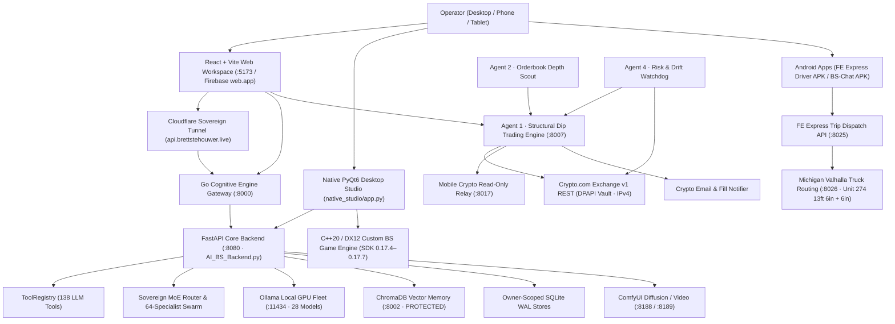

# AI-BS Complete Architectural & Operational Reference Manual

**System:** AI-BS (Adam's Infinite Brett Stehouwer Living Learning Memory & Sovereign Multi-Agent Ecosystem)  
**Canonical Workspace:** `C:\AI-BS`  
**Generated From Live Source Inspection:** 2026-11-22  
**Coverage:** Web React Frontend (4 Master Pillars, 73 Registered Tabs, 282 Live Components, 70 Industry Verticals), FastAPI Core Backend (118 Routers/Modules, 1,168+ Routes, 212 Core Engines), 138 LLM Tool Declarations, 28-Model Local Ollama Fleet, 64-Specialist MoE Swarm, Go Cognitive Gateway (`:8000`), Native PyQt6 Desktop Studio (52 Consolidated Tabs, 167 Modules), Autonomous Crypto Trading Pod & Watchdog (`:8007`/`:8017`), FE Express Navigation Stack (`:8025`/`:8026`/Android APK), C++20/DX12 BS Game Engine & SDK, and Satellite Applications.

> [!NOTE]
> Every hub, tab, sub-tab, button label, handler function, API route, LLM tool, native view, daemon, and engine file in this manual was extracted directly from source code in `C:\AI-BS`. Having a source anchor establishes that code or navigation exists; it does not certify every optional service is currently running or every feature is enabled in production.

---

## Table of Contents

1. [Executive System Architecture & Topology](#1-executive-system-architecture--topology)
2. [Global Web Application Shell, Navigation & Access Control](#2-global-web-application-shell-navigation--access-control)
3. [Pillar 1 — Intelligence & Code Hub (Complete Tab, Button & Function Map)](#3-pillar-1--intelligence--code-hub)
4. [Pillar 2 — Creative Media Studio Hub (Complete Tab, Button & Function Map)](#4-pillar-2--creative-media-studio-hub)
5. [Pillar 3 — Business & Operations Hub (Complete Tab, Button & Function Map)](#5-pillar-3--business--operations-hub)
6. [Pillar 4 — Engineering & Specialized Labs Hub (Complete Tab, Button & Function Map)](#6-pillar-4--engineering--specialized-labs-hub)
7. [70-Vertical Enterprise Industry Expansion Grid](#7-70-vertical-enterprise-industry-expansion-grid)
8. [Sovereign AI Intelligence Layer (28-Model Fleet, 6-Domain MoE & All 64 Specialists)](#8-sovereign-ai-intelligence-layer)
9. [Complete LLM Tool Registry (All 138 Tool Actions)](#9-complete-llm-tool-registry)
10. [FastAPI Backend Architecture (All 118 Routers, 1,168+ Routes & 212 Core Engines)](#10-fastapi-backend-architecture)
11. [Go Cognitive Engine Gateway, Shared-Memory Spine & Crypto-Swarm Go Services](#11-go-cognitive-engine-gateway--go-services)
12. [Native PyQt6 Desktop Studio (52 Consolidated Tabs & All 167 Modules)](#12-native-pyqt6-desktop-studio)
13. [Autonomous Crypto Trading Pod, 24/7 Supervisor & FE Express Navigation Stack](#13-autonomous-crypto-trading-pod-supervisor--fe-express-navigation-stack)
14. [C++20 / DirectX 12 BS Game Engine, SDK & Satellite Applications](#14-c20--directx-12-bs-game-engine-sdk--satellite-applications)

---

## 1. Executive System Architecture & Topology

### 1.1 Multi-Layer Hybrid Architecture

AI-BS is a hybrid, local-first multi-agent operating platform running on Windows 11 (RTX 4090 workstation) with companion cloud ingress (Firebase Hosting + Cloudflare Sovereign Tunnel) and Android mobile clients.

### 1.2 Complete Service & Port Topology

| Port / Surface | Service / Daemon | Primary Source Anchor | Purpose & Notes |
| :--- | :--- | :--- | :--- |
| `:5173` | Vite Dev Frontend Dashboard | `frontend/main.jsx` -> `frontend/App.jsx` | Local web workspace (all sub-tabs unlocked on `localhost`/`127.0.0.1`). |
| `:3000` | Local Static Production Web Server | Recovery launcher (`5.329.180` archive) | Static production bundle mirror when launched. |
| `https://ai-bs-dashboard.web.app` | Firebase Hosting Frontend | `frontend/firebase.json` -> `frontend/dist/` | Public/remote hosted web UI (requires Firebase admin sign-in for protected tabs). |
| `https://api.brettstehouwer.live` | Cloudflare Sovereign Tunnel (`ai-bs`) | `C:\AI-BS\cloudflared.exe` (`C:\Users\footb\.cloudflared\cert.pem`) | Encrypted QUIC ingress exposing local backend to remote web/mobile clients. |
| `:8000` | Go Cognitive Engine Gateway | `go-core/cmd/aibs_engine/main.go` | High-throughput reverse proxy, supervision, telemetry & shared-memory spine. |
| `:8002` | ChromaDB Vector Engine | `chromadb_vector_store` (Supervisor managed) | **PROTECTED** partitioned vector memory store (`nomic-embed-text`). Never disrupt. |
| `:8007` | Agent 1 · Structural Dip Trading Engine | `scratch/structural_dip_engine.py` | Live `CRO_USDT` spot dip-grid trader + `/api/live-telemetry` & `/api/scenario-mode`. |
| `:8013` | VST3 Audio Bridge | `vst_bridge` / `backend/routers/vst_router.py` | Local VST3 plugin bridge for DAW audio processing. |
| `:8017` | Mobile Crypto Read-Only Relay | `scratch/mobile_crypto_relay.py` | Read-only `/mobile-crypto/snapshot` relay for Android Crypto Monitor app. |
| `:8025` | FE Express Trip & Navigation Dispatch API | `backend/run_trip_dispatch.py` (`backend/app/main.py`) | Shared trip session, entrance guidance (`GATE-NORTH-4`), Unit 274 profile (`13'6"` + `6"`). |
| `:8026` | Michigan Valhalla Truck Routing Service | `routing/valhalla_truck_service.py` | Commercial truck costing engine for Unit 274 (14'0" min planned clearance). |
| `:8080` | FastAPI Core AI-BS Backend | `backend/AI_BS_Backend.py` | Primary REST/SSE/WebSocket orchestration API (118 routers/modules, 1,168+ routes). |
| `:8088` | Broadcast Kernel | `BroadcastStudioApp` / OBS Bridge | Broadcast overlay and live stream kernel. |
| `:8188` / `:8189` | ComfyUI Local Diffusion / Img2Img | `ComfyUI/` + `backend/comfy_bridge.py` | Local RTX 4090 image/video diffusion & WAN synthesis engine. |
| `:11434` / `:11435` | Ollama Local GPU LLM Nodes | `Ollama` + `moe_specialist_router.py` | Local 28-model Ollama fleet serving Code, Creative, Function Calling, Vision, Reasoning & Embeddings. |
| `:5174` | Broadcast Studio Vite Dev UI | `BroadcastStudioApp/` | Dedicated Broadcast Studio web/Electron frontend. |
| `:8001` / `:3001` | Legacy Vault / Theatrical Services | Referenced by `BrettDataTab`, `VectorVaultManager` | **Currently unmounted/down** (verified in Nov 22 audit, P0-#8). |

### 1.3 Persistence, Storage & Credential Authority

| Store / Mechanism | Location | Authority & Invariants |
| :--- | :--- | :--- |
| **SQLite WAL Databases** | `C:\AI-BS\*.db`, `saved_data\trade_ledger.db`, `leads_store.db`, `prestige_powerwash.db`, `backend_master`, `cdz_audit` | Relational & lexical truth for conversations, 64-specialist registry, CDZ audit ledger, leads, power washing CRM, and trade ledger. |
| **ChromaDB Vector Vault** | Port `:8002`, `stehouwer_vector_memory/` | Partitioned semantic retrieval bins. Must stay strictly partitioned by owner/domain. |
| **Windows DPAPI Crypto Vault** | Locator: `backups/crypto_connector_candidate_20261115_v01/private-candidate-location.json` | Windows user-bound `CryptProtectData` encrypted binary blob holding live Crypto.com Exchange API key/secret. Rotated safely via `scratch/store_new_crypto_key.py`. |
| **Runtime JSON State Files** | `C:\AI-BS\saved_data\*.json` | Atomic temp-file-replaced state snapshots: `structural_dip_state.json`, `agent4_watchdog_status.json`, `orderbook_scout_signals.json`, `master_supervisor_status.json`, `oci_claimer_status.json`, `engine_alert.json`, `BUYS_PAUSED.flag`. |
| **Immutable Publishing Vault** | `backend/core/immutable_publishing_engine.py` | Write-once chapter artifacts with SHA-256 content fingerprints and lexical fidelity verification (Role 49: Immutable Fire Scribe). |

### 1.4 Known Architectural Quirks & Nov 22 Full-Stack Audit Findings

1. **Four Mirrored Frontend Trees:** `frontend/src/components` (canonical), `frontend/components`, `frontend/components/components`, and `frontend/src/components/components` are kept byte-identical by `verify-mirror-parity.ps1`. Because `App.jsx` imports from both `components/` and `src/components/`, any frontend edit MUST be synced across all 4 mirrors.
2. **Three Shadowed Backend Handlers in `AI_BS_Backend.py`:** Mounted routers register first (lines 2067–2191), shadowing later handlers on `app`:
   - `POST /api/chat` → live handler is `routers/chat_router.py:171` (`AI_BS_Backend.py:9001` is shadowed).
   - `GET /api/comfyui/view` → live handler is `routers/comfyui_router.py` (`AI_BS_Backend.py:10833` is shadowed).
   - `POST /api/v1/emails/send` → live handler is `routers/email_client_router.py` (`AI_BS_Backend.py:8018` is shadowed).
3. **Verified P0 Issues from Nov 22 Audit (for upcoming fixes):**
   - **FIXED 2026-11-22 (`c0de548b`):** client-side hard-coded password prompts removed from `BetaAnalyticsTab.jsx` and `UnifiedMediaVaultTab.jsx` (backend auth remains the gate; rebuild `dist/` to purge the old bundle).
   - ~~`ProductionBreakdownModal.jsx` & `StagePlayBreakdownModal.jsx` hardcode `http://127.0.0.1:8000` (fails remotely).~~ **FIXED 2026-11-22 (`8103ec48`):** now use `getApiBase()` in all 4 mirrors.
   - `BsMediaCreatorTab.jsx` (`/api/v1/media/wan/synthesize`) and `MediaStudioTab.jsx` (`/api/v1/media/ipc/buffer/allocate`) call unimplemented routes.
   - `ComfyUIWorkflowTrigger.jsx` points at `:8002` (ChromaDB) instead of ComfyUI (`:8188`/`:8189`).
   - `CryptoSwarmMobileController.jsx` calls `:8007` endpoints (`/api/v1/telemetry`, `/api/crypto/set-parameters`, `/api/crypto/force-swap`) not served by `structural_dip_engine.py` (which serves `/health`, `/api/live-telemetry`, `/api/scenario-mode`).
   - `DennisBellMobileRemote.jsx` broadcast start/pause/stop/single_test/replies-sync endpoints are absent in backend.
   - ~~`App.jsx:743` silently falls back to `tabs[0]` (`specialist_swarm`) for unrecognized tab keys (including the 70 placeholder industry verticals and 5 stale quick-buttons).~~ **FIXED 2026-11-22 (`946cc741`, `88e0c090`):** unknown keys show an "isn't available yet" card; aliases added `video_agent`→`video_streaming`, `documents`→`shared_cloud_drive`, `media_vault`→`unified_media_gallery`, `definitions_module`→`definitions`; Shared Drive "open in video studio" now targets `media_studio`.
   - ~~`App.jsx:777` creates `lazy()` inside render for `/overlay`.~~ **FIXED 2026-11-22 (`946cc741`):** hoisted to module scope.
   - `UniversalCreationSuite.jsx:40` enforces an independent Firebase `auth.currentUser` check even when `localhost` tabs are unlocked in `accessControl.js`.
4. **Dead / Unreachable Frontend Files (edits have zero effect):** `BullshitCreationSuite.jsx`, `FireWritingTab.jsx`, `UnifiedCreationHub.jsx`, `UniversalCommandPalette.jsx`, `BullshitKnowledgeSuite.jsx`, `src/main.jsx`, `FEExpressDriverReports.jsx`, `CryptoTraderTab.jsx`, `useUnifiedTelemetry.js`.

---

## 2. Global Web Application Shell, Navigation & Access Control

### 2.1 User Tiers & Access Control Matrix (`accessControl.js`)

**Localhost Policy (Updated 2026-11-22):** `getUserTier()` in all 4 mirrored copies of `accessControl.js` grants `USER_TIERS.ADMIN` automatically on `localhost` and `127.0.0.1` without requiring login, unlocking all 55 permission-mapped sub-tabs locally. Public Firebase Hosting (`ai-bs-dashboard.web.app`) still enforces verified Firebase admin/subscription tier checks.

| Tier ID | Name | Badge | Description |
| :--- | :--- | :--- | :--- |
| `admin` | Master Admin (Full Root Access) | Root Admin | Unrestricted access to all tools, host terminal, VMs, security, crypto, and hardware telemetry. |
| `enterprise_all_access` | AI-BS Enterprise All-Access Pass | Enterprise All-Access | Full commercial access to Screenwriting, Hospitality, B2B Growth, Creator Studio, and Accounting. |
| `screenwriting` | ScreenplayStudio.ai Pro | Screenwriter Tier | Hollywood AST Screenplay Editor, Book-to-Script AI Matrix, FDX Serializer, Character Vault, Coverage Engine. |
| `hospitality` | BanquetArchitect.com & Noto OS | Hospitality & Venues | Banquet Architect Studio, Table & Floor Planner, Dietary Registry, Lost Property, Client Scheduler. |
| `b2b_growth` | GrowthMatrix B2B Suite | B2B Growth Tier | Bullshit Lead Matrix, OSINT Recon Hub, Automated Email Outreach, Action Items & Calendar, Clients CRM. |
| `creator_media` | Creator Studio & Video Suite | Creator Studio | Digital Storefront, Public Playground, Personal Brand Studio, Video Streaming, Media Vault. |
| `free_demo` | Free Community / Demo | Free Tier | Limited public preview of AI Studio, Public Playground, and Pricing Passes. |

**Complete `TAB_PERMISSIONS` Matrix (55 Entries):**

| Tab Key | Allowed Tiers | Tab Key | Allowed Tiers |
| :--- | :--- | :--- | :--- |
| `advertising` | `admin`, `enterprise_all_access`, `b2b_growth`, `creator_media` | `moneytrack` | `admin`, `enterprise_all_access`, `b2b_growth` |
| `agent_memory` | `admin` | `noco_vision` | `admin`, `enterprise_all_access`, `screenwriting`, `creator_media` |
| `api_recon` | `admin`, `enterprise_all_access`, `b2b_growth` | `notos_enterprise` | `admin`, `enterprise_all_access`, `hospitality` |
| `banquet_architect` | `admin`, `enterprise_all_access`, `hospitality` | `nutrition_subsystem` | `admin`, `enterprise_all_access`, `creator_media`, `screenwriting`, `hospitality`, `b2b_growth`, `free_demo` |
| `beta` | `admin`, `enterprise_all_access`, `b2b_growth` | `onboarding` | `admin`, `enterprise_all_access`, `hospitality`, `b2b_growth` |
| `brett_data_hub` | `admin` | `personal_brand` | `admin`, `enterprise_all_access`, `creator_media`, `b2b_growth` |
| `bs_game` | `admin`, `enterprise_all_access`, `creator_media`, `screenwriting`, `hospitality`, `b2b_growth`, `free_demo` | `power_washing` | `admin`, `enterprise_all_access`, `b2b_growth` |
| `calendar` | `admin`, `enterprise_all_access`, `screenwriting`, `hospitality`, `b2b_growth`, `creator_media` | `public_checkout` | `admin`, `enterprise_all_access`, `screenwriting`, `hospitality`, `b2b_growth`, `creator_media`, `free_demo` |
| `central_gaming_hub` | `admin`, `enterprise_all_access`, `creator_media`, `screenwriting`, `hospitality`, `b2b_growth`, `free_demo` | `public_playground` | `admin`, `enterprise_all_access`, `creator_media`, `screenwriting`, `free_demo` |
| `chat` | `admin`, `enterprise_all_access`, `creator_media`, `screenwriting`, `hospitality`, `b2b_growth`, `free_demo` | `reasoning_attention` | `admin` |
| `client_directory` | `admin`, `enterprise_all_access`, `b2b_growth` | `rec_debut` | `admin`, `enterprise_all_access`, `b2b_growth` |
| `client_scheduler` | `admin`, `enterprise_all_access`, `hospitality`, `b2b_growth`, `creator_media` | `security_monitor` | `admin` |
| `clients` | `admin`, `enterprise_all_access`, `b2b_growth` | `shared_cloud_drive` | `admin`, `enterprise_all_access` |
| `comfy_workspace` | `admin`, `enterprise_all_access`, `creator_media` | `steam_gaming` | `admin`, `enterprise_all_access`, `creator_media`, `screenwriting`, `hospitality`, `b2b_growth`, `free_demo` |
| `creation_suite` | `admin`, `enterprise_all_access`, `screenwriting` | `stehouwer_cms` | `admin`, `enterprise_all_access`, `screenwriting`, `creator_media` |
| `dashboard` | `admin`, `enterprise_all_access`, `screenwriting`, `hospitality`, `b2b_growth`, `creator_media`, `free_demo` | `system_economics` | `admin` |
| `deep_learning_studio` | `admin` | `system_health` | `admin` |
| `definitions` | `admin`, `enterprise_all_access`, `screenwriting`, `hospitality`, `b2b_growth`, `creator_media`, `free_demo` | `terminal` | `admin` |
| `digital_storefront` | `admin`, `enterprise_all_access`, `creator_media` | `unified_calendar` | `admin`, `enterprise_all_access`, `screenwriting`, `hospitality`, `b2b_growth`, `creator_media` |
| `email_client` | `admin`, `enterprise_all_access`, `b2b_growth`, `screenwriting` | `unified_creation` | `admin`, `enterprise_all_access`, `screenwriting` |
| `executive_cockpit` | `admin`, `enterprise_all_access` | `unified_crypto` | `admin` |
| `fe_express` | `admin`, `enterprise_all_access`, `b2b_growth` | `unified_financial` | `admin`, `enterprise_all_access`, `b2b_growth` |
| `ide` | `admin`, `enterprise_all_access`, `screenwriting`, `creator_media` | `unified_media_gallery` | `admin`, `enterprise_all_access`, `creator_media`, `screenwriting` |
| `industry_grid` | `admin`, `enterprise_all_access`, `b2b_growth` | `unified_osint` | `admin`, `enterprise_all_access`, `b2b_growth` |
| `leadmatrix` | `admin`, `enterprise_all_access`, `b2b_growth` | `video_agent` | `admin`, `enterprise_all_access`, `creator_media` |
| `learning_material_hub` | `admin`, `enterprise_all_access`, `screenwriting`, `hospitality`, `b2b_growth`, `creator_media`, `free_demo` | `video_streaming` | `admin`, `enterprise_all_access`, `creator_media`, `screenwriting`, `hospitality`, `b2b_growth`, `free_demo` |
| `lost_property` | `admin`, `enterprise_all_access`, `hospitality`, `b2b_growth` | `vms` | `admin` |
| `master_accounting` | `admin`, `enterprise_all_access`, `b2b_growth` | `` |  |

### 2.2 Standalone Web Routes & Tab Aliases (`frontend/App.jsx`)

- **Standalone URL Routes (bypass main navigation shell):**
  - `?standalone_writer=true` → Fullscreen `UniversalCreationSuite`
  - `/overlay` → Transparent `UnifiedChat` OBS/Desktop Overlay
  - `/playground` → `PublicPlaygroundTab` (isolated public AI studio)
  - `/checkout` → `PublicCheckoutTab` (1-click PayPal compute passes)
  - `/nocovision/teleprompter` → `TheatricalTeleprompter` (fullscreen stage teleprompter)
  - `/nocovision/projector` → `TheatricalProjector` (fullscreen stage projector)
  - `/recdebut`, `/remote`, `?portal=recdebut`, `?client=dennisbell`, `?remote=true`, `?view=mobile` → `DennisBellPortal`
  - `?portal=banquet` → Opens `ClientBanquetPortalModal` overlay
  - `?portal=service` → Opens `ClientServicePortalModal` overlay
- **Pinned Quick-Launch Bar (8 Items):** `executive_cockpit`, `steam_gaming`, `ide` (BS-CHAT), `bv_media_creator`, `screen_mirror`, `shared_cloud_drive`, `workflow_dag`, `terminal`.
- **Simple / Beginner Mode Launchpad (5 Items):** `dashboard` (Home Portal), `shared_cloud_drive` (Cloud Drive), `unified_creation` (Creative Studio), `banquet_architect` (Hospitality Studio), `unified_calendar` (Master Calendar).
- **Tab Alias Map (`TAB_ALIASES` in `App.jsx:720-741`):** `mobile_chat` → `chat`; `steam_gaming`/`gaming_lab` → `central_gaming_hub`; `screen_mirror` → `ide`; `vlc`/`vlc_player`/`video_meet` → `video_streaming`; `command_center` → `dashboard`; `agent_apps` → `sovereign_apps`; `host_terminal` → `terminal`; `screenwriting` → `creation_suite`; `cloud_drive` → `shared_cloud_drive`; `noto_bar` → `noto_inventory`; `prestige_wash` → `power_washing`; `bible_study` → `bible_hub`; `noco_properties`/`campus_map`/`stage_acoustics`/`energy_microgrid`/`cea_agriculture` → `project_noco`.

### 2.3 Global Shell, Navigation Chrome & Global Modal Components

#### App
- **Source:** [App.jsx](file:///C:/AI-BS/frontend/App.jsx) · **Size:** 1211 lines (63.9 KB) · **Ports referenced:** `:8000`

**Internal Sub-Tabs / Views / Modes:**

| Sub-Tab / ID | Label | Description |
| :--- | :--- | :--- |
| `specialist_swarm` | 🤖 64-Specialist Swarm Explorer | SQLite WAL Specialist Registry, 7 Operational Domains & Verification Gates |
| `chat` | 💬 BS-CHAT Assistant | Autonomous Sovereign Mobile & Desktop AI Assistant & Swarm |
| `video_streaming` | 🎬 VLC Media Player & Video Studio | Integrated VLC Player for Rendered & Uploaded Videos, HLS Streaming & UE5 Bridge |
| `executive_cockpit` | ⚡ Executive Cockpit | Unified Autonomous Command Bus, 4-Pillar Matrix & Tiered Governance HUD |
| `nutrition_subsystem` | 🥗 Clinical Nutrition & Detox Engine | Hybrid Cold-Press Mechanical Extraction, Fiber Suspension & 4-Day Stepped Keto Refeeding Protocol |
| `sovereign_apps` | 🤖 Sovereign Agent Apps Hub | 14-Tool Sovereign Agent Suite (Claude Code, Codex, OpenClaw, OpenCode, Hermes, Droid, Pi, Cline, Copilot) & MoE Specialist Router |
| `gpu_telemetry` | 🔥 GPU Hardware Telemetry Hub | NVIDIA GeForce RTX 4090 NVML Hardware Telemetry, Fan Speed Lock & SQLite Thermal Vault |
| `central_gaming_hub` | 🎮 Central Gaming Hub | Unified Ludic Nexus: 2-Player P2P Dyadic Hub, Steam Game Library & Win32 Memory Trainer |
| `bs_game` | 🛠️ BS Game · First Boot | Custom PC engine progress & playable motherboard concept |
| `dashboard` | Command Center | System overview and live status at a glance |
| `operations_audit` | Omni Operations & Live Audit Hub | Live User Tasks, Media Queue, Continuous Autosaves, Admin Vault & Daemon Error Diagnostics |
| `workflow_dag` | ⚡ Multi-Agent DAG Builder | Visual Node-Based Autonomous Agent Pipeline & DAG Builder |
| `shared_cloud_drive` | Shared Cloud Drive | Google Drive-Style Cloud Storage, Document Creator & Asset Sharing |
| `power_washing` | Prestige Mobile Wash | Commercial & Residential Pressure Washing CRM, Chemical Estimator & Fleet Portal |
| `phone_repair` | 🔧 Phone & Tablet Repair Lab | Master technical teardowns, Face ID serialization & diagnostic trees for Apple, Android & Tablets |
| `bible_hub` | 📖 Sovereign Bible Hub | Dual KJV & NIV Canonical New Testament Reader, Parallel Comparison & Verse Concordance |
| `system_health` | System Health & Logs | Real-time SSE Logs and SQLite Audit |
| `onboarding` | Client Onboarding | Smart Onboarding Portal |
| `client_directory` | Client Directory | Live Client Directory |
| `system_economics` | System Economics | Analyze system telemetry vs LLM costs & Agency revenue |
| `unified_crypto` | Crypto & Mining Suite | Trading, Harvesting, and Network Hardware Control |
| `security_monitor` | Admin Security & Telemetry Interceptor | Live hardware stream and process monitoring |
| `vms` | Virtual Machines | Interact with local virtual machines via VNC |
| `ide` | BS-CHAT Interface | Split-Pane Code Editor & Telemetry Hub |
| `creation_suite` | Creation Suite | Universal creation workspace |
| `leadmatrix` | Lead Matrix | Inspect generated acquisition leads and sweep the matrix |
| `terminal` | Terminal | Interactive virtual terminal shell |
| `automation_console` | Automation Console | Trusted local Windows automation runner and live job queue |
| `advertising` | Advertising | Local business lead management and AI ad copy |
| `syndication` | 🌐 Automated Syndication | 1-Click Fire Send Broadcaster & Multi-Channel Ad Suite |

**Interactive Buttons & UI Actions:**

| Button / Control | Triggered Handler / Action |
| :--- | :--- |
| 🔄 Update & Reload Dashboard / Retry Tab View | Calls `reload()` |
| Go to Dashboard | Navigates workspace to tab `dashboard` |
| ☰ | Toggles `IsMobileMenuOpen` (`!isMobileMenuOpen`) |
| 🔄 Reset Layout | Calls `getState()` |
| 💾 Save Layout / ⚙️ Edit Workspace | Invokes `toggleEditMode()` |
| 📌 Switch to Top Bar | Invokes `handleToggleNavLayout()` |
| ⚡ Efficiency: ON / Efficiency: OFF *(tooltip: Toggle Efficiency Mode (API Offload))* | Calls `getState()` |
| 🎮 3D Viewport / 🖥️ 2D Mode *(tooltip: Toggle Unreal Engine 3D Environment)* | Switches `ViewMode` to `viewMode === '2D' ? '3D' : '2D'` |
| ❌ Exit Zen Mode *(tooltip: Exit Zen Mode (Show Navigation))* | Switches `ZenMode` to `false` |

**Module Functions & Handlers (17):** `TabLoader()`, `safeLazy(importFn)`, `UnavailableTab({ onNavigateTab, tabKey })`, `isLocalDesktopHost()`, `normalizeLocalDesktopAdmin(candidate)`, `readLocalDesktopAdminSession()`, `App()`, `handleSignOut()`, `handleToggleWorkspaceMode()`, `readLocalTrustState()`, `handleToggleMomMode()`, `handleZoomChange(newZoom)`, `handleSimulateTier(tierKey)`, `handleBeforeUnload()`, `handlePopState()`, `loadProviders()`, `handleToggleNavLayout()`

**Backend / Service Endpoints Invoked (4):** `/api/ai/providers`, `/api/models`, `http://127.0.0.1:8000/api/analytics/notify-login`, `https://api.brettstehouwer.live/api/analytics/notify-login`

#### TopNavbar
- **Source:** [TopNavbar.jsx](file:///C:/AI-BS/frontend/components/TopNavbar.jsx) · **Size:** 999 lines (40.0 KB) · **Ports referenced:** `:8000`, `:8080`

**Interactive Buttons & UI Actions:**

| Button / Control | Triggered Handler / Action |
| :--- | :--- |
| 🌸 *(tooltip: Mom View: High Contrast & Big Text)* | Invokes `onToggleMomMode()` |
| 🔍 *(tooltip: Search Tools & Tabs (Ctrl+K))* | Updates `ShowCmdPalette` via `setShowCmdPalette(true)` |
| 💬 {onlineCount > 0 && ( {onlineCount} )} *(tooltip: Open Stehouwer Team Messenger)* | Updates `ShowChatModal` via `setShowChatModal(true)` |
| ☰ *(tooltip: Open Navigation Menu)* | Calls `onOpenMobileDrawer()` |
| {pt.icon} {pt.label} | Navigates workspace tab |
| ↗ *(tooltip: Open Full Sovereign GPU & Telemetry Workspace)* | Navigates workspace to tab `gpu_telemetry` |
| 🔍 Jump to tool... Ctrl+K *(tooltip: Search all 50+ Tools, Commands & Pages (Ctrl+K))* | Updates `ShowCmdPalette` via `setShowCmdPalette(true)` |
| 🌸 Mom Mode / Mom View | Invokes `onToggleMomMode()` |
| − *(tooltip: Make Text & Visuals Smaller)* | Calls `onZoomChange(Math.max(100, zoomLevel - 15)` |
| + *(tooltip: Make Text & Visuals Bigger)* | Calls `onZoomChange(Math.min(160, zoomLevel + 15)` |
| {item.icon} {item.label} | Navigates workspace tab |
| 🔍 All Tools Ctrl+K *(tooltip: Search all 32+ Tools & Commands (Ctrl+K))* | Updates `ShowCmdPalette` via `setShowCmdPalette(true)` |
| {group.icon} {group.group} ▲ / ▼ | Updates `OpenGroup` via `setOpenGroup(null)` |
| {item.icon \|\| '•'} {item.label} | Navigates workspace tab |
| 💬 Messenger 🟢 {onlineCount} *(tooltip: Open Stehouwer Team Messenger)* | Updates `ShowChatModal` via `setShowChatModal(true)` |
| 📧 Business Email 📬 *(tooltip: Open Stehouwer Business Email Client)* | Navigates workspace to tab `email_client` |
| 📹 Video Meet LIVE *(tooltip: Open Stehouwer Enterprise Video Meeting Suite (Google Meet / Zoom))* | Navigates workspace to tab `video_agent` (aliased to `video_streaming`) |
| ✨ Simple / ⚡ Pro Cockpit *(tooltip: Toggle Mode)* | Invokes `onToggleWorkspaceMode()` |
| 🔗 Copied Link! / Share Tool *(tooltip: Copy direct shareable link)* | Invokes `handleShareToolLink()` |
| 🎯 Tour | Updates `ShowTour` via `setShowTour(true)` |
| 💡 Guide & Tips | Updates `ShowGuideModal` via `setShowGuideModal(true)` |
| 💬 Team Chat 🟢 {onlineCount} *(tooltip: Open Stehouwer Team Live Chat)* | Updates `ShowChatModal` via `setShowChatModal(true)` |
| ❌ Exit Zen / 🔲 Zen | Invokes `onToggleZenMode()` |
| Sign Out | Calls `confirm('Sign out of AI-BS Dashboard?')` |

**Module Functions & Handlers (6):** `TopNavbar({ activeTab, onTabChange,)`, `handleResize()`, `fetchTelemetry()`, `handleGroupHover(groupName, event)`, `handleShareToolLink()`, `handleKeyDown(e)`

**Backend / Service Endpoints Invoked (1):** `/api/v1/hardware/gpu/telemetry`

#### Sidebar
- **Source:** [Sidebar.jsx](file:///C:/AI-BS/frontend/components/Sidebar.jsx) · **Size:** 232 lines (7.7 KB)

**Interactive Buttons & UI Actions:**

| Button / Control | Triggered Handler / Action |
| :--- | :--- |
| {dynamic} {hub.icon} {!isCollapsed && {hub.label} } | Navigates workspace tab |
| » / « | Toggles `IsCollapsed` (`!isCollapsed`) |

**Module Functions & Handlers (3):** `SortableHubItem({ hub, isHubActive, isCol)`, `Sidebar({ activeTab, onTabChange )`, `handleDragEnd(event)`

#### SubTabBar
- **Source:** [SubTabBar.jsx](file:///C:/AI-BS/frontend/components/SubTabBar.jsx) · **Size:** 204 lines (6.3 KB)

**Interactive Buttons & UI Actions:**

| Button / Control | Triggered Handler / Action |
| :--- | :--- |
| {isEditingLayout && ( ⋮⋮ )} {sub.icon \|\| '•'} {sub.label} | Navigates workspace tab |

**Module Functions & Handlers (3):** `SortableSubTab({ sub, isActive, onTabCha)`, `SubTabBar({ activeTab, onTabChange )`, `handleDragEnd(event)`

#### GlobalCommandPalette
- **Source:** [GlobalCommandPalette.jsx](file:///C:/AI-BS/frontend/components/GlobalCommandPalette.jsx) · **Size:** 302 lines (10.1 KB) · **Ports referenced:** `:8000`

**Internal Sub-Tabs / Views / Modes:**

| Sub-Tab / ID | Label | Description |
| :--- | :--- | :--- |
| `action-new-doc` | 📄 New Document (Word & Google Docs White Paper Canvas) | — |
| `action-banquet-beo` | 🏛️ 3D Banquet Architect & Word BEO Contract Generator | — |
| `action-table-read` | 🎙️ Multi-Voice Screenplay AI Audio Table Read Studio | — |
| `action-novelize` | 📖 Screenplay-to-Book AI Novelizer Studio (KDP Export) | — |
| `action-portal-banquet` | 🌐 Open Client 3D Banquet Planner Portal (?portal=banquet) | — |
| `action-portal-wash` | 🚿 Open Prestige Mobile Wash Customer Checkout Portal (?portal=service) | — |
| `action-tour` | 🎯 Start Interactive Feature Spotlight Tour | — |
| `action-guide` | 💡 Open AI-BS Knowledge & Walkthrough Guide (Hotkeys: ? or F1) | — |
| `action-toggle-mom-mode` | 🚨 🌸 Toggle MOM Version (Big Text & High Contrast Readability) | — |

**Module Functions & Handlers (3):** `GlobalCommandPalette({ isOpen, onClose, onNavi)`, `handleKeyDown(e)`, `handleSelectItem(item)`

#### GlobalLayoutCustomizerModal
- **Source:** [GlobalLayoutCustomizerModal.jsx](file:///C:/AI-BS/frontend/components/GlobalLayoutCustomizerModal.jsx) · **Size:** 723 lines (27.6 KB)

**Internal Sub-Tabs / Views / Modes:**

| Sub-Tab / ID | Label | Description |
| :--- | :--- | :--- |
| `outfit` | Outfit (Default Geometric) | — |
| `inter` | Inter (Clean Technical) | — |
| `space_grotesk` | Space Grotesk (Tech Editorial) | — |
| `jetbrains` | JetBrains Mono (Hacker Terminal) | — |
| `lexend` | Lexend (High Readability) | — |
| `roboto` | Roboto / Modern Standard | — |
| `compact_pro` | ⚡ Compact Pro | Dense tables & small padding for max screen real-estate |
| `balanced_default` | ⚖️ Standard Balanced | Original Stehouwer AI-BS balanced dark glassmorphism |
| `ultra_spacious` | 🌌 Ultra Spacious | Luxurious breathing room, large cards, and soft padding |
| `high_contrast_readability` | 👓 High Readability | Enlarged text size, opaque cards, and maximum text clarity |
| `cyber_neon` | 🔮 Cyber Neon Deck | Sharp zero-radius corners, glowing edges, and terminal typography |

**Interactive Buttons & UI Actions:**

| Button / Control | Triggered Handler / Action |
| :--- | :--- |
| ✕ | Invokes `onClose()` |
| 🎚️ Live Sliders | Switches `ActiveTab` to `'sliders'` |
| 🔤 Typography & Font Style | Switches `ActiveTab` to `'fonts'` |
| ✨ 1-Click Presets | Switches `ActiveTab` to `'presets'` |
| 🔄 Reset Defaults *(tooltip: Reset all layout settings back to system standard)* | Invokes `handleResetToDefault()` |
| Apply Preset | Calls `handleApplyPreset(preset.config)` |
| ✅ Copied CSS Vars! / 📋 Copy CSS Variables | Invokes `handleCopyCssVariables()` |
| Done & Save | Invokes `onClose()` |

**Module Functions & Handlers (6):** `applyLayoutConfigToDom(/** @type {typeof DEFAULT)`, `GlobalLayoutCustomizerModal({ isOpen, onClose })`, `updateConfig(key, value)`, `handleApplyPreset(/** @type {Partial<typeof)`, `handleResetToDefault()`, `handleCopyCssVariables()`

#### SimpleDashboardPortal
- **Source:** [SimpleDashboardPortal.jsx](file:///C:/AI-BS/frontend/components/SimpleDashboardPortal.jsx) · **Size:** 340 lines (15.2 KB)

**Internal Sub-Tabs / Views / Modes:**

| Sub-Tab / ID | Label | Description |
| :--- | :--- | :--- |
| `step-drive` | 1. Shared Cloud Drive | Centralized cloud folders for screenplays, media assets, contracts, and audio stems. |
| `step-creative` | 2. Hollywood Screenwriting | Write in Final Draft format with AST shortcuts (Ctrl+1..6), run the !proof AI Doctor, and stream audio. |
| `step-advertising` | 3. Advertising Campaign Studio | Generate viral ad copy, Facebook/Google campaigns, and high-conversion client funnels. |
| `step-hospitality` | 4. Hospitality & Banquets | Architect 2D/3D venue floor plans, VIP seating charts, and dietary registries. |
| `step-calendar` | 5. Master Calendar | Plan client jobs, banquet bookings, content releases, and team deadlines with synced action items. |

**Interactive Buttons & UI Actions:**

| Button / Control | Triggered Handler / Action |
| :--- | :--- |
| 🎯 Start 1-Minute Tour | Invokes `onStartTour()` |
| 💡 Guide & Tips | Invokes `onOpenGuide()` |
| ⚡ Pro Cockpit Mode | Invokes `onSwitchToProMode()` |
| Open Full Creative Studio → | Navigates workspace to tab `unified_creation` |
| Open Ad Campaign Studio → | Navigates workspace to tab `advertising` |
| 👁️ View in {act.toolName \|\| 'Workspace'} → | Navigates workspace tab |
| {sub.icon \|\| '•'} {sub.label} | Navigates workspace tab |
| Launch {hub.label.split(' ')[0]} Hub → | Navigates workspace to tab `dashboard` |

**Module Functions & Handlers (1):** `SimpleDashboardPortal({ onNavigateTab, onOpenGu)`

#### MobileBottomNav
- **Source:** [MobileBottomNav.jsx](file:///C:/AI-BS/frontend/components/MobileBottomNav.jsx) · **Size:** 185 lines (5.7 KB)

**Internal Sub-Tabs / Views / Modes:**

| Sub-Tab / ID | Label | Description |
| :--- | :--- | :--- |
| `chat` | Chat | — |
| `project_noco` | NoCo | — |
| `video_streaming` | VLC / Media | — |
| `executive_cockpit` | Cockpit | — |
| `menu` | All Tools | — |

**Interactive Buttons & UI Actions:**

| Button / Control | Triggered Handler / Action |
| :--- | :--- |
| {/* Active Glow Pill Indicator */} {isActive && ( )} {/* Icon + Badge */} {item.icon} {item.badge && | Invokes `handleClick()` |

**Module Functions & Handlers (2):** `MobileBottomNav({ activeTab, onTabChange,)`, `handleClick()`

#### MobileNavDrawer
- **Source:** [MobileNavDrawer.jsx](file:///C:/AI-BS/frontend/components/MobileNavDrawer.jsx) · **Size:** 395 lines (15.1 KB)

**Internal Sub-Tabs / Views / Modes:**

| Sub-Tab / ID | Label | Description |
| :--- | :--- | :--- |
| `swarm_specialists` | 🤖 64-Specialist Sovereign Swarm | 7 Operational Domains & SQLite WAL Registry |
| `specialist_swarm` | 64-Specialist Swarm Explorer | — |
| `immutable_scribe` | Fire & Forge Verbatim Scribe | — |
| `agent_apps` | Sovereign Agent Apps & DAGs | — |
| `noco` | 🏛️ Project NoCo Sovereign Enclave | 23-Acre Campus, 3D Walkthrough & Land Audits |
| `project_noco` | NoCo Master Campus & 3D Walkthrough | — |
| `noco_properties` | Land Tracker & 112 Due Diligence Qs | — |
| `campus_map` | 2D Spatial Map & 23-Ac Blueprints | — |
| `stage_acoustics` | Living Stage, Acoustics & DMX | — |
| `energy_microgrid` | Microgrid, 500kWh BESS & Bioenergy | — |
| `cea_agriculture` | CEA Hydroponics, Koi Loop & Sheep | — |
| `chat_ai` | 💬 AI & Communication Swarm | Local Ollama, Gemini 3.8 & Team Messaging |
| `chat` | BS-CHAT (Autonomous Sovereign AI) | — |
| `team_chat` | Stehouwer Team Messenger | — |
| `email_client` | Sovereign Business Email Client | — |
| `video_meet` | Enterprise Video Meeting Suite | — |
| `media_creative` | 🎬 Creative Studios & Media Vault | VLC Media Player, DAW, Video & Screenwriting |
| `video_streaming` | VLC Preview Monitor & 3D Tours | — |
| `media_studio` | BV-Media Studio & Video Editor | — |
| `music_daw` | Music DAW Studio & Audio Engine | — |
| `screenwriting` | Hollywood AST Screenwriting | — |
| `cloud_drive` | Shared Cloud Drive & Media Vault | — |
| `executive` | ⚡ Autonomous Command & Agents | Cockpit, DAG Builder & Swarm Telemetry |
| `executive_cockpit` | Executive Cockpit (Unified Bus) | — |
| `command_center` | Autonomous Command Center | — |
| `host_terminal` | Host System Terminal & CLI | — |
| `gpu_telemetry` | RTX 4090 Hardware Telemetry | — |
| `business` | 💰 Sovereign Business & Hospitality | Crypto Swarm, CRM & Banquet Systems |
| `unified_crypto` | Crypto Swarm, Wallets & Mining | — |
| `clients` | Client CRM & Project Portals | — |

**Interactive Buttons & UI Actions:**

| Button / Control | Triggered Handler / Action |
| :--- | :--- |
| ✕ | Invokes `onClose()` |
| 🌸 Mom Mode ON / Mom View | Invokes `onToggleMomMode()` |
| ✕ | Switches `SearchFilter` to `''` |
| {tool.icon} {tool.label} {tool.badge && ( {tool.badge} )} | Calls `handleSelectTool(tool.key)` |

**Module Functions & Handlers (2):** `MobileNavDrawer({ isOpen, onClose, active)`, `handleSelectTool(/** @type {string} */ key)`

#### TeamChatDrawer
- **Source:** [TeamChatDrawer.jsx](file:///C:/AI-BS/frontend/components/TeamChatDrawer.jsx) · **Size:** 359 lines (13.9 KB)

**Interactive Buttons & UI Actions:**

| Button / Control | Triggered Handler / Action |
| :--- | :--- |
| 🔗 Share Tool *(tooltip: Share your active view into chat)* | Invokes `handleShareTool()` |
| ✕ | Updates `IsChatDrawerOpen` via `setIsChatDrawerOpen(false)` |
| ↑ | Form submit / button control (`↑`) |

**Module Functions & Handlers (7):** `recordedDate(value)`, `TeamChatDrawer({ })`, `handleSendMessage(e)`, `handleShareTool()`, `formatTime(timestamp)`, `getInitials(name)`, `formatLastSeen(timestamp)`

#### ThoughtfulFrictionModal
- **Source:** [ThoughtfulFrictionModal.jsx](file:///C:/AI-BS/frontend/components/ThoughtfulFrictionModal.jsx) · **Size:** 151 lines (5.6 KB)

**Interactive Buttons & UI Actions:**

| Button / Control | Triggered Handler / Action |
| :--- | :--- |
| Sending... / Abort | Calls `handleResolve(false)` |
| Sending... / Approve Execution | Calls `handleResolve(true)` |

**Module Functions & Handlers (2):** `ThoughtfulFrictionModal({ currentUser })`, `handleResolve(approved)`

**Backend / Service Endpoints Invoked (2):** `/api/friction/resolve`, `/api/ws`

#### LoginModal
- **Source:** [LoginModal.jsx](file:///C:/AI-BS/frontend/components/LoginModal.jsx) · **Size:** 247 lines (8.3 KB)

**Interactive Buttons & UI Actions:**

| Button / Control | Triggered Handler / Action |
| :--- | :--- |
| Verifying... / Sign in with Google | Invokes `handleGoogleSignIn()` |
| Continue sign-in in this tab | Calls `reloadSignIn(true)` |
| Restart sign-in | Calls `reloadSignIn(false)` |
| ⚡ Local Desktop Access | Executes `{ const localUser = { email: 'brett@stehouwerproductions.com', displayName: 'Bre` |

**Module Functions & Handlers (7):** `isLocalDesktop()`, `LoginModal({ onLoginSuccess })`, `isCurrent(id)`, `acceptUser(user, id)`, `handleGoogleSignIn()`, `reloadSignIn(continueInTab)`, `errorMessage(error)`

#### MomAccessibilityHUD
- **Source:** [MomAccessibilityHUD.jsx](file:///C:/AI-BS/frontend/components/MomAccessibilityHUD.jsx) · **Size:** 418 lines (16.2 KB)

**Interactive Buttons & UI Actions:**

| Button / Control | Triggered Handler / Action |
| :--- | :--- |
| 🌸 MOM CONTROLS ({zoomLevel}%) 🔍 *(tooltip: Open Mom Accessibility Controls)* | Calls `triggerFeedback(600)` |
| ✕ *(tooltip: Minimize Controls)* | Calls `triggerFeedback(400)` |
| 🔍 Zoom | Calls `triggerFeedback(500)` |
| 🎨 Color | Calls `triggerFeedback(500)` |
| 📖 Font | Calls `triggerFeedback(500)` |
| − *(tooltip: Zoom Out (Make Smaller))* | Invokes `handleZoomOut()` |
| + *(tooltip: Zoom In (Make Bigger))* | Invokes `handleZoomIn()` |
| 🔄 100% Reset *(tooltip: Reset Zoom to 100%)* | Calls `triggerFeedback(500)` |
| ⏹️ Stop Voice / 🔊 Read Aloud *(tooltip: Read screen text aloud)* | Invokes `handleReadScreen()` |
| ON / OFF | Invokes `toggleAudioCues()` |
| 🌙 Standard High-Contrast Dark {contrastTheme === 'default' && ✓ } | Calls `handleSetTheme('default')` |
| 🟡 Ultra Low-Glare Amber {contrastTheme === 'amber' && ✓ } | Calls `handleSetTheme('amber')` |
| 🔵 Deep Navy & Crisp Cyan {contrastTheme === 'cyan' && ✓ } | Calls `handleSetTheme('cyan')` |
| ☀️ Pure Black & White Mono {contrastTheme === 'mono' && ✓ } | Calls `handleSetTheme('mono')` |
| Clean Sans | Calls `handleSetFont('sans')` |
| Dyslexia-Aid | Calls `handleSetFont('dyslexic')` |
| Normal | Calls `handleSetSpacing('standard')` |
| Relaxed | Calls `handleSetSpacing('relaxed')` |
| Loose | Calls `handleSetSpacing('loose')` |
| Exit Mom Version *(tooltip: Turn off Mom Mode and return to standard developer view)* | Calls `triggerFeedback(350)` |

**Module Functions & Handlers (10):** `playSoundCue(frequency = 520, duration)`, `MomAccessibilityHUD({ momMode, onToggleMomMod)`, `triggerFeedback(freq = 520)`, `handleZoomIn()`, `handleZoomOut()`, `handleSetTheme(/** @type {string} */ the)`, `handleSetFont(/** @type {string} */ fon)`, `handleSetSpacing(/** @type {string} */ spa)`, `toggleAudioCues()`, `handleReadScreen()`

#### ClientBanquetPortalModal
- **Source:** [ClientBanquetPortalModal.jsx](file:///C:/AI-BS/frontend/components/ClientBanquetPortalModal.jsx) · **Size:** 326 lines (13.1 KB) · **Ports referenced:** `:8000`

**Interactive Buttons & UI Actions:**

| Button / Control | Triggered Handler / Action |
| :--- | :--- |
| ✕ | Invokes `onClose()` |
| {r} | Updates `SelectedRoom` via `setSelectedRoom(r)` |
| Clear | Invokes `clearSignature()` |
| ⏳ Generating BEO... / 📥 Download Official Word BEO (.docx) | Invokes `handleDownloadBEO()` |

**Module Functions & Handlers (5):** `ClientBanquetPortalModal({ isOpen, onClose })`, `stopDrawing()`, `clearSignature()`, `handleDownloadBEO()`, `errorMessage(error)`

**Backend / Service Endpoints Invoked (1):** `/api/documents/banquet/generate_beo`

#### ClientServicePortalModal
- **Source:** [ClientServicePortalModal.jsx](file:///C:/AI-BS/frontend/components/ClientServicePortalModal.jsx) · **Size:** 203 lines (7.7 KB)

**Interactive Buttons & UI Actions:**

| Button / Control | Triggered Handler / Action |
| :--- | :--- |
| ✕ | Invokes `onClose()` |
| {t}% (\${((basePrice * t) / 100).toFixed(0)}) | Updates `TipPercent` via `setTipPercent(t)` |
| ★ | Updates `ClientRating` via `setClientRating(star)` |
| Processing Payment... / 💳 Pay \$\${total.toFixed(2)} (Instant Apple Pay / Card) | Invokes `handlePay()` |

**Module Functions & Handlers (2):** `ClientServicePortalModal({ isOpen, onClose, servic)`, `handlePay()`

---

## 3. Pillar 1 — Intelligence & Code Hub

Core sovereign AI reasoning, BS-CHAT split-pane IDE, 64-specialist swarm verification, 14-tool sovereign agent suite, visual multi-agent DAG builder, PowerShell host terminal, deep learning graph visualizer, ChromaDB vector memory, RTX 4090 GPU hardware telemetry, cluster spine, VMs, system health/security, and architectural lore.

| Tab Key | Label | Component File | Description |
| :--- | :--- | :--- | :--- |
| `executive_cockpit` | ⚡ Executive Cockpit | [ExecutiveCockpitTab.jsx](file:///C:/AI-BS/frontend/components/ExecutiveCockpitTab.jsx) | Unified Autonomous Command Bus, 4-Pillar Matrix & Tiered Governance HUD |
| `ide` | BS-CHAT Interface | [SplitPaneIDEWorkspace.jsx](file:///C:/AI-BS/frontend/components/SplitPaneIDEWorkspace.jsx) | Split-Pane Code Editor & Telemetry Hub |
| `chat` | 💬 BS-CHAT Assistant | [MobileStehouwerChat.jsx](file:///C:/AI-BS/frontend/components/MobileStehouwerChat.jsx) | Autonomous Sovereign Mobile & Desktop AI Assistant & Swarm |
| `specialist_swarm` | 🤖 64-Specialist Swarm Explorer | [SpecialistSwarmExplorer.jsx](file:///C:/AI-BS/frontend/src/components/SpecialistSwarmExplorer.jsx) | SQLite WAL Specialist Registry, 7 Operational Domains & Verification Gates |
| `sovereign_apps` | 🤖 Sovereign Agent Apps Hub | [SovereignAgentAppsTab.jsx](file:///C:/AI-BS/frontend/src/components/SovereignAgentAppsTab.jsx) | 14-Tool Sovereign Agent Suite (Claude Code, Codex, OpenClaw, OpenCode, Hermes, Droid, Pi, Cline, Copilot) & MoE Specialist Router |
| `workflow_dag` | ⚡ Multi-Agent DAG Builder | [VisualWorkflowDAGTab.jsx](file:///C:/AI-BS/frontend/src/components/VisualWorkflowDAGTab.jsx) | Visual Node-Based Autonomous Agent Pipeline & DAG Builder |
| `terminal` | Terminal | [TerminalPanelWrapper.jsx](file:///C:/AI-BS/frontend/components/TerminalPanelWrapper.jsx) | Interactive virtual terminal shell |
| `deep_learning_studio` | Deep Learning Studio | [DeepLearningStudioTab.jsx](file:///C:/AI-BS/frontend/components/DeepLearningStudioTab.jsx) | Define-by-Run Dynamic Computation Graphs |
| `nutrition_subsystem` | 🥗 Clinical Nutrition & Detox Engine | [NutritionSubsystemLedger.jsx](file:///C:/AI-BS/frontend/components/NutritionSubsystemLedger.jsx) | Hybrid Cold-Press Mechanical Extraction, Fiber Suspension & 4-Day Stepped Keto Refeeding Protocol |
| `agent_memory` | Agent Memory | [AgentMemoryDashboardTab.jsx](file:///C:/AI-BS/frontend/components/AgentMemoryDashboardTab.jsx) | Vector Memory Dashboard and Danger Zone |
| `reasoning_attention` | Self-Refinement & Attention Studio | [ReasoningAttentionTab.jsx](file:///C:/AI-BS/frontend/components/ReasoningAttentionTab.jsx) | Self-Attention Heatmaps & Contextual Encodings |
| `system_health` | System Health & Logs | [SystemHealthTab.jsx](file:///C:/AI-BS/frontend/components/SystemHealthTab.jsx) | Real-time SSE Logs and SQLite Audit |
| `gpu_telemetry` | 🔥 GPU Hardware Telemetry Hub | [GpuHardwareTelemetryTab.jsx](file:///C:/AI-BS/frontend/src/components/GpuHardwareTelemetryTab.jsx) | NVIDIA GeForce RTX 4090 NVML Hardware Telemetry, Fan Speed Lock & SQLite Thermal Vault |
| `cluster_engine` | ⚡ Cluster Engine | [ClusterEngineDashboard.jsx](file:///C:/AI-BS/frontend/src/components/ClusterEngineDashboard.jsx) | Granian Rust ASGI, NATS JetStream, Temporal Durability, Dragonfly Cache & gRPC IPC |
| `security_monitor` | Admin Security & Telemetry Interceptor | [AdminSecurityMonitorTab.jsx](file:///C:/AI-BS/frontend/components/AdminSecurityMonitorTab.jsx) | Live hardware stream and process monitoring |
| `vms` | Virtual Machines | [VirtualMachineTab.jsx](file:///C:/AI-BS/frontend/src/components/VirtualMachineTab.jsx) | Interact with local virtual machines via VNC |
| `automation_console` | Automation Console | [AutomationConsole.jsx](file:///C:/AI-BS/frontend/components/AutomationConsole.jsx) | Trusted local Windows automation runner and live job queue |
| `lexicon_dashboard` | 🎭 Lexicon Engine Dashboard | [LexiconTheatricalDashboard.jsx](file:///C:/AI-BS/frontend/src/components/LexiconTheatricalDashboard.jsx) | Real-time semantic expansion and Persona trigger visualization |
| `definitions` | Definitions & Lore | [DefinitionsModuleTab.jsx](file:///C:/AI-BS/frontend/components/DefinitionsModuleTab.jsx) | Interactive AI-BS dictionary and architectural timeline |
| `learning_material_hub` | Educational Modules | [LearningMaterialHub.jsx](file:///C:/AI-BS/frontend/components/LearningMaterialHub.jsx) | Information explainers and learning material |
| `brett_data_hub` | Brett Stehouwer Data | [BrettDataTab.jsx](file:///C:/AI-BS/frontend/components/BrettDataTab.jsx) | Data testing and organization hub |

### `executive_cockpit` — ⚡ Executive Cockpit
- **Source:** [ExecutiveCockpitTab.jsx](file:///C:/AI-BS/frontend/components/ExecutiveCockpitTab.jsx) · **Size:** 1597 lines (68.4 KB) · **Ports referenced:** `:8080`

**Interactive Buttons & UI Actions:**

| Button / Control | Triggered Handler / Action |
| :--- | :--- |
| {mode} | Calls `handleSetAutonomy(mode)` |
| 💾 {isCheckpointing ? 'SAVING...' : lastCheckpointHash ? `CP: [${lastCheckpointHash}]` : 'VIBE-CHECKP *(tooltip: Create an instant non-destructive Git snapshot of your code)* | Invokes `handleCreateVibeCheckpoint()` |
| ↩️ ROLLBACK *(tooltip: Revert all uncommitted code changes to last safe Vibe-Checkpoint)* | Invokes `handleRollbackVibeCheckpoint()` |
| 🛑 EMERGENCY HALT | Invokes `handleEmergencyHalt()` |
| 🔄 Live (3s) / ⏸️ Paused *(tooltip: Auto-refresh telemetry every 3 seconds)* | Toggles `AutoRefresh` (`!autoRefresh`) |
| Rendering 9:16... / ⚡ Reframe 9:16 | Executes `handleExpandMedia(sentinelAlerts[0]?.metadata?.file_hash, 'reframe_9_16')` |
| Scanning... / 📡 Scan Now *(tooltip: Scan folders, crypto velocity, and hardware now)* | Invokes `handleTriggerSentinelScan()` |
| 🎙️ Listening... / 🎤 Direct by Voice | Invokes `toggleVoiceRecognition()` |
| 🔊 Voice Feedback: ON / 🔇 Muted *(tooltip: Toggle directorial voice speech synthesis feedback)* | Toggles `VoiceAudioEnabled` (`!voiceAudioEnabled`) |
| {cmd.label} | Calls `handleSendMessage(cmd.prompt)` |
| 🔴 / 🎤 | Invokes `toggleVoiceRecognition()` |
| ... / Dispatch | Calls `handleSendMessage()` |
| ⏳ EXECUTING... / ✓ APPROVE & EXECUTE | Calls `handleResolveAction(action.action_id, 'APPROVE')` |
| ✕ REJECT | Calls `handleResolveAction(action.action_id, 'REJECT')` |

**Module Functions & Handlers (20):** `emptyExecutiveMatrix()`, `executiveMetric(value, unit = '')`, `ExecutiveCockpitTab({ BACKEND_URL, backendUrl)`, `fetchMatrixStatus()`, `fetchPendingActions()`, `fetchActionHistory()`, `fetchSentinelAlerts()`, `fetchCloudStatus()`, `fetchVoiceStatus()`, `speakDirectorialResponse(text)`, `toggleVoiceRecognition()`, `handleTriggerSentinelScan()`, `handleExpandMedia(fileHash, action = 'refra)`, `handleSendMessage(textToSend)`, `handleResolveAction(actionId, decision)`, `handleSetAutonomy(mode)`, `handleEmergencyHalt()`, `handleCreateVibeCheckpoint()`, `handleRollbackVibeCheckpoint()`, `errorMessage(error)`

**Backend / Service Endpoints Invoked (14):** `/api/v1/executive/actions/${actionId}/resolve`, `/api/v1/executive/actions/halt`, `/api/v1/executive/actions/history`, `/api/v1/executive/actions/pending`, `/api/v1/executive/chat`, `/api/v1/executive/cloud/status`, `/api/v1/executive/matrix/status`, `/api/v1/executive/sentinel/alerts`, `/api/v1/executive/sentinel/expand-media`, `/api/v1/executive/sentinel/scan`, `/api/v1/executive/settings/autonomy`, `/api/v1/executive/vibe-checkpoint`, `/api/v1/executive/vibe-rollback`, `/api/v1/executive/voice/status`

### `ide` — BS-CHAT Interface
- **Source:** [SplitPaneIDEWorkspace.jsx](file:///C:/AI-BS/frontend/components/SplitPaneIDEWorkspace.jsx) · **Size:** 597 lines (23.7 KB) · **Ports referenced:** `:8080`

**Interactive Buttons & UI Actions:**

| Button / Control | Triggered Handler / Action |
| :--- | :--- |
| 📝 IDE Code Editor | Switches `ActiveRightTab` to `'ide_editor'` |
| ⚡ SHM Telemetry | Switches `ActiveRightTab` to `'shm_telemetry'` |
| 📂 Omni-Drive Explorer | Switches `ActiveRightTab` to `'omnidrive'` |
| 🧩 Visual Scripting | Switches `ActiveRightTab` to `'visual_scripting'` |
| ✕ Close Split | Updates `ShowRightPane` via `setShowRightPane(false)` |
| 📂 Show in File Explorer | Calls `handleShowInExplorer(ideFile.fullPath)` |
| ✏️ Rename File | Updates `RenameValue` via `setRenameValue(ideFile.fullPath.split('\\')` |
| 📋 Copy | Calls `writeText(ideFile.content)` |
| ⏳ Saving... / 💾 Save to Host | Invokes `handleSaveIdeFile()` |
| ✓ Apply Rename | Invokes `handleRenameIdeFile()` |

**Module Functions & Handlers (8):** `unavailableNoCoAction()`, `resolveHostCPath(rawPath)`, `SplitPaneIDEWorkspace({ wirelessCastOpenRequest)`, `loadFileIntoIde(targetPath, preloadedCont)`, `handleOpenIdeEvent(e)`, `handleSaveIdeFile()`, `handleShowInExplorer(pathToReveal)`, `handleRenameIdeFile()`

**Backend / Service Endpoints Invoked (1):** `/api/executive/run`

#### Sub-Module: `ChatTab`
- **Source:** [ChatTab.jsx](file:///C:/AI-BS/frontend/components/ChatTab.jsx) · **Size:** 9748 lines (437.6 KB) · **Ports referenced:** `:5173`, `:8000`, `:8080`, `:8188`, `:8189`
- **Module Summary:** @typedef {{status: string, message?: string, stdout?: string, stderr?: string, returncode?: number, execution_time_ms?: number, result?: unknown}} ExecutionResult

**Internal Sub-Tabs / Views / Modes:**

| Sub-Tab / ID | Label | Description |
| :--- | :--- | :--- |
| `desktop_native` | 100% Native | — |
| `mobile_1440p_125` | 1440p (125% DPI) | — |
| `mobile_1080p_150` | 1080p (150% Touch) | — |

**Interactive Buttons & UI Actions:**

| Button / Control | Triggered Handler / Action |
| :--- | :--- |
| ⏳ Checking... / 🔍 Validate *(tooltip: Pre-flight syntax & type verification (AST / ESBuild / Go))* | Invokes `handleValidateSyntax()` |
| ⏳ Syncing... / 🔄 4-Mirror *(tooltip: Synchronize component across all 4 frontend mirrors with 100% hash parity)* | Invokes `handleMirrorSync()` |
| 💾 Vibe-CP *(tooltip: Create an ultra-fast non-destructive Git snapshot before applying or running this code)* | Calls `async()` |
| ⏳ Patching... / ⚡ Patch *(tooltip: Apply surgical targeted patch to file with pre-flight check and .bak backup)* | Invokes `handleApplyPatch()` |
| 🩹 Auto-Heal: ON / 🩹 Auto-Heal: OFF *(tooltip: Toggle Autonomous Self-Healing on execution failures (Ollama grammar-locked patch loop))* | Toggles `AutoHealEnabled` (`!autoHealEnabled`) |
| {dynamic} *(tooltip: Execute script directly on host system via BS-Chat)* | Calls `handleExecuteScript()` |
| ⏳ Building... / 🚀 Build Scene in UE5.8 | Invokes `handleExecuteUnreal()` |
| 🎮 Open 3D Editor | Invokes `handleLaunchEditor()` |
| ✕ Close Viewport / 📺 Live 3D Stream | Switches `ShowViewport` to `!showViewport` |
| ✓ Copied! / 📋 Copy Code | Invokes `handleCopy()` |
| ✕ | Updates `SyntaxResult` via `setSyntaxResult(null)` |
| ✕ | Updates `MirrorResult` via `setMirrorResult(null)` |
| ✕ | Updates `PatchResult` via `setPatchResult(null)` |
| 🩹 Healing... / 🩺 Auto-Heal & Retry *(tooltip: Force qwen2.5-coder to diagnose this traceback and apply a patch)* | Invokes `handleManualAutoHeal()` |
| ✕ Close | Updates `ScriptResult` via `setScriptResult(null)` |
| 📝 Open in BS-Chat IDE Code Editor | Invokes `handleOpenInIde()` |
| 📂 Show in File Explorer | Invokes `handleShowInExplorer()` |
| 📋 Copy Host C: Drive Path | Invokes `handleCopyPath()` |
| ℹ️ Reported routing rationale | Toggles `ShowWhy` (`!showWhy`) |
| 🪜 Reported stages ({steps.length}) ▲ / ▼ | Switches `ShowStepper` to `!showStepper` |
| ✦ Exhaustive CoT Trace (Point A ➔ Point ∞)... / 🧠 Complete Thought Process (Point A ➔ Point ∞) Point | Toggles `IsOpen` (`!isOpen`) |
| 🧠 Hide AI Decision Inspector / Inspect AI Reasoning & Execution Trace ({duration}) | Toggles `IsOpen` (`!isOpen`) |
| ⏳ Executing... / ▶ Run in Host IDE | Invokes `handleExecute()` |
| ▼ Hide Full Arguments / ▶ Show Full Arguments | Toggles `ShowArgs` (`!showArgs`) |
| ↔ Dock to Split-Pane IDE | Executes `window.dispatchEvent(new CustomEvent('aibs-open-ide-editor', { detail: { path: f` |
| 📂 Show in File Explorer | Invokes `handleShowExplorer()` |
| ✓ Copied / 📋 Copy | Invokes `handleCopy()` |
| ⏳ Saving... / 💾 Save to Host | Invokes `handleSave()` |
| ✕ | Invokes `onClose()` |
| Exit focused chat / Focus chat | Updates `ChatFocus` via `setChatFocus(value => !value)` |
| ↔ Hide IDE / Split IDE | Invokes `onToggleSplitPane()` |
| 📡 Cast *(tooltip: Toggle Wireless Screen Mirror & Cast Hub)* | Toggles `ShowWirelessCastHub` (`!showWirelessCastHub`) |
| 📱 Mobile *(tooltip: Toggle Mobile Synergy & Trackpad Mode)* | Switches `MobileSynergyMode` to `next` |
| ⚙️ Hub Controls ▴ / ▾ *(tooltip: Toggle Controls, Hardware Targets, DPI, and Showcase Starters)* | Toggles `ShowControlDrawer` (`!showControlDrawer`) |
| 🔗 Copied! / Share IDE | Calls `writeText(url)` |
| 💾 Archiving... / Archive & Clear | Invokes `handleSaveToMemoryAndClear()` |
| ⚡ 18 Quick Starters | Invokes `handleSaveToMemoryAndClear()` |
| 🎯 Mission Control | Updates `FooterInput` via `setFooterInput('/mission ')` |
| 🔥 Grill Architecture | Updates `FooterInput` via `setFooterInput('/grill ')` |
| 💡 Hide Tips / IDE Guide | Toggles `ShowTips` (`!showTips`) |
| ✕ | Updates `ErrorPopup` via `setErrorPopup(null)` |
| {cat} | Updates `StarterCategory` via `setStarterCategory(cat)` |
| 🔥 {ex} Run ➜ | Calls `triggerGrillProposal(ex)` |
| ✕ | Calls `removeAttachment(index)` |
| @Tags ▴ / ▾ | Toggles `ShowTagsBar` (`!showTagsBar`) |
| 🛠️ Tools ▴ / ▾ | Toggles `ShowToolBar` (`!showToolBar`) |
| {tag} | Updates `FooterInput` via `setFooterInput(prev => (prev ? prev + ' ' + tag + ' ' : tag + ' ')` |
| ⏳ Scanning... / 🔍 Scan Nearby Devices | Calls `handleWirelessCastAction('scan_nearby')` |
| ✕ *(tooltip: Close Wireless Cast Hub)* | Updates `ShowWirelessCastHub` via `setShowWirelessCastHub(false)` |
| ✕ | Updates `WirelessCastFeedback` via `setWirelessCastFeedback('')` |

**Module Functions & Handlers (60):** `CodeBlock({ language, code })`, `handleValidateSyntax()`, `handleApplyPatch()`, `handleMirrorSync()`, `detectRuntimeType(lang, snippet)`, `handleExecuteScript(codeToRun = null, retryCo)`, `handleManualAutoHeal()`, `handleExecuteUnreal()`, `handleLaunchEditor()`, `handleCopy()`, `resolveHostCPath(rawPath)`, `isLikelyHostFilePath(str)`, `InteractiveFileLinkPill({ targetPath, displayLabe)`, `closeMenu()`, `handleOpenInIde(e)`, `handleShowInExplorer(e)`, `handleCopyPath(e)`, `readCognitiveMetadata(text)`, `canFallbackToLegacyStream(status, aborted, received)`, `createChatStreamDecoder()`, `parseCognitiveContent(rawContent)`, `cognitiveStagePresentation(meta)`, `DesktopCognitiveMetaHeader({ meta })`, `DesktopCognitiveThoughtDrawer({ thought, isThinking })`, `FormattedMessageContent({ content, role, meta: me)`, `renderMarkdownBlock(markdownText, key)`, `renderCanvasParts()`, `ReasoningInspector({ msg })`, `extractToolCall(text)`, `ExecutiveActionCard({ toolCall, onExecuted })`, `getActionBadge(name)`, `handleExecute()`, `FileEditorDrawer({ editorData, onClose })`, `handleSave()`, `handleShowExplorer()`, `ChatTab({ isNested = false, wirel)`, `handleStopOrToggleBackend()`, `handleRunStressTest(tier)`, `handleSaveToMemoryAndClear()`, `closeWorkspacePanel()`

**Backend / Service Endpoints Invoked (60):** `/api/chat`, `/api/chat/attach`, `/api/chat/execute-script`, `/api/comfyui/view${urlObj.search}`, `/api/executive/auto-heal`, `/api/executive/blast`, `/api/executive/daemons`, `/api/executive/distill`, `/api/executive/graph/build`, `/api/executive/mobile-workstation/profile`, `/api/executive/mobile-workstation/status`, `/api/executive/privilege-directive/enforce`, `/api/executive/privilege-directive/status`, `/api/executive/run`, `/api/executive/wireless-cast/action`, `/api/executive/wireless-cast/frame`, `/api/executive/wireless-cast/status`, `/api/health`, `/api/memory/recall`, `/api/mission/audit`, `/api/mission/diff-review`, `/api/mission/grill`, `/api/mission/grill-conclude`, `/api/mission/grill-respond`, `/api/mission/hardware-health`, `/api/mission/plan`, `/api/mission/port-probe/${portVal}`, `/api/mission/rollback`, `/api/mission/snapshot`, `/api/mission/test-first`, `/api/oversight/modules`, `/api/spaces/ingest`, `/api/spaces/overview`, `/api/spaces/retrieve`, `/api/tags`

##### Sub-Module: `CodingPreparationPanel`
- **Source:** [CodingPreparationPanel.jsx](file:///C:/AI-BS/frontend/components/CodingPreparationPanel.jsx) · **Size:** 265 lines (24.6 KB)

**Interactive Buttons & UI Actions:**

| Button / Control | Triggered Handler / Action |
| :--- | :--- |
| Connect to selected backend | Invokes `onReconnect()` |
| Use current chat draft | Invokes `onCopyDraft()` |
| Preview inputs | Invokes `onPreview()` |
| Retry same save / Save reviewed inputs | Invokes `onSave()` |
| Refresh saved preparations | Invokes `onRefresh()` |
| Inspect pending preparation | Calls `onInspect(state.pendingId)` |
| Keep pending ID and edit a new request | Invokes `onKeepPending()` |
| Retry same plan request / Generate Stehouwer plan | Invokes `onGeneratePlan()` |
| Load saved plans | Invokes `onPlansRefresh()` |
| Cancel planning | Calls `onPlanCancel(activePlanId)` |
| Inspect pending plan | Calls `onPlanInspect(state.planPendingId)` |
| Recover current plan | Calls `onPlanRecover(state.planRecord.plan_id)` |
| Review saved plan | Invokes `onProposalReview()` |
| Retry same proposal request / Generate code proposal | Invokes `onProposalGenerate()` |
| Cancel proposal | Calls `onProposalCancel(activeProposalId)` |
| Inspect pending proposal | Calls `onProposalInspect(state.proposalPendingId)` |
| Recover current proposal | Calls `onProposalRecover(state.proposalRecord.proposal_id)` |
| Load saved proposals | Invokes `onProposalsRefresh()` |
| Inspect saved proposal | Calls `onProposalInspect(item.proposal_id)` |
| Recover saved proposal | Calls `onProposalRecover(item.proposal_id)` |
| Load more proposals | Invokes `onProposalsMore()` |
| Inspect seen proposal | Calls `onProposalInspect(item.proposal_id)` |
| Inspect entered proposal ID | Calls `onProposalInspect(state.proposalIdInput)` |
| Recover entered proposal ID | Calls `onProposalRecover(state.proposalIdInput)` |
| Inspect saved plan | Calls `onPlanInspect(item.plan_id)` |
| Recover saved plan | Calls `onPlanRecover(item.plan_id)` |
| Load more plans | Invokes `onPlansMore()` |
| Inspect entered plan ID | Calls `onPlanInspect(state.planIdInput)` |
| Inspect | Calls `onInspect(item.request_id)` |
| Recover saved state | Calls `onRecover(item.request_id)` |
| Load more | Invokes `onMore()` |
| Inspect | Calls `onInspect(id)` |
| Prepare code change | Toggles `Open` (`!open`) |

**Module Functions & Handlers (4):** `InputEvidence({ record })`, `PreparationView({ state, onField, onPrevi)`, `CodingPreparationPanel({ memory })`, `copyDraft()`

##### Sub-Module: `CodingModePanel`
- **Source:** [CodingModePanel.jsx](file:///C:/AI-BS/frontend/components/CodingModePanel.jsx) · **Size:** 153 lines (14.3 KB)

**Interactive Buttons & UI Actions:**

| Button / Control | Triggered Handler / Action |
| :--- | :--- |
| Chat | Switches `Mode` to `'chat'` |
| Coding | Switches `Mode` to `'coding'` |
| Refresh Coding connection | Calls `run(connectCoding)` |
| {value[0].toUpperCase() + value.slice(1)} | Updates `Stage` via `setStage(value)` |
| Run selected trusted local checks / Prepare isolated candidate verification | Calls `executionAction('create')` |
| Refresh saved verifications | Calls `run(()` |
| Inspect saved verification | Calls `run(()` |
| Load more saved verifications | Calls `run(()` |
| {action[0].toUpperCase() + action.slice(1)} saved execution | Calls `executionAction(action)` |
| Apply reviewed changes | Calls `executionAction('apply')` |

**Module Functions & Handlers (3):** `CodingModePanel({ memory })`, `connectCoding()`, `copyDraft()`

###### Sub-Module: `CodingTaskHistory`
- **Source:** [CodingTaskHistory.jsx](file:///C:/AI-BS/frontend/components/CodingTaskHistory.jsx) · **Size:** 135 lines (7.5 KB)

**Interactive Buttons & UI Actions:**

| Button / Control | Triggered Handler / Action |
| :--- | :--- |
| Saved coding tasks | Calls `current()` |
| Refresh | Calls `load(true)` |
| Review | Calls `current()` |
| Cancel task | Calls `cancel(item.id)` |
| Cancel request | Calls `cancel(item.id)` |
| Recover Task | Calls `recover(item.id)` |

**Module Functions & Handlers (9):** `useCodingSession()`, `snapshot()`, `CodingTaskHistory()`, `ScopedCodingTaskHistory({ backendUrl, isCurrent })`, `current()`, `load(refreshSelected = false)`, `refreshReview(id)`, `recover(id)`, `cancel(id)`

**Backend / Service Endpoints Invoked (3):** `/api/chat/coding-tasks`, `/api/chat/coding-tasks/${id}/cancel`, `/api/chat/coding-tasks/${id}/recover`

##### Sub-Module: `ChatToolControlBar`
- **Source:** [ChatToolControlBar.jsx](file:///C:/AI-BS/frontend/components/ChatToolControlBar.jsx) · **Size:** 76 lines (2.5 KB)

**Interactive Buttons & UI Actions:**

| Button / Control | Triggered Handler / Action |
| :--- | :--- |
| ● / ○ {TOOL_LABELS[key] \|\| key.replace(/_/g, ' ')} | Calls `toggleTool(key)` |

**Module Functions & Handlers (2):** `ChatToolControlBar({ onToolToggle })`, `toggleTool(name)`

##### Sub-Module: `ChatContextToolbar`
- **Source:** [ChatContextToolbar.jsx](file:///C:/AI-BS/frontend/components/ChatContextToolbar.jsx) · **Size:** 45 lines (2.9 KB)

**Interactive Buttons & UI Actions:**

| Button / Control | Triggered Handler / Action |
| :--- | :--- |
| Artifacts *(tooltip: Open Artifacts)* | Invokes `onOpenArtifacts()` |
| Terminal *(tooltip: Open Terminal)* | Invokes `onOpenTerminal()` |
| Codebase *(tooltip: Open Codebase)* | Invokes `onOpenCodebase()` |
| Use Web Search *(tooltip: Use web search for this message; only your search query is sent)* | Calls `onToggleContext('web')` |

**Module Functions & Handlers (1):** `ChatContextToolbar({ activeContexts, onToggl)`

##### Sub-Module: `ChatWorkspaceTools`
- **Source:** [ChatWorkspaceTools.jsx](file:///C:/AI-BS/frontend/components/ChatWorkspaceTools.jsx) · **Size:** 78 lines (6.3 KB)

**Interactive Buttons & UI Actions:**

| Button / Control | Triggered Handler / Action |
| :--- | :--- |
| Close | Invokes `onClose()` |
| Add command to chat | Form submit / button control (`Add command to chat`) |
| Searching… / Search codebase | Form submit / button control (`Searching… / Search codebase`) |
| Add reference | Executes `insert(`Codebase reference: \${item.path}:\${item.line} (\${item.symbol})`)` |
| Open in editor | Calls `onClose()` |

**Module Functions & Handlers (2):** `ChatWorkspaceTools({panel, onClose, onInsert)`, `errorMessage(error)`

**Backend / Service Endpoints Invoked (1):** `/api/executive/run`

##### Sub-Module: `AgentPlanReviewCard`
- **Source:** [AgentPlanReviewCard.jsx](file:///C:/AI-BS/frontend/components/AgentPlanReviewCard.jsx) · **Size:** 68 lines (2.6 KB)

**Interactive Buttons & UI Actions:**

| Button / Control | Triggered Handler / Action |
| :--- | :--- |
| ✏️ Request Revisions | Invokes `onRequestRevisions()` |
| 🚀 Accept & Execute Plan | Invokes `handleExecute()` |

**Module Functions & Handlers (3):** `AgentPlanReviewCard({ planData, onExecutePlan)`, `toggleStep(stepNum)`, `handleExecute()`

##### Sub-Module: `AutonomousMissionCard`
- **Source:** [AutonomousMissionCard.jsx](file:///C:/AI-BS/frontend/components/AutonomousMissionCard.jsx) · **Size:** 349 lines (15.3 KB)

**Interactive Buttons & UI Actions:**

| Button / Control | Triggered Handler / Action |
| :--- | :--- |
| ▲ Hide / ▼ Details | Updates `ExpandedTask` via `setExpandedTask(isExpanded ? null : t.task_id)` |
| Running... / ▶ Step | Calls `handleExecuteStep(t.task_id)` |
| {dynamic} | Invokes `handleRunFull()` |
| ▲ Hide Telemetry JSON / 🔍 Telemetry JSON | Toggles `ShowJson` (`!showJson`) |

**Module Functions & Handlers (3):** `AutonomousMissionCard({ missionData: initialMis)`, `handleRunFull()`, `handleExecuteStep(taskId)`

**Backend / Service Endpoints Invoked (2):** `/api/mission/execute-step`, `/api/mission/run`

##### Sub-Module: `CodingTaskReviewCard`
- **Source:** [CodingTaskReviewCard.jsx](file:///C:/AI-BS/frontend/components/CodingTaskReviewCard.jsx) · **Size:** 147 lines (9.0 KB)

**Interactive Buttons & UI Actions:**

| Button / Control | Triggered Handler / Action |
| :--- | :--- |
| Applying… / Apply Verified Change | Invokes `apply()` |

**Module Functions & Handlers (7):** `useCodingSession()`, `snapshot()`, `CodingVerificationEvidence({ checks, executionMode })`, `CodingTaskReviewCard({ taskId })`, `ScopedCodingTaskReviewCard({ taskId, backendUrl, isC)`, `current()`, `apply()`

**Backend / Service Endpoints Invoked (2):** `/api/chat/coding-tasks/${taskId}/apply`, `/api/chat/coding-tasks/${taskId}/review`

##### Sub-Module: `CodingTaskHistory`

- *See full module specification above:* [CodingTaskHistory.jsx](file:///C:/AI-BS/frontend/components/CodingTaskHistory.jsx)

##### Sub-Module: `GrillSessionCard`
- **Source:** [GrillSessionCard.jsx](file:///C:/AI-BS/frontend/components/GrillSessionCard.jsx) · **Size:** 282 lines (11.6 KB)

**Interactive Buttons & UI Actions:**

| Button / Control | Triggered Handler / Action |
| :--- | :--- |
| {isProcessing ? '⚡ Locking...' : '✅ Accept All ("yes")'} | Invokes `handleAccept()` |
| 🚀 Build (/build) | Invokes `handleBuild()` |
| Hide Spec / View Locked Spec | Toggles `ShowSpecDetails` (`!showSpecDetails`) |

**Module Functions & Handlers (3):** `GrillSessionCard({ grillData: initialGrill)`, `handleAccept()`, `handleBuild()`

**Backend / Service Endpoints Invoked (2):** `/api/mission/grill-conclude`, `/api/mission/grill-respond`

##### Sub-Module: `UnrealPixelStreamBridge`
- **Source:** [UnrealPixelStreamBridge.jsx](file:///C:/AI-BS/frontend/components/UnrealPixelStreamBridge.jsx) · **Size:** 419 lines (14.9 KB)

**Interactive Buttons & UI Actions:**

| Button / Control | Triggered Handler / Action |
| :--- | :--- |
| Booting UE5... / Launch UE5 Streamer | Invokes `handleLaunchStreamer()` |
| Disconnect / Connect | Toggles `StreamActive` (`!streamActive`) |
| 🚀 Launch Unreal Engine 5.8 Now | Invokes `handleLaunchStreamer()` |
| ⚡ Spawn Actors | Calls `triggerAction("level")` |
| 🎨 Change Material | Calls `triggerAction("material")` |
| ✨ Trigger VFX | Calls `triggerAction("niagara")` |
| Tracking Active / 🎥 OpenCV Head Track | Invokes `toggleTracker()` |

**Module Functions & Handlers (6):** `WebRTCSession({ signalingUrl, onStatusC)`, `connect()`, `UnrealPixelStreamBridge({ signalingUrl = "ws://12)`, `handleLaunchStreamer()`, `toggleTracker()`, `triggerAction(actionType)`

**Backend / Service Endpoints Invoked (4):** `/api/unreal/execute`, `/api/unreal/launch_streamer`, `/api/unreal/tracker/start`, `/api/unreal/tracker/stop`

##### Sub-Module: `ContentGovernanceRiskModal`
- **Source:** [ContentGovernanceRiskModal.jsx](file:///C:/AI-BS/frontend/components/ContentGovernanceRiskModal.jsx) · **Size:** 295 lines (12.3 KB)

**Interactive Buttons & UI Actions:**

| Button / Control | Triggered Handler / Action |
| :--- | :--- |
| × *(tooltip: Close Modal)* | Invokes `onClose()` |
| ⏳ Calculating Vector Scores... / ⚡ Run Risk & Compliance Audit | Invokes `runAudit()` |
| ⚡ 1-Click Replace & Apply | Calls `handleApplyRefinement(ref)` |
| ✓ Copied / 📋 Copy Refined Text | Calls `handleCopyRefinement(ref.refined, idx)` |

**Module Functions & Handlers (4):** `ContentGovernanceRiskModal({ isOpen, onClose, initia)`, `runAudit()`, `handleApplyRefinement(refinement)`, `handleCopyRefinement(refinedText, idx)`

**Backend / Service Endpoints Invoked (1):** `/api/v1/content-governance/analyze`

##### Sub-Module: `ArtifactsAndToolsModal`
- **Source:** [ArtifactsAndToolsModal.jsx](file:///C:/AI-BS/frontend/components/ArtifactsAndToolsModal.jsx) · **Size:** 859 lines (42.2 KB) · **Ports referenced:** `:8080`
- **Module Summary:** @typedef {{name: string, content?: string}} ArtifactFile

**Interactive Buttons & UI Actions:**

| Button / Control | Triggered Handler / Action |
| :--- | :--- |
| 🔄 Syncing... / 🔄 Refresh All | Calls `fetchArtifacts()` |
| ✕ | Invokes `onClose()` |
| {tab.label} | Switches `ActiveTab` to `tab.id` |
| 🧠 Knowledge Bank & Directives ({personalMemories.length}) | Switches `MemorySubTab` to `'facts'` |
| 📜 Activity Timeline & Episodic Lore ({activityTimeline.length}) | Switches `MemorySubTab` to `'timeline'` |
| {cat} | Switches `MemoryFilter` to `cat` |
| ✕ Cancel / ➕ Add Custom Rule | Toggles `IsAddingMemory` (`!isAddingMemory`) |
| 💾 Save to Personal Intelligence | Form submit / button control (`💾 Save to Personal Intelligence`) |
| 🗑️ Forget *(tooltip: Forget this memory)* | Calls `handleDeleteMemory(m.id)` |
| ⚡ Executing... / ▶ Run Program | Calls `handleRunProgram(selectedItem.project_name \|\| '')` |
| 📥 Download ZIP | Invokes `downloadProgram()` |
| ➕ Insert Reference into Prompt | Calls `onClose()` |

**Module Functions & Handlers (8):** `ArtifactsAndToolsModal({ isOpen, onClose, onInse)`, `fetchArtifacts()`, `fetchMemories()`, `fetchActivity()`, `handleRunProgram(projectName)`, `handleDeleteMemory(factId)`, `downloadProgram()`, `errorMessage(error)`

**Backend / Service Endpoints Invoked (7):** `/api/artifacts/live`, `/api/artifacts/programs/download/${encodeURIComponent`, `/api/artifacts/programs/run`, `/api/memory/personal`, `/api/memory/personal/activity`, `/api/memory/personal/add`, `/api/memory/personal/delete/${factId}`

##### Sub-Module: `EcosystemPortMonitorWidget`
- **Source:** [EcosystemPortMonitorWidget.jsx](file:///C:/AI-BS/frontend/components/EcosystemPortMonitorWidget.jsx) · **Size:** 536 lines (26.1 KB) · **Ports referenced:** `:8080`
- **Module Summary:** @typedef {{port:number,service?:string,process_name?:string,runtime?:string,status?:string,pid?:number\|string,cpu_pct?:number,mem_mb?:number,threads?:number,type?:string,category?:string,health_endpoint?:string,subsystem?:string}} PortRecord

**Interactive Buttons & UI Actions:**

| Button / Control | Triggered Handler / Action |
| :--- | :--- |
| 🔍 Scanning... / ⚡ Auto-Discover Tools | Calls `handleDiscoverPortTools(8080)` |
| {tab.label} | Switches `ActiveFilter` to `tab.id` |
| ✕ | Updates `SearchQuery` via `setSearchQuery('')` |
| Close ✕ | Updates `DiscoveryResult` via `setDiscoveryResult(null)` |
| ⚡ Tool Call | Updates `SelectedPort` via `setSelectedPort(p)` |
| 🔍 *(tooltip: Discover APIs & Schemas)* | Calls `handleDiscoverPortTools(p.port)` |
| ✕ | Updates `TestModalOpen` via `setTestModalOpen(false)` |
| Cancel | Updates `TestModalOpen` via `setTestModalOpen(false)` |
| ⚡ Executing... / Execute Tool Call | Invokes `handleExecutePortTest()` |

**Module Functions & Handlers (6):** `EcosystemPortMonitorWidget({ backendUrl, isCompact =)`, `connectWs()`, `fetchSnapshot()`, `handleExecutePortTest()`, `handleDiscoverPortTools(/** @type {number} */ por)`, `errorMessage(error)`

**Backend / Service Endpoints Invoked (4):** `/api/health`, `/api/v1/system/ecosystem/ports/discover`, `/api/v1/system/ecosystem/ports/dispatch`, `/api/v1/system/ecosystem/telemetry`

#### Sub-Module: `VisualScriptingTab`
- **Source:** [VisualScriptingTab.jsx](file:///C:/AI-BS/frontend/components/VisualScriptingTab.jsx) · **Size:** 305 lines (15.3 KB)

**Interactive Buttons & UI Actions:**

| Button / Control | Triggered Handler / Action |
| :--- | :--- |
| + Print | Calls `addNode('printNode')` |
| + Math | Calls `addNode('mathNode')` |
| + Logic | Calls `addNode('logicNode')` |
| + Spawn 3D | Calls `addNode('spawn3dNode')` |
| + Telemetry | Calls `addNode('telemetryNode')` |
| ⚙️ Compile Graph | Invokes `handleCompile()` |

**Module Functions & Handlers (14):** `StartNode({ })`, `PrintNode({ data, id })`, `MathNode({ data, id })`, `LogicBranchNode({ data, id })`, `Spawn3DNode({ data, id })`, `TelemetryNode({ data, id })`, `VisualScriptingTab({ onExportCode })`, `handleNodeDataChange(id, field, val)`, `addNode(type)`, `generateThreeJsBoilerplate(innerLogic)`, `animate()`, `handleCompile()`, `traverse(nodeId, currentIndent)`, `start()`

**Backend / Service Endpoints Invoked (1):** `/api/telemetry/matrix`

#### Sub-Module: `BullshitTelemetrySuite`
- **Source:** [BullshitTelemetrySuite.jsx](file:///C:/AI-BS/frontend/src/BullshitTelemetrySuite.jsx) · **Size:** 271 lines (14.5 KB) · **Ports referenced:** `:8000`

**Interactive Buttons & UI Actions:**

| Button / Control | Triggered Handler / Action |
| :--- | :--- |
| ⏸ PAUSE TELEMETRY / ▶ RESUME STREAM | Toggles `IsPolling` (`!isPolling`) |
| Forget Context | Calls `handleDeleteMemory(item.id)` |
| Store in Vector DB | Invokes `handleAddMemory()` |
| Save / Override state.json | Invokes `handleSaveState()` |
| 💥 Trigger Anomaly | Executes `props.handleTriggerNocoAlert` |
| Compiling... / 💾 Generate Automation Code | Executes `props.handleGenerateNocoCode` |

**Module Functions & Handlers (7):** `TerminalWindow({ title, logs, statusColo)`, `BullshitTelemetrySuite(props)`, `fetchLogs()`, `fetchMemoryData()`, `handleAddMemory()`, `handleDeleteMemory(id)`, `handleSaveState()`

**Backend / Service Endpoints Invoked (4):** `/api/memory`, `/api/memory/${id}`, `/api/state`, `/api/system/daemon_logs`

#### Sub-Module: `OmniDriveExplorer`
- **Source:** [OmniDriveExplorer.jsx](file:///C:/AI-BS/frontend/components/OmniDriveExplorer.jsx) · **Size:** 44 lines (3.0 KB) · **Ports referenced:** `:8000`

**Interactive Buttons & UI Actions:**

| Button / Control | Triggered Handler / Action |
| :--- | :--- |
| Searching... / Omni Search | Invokes `handleOdSearch()` |

**Module Functions & Handlers (2):** `OmniDriveExplorer({ BACKEND_URL = '' })`, `handleOdSearch()`

**Backend / Service Endpoints Invoked (1):** `/api/omnidrive/search`

### `chat` — 💬 BS-CHAT Assistant
- **Source:** [MobileStehouwerChat.jsx](file:///C:/AI-BS/frontend/components/MobileStehouwerChat.jsx) · **Size:** 2816 lines (115.4 KB) · **Ports referenced:** `:8080`
- **Module Summary:** @typedef {{status: string, stdout?: string, stderr?: string, returncode?: number, execution_time_ms?: number}} MobileExecutionResult

**Internal Sub-Tabs / Views / Modes:**

| Sub-Tab / ID | Label | Description |
| :--- | :--- | :--- |
| `stehouwer_llm` | Stehouwer LLM | — |
| `gpt-4o` | GPT-4o Omniscient | — |
| `claude-3-7-sonnet` | Claude 3.7 Sonnet | — |

**Interactive Buttons & UI Actions:**

| Button / Control | Triggered Handler / Action |
| :--- | :--- |
| Wrap / Scroll *(tooltip: Toggle Word Wrap)* | Updates `WordWrap` via `setWordWrap(w => !w)` |
| Running... / Run *(tooltip: Execute on host workstation)* | Invokes `handleRun()` |
| {copied ? : } Copied / Copy | Invokes `handleCopy()` |
| Close Output | Updates `ShowOutput` via `setShowOutput(false)` |
| ℹ️ Why this LLM? | Toggles `ShowWhy` (`!showWhy`) |
| 🪜 Pipeline ({steps.length}/{steps.length}) ▲ / ▼ | Switches `ShowStepper` to `!showStepper` |
| ✦ Exhaustive CoT Trace (Point A ➔ Point ∞)... / 🧠 Complete Thought Process (Point A ➔ Point ∞) Point | Toggles `IsOpen` (`!isOpen`) |
| Open Menu | Updates `DrawerOpen` via `setDrawerOpen(true)` |
| {dynamic} | Switches `ModelDropdownOpen` to `!modelDropdownOpen` |
| Saving... / Save & Clear *(tooltip: Archive conversation to SQLite; clear only after confirmation)* | Invokes `handleSaveToMemoryAndClear()` |
| Share with Friend | Invokes `handleShareWithFriend()` |
| New Chat (Saves to Memory) | Invokes `handleSaveToMemoryAndClear()` |
| ✕ | Updates `DismissedIOSBanner` via `setDismissedIOSBanner(true)` |
| 📋 Copy Hot Wallet | Calls `writeText(gpuTelemetry.payout_bridge?.treasury_wallet \|\| '')` |
| ✕ | Updates `Attachments` via `setAttachments(prev => prev.filter((_, i)` |
| Tools & Attachments | Toggles `ActionSheetOpen` (`!actionSheetOpen`) |
| {isListening ? : } *(tooltip: Speech-To-Text)* | Invokes `toggleListening()` |
| Stop Generation | Invokes `handleStopGeneration()` |
| New Conversation | Calls `handleSaveToMemoryAndClear()` |
| ✓ Link Copied! / Share App with Friend | Invokes `handleShareWithFriend()` |
| Switch to Desktop View | Updates `DrawerOpen` via `setDrawerOpen(false)` |
| ON / OFF | Toggles `AutoSpeak` (`!autoSpeak`) |

**Module Functions & Handlers (24):** `StehouwerStar({ size = 28, className = )`, `MobileCodeBlock({ language, code, backend)`, `handleCopy()`, `handleRun()`, `parseCognitiveContent(rawContent)`, `MobileCognitiveMetaHeader({ meta })`, `MobileCognitiveThoughtDrawer({ thought, isThinking })`, `MobileFormattedContent({ content, role, meta: me)`, `renderMarkdownBlock(markdownText, key)`, `renderMainBody()`, `MobileStehouwerChat({ onSwitchToDesktop, curr)`, `handleStopGeneration()`, `fetchTelemetry()`, `speakText(text)`, `toggleListening()`, `handleFileUpload(e)`, `readLocalFileAsText(targetFile)`, `readLocalFileAsDataUrl(targetFile)`, `handleShareWithFriend()`, `handleSaveToMemoryAndClear()`, `handleSendMessage(textToSend = null)`, `requireCurrentRequest()`, `cancelReader()`, `errorMessage(error)`

**Backend / Service Endpoints Invoked (6):** `/api/chat`, `/api/chat/attach`, `/api/executive/run`, `/api/system/health`, `/api/v1/hardware/gpu/telemetry`, `/api/v1/hybrid-chat/stream`

### `specialist_swarm` — 🤖 64-Specialist Swarm Explorer
- **Source:** [SpecialistSwarmExplorer.jsx](file:///C:/AI-BS/frontend/src/components/SpecialistSwarmExplorer.jsx) · **Size:** 1013 lines (43.3 KB)

**Internal Sub-Tabs / Views / Modes:**

| Sub-Tab / ID | Label | Description |
| :--- | :--- | :--- |
| `all` | All 64 Roles | — |
| `chat` | Chat (IDE) | — |
| `project_noco` | NoCo (3D) | — |
| `video_streaming` | VLC / Media | — |
| `executive_cockpit` | Cockpit | — |
| `menu` | All Tools | — |

**Interactive Buttons & UI Actions:**

| Button / Control | Triggered Handler / Action |
| :--- | :--- |
| 🔥 Close Scribe Workbench / Role 49: Fire & Forge Workbench | Toggles `ShowScribeWorkbench` (`!showScribeWorkbench`) |
| ✕ | Updates `ShowScribeWorkbench` via `setShowScribeWorkbench(false)` |
| Saving... / 🔒 Save Verified Chapter | Invokes `handleSealChapter()` |
| {tab.icon} {tab.label} {tab.count} | Switches `ActiveTabFilter` to `tab.key` |
| Clear | Updates `SearchQuery` via `setSearchQuery('')` |
| Running... / Run Gate | Calls `stopPropagation()` |
| {dynamic} | Calls `handleRunVerification(selectedSpecialist)` |
| Routing... / Route Prompt | Invokes `handleTestRoute()` |

**Module Functions & Handlers (10):** `swarmRequest(url, options = {})`, `formatSwarmError(error)`, `SpecialistSwarmExplorer({ backendUrl = 'https://a)`, `loadSwarmData()`, `fetchEvidence()`, `fetchChapters()`, `tokenize(t)`, `handleTestRoute()`, `handleRunVerification(agent)`, `handleSealChapter()`

**Backend / Service Endpoints Invoked (11):** `/api/v1/agents/domains`, `/api/v1/agents/immutable-scribe/chapters`, `/api/v1/agents/immutable-scribe/seal`, `/api/v1/agents/immutable-scribe/verify`, `/api/v1/agents/route-hierarchical`, `/api/v1/agents/specialists`, `/api/v1/agents/specialists/${agent.agent_id}/evidence`, `/api/v1/agents/specialists/${agent.agent_id}/run-gate`, `/api/v1/agents/specialists/${selectedAgentId}/evidence`, `/api/v1/agents/specialists/{agent_id}/evidence`, `/api/v1/agents/specialists/{agent_id}/run-gate`

### `sovereign_apps` — 🤖 Sovereign Agent Apps Hub
- **Source:** [SovereignAgentAppsTab.jsx](file:///C:/AI-BS/frontend/src/components/SovereignAgentAppsTab.jsx) · **Size:** 1511 lines (59.6 KB) · **Ports referenced:** `:8080`

**Internal Sub-Tabs / Views / Modes:**

| Sub-Tab / ID | Label | Description |
| :--- | :--- | :--- |
| `claude_code` | Claude Code | Autonomous CLI coding agent inspired by Claude Code / Aider. Synthesizes multi-file edits, checks ASTs, and executes Git commits. |
| `codex_cli` | Codex CLI | Deterministic snippet generator and algorithmic code optimizer powered by local 32.8B Qwen coder weights. |
| `openclaw` | OpenClaw | — |
| `opencode` | OpenCode | Interactive Python / JavaScript code interpreter executing inside local sandboxed runtimes with zero external leaks. |
| `hermes_agent` | Hermes Agent | — |
| `hermes_desktop` | Hermes Desktop | Desktop workspace inspector for drives C:, D:, and E:. Watches directory changes, audits file permissions, and automates workspace syncing. |
| `droid` | Droid | — |
| `pi` | Pi | Warm, conversational cognitive partner with long-term episodic memory recall and philosophical reflection. |
| `cline` | Cline | Multi-step architectural refactoring assistant that reads AST trees, plans file replacements, and validates syntax. |
| `copilot_cli` | Copilot CLI | Explains complex PowerShell / WSL2 Linux commands, suggests syntax flags, and generates one-liner terminal snippets. |
| `oh_my_pi` | Oh My Pi | Uninhibited narrative generator for storytelling, character development, world-building, and Fire Writing manuscripts. |
| `deepseek_harness` | DeepSeek Harness | Multi-step symbolic logic, formal proofs, and mathematical derivation harness running local 70.6B Q4_K_M weights. |
| `qwen_code` | Qwen Code | Full-context 32k window polyglot coder supporting 92 programming languages, SQL, regex, and compiler intermediate representations. |
| `terminal` | Terminal | Direct, authenticated host terminal bridge running Windows 11 PowerShell with ExecutionPolicy Bypass and WSL2 dispatch. |
| `full_feature_sprint` | Full Feature Sprint | 4 Stages: Spec -> Code -> Test -> Parity |
| `rapid_bug_fix` | Rapid Bug Fix | 2 Stages: Patch -> Pytest |
| `repo_audit_parity` | Repo Audit & Parity | 2 Stages: Scan -> Parity |

**Interactive Buttons & UI Actions:**

| Button / Control | Triggered Handler / Action |
| :--- | :--- |
| 14-App Sovereign Matrix | Switches `ViewMode` to `'matrix'` |
| 🐝 Sovereign Swarm Collaboration Hub | Switches `ViewMode` to `'swarm'` |
| {preset.name} {preset.desc} | Updates `SelectedPreset` via `setSelectedPreset(preset.id)` |
| {swarmExecuting ? : } Executing Swarm... / Launch Collaborative Swarm | Invokes `handleExecuteSwarm()` |
| {cat} | Updates `SelectedCategory` via `setSelectedCategory(cat)` |
| {dynamic} | Calls `launchAppSession(app)` |
| {classifying ? : } Classify Intent | Invokes `handleTestMoeClassification()` |
| Execute Specialist Dispatch | Invokes `handleDispatchMoe()` |
| ✕ | Updates `ActiveSession` via `setActiveSession(null)` |

**Module Functions & Handlers (7):** `SovereignAgentAppsTab()`, `fetchBackendData()`, `launchAppSession(app)`, `handleSendPrompt()`, `handleExecuteSwarm()`, `handleTestMoeClassification()`, `handleDispatchMoe()`

**Backend / Service Endpoints Invoked (10):** `/api/v1/agent-harness/ws/${activeSession.session_id}`, `http://127.0.0.1:8080/api/v1/agent-harness/apps`, `http://127.0.0.1:8080/api/v1/agent-harness/session/${activeSession.session_id}/stream`, `http://127.0.0.1:8080/api/v1/agent-harness/session/${activeSession.session_id}/turn`, `http://127.0.0.1:8080/api/v1/agent-harness/session/create`, `http://127.0.0.1:8080/api/v1/agent-harness/swarm/execute`, `http://127.0.0.1:8080/api/v1/agent-harness/swarm/jobs/${jobId}/stream`, `http://127.0.0.1:8080/api/v1/moe/classify`, `http://127.0.0.1:8080/api/v1/moe/fleet`, `http://127.0.0.1:8080/api/v1/moe/route`

### `workflow_dag` — ⚡ Multi-Agent DAG Builder
- **Source:** [VisualWorkflowDAGTab.jsx](file:///C:/AI-BS/frontend/src/components/VisualWorkflowDAGTab.jsx) · **Size:** 787 lines (32.7 KB) · **Ports referenced:** `:8080`

**Internal Sub-Tabs / Views / Modes:**

| Sub-Tab / ID | Label | Description |
| :--- | :--- | :--- |
| `lead_gen_to_crm` | B2B Lead Qualifier & Proposal | Queries commercial properties & vehicle fleets |
| `2` | Stehouwer LLM Qualifier | Scores revenue potential & writes custom proposal |
| `3` | ComfyUI Visual Studio | Renders branded commercial mockups |
| `4` | Proposal Dispatch | Sends custom email & SMS proposal |
| `5` | CRM & Invoice Sync | Records contract in Prestige CRM and Accounting DB |
| `multimedia_video_pipeline` | Autonomous Music Video Production | Creates MIDI progression & drum stems |
| `2` | ComfyUI Wan2.1 Scene Gen | Generates 4k video clips from prompt |
| `3` | Neural Voiceover & FX | Clones narrative vocal track |
| `4` | FFmpeg NVENC AV Master | Muxes 4K MP4 with hardware acceleration |
| `notos_banquet_orchestrator` | Hospitality & Banquet Orchestrator | Generates 2D/3D table layout |
| `2` | Dietary & Allergy Registry | Validates special prep requirements |
| `3` | Noto Multi-Bar Par Check | Checks bottle inventory across bars |
| `4` | Staff Dispatch & P&L | Schedules barbacks and logs revenue |

**Interactive Buttons & UI Actions:**

| Button / Control | Triggered Handler / Action |
| :--- | :--- |
| {tpl.name} | Calls `handleSelectTemplate(tpl.id)` |
| Dry Run | Calls `handleRunWorkflow(true)` |
| {isExecuting ? : } Running... / Execute Live | Calls `handleRunWorkflow(false)` |
| Delete Node | Calls `handleDeleteNode(node.id, e)` |
| Delete Step from Pipeline | Calls `handleDeleteNode(selectedNode.id)` |

**Module Functions & Handlers (11):** `VisualWorkflowDAGTab()`, `fetchVramStatus()`, `handleSelectTemplate(tplId)`, `addLog(msg, type = 'info')`, `handleAddToolToPipeline(tool)`, `handleDeleteNode(id, e)`, `handleUpdateNodeParam(key, value)`, `handleUpdateNodeTitle(title)`, `handleRunWorkflow(isDryRun = false)`, `getNodeIcon(type)`, `getNodeColor(type)`

**Backend / Service Endpoints Invoked (1):** `http://localhost:8080/api/system/vram/status`

### `terminal` — Terminal
- **Source:** [TerminalPanelWrapper.jsx](file:///C:/AI-BS/frontend/components/TerminalPanelWrapper.jsx) · **Size:** 145 lines (8.1 KB) · **Ports referenced:** `:11434`, `:8080`

**Interactive Buttons & UI Actions:**

| Button / Control | Triggered Handler / Action |
| :--- | :--- |
| ▶ Run | Invokes `injectCommand()` |

**Module Functions & Handlers (2):** `TerminalPanelWrapper()`, `injectCommand()`

**Backend / Service Endpoints Invoked (3):** `/api/terminal/run`, `http://127.0.0.1:11434/api/tags`, `https://pearl.herominers.com/api/miner_info`

#### Sub-Module: `TerminalPanel`
- **Source:** [TerminalPanel.jsx](file:///C:/AI-BS/frontend/components/TerminalPanel.jsx) · **Size:** 182 lines (6.2 KB)

**Module Functions & Handlers (4):** `TerminalPanel({ backendUrl, injectRef })`, `safeFit()`, `runCommand(cmd)`, `handleResize()`

**Backend / Service Endpoints Invoked (1):** `/api/terminal/run`

### `deep_learning_studio` — Deep Learning Studio
- **Source:** [DeepLearningStudioTab.jsx](file:///C:/AI-BS/frontend/components/DeepLearningStudioTab.jsx) · **Size:** 286 lines (15.0 KB)

**Interactive Buttons & UI Actions:**

| Button / Control | Triggered Handler / Action |
| :--- | :--- |
| ⚡ Re-evaluate Dynamic DAG | Invokes `fetchAutogradDag()` |

**Module Functions & Handlers (3):** `DeepLearningStudioTab({ backendUrl })`, `fetchAutogradDag()`, `fetchDomainBenchmark(domain = selectedDomain)`

### `nutrition_subsystem` — 🥗 Clinical Nutrition & Detox Engine
- **Source:** [NutritionSubsystemLedger.jsx](file:///C:/AI-BS/frontend/components/NutritionSubsystemLedger.jsx) · **Size:** 387 lines (23.7 KB)

**Internal Sub-Tabs / Views / Modes:**

| Sub-Tab / ID | Label | Description |
| :--- | :--- | :--- |
| `schedule-formulations` | 1. DAILY JUICE SCHEDULE & HYBRID FORMULATIONS | — |
| `procurement-matrix` | 2. 14-DAY INVENTORY CONSOLIDATION & STAGGERED REQUISITION | — |
| `preparation-tutorial` | 3. EXTRACTION MECHANICS & EQUIPMENT SOP | — |
| `keto-snacks` | 4. KETOGENIC COMPENSATORY SNACK PROTOCOLS (<3g NET CARBS) | — |
| `keto-meals` | 5. HIGH-SATIETY KETOGENIC MEAL BLUEPRINTS | — |
| `refeeding-protocol` | 6. STEPPED REFEEDING & METABOLIC PHASE-SHIFT (DAYS 15-18) | — |

**Interactive Buttons & UI Actions:**

| Button / Control | Triggered Handler / Action |
| :--- | :--- |
| {copiedRaw ? : } Copied JSON Payload / Export Subsystem JSON | Invokes `handleCopyPayload()` |
| {section.title} {section.badge && ( {section.badge} )} {isOpen ? : } | Calls `toggleSection(idx)` |

**Module Functions & Handlers (3):** `NutritionSubsystemLedger()`, `toggleSection(index)`, `handleCopyPayload()`

### `agent_memory` — Agent Memory
- **Source:** [AgentMemoryDashboardTab.jsx](file:///C:/AI-BS/frontend/components/AgentMemoryDashboardTab.jsx) · **Size:** 241 lines (10.7 KB)

**Interactive Buttons & UI Actions:**

| Button / Control | Triggered Handler / Action |
| :--- | :--- |
| Forget Context | Calls `handleDeleteMemory(item.id)` |
| Store in Vector DB | Invokes `handleAddMemory()` |
| Hide Advanced / Show Advanced | Toggles `ShowAdvanced` (`!showAdvanced`) |
| Wipe Long-Term Memory (ChromaDB) | Invokes `handleWipeMemory()` |
| Save / Override state.json | Invokes `handleSaveState()` |

**Module Functions & Handlers (6):** `AgentMemoryDashboardTab(props)`, `fetchData()`, `handleAddMemory()`, `handleDeleteMemory(/** @type {string} */ id)`, `handleSaveState()`, `handleWipeMemory()`

**Backend / Service Endpoints Invoked (5):** `/api/friction/trigger`, `/api/memory`, `/api/memory/${id}`, `/api/memory/wipe`, `/api/state`

#### Sub-Module: `MemoryBankSupervisor`
- **Source:** [MemoryBankSupervisor.jsx](file:///C:/AI-BS/frontend/components/MemoryBankSupervisor.jsx) · **Size:** 344 lines (15.4 KB)
- **Module Summary:** @typedef {{is_running?:boolean\|null,iteration?:number,uptime_seconds?:number,memory_bank?:{master_memory_blocks?:number,master_memory_path?:string,chroma_heuristics_count?:number,chroma_online?:boolean},telemetry?:{vram_used_mb?:number,vram_total_mb?:number,system_ram_used_mb?:number,system_ram_tota

**Interactive Buttons & UI Actions:**

| Button / Control | Triggered Handler / Action |
| :--- | :--- |
| ✅ Auto-Launch preference ON (held) / ⚙️ Auto-Launch preference OFF *(tooltip: Auto-launch Infinite Learning Loop whenever AI-BS starts up)* | Invokes `toggleAutoLaunch()` |
| ⏸️ Pause Loop | Invokes `handleStop()` |
| ▶️ Engage Loop | Invokes `handleStart()` |
| ⚡ Trigger Tick *(tooltip: Force immediate deduction cycle)* | Invokes `handleTick()` |

**Module Functions & Handlers (7):** `MemoryBankSupervisor({ backendUrl })`, `fetchStatus()`, `handleStart()`, `handleStop()`, `handleTick()`, `toggleAutoLaunch()`, `errorMessage(error)`

**Backend / Service Endpoints Invoked (3):** `/api/learning-loop/status`, `/api/learning-loop/stop`, `/api/memory/status`

### `reasoning_attention` — Self-Refinement & Attention Studio
- **Source:** [ReasoningAttentionTab.jsx](file:///C:/AI-BS/frontend/components/ReasoningAttentionTab.jsx) · **Size:** 384 lines (18.4 KB)

**Interactive Buttons & UI Actions:**

| Button / Control | Triggered Handler / Action |
| :--- | :--- |
| 🌐 Mode: Bidirectional / ➡️ Mode: Unidirectional (Causal) | Toggles `IsBidirectional` (`!isBidirectional`) |
| ⚡ Self-Attention Matrix | Switches `ActiveSubView` to `'attention'` |
| 🔤 Tokenization & Encodings ({tokensData.length} Tokens) | Switches `ActiveSubView` to `'tokenization'` |
| 🕸️ Graph Entity Reasoning ({graphData ? graphData.node_count : 0} Nodes) | Switches `ActiveSubView` to `'graph'` |
| 🔄 Self-Problem Solving & Refinement | Switches `ActiveSubView` to `'self_solve'` |
| 🔄 Refining Solution... / 🚀 Execute Self-Solving Loop | Invokes `handleRunSelfSolver()` |
| 📋 Copy Solution | Calls `writeText(solveData.final_solution)` |

**Module Functions & Handlers (5):** `ReasoningAttentionTab({ backendUrl })`, `fetchTokenization()`, `fetchAttentionMatrix()`, `fetchGraphReasoning()`, `handleRunSelfSolver()`

### `system_health` — System Health & Logs
- **Source:** [SystemHealthTab.jsx](file:///C:/AI-BS/frontend/components/SystemHealthTab.jsx) · **Size:** 401 lines (18.0 KB)

**Interactive Buttons & UI Actions:**

| Button / Control | Triggered Handler / Action |
| :--- | :--- |
| Live Stream | Switches `ActiveTab` to `'live'` |
| Persistent Archive | Switches `ActiveTab` to `'history'` |
| {isFetchingHistory ? : 'Search'} | Form submit / button control (`{isFetchingHistory ? : 'Search'}`) |
| Previous | Switches `HistoryPage` to `p => Math.max(0, p - 1` |
| Next | Switches `HistoryPage` to `p => p + 1` |

**Module Functions & Handlers (5):** `SystemHealthTab({ backendUrl })`, `fetchGpuTelemetry()`, `fetchHistory()`, `handleSearchSubmit(e)`, `getLogColor(level)`

**Backend / Service Endpoints Invoked (3):** `/api/system/gpu-telemetry`, `/api/system/logs/history`, `/api/system/logs/stream`

### `gpu_telemetry` — 🔥 GPU Hardware Telemetry Hub
- **Source:** [GpuHardwareTelemetryTab.jsx](file:///C:/AI-BS/frontend/src/components/GpuHardwareTelemetryTab.jsx) · **Size:** 355 lines (17.3 KB)

**Interactive Buttons & UI Actions:**

| Button / Control | Triggered Handler / Action |
| :--- | :--- |
| 🔥 Lock Fans 100% | Calls `handleFanControl(100, false)` |
| ❄️ Auto Curve | Calls `handleFanControl(0, true)` |
| Refresh Telemetry | Invokes `fetchTelemetry()` |

**Module Functions & Handlers (8):** `GpuHardwareTelemetryTab({ backendUrl })`, `GpuHardwareContent({ backendUrl, financialRe)`, `fetchTelemetry()`, `poll()`, `handleFanControl(speed, auto)`, `metric(key, maximum = Infinity)`, `display(value, unit = '')`, `getTempColor(t)`

**Backend / Service Endpoints Invoked (1):** `/api/v1/hardware/gpu/telemetry`

### `cluster_engine` — ⚡ Cluster Engine
- **Source:** [ClusterEngineDashboard.jsx](file:///C:/AI-BS/frontend/src/components/ClusterEngineDashboard.jsx) · **Size:** 135 lines (8.9 KB)

**Interactive Buttons & UI Actions:**

| Button / Control | Triggered Handler / Action |
| :--- | :--- |
| ▶ Trigger Temporal Workflow (Wan2.1) | Invokes `runTemporalWorkflow()` |
| ⚡ Benchmark NATS JetStream | Invokes `runNatsBenchmark()` |
| 💾 Test Dragonfly Cache | Invokes `testDragonflyCache()` |
| 🌐 Probe gRPC Handshake | Invokes `testGrpcHandshake()` |
| 🧹 Sweep Zombie Nodes | Invokes `sweepZombieNodes()` |
| Clear Log | Updates `Logs` via `setLogs([])` |

**Module Functions & Handlers (7):** `ClusterEngineDashboard()`, `appendLog(/** @type {string} */ msg)`, `runTemporalWorkflow()`, `runNatsBenchmark()`, `testDragonflyCache()`, `testGrpcHandshake()`, `sweepZombieNodes()`

### `security_monitor` — Admin Security & Telemetry Interceptor
- **Source:** [AdminSecurityMonitorTab.jsx](file:///C:/AI-BS/frontend/components/AdminSecurityMonitorTab.jsx) · **Size:** 650 lines (32.9 KB) · **Ports referenced:** `:8000`

**Interactive Buttons & UI Actions:**

| Button / Control | Triggered Handler / Action |
| :--- | :--- |
| 🛡️ Live Threat Stream | Switches `ActiveSubPage` to `'threat_monitor'` |
| 💳 Billing & PayPal Payouts | Switches `ActiveSubPage` to `'billing_paypal'` |
| 🌐 Developer API Docs | Switches `ActiveSubPage` to `'dev_portal'` |
| ☁️ Cloudflare Tunnel | Switches `ActiveSubPage` to `'tunnel_status'` |
| ⚡ SHM Telemetry | Switches `ActiveSubPage` to `'shm_telemetry'` |
| Generating... / ⚡ Generate Auditor Passkey | Form submit / button control (`Generating... / ⚡ Generate Auditor Passkey`) |
| EXECUTE IMMEDIATE BAN | Form submit / button control (`EXECUTE IMMEDIATE BAN`) |
| Processing Payout... / SIMULATE PAYPAL CHECKOUT & ISSUE KEY | Form submit / button control (`Processing Payout... / SIMULATE PAYPAL CHECKO`) |

**Module Functions & Handlers (6):** `AdminSecurityMonitorTab({ currentUser })`, `fetchTelemetry()`, `handleGenerateTesterPasskey(e)`, `handleManualBan(e)`, `handleSimulatePayment(e)`, `errorMessage(error)`

**Backend / Service Endpoints Invoked (4):** `/api/admin/ip-ban`, `/api/admin/security-telemetry`, `/api/admin/tester-passkey/create`, `/api/v1/billing/simulate-checkout`

### `vms` — Virtual Machines
- **Source:** [VirtualMachineTab.jsx](file:///C:/AI-BS/frontend/src/components/VirtualMachineTab.jsx) · **Size:** 14 lines (0.9 KB)

**Module Functions & Handlers (1):** `VirtualMachineTab()`

### `automation_console` — Automation Console
- **Source:** [AutomationConsole.jsx](file:///C:/AI-BS/frontend/components/AutomationConsole.jsx) · **Size:** 454 lines (20.4 KB) · **Ports referenced:** `:8080`

**Interactive Buttons & UI Actions:**

| Button / Control | Triggered Handler / Action |
| :--- | :--- |
| Run Safe Smoke Test | Invokes `runSmokeTest()` |
| Refresh Jobs | Calls `listJobs()` |
| Submitting... / Run Job | Invokes `handleRunJob()` |
| {job.action} | Updates `SelectedJobId` via `setSelectedJobId(job.id)` |
| Cancel | Calls `handleCancel(job.id)` |

**Module Functions & Handlers (11):** `formatStatus(status)`, `getStatusTone(status)`, `AutomationConsole({ backendUrl = defaultBac)`, `currentUserEmail(()`, `runSmokeTest()`, `requestJson(path, options = {})`, `listJobs()`, `updateActionTemplate(nextAction)`, `handleRunJob()`, `handleCancel(jobId)`, `errorMessage(error)`

**Backend / Service Endpoints Invoked (2):** `/api/v1/jobs`, `/api/v1/jobs/${jobId}/cancel`

### `lexicon_dashboard` — 🎭 Lexicon Engine Dashboard
- **Source:** [LexiconTheatricalDashboard.jsx](file:///C:/AI-BS/frontend/src/components/LexiconTheatricalDashboard.jsx) · **Size:** 119 lines (5.5 KB) · **Ports referenced:** `:8080`

**Interactive Buttons & UI Actions:**

| Button / Control | Triggered Handler / Action |
| :--- | :--- |
| Analyzing... / Enrich & Expand | Invokes `handleEnrich()` |
| Lookup | Invokes `handleLookup()` |

**Module Functions & Handlers (3):** `LexiconTheatricalDashboard()`, `handleEnrich()`, `handleLookup()`

### `definitions` — Definitions & Lore
- **Source:** [DefinitionsModuleTab.jsx](file:///C:/AI-BS/frontend/components/DefinitionsModuleTab.jsx) · **Size:** 455 lines (31.8 KB) · **Ports referenced:** `:8000`

**Internal Sub-Tabs / Views / Modes:**

| Sub-Tab / ID | Label | Description |
| :--- | :--- | :--- |
| `timeline` | Architectural Timeline | — |
| `glossary` | AI-BS Jargon Glossary | — |
| `chronology` | Master Markdown Records | — |
| `quiz` | Interactive Study Guide | — |
| `tasks_chronology` | MASTER_TASKS_CHRONOLOGY.md | — |
| `plans_chronology` | MASTER_IMPLEMENTATION_PLANS_CHRONOLOGY.md | — |
| `handoff_chronology` | MASTER_HANDOFF_CHRONOLOGY.md | — |
| `artifact_history` | artifact_history.md | — |
| `master_index` | MASTER_HISTORICAL_INDEX.md | — |

**Interactive Buttons & UI Actions:**

| Button / Control | Triggered Handler / Action |
| :--- | :--- |
| 🛡️ Content Risk &amp; Governance Analyzer | Updates `IsGovernanceOpen` via `setIsGovernanceOpen(true)` |
| {label} | Switches `ActiveTab` to `id` |
| {cat} | Switches `FilterCategory` to `cat` |
| {rec.label} | Updates `Selected` via `setSelected(rec.key)` |
| {opt} {selectedOption !== null && idx === q.answerIndex && } {dynamic} | Calls `handleSelect(idx)` |
| {currentIndex | Invokes `handleNext()` |
| Restart Mastery Study Guide | Invokes `handleRestart()` |

**Module Functions & Handlers (15):** `tabBtn(active, c0, c1)`, `pill(active, color)`, `tagChip(color)`, `ansBtn(state)`, `StatTile({ label, value, color })`, `LoadingState({ color, text })`, `ErrorState({ text })`, `DefinitionsModuleTab({ backendUrl: propBackend)`, `ArchitecturalTimelinePanel({ backendUrl })`, `JargonGlossaryPanel({ backendUrl })`, `MasterRecordsChronologyPanel({ backendUrl })`, `InteractiveStudyGuidePanel({ backendUrl })`, `handleSelect(/** @type {number} */ idx)`, `handleNext()`, `handleRestart()`

**Backend / Service Endpoints Invoked (4):** `/api/v1/dictionary/ledger-history`, `/api/v1/dictionary/master-chronology`, `/api/v1/dictionary/quiz`, `/api/v1/dictionary/terms`

### `learning_material_hub` — Educational Modules
- **Source:** [LearningMaterialHub.jsx](file:///C:/AI-BS/frontend/components/LearningMaterialHub.jsx) · **Size:** 56 lines (2.4 KB) · **Ports referenced:** `:8000`

**Interactive Buttons & UI Actions:**

| Button / Control | Triggered Handler / Action |
| :--- | :--- |
| 🔍 AEO Tracker Explainer | Switches `ActiveSubTab` to `'aeo_tracker'` |
| 📈 SEO Optimizer Explainer | Switches `ActiveSubTab` to `'seo_optimizer'` |

**Module Functions & Handlers (1):** `LearningMaterialHub()`

**Backend / Service Endpoints Invoked (1):** `/api/proxy/3000`

#### Sub-Module: `AeoTracker`
- **Source:** [AeoTracker.jsx](file:///C:/AI-BS/frontend/src/components/AeoTracker.jsx) · **Size:** 164 lines (8.8 KB) · **Ports referenced:** `:8080`

**Interactive Buttons & UI Actions:**

| Button / Control | Triggered Handler / Action |
| :--- | :--- |
| 🔄 Refresh Audit | Invokes `fetchAeoData()` |
| Auditing LLM... / ⚡ Audit Prompt | Form submit / button control (`Auditing LLM... / ⚡ Audit Prompt`) |

**Module Functions & Handlers (2):** `AeoTracker()`, `fetchAeoData()`

**Backend / Service Endpoints Invoked (2):** `/api/advertising/aeo`, `/api/advertising/aeo/evaluate`

#### Sub-Module: `SeoOptimizer`
- **Source:** [SeoOptimizer.jsx](file:///C:/AI-BS/frontend/src/clients/action_glass/SeoOptimizer.jsx) · **Size:** 277 lines (19.2 KB)
- **Module Summary:** Encode untrusted model/input text before adding fixed result markup. @param {unknown} value

**Interactive Buttons & UI Actions:**

| Button / Control | Triggered Handler / Action |
| :--- | :--- |
| Dashboard | Switches `ActiveView` to `'dashboard'` |
| ✨ AI Ad Generator | Switches `ActiveView` to `'ai_generator'` |
| Security & Audit | Switches `ActiveView` to `'security'` |
| Copy Template | Form submit / button control (`Copy Template`) |
| Generate Copy | Calls `async()` |
| ⏳ Running Live Audit... / 🔒 Run Security Audit Now | Invokes `runSecurityAudit()` |

**Module Functions & Handlers (3):** `seoText(value)`, `SeoOptimizer({ backendUrl })`, `runSecurityAudit()`

**Backend / Service Endpoints Invoked (1):** `/api/clients/action_glass/seo-optimizer`

### `brett_data_hub` — Brett Stehouwer Data
- **Source:** [BrettDataTab.jsx](file:///C:/AI-BS/frontend/components/BrettDataTab.jsx) · **Size:** 1040 lines (56.0 KB)
- **Module Summary:** @typedef {{id: string, clientName: string, apiName: string, apiKey: string, baseUrl: string, category: string}} SavedApi

**Internal Sub-Tabs / Views / Modes:**

| Sub-Tab / ID | Label | Description |
| :--- | :--- | :--- |
| `data` | Data | — |
| `sports` | Sports | — |
| `ai` | AI & ML | — |
| `finance` | Finance | — |
| `entertainment` | Entertainment | — |
| `travel` | Travel | — |
| `location` | Location | — |
| `science` | Science | — |
| `food` | Food | — |
| `transportation` | Transportation | — |
| `music` | Music | — |
| `business` | Business | — |
| `visual` | Visual Recog. | — |
| `tools` | Tools | — |
| `text` | Text Analysis | — |
| `weather` | Weather | — |
| `gaming` | Gaming | — |
| `sms` | SMS | — |
| `events` | Events | — |
| `health` | Health | — |

**Interactive Buttons & UI Actions:**

| Button / Control | Triggered Handler / Action |
| :--- | :--- |
| 🌐 API Catalog | Switches `ActiveSubTab` to `'api_hub'` |
| 🧪 Test & Sort | Switches `ActiveSubTab` to `'test_sort'` |
| 🔑 API Vault & Discovery | Switches `ActiveSubTab` to `'api_manager'` |
| 🗄️ Data Vault ({vaultItems.length}) | Switches `ActiveSubTab` to `'vault'` |
| {cat.icon} {cat.label} | Updates `SelectedCategory` via `setSelectedCategory(cat.id)` |
| ← Back to Categories | Updates `SelectedCategory` via `setSelectedCategory(null)` |
| 🔍 Extract ID *(tooltip: Extract Group ID from URL)* | Calls `async()` |
| Fetching... / ⚡ Fetch & Organize Live Data | Invokes `handleFetchLive()` |
| Parse Data | Invokes `handleParseJson()` |
| 💾 Save to Vault | Calls `handleSaveToVault(item, 'Extracted Data')` |
| Fetching... / 🧪 Fetch & Auto-Sort | Invokes `handleTestFetchLive()` |
| 💾 Save to Vault | Calls `handleSaveToVault(item, 'Auto-Sorted Data API')` |
| Save API Config | Form submit / button control (`Save API Config`) |
| × *(tooltip: Delete API)* | Calls `handleDeleteApi(api.id)` |
| 📋 Copy *(tooltip: Copy API Key)* | Calls `copyToClipboard(api.apiKey)` |
| ... / Ask | Form submit / button control (`... / Ask`) |
| Testing... / ▶ Run Test | Form submit / button control (`Testing... / ▶ Run Test`) |
| 🗑️ *(tooltip: Delete)* | Calls `handleDeleteFromVault(item.id)` |
| 📤 Send To Clipboard | Calls `handleSendToClipboard(item)` |

**Module Functions & Handlers (16):** `BrettDataTab({ backendUrl })`, `handleSaveToVault(item, source)`, `handleDeleteFromVault(id)`, `handleSendToClipboard(item)`, `handleAddApi(e)`, `handleDeleteApi(id)`, `copyToClipboard(text)`, `handleAskRecommender(e)`, `handleRunTest(e)`, `handleFetchLive()`, `getTaskHelperText(type)`, `extractArrayFromJSON(obj)`, `handleTestFetchLive()`, `handleParseJson()`, `errorMessage(error)`, `jsonCards(values)`

**Backend / Service Endpoints Invoked (7):** `/api/chat`, `/api/proxy/3001/api/fetch`, `/api/proxy/3001/api/utils/fb-group-id`, `/api/proxy/8001/api/v1/vault/data`, `/api/proxy/8001/api/v1/vault/data/${id}`, `/api/proxy/8001/api/v1/vault/keys`, `/api/proxy/8001/api/v1/vault/keys/${id}`

---

## 4. Pillar 2 — Creative Media Studio Hub

Full creative production pipeline: BV-Media Creator & BsMedia-Chat, ComfyUI local diffusion & video studio, Universal Creation Suite (Hollywood AST Screenwriting, Production/Stage-Play Breakdowns, Visual Scripting, Video Studio), Stehouwer CMS, FL-style AI Music Studio DAW (with Wave Studio, Vocal Stem Suite, Piano Roll, Channel Rack, Playlist), Autonomous Media Studio, Universal AV Omni-Studio, Personal Brand Ghostwriter, Advertising & Syndication, Campaign Automation, Media Asset Vault, Neon Lounge Studio, Public Playground, Digital Storefront, and Theatrical Stage Teleprompter/Projector.

| Tab Key | Label | Component File | Description |
| :--- | :--- | :--- | :--- |
| `bv_media_creator` | 🎨 BV-Media Creator & BsMedia-Chat | [BsMediaCreatorTab.jsx](file:///C:/AI-BS/frontend/components/BsMediaCreatorTab.jsx) | Unified Media Creator Studio, Dedicated BsMedia-Chat & ChromaDB Media Vault |
| `comfy_workspace` | 🧩 ComfyUI Creative Studio | [ComfyWorkspaceTab.jsx](file:///C:/AI-BS/frontend/components/ComfyWorkspaceTab.jsx) | Interactive Local Diffusion & Video Studio, AST Graph Generator, FaceDetailer & Real-Time Presets |
| `unified_creation` | Universal Screenwriting Studio | [UniversalCreationSuite.jsx](file:///C:/AI-BS/frontend/components/UniversalCreationSuite.jsx) | Universal creation workspace |
| `creation_suite` | Creation Suite | [UniversalCreationSuite.jsx](file:///C:/AI-BS/frontend/components/UniversalCreationSuite.jsx) | Universal creation workspace |
| `stehouwer_cms` | Stehouwer CMS | [StehouwerCMSTab.jsx](file:///C:/AI-BS/frontend/components/StehouwerCMSTab.jsx) | Live Content Management System |
| `music_daw` | FL Music Studio (DAW) | [MusicDAWStudioTab.jsx](file:///C:/AI-BS/frontend/src/components/daw/MusicDAWStudioTab.jsx) | Pattern-based Digital Audio Workspace & FL Studio-Style Beat Maker |
| `media_studio` | 🎬 Autonomous Media Studio | [MediaStudioTab.jsx](file:///C:/AI-BS/frontend/components/MediaStudioTab.jsx) | Autonomous Headless Media Production Studio, 13-Domain NLE & Visual Editor |
| `video_streaming` | 🎬 VLC Media Player & Video Studio | [VideoStudioTab.jsx](file:///C:/AI-BS/frontend/components/VideoStudioTab.jsx) | Integrated VLC Player for Rendered & Uploaded Videos, HLS Streaming & UE5 Bridge |
| `universal_studio` | Universal AV Studio | [OmniStudioTab.jsx](file:///C:/AI-BS/frontend/components/OmniStudioTab.jsx) | Master Broadcast, Video WebRTC, DAW & Neural Voice Engine |
| `personal_brand` | Personal Brand Studio | [PersonalBrandStudioTab.jsx](file:///C:/AI-BS/frontend/components/PersonalBrandStudioTab.jsx) | AI-assisted social media Ghostwriter optimized for organic reach |
| `advertising` | Advertising | [AdvertisingTab.jsx](file:///C:/AI-BS/frontend/components/AdvertisingTab.jsx) | Local business lead management and AI ad copy |
| `syndication` | 🌐 Automated Syndication | [SyndicationTab.jsx](file:///C:/AI-BS/frontend/components/SyndicationTab.jsx) | 1-Click Fire Send Broadcaster & Multi-Channel Ad Suite |
| `campaign_automation` | Email & SMS Campaigns | [BrandCampaignManager.jsx](file:///C:/AI-BS/frontend/components/BrandCampaignManager.jsx) | Brand contacts, drafts and verified provider connections |
| `unified_media_gallery` | Unified Media Gallery | [UnifiedMediaVaultTab.jsx](file:///C:/AI-BS/frontend/components/UnifiedMediaVaultTab.jsx) | Unified Media and Asset Vault |
| `neon_lounge_studio` | Neon Lounge Studio | [FuturisticNeonLoungeStudio.jsx](file:///C:/AI-BS/frontend/src/components/FuturisticNeonLoungeStudio.jsx) | Futuristic Neon Lounge Architectural Design Studio & AI Autograd Engine |
| `public_playground` | AI Studio & Playground | [PublicPlaygroundTab.jsx](file:///C:/AI-BS/frontend/components/PublicPlaygroundTab.jsx) | Isolated Public Creator Studio |
| `digital_storefront` | Digital Storefront | [DigitalStorefrontTab.jsx](file:///C:/AI-BS/frontend/components/DigitalStorefrontTab.jsx) | Monetize local AI infrastructure via micro-SaaS and credit tools |
| `public_checkout` | Pricing & Passes | [PublicCheckoutTab.jsx](file:///C:/AI-BS/frontend/components/PublicCheckoutTab.jsx) | 1-Click PayPal Compute Passes |

### `bv_media_creator` — 🎨 BV-Media Creator & BsMedia-Chat
- **Source:** [BsMediaCreatorTab.jsx](file:///C:/AI-BS/frontend/components/BsMediaCreatorTab.jsx) · **Size:** 1367 lines (70.0 KB) · **Ports referenced:** `:8000`, `:8080`

**Internal Sub-Tabs / Views / Modes:**

| Sub-Tab / ID | Label | Description |
| :--- | :--- | :--- |
| `chat` | 💬 BsMedia-Chat Guide | — |
| `canvas` | 🖼️ Photo Canvas & Matting | — |
| `video` | 🎬 Video Studio & 9:16 Shorts | — |
| `audio` | 🎵 Audio & Stems Lab | — |
| `vault` | 📚 Media ChromaDB Vault | — |
| `unreal` | 🎮 Unreal Engine 5.8 Studio | — |
| `vocals` | 🎙️ Vocals | — |
| `drums` | 🥁 Drums | — |
| `bass` | 🎸 Bass | — |
| `other` | 🎹 Other | — |

**Interactive Buttons & UI Actions:**

| Button / Control | Triggered Handler / Action |
| :--- | :--- |
| {tab.label} {tab.badge && ( {tab.badge} )} | Switches `ActiveTab` to `tab.id` |
| Streaming... / Direct & Create | Invokes `handleSendChat()` |
| Synthesizing on 4090... / Render Video Clip | Invokes `handleGenerateVideo()` |
| Extract Alpha Matte (Sub-Pixel) | Form submit / button control (`Extract Alpha Matte (Sub-Pixel)`) |
| Preview Checkerboard | Form submit / button control (`Preview Checkerboard`) |
| Upscale 4x (4K Enhanced Master) | Form submit / button control (`Upscale 4x (4K Enhanced Master)`) |
| 8K Cinema Master | Form submit / button control (`8K Cinema Master`) |
| 🚀 Execute CFR Gate & 9:16 Vertical Render | Form submit / button control (`🚀 Execute CFR Gate & 9:16 Vertical Render`) |
| 🎥 mtd.mp4 (4K Master) | Updates `AudioInputPath` via `setAudioInputPath('C:\\AI-BS\\MP4 medial screen recordings\\mtd.mp4')` |
| 🎵 mtd_15s_sample.mp4 | Executes `setAudioInputPath('C:\\AI-BS\\saved_data\\mtd_demo_showcase\\mtd_15s_sample.mp4'` |
| Isolate Stems (Unavailable) | Invokes `handleSeparateStems()` |
| Play Master (Unavailable) | Form submit / button control (`Play Master (Unavailable)`) |
| M | Updates `StemMutes` via `setStemMutes(p => ({ ...p, [stem.key]: !p[stem.key] })` |
| S | Updates `StemSolos` via `setStemSolos(p => ({ ...p, [stem.key]: !p[stem.key] })` |
| Export to DAW (Unavailable) | Form submit / button control (`Export to DAW (Unavailable)`) |
| Vector Search (Unavailable) | Invokes `handleVaultSearch()` |
| 🔄 Refresh Status | Invokes `fetchUnrealStatus()` |
| {dynamic} | Invokes `handleLaunchUnreal()` |
| {fl}mm | Updates `CameraFocalLength` via `setCameraFocalLength(fl)` |
| 🎬 Spawn CineCamera in Scene | Invokes `handleSpawnCamera()` |
| {act} | Updates `SequencerAction` via `setSequencerAction(act)` |
| ⚡ Trigger Sequencer ({sequencerAction.toUpperCase()}) | Invokes `handleTriggerSequencer()` |
| All | Updates `UnrealCategory` via `setUnrealCategory('')` |
| {cat} | Updates `UnrealCategory` via `setUnrealCategory(cat)` |
| Filtering... / Search Assets | Calls `fetchUnrealAssets(unrealAssetQuery, unrealCategory)` |
| 📋 Copy Path | Calls `writeText(asset.full_path)` |

**Module Functions & Handlers (13):** `BsMediaCreatorTab({ BACKEND_URL, backendUrl)`, `handleSeparateStems()`, `fetchTelemetry()`, `fetchVaultStats()`, `fetchUnrealStatus()`, `fetchUnrealAssets(q = '', cat = '')`, `handleLaunchUnreal()`, `handleSpawnCamera()`, `handleTriggerSequencer()`, `handleVaultSearch()`, `handleSendChat()`, `handleGenerateVideo()`, `errorMessage(error)`

**Backend / Service Endpoints Invoked (9):** `/api/v1/media/chat/stream`, `/api/v1/media/stream`, `/api/v1/media/vram/telemetry`, `/api/v1/media/wan/synthesize`, `/api/v1/unreal/assets`, `/api/v1/unreal/camera/spawn`, `/api/v1/unreal/launch`, `/api/v1/unreal/sequencer/trigger`, `/api/v1/unreal/status`

### `comfy_workspace` — 🧩 ComfyUI Creative Studio
- **Source:** [ComfyWorkspaceTab.jsx](file:///C:/AI-BS/frontend/components/ComfyWorkspaceTab.jsx) · **Size:** 958 lines (45.6 KB) · **Ports referenced:** `:8000`
- **Module Summary:** @typedef {{filename: string, subfolder?: string, type?: string, width?: number, height?: number}} ComfyOutput

**Interactive Buttons & UI Actions:**

| Button / Control | Triggered Handler / Action |
| :--- | :--- |
| 🪄 Directorial Wizard | Switches `WorkspaceMode` to `'wizard'` |
| ⚡ Interactive Workstation | Switches `WorkspaceMode` to `'station'` |
| Flush VRAM *(tooltip: Flush GPU VRAM)* | Invokes `handleFreeVram()` |
| {s.id} {s.label} | Switches `CurrentStep` to `s.id` |
| ✨ Use Latest Render ({gallery.find(isImageFile)?.filename.slice(0, 18)}...) | Updates `ReferenceImage` via `setReferenceImage(gallery.find(isImageFile)` |
| 🔲 2×2 Grid Stitch | Invokes `handleTriggerGridBlueprint()` |
| 🎭 Feather Mask | Invokes `handleTriggerFeatherBlueprint()` |
| 🔀 A/B Switch Variant | Invokes `handleToggleSwitchVariant()` |
| 🎨 Color Grade Match | Executes `{ setPrompt(prev => prev + ', vibrant color grading, high dynamic range cinemati` |
| {tier === 'NATIVE' && 'Native video'} {tier === '4K' && '🌟 4K Ultra-HD'} {tier === '8K' && '🔥 8K Cin | Calls `handleSelectTier(tier)` |
| {ar === '16:9' && '16:9 Cinema'} {ar === '1:1' && '1:1 Square'} {ar === '9:16' && '9:16 Vertical / R | Calls `handleSelectAspect(ar)` |
| ✨ Lock Latest Render as Anchor ({gallery.find(isImageFile)?.filename}) | Updates `ReferenceImage` via `setReferenceImage(gallery.find(isImageFile)` |
| ⚡ GPU Computing in Progress... / 🚀 Queue Pipeline on RTX 4090 | Invokes `handleRun()` |
| ← Previous Step | Switches `CurrentStep` to `currentStep - 1` |
| Next Step → | Switches `CurrentStep` to `currentStep + 1` |

**Module Functions & Handlers (14):** `ComfyWorkspaceTab({ backendUrl = 'http://12)`, `fetchCapabilities()`, `fetchStyles()`, `fetchGallery()`, `handleFreeVram()`, `handleSelectTier(tier, aspect = aspectRati)`, `handleSelectAspect(aspect)`, `handleRun()`, `pollCompletion(promptId)`, `handleTriggerGridBlueprint()`, `handleTriggerFeatherBlueprint()`, `handleToggleSwitchVariant()`, `getMediaUrl(item)`, `errorMessage(error)`

**Backend / Service Endpoints Invoked (9):** `/api/comfy/media`, `/api/comfyui/status/${promptId}`, `/api/comfyui/workspace/blueprints/feather`, `/api/comfyui/workspace/blueprints/grid`, `/api/comfyui/workspace/capabilities`, `/api/comfyui/workspace/free`, `/api/comfyui/workspace/gallery`, `/api/comfyui/workspace/run`, `/api/comfyui/workspace/styles`

#### Sub-Module: `ComfyStation`
- **Source:** [ComfyStation.jsx](file:///C:/AI-BS/frontend/components/ComfyStation.jsx) · **Size:** 453 lines (20.3 KB) · **Ports referenced:** `:8189`

**Interactive Buttons & UI Actions:**

| Button / Control | Triggered Handler / Action |
| :--- | :--- |
| 🔄 Sync *(tooltip: Reconnect and refresh node schemas)* | Updates `BaseUrl` via `setBaseUrl(endpointInput)` |
| ⚡ Queueing... / 🚀 Queue Workflow | Invokes `handleExecute()` |
| ⏹ Interrupt *(tooltip: Interrupt running queue immediately)* | Invokes `interrupt()` |
| Native Canvas | Switches `ActiveTab` to `'canvas'` |
| Outputs ({outputs.length}) | Switches `ActiveTab` to `'gallery'` |
| DAG Editor | Switches `ActiveTab` to `'dag_editor'` |
| Reset to Default | Calls `stringify(SOVEREIGN_PRESETS[selectedPreset], null, 2)` |

**Module Functions & Handlers (4):** `ComfyStation()`, `handlePresetChange(/** @type {string} */ nam)`, `handleExecute()`, `errorMessage(error)`

### `unified_creation` — Universal Screenwriting Studio
- **Source:** [UniversalCreationSuite.jsx](file:///C:/AI-BS/frontend/components/UniversalCreationSuite.jsx) · **Size:** 277 lines (14.6 KB)

**Interactive Buttons & UI Actions:**

| Button / Control | Triggered Handler / Action |
| :--- | :--- |
| ✍️ Writing Studio | Calls `handleSelectTool('playwright')` |
| 🎥 Video Studio | Calls `handleSelectTool('video')` |
| 🎨 ComfyUI Studio | Calls `handleSelectTool('comfyui')` |
| 👁️ Visual Scripting | Calls `handleSelectTool('visual')` |
| 🔗 Copied! / Share Sub-Tool *(tooltip: Copy direct shareable link for this creation sub-tool)* | Invokes `handleCopyShareUrl()` |
| 💡 Hide Tips / Studio Guide *(tooltip: Toggle Studio Operating Guide & Keyboard Shortcuts)* | Toggles `ShowTips` (`!showTips`) |

**Module Functions & Handlers (8):** `CreationRouteNotice({ tool })`, `UniversalCreationSuite(props)`, `updateRoute()`, `CreationWorkspace(props)`, `handleSelectTool(toolKey)`, `handleCopyShareUrl()`, `handleSendToVideoStudio(text)`, `renderTool()`

#### Sub-Module: `PlaywrightTab`
- **Source:** [PlaywrightTab.jsx](file:///C:/AI-BS/frontend/components/PlaywrightTab.jsx) · **Size:** 120 lines (6.2 KB)

**Interactive Buttons & UI Actions:**

| Button / Control | Triggered Handler / Action |
| :--- | :--- |
| 🎭 *(tooltip: Theatrical Performance Mode)* | Switches `ActiveMode` to `'play_performance'` |
| 🎬 *(tooltip: Screenwriting (FDX/Fountain))* | Switches `ActiveMode` to `'screenwriting'` |
| 🎨 *(tooltip: Studio Workspace (Documents/PDFs))* | Switches `ActiveMode` to `'studio'` |
| Upload to Isolated Vector Space | Form submit / button control (`Upload to Isolated Vector Space`) |

**Module Functions & Handlers (2):** `PlaywrightTab(props)`, `handleSwitchToScreenwriting(newContent, docName)`

##### Sub-Module: `ScreenwritingTab`
- **Source:** [ScreenwritingTab.jsx](file:///C:/AI-BS/frontend/components/ScreenwritingTab.jsx) · **Size:** 3575 lines (221.0 KB) · **Ports referenced:** `:8000`

**Internal Sub-Tabs / Views / Modes:**

| Sub-Tab / ID | Label | Description |
| :--- | :--- | :--- |
| `write` | ✍️ Write | — |
| `elements` | 🧩 Elements | — |
| `views` | 👁️ Views & Split | — |
| `unreal` | 🎮 3D & Previs | — |
| `production` | 🚀 Production & CMS | — |

**Interactive Buttons & UI Actions:**

| Button / Control | Triggered Handler / Action |
| :--- | :--- |
| &times; | Invokes `onClose()` |
| {cat.title} {cat.desc} | Updates `ActiveCategory` via `setActiveCategory(cat.id)` |
| Close Guide | Invokes `onClose()` |
| Download workspace draft | Calls `downloadLocalDraft(incomingWorkspaceDraft)` |
| Create separate plain working copy | Invokes `createRichWorkingCopy()` |
| Download local draft | Calls `downloadLocalDraft()` |
| Reload saved version | Invokes `reloadSavedVersion()` |
| Download {draft.project} — {dynamic} | Calls `downloadLocalDraft(draft)` |
| Cancel | Updates `ShowAdaptModal` via `setShowAdaptModal(false)` |
| 🚀 Start Adaptation | Calls `handleStartAdaptation()` |
| App / Focus | Updates `MobileFocus` via `setMobileFocus(value=>!value)` |
| Save | Invokes `handleSaveScreenplay()` |
| Write | Switches `ActiveView` to `'editor'` |
| Preview | Switches `ActiveView` to `'preview'` |
| Scenes | Calls `toggleMobilePanel('scenes',event)` |
| Tools | Calls `toggleMobilePanel('tools',event)` |
| Close tools | Switches `MobilePanel` to `null` |
| Exit (Esc) | Switches `ZenMode` to `false` |
| {tab.label} | Switches `ActiveRibbonTab` to `tab.id` |
| + New Project *(tooltip: Create a new Screenplay Project)* | Updates `ShowNewProjectModal` via `setShowNewProjectModal(true)` |
| 🧘 Zen Mode *(tooltip: Enter Distraction-Free Fullscreen Mode (Esc to exit))* | Switches `ZenMode` to `true` |
| 📖 Novelize to Book *(tooltip: Convert this Screenplay into a full-length Book / Novel / Memoir)* | Updates `ShowNovelizerModal` via `setShowNovelizerModal(true)` |
| 🎙️ Table Read Studio *(tooltip: Launch Multi-Voice AI Audio Table Read Studio)* | Switches `ShowTableReadModal` to `true` |
| ⚡ Thoughts & Pages Telemetry *(tooltip: Watch pages being written, AI thoughts & execution telemetry live)* | Updates `ShowScriptTelemetryModal` via `setShowScriptTelemetryModal(true)` |
| 📥 Import | Invokes `handleImportClick()` |
| 🔍 Find & Replace | Toggles `ShowFindReplace` (`!showFindReplace`) |
| 📄 Export FDX | Invokes `handleExportFDX()` |
| 📄 Export PDF | Invokes `handleExportPDF()` |
| 📖 Help Guide *(tooltip: Complete Hollywood Screenwriting Studio Step-by-Step Guide & Tool Manual (F1))* | Updates `ShowHelpGuideModal` via `setShowHelpGuideModal(true)` |
| Saving... / 💾 Save | Invokes `handleSaveScreenplay()` |
| Opening… / Save & open native *(tooltip: Save this project and request the native writer on the local AI-BS computer)* | Invokes `handleOpenNativeScreenplay()` |
| Replace All | Calls `map(b => { if (b.text && b.text.includes(findText)` |
| &times; | Updates `ShowFindReplace` via `setShowFindReplace(false)` |
| ↶ Undo *(tooltip: Undo (Ctrl+Z))* | Invokes `handleUndo()` |
| ↷ Redo *(tooltip: Redo (Ctrl+Y))* | Invokes `handleRedo()` |
| ✂️ Cut | Calls `handleClipboard('cut')` |
| 📋 Copy | Calls `handleClipboard('copy')` |
| 📋 Paste | Calls `handleClipboard('paste')` |
| B | Calls `handleFormat('bold')` |
| I | Calls `handleFormat('italic')` |
| U | Calls `handleFormat('underline')` |
| ⏳ / 📝 Spell | Calls `handleProofing('spell')` |
| ⏳ / 📖 Thesaurus | Calls `handleProofing('thesaurus')` |
| ⏳ / ✨ Alt-Take | Invokes `handleAltTake()` |
| ❓ Help Guide *(tooltip: Screenwriting Studio Master Help Guide & Tool Manual (F1))* | Updates `ShowHelpGuideModal` via `setShowHelpGuideModal(true)` |
| 🎬 Heading | Calls `insertSyntax('INT. ')` |
| 📝 Action | Calls `insertSyntax('\n\nAction text...\n')` |
| 👤 Character | Calls `insertSyntax('\n\nCHARACTER\n')` |
| 💬 Dialogue | Calls `insertSyntax('Dialogue text\n')` |
| 🗣️ Parenthetical | Calls `insertSyntax('(parenthetical)` |

**Module Functions & Handlers (60):** `ScreenwritingHelpGuideModal({ isOpen, onClose })`, `ScreenwritingTab({ backendUrl, sharedConte)`, `setScreenplay(content)`, `currentRichDocument()`, `toggleMobilePanel(panel, event)`, `calculateTotalPages()`, `calculateScriptDiagnostics()`, `handleUndo()`, `handleRedo()`, `setCurrentProject(project)`, `handleJumpToScene(beat)`, `handleJumpToPage(pageNum)`, `handleGlobalKeyDown(e)`, `handleCreateNewProject()`, `handleDeleteCurrentProject()`, `loadArchivedProjects()`, `handleRestoreProject(archiveId)`, `parseScreenplay(contentToParse)`, `handleAstChange(newAst)`, `loadProjects()`, `loadScreenplay(targetProj = '', { reload)`, `loadBranches()`, `loadCharacters(targetProject = loadedPro)`, `loadSprints()`, `followHandoff()`, `captureDraft()`, `preserveDraft(draft, recoveryId = recov)`, `reportSaveFailure(draft, error)`, `flushDraftForTransition()`, `reloadSavedVersion()`, `handleOpenNativeScreenplay()`, `contextCurrent()`, `handleSaveScreenplay()`, `handleExportFDX()`, `downloadScreenplayExport(format, watermark = '')`, `handleExportPDF()`, `handleCreateBranch()`, `handleStartSprint()`, `handleEndSprint()`, `handleDragStart(e, index)`

**Backend / Service Endpoints Invoked (27):** `/api/chat`, `/api/chat/attach`, `/api/cms/page/save`, `/api/screenplay/adapt`, `/api/screenplay/adapt/capabilities`, `/api/screenwriting/beats/reorder`, `/api/screenwriting/branch/create`, `/api/screenwriting/coverage`, `/api/screenwriting/export/${format}`, `/api/screenwriting/export/unreal-csv`, `/api/screenwriting/export/unreal-python`, `/api/screenwriting/parse`, `/api/screenwriting/projects`, `/api/screenwriting/projects/archive`, `/api/screenwriting/projects/archives`, `/api/screenwriting/projects/characters`, `/api/screenwriting/projects/create`, `/api/screenwriting/projects/fdx-working-copy`, `/api/screenwriting/projects/import`, `/api/screenwriting/projects/restore`, `/api/screenwriting/projects/scene_video`, `/api/screenwriting/projects/switch`, `/api/screenwriting/read${queryParam}`, `/api/screenwriting/sprint/end`, `/api/screenwriting/sprint/start`, `/api/screenwriting/write`, `/api/video/test_pipeline`

###### Sub-Module: `CharacterVaultModal`
- **Source:** [CharacterVaultModal.jsx](file:///C:/AI-BS/frontend/components/CharacterVaultModal.jsx) · **Size:** 347 lines (16.3 KB)
- **Module Summary:** @typedef {{name:string,gender?:string,role?:string,voice_tag?:string,vocal_tone?:string,vocal_pitch?:string,accent?:string,personality?:string,bio?:string,speaking_style?:string}} VaultCharacter

**Interactive Buttons & UI Actions:**

| Button / Control | Triggered Handler / Action |
| :--- | :--- |
| + *(tooltip: Add New Character)* | Invokes `resetForm()` |
| × *(tooltip: Delete Character)* | Calls `stopPropagation()` |
| ✕ | Invokes `onClose()` |
| Cancel | Invokes `resetForm()` |
| Saving... / Save Character Dossier | Invokes `handleSave()` |

**Module Functions & Handlers (8):** `CharacterVaultModal({ backendUrl, projectName)`, `loadCharacters()`, `isCurrent()`, `handleSave()`, `handleDelete(/** @type {string} */ cha)`, `resetForm()`, `selectCharacter(/** @type {VaultCharacter)`, `errorMessage(error)`

**Backend / Service Endpoints Invoked (1):** `/api/screenwriting/projects/characters`

###### Sub-Module: `CoverageReportModal`
- **Source:** [CoverageReportModal.jsx](file:///C:/AI-BS/frontend/components/CoverageReportModal.jsx) · **Size:** 100 lines (7.0 KB)

**Interactive Buttons & UI Actions:**

| Button / Control | Triggered Handler / Action |
| :--- | :--- |
| ✕ | Invokes `onClose()` |
| 🖨️ Print Coverage | Calls `print()` |

**Module Functions & Handlers (1):** `CoverageReportModal({ coverageData, onClose })`

###### Sub-Module: `ScreenplayEditor`
- **Source:** [ScreenplayEditor.jsx](file:///C:/AI-BS/frontend/components/ScreenplayEditor.jsx) · **Size:** 902 lines (32.0 KB)

**Interactive Buttons & UI Actions:**

| Button / Control | Triggered Handler / Action |
| :--- | :--- |
| DUAL *(tooltip: Toggle Dual Dialogue)* | Calls `toggleDualDialogue(originalIndex)` |
| {badge.label} *(tooltip: Click to cycle element type (or press Tab / Ctrl+1..6))* | Calls `indexOf(block.type)` |

**Module Functions & Handlers (15):** `ScreenplayEditor({ ast = [], onChange, zoo)`, `handleUndo()`, `handleRedo()`, `getKnownSceneLocations()`, `getAllCharacterNames()`, `handleScroll(e)`, `handleWheel(e)`, `toggleDualDialogue(index)`, `setBlockType(index, targetType)`, `handleInput(id, rawText, pageNumber =)`, `handleSelectAutocomplete(itemText)`, `handleKeyDown(e, index, block)`, `handleKeyUp(e, block)`, `getStyleForType(type, isDualItem = false)`, `renderSingleBlock(block, isDualItem = false)`

###### Sub-Module: `ScreenplayViewer`
- **Source:** [ScreenplayViewer.jsx](file:///C:/AI-BS/frontend/components/ScreenplayViewer.jsx) · **Size:** 476 lines (18.4 KB)

**Interactive Buttons & UI Actions:**

| Button / Control | Triggered Handler / Action |
| :--- | :--- |
| ⏮ *(tooltip: First Page)* | Calls `scrollToPage(1)` |
| ◀ *(tooltip: Previous Page)* | Calls `scrollToPage(currentPage - 1)` |
| ▶ *(tooltip: Next Page)* | Calls `scrollToPage(currentPage + 1)` |
| ⏭ *(tooltip: Last Page)* | Calls `scrollToPage(totalPages)` |

**Module Functions & Handlers (11):** `ScreenplayViewer({ ast = [], beats = [], z)`, `read()`, `getStyleForType(type, isDual = false)`, `scrollElementIntoContainer(el, alignTop = false)`, `scrollToPage(pageNum)`, `scrollToScene(beat)`, `handleNextSearch()`, `handlePrevSearch()`, `renderViewerBlock(block, isDual = false)`, `handleWheel(e)`, `handleScroll(e)`

###### Sub-Module: `AdaptationStatusBar`
- **Source:** [AdaptationStatusBar.jsx](file:///C:/AI-BS/frontend/components/AdaptationStatusBar.jsx) · **Size:** 347 lines (14.3 KB) · **Ports referenced:** `:8000`
- **Module Summary:** @typedef {{projectName: string, job_id: string, contract: string, connectionError?: string, status: string, progress?: number, current_chunk?: number, total_chunks?: number, adaptation_type?: string, book_style?: string, error?: string, previous_summary?: string}} AdaptationJob

**Interactive Buttons & UI Actions:**

| Button / Control | Triggered Handler / Action |
| :--- | :--- |
| 🎬 Open in Editor *(tooltip: Open screenplay editor for this project)* | Calls `onSwitchToProject(activeJob.projectName)` |
| ⏹️ Cancel Job *(tooltip: Stop ongoing adaptation)* | Invokes `handleCancel()` |
| 🔄 Reset *(tooltip: Release worker ownership; existing files and project names are retained)* | Invokes `handleReset()` |
| ✕ *(tooltip: Dismiss status bar)* | Updates `IsDismissed` via `setIsDismissed(true)` |

**Module Functions & Handlers (4):** `AdaptationStatusBar({ backendUrl, onSwitchToP)`, `checkActiveJobs()`, `handleCancel()`, `handleReset()`

**Backend / Service Endpoints Invoked (1):** `/api/screenplay/adapt/active-jobs`

###### Sub-Module: `ScriptAssistantDrawer`
- **Source:** [ScriptAssistantDrawer.jsx](file:///C:/AI-BS/frontend/components/ScriptAssistantDrawer.jsx) · **Size:** 442 lines (18.2 KB)

**Interactive Buttons & UI Actions:**

| Button / Control | Triggered Handler / Action |
| :--- | :--- |
| ✕ | Invokes `onClose()` |
| ⏳ Syncing... / 🔄 Sync DB *(tooltip: Index current saved screenplay, book and transcript sources for this owner and project)* | Invokes `handleSync()` |
| {chip} | Calls `handleSendMessage(chip)` |
| 📋 Copy | Calls `writeText(m.content)` |
| 📝 Insert in Script | Calls `onInsertScript(m.content)` |
| ➤ | Calls `handleSendMessage()` |

**Module Functions & Handlers (7):** `readReply(response)`, `verifiedReceipt(receipt)`, `ScriptAssistantDrawer(props)`, `ScriptAssistantSession({ projectName = 'Default )`, `fetchStats()`, `handleSync()`, `handleSendMessage(textToSend = null)`

**Backend / Service Endpoints Invoked (3):** `/api/screenwriting/project-assistant/chat`, `/api/screenwriting/project-assistant/stats`, `/api/screenwriting/project-assistant/sync`

###### Sub-Module: `ProjectAudioPlayer`
- **Source:** [ProjectAudioPlayer.jsx](file:///C:/AI-BS/frontend/components/ProjectAudioPlayer.jsx) · **Size:** 493 lines (17.4 KB)

**Interactive Buttons & UI Actions:**

| Button / Control | Triggered Handler / Action |
| :--- | :--- |
| ⏸ / ▶ | Invokes `togglePlay()` |
| 📄 View Text Transcript *(tooltip: Open full audio transcript document)* | Updates `ShowTranscriptModal` via `setShowTranscriptModal(true)` |
| 📝 Transcribe to Text Doc *(tooltip: Convert this entire audio file into a text document using Whisper AI)* | Invokes `startTranscription()` |
| {rate}x | Calls `handleRateChange(rate)` |
| ✕ *(tooltip: Hide Audio Bar)* | Invokes `onClose()` |
| ✕ | Updates `ShowTranscriptModal` via `setShowTranscriptModal(false)` |
| 📋 Copy All Text | Calls `writeText(transcriptContent)` |
| ⬇️ Download .MD Document | Calls `createObjectURL(blob)` |

**Module Functions & Handlers (10):** `ProjectAudioPlayer({ projectName, backendUrl)`, `fetchAudioInfo()`, `checkTranscriptExists()`, `startTranscription()`, `startPollingStatus()`, `togglePlay()`, `handleTimeUpdate()`, `handleSeek(e)`, `handleRateChange(rate)`, `formatTime(secs)`

**Backend / Service Endpoints Invoked (1):** `/api/screenwriting/projects/${encodeURIComponent`

###### Sub-Module: `ScriptToBookNovelizerModal`
- **Source:** [ScriptToBookNovelizerModal.jsx](file:///C:/AI-BS/frontend/components/ScriptToBookNovelizerModal.jsx) · **Size:** 561 lines (30.0 KB) · **Ports referenced:** `:8000`

**Interactive Buttons & UI Actions:**

| Button / Control | Triggered Handler / Action |
| :--- | :--- |
| ✕ *(tooltip: Close Novelizer)* | Invokes `onClose()` |
| 📑 1. Chapter Plan ({chapters.length} Chapters) | Switches `ActiveStep` to `'plan'` |
| ✍️ 2. Chapter Prose Studio | Switches `ActiveStep` to `'studio'` |
| 🎙️ 3. Voice & Tone Setup | Switches `ActiveStep` to `'setup'` |
| 📚 4. Manuscript Vault & Export ({totalNovelWords.toLocaleString()} Words · ~{estBookPages} pgs) | Switches `ActiveStep` to `'export'` |
| Use generated candidate (keep a recovery copy) | Invokes `useGeneratedCandidate()` |
| Use saved version (keep a recovery copy) | Executes `showDraft(store.useSaved(scope,selectedProject,chapter.chapter_number,currentDra` |
| Restore previous local draft | Calls `restore(scope,selectedProject,chapter.chapter_number)` |
| ⏳ Analyzing Script... / 🔄 Re-Scan Script Scenes | Calls `groupScriptChapters(selectedProject)` |
| ◀ Prev | Updates `SelectedChapterIndex` via `setSelectedChapterIndex(prev => prev - 1)` |
| Next ▶ | Updates `SelectedChapterIndex` via `setSelectedChapterIndex(prev => prev + 1)` |
| ✨ Novelizing Chapter... / ✨ Convert Script to Book Prose | Invokes `handleConvertChapter()` |
| 💾 Save Chapter Draft | Executes `handleSaveDraft(currentChapObj.chapter_number, currentChapObj.title, visiblePros` |
| 📝 Markdown Manuscript (.md) Master editable text file with chapter headings and table of contents. | Calls `handleExportBook('markdown')` |
| 📕 HTML Print Layout (.html) Escaped manuscript text for browser printing; final PDF size and paginat | Calls `handleExportBook('html_print')` |

**Module Functions & Handlers (13):** `ScriptToBookNovelizerModal({isOpen,onClose,backendUr)`, `current(epoch)`, `showDraft(buffer)`, `authenticatedFetch(route,body,method='POST')`, `loadProjects(epoch)`, `loadSavedDrafts(project,epoch)`, `groupScriptChapters(project,epoch=epochRef.cu)`, `handleProseChange(value)`, `handleConvertChapter()`, `handleSaveDraft(chapterNumber,chapterTitl)`, `pending(async()`, `handleExportBook(format)`, `useGeneratedCandidate()`

**Backend / Service Endpoints Invoked (6):** `/api/novelizer/convert_chapter`, `/api/novelizer/export_book`, `/api/novelizer/get_drafts/${encodeURIComponent`, `/api/novelizer/group_chapters`, `/api/novelizer/projects`, `/api/novelizer/save_draft`

###### Sub-Module: `ScreenplayTableReadModal`
- **Source:** [ScreenplayTableReadModal.jsx](file:///C:/AI-BS/frontend/components/ScreenplayTableReadModal.jsx) · **Size:** 442 lines (16.4 KB) · **Ports referenced:** `:8000`

**Internal Sub-Tabs / Views / Modes:**

| Sub-Tab / ID | Label | Description |
| :--- | :--- | :--- |
| `en-US-GuyNeural` | 🎙️ Guy Neural (Deep Cinematic Narrator) | — |
| `en-US-ChristopherNeural` | 🎭 Christopher Neural (Authoritative Dramatic) | — |
| `en-US-AriaNeural` | 🌟 Aria Neural (Expressive Lead Female) | — |
| `en-US-JennyNeural` | 🌸 Jenny Neural (Warm Natural Female) | — |
| `en-US-EricNeural` | ⚡ Eric Neural (Dynamic Lead Male) | — |
| `en-US-RogerNeural` | 🕶️ Roger Neural (Grounded Mature Male) | — |
| `en-US-SteffanNeural` | 🎬 Steffan Neural (Intense Character Male) | — |
| `en-GB-SoniaNeural` | 👑 Sonia Neural (British Dramatic Female) | — |
| `en-GB-RyanNeural` | 🎩 Ryan Neural (British Lead Male) | — |
| `en-US-AvaNeural` | ✨ Ava Neural (Contemporary Conversational) | — |
| `en-US-AndrewNeural` | 🔥 Andrew Neural (Energetic Protagonist) | — |
| `en-US-MichelleNeural` | 💎 Michelle Neural (Polished Professional) | — |

**Interactive Buttons & UI Actions:**

| Button / Control | Triggered Handler / Action |
| :--- | :--- |
| ✕ | Invokes `onClose()` |
| ⏮️ Prev | Updates `CurrentIdx` via `setCurrentIdx(Math.max(0, currentIdx - 1)` |
| ⏸️ Pause Table Read / ▶️ Start Table Read | Invokes `togglePlay()` |
| ⏹️ Stop | Invokes `handleStop()` |
| ⏭️ Next | Updates `CurrentIdx` via `setCurrentIdx(Math.min(segments.length - 1, currentIdx + 1)` |
| {s}x | Updates `Speed` via `setSpeed(s)` |

**Module Functions & Handlers (6):** `ScreenplayTableReadModal({ isOpen, onClose, screen)`, `loadStudioVoices()`, `fetchAudioBlob(text, voice, pitchHz, spe)`, `speakCurrentSegment(idx)`, `togglePlay()`, `handleStop()`

**Backend / Service Endpoints Invoked (2):** `/api/screenwriting/generate_audio`, `/api/screenwriting/studio_voices`

###### Sub-Module: `AnalyticsOverlay`
- **Source:** [AnalyticsOverlay.jsx](file:///C:/AI-BS/frontend/components/AnalyticsOverlay.jsx) · **Size:** 67 lines (3.3 KB)

**Interactive Buttons & UI Actions:**

| Button / Control | Triggered Handler / Action |
| :--- | :--- |
| ✖ | Invokes `onClose()` |

**Module Functions & Handlers (1):** `AnalyticsOverlay({ ast, onClose })`

###### Sub-Module: `ProductionBreakdownModal`
- **Source:** [ProductionBreakdownModal.jsx](file:///C:/AI-BS/frontend/components/ProductionBreakdownModal.jsx) · **Size:** 452 lines (26.3 KB)

**Interactive Buttons & UI Actions:**

| Button / Control | Triggered Handler / Action |
| :--- | :--- |
| ✖ | Invokes `onClose()` |
| 📥 Export Movie Magic CSV | Invokes `handleDownloadCSV()` |
| Shooting Schedule | Switches `ActiveTab` to `'schedule'` |
| Script Breakdown | Switches `ActiveTab` to `'breakdown'` |
| Cast DOOD Matrix | Switches `ActiveTab` to `'dood'` |
| Top Sheet Budget | Switches `ActiveTab` to `'budget'` |

**Module Functions & Handlers (9):** `formatEighths(eighths)`, `getStripColor(isExt, isNight)`, `getStripTextColor(isExt, isNight)`, `ProductionBreakdownModal({ scriptText, onClose })`, `fetchStates()`, `handleStateChange(newCode)`, `handleUpliftToggle(checked)`, `fetchData()`, `handleDownloadCSV()`

**Backend / Service Endpoints Invoked (2):** `/api/screenwriting/production_breakdown`, `/api/screenwriting/tax_incentives`

###### Sub-Module: `StagePlayBreakdownModal`
- **Source:** [StagePlayBreakdownModal.jsx](file:///C:/AI-BS/frontend/components/StagePlayBreakdownModal.jsx) · **Size:** 275 lines (13.8 KB)

**Interactive Buttons & UI Actions:**

| Button / Control | Triggered Handler / Action |
| :--- | :--- |
| ✖ | Invokes `onClose()` |
| 📥 Export Accounting CSV | Invokes `handleDownloadCSV()` |
| Capitalization Budget | Switches `ActiveTab` to `'capitalization'` |
| Weekly Operating | Switches `ActiveTab` to `'weekly'` |
| Recoupment Projection | Switches `ActiveTab` to `'recoupment'` |

**Module Functions & Handlers (3):** `StagePlayBreakdownModal({ scriptText, onClose })`, `fetchData()`, `handleDownloadCSV()`

**Backend / Service Endpoints Invoked (1):** `/api/screenwriting/stage_play_breakdown`

###### Sub-Module: `ScriptTelemetryModal`
- **Source:** [ScriptTelemetryModal.jsx](file:///C:/AI-BS/frontend/components/ScriptTelemetryModal.jsx) · **Size:** 538 lines (22.4 KB) · **Ports referenced:** `:8000`

**Internal Sub-Tabs / Views / Modes:**

| Sub-Tab / ID | Label | Description |
| :--- | :--- | :--- |
| `stream` | 🧠 Live Thought & Stream Ledger | — |
| `steps` | 📋 Execution Steps | — |
| `elements` | 📊 Hollywood AST Breakdown | — |
| `chunks` | 🧩 Narrative Chunks | — |

**Interactive Buttons & UI Actions:**

| Button / Control | Triggered Handler / Action |
| :--- | :--- |
| ⏸ Pause Scroll / ▶ Resume Stream | Toggles `IsLiveStreaming` (`!isLiveStreaming`) |
| ✕ *(tooltip: Close Telemetry)* | Invokes `onClose()` |
| {t.label} | Switches `ActiveTab` to `t.id` |
| Close Telemetry HUD | Invokes `onClose()` |

**Module Functions & Handlers (2):** `ScriptTelemetryModal({ isOpen = false, onClose)`, `pollJob()`

**Backend / Service Endpoints Invoked (2):** `/api/screenplay/adapt/status`, `/api/screenwriting/read`

##### Sub-Module: `StudioWorkspaceTab`
- **Source:** [StudioWorkspaceTab.jsx](file:///C:/AI-BS/frontend/components/StudioWorkspaceTab.jsx) · **Size:** 146 lines (7.5 KB)

**Interactive Buttons & UI Actions:**

| Button / Control | Triggered Handler / Action |
| :--- | :--- |
| 📄 *(tooltip: General Documents)* | Switches `ActiveMode` to `'documents'` |
| 🔥 *(tooltip: Fire Writing)* | Switches `ActiveMode` to `'firewriting'` |
| Processing AI... / ✨ Execute Formatting | Invokes `handleFormatFireWriting()` |
| 📥 Export (.md) | Invokes `handleExportFireWriting()` |

**Module Functions & Handlers (3):** `StudioWorkspaceTab(props)`, `handleFormatFireWriting()`, `handleExportFireWriting()`

**Backend / Service Endpoints Invoked (1):** `/api/v1/firewrite`

###### Sub-Module: `DocumentsTab`
- **Source:** [DocumentsTab.jsx](file:///C:/AI-BS/frontend/components/DocumentsTab.jsx) · **Size:** 1533 lines (82.1 KB) · **Ports referenced:** `:8000`
- **Module Summary:** @typedef {{path: string, name?: string, ext?: string, isPdf?: boolean, isBinary?: boolean, isNew?: boolean, isRecovery?: boolean, isIntakeOriginal?: boolean, created?: string, modified?: string, rawFile?: File}} DocumentMetadata

**Internal Sub-Tabs / Views / Modes:**

| Sub-Tab / ID | Label | Description |
| :--- | :--- | :--- |
| `blank` | Blank Document | Empty document — start from scratch |
| `screenplay` | Screenplay | Standard Hollywood screenplay format (8.5 |
| `markdown` | Markdown Document | Rich markdown with headings, lists, and formatting |
| `json` | JSON Configuration | Structured JSON data file |
| `python` | Python Script | Python source file with boilerplate |
| `html` | HTML Page | Basic HTML5 document structure |
| `css` | CSS Stylesheet | Cascading stylesheet with reset |
| `readme` | README | Project documentation template |

**Interactive Buttons & UI Actions:**

| Button / Control | Triggered Handler / Action |
| :--- | :--- |
| Files | Updates `ShowFileTree` via `setShowFileTree(value => !value)` |
| + New Document | Updates `ShowNewDocModal` via `setShowNewDocModal(true)` |
| 📂 Open (.pdf, .docx, .epub, .fdx, etc.) | Calls `getElementById('file-input')` |
| Recovery copies | Calls `refreshRecovery()` |
| Reload latest *(tooltip: Retain your current draft, then read the latest saved version)* | Calls `loadFile(path, { reload: true })` |
| 🔄 Convert to Text | Invokes `convertPdf()` |
| 💾 Save | Calls `saveFile()` |
| Save As | Invokes `saveAs()` |
| 🎬 Adapt & Send to Screenplay Editor *(tooltip: Convert this document/book into a Hollywood screenplay)* | Updates `AdaptProjectName` via `setAdaptProjectName(activeDoc?.name?.replace(/\.[^/.]+$/, "")` |
| 🖋️ Sign & File | Invokes `signDocument()` |
| 🗑️ Delete | Invokes `deleteFile()` |
| {mode} | Switches `ViewMode` to `mode` |
| Start | Calls `startSprint()` |
| Pause | Calls `pauseSprint()` |
| Resume | Calls `resumeSprint()` |
| − | Updates `Zoom` via `setZoom((z)` |
| + | Updates `Zoom` via `setZoom((z)` |
| Download current draft | Executes `downloadRecoveryText(currentDocumentRef.current.content \|\| '', currentDocumentRe` |
| Download | Calls `downloadRecoveryText(copy.content, copy.name)` |
| Open as new unsaved | Calls `openRecoveryCopy(copy)` |
| Extract text to working copy | Invokes `convertPdf()` |
| Create editable working copy | Invokes `createEditableIntakeCopy()` |
| 🔄 Extract to Text | Invokes `convertPdf()` |
| 🎬 Adapt to Screenplay | Updates `AdaptProjectName` via `setAdaptProjectName(activeDoc?.name?.replace(/\.[^/.]+$/, "")` |
| ⌨️ Code IDE Mode *(tooltip: Switch to Raw Monaco Code IDE Mode)* | Switches `DocCanvasMode` to `'code'` |
| 📄 Switch to Word/Docs Paper View | Switches `DocCanvasMode` to `'paper'` |
| + Create New Document | Updates `ShowNewDocModal` via `setShowNewDocModal(true)` |
| {template.icon} {template.label} {template.description} {template.ext} | Calls `createDocument(template)` |
| Cancel | Updates `ShowNewDocModal` via `setShowNewDocModal(false)` |
| Clear Canvas | Invokes `clearCanvas()` |
| Cancel | Updates `ShowSignModal` via `setShowSignModal(false)` |
| File without signature | Calls `submitSignature(false)` |
| Saving PDF… / Sign & File PDF | Calls `submitSignature(true)` |
| Cancel | Updates `ShowAdaptModal` via `setShowAdaptModal(false)` |
| ⏳ Starting Conversion... / 🚀 Start Adaptation & Open Editor | Invokes `handleStartAdaptation()` |

**Module Functions & Handlers (36):** `getLanguageForExt(ext)`, `getFileTypeInfo(ext)`, `DocumentsTab({ backendUrl, sharedConte)`, `refreshRecovery()`, `retainDraft(/** @type {string} */ rea)`, `preserve()`, `handleContentChange(/** @type {unknown} */ va)`, `installDocument(/** @type {DocumentMetada)`, `beginDocumentTransition()`, `transitionIsCurrent(/** @type {{sequence:numb)`, `cancelChangedTransition(/** @type {{sequence:numb)`, `downloadRecoveryText(/** @type {string} */ tex)`, `signaturePosition(e)`, `startDrawing(e)`, `draw(e)`, `stopDrawing()`, `clearCanvas()`, `formatTime(seconds)`, `startSprint()`, `pauseSprint()`, `resumeSprint()`, `refreshFileTree()`, `loadFile(/** @type {string} */ fil)`, `saveFile(/** @type {DocumentDestin)`, `openRecoveryCopy(/** @type {ReturnType<typ)`, `handleImportFile(/** @type {File|null|unde)`, `createEditableIntakeCopy()`, `convertPdf()`, `handleStartAdaptation()`, `saveAs()`, `signDocument()`, `submitSignature(/** @type {boolean} */ in)`, `deleteFile()`, `handler(e)`, `renderFileTree(files, depth = 0)`, `errorMessage(error)`

**Backend / Service Endpoints Invoked (10):** `/api/convert-pdf`, `/api/documents/import_docx`, `/api/documents/sign`, `/api/drive/preview`, `/api/drive/upload`, `/api/read`, `/api/save`, `/api/screenplay/adapt`, `/api/screenplay/adapt/text`, `/api/tree`

##### Sub-Module: `DocumentsTab`

- *See full module specification above:* [DocumentsTab.jsx](file:///C:/AI-BS/frontend/components/DocumentsTab.jsx)

#### Sub-Module: `VideoStudioTab`
- **Source:** [VideoStudioTab.jsx](file:///C:/AI-BS/frontend/components/VideoStudioTab.jsx) · **Size:** 441 lines (24.9 KB)

**Interactive Buttons & UI Actions:**

| Button / Control | Triggered Handler / Action |
| :--- | :--- |
| {dynamic} | Invokes `handleGenerateScene()` |
| Loading... / Load & Play | Invokes `handleStartStream()` |
| ▶ Load into Monitor | Updates `VideoPath` via `setVideoPath(clip.path)` |

**Module Functions & Handlers (3):** `VideoStudioTab({ BACKEND_URL, backendUrl)`, `handleStartStream()`, `handleGenerateScene()`

**Backend / Service Endpoints Invoked (5):** `/api/video/batch_pipeline`, `/api/video/batch_status/${activeJobId}`, `/api/video/start_stream`, `/api/video/stream`, `/api/video/test_pipeline`

##### Sub-Module: `VLCPreviewMonitor`
- **Source:** [VLCPreviewMonitor.jsx](file:///C:/AI-BS/frontend/components/VLCPreviewMonitor.jsx) · **Size:** 773 lines (33.5 KB)

**Interactive Buttons & UI Actions:**

| Button / Control | Triggered Handler / Action |
| :--- | :--- |
| 📁 Open / Upload | Calls `click()` |
| 🔶 In VLC App (.m3u) | Invokes `launchInNativeVLC()` |
| {item.title} | Updates `ActiveVideoIndex` via `setActiveVideoIndex(idx)` |
| ▶ | Invokes `togglePlay()` |
| ⏸ Pause / ▶ Play | Invokes `togglePlay()` |
| ⏪ -5s | Calls `handleSkip(-5)` |
| ⏩ +5s | Calls `handleSkip(5)` |
| 🔁 Loop ON / Loop OFF | Toggles `IsLooping` (`!isLooping`) |
| {isMuted ? '🔇' : volume > 0.5 ? '🔊' : '🔉'} | Invokes `toggleMute()` |
| {rate}x | Calls `handleRateChange(rate)` |
| 📐 {aspectRatio.toUpperCase()} | Calls `indexOf(aspectRatio)` |
| 📸 Snapshot *(tooltip: Capture Snapshot Image)* | Invokes `captureSnapshot()` |
| ⛶ Fullscreen | Invokes `toggleFullscreen()` |

**Module Functions & Handlers (13):** `requestVideoMediaUrl(backendUrl, videoPath, si)`, `VLCPreviewMonitor({ streamUrl, videoSrc, vi)`, `handleFileUpload(e)`, `togglePlay()`, `handleSkip(seconds)`, `handleSeek(e)`, `handleVolumeChange(e)`, `toggleMute()`, `handleRateChange(rate)`, `toggleFullscreen()`, `captureSnapshot()`, `launchInNativeVLC()`, `formatTime(secs)`

**Backend / Service Endpoints Invoked (3):** `/api/video/media-ticket`, `/api/video/script`, `/api/video/stream`

#### Sub-Module: `ComfyUIStudio`
- **Source:** [ComfyUIStudio.jsx](file:///C:/AI-BS/frontend/src/components/ComfyUIStudio.jsx) · **Size:** 396 lines (14.9 KB) · **Ports referenced:** `:8000`
- **Module Summary:** @typedef {{prompt:string,duration:number\|string}} ScriptScene

**Interactive Buttons & UI Actions:**

| Button / Control | Triggered Handler / Action |
| :--- | :--- |
| ✖ Remove | Calls `removeScene(index)` |
| + Add New Scene | Invokes `addScene()` |
| ⚡ Generating Script... / 🎬 Generate Full Script! | Form submit / button control (`⚡ Generating Script... / 🎬 Generate Full Scri`) |

**Module Functions & Handlers (8):** `ComfyUIStudio({ backendUrl = 'http://12)`, `addScene()`, `removeScene(/** @type {number} */ ind)`, `updateScene(index, field, value)`, `handleScriptUpload(e)`, `calculateDuration(/** @type {string} */ tex)`, `handleGenerate(e)`, `pollStatus(/** @type {string} */ pro)`

**Backend / Service Endpoints Invoked (5):** `/api/audio/api/comfyui/workflows`, `/api/comfyui/generate_script`, `/api/comfyui/status/${promptId}`, `/api/comfyui/upload`, `/api/comfyui/view`

### `creation_suite` — Creation Suite

- *See full module specification above:* [UniversalCreationSuite.jsx](file:///C:/AI-BS/frontend/components/UniversalCreationSuite.jsx)

### `stehouwer_cms` — Stehouwer CMS
- **Source:** [StehouwerCMSTab.jsx](file:///C:/AI-BS/frontend/components/StehouwerCMSTab.jsx) · **Size:** 316 lines (13.0 KB) · **Ports referenced:** `:8080`

**Interactive Buttons & UI Actions:**

| Button / Control | Triggered Handler / Action |
| :--- | :--- |
| 🔄 Refresh Files | Invokes `fetchPages()` |
| 📝 Code Editor | Switches `ActiveView` to `'editor'` |
| 👁️ Live Preview | Switches `ActiveView` to `'preview'` |
| Saving... / 💾 Publish Changes Live | Invokes `handleSave()` |
| Generating AI Copy... / 🤖 Generate with Stehouwer LLM | Invokes `handleAiGenerate()` |
| 📋 Append Output to Editor | Invokes `appendAiResultToEditor()` |

**Module Functions & Handlers (7):** `getApiBase()`, `StehouwerCMSTab()`, `fetchPages()`, `loadFileContent(filename)`, `handleSave()`, `handleAiGenerate()`, `appendAiResultToEditor()`

**Backend / Service Endpoints Invoked (4):** `/api/cms/generate`, `/api/cms/page/${filename}`, `/api/cms/page/save`, `/api/cms/pages`

### `music_daw` — FL Music Studio (DAW)
- **Source:** [MusicDAWStudioTab.jsx](file:///C:/AI-BS/frontend/src/components/daw/MusicDAWStudioTab.jsx) · **Size:** 701 lines (25.9 KB) · **Ports referenced:** `:8080`

**Internal Sub-Tabs / Views / Modes:**

| Sub-Tab / ID | Label | Description |
| :--- | :--- | :--- |
| `multimedia` | 🎬 Multimedia Video+Audio Studio | — |
| `ai_stems` | ✨ AI Vocal & Stems Suite (Demucs/F5) | — |
| `wave_studio` | 🎙️ Stehouwer Wave Studio | — |
| `all` | 🎛 Full Audio Studio Layout | — |
| `channel_rack` | 🥁 Channel Rack & Piano Roll | — |
| `playlist` | 🎼 Arranger Playlist | — |
| `mixer` | 🎚 Mixer & FX Rack | — |
| `vst_thematic` | 🎹 Theatrical VST3 DSP Telemetry | — |
| `ai_assistant` | 🤖 Audio AI Assistant Chat | — |

**Interactive Buttons & UI Actions:**

| Button / Control | Triggered Handler / Action |
| :--- | :--- |
| {isPlaying ? : } | Invokes `handleTogglePlay()` |
| Stop & Reset Playhead | Calls `togglePlay()` |
| PAT | Switches `PlayMode` to `'PAT'` |
| SONG | Switches `PlayMode` to `'SONG'` |
| 85 Suno *(tooltip: Lock project tempo to 85 BPM (Suno October 7v2 Native Timing))* | Updates `Bpm` via `setBpm(85)` |
| ⏱ CLICK | Invokes `toggleMetronome()` |
| ⚡ Live Sync: OBS & UE5 / OFF *(tooltip: Broadcast live transport triggers to OBS scenes & Unreal Engine 5 DMX lighting)* | Calls `getState()` |
| 🎙️ Wave Studio *(tooltip: Switch to Stehouwer Multi-Track Linear Waveform Studio & Recorder)* | Executes `setActiveView(activeView === 'wave_studio' ? 'playlist' : 'wave_studio')` |
| 💬 AI Copilot *(tooltip: Open Natural Language AI Music Audio Assistant & Co-Producer)* | Invokes `toggleAssistantDrawer()` |
| WAV | Invokes `handleExportWAV()` |
| Master MP4 | Invokes `handleExportMasterMP4()` |
| {v.label} | Switches `ActiveView` to `v.key` |

**Module Functions & Handlers (11):** `audioBufferToWavBlob(buffer)`, `writeString(str)`, `setUint16(data)`, `setUint32(data)`, `MusicDAWStudioTab()`, `handleTogglePlay()`, `handleToggleTheater()`, `handleToggleBrowserExpand()`, `handleExportWAV()`, `handleExportMasterMP4()`, `handleGlobalWheel(e)`

**Backend / Service Endpoints Invoked (1):** `http://localhost:8080/api/studio/render_master_video`

#### Sub-Module: `Browser`
- **Source:** [Browser.jsx](file:///C:/AI-BS/frontend/src/components/daw/Browser.jsx) · **Size:** 1003 lines (39.8 KB) · **Ports referenced:** `:8000`, `:8080`

**Interactive Buttons & UI Actions:**

| Button / Control | Triggered Handler / Action |
| :--- | :--- |
| Media | Updates `CurrentPath` via `setCurrentPath('/4 media')` |
| {part.replace(/_/g, ' ')} | Updates `CurrentPath` via `setCurrentPath(subPath)` |
| S *(tooltip: Compact Width (280px))* | Updates `BrowserWidth` via `setBrowserWidth(280)` |
| M *(tooltip: Medium Width (380px))* | Updates `BrowserWidth` via `setBrowserWidth(380)` |
| L *(tooltip: Wide Grid Width (520px))* | Updates `BrowserWidth` via `setBrowserWidth(520)` |
| List View | Switches `ViewMode` to `'list'` |
| Grid View | Switches `ViewMode` to `'grid'` |
| {isExpanded ? : } | Invokes `onToggleExpand()` |
| 📁 All Media | Updates `CurrentPath` via `setCurrentPath('/4 media')` |
| 🌊 Cymatics (31 Banks) | Updates `CurrentPath` via `setCurrentPath('/4 media/Cymatics_Sound_Banks')` |
| 🎻 Muse Hub (15GB) | Updates `CurrentPath` via `setCurrentPath('/4 media/Muse_Hub_Instruments')` |
| 🧠 Suno & Stems | Updates `CurrentPath` via `setCurrentPath('__suno_stems__')` |
| Compose & Copy Suno Schema | Calls `async()` |
| Split & Load 4 Stems | Calls `async()` |
| UP ONE LEVEL | Invokes `goUp()` |
| Trap 808 | Calls `generateAIBeat('trap')` |
| Synthwave | Calls `generateAIBeat('synthwave')` |
| Retry Connection | Updates `CurrentPath` via `setCurrentPath(currentPath)` |
| Audition Preview | Calls `stopPropagation()` |
| ADD *(tooltip: Add to Channel Rack)* | Calls `stopPropagation()` |

**Module Functions & Handlers (11):** `Browser({ browserWidth = 320, set)`, `fetchDrive()`, `handleFileUpload(e)`, `handleDrop(e)`, `handleDragOver(e)`, `handleItemClick(item)`, `auditionSound(item, autoAdd = false)`, `handleDragStart(e, item)`, `goUp()`, `renderBreadcrumbs()`, `handleBrowserWheel(e)`

**Backend / Service Endpoints Invoked (4):** `/api/audio/stems/split`, `/api/audio/suno/structure`, `/api/drive/files`, `/api/drive/stream`

#### Sub-Module: `ChannelRack`
- **Source:** [ChannelRack.jsx](file:///C:/AI-BS/frontend/src/components/daw/ChannelRack.jsx) · **Size:** 279 lines (10.4 KB)

**Interactive Buttons & UI Actions:**

| Button / Control | Triggered Handler / Action |
| :--- | :--- |
| 🎲 Random Beat *(tooltip: Roll a Clean Random Beat (Organic, Rock, Boom-Bap, R&B, Lo-Fi - Zero Cyberpunk))* | Calls `generateAIBeat('random')` |
| AI Trap *(tooltip: Generate AI Trap Groove)* | Calls `generateAIBeat('trap')` |
| AI Synthwave *(tooltip: Generate AI Synthwave Groove)* | Calls `generateAIBeat('synthwave')` |
| Sound Designer *(tooltip: Open Sound Designer)* | Updates `DesignerOpen` via `setDesignerOpen(prev => !prev)` |
| {stepCount} Steps | Switches `StepCount` to `stepCount === 16 ? 32 : 16` |
| Clear Pattern Grid | Invokes `clearAllSteps()` |
| M *(tooltip: Mute Track)* | Calls `toggleChannelMute(channel.id)` |
| S *(tooltip: Solo Track)* | Calls `toggleChannelSolo(channel.id)` |

**Module Functions & Handlers (1):** `ChannelRack()`

##### Sub-Module: `SoundDesigner`
- **Source:** [SoundDesigner.jsx](file:///C:/AI-BS/frontend/src/components/daw/SoundDesigner.jsx) · **Size:** 166 lines (7.0 KB)

**Internal Sub-Tabs / Views / Modes:**

| Sub-Tab / ID | Label | Description |
| :--- | :--- | :--- |
| `attack` | ATT | — |
| `decay` | DEC | — |
| `sustain` | SUS | — |
| `release` | REL | — |

**Module Functions & Handlers (3):** `SoundDesigner({ channel, onClose })`, `handleEqChange(band, val)`, `handleEnvChange(param, val)`

#### Sub-Module: `PianoRoll`
- **Source:** [PianoRoll.jsx](file:///C:/AI-BS/frontend/src/components/daw/PianoRoll.jsx) · **Size:** 290 lines (10.9 KB)

**Interactive Buttons & UI Actions:**

| Button / Control | Triggered Handler / Action |
| :--- | :--- |
| REC MIDI ON / MIDI In *(tooltip: Connect & Record Hardware MIDI Keyboard)* | Invokes `toggleMidiRecording()` |
| Single | Updates `SelectedChord` via `setSelectedChord(null)` |
| {c.name} | Updates `SelectedChord` via `setSelectedChord(selectedChord?.name === c.name ? null : c)` |

**Module Functions & Handlers (2):** `PianoRoll()`, `stampChord(rootKey, stepIdx)`

##### Sub-Module: `AIPromptGenerator`
- **Source:** [AIPromptGenerator.jsx](file:///C:/AI-BS/frontend/src/components/daw/AIPromptGenerator.jsx) · **Size:** 156 lines (5.5 KB) · **Ports referenced:** `:8080`

**Interactive Buttons & UI Actions:**

| Button / Control | Triggered Handler / Action |
| :--- | :--- |
| {isGenerating ? : 'Compose'} | Form submit / button control (`{isGenerating ? : 'Compose'}`) |
| Chat *(tooltip: Open Full Assistant Chat Drawer)* | Invokes `toggleAssistantDrawer()` |

**Module Functions & Handlers (2):** `AIPromptGenerator()`, `handleGenerate(e)`

**Backend / Service Endpoints Invoked (1):** `http://127.0.0.1:8080/api/audio/assistant/chat`

#### Sub-Module: `Playlist`
- **Source:** [Playlist.jsx](file:///C:/AI-BS/frontend/src/components/daw/Playlist.jsx) · **Size:** 1208 lines (51.2 KB) · **Ports referenced:** `:8080`

**Internal Sub-Tabs / Views / Modes:**

| Sub-Tab / ID | Label | Description |
| :--- | :--- | :--- |
| `v1` | V1: Main Video | — |
| `vc1` | Cyber City Drone.mp4 | — |
| `vc2` | Matrix Tunnel.mp4 | — |
| `v2` | V2: B-Roll & Overlays | — |
| `vc3` | Glitch Overlay.mp4 | — |

**Interactive Buttons & UI Actions:**

| Button / Control | Triggered Handler / Action |
| :--- | :--- |
| {tool.icon} {tool.label} ({tool.key}) | Updates `ActiveTool` via `setActiveTool(tool.id)` |
| Zoom Out Timeline | Updates `ZoomScale` via `setZoomScale(Math.max(32, zoomScale - 16)` |
| Zoom In Timeline | Updates `ZoomScale` via `setZoomScale(Math.min(128, zoomScale + 16)` |
| 🎙️ Wave Studio *(tooltip: Open Stehouwer Multi-Track Linear Waveform Studio)* | Switches `ActiveView` to `'wave_studio'` |
| 🎛️ Stem Ingestion *(tooltip: Open Drag & Drop AI Stem Extractor (Demucs v4 CUDA on RTX 4090))* | Updates `ShowStemDrawer` via `setShowStemDrawer(prev => !prev)` |
| ✕ *(tooltip: Close Drawer)* | Updates `ShowStemDrawer` via `setShowStemDrawer(false)` |
| ➕ Insert All 5 Stems into Arranger Tracks | Invokes `handleInsertOctoberStems()` |
| {auditioningClipId === clip.id ? : } | Calls `stopPropagation()` |
| Clip Settings | Calls `stopPropagation()` |
| Make Unique | Calls `handleMakeUnique(clip)` |
| Channel Settings | Updates `ActiveEditingClip` via `setActiveEditingClip(clip ?? null)` |
| Edit in Edison (Ctrl+E) | Updates `ActiveEditingClip` via `setActiveEditingClip(clip ?? null)` |
| Slice in Slicex | Updates `ActiveEditingClip` via `setActiveEditingClip(clip ?? null)` |
| Demucs Stem Split into Tracks | Calls `resolve()` |
| Delete Clip | Calls `filter(c => c.id !== clip.id)` |

**Module Functions & Handlers (13):** `Playlist()`, `handleKeyDown(e)`, `handleLaneClick(trackId, e)`, `handleClipClick(trackId, clip, e)`, `handleClipDoubleClick(clip, e)`, `handleMakeUnique(clipToClone)`, `handleUpdateClip(updatedClip)`, `handleEdisonSendToPlaylist(edisonClip)`, `handleDumpSlices(slices, originClip)`, `handleAuditionClip(clip)`, `handleUploadAndSeparateInArranger(file)`, `handleInsertOctoberStems()`, `handleTimelineDrop(trackId, e)`

**Backend / Service Endpoints Invoked (6):** `http://127.0.0.1:8080/api/v1/audio/demucs/file/october_7v2_remastered/October_7v2_Master_Repaired.wav`, `http://127.0.0.1:8080/api/v1/audio/demucs/file/october_7v2_remastered/bass.wav`, `http://127.0.0.1:8080/api/v1/audio/demucs/file/october_7v2_remastered/drums.wav`, `http://127.0.0.1:8080/api/v1/audio/demucs/file/october_7v2_remastered/other.wav`, `http://127.0.0.1:8080/api/v1/audio/demucs/file/october_7v2_remastered/vocals.wav`, `http://127.0.0.1:8080/api/v1/audio/demucs/upload_and_separate`

##### Sub-Module: `EdisonAudioEditorModal`
- **Source:** [EdisonAudioEditorModal.jsx](file:///C:/AI-BS/frontend/src/components/daw/EdisonAudioEditorModal.jsx) · **Size:** 711 lines (25.2 KB)

**Interactive Buttons & UI Actions:**

| Button / Control | Triggered Handler / Action |
| :--- | :--- |
| {isPlaying ? : } STOP / PLAY SEL | Executes `isPlaying ? stopPlayback : startPlayback` |
| LOOP | Toggles `IsLooping` (`!isLooping`) |
| TRIM *(tooltip: Trim: Keep only selection and delete edges)* | Invokes `handleTrim()` |
| CUT SEL *(tooltip: Cut / Excise selection)* | Invokes `handleCut()` |
| SILENCE *(tooltip: Silence: Zero out background noise or breaths)* | Invokes `handleSilence()` |
| FADE IN *(tooltip: Fade In Ramp across selection)* | Invokes `handleFadeIn()` |
| FADE OUT *(tooltip: Fade Out Ramp across selection)* | Invokes `handleFadeOut()` |
| NORMALIZE *(tooltip: Normalize to 0 dB)* | Invokes `handleNormalize()` |
| REVERSE *(tooltip: Reverse Selection)* | Invokes `handleReverse()` |
| CLEAN | Invokes `handleDenoise()` |
| SELECT ALL | Updates `SelectionStart` via `setSelectionStart(0)` |
| SEND TO PLAYLIST | Invokes `handleExportToPlaylist()` |

**Module Functions & Handlers (18):** `EdisonAudioEditorModal({ clip, onClose, onSendTo)`, `loadAudio()`, `drawWaveform(buffer, selStart, selEnd)`, `startPlayback()`, `stopPlayback()`, `handleMouseDown(e)`, `handleMouseMove(e)`, `handleMouseUp()`, `cloneBuffer(buffer)`, `handleTrim()`, `handleCut()`, `handleSilence()`, `handleFadeIn()`, `handleFadeOut()`, `handleNormalize()`, `handleReverse()`, `handleDenoise()`, `handleExportToPlaylist()`

##### Sub-Module: `SlicexChopperModal`
- **Source:** [SlicexChopperModal.jsx](file:///C:/AI-BS/frontend/src/components/daw/SlicexChopperModal.jsx) · **Size:** 452 lines (15.1 KB)

**Internal Sub-Tabs / Views / Modes:**

| Sub-Tab / ID | Label | Description |
| :--- | :--- | :--- |
| `transients` | ⚡ Auto Transients | — |
| `8_slices` | 8 Chops | — |
| `16_slices` | 16 Chops | — |

**Interactive Buttons & UI Actions:**

| Button / Control | Triggered Handler / Action |
| :--- | :--- |
| {m.label} | Switches `ChopMode` to `m.id` |
| {slice.label} {((slice.end - slice.start) * audioDuration).toFixed(2)}s | Calls `playSlice(slice, idx)` |
| CLOSE | Invokes `onClose()` |
| DUMP TO PIANO ROLL / TRACKS | Invokes `handleDumpToPianoRoll()` |

**Module Functions & Handlers (7):** `SlicexChopperModal({ clip, onClose, onDumpSl)`, `loadAudio()`, `generateSlices(buffer, mode)`, `drawSlices()`, `playSlice(slice, idx)`, `stopPlayback()`, `handleDumpToPianoRoll()`

##### Sub-Module: `ClipSettingsModal`
- **Source:** [ClipSettingsModal.jsx](file:///C:/AI-BS/frontend/src/components/daw/ClipSettingsModal.jsx) · **Size:** 395 lines (15.1 KB)

**Internal Sub-Tabs / Views / Modes:**

| Sub-Tab / ID | Label | Description |
| :--- | :--- | :--- |
| `e3_generic` | e3 Generic | — |
| `e3_pro` | e3 Pro | — |
| `resample` | Resample | — |
| `stretch_pro` | Stretch Pro | — |

**Interactive Buttons & UI Actions:**

| Button / Control | Triggered Handler / Action |
| :--- | :--- |
| {m.label} | Switches `StretchMode` to `m.id` |
| MAKE UNIQUE | Calls `onMakeUnique(clip)` |
| EDIT IN EDISON | Calls `onClose()` |
| SLICE IN SLICEX | Calls `onClose()` |
| CANCEL | Invokes `onClose()` |
| APPLY SETTINGS | Invokes `handleApply()` |

**Module Functions & Handlers (2):** `ClipSettingsModal({ clip, onClose, onUpdate)`, `handleApply()`

#### Sub-Module: `Mixer`
- **Source:** [Mixer.jsx](file:///C:/AI-BS/frontend/src/components/daw/Mixer.jsx) · **Size:** 489 lines (22.9 KB)

**Interactive Buttons & UI Actions:**

| Button / Control | Triggered Handler / Action |
| :--- | :--- |
| M | Calls `stopPropagation()` |
| S | Calls `stopPropagation()` |

**Module Functions & Handlers (2):** `Mixer()`, `updateMeters(time)`

##### Sub-Module: `LatencyMonitorHUD`
- **Source:** [LatencyMonitorHUD.jsx](file:///C:/AI-BS/frontend/src/components/daw/LatencyMonitorHUD.jsx) · **Size:** 293 lines (11.6 KB) · **Ports referenced:** `:8013`

**Module Functions & Handlers (4):** `LatencyMonitorHUD({ compact = false })`, `measure(now)`, `checkVst()`, `getStatusColor()`

**Backend / Service Endpoints Invoked (1):** `http://localhost:8013/api/vst/scan`

#### Sub-Module: `VideoPreviewMonitor`
- **Source:** [VideoPreviewMonitor.jsx](file:///C:/AI-BS/frontend/src/components/daw/VideoPreviewMonitor.jsx) · **Size:** 816 lines (30.8 KB) · **Ports referenced:** `:8080`

**Internal Sub-Tabs / Views / Modes:**

| Sub-Tab / ID | Label | Description |
| :--- | :--- | :--- |
| `cyber_city` | Cyber City Grid (Synthwave) | Audio-reactive wireframe cityscape |
| `matrix_tunnel` | Matrix Data Tunnel | 3D hyperspace data stream |
| `spectrum_vault` | Neural Spectrum Visualizer | Real-time 64-band FFT analyzer |
| `glitch_nebula` | Cosmic Nebula & Glitch | Audio-reactive particle matrix |

**Interactive Buttons & UI Actions:**

| Button / Control | Triggered Handler / Action |
| :--- | :--- |
| {isTheater ? : } Standard / Theater | Invokes `onToggleTheater()` |
| {fitMode.toUpperCase()} *(tooltip: Toggle Framing (Fit Contain / Fill Cover / Stretch))* | Calls `indexOf(fitMode)` |
| {aspectRatio === '9:16' ? : } {aspectRatio} *(tooltip: Switch Aspect Ratio (16:9 / 9:16 Shorts / 21:9 Ultrawide / 4:3))* | Calls `indexOf(aspectRatio)` |
| +\${latencyOffsetMs}ms / \${latencyOffsetMs}ms *(tooltip: Adjust Latency Offset Calibration (-300ms to +300ms))* | Toggles `ShowLatencyDrawer` (`!showLatencyDrawer`) |
| Load Clip *(tooltip: Load Local Video File (.mp4, .webm, .mov))* | Calls `click()` |
| AI Scene *(tooltip: Generate AI Scene with ComfyUI Wan2.1)* | Toggles `ShowPromptModal` (`!showPromptModal`) |
| {isMuted ? : } | Toggles `IsMuted` (`!isMuted`) |
| Reset (0ms) | Updates `LatencyOffsetMs` via `setLatencyOffsetMs(0)` |
| Rendering... / Generate Clip | Invokes `handleGenerateAIScene()` |
| {p.name} | Calls `handleSelectPreset(p)` |

**Module Functions & Handlers (7):** `VideoPreviewMonitor({ isTheater = false, onTo)`, `getAspectDimensions()`, `render(now)`, `handleSelectPreset(preset)`, `handleLocalVideoUpload(e)`, `handleGenerateAIScene()`, `handleScrollForward(e)`

**Backend / Service Endpoints Invoked (1):** `http://localhost:8080/api/studio/generate_ai_scene`

#### Sub-Module: `ThematicVstVisualizer`
- **Source:** [ThematicVstVisualizer.jsx](file:///C:/AI-BS/frontend/src/components/ThematicVstVisualizer.jsx) · **Size:** 228 lines (8.5 KB) · **Ports referenced:** `:8013`, `:8080`

**Interactive Buttons & UI Actions:**

| Button / Control | Triggered Handler / Action |
| :--- | :--- |
| {t} | Calls `triggerTheme(t)` |

**Module Functions & Handlers (3):** `ThematicVstVisualizer({ compact = false })`, `fetchState()`, `triggerTheme(themeName)`

**Backend / Service Endpoints Invoked (3):** `/api/vst/theme-state`, `/api/vst/trigger-theme`, `http://127.0.0.1:8080/api/vst/theme-state`

#### Sub-Module: `StehouwerWaveStudio`
- **Source:** [StehouwerWaveStudio.jsx](file:///C:/AI-BS/frontend/src/components/daw/StehouwerWaveStudio.jsx) · **Size:** 2195 lines (84.6 KB)

**Internal Sub-Tabs / Views / Modes:**

| Sub-Tab / ID | Label | Description |
| :--- | :--- | :--- |
| `select` | Selection Tool (F1) - Highlight audio ranges | — |
| `envelope` | Envelope Tool (F2) - Volume nodes | — |
| `draw` | Draw Tool (F3) - Sample point drawing | — |
| `zoom` | Zoom Tool (F4) - Zoom in / out | — |
| `timeshift` | Time Shift Tool (F5) - Slide clips left/right | — |
| `multitool` | Multi-Tool (F6) - Smart contextual | — |

**Interactive Buttons & UI Actions:**

| Button / Control | Triggered Handler / Action |
| :--- | :--- |
| 🧹 Noise Calibration | Updates `ActiveEffectModal` via `setActiveEffectModal('noise_reduction')` |
| 📊 Peak Normalizer (0 dB) | Updates `ActiveEffectModal` via `setActiveEffectModal('normalize')` |
| 🎤 Vocal Isolation Matrix | Updates `ActiveEffectModal` via `setActiveEffectModal('vocal_remover')` |
| 📈 Fade In *(tooltip: Fade In Selection)* | Calls `applyFade(true)` |
| 📉 Fade Out *(tooltip: Fade Out Selection)* | Calls `applyFade(false)` |
| 🔄 Reverse *(tooltip: Reverse Audio)* | Invokes `applyReverse()` |
| 🎛 Speed Multiplier | Updates `ActiveEffectModal` via `setActiveEffectModal('pitch_speed')` |
| Master WAV Export | Invokes `handleExportMixWav()` |
| Send to Audio Arranger | Calls `onSendToPlaylist(tracks[0].clips[0].buffer, tracks[0].name)` |
| Pause (Space) | Invokes `pausePlayback()` |
| Play (Space) | Invokes `handleTogglePlay()` |
| Stop Playback | Invokes `stopPlayback()` |
| Skip to Start (Home) | Invokes `handleSkipToStart()` |
| Skip to End (End) | Invokes `handleSkipToEnd()` |
| Record Microphone (R) | Executes `isRecording ? stopRecording : startRecording` |
| {t.label} | Updates `ActiveTool` via `setActiveTool(t.id)` |
| Cut Selection (Ctrl+X) | Invokes `handleCut()` |
| Copy Selection (Ctrl+C) | Invokes `handleCopy()` |
| Paste at Playhead (Ctrl+V) | Invokes `handlePaste()` |
| ✂ Trim *(tooltip: Trim Outside Selection (Ctrl+T))* | Invokes `handleTrimOutside()` |
| 🔇 Silence *(tooltip: Silence Audio in Selection (Ctrl+L))* | Invokes `handleSilenceAudio()` |
| ⚡ Split (Ctrl+I) *(tooltip: Split Clip at Playhead / Selection (Ctrl+I))* | Invokes `handleSplitAtCursor()` |
| 85 Suno *(tooltip: Lock project tempo to 85 BPM (Suno October 7v2 Native Timing))* | Updates `Bpm` via `setBpm(85)` |
| 🎼 Musical Bars / ⏱ Timecode *(tooltip: Toggle between Musical Bars (85 BPM) and Seconds Timecode)* | Executes `setRulerMode(prev => prev === 'musical' ? 'timecode' : 'musical')` |
| Zoom Out | Updates `PixelsPerSecond` via `setPixelsPerSecond(prev => Math.max(20, prev * 0.75)` |
| Zoom In | Updates `PixelsPerSecond` via `setPixelsPerSecond(prev => Math.min(500, prev * 1.33)` |
| Record Stem | Invokes `startRecording()` |
| Close Track | Updates `Tracks` via `setTracks(prev => prev.filter(t => t.id !== track.id)` |
| MUTE | Executes `setTracks(prev => prev.map(t => t.id === track.id ? { ...t, isMuted: !t.isMuted ` |
| SOLO | Executes `setTracks(prev => prev.map(t => t.id === track.id ? { ...t, isSolo: !t.isSolo } ` |
| 🎯 Step 1: Capture Noise Signature From Selection | Invokes `captureNoiseProfile()` |
| Cancel | Updates `ActiveEffectModal` via `setActiveEffectModal(null)` |
| Step 2: Apply Filter | Invokes `applyNoiseReduction()` |
| Normalize | Calls `applyNormalize(amplifyTargetDb)` |
| Process Stem | Calls `applyVocalRemover(vocalMode)` |
| Close | Updates `ActiveEffectModal` via `setActiveEffectModal(null)` |

**Module Functions & Handlers (39):** `audioBufferToWavBlob(buffer)`, `writeString(str)`, `setUint16(data)`, `setUint32(data)`, `formatPrecisionTime(seconds)`, `formatMusicalBar(seconds, bpm = 85)`, `StehouwerWaveStudio({ onSendToPlaylist })`, `getAudioContext()`, `stopPlayback()`, `startPlayback()`, `updatePlayhead(frameTime = 0)`, `pausePlayback()`, `handleTogglePlay()`, `handleSkipToStart()`, `handleSkipToEnd()`, `startRecording()`, `recPlayhead(frameTime = 0)`, `stopRecording()`, `handleAudioFileUpload(file)`, `handleSplitAtCursor()`, `handleCut()`, `handleCopy()`, `handlePaste()`, `handleDeleteSelection()`, `handleSilenceAudio()`, `handleTrimOutside()`, `handleDuplicateSelection()`, `applyNormalize(targetPeakDb = 0.0)`, `applyVocalRemover(mode = 'remove')`, `applyReverse()`, `applyFade(isFadeIn = true)`, `captureNoiseProfile()`, `applyNoiseReduction()`, `handleExportMixWav()`, `handleKeyDown(e)`, `handleTimelineMouseDown(e, trackId, clipId = null)`, `handleTimelineMouseMove(e)`, `handleTimelineMouseUp()`, `WaveformRenderer({ clip, channelIndex = 0,)`

#### Sub-Module: `AiVocalStemSuite`
- **Source:** [AiVocalStemSuite.jsx](file:///C:/AI-BS/frontend/src/components/daw/AiVocalStemSuite.jsx) · **Size:** 866 lines (35.1 KB) · **Ports referenced:** `:8080`

**Internal Sub-Tabs / Views / Modes:**

| Sub-Tab / ID | Label | Description |
| :--- | :--- | :--- |
| `stems` | 🎛️ Neural Stems & Library Drag-and-Drop | — |
| `vocal_gen` | 🎙️ F5-TTS Vocal Cloner | — |
| `projects` | 📂 Vault Stems Archive | — |

**Interactive Buttons & UI Actions:**

| Button / Control | Triggered Handler / Action |
| :--- | :--- |
| Safe Headroom: ON / Force Full GPU | Switches `VramSafeMode` to `!vramSafeMode` |
| {tab.label} | Switches `ActiveSubTab` to `tab.key` |
| Refresh Catalog | Invokes `fetchSessions()` |
| 🚀 Send All Stems to Audio Arranger (Multi-Track) *(tooltip: Populate all separated stems onto discrete tracks in the Audio Arranger)* | Calls `entries(activeSession.stems_detail)` |
| {isPlaying ? : } | Calls `handlePlayToggle(key, stem)` |
| Add to Arranger Track | Calls `getStemLabel(key)` |

**Module Functions & Handlers (12):** `AiVocalStemSuite({ onSendStemToPlaylist, o)`, `fetchSessions()`, `handlePlayToggle(stemKey, stemObj)`, `handleDragOver(e)`, `handleDragLeave(e)`, `handleDrop(e)`, `handleFileInputChange(e)`, `processSelectedFile(file)`, `handleUploadAndSeparate(fileToUpload)`, `formatSize(bytes)`, `getStemColor(key)`, `getStemLabel(key)`

**Backend / Service Endpoints Invoked (11):** `/api/v1/audio/demucs/file/october_7v2_remastered/October_7v2_Master_Repaired.wav`, `/api/v1/audio/demucs/file/october_7v2_remastered/bass.wav`, `/api/v1/audio/demucs/file/october_7v2_remastered/comparison_before_and_after.wav`, `/api/v1/audio/demucs/file/october_7v2_remastered/drums.wav`, `/api/v1/audio/demucs/file/october_7v2_remastered/instrumental.wav`, `/api/v1/audio/demucs/file/october_7v2_remastered/instrumental_repaired.wav`, `/api/v1/audio/demucs/file/october_7v2_remastered/other.wav`, `/api/v1/audio/demucs/file/october_7v2_remastered/other_repaired.wav`, `/api/v1/audio/demucs/file/october_7v2_remastered/vocals.wav`, `http://127.0.0.1:8080/api/v1/audio/demucs/sessions`, `http://127.0.0.1:8080/api/v1/audio/demucs/upload_and_separate`

#### Sub-Module: `LatencyMonitorHUD`

- *See full module specification above:* [LatencyMonitorHUD.jsx](file:///C:/AI-BS/frontend/src/components/daw/LatencyMonitorHUD.jsx)

#### Sub-Module: `MusicAssistantChat`
- **Source:** [MusicAssistantChat.jsx](file:///C:/AI-BS/frontend/src/components/daw/MusicAssistantChat.jsx) · **Size:** 633 lines (23.7 KB) · **Ports referenced:** `:8080`

**Interactive Buttons & UI Actions:**

| Button / Control | Triggered Handler / Action |
| :--- | :--- |
| {voiceSpeechEnabled ? : } Voice ON / Voice | Updates `VoiceSpeechEnabled` via `setVoiceSpeechEnabled(prev => !prev)` |
| Clear Chat History | Invokes `clearAssistantHistory()` |
| Close Assistant Drawer | Invokes `onClose()` |
| {qp.label} | Calls `sendMessage(qp.prompt)` |
| {sug} | Calls `sendMessage(sug)` |
| {isListening ? : } | Invokes `toggleMic()` |
| Send | Calls `sendMessage()` |

**Module Functions & Handlers (7):** `MusicAssistantChat({ drawerMode = false, onC)`, `scrollToBottom()`, `toggleMic()`, `speakResponse(text)`, `sendMessage(customText = null)`, `handleKeyDown(e)`, `renderFormattedContent(content)`

**Backend / Service Endpoints Invoked (1):** `http://127.0.0.1:8080/api/audio/assistant/chat`

### `media_studio` — 🎬 Autonomous Media Studio
- **Source:** [MediaStudioTab.jsx](file:///C:/AI-BS/frontend/components/MediaStudioTab.jsx) · **Size:** 2280 lines (96.3 KB) · **Ports referenced:** `:8080`
- **Module Summary:** @typedef {{name: string, type: string, size: number, url: string, duration?: number, path?: string, width?: number, height?: number}} StudioMedia

**Internal Sub-Tabs / Views / Modes:**

| Sub-Tab / ID | Label | Description |
| :--- | :--- | :--- |
| `layer_bg` | Background Matte | — |
| `layer_cutout` | Isolated Subject (BiRefNet) | — |
| `layer_mask` | Inpaint Healing Mask | — |
| `layer_text` | Master Title Typography | — |
| `layer_grade` | Teal & Orange 3D LUT | — |
| `v_clip_1` | A-Roll Opening Anchor Take | — |
| `v_clip_2` | Dr. Aris Vance Laboratory | — |
| `v_clip_3` | Closing Horizon Sweep | — |
| `b_clip_1` | Wan 2.2 Neural Library Flythrough | — |
| `b_clip_2` | ComfyUI Volumetric Particles | — |
| `canvas` | 🎨 Visual Canvas Studio | Photoshop / Krita Analog |
| `timeline` | 🎞️ NLE Timeline Studio | Premiere Pro / VSE Analog |
| `recipes` | 🎯 13-Domain Recipes | Autonomous Closed-Loop |
| `select` | Hand / Pan Tool | — |
| `crop` | Crop & 9:16 Reframe | — |
| `brush` | Inpaint Healing Brush | — |
| `outpaint` | Generative Expand Box | — |
| `wand` | Magic Wand / Select Subject | — |
| `type` | Type Tool (HarfBuzz) | — |
| `vector` | Vectorize to SVG (VTracer) | — |
| `viral_shorts` | ⚡ Viral 60s Reel | CFR Ingest ➔ 9:16 Reframe ➔ Silence Strip ➔ Audio Ducking ➔ Whisper Karaoke ➔ VMAF QC |
| `cinematic_trailer` | 🎬 Book Reveal Trailer | Wan 2.2 DiT ➔ F5-TTS Cloned Voice ➔ 124 BPM Beat Cuts ➔ 3D LUT Color Grade |
| `print_cover` | 📖 8K Book Jacket | Pyvips CMYK Engine ➔ HarfBuzz Typography ➔ 300 DPI Pre-Press Export |

**Interactive Buttons & UI Actions:**

| Button / Control | Triggered Handler / Action |
| :--- | :--- |
| {m.icon} {m.label} | Switches `StudioMode` to `m.id` |
| 📤 Upload Media *(tooltip: Upload local photo to Visual Canvas or video to NLE Timeline)* | Calls `click()` |
| 📂 Load Local Path *(tooltip: Enter local host path to stream directly without memory copies)* | Calls `handleLoadPath()` |
| 🎬 studiopro.mp4 (4K) *(tooltip: Click to instantly stream 4K studiopro.mp4 (3840x2050, 4m 7s))* | Executes `handleLoadPath('C:\\AI-BS\\MP4 medial screen recordings\\studiopro.mp4')` |
| Evicting... / 🧹 Flush VRAM *(tooltip: Flush CUDA Cache & IPC surfaces)* | Invokes `handleFlushVram()` |
| Allocating... / ⚡ Zero-Copy IPC *(tooltip: Allocate test Zero-Copy DDR5 Shared Memory Buffer)* | Invokes `handleTestBuffer()` |
| 📜 Logs ({executionLogs.length}) | Toggles `IsLogDrawerOpen` (`!isLogDrawerOpen`) |
| {tool.icon} | Updates `ActiveTool` via `setActiveTool(tool.id)` |
| 🔍+ *(tooltip: Zoom In)* | Updates `ZoomLevel` via `setZoomLevel(prev => Math.min(prev + 25, 400)` |
| 🔍- *(tooltip: Zoom Out)* | Updates `ZoomLevel` via `setZoomLevel(prev => Math.max(prev - 25, 25)` |
| {asp} | Executes `{ let w = 320, h = 480; if (asp === '16:9') { w = 480; h = 270; } if (asp === '1` |
| Apply Crop | Executes `addLog('CROP', `Applied \${cropBox.aspect} crop window: \${cropBox.width}x\${cropBo` |
| Run LaMa Inpaint | Invokes `handleTriggerInpaint()` |
| Clear Mask | Invokes `handleClearMask()` |
| Synthesizing... / Expand Canvas | Invokes `handleTriggerOutpaint()` |
| Extract Foreground Alpha | Invokes `handleSelectSubject()` |
| Export Clean SVG | Executes `addLog('VTRACER', 'Exported 1,480 vector bezier curves to output/vector_asset.sv` |
| 👁️ / 🕶️ *(tooltip: Toggle Layer Visibility)* | Calls `stopPropagation()` |
| 🔒 / 🔓 | Calls `stopPropagation()` |
| {lut} | Updates `Adjustments` via `setAdjustments(prev => ({ ...prev, activeLut: lut })` |
| 📖 Export 300 DPI CMYK (Pyvips) | Executes `addLog('PYVIPS', 'Exported 300 DPI CMYK pre-press book jacket to output/book_jac` |
| ⏮️ *(tooltip: Step 1 Frame Back)* | Updates `PlayheadTime` via `setPlayheadTime(prev => Math.max(0, prev - (1 / 30)` |
| ⏸️ / ▶️ | Toggles `IsPlaying` (`!isPlaying`) |
| ⏭️ *(tooltip: Step 1 Frame Forward)* | Updates `PlayheadTime` via `setPlayheadTime(prev => Math.min(totalDuration, prev + (1 / 30)` |
| {spd}x | Updates `PlaybackSpeed` via `setPlaybackSpeed(spd)` |
| 📸 Frame to Canvas *(tooltip: Capture current video frame and send to Visual Canvas for editing & cropping)* | Invokes `handleCaptureFrameToCanvas()` |
| ✂️ Razor Split *(tooltip: Split active clip at playhead)* | Invokes `handleRazorSplit()` |
| 🔇 Strip Silence *(tooltip: Remove dead silence gaps and ripple edit left)* | Invokes `handleStripSilence()` |
| 🎵 Snap to Beats (124 BPM) *(tooltip: Align cut boundaries to music beat markers)* | Invokes `handleSnapToBeats()` |
| Execute Autonomous Pipeline | Calls `handleExecuteCopilot(`/\${rcp.id.replace('_', '-')` |
| ✕ | Updates `IsLogDrawerOpen` via `setIsLogDrawerOpen(false)` |
| {chp.label} | Calls `handleExecuteCopilot(chp.cmd)` |
| Executing... / Dispatch | Calls `handleExecuteCopilot()` |

**Module Functions & Handlers (22):** `MediaStudioTab({ BACKEND_URL, backendUrl)`, `handleMediaUpload(file)`, `handleLoadPath(customPath)`, `handleCaptureFrameToCanvas()`, `addLog(tag, message, payload = n)`, `fetchTelemetry()`, `handleFlushVram()`, `handleTestBuffer()`, `handleCanvasMouseDown(e)`, `handleCanvasMouseMove(e)`, `handleCanvasMouseUp()`, `handleClearMask()`, `handleTriggerInpaint()`, `handleSelectSubject()`, `handleTriggerOutpaint()`, `step()`, `handleRazorSplit()`, `handleStripSilence()`, `handleSnapToBeats()`, `handleExecuteCopilot(cmdText = null)`, `formatTimecode(sec)`, `errorMessage(error)`

**Backend / Service Endpoints Invoked (5):** `/api/v1/media/inspect`, `/api/v1/media/ipc/buffer/allocate`, `/api/v1/media/upload`, `/api/v1/media/vram/flush`, `/api/v1/media/vram/telemetry`

### `video_streaming` — 🎬 VLC Media Player & Video Studio

- *See full module specification above:* [VideoStudioTab.jsx](file:///C:/AI-BS/frontend/components/VideoStudioTab.jsx)

### `universal_studio` — Universal AV Studio
- **Source:** [OmniStudioTab.jsx](file:///C:/AI-BS/frontend/components/OmniStudioTab.jsx) · **Size:** 260 lines (10.0 KB)

**Internal Sub-Tabs / Views / Modes:**

| Sub-Tab / ID | Label | Description |
| :--- | :--- | :--- |
| `broadcast` | Broadcast Studio | Broadcast workspace, local canvases and output status |
| `daw` | Music DAW & VST3 Studio | 16-Step Arranger, Tone.js Workstation, DSP FX |
| `neural` | Neural Voice & Audio AI | F5-TTS, Voice Cloner, Zero-Shot Vocals |
| `video` | Video Meetings & WebRTC | P2P Encrypted Video Calls & Screen Share |
| `split_broadcast_daw` | Dual: Broadcast + DAW | — |
| `split_broadcast_video` | Dual: Broadcast + Video Meet | — |
| `matrix_quad` | 4-Grid Master Matrix | — |

**Interactive Buttons & UI Actions:**

| Button / Control | Triggered Handler / Action |
| :--- | :--- |
| {tab.label} | Updates `ActiveLayout` via `setActiveLayout(tab.id)` |
| {preset.label} | Updates `ActiveLayout` via `setActiveLayout(preset.id)` |

**Module Functions & Handlers (1):** `OmniStudioTab()`

### `personal_brand` — Personal Brand Studio
- **Source:** [PersonalBrandStudioTab.jsx](file:///C:/AI-BS/frontend/components/PersonalBrandStudioTab.jsx) · **Size:** 787 lines (34.0 KB) · **Ports referenced:** `:8000`, `:8080`

**Internal Sub-Tabs / Views / Modes:**

| Sub-Tab / ID | Label | Description |
| :--- | :--- | :--- |
| `auto` | ⚡ Auto-Detect | — |
| `long` | 📖 Long Story | — |
| `short` | 🎯 Short Punch | — |
| `fire` | 🔥 Fire Writing | — |

**Interactive Buttons & UI Actions:**

| Button / Control | Triggered Handler / Action |
| :--- | :--- |
| 1: Film & Friend *(tooltip: Load Anna Stadler IMDb Acting / Shoutout Sample)* | Invokes `loadFilmStageSample()` |
| 2: Memoir & Resilience *(tooltip: Load C-PTSD & Personal Resilience Book Excerpt)* | Invokes `loadBookMemoirSample()` |
| 3: Sovereign Tech *(tooltip: Load RTX 4090 / Local LLM Software Engineering Sample)* | Invokes `loadTechSoftwareSample()` |
| {mode.label} | Switches `FormatMode` to `mode.key` |
| {dynamic} | Invokes `handleOptimize()` |
| 📖 Long-Form Narrative | Switches `ActiveOutputTab` to `'long'` |
| 🎯 Short-Form Hook | Switches `ActiveOutputTab` to `'short'` |
| 🔥 Fire Writing (Immutable) | Switches `ActiveOutputTab` to `'fire'` |
| {copiedKey === 'post_body' ? : } Copied! / Copy Text | Executes `handleCopy( activeOutputTab === 'long' ? resultData.posts.long_form : activeOutp` |
| {copiedKey === 'full_buffered' ? : } Copied Full! / Copy with . Buffers + Tags *(tooltip: Copy post body with triple period buffer (. \n . \n .) and hashtag block)* | Calls `handleCopy(getFullPostWithBuffer()` |
| Copied / Copy Code Block | Executes `handleCopy(resultData.fire_writing.raw_source_payload, 'raw_code')` |
| {copiedKey === boxKey ? : } Copied / Copy Box | Calls `handleCopy(box.tag_string, boxKey)` |
| {copiedKey === 'comment_drop' ? : } Copied / Copy Comment #1 | Calls `handleCopy(resultData.comment_drop, 'comment_drop')` |

**Module Functions & Handlers (7):** `PersonalBrandStudioTab({ backendUrl })`, `handleCopy(text, key)`, `handleOptimize()`, `loadFilmStageSample()`, `loadBookMemoirSample()`, `loadTechSoftwareSample()`, `getFullPostWithBuffer()`

**Backend / Service Endpoints Invoked (1):** `/api/social/optimize`

### `advertising` — Advertising
- **Source:** [AdvertisingTab.jsx](file:///C:/AI-BS/frontend/components/AdvertisingTab.jsx) · **Size:** 563 lines (34.3 KB)
- **Module Summary:** @typedef {{id: string, business_name: string, contact: string, url: string, email: string, status: string, value: string, heuristic_match: string, date_acquired: string}} AdvertisingLead

**Internal Sub-Tabs / Views / Modes:**

| Sub-Tab / ID | Label | Description |
| :--- | :--- | :--- |
| `google` | Google Business Profile | — |
| `facebook` | Facebook | — |
| `instagram` | Instagram | — |
| `tiktok` | TikTok | — |
| `twitter` | X / Twitter | — |
| `pinterest` | Pinterest | — |
| `yelp` | Yelp | — |

**Interactive Buttons & UI Actions:**

| Button / Control | Triggered Handler / Action |
| :--- | :--- |
| 🏢 Lead Manager | Switches `ActiveSubTab` to `'leads'` |
| 🤖 AI Campaign Generator | Switches `ActiveSubTab` to `'campaign'` |
| 🌐 Platform Post Generator | Switches `ActiveSubTab` to `'posts'` |
| 💰 Budget Tracker | Switches `ActiveSubTab` to `'budget'` |
| + Add Lead | Invokes `addLead()` |
| 🗑️ | Calls `deleteLead(lead.id)` |
| Generating Copy... / ⚡ Generate Advertising Copy | Invokes `generateCampaign()` |
| + Add Event | Updates `Budgets` via `setBudgets(prev => [...prev, { id: Date.now()` |
| Remove | Updates `Budgets` via `setBudgets(prev => prev.filter(b => b.id !== budget.id)` |
| ⚙️ Generating... / ⚡ Generate All 7 Platforms | Invokes `handleGeneratePlatformPosts()` |
| ✅ Copied! / 📋 Copy | Calls `handleCopyPost(key, text)` |

**Module Functions & Handlers (9):** `AdvertisingTab({ backendUrl, selectedMod)`, `fetchLeads()`, `addLead()`, `updateLead(id, field, value)`, `deleteLead(id)`, `generateCampaign()`, `handleGeneratePlatformPosts()`, `handleCopyPost(/** @type {string} */ key)`, `errorMessage(error)`

**Backend / Service Endpoints Invoked (3):** `/api/advertising/leads`, `/api/advertising/leads.`, `/api/chat`

### `syndication` — 🌐 Automated Syndication
- **Source:** [SyndicationTab.jsx](file:///C:/AI-BS/frontend/components/SyndicationTab.jsx) · **Size:** 1032 lines (42.7 KB) · **Ports referenced:** `:8000`, `:8080`

**Internal Sub-Tabs / Views / Modes:**

| Sub-Tab / ID | Label | Description |
| :--- | :--- | :--- |
| `all` | All 37 Channels & Nodes | — |
| `social` | Community & Social | — |
| `indexnow` | IndexNow Fleet | — |
| `xmlrpc` | XML-RPC Network | — |
| `websub` | WebSub Push Hubs | — |
| `decentralized` | Decentralized W3C | — |
| `archival` | Archival Gateways | — |
| `aggregator` | Aggregator Gateways | — |
| `local` | Local Sitemap / RSS | — |
| `stream_chat_short` | 🔴 YouTube & Twitch Live Chat (Pure Link) | — |
| `stream_chat_value` | 💬 Live Stream Producer Blurb | — |
| `reddit_producers` | 🎹 Reddit Music Communities | — |
| `screenwriting_film` | 🎬 Stage 32 & Screenwriters Hub | — |
| `social_x_threads` | 📱 Twitter / X & Threads Showcase | — |
| `discord` | Discord Webhook | — |
| `telegram` | Telegram Bot | — |
| `bluesky` | Bluesky (AT Protocol) | — |
| `mastodon` | Mastodon / Fediverse | — |
| `sitemap` | Dynamic Sitemap & RSS | — |

**Interactive Buttons & UI Actions:**

| Button / Control | Triggered Handler / Action |
| :--- | :--- |
| 🩺 Auditing Fleet... / 🩺 Run Matrix Audit | Invokes `handleRunAudit()` |
| 🔄 Refresh Logs | Calls `fetchHistory()` |
| {preset.name} {preset.description} | Switches `CampaignMode` to `key` |
| 🟢 / ⚪ {ch.label} | Calls `toggleChannel(ch.id)` |
| {snip.label} | Updates `TargetUrl` via `setTargetUrl(snip.url)` |
| {isBroadcasting ? '🚀 Multiplexing Omni-Channel Broadcast...' : `🔥 FIRE SEND (${campaignMode === 'sin | Invokes `handleBroadcast()` |
| {f} | Switches `ResultsFilter` to `f` |
| {cat} | Updates `SelectedCategory` via `setSelectedCategory(cat)` |
| ✓ COPIED / 📋 COPY | Calls `copyToClipboard(preset.text, preset.id)` |

**Module Functions & Handlers (8):** `SyndicationTab({ backendUrl })`, `fetchWithFallback(endpoint, options = {})`, `fetchHistory()`, `fetchHealth()`, `handleRunAudit()`, `handleBroadcast()`, `copyToClipboard(text, id)`, `toggleChannel(key)`

**Backend / Service Endpoints Invoked (4):** `/api/syndication/broadcast`, `/api/syndication/history`, `/api/syndication/matrix/audit`, `/api/syndication/matrix/health`

### `campaign_automation` — Email & SMS Campaigns
- **Source:** [BrandCampaignManager.jsx](file:///C:/AI-BS/frontend/components/BrandCampaignManager.jsx) · **Size:** 365 lines (30.6 KB) · **Ports referenced:** `:5173`

**Interactive Buttons & UI Actions:**

| Button / Control | Triggered Handler / Action |
| :--- | :--- |
| Refresh | Calls `perform(async ()` |
| Save pending email settings | Form submit / button control (`Save pending email settings`) |
| Verify AWS SES | Executes `perform(request => request(`/connections/ses/\${brand}/verify`, { method: 'POST',` |
| Save connection | Form submit / button control (`Save connection`) |
| Verify device | Executes `perform(request => request(`/connections/textbee/\${brand}/verify`, { method: 'PO` |
| Import reviewed rows for {BRANDS[brand]} | Executes `perform(request => request('/import', { method: 'POST', body: { brand, ...previe` |
| Cancel editing | Updates `EditingDraft` via `setEditingDraft(null)` |
| Previous 50 | Switches `RecipientPage` to `previous => Math.max(0, previous - 1` |
| Next 50 | Switches `RecipientPage` to `previous => previous + 1` |
| Select visible | Calls `map(contact => contact.id)` |
| Clear selection | Updates `SelectedContacts` via `setSelectedContacts([])` |
| Save draft | Form submit / button control (`Save draft`) |
| Save copy for review (no recipients) | Calls `saveDraftCopy([])` |
| Edit copy | Updates `EditingDraft` via `setEditingDraft({ id: campaign.id, revision: campaign.revision })` |
| Prepare recipients | Executes `perform(request => request(`/campaigns/\${campaign.id}/prepare`, { method: 'POST'` |

**Module Functions & Handlers (14):** `campaignServiceAvailable(origin = globalThis.locat)`, `validateCampaignSes(brand, sender, reply)`, `campaignValidationDetail(value)`, `campaignRequest(path, { method = 'GET', b)`, `guard()`, `parseCampaignCsv(text)`, `campaignRecipientOptions(contacts, channel, search)`, `selectCampaignRecipients(selected, visibleIds)`, `campaignResearchDetails(contact)`, `BrandCampaignManager({ currentUser })`, `perform(action, success = '')`, `request(path, options = {})`, `previewCsv(file)`, `ContactResearch({ contact })`

**Backend / Service Endpoints Invoked (1):** `/api/brand-campaigns`

#### Sub-Module: `OutreachReceipts`
- **Source:** [OutreachReceipts.jsx](file:///C:/AI-BS/frontend/components/OutreachReceipts.jsx) · **Size:** 78 lines (6.5 KB)

**Interactive Buttons & UI Actions:**

| Button / Control | Triggered Handler / Action |
| :--- | :--- |
| Refresh receipts | Updates `Refresh` via `setRefresh(v => v + 1)` |
| Download receipts | Invokes `download()` |

**Module Functions & Handlers (3):** `OutreachReceipts({ owner, brand, request })`, `load()`, `download()`

### `unified_media_gallery` — Unified Media Gallery
- **Source:** [UnifiedMediaVaultTab.jsx](file:///C:/AI-BS/frontend/components/UnifiedMediaVaultTab.jsx) · **Size:** 207 lines (8.0 KB) · **Ports referenced:** `:8000`

**Interactive Buttons & UI Actions:**

| Button / Control | Triggered Handler / Action |
| :--- | :--- |
| {cat.name} ({cat.files.length}) | Updates `ActiveCategory` via `setActiveCategory(cat.name)` |
| &times; | Invokes `closeLightbox()` |

**Module Functions & Handlers (5):** `UnifiedMediaVaultTab({ backendUrl, currentUser)`, `fetchMedia()`, `formatSize(bytes)`, `handleMediaClick(media)`, `closeLightbox()`

**Backend / Service Endpoints Invoked (1):** `/api/media-vault/all`

### `neon_lounge_studio` — Neon Lounge Studio
- **Source:** [FuturisticNeonLoungeStudio.jsx](file:///C:/AI-BS/frontend/src/components/FuturisticNeonLoungeStudio.jsx) · **Size:** 154 lines (7.2 KB)

**Internal Sub-Tabs / Views / Modes:**

| Sub-Tab / ID | Label | Description |
| :--- | :--- | :--- |
| `full_lounge` | 🌆 Complete Lounge Overview | — |
| `vst_acoustics` | 🎹 Theatrical VST Acoustic DSP | — |
| `lighting` | 💡 Layered Lighting | — |
| `layout` | 📐 Layout & Flow | — |
| `materials` | ✨ Materials & Finishes | — |
| `amenities` | 🍸 Key Amenities | — |
| `software` | 🤖 Neural Software Engine | — |
| `parameters` | ⚙️ Parametric AI Tuning | — |

**Interactive Buttons & UI Actions:**

| Button / Control | Triggered Handler / Action |
| :--- | :--- |
| {tab.icon} {tab.label} | Switches `ActiveSubTab` to `tab.id` |

**Module Functions & Handlers (1):** `FuturisticNeonLoungeStudio()`

#### Sub-Module: `Layout`
- **Source:** [Layout.jsx](file:///C:/AI-BS/frontend/src/components/Layout.jsx) · **Size:** 140 lines (6.3 KB)

**Interactive Buttons & UI Actions:**

| Button / Control | Triggered Handler / Action |
| :--- | :--- |
| 🎵 Audio Pulse ON / 🔇 Audio Pulse OFF | Toggles `IsBassActive` (`!isBassActive`) |

**Module Functions & Handlers (4):** `PillarlessCenter({ areaSqFt = 4500, guestC)`, `DanceFloor({ isBassActive = true })`, `WideAisles({ aisleWidthFeet = 8.5 })`, `Layout()`

#### Sub-Module: `DesignParameters`
- **Source:** [DesignParameters.jsx](file:///C:/AI-BS/frontend/src/components/DesignParameters.jsx) · **Size:** 135 lines (5.7 KB)

**Interactive Buttons & UI Actions:**

| Button / Control | Triggered Handler / Action |
| :--- | :--- |
| ⚙️ Re-calculating Tensors... / 🚀 Execute AI Structural Autograd | Invokes `handleRunOptimization()` |

**Module Functions & Handlers (2):** `DesignParameters()`, `handleRunOptimization()`

### `public_playground` — AI Studio & Playground
- **Source:** [PublicPlaygroundTab.jsx](file:///C:/AI-BS/frontend/components/PublicPlaygroundTab.jsx) · **Size:** 1119 lines (54.3 KB)

**Internal Sub-Tabs / Views / Modes:**

| Sub-Tab / ID | Label | Description |
| :--- | :--- | :--- |
| `image` | 🎨 Image Studio (SDXL) | 2-Sec Render |
| `video` | 🎬 Video Studio (WanVideo) | 4s Render |
| `audio` | 🎵 Audio & Music Studio | 13 Genres |
| `chat` | 💬 AI Assistant Chat | Fast LLM |
| `developer` | 🚀 API Developer & Passkey Portal | Commercial Gateway |
| `all` | All Media | — |
| `image` | 🎨 Images | — |
| `video` | 🎬 Videos | — |
| `audio` | 🎵 Audio Tracks | — |

**Interactive Buttons & UI Actions:**

| Button / Control | Triggered Handler / Action |
| :--- | :--- |
| {tab.label} | Switches `ActiveSubTab` to `tab.id` |
| ⚡ RTX 4090 Rendering Image... / ✨ Generate Image | Invokes `handleGenerateImage()` |
| ⚡ RTX 4090 Rendering \${videoDuration}s Video... / 🎬 Generate \${videoDuration}s AI Video | Invokes `handleGenerateVideo()` |
| + Insert Sample Verse & Chorus Lyrics | Executes `setAudioLyrics('[Verse 1]\nNeon lights in the midnight rain\nDriving fast down m` |
| + {tag} | Updates `AudioPrompt` via `setAudioPrompt(prev => prev ? `\${prev}, \${tag}` : tag)` |
| {isGeneratingAudio ? `⚡ Synthesizing ${audioDuration === 0 ? 'Auto-Timed' : audioDuration + 's'} Son | Invokes `handleGenerateAudio()` |
| Send | Invokes `handleSendChat()` |
| Provisioning Passkey... / ⚡ Generate Developer Passkey | Invokes `handleRequestPasskey()` |
| 🔍 Inspect Active Passkey Usage | Invokes `handleCheckPasskeyUsage()` |
| 🗑️ Clear Entire Vault | Invokes `clearVault()` |
| {filter.label} | Switches `VaultFilter` to `filter.id` |
| ❌ Remove | Calls `deleteFromVault(item.id)` |

**Module Functions & Handlers (10):** `PublicPlaygroundTab({ backendUrl })`, `handleRequestPasskey()`, `handleCheckPasskeyUsage()`, `saveToMediaVault(type, prompt, url, metada)`, `deleteFromVault(id)`, `clearVault()`, `handleGenerateImage()`, `handleSendChat()`, `handleGenerateVideo()`, `handleGenerateAudio()`

### `digital_storefront` — Digital Storefront
- **Source:** [DigitalStorefrontTab.jsx](file:///C:/AI-BS/frontend/components/DigitalStorefrontTab.jsx) · **Size:** 643 lines (34.4 KB)

**Interactive Buttons & UI Actions:**

| Button / Control | Triggered Handler / Action |
| :--- | :--- |
| {dynamic} | Invokes `handleGenerate()` |
| {copied ? : } Copied! / Copy Result | Invokes `handleCopy()` |
| + Add Business | Form submit / button control (`+ Add Business`) |
| ✓ PDF Unlocked / Unlock Report (\$19 via PayPal) | Updates `IsUnlocked` via `setIsUnlocked(true)` |
| Buy 100 Credits (\$5) | Form submit / button control (`Buy 100 Credits ($5)`) |
| Buy 500 Credits (\$19) | Form submit / button control (`Buy 500 Credits ($19)`) |
| Buy 2,000 Credits (\$49) | Form submit / button control (`Buy 2,000 Credits ($49)`) |

**Module Functions & Handlers (14):** `ZapIcon({ color = "#58a6ff", size)`, `BriefcaseIcon({ color = "#3fb950", size)`, `ChartIcon({ color = "#a371f7", size)`, `CreditCardIcon({ color = "#d29922", size)`, `CheckIcon({ color = "#3fb950", size)`, `CopyIcon({ color = "#8b949e", size)`, `DigitalStorefrontTab({ backendUrl, currentUser)`, `handleGenerate()`, `handleCopy()`, `renderHub()`, `renderAiContentEngine()`, `renderLeadTracker()`, `renderRoiDiagnostic()`, `renderResaleLedger()`

**Backend / Service Endpoints Invoked (2):** `/api/storefront/balance`, `/api/storefront/generate-content`

### `public_checkout` — Pricing & Passes
- **Source:** [PublicCheckoutTab.jsx](file:///C:/AI-BS/frontend/components/PublicCheckoutTab.jsx) · **Size:** 145 lines (7.5 KB)

**Internal Sub-Tabs / Views / Modes:**

| Sub-Tab / ID | Label | Description |
| :--- | :--- | :--- |
| `pass_1day` | 1-Day Pass | Ideal for quick 1-day AI generation projects and quick API testing. |
| `pass_3day` | 3-Day Pass | Perfect weekend pass for artists and short project sprints. |
| `pass_5day` | 5-Day Pass | Work-week pass for intense creative asset production. |
| `pass_7day` | 7-Day Pass | Full week of unthrottled SDXL image, video, and chat compute. |
| `pass_12day` | 12-Day Pass | Extended developer pass for batch rendering datasets. |
| `pass_15day` | 15-Day Pass | Half-month pass for active creators and small studios. |
| `pass_30day` | 30-Day Pass | Full 30-day non-recurring pass for ongoing batch production. |

**Interactive Buttons & UI Actions:**

| Button / Control | Triggered Handler / Action |
| :--- | :--- |
| PayPal checkout unavailable | Invokes `handlePayPalV6Checkout()` |
| Stripe checkout unavailable | Invokes `handleStripeCheckout()` |
| Explore Public Playground | Invokes `onLaunchPlayground()` |

**Module Functions & Handlers (3):** `PublicCheckoutTab({ onLaunchPlayground })`, `handlePayPalV6Checkout()`, `handleStripeCheckout()`

### Standalone `/nocovision/teleprompter` — Theatrical Teleprompter
- **Source:** [TheatricalTeleprompter.jsx](file:///C:/AI-BS/frontend/components/TheatricalTeleprompter.jsx) · **Size:** 158 lines (6.4 KB)

**Interactive Buttons & UI Actions:**

| Button / Control | Triggered Handler / Action |
| :--- | :--- |
| 📢 Trigger Stream Shoutout | Invokes `handleTriggerLiveShoutout()` |

**Module Functions & Handlers (2):** `TheatricalTeleprompter()`, `handleTriggerLiveShoutout()`

**Backend / Service Endpoints Invoked (1):** `http://localhost:8005/api/broadcast/stream/shoutout`

### Standalone `/nocovision/projector` — Theatrical Stage Projector
- **Source:** [TheatricalProjector.jsx](file:///C:/AI-BS/frontend/components/TheatricalProjector.jsx) · **Size:** 45 lines (1.5 KB)

**Module Functions & Handlers (1):** `TheatricalProjector()`

---

## 5. Pillar 3 — Business & Operations Hub

Executive Command Center, Shared Cloud Drive, Omni Operations & Live Audit Hub, Clients CRM & Action Glass, FE Express Box Truck Automation & Dispatch Hub (Devin), Recreational Debut Recruiting Portal (Dennis Bell), Client Onboarding, Financial Ledger / Master Accounting / Money Track / System Economics, Sovereign NDA & Anti-Tamper Signer, Local IMAP/SMTP Business Email Client, Master Schedule & Calendar Suite, Unified OSINT Recon & Lead Matrix, Web Traffic & Telemetry, and Matrix Blueprint & ROI.

| Tab Key | Label | Component File | Description |
| :--- | :--- | :--- | :--- |
| `dashboard` | Command Center | [CommandCenterTab.jsx](file:///C:/AI-BS/frontend/components/CommandCenterTab.jsx) | System overview and live status at a glance |
| `shared_cloud_drive` | Shared Cloud Drive | [AdminSharedDriveTab.jsx](file:///C:/AI-BS/frontend/components/AdminSharedDriveTab.jsx) | Google Drive-Style Cloud Storage, Document Creator & Asset Sharing |
| `operations_audit` | Omni Operations & Live Audit Hub | [OperationsAuditHubTab.jsx](file:///C:/AI-BS/frontend/components/OperationsAuditHubTab.jsx) | Live User Tasks, Media Queue, Continuous Autosaves, Admin Vault & Daemon Error Diagnostics |
| `clients` | Clients Hub | [ClientsModule.jsx](file:///C:/AI-BS/frontend/src/clients/ClientsModule.jsx) | Master Workspace for all clients |
| `client_directory` | Client Directory | [ClientsTab.jsx](file:///C:/AI-BS/frontend/components/ClientsTab.jsx) | Live Client Directory |
| `fe_express` | 🚚 FE Express Box Truck Automation Hub (Devin) | [FEExpressPinPortal.jsx](file:///C:/AI-BS/frontend/src/components/FEExpressPinPortal.jsx) | Real-Time Trulos Public Load Board, Smart Backhaul Radar, Broker Credit Sentinel, Spot Rate Benchmarks & 1-Tap Mobile Dispatch Suite for Devin |
| `rec_debut` | 🏀 Recreational Debut | [RecreationalDebut.jsx](file:///C:/AI-BS/frontend/src/components/clients/RecreationalDebut.jsx) | Recreational Debut — Families, Recruiting Workflow, Services & Review |
| `onboarding` | Client Onboarding | [OnboardingTab.jsx](file:///C:/AI-BS/frontend/components/OnboardingTab.jsx) | Smart Onboarding Portal |
| `unified_financial` | Financial Ledger & Yields | [UnifiedFinancialHub.jsx](file:///C:/AI-BS/frontend/components/UnifiedFinancialHub.jsx) | Unified Financial Suite |
| `master_accounting` | Master Accounting & Taxes | [MasterAccountingTab.jsx](file:///C:/AI-BS/frontend/components/MasterAccountingTab.jsx) | Excel-Style Spreadsheet Ledger & US Tax Suite |
| `moneytrack` | Money Track | [MoneyTrackTab.jsx](file:///C:/AI-BS/frontend/components/MoneyTrackTab.jsx) | Financial dashboard for revenue, expenses, and invoices |
| `system_economics` | System Economics | [UnifiedSystemEconomics.jsx](file:///C:/AI-BS/frontend/components/UnifiedSystemEconomics.jsx) | Analyze system telemetry vs LLM costs & Agency revenue |
| `nda_module` | 📜 Sovereign NDA & Anti-Tamper | [NdaModuleTab.jsx](file:///C:/AI-BS/frontend/components/NdaModuleTab.jsx) | Interactive Master NDA Signer, Clause Reviewer, Watermarking & Cryptographic Tamper Seal |
| `email_client` | Local Email | [EmailClientTab.jsx](file:///C:/AI-BS/frontend/components/EmailClientTab.jsx) | Integrated IMAP Email Client |
| `unified_calendar` | Master Calendar & Scheduler | [UnifiedCalendarHub.jsx](file:///C:/AI-BS/frontend/components/UnifiedCalendarHub.jsx) | Unified Scheduling Suite |
| `calendar` | Workspace Calendar | [WorkspaceCalendarTab.jsx](file:///C:/AI-BS/frontend/components/WorkspaceCalendarTab.jsx) | Stehouwer Publishing Master Schedule |
| `client_scheduler` | Client Content Scheduler | [AutomatedClientSchedulerTab.jsx](file:///C:/AI-BS/frontend/components/AutomatedClientSchedulerTab.jsx) | Weekly Social Media Automation |
| `unified_osint` | OSINT Recon & API Hub | [UnifiedOsintHub.jsx](file:///C:/AI-BS/frontend/components/UnifiedOsintHub.jsx) | Unified Intelligence Suite |
| `leadmatrix` | Lead Matrix | [BullshitLeadMatrix.jsx](file:///C:/AI-BS/frontend/components/BullshitLeadMatrix.jsx) | Inspect generated acquisition leads and sweep the matrix |
| `api_recon` | RapidAPI Recon | [RapidApiReconTab.jsx](file:///C:/AI-BS/frontend/components/RapidApiReconTab.jsx) | OSINT Data & API Hub |
| `beta` | 📈 Web Traffic & Telemetry | [BetaAnalyticsTab.jsx](file:///C:/AI-BS/frontend/components/BetaAnalyticsTab.jsx) | Stehouwer Web Traffic, Wire Packet Hashes & Over-The-Air Wave Telemetry |
| `ecosystem_blueprint` | Matrix Blueprint & ROI | [EcosystemBlueprintTab.jsx](file:///C:/AI-BS/frontend/src/components/EcosystemBlueprintTab.jsx) | Interactive Ecosystem Architecture, 5-Pillar Matrix & Financial ROI Simulator |

### `dashboard` — Command Center
- **Source:** [CommandCenterTab.jsx](file:///C:/AI-BS/frontend/components/CommandCenterTab.jsx) · **Size:** 616 lines (29.2 KB)

**Interactive Buttons & UI Actions:**

| Button / Control | Triggered Handler / Action |
| :--- | :--- |
| ⏸ Pause / ▶ Resume | Updates `Polling` via `setPolling(p => !p)` |
| ↻ Refresh | Invokes `fetchStatus()` |
| … / ⟳ Restart | Calls `handleRestart(name)` |
| ✨ Switch to Simple Mode | Invokes `onToggleWorkspaceMode()` |
| Launch VS Code Sync | Calls `handleLaunchAgent('vscode')` |
| Start Autonomous Loop | Executes `handleLaunchAgent('claude', `/loop \${customLoopTime} \${customLoopTask}`)` |
| Launch Telegram Bridge | Calls `trim()` |
| Pull | Invokes `handlePullModel()` |
| Terminate | Calls `handleKillAgent(agent.agent \|\| '')` |
| Saving... / 💾 Set Path | Calls `trim()` |
| 🗑️ Wipe Cache | Invokes `wipeSsdRam()` |
| Send to AI Chat ➤ | Updates `FooterInput` via `setFooterInput('')` |

**Module Functions & Handlers (10):** `DaemonSupervisor({ backendUrl })`, `fetchStatus()`, `handleRestart(/** @type {string} */ nam)`, `CommandCenterTab({ backendUrl: propBackend)`, `handleLaunchAgent(/** @type {string} */ age)`, `handleKillAgent(/** @type {string} */ age)`, `handlePullModel()`, `updateSsdSettings(/** @type {string} */ pat)`, `wipeSsdRam()`, `errorMessage(error)`

**Backend / Service Endpoints Invoked (7):** `/api/agents/kill`, `/api/agents/launch`, `/api/daemons/${name}/restart`, `/api/health`, `/api/models/pull`, `/api/ssd-ram/config`, `/api/ssd-ram/wipe`

#### Sub-Module: `SovereignMatrixWidget`
- **Source:** [SovereignMatrixWidget.jsx](file:///C:/AI-BS/frontend/components/SovereignMatrixWidget.jsx) · **Size:** 314 lines (12.2 KB) · **Ports referenced:** `:11434`, `:3000`

**Internal Sub-Tabs / Views / Modes:**

| Sub-Tab / ID | Label | Description |
| :--- | :--- | :--- |
| `aider` | Aider (aider-chat) | Terminal AI pair programmer with git repo mapping and multi-file automated git commits. |
| `openhands` | OpenHands (f. OpenDevin) | Autonomous software development agent executing shell commands, browsing docs, and writing code in sandboxes. |
| `opencode` | OpenCodeInterpreter | — |
| `plandex` | Plandex | Terminal engine for complex multi-file coding tasks, branches, and version-controlled diff sets. |
| `roocode` | Roo Code (Roo-Cline) | Community fork of Cline with custom personas, mode switching, tool-use execution, and zero telemetry. |
| `continue` | Continue (continue.dev) | Open-source AI code assistant connecting tab autocomplete and sidebar chat directly to Port 11434. |
| `void` | Void Editor | Open-source Cursor alternative enabling complete privacy, local model connections, and zero tracking. |
| `jan` | Jan AI (jan.ai) | 100% offline local AI desktop client running GGUF engines or routing to AI-BS Port 11434. |
| `librechat` | LibreChat | Comprehensive multi-model agent UI with code execution plugins, custom agent creation, and local RAG. |
| `anythingllm` | AnythingLLM Desktop | — |
| `nous_hermes` | Nous Hermes Runners | — |
| `all` | All Open-Source Tools | — |

**Interactive Buttons & UI Actions:**

| Button / Control | Triggered Handler / Action |
| :--- | :--- |
| {cat.label} | Updates `ActiveCategory` via `setActiveCategory(cat.id)` |
| ✓ Copied / Copy | Calls `handleCopyCmd(tool.id, tool.cliCmd)` |
| 🚀 Quick Launch via AI-BS | Calls `onLaunchAgent(tool.id, tool.cliCmd)` |

**Module Functions & Handlers (2):** `SovereignMatrixWidget({ onLaunchAgent })`, `handleCopyCmd(id, cmd)`

### `shared_cloud_drive` — Shared Cloud Drive
- **Source:** [AdminSharedDriveTab.jsx](file:///C:/AI-BS/frontend/components/AdminSharedDriveTab.jsx) · **Size:** 1522 lines (63.3 KB) · **Ports referenced:** `:8080`
- **Module Summary:** @typedef {{id?: string \| number, name: string, path: string, is_dir: boolean, extension?: string, category?: string, icon?: string, size_formatted?: string, modified_formatted?: string}} DriveItem

**Internal Sub-Tabs / Views / Modes:**

| Sub-Tab / ID | Label | Description |
| :--- | :--- | :--- |
| `saxophone` | Isolated Saxophone | — |
| `instrumental` | Isolated Instrumental | — |
| `vocals` | Lead & Backing Vocals | — |
| `guitar` | Isolated Acoustic Guitar | — |
| `piano` | Isolated Piano & Keys | — |
| `drums` | Isolated Drums | — |
| `bass` | Isolated Bass | — |
| `other` | Harmonics & Melodics | — |
| `original` | Original Mix Reference | — |

**Interactive Buttons & UI Actions:**

| Button / Control | Triggered Handler / Action |
| :--- | :--- |
| &times; | Updates `SearchQuery` via `setSearchQuery('')` |
| ➕ New ▾ | Toggles `ShowNewMenu` (`!showNewMenu`) |
| 📁 New Folder | Updates `ShowNewMenu` via `setShowNewMenu(false)` |
| 🎬 New Screenplay (.fountain) | Calls `handleStartNewDocument('fountain')` |
| 📝 New Markdown Document (.md) | Calls `handleStartNewDocument('markdown')` |
| 📋 New Plain Text Note (.txt) | Calls `handleStartNewDocument('text')` |
| 📊 New JSON Data File (.json) | Calls `handleStartNewDocument('json')` |
| 🐍 New Python Script (.py) | Calls `handleStartNewDocument('python')` |
| ⬆️ Upload Files | Updates `ShowNewMenu` via `setShowNewMenu(false)` |
| 📂 Upload Folder | Updates `ShowNewMenu` via `setShowNewMenu(false)` |
| 🔲 *(tooltip: Grid View)* | Switches `ViewMode` to `'grid'` |
| 📋 *(tooltip: List Table View)* | Switches `ViewMode` to `'list'` |
| ▲ / ▼ | Updates `SortOrder` via `setSortOrder(sortOrder === 'asc' ? 'desc' : 'asc')` |
| 💡 Hide Tips / Drive Guide & Tips *(tooltip: Toggle Shared Cloud Drive Tips & Keyboard Shortcuts)* | Toggles `ShowDriveTips` (`!showDriveTips`) |
| 📂 All Files | Updates `ActiveCategory` via `setActiveCategory('all')` |
| 🎬 Screenplays & Scripts | Updates `ActiveCategory` via `setActiveCategory('screenplay')` |
| 🖼️ Images & Previs | Updates `ActiveCategory` via `setActiveCategory('image')` |
| 🎥 Videos & Renders | Updates `ActiveCategory` via `setActiveCategory('video')` |
| 🎙️ Audio & Voiceovers | Updates `ActiveCategory` via `setActiveCategory('audio')` |
| 📄 Documents & Legal | Updates `ActiveCategory` via `setActiveCategory('document')` |
| 💻 Code & Configs | Updates `ActiveCategory` via `setActiveCategory('code')` |
| 📦 Archives & Zips | Updates `ActiveCategory` via `setActiveCategory('archive')` |
| 🎮 Unreal Engine Assets | Updates `ActiveCategory` via `setActiveCategory('unreal')` |
| 🎵 October 7 (Ultra-HQ Stems) | Updates `CurrentPath` via `setCurrentPath('/October_7_Stems_Ultra_HQ')` |
| 📁 {f.replace(/^\d+_/g, '').replace(/_/g, ' ')} | Updates `CurrentPath` via `setCurrentPath(`/\${f}`)` |
| 🏠 / 📁 {b.name} | Updates `CurrentPath` via `setCurrentPath(b.path)` |
| 📥 Download Folder (ZIP) *(tooltip: Download entire current folder as a streaming ZIP archive)* | Executes `handleDownload({ path: currentPath, name: breadcrumbs[breadcrumbs.length - 1]?.n` |
| 📦 ZIP Download *(tooltip: Download selected as ZIP archive)* | Invokes `handleZipDownload()` |
| 🚚 Move *(tooltip: Move selected items)* | Updates `ShowMoveModal` via `setShowMoveModal(true)` |
| 🗑️ Delete *(tooltip: Delete selected items)* | Invokes `handleDeleteSelected()` |
| Cancel | Updates `SelectedItems` via `setSelectedItems([])` |
| 📁 Open Folder *(tooltip: Explore files in directory view)* | Updates `CurrentPath` via `setCurrentPath('/October_7_Stems_Ultra_HQ')` |
| 🎵 Open in DAW *(tooltip: Open in AI Music Studio DAW)* | Navigates workspace to tab `music_daw` |
| ✕ *(tooltip: Collapse October 7 Stem Section)* | Switches `ShowOctober7Section` to `false` |
| 🎬 Create Screenplay | Calls `handleStartNewDocument('fountain')` |
| 📝 Create Document | Calls `handleStartNewDocument('markdown')` |
| ⬆️ Upload File | Calls `click()` |
| 📥 ZIP *(tooltip: Download entire folder as ZIP)* | Calls `stopPropagation()` |
| ⬇️ *(tooltip: Download file)* | Calls `stopPropagation()` |
| ✏️ *(tooltip: Rename)* | Calls `stopPropagation()` |
| 📥 Download ZIP *(tooltip: Download entire folder as ZIP)* | Calls `handleDownload(item)` |
| 👁️ Open *(tooltip: View / Edit)* | Calls `handleOpenPreviewOrEdit(item)` |
| ⬇️ *(tooltip: Download)* | Calls `handleDownload(item)` |
| ✏️ *(tooltip: Rename)* | Updates `RenameTarget` via `setRenameTarget(item)` |
| 🎬 Screenplay Studio *(tooltip: Send to Universal Screenwriting Studio)* | Calls `handleOpenInScreenplayStudio(editingDoc.path)` |
| 💻 IDE *(tooltip: Open in BS-CHAT IDE)* | Calls `handleOpenInIDE(editingDoc.path)` |
| ✨ AI Co-Pilot *(tooltip: AI Polish)* | Calls `handleAiPolishDoc('expand_screenplay')` |
| 🎥 Open in Video Studio | Calls `handleOpenInVideoStudio(previewMedia.path)` |
| ⬇️ Download | Calls `handleDownload(previewMedia)` |
| ✕ | Updates `PreviewMedia` via `setPreviewMedia(null)` |

**Module Functions & Handlers (25):** `AdminSharedDriveTab(props)`, `ScopedAdminSharedDriveTab({ backendUrl = 'http://lo)`, `current()`, `handleClickOutside(e)`, `fetchDirectory()`, `fetchStorageStats()`, `handleItemClick(item, _event)`, `handleSelect(item, e)`, `toggleSelectAll()`, `handleOpenPreviewOrEdit(item)`, `handleFilesUpload(/** @type {FileList|File[)`, `handleDrop(e)`, `handleCreateFolder()`, `handleStartNewDocument(docType = 'markdown')`, `handleSaveDocument()`, `handleAiPolishDoc(/** @type {string} */ pro)`, `handleDeleteSelected()`, `handleRename()`, `handleMoveItems()`, `handleDownload(item)`, `handleZipDownload()`, `handleOpenInScreenplayStudio(/** @type {string|undefin)`, `handleOpenInIDE(/** @type {string|undefin)`, `handleOpenInVideoStudio(/** @type {string|undefin)`, `errorMessage(error)`

**Backend / Service Endpoints Invoked (12):** `/api/drive/create_document`, `/api/drive/create_folder`, `/api/drive/delete`, `/api/drive/files`, `/api/drive/move`, `/api/drive/read_document`, `/api/drive/rename`, `/api/drive/save_document`, `/api/drive/storage_stats`, `/api/drive/upload`, `/api/drive/zip_download`, `/api/screenwriting/ghostwrite`

#### Sub-Module: `WordDocsPaperCanvas`
- **Source:** [WordDocsPaperCanvas.jsx](file:///C:/AI-BS/frontend/components/WordDocsPaperCanvas.jsx) · **Size:** 681 lines (23.9 KB) · **Ports referenced:** `:8000`

**Interactive Buttons & UI Actions:**

| Button / Control | Triggered Handler / Action |
| :--- | :--- |
| 📄 White Page *(tooltip: White Page View (Word / Google Docs Paper Canvas))* | Updates `CanvasTheme` via `setCanvasTheme('white_paper')` |
| 📜 Warm Sepia *(tooltip: Warm Sepia Paper View (Warm Comfort Readability))* | Updates `CanvasTheme` via `setCanvasTheme('focus_sepia')` |
| 🌙 Dark Canvas *(tooltip: Dark Studio Canvas)* | Updates `CanvasTheme` via `setCanvasTheme('dark_studio')` |
| 🖨️ Print *(tooltip: Print Document (Ctrl+P))* | Invokes `handlePrint()` |
| ⏳ Generating Word... / 📥 Word (.docx) *(tooltip: Download formatted Microsoft Word (.docx) document)* | Invokes `handleExportWordDocx()` |
| ⏳ Generating FDX... / 📥 Final Draft (.fdx) *(tooltip: Download Final Draft (.fdx) script)* | Invokes `handleExportFdx()` |
| 💾 Save | Invokes `onSave()` |
| ✕ Close *(tooltip: Close Document & Return)* | Invokes `onClose()` |
| B *(tooltip: Bold (Ctrl+B))* | Calls `insertFormatting('**', '**')` |
| I *(tooltip: Italic (Ctrl+I))* | Calls `insertFormatting('*', '*')` |
| U *(tooltip: Underline (Ctrl+U))* | Calls `insertFormatting('<u>', '</u>')` |
| S *(tooltip: Strikethrough)* | Calls `insertFormatting('~~', '~~')` |
| 🖍️ *(tooltip: Highlight Text (==text==))* | Calls `insertHighlight()` |
| H1 *(tooltip: Heading 1)* | Calls `insertTemplateHeading(1)` |
| H2 *(tooltip: Heading 2)* | Calls `insertTemplateHeading(2)` |
| H3 *(tooltip: Heading 3)* | Calls `insertTemplateHeading(3)` |
| ⇤ *(tooltip: Align Left)* | Updates `TextAlign` via `setTextAlign('left')` |
| ⇥⇤ *(tooltip: Align Center)* | Updates `TextAlign` via `setTextAlign('center')` |
| ⇥ *(tooltip: Align Right)* | Updates `TextAlign` via `setTextAlign('right')` |
| ☰ *(tooltip: Justify)* | Updates `TextAlign` via `setTextAlign('justify')` |
| • List *(tooltip: Bulleted List)* | Invokes `insertBullet()` |
| 1. List *(tooltip: Numbered List)* | Invokes `insertNumbered()` |
| ❝ Quote *(tooltip: Blockquote)* | Invokes `insertQuote()` |
| ― Line *(tooltip: Divider Line)* | Invokes `insertHorizontalRule()` |
| 📑 Page Break *(tooltip: Page Break)* | Invokes `insertPageBreak()` |
| 🔍 Find *(tooltip: Find & Replace (Ctrl+F))* | Toggles `ShowFindReplace` (`!showFindReplace`) |
| Replace | Invokes `handleReplaceOne()` |
| Replace All | Invokes `handleReplaceAll()` |
| ✕ *(tooltip: Close Search)* | Updates `ShowFindReplace` via `setShowFindReplace(false)` |

**Module Functions & Handlers (15):** `WordDocsPaperCanvas({ value = '', onChange, f)`, `handleExportWordDocx()`, `handleExportFdx()`, `handleReplaceOne()`, `handleReplaceAll()`, `handlePrint()`, `insertFormatting(prefix, suffix = '')`, `insertTemplateHeading(level)`, `insertBullet()`, `insertNumbered()`, `insertQuote()`, `insertHighlight(_color = '#fef08a')`, `insertHorizontalRule()`, `insertPageBreak()`, `handleKeyDown(e)`

**Backend / Service Endpoints Invoked (2):** `/api/documents/export_docx`, `/api/documents/export_fdx`

### `operations_audit` — Omni Operations & Live Audit Hub
- **Source:** [OperationsAuditHubTab.jsx](file:///C:/AI-BS/frontend/components/OperationsAuditHubTab.jsx) · **Size:** 1206 lines (54.9 KB) · **Ports referenced:** `:8080`

**Internal Sub-Tabs / Views / Modes:**

| Sub-Tab / ID | Label | Description |
| :--- | :--- | :--- |
| `tasks` | Active Tasks & Daemons | — |
| `media` | Media Generation Pipeline | — |
| `saves` | Work & Autosaves Log | — |
| `admin` | Admin User Data Vault | — |
| `errors` | System Error & Crash Diagnostics | — |

**Interactive Buttons & UI Actions:**

| Button / Control | Triggered Handler / Action |
| :--- | :--- |
| 🔄 Polling... / Refresh | Invokes `fetchAllData()` |
| Auto (\${refreshInterval}s) / Paused | Toggles `AutoRefresh` (`!autoRefresh`) |
| {tab.icon} {tab.label} {tab.badge !== undefined && tab.badge !== null && ( {tab.badge} )} | Switches `ActiveSubTab` to `tab.id` |
| Kill PID *(tooltip: Force Kill Process)* | Calls `handleProcessAction(p.pid, 'kill')` |
| Refreshing... / Reload Log Tail | Calls `fetchLogTail(selectedLogFile)` |
| ✕ | Updates `SelectedMediaModal` via `setSelectedMediaModal(null)` |

**Module Functions & Handlers (5):** `OperationsAuditHubTab()`, `fetchAllData()`, `fetchLogTail(filename)`, `handleProcessAction(pid, action)`, `formatBytes(bytes)`

**Backend / Service Endpoints Invoked (7):** `/api/operations/admin-submissions`, `/api/operations/error-diagnostics`, `/api/operations/log-tail`, `/api/operations/media-workloads`, `/api/operations/process-action`, `/api/operations/processes`, `/api/operations/saves-and-work`

### `clients` — Clients Hub
- **Source:** [ClientsModule.jsx](file:///C:/AI-BS/frontend/src/clients/ClientsModule.jsx) · **Size:** 101 lines (3.8 KB)

**Internal Sub-Tabs / Views / Modes:**

| Sub-Tab / ID | Label | Description |
| :--- | :--- | :--- |
| `rec_debut` | 🏀 Dennis Bell (Recreational Debut - RecDebut.com) | — |
| `fe_express` | 🚚 FE Express (Box Truck Automation Hub) | — |
| `john_barr` | John Barr (The Simple Chef) | — |
| `joey_hamilton` | Joey Hamilton | — |
| `action_glass` | ActionGlass | — |
| `new_client` | + Add New Client | — |

**Module Functions & Handlers (2):** `ClientsModule({ backendUrl })`, `getInitialClient()`

#### Sub-Module: `JoeyHamilton`
- **Source:** [JoeyHamilton.jsx](file:///C:/AI-BS/frontend/src/clients/JoeyHamilton.jsx) · **Size:** 1147 lines (65.5 KB) · **Ports referenced:** `:8000`

**Interactive Buttons & UI Actions:**

| Button / Control | Triggered Handler / Action |
| :--- | :--- |
| Project Spaces | Switches `ActiveTab` to `'spaces'` |
| Lead Directory | Switches `ActiveTab` to `'directory'` |
| Marketing | Switches `ActiveTab` to `'marketing'` |
| AI Staging | Switches `ActiveTab` to `'virtual_staging'` |
| Database | Switches `ActiveTab` to `'database'` |
| Discovery | Switches `ActiveTab` to `'search'` |
| Vault | Switches `ActiveTab` to `'vault'` |
| Enrichment | Switches `ActiveTab` to `'enrichment'` |
| Reactivation | Switches `ActiveTab` to `'reactivation'` |
| Telecom | Switches `ActiveTab` to `'telecom'` |
| + | Updates `Spaces` via `setSpaces([...spaces, {id: Date.now()` |
| Upload File | Form submit / button control (`Upload File`) |
| Generating Pipeline... / Run Mass Marketing Pipeline | Invokes `generateMarketing()` |
| Searching... / Search MLS | Invokes `runPropertySearch()` |
| Encrypting... / Save to Secure Vault | Invokes `saveVaultNote()` |
| Running Mass Data Pull... / Run Bulk Pipeline | Invokes `enrichLead()` |
| Scraping Market... / Run Mass Scraper | Invokes `scrapeDatabase()` |
| Generate Marketing | Switches `ActiveTab` to `'marketing'` |
| Routing Call to Joe... / Submit Lead & Trigger Whisper | Invokes `triggerCallWhisper()` |
| Running AI Engine... / Run Reactivation Engine | Invokes `runReactivation()` |
| Send via Twilio | Form submit / button control (`Send via Twilio`) |
| Still Image | Switches `GenerationMode` to `"Image"` |
| Video Tour | Switches `GenerationMode` to `"Video"` |
| {dynamic} | Invokes `runVirtualStaging()` |
| Download High-Res | Form submit / button control (`Download High-Res`) |
| Push to MLS / Zillow | Form submit / button control (`Push to MLS / Zillow`) |
| Enriched LinkedIn Leads ({enrichedLeads.length}) | Updates `DirectoryCategory` via `setDirectoryCategory('linkedin')` |
| Zillow Agent Leads ({masterDatabase.length}) | Updates `DirectoryCategory` via `setDirectoryCategory('zillow')` |
| Generate Icebreaker Email | Form submit / button control (`Generate Icebreaker Email`) |

**Module Functions & Handlers (16):** `JoeyHamilton({ BACKEND_URL: propBacken)`, `fetchMarketingHistory()`, `fetchVaultNotes()`, `fetchEnrichedLeads()`, `fetchMasterDatabase()`, `generateMarketing()`, `runPropertySearch()`, `saveVaultNote()`, `enrichLead()`, `scrapeDatabase()`, `triggerCallWhisper()`, `handleCsvUpload(e)`, `runReactivation()`, `handleStagingUpload(e)`, `runVirtualStaging()`, `tabStyle(id)`

**Backend / Service Endpoints Invoked (11):** `/api/clients/joey_hamilton/database/properties`, `/api/clients/joey_hamilton/database/scrape`, `/api/clients/joey_hamilton/enrich`, `/api/clients/joey_hamilton/listings`, `/api/clients/joey_hamilton/marketing`, `/api/clients/joey_hamilton/marketing/bulk`, `/api/clients/joey_hamilton/reactivation/upload`, `/api/clients/joey_hamilton/secure-memory`, `/api/clients/joey_hamilton/telecom/lead-capture`, `/api/clients/joey_hamilton/virtual-staging/generate`, `/api/clients/joey_hamilton/virtual-staging/video-tour`

#### Sub-Module: `JohnBarr`
- **Source:** [JohnBarr.jsx](file:///C:/AI-BS/frontend/src/clients/JohnBarr.jsx) · **Size:** 1025 lines (64.9 KB) · **Ports referenced:** `:8080`

**Interactive Buttons & UI Actions:**

| Button / Control | Triggered Handler / Action |
| :--- | :--- |
| 📦 Live Orders & Revenue ({orders.length}) | Switches `ActiveTab` to `"orders"` |
| 📊 Sovereign AI Analytics | Switches `ActiveTab` to `"analytics"` |
| 📋 Overview & Sovereign Infrastructure | Switches `ActiveTab` to `"overview"` |
| 📝 Client Notes & Vault ({notes.length}) | Switches `ActiveTab` to `"notes"` |
| 🎯 Deliverables & Roadmap | Switches `ActiveTab` to `"tasks"` |
| ✕ | Updates `OrderActionMsg` via `setOrderActionMsg("")` |
| {status} | Switches `FilterStatus` to `status` |
| 🔄 Refreshing... / Refresh Feed | Invokes `fetchOrders()` |
| 🔄 Syncing... / Sync | Invokes `fetchAnalyticsData()` |
| 📋 Copy Client Report | Invokes `handleCopyReport()` |
| Querying... / Query Vectors | Form submit / button control (`Querying... / Query Vectors`) |
| Save Note | Form submit / button control (`Save Note`) |

**Module Functions & Handlers (8):** `JohnBarr({ BACKEND_URL })`, `fetchOrders()`, `fetchStats()`, `fetchAnalyticsData()`, `handleSemanticSearch(e)`, `handleCopyReport()`, `handleUpdateStatus(orderId, newStatus)`, `handleAddNote(e)`

**Backend / Service Endpoints Invoked (9):** `/api/analytics/traffic-summary`, `/api/v1/chef/analytics`, `/api/v1/chef/analytics/semantic-insights`, `/api/v1/chef/order/${orderId}/status`, `/api/v1/chef/orders`, `/api/v1/chef/stats`, `http://localhost:8080/api/v1/chef/analytics`, `http://localhost:8080/api/v1/chef/orders`, `https://api.brettstehouwer.live/api/v1/chef/orders`

#### Sub-Module: `RecreationalDebut`
- **Source:** [RecreationalDebut.jsx](file:///C:/AI-BS/frontend/src/clients/RecreationalDebut.jsx) · **Size:** 5442 lines (252.2 KB) · **Ports referenced:** `:8080`

**Internal Sub-Tabs / Views / Modes:**

| Sub-Tab / ID | Label | Description |
| :--- | :--- | :--- |
| `analytics` | 📊 Campaigns & Analytics | — |
| `comms` | 💬 Communications Hub | — |
| `roster` | 👥 Athlete Master Roster | — |
| `vault` | 🏛️ Organization & Vault | — |

**Interactive Buttons & UI Actions:**

| Button / Control | Triggered Handler / Action |
| :--- | :--- |
| Retry connection | Invokes `fetchData()` |
| 📱 S25 Ultra Mobile Remote *(tooltip: Switch to Mobile Phone Remote View (6-Tab S25 Ultra App))* | Switches `ViewMode` to `'mobile'` |
| ✓ Link Copied! / 🔗 Share Portal Link | Invokes `handleCopyLink()` |
| View {messagedAthletes.length.toLocaleString()} Contacted ✓ | Updates `SyndicationCategory` via `setSyndicationCategory('messaged')` |
| Send Next Batch ({effectivePendingCount.toLocaleString()} Ready) → | Updates `SyndicationCategory` via `setSyndicationCategory('pending')` |
| View Outbox Details ↗ | Calls `handleTabChange('syndication')` |
| ⏹️ Pause / Cancel | Invokes `handleCancelBroadcast()` |
| {cat.label} {cat.badge} | Calls `handleTabChange(cat.defaultTab)` |
| 📊 Live Outreach Telemetry &amp; Funnel | Calls `handleTabChange('telemetry')` |
| 📢 Campaign Activity &amp; Dispatched Logs ({effectiveCampaignsCount} Blasts) | Calls `handleTabChange('campaigns')` |
| 📱 Mass SMS Syndication &amp; Outbox ({effectivePendingCount.toLocaleString()} Ready) | Calls `handleTabChange('syndication')` |
| 📧 Athlete Email Hub &amp; SMTP Swarm ({effectiveEmailsCount.toLocaleString()} Emails) | Calls `handleTabChange('emails')` |
| 💬 Inbound Athlete SMS Replies {unreadRepliesCount > 0 && ( {unreadRepliesCount} NEW )} | Calls `handleTabChange('replies')` |
| 👥 Master Athlete Directory ({effectiveTotalAthletes.toLocaleString()}) | Calls `handleTabChange('roster')` |
| ➕ Submit New Candidate Intake Form | Calls `handleTabChange('submit')` |
| 🏀 2,000+ Coaches &amp; Pro Ambassadors | Calls `handleTabChange('network')` |
| 🏆 All-American Alumni Vault ({REC_DEBUT_AWARDS.length}) | Calls `handleTabChange('awards')` |
| 🎯 13-Sport Registration Portals | Calls `handleTabChange('portals')` |
| ❓ Program Intel &amp; FAQs | Calls `handleTabChange('faq')` |
| 🔄 Live Refresh | Invokes `fetchData()` |
| 🚀 Launch Next Batch &rarr; | Calls `handleTabChange('syndication')` |
| Manage Replies &rarr; | Calls `handleTabChange('replies')` |
| View All &rarr; | Calls `handleTabChange('campaigns')` |
| Open Full Roster Table &rarr; | Calls `handleTabChange('roster')` |
| 📱 Phone MMS Blast ({pendingAthletes.length}) | Updates `CampaignType` via `setCampaignType('sms')` |
| 📧 Email Inbox Blast ({athletesWithEmails.length}) | Updates `CampaignType` via `setCampaignType('email')` |
| 🏀 NCAA Eligibility Draft | Updates `MessageScript` via `setMessageScript(NCAA_ELIGIBILITY_DRAFT)` |
| Las Vegas Talent Script | Updates `MessageScript` via `setMessageScript(LAS_VEGAS_TALENT_SCRIPT)` |
| Clear Box | Updates `MessageScript` via `setMessageScript('')` |
| Sending Email... / 🧪 Send Test Email to Inbox | Invokes `handleSendTestDispatch()` |
| Sending MMS... / 🧪 Send Test to My Phone | Invokes `handleSendTestDispatch()` |
| ⚙️ Manage Swarm Accounts | Calls `handleTabChange('emails')` |
| {preset.label} | Switches `BatchSize` to `preset.size` |
| {isStaging ? 'Staging...' : `📋 Preview Batch of ${Math.min(batchSize, pendingAthletes.length)}`} | Invokes `handleStageBroadcast()` |
| {isBroadcastingLive ? '🚀 Broadcasting...' : `🚀 LAUNCH BATCH (${Math.min(batchSize, pendingAthletes.l | Calls `handleLaunchLiveBroadcast()` |
| ⚡ 1-Click Swarm Blast (All {pendingAthletes.length} in 1 Day) *(tooltip: Dispatches to all remaining athletes across all connected Gmail accounts automatically in a single day)* | Calls `handleLaunchLiveBroadcast(pendingAthletes.length)` |
| ✕ Close | Updates `StagedResult` via `setStagedResult(null)` |
| {isBroadcastingLive ? 'Dispatching...' : `🚀 Ready to Send: Dispatch to All ${stagedResult.ready_athl | Calls `handleLaunchLiveBroadcast()` |
| 🟡 Needs To Be Messaged ({pendingAthletes.length}) | Updates `SyndicationCategory` via `setSyndicationCategory('pending')` |
| 🟢 Already Messaged ({messagedAthletes.length}) | Updates `SyndicationCategory` via `setSyndicationCategory('messaged')` |
| 📱 Phone-Only Follow-Up ({phoneOnlyAthletes.length}) | Updates `SyndicationCategory` via `setSyndicationCategory('phone_only')` |
| 📥 Export Athletes (CSV) | Calls `exportCsv(athletes, 'RecDebut_Athletes_Clean_List', false)` |
| Mark Selected as Contacted | Calls `handleBulkStatusUpdate('Contacted')` |
| Reset Selected to Pending | Calls `handleBulkStatusUpdate('Pending')` |
| 📥 Export Phone-Only (CSV) | Executes `exportCsv(phoneOnlyAthletes, 'Athletes_Nike_Phone_Only_Roster', false)` |
| Set Pending / Mark Done *(tooltip: Toggle Contacted / Pending)* | Calls `handleToggleSingleStatus(item)` |
| ✕ *(tooltip: Delete athlete)* | Calls `handleDeleteAthlete(item.id)` |
| 📋 Copy All 2,107 Emails (For BCC / Blast) | Calls `handleCopyAllEmails(false)` |
| 📥 Download CSV (Full Data) | Executes `exportCsv(athletesWithEmails, 'RecDebut_Athlete_Emails_Master', false)` |
| 📄 Download .TXT (1 Per Line) | Invokes `exportEmailsTxt()` |

**Module Functions & Handlers (26):** `DennisBellPortal({ backendUrl: propBackend)`, `handleSaveApiConfig()`, `handleTabChange(tabId)`, `fetchData()`, `checkStatus()`, `handleCopyLink()`, `handleSendTestDispatch()`, `handleStageBroadcast()`, `handleLaunchLiveBroadcast(countOverride = null)`, `handleCancelBroadcast()`, `handleSaveSmtpAccount(e)`, `handleTestSmtpAccount(account)`, `handleDeleteSmtpAccount(accountId, accountEmail)`, `handleCopyAllEmails(formatted = false)`, `handleBulkStatusUpdate(newStatus)`, `handleToggleSingleStatus(athlete)`, `handleDeleteAthlete(id)`, `handleSyncReplies()`, `handleMarkReplyRead(replyId)`, `handleSendQuickReply(reply)`, `handleSubmitReferral(e)`, `exportCsv(dataList, filename, isCoa)`, `exportEmailsTxt()`, `getActiveList()`, `handleSelectAll(e)`, `handleToggleSelectId(id)`

**Backend / Service Endpoints Invoked (19):** `/api/v1/recdebut/athletes`, `/api/v1/recdebut/athletes/${id}`, `/api/v1/recdebut/athletes/update-status`, `/api/v1/recdebut/athletes/upload-csv`, `/api/v1/recdebut/broadcast`, `/api/v1/recdebut/broadcast/cancel`, `/api/v1/recdebut/broadcast/status`, `/api/v1/recdebut/clean-coaches`, `/api/v1/recdebut/email-api/config`, `/api/v1/recdebut/sms/replies/${reply.id}/respond`, `/api/v1/recdebut/sms/replies/${replyId}/read`, `/api/v1/recdebut/sms/sync-replies`, `/api/v1/recdebut/smtp-accounts`, `/api/v1/recdebut/smtp-accounts/${accountId}`, `/api/v1/recdebut/smtp-accounts/test`, `/api/v1/recdebut/test-email`, `/api/v1/recdebut/test-sms`, `/api/v1/recdebut/track/click/...`, `/api/v1/recdebut/track/open/...`

##### Sub-Module: `DennisBellMobileRemote`
- **Source:** [DennisBellMobileRemote.jsx](file:///C:/AI-BS/frontend/src/clients/DennisBellMobileRemote.jsx) · **Size:** 2956 lines (128.4 KB) · **Ports referenced:** `:8080`

**Internal Sub-Tabs / Views / Modes:**

| Sub-Tab / ID | Label | Description |
| :--- | :--- | :--- |
| `hot_clickers` | 🔥 Hot Clickers | — |
| `engaged_openers` | 👁️ Openers | — |
| `unopened_nudge` | 📬 48h Nudge | — |
| `clicks` | 🔥 Hot Clicks | — |
| `opens` | 👁️ Openers | — |
| `roster` | 🏀 Full Roster | — |
| `remote` | Remote | — |
| `roster` | Rosters | — |
| `coaches` | Coaches | — |
| `video` | Film | — |
| `register` | Letters | — |
| `matrix` | Direct | — |

**Interactive Buttons & UI Actions:**

| Button / Control | Triggered Handler / Action |
| :--- | :--- |
| 🎙️ Voice AI | Updates `VoiceOpen` via `setVoiceOpen(true)` |
| 🖥️ Desktop | Invokes `onSwitchToDesktop()` |
| ⭐ Scout Card | Calls `openScoutCard(activeLeadBanner.athlete_id)` |
| ✕ | Updates `ActiveLeadBanner` via `setActiveLeadBanner(null)` |
| ✕ | Updates `LastActionResponse` via `setLastActionResponse(null)` |
| DISPATCHING... / 🚀 DISPATCH CORE 300 ATHLETES | Invokes `handleStartBatch()` |
| ⏸ PAUSE | Invokes `handlePauseBatch()` |
| ⏹ EMERGENCY HALT | Invokes `handleStopBatch()` |
| {c.label} {c.count} | Updates `SelectedCohort` via `setSelectedCohort(c.key)` |
| {dripLoading ? 'DISPATCHING...' : `⚡ DISPATCH ${dynamic}`} | Calls `handleDispatchDrip(selectedCohort, false)` |
| 🧪 Dry Run | Calls `handleDispatchDrip(selectedCohort, true)` |
| {c.label} {c.count} | Switches `NativeBatchCohort` to `c.key` |
| {sz} | Switches `NativeBatchSize` to `sz` |
| 📲 TRANSFER BATCH TO PHONE MESSAGES | Invokes `handleNativeBatchHandoff()` |
| ⚡ 1-Tap Solo Text | Invokes `handleNativeSoloHandoff()` |
| ✅ Next Batch ⏭️ | Invokes `handleAdvanceBatch()` |
| {item.label} {item.prompt} | Calls `handleGenerateAI(item.template)` |
| SEND TEST | Calls `handleDispatch(customRecipient, false)` |
| 🔄 Refresh | Calls `fetchReplies()` |
| {tab.label} | Switches `LeadFilter` to `tab.id` |
| ⭐ Card | Calls `openScoutCard(ev.athlete_id)` |
| 💬 Chat | Executes `openAthleteChat({ id: ev.athlete_id, name: ev.athlete_name, phone: ev.athlete_ph` |
| 📁 Import CSV / XLS | Calls `click()` |
| {div} | Updates `SelectedDivision` via `setSelectedDivision(div)` |
| 📜 Generate Dennis Bell Endorsement Letter | Form submit / button control (`📜 Generate Dennis Bell Endorsement Letter`) |
| 📋 Copy Text | Calls `writeText(generatedLetter)` |
| 💬 Reply | Form submit / button control (`💬 Reply`) |
| ✕ | Updates `VoiceOpen` via `setVoiceOpen(false)` |
| 🔴 / 🎙️ | Invokes `startVoiceRecognition()` |
| {s.label} | Updates `VoiceQuery` via `setVoiceQuery(s.q)` |
| ✕ | Updates `ActiveScoutCard` via `setActiveScoutCard(null)` |
| ✓ Caption Copied! / 📋 Copy IG/X Caption | Calls `writeText(activeScoutCard.share_caption)` |
| ✕ | Updates `ActiveChatAthlete` via `setActiveChatAthlete(null)` |
| {chip.label} | Calls `sendChatMessage(chip.text)` |
| ... / ➤ SEND | Calls `sendChatMessage()` |
| {tab.icon} {tab.label} | Switches `ActiveTab` to `tab.id` |

**Module Functions & Handlers (24):** `DennisBellMobileRemote({ backendUrl: propBackend)`, `fetchStatus()`, `fetchReplies()`, `fetchEngagement()`, `fetchLeadAlerts()`, `fetchDripCohorts()`, `fetchChatThreads()`, `openAthleteChat(ath)`, `sendChatMessage(presetText = null)`, `openScoutCard(athleteId)`, `handleDispatchDrip(cohortKey, dryRun = false)`, `handleVoiceAssistantQuery(queryText)`, `startVoiceRecognition()`, `getNativeCohortAthletes()`, `handleNativeBatchHandoff()`, `handleNativeSoloHandoff()`, `handleAdvanceBatch()`, `handleGenerateAI(templateOverride = null)`, `handleDispatch(target, isDryRun = false)`, `handleStartBatch()`, `handlePauseBatch()`, `handleStopBatch()`, `handleFileUpload(e)`, `handleGenerateLetter(e)`

**Backend / Service Endpoints Invoked (19):** `/api/recdebut/athletes`, `/api/recdebut/coaches`, `/api/recdebut/upload_roster`, `/api/v1/recdebut/assistant/query`, `/api/v1/recdebut/broadcast/pause`, `/api/v1/recdebut/broadcast/single_test`, `/api/v1/recdebut/broadcast/start`, `/api/v1/recdebut/broadcast/status`, `/api/v1/recdebut/broadcast/stop`, `/api/v1/recdebut/chat/messages/${activeChatAthlete.id}`, `/api/v1/recdebut/chat/messages/${ath.id}`, `/api/v1/recdebut/chat/send`, `/api/v1/recdebut/chat/threads`, `/api/v1/recdebut/drip/cohorts`, `/api/v1/recdebut/drip/dispatch`, `/api/v1/recdebut/engagement`, `/api/v1/recdebut/lead-alerts`, `/api/v1/recdebut/replies/sync`, `/api/v1/recdebut/scouting-card/${athleteId}`

#### Sub-Module: `FEExpressDispatcher`
- **Source:** [FEExpressDispatcher.jsx](file:///C:/AI-BS/frontend/src/components/FEExpressDispatcher.jsx) · **Size:** 4931 lines (267.8 KB) · **Ports referenced:** `:8080`
- **Module Summary:** @jsxRuntime classic

**Internal Sub-Tabs / Views / Modes:**

| Sub-Tab / ID | Label | Description |
| :--- | :--- | :--- |
| `trulos` | Trulos | — |
| `freightfinder` | FreightFinder | — |
| `directfreight` | Direct Freight | — |

**Interactive Buttons & UI Actions:**

| Button / Control | Triggered Handler / Action |
| :--- | :--- |
| ⏳ Refreshing Trulos... / 🌐 Pull connected boards | Invokes `triggerLivePublicSync()` |
| 🔄 Refresh saved results | Invokes `fetchLoads()` |
| Show {board.name} loads | Updates `SelectedBoard` via `setSelectedBoard(board.id)` |
| Pull Trulos | Invokes `triggerLivePublicSync()` |
| {title} ({dynamic}) | Updates `SelectedBoard` via `setSelectedBoard(id)` |
| 📋 Live Load Board ({loads.length}) | Switches `ActiveSubTab` to `'board'` |
| 🚚 Devin's Active Hauls ({dynamic}) | Switches `ActiveSubTab` to `'active_dispatches'` |
| 💰 Trip Profit &amp; BOL Ledger (\${dynamic}) | Switches `ActiveSubTab` to `'profit_ledger'` |
| Daily logs &amp; weekly reports | Updates `ReportsOpened` via `setReportsOpened(true)` |
| 👥 1099 Drivers &amp; Tax Spreadsheet ({driversList.length} Drivers \| \${dynamic} Paid) | Switches `ActiveSubTab` to `'drivers_ledger'` |
| 🚀 Owner-Operator Yield &amp; Uptime Cockpit | Switches `ActiveSubTab` to `'owner_operator'` |
| Prepare capacity posting draft *(tooltip: Prepare a local capacity draft; load board posting is not connected)* | Executes `{ setCapacityBroadcastModal({ location: homeBase \|\| 'Grand Rapids, MI', destinat` |
| ⛓️ Mesh-Haul P2P *(tooltip: Decentralized Mesh-Haul: Peer-to-peer capacity exchange with cryptographic smart contracts)* | Calls `async()` |
| 👁️ Fatigue &amp; HOS Sentinel *(tooltip: Biometric Fatigue Catalyst: Predictive computer-vision eye tracking & proactive appointment buffering)* | Calls `async()` |
| 🌱 Scope 3 Carbon Ledger *(tooltip: Scope 3 Emissions: Audit-proof carbon credit certificate generator for enterprise shippers)* | Calls `async()` |
| 🌪️ Black Swan Radar *(tooltip: Black Swan Radar: Anonymized telematics velocity sinks & macro corridor disruption alerts)* | Calls `async()` |
| 🕶️ AR HUD Windshield *(tooltip: AR HUD Windshield Mode: Inverted high-contrast text projection for nighttime windshield reflection)* | Calls `async()` |
| Trip ledger | Switches `ActiveSubTab` to `'profit_ledger'` |
| Employee weekly file | Updates `ReportsOpened` via `setReportsOpened(true)` |
| Add employee log | Updates `ReportsOpened` via `setReportsOpened(true)` |
| Manage drivers | Switches `ActiveSubTab` to `'drivers_ledger'` |
| 🌐 All Fleet | Switches `VehicleFilter` to `'ALL'` |
| 🚚 Box Truck (24'/26') | Switches `VehicleFilter` to `'BOX_TRUCK'` |
| 🚐 Cargo / Sprinter Van | Switches `VehicleFilter` to `'CARGO_VAN'` |
| 📱 Phone Cards | Switches `ViewMode` to `'cards'` |
| 🖥️ Data Table | Switches `ViewMode` to `'table'` |
| ⚡ Hide Evaluator / ⚡ Show Evaluator | Toggles `ShowEvaluator` (`!showEvaluator`) |
| ✕ Clear All | Updates `SearchOrigin` via `setSearchOrigin('')` |
| ⚡ Evaluate / find closest loads | Form submit / button control (`⚡ Evaluate / find closest loads`) |
| {t} | Switches `FilterScore` to `t` |
| 💼 Bid | Calls `handleOpenBidModal(load)` |
| 🔄 Backhaul | Calls `handleOpenBackhaulModal(load)` |
| ⚡ Book Haul *(tooltip: Book Load and add to Devin)* | Calls `handleBookLoad(load)` |
| Prepare bid draft *(tooltip: Prepare a bid draft for manual sending; providers not connected)* | Updates `SelectedLoadForBlast` via `setSelectedLoadForBlast(load)` |
| 🌅 Horizon *(tooltip: Temporal Heat Map: Project destination capacity & outbound RPM for tomorrow)* | Calls `encodeURIComponent(load.dest_city_state)` |
| 🏢 Dock *(tooltip: Consignee & Shipper Dock Delay Intelligence, Lumper Fees & Parking)* | Executes `{ request(`\${baseUrl}/api/v1/fe-express/dock-intelligence?query=\${encodeURICompo` |
| 📊 CPM Floor *(tooltip: Dynamic Live Cost-Per-Mile (CPM) Calibration Engine: True Break-Even Floor)* | Executes `{ request(`\${baseUrl}/api/v1/fe-express/cpm-calibration?diesel_price=\${cpmParams` |
| ⛽ Fuel Stop *(tooltip: Dynamic Fuel Route Optimizer: Exploit wholesale diesel price arbitrage to save \$50-\$150)* | Executes `{ request(`\${baseUrl}/api/v1/fe-express/fuel-optimizer?origin=\${encodeURICompone` |
| ⚖️ Claim *(tooltip: Automated Accessorial Claims Builder: 1-Click TONU, Layover, or Detention Dispute Packet)* | Updates `AccessorialClaimModal` via `setAccessorialClaimModal(load)` |
| ⚡ Book *(tooltip: Book load and lock in Devin)* | Calls `handleBookLoad(load)` |
| ➕ Book Another Load | Switches `ActiveSubTab` to `'board'` |
| 📄 Shipment paperwork | Calls `openShipmentPaperwork(dispatch)` |
| Review delivery status | Calls `openShipmentPaperwork(dispatch)` |
| Prepare factoring draft *(tooltip: Prepare a local factoring estimate for review; provider not connected)* | Calls `async()` |
| Prepare lumper request *(tooltip: Prepare a local lumper request; contact the broker separately)* | Calls `async()` |
| Employee file | Updates `TripForReport` via `setTripForReport(dispatch.dispatch_id)` |
| Shipment paperwork | Calls `openShipmentPaperwork(dispatch)` |
| ➕ Add Subcontract Driver | Updates `ShowAddDriverModal` via `setShowAddDriverModal(true)` |
| 💵 Record Trip Payout | Updates `SelectedDriverForSettlement` via `setSelectedDriverForSettlement(driversList[0])` |
| ➕ Add First Driver | Updates `ShowAddDriverModal` via `setShowAddDriverModal(true)` |

**Module Functions & Handlers (18):** `classifyEquipmentLocally(equipmentStr, weight = 0)`, `evaluateLocally(payload)`, `getLocalBrokerCredit(brokerName)`, `getLocalSpotBenchmark(_origin, _dest, currentRp)`, `buildDevinMailto(brokerEmail, load, bidSub)`, `DispatcherContent({ BACKEND_URL = 'http://1)`, `handleOpenBackhaulModal(load)`, `openShipmentPaperwork(dispatch)`, `handleBookLoad(load)`, `triggerLivePublicSync()`, `handleOpenBidModal(load)`, `fetchActiveDispatches()`, `refreshDispatchesAfterUpdate()`, `fetchLoads()`, `handleSaveDriver(e)`, `handleRecordSettlement(e)`, `handleCalculate(e)`, `FEExpressDispatcher(props)`

**Backend / Service Endpoints Invoked (27):** `/api/v1/fe-express/accessorial-claim`, `/api/v1/fe-express/active-dispatches`, `/api/v1/fe-express/ar-hud`, `/api/v1/fe-express/black-swan-radar`, `/api/v1/fe-express/blast-bid`, `/api/v1/fe-express/book-load`, `/api/v1/fe-express/capacity-broadcast`, `/api/v1/fe-express/cpm-calibration`, `/api/v1/fe-express/dock-intelligence`, `/api/v1/fe-express/drivers`, `/api/v1/fe-express/factoring/submit`, `/api/v1/fe-express/fatigue-catalyst`, `/api/v1/fe-express/fuel-optimizer`, `/api/v1/fe-express/horizon-map`, `/api/v1/fe-express/ifta/summary`, `/api/v1/fe-express/loads`, `/api/v1/fe-express/loads/${load.load_id}/backhauls`, `/api/v1/fe-express/loads/${load.load_id}/bid`, `/api/v1/fe-express/loads/evaluate`, `/api/v1/fe-express/loads/sync-public`, `/api/v1/fe-express/lumper-escrow`, `/api/v1/fe-express/maintenance/dvir`, `/api/v1/fe-express/mesh-haul/match`, `/api/v1/fe-express/scope3-carbon`, `/api/v1/fe-express/settlements`, `/api/v1/fe-express/status`, `/api/v1/fe-express/triangulation-chains`

### `client_directory` — Client Directory
- **Source:** [ClientsTab.jsx](file:///C:/AI-BS/frontend/components/ClientsTab.jsx) · **Size:** 99 lines (4.4 KB)

**Module Functions & Handlers (1):** `ClientsTab()`

### `fe_express` — 🚚 FE Express Box Truck Automation Hub (Devin)
- **Source:** [FEExpressPinPortal.jsx](file:///C:/AI-BS/frontend/src/components/FEExpressPinPortal.jsx) · **Size:** 87 lines (5.2 KB)

**Interactive Buttons & UI Actions:**

| Button / Control | Triggered Handler / Action |
| :--- | :--- |
| Back to AI-BS / administrator sign-in / Back to dashboard | Calls `closePortal(true)` |
| Lock portal | Calls `closePortal(false)` |

**Module Functions & Handlers (3):** `FEExpressPinPortal({backendUrl, onExit, onNa)`, `check()`, `closePortal(exit)`

**Backend / Service Endpoints Invoked (3):** `/api/v1/fe-express/`, `/api/website-access/logout`, `/api/website-access/session`

#### Sub-Module: `WebsitePhoneLogin`
- **Source:** [WebsitePhoneLogin.jsx](file:///C:/AI-BS/frontend/src/components/WebsitePhoneLogin.jsx) · **Size:** 55 lines (3.4 KB)

**Interactive Buttons & UI Actions:**

| Button / Control | Triggered Handler / Action |
| :--- | :--- |
| Signing in… / Sign in with phone + PIN | Form submit / button control (`Signing in… / Sign in with phone + PIN`) |

**Module Functions & Handlers (2):** `WebsitePhoneLogin({backendUrl, onLogin})`, `submit(event)`

**Backend / Service Endpoints Invoked (1):** `/api/website-access/login`

### `rec_debut` — 🏀 Recreational Debut
- **Source:** [RecreationalDebut.jsx](file:///C:/AI-BS/frontend/src/components/clients/RecreationalDebut.jsx) · **Size:** 1 lines (0.1 KB)

### `onboarding` — Client Onboarding
- **Source:** [OnboardingTab.jsx](file:///C:/AI-BS/frontend/components/OnboardingTab.jsx) · **Size:** 583 lines (24.2 KB)

**Internal Sub-Tabs / Views / Modes:**

| Sub-Tab / ID | Label | Description |
| :--- | :--- | :--- |
| `starter` | Phase 1 MVP | Fast MVP Prototype & Architecture Audit |
| `growth` | Autonomous Pipeline | Full AI-BS Autonomous Agent Swarm Integration |
| `enterprise` | Sovereign Cluster | Dedicated Local RTX 4090 GPU & Tailscale Node |

**Interactive Buttons & UI Actions:**

| Button / Control | Triggered Handler / Action |
| :--- | :--- |
| ⚡ Apex Media AI | Calls `handleApplyTemplate('ai_pipeline')` |
| 🍸 Notō Hospitality | Calls `handleApplyTemplate('hospitality')` |
| Provisioning Dossier... / Complete Onboarding & Route to Clients | Form submit / button control (`Provisioning Dossier... / Complete Onboarding`) |

**Module Functions & Handlers (4):** `OnboardingTab()`, `handleChange(e)`, `handleApplyTemplate(type)`, `handleSubmit(e)`

### `unified_financial` — Financial Ledger & Yields
- **Source:** [UnifiedFinancialHub.jsx](file:///C:/AI-BS/frontend/components/UnifiedFinancialHub.jsx) · **Size:** 46 lines (1.9 KB)

**Internal Sub-Tabs / Views / Modes:**

| Sub-Tab / ID | Label | Description |
| :--- | :--- | :--- |
| `fiat` | Master Accounting & Taxes (Fiat) | — |
| `crypto` | Passive Yields & Mining (Crypto) | — |

**Interactive Buttons & UI Actions:**

| Button / Control | Triggered Handler / Action |
| :--- | :--- |
| {tab.icon} {tab.label} | Switches `ActiveSubTab` to `tab.id` |

**Module Functions & Handlers (1):** `UnifiedFinancialHub(props)`

#### Sub-Module: `MasterAccountingTab`
- **Source:** [MasterAccountingTab.jsx](file:///C:/AI-BS/frontend/components/MasterAccountingTab.jsx) · **Size:** 492 lines (27.7 KB)
- **Module Summary:** @typedef {{id: string \| number, date: string, category: string, description: string, entry_type: string, amount: string \| number, is_tax_deductible: boolean, schedule_c_code?: string, receipt_note?: string, verification?: unknown}} AccountingEntry

**Interactive Buttons & UI Actions:**

| Button / Control | Triggered Handler / Action |
| :--- | :--- |
| Hide AI Assistant / Accounting assistant | Toggles `IsChatOpen` (`!isChatOpen`) |
| Refresh Data | Invokes `fetchAccountingData()` |
| Interactive Excel Ledger Grid | Switches `ActiveSubPage` to `"spreadsheet"` |
| Tax record availability | Switches `ActiveSubPage` to `"tax_suite"` |
| Add Row | Form submit / button control (`Add Row`) |
| Save | Invokes `handleSaveEdit()` |
| Edit | Calls `handleStartEdit(item)` |
| Delete | Calls `handleDeleteEntry(item.id)` |
| ✕ | Updates `IsChatOpen` via `setIsChatOpen(false)` |

**Module Functions & Handlers (16):** `FileSpreadsheetIcon()`, `CalculatorIcon()`, `SparklesIcon()`, `TrashIcon()`, `SendIcon()`, `RefreshIcon({ spinning })`, `AccountingOverviewAvailability()`, `AccountingTaxAvailability()`, `MasterAccountingTab({ backendUrl })`, `AccountingContent({ backendUrl, financialRe)`, `fetchAccountingData()`, `handleAddEntry(e)`, `handleDeleteEntry(id)`, `handleStartEdit(/** @type {AccountingEntr)`, `handleSaveEdit()`, `errorMessage(error)`

**Backend / Service Endpoints Invoked (4):** `/api/accounting/chat-assistant`, `/api/accounting/entries`, `/api/accounting/entry`, `/api/accounting/entry/${id}`

### `master_accounting` — Master Accounting & Taxes

- *See full module specification above:* [MasterAccountingTab.jsx](file:///C:/AI-BS/frontend/components/MasterAccountingTab.jsx)

### `moneytrack` — Money Track
- **Source:** [MoneyTrackTab.jsx](file:///C:/AI-BS/frontend/components/MoneyTrackTab.jsx) · **Size:** 182 lines (8.7 KB)

**Module Functions & Handlers (3):** `MoneyTrackTab()`, `MetricCard({ title, value, color })`, `MiniCard({ title, value, color = ')`

### `system_economics` — System Economics
- **Source:** [UnifiedSystemEconomics.jsx](file:///C:/AI-BS/frontend/components/UnifiedSystemEconomics.jsx) · **Size:** 6 lines (0.2 KB)

**Module Functions & Handlers (1):** `UnifiedSystemEconomics()`

### `nda_module` — 📜 Sovereign NDA & Anti-Tamper
- **Source:** [NdaModuleTab.jsx](file:///C:/AI-BS/frontend/components/NdaModuleTab.jsx) · **Size:** 1617 lines (72.8 KB) · **Ports referenced:** `:8080`

**Internal Sub-Tabs / Views / Modes:**

| Sub-Tab / ID | Label | Description |
| :--- | :--- | :--- |
| `recitals` | Preamble & Recitals | — |
| `recitals_parties` | Corporate Identification | — |
| `recitals_intent` | Protection of Proprietary Systems | — |
| `sec_1` | Section I: Master Services Agreement (MSA) | — |
| `c_1_1` | Purpose & Scope | — |
| `c_1_2` | Precedence | — |
| `c_2_1` | Corporate Authority | — |
| `c_2_2` | Key Representatives | — |
| `c_3_1` | Written SOW Requirement | — |
| `c_3_2` | Consulting Fee Rule | — |
| `c_4_2` | Termination for Cause/Convenience | — |
| `c_4_4` | Perpetual Survival | — |
| `sec_2` | Section II: Confidentiality & Non-Disclosure | — |
| `c_5_1` | Definition of Confidential Information | — |
| `c_6_1` | Duty & Standard of Care | — |
| `c_6_3` | Permitted Use & Non-Replication | — |
| `c_6_5` | Perpetual Duration for Trade Secrets | — |
| `c_6_6` | 24-Hour Breach Reporting | — |
| `c_7_2` | DTSA Whistleblower Notice | — |
| `sec_3` | Section III: Intellectual Property Assignment | — |
| `c_8_0` | Ownership of Work Product | — |
| `c_9_1` | Work Made for Hire & Universal Assignment | — |
| `c_9_3` | Transfer Restrictions | — |
| `c_10_0` | Proprietary Technology Ownership | — |
| `sec_4` | Section IV: Security, Access, and Data Compliance | — |
| `c_12_0` | System Access & CTO Authorization | — |
| `c_13_0` | Technical Security Controls | — |
| `c_14_1` | Sandbox Integrity & Export Controls | — |
| `c_15_1` | Data Privacy & Indemnity | — |
| `sec_5` | Section V: Brand & Business Protection | — |

**Interactive Buttons & UI Actions:**

| Button / Control | Triggered Handler / Action |
| :--- | :--- |
| ✍️ 1. Interactive Fill & Sign | Switches `ActiveSubTab` to `'review_and_sign'` |
| 🛡️ 2. Anti-Tamper & Corruption Inspector | Switches `ActiveSubTab` to `'anti_tamper_inspector'` |
| 📑 3. Full Agreement Legal Reference | Switches `ActiveSubTab` to `'full_agreement_text'` |
| ⚡ Preset: Robert Costner | Invokes `applyPresetRobertCostner()` |
| 🧹 Clear All Fields | Invokes `clearForm()` |
| Reset Form | Invokes `clearForm()` |
| ✓ Verify All 32 Clauses | Invokes `verifyAllClauses()` |
| ✓ / \${idx + 1} {sec.title.split(':')[0]} | Switches `ActiveSectionIndex` to `idx` |
| ✓ Section Verified / Check All In This Section | Invokes `verifyCurrentSection()` |
| ← Previous Section | Switches `ActiveSectionIndex` to `(prev` |
| Next Section → | Switches `ActiveSectionIndex` to `(prev` |
| Draw Pad | Switches `SignatureMode` to `'draw'` |
| Type Signature | Switches `SignatureMode` to `'type'` |
| Clear Pad | Invokes `clearSignatureCanvas()` |
| {dynamic} | Invokes `handleAgreeAndSign()` |
| ⬇️ Download Master NDA PDF | Invokes `downloadSignedPdf()` |
| 🛡️ Open in Anti-Tamper Inspector | Invokes `loadSignedPdfIntoInspector()` |
| Inspecting... / 🔄 Re-Verify File | Calls `runAntiTamperInspection()` |
| Simulating Attack... / ⚡ Test Tamper Attack (Simulate Clause Modification) | Invokes `simulateTamperAttack()` |

**Module Functions & Handlers (17):** `NdaModuleTab({ backendUrl: propBackend)`, `startDrawing(e)`, `draw(e)`, `stopDrawing()`, `clearSignatureCanvas()`, `applyPresetRobertCostner()`, `clearForm()`, `toggleClause(clauseId)`, `verifyCurrentSection()`, `verifyAllClauses()`, `isSectionComplete(sec)`, `getSignatureDataUrl()`, `handleAgreeAndSign()`, `downloadSignedPdf()`, `runAntiTamperInspection(fileToInspect)`, `loadSignedPdfIntoInspector()`, `simulateTamperAttack()`

**Backend / Service Endpoints Invoked (4):** `/api/v1/nda/generate-signed`, `/api/v1/nda/schema`, `/api/v1/nda/simulate-tamper`, `/api/v1/nda/verify-integrity`

### `email_client` — Local Email
- **Source:** [EmailClientTab.jsx](file:///C:/AI-BS/frontend/components/EmailClientTab.jsx) · **Size:** 2495 lines (95.4 KB)
- **Module Summary:** @typedef {{id: string, account?: string, sender?: string, email?: string, subject?: string, snippet?: string, body?: string, folder?: string, category?: string, starred?: boolean, read?: boolean, unread?: boolean, label?: string, time?: string, date?: string, timestamp?: number \| string, created_at?

**Internal Sub-Tabs / Views / Modes:**

| Sub-Tab / ID | Label | Description |
| :--- | :--- | :--- |
| `brett` | Brett Stehouwer | — |
| `sean` | Sean Stehouwer | — |
| `julie` | Julie Stehouwer | — |

**Interactive Buttons & UI Actions:**

| Button / Control | Triggered Handler / Action |
| :--- | :--- |
| Compose | Updates `IsComposeOpen` via `setIsComposeOpen(true)` |
| Launch Stehouwer Campaign & Audience Automation Engine | Navigates workspace to tab `Campaigns` |
| {selectedIds.length} Selected *(tooltip: Deselect or Select All)* | Invokes `toggleSelectAll()` |
| Mark Read *(tooltip: Mark Selected as Read)* | Calls `handleBulkAction('mark_read')` |
| Mark Unread *(tooltip: Mark Selected as Unread)* | Calls `handleBulkAction('mark_unread')` |
| Star *(tooltip: Star Selected)* | Calls `handleBulkAction('star')` |
| Restore *(tooltip: Restore Selected to Inbox)* | Calls `handleBulkAction('restore')` |
| Delete Forever *(tooltip: Permanently Delete Selected)* | Calls `handleBulkAction('delete_forever')` |
| Trash *(tooltip: Move Selected to Trash)* | Calls `handleBulkAction('trash')` |
| Cancel *(tooltip: Deselect All)* | Updates `SelectedIds` via `setSelectedIds([])` |
| Syncing... / Sync Mail *(tooltip: Sync IMAP mailbox from mail server)* | Invokes `handleTriggerSync()` |
| Previous Page | Switches `CurrentPage` to `p => Math.max(1, p - 1` |
| Next Page | Switches `CurrentPage` to `p => Math.min(totalPages, p + 1` |
| Syncing Mailbox... / Sync Mailbox Now | Invokes `handleTriggerSync()` |
| Compose Email | Updates `IsComposeOpen` via `setIsComposeOpen(true)` |
| {em.read ? : } | Calls `toggleReadStatus(em.id)` |
| Move to trash | Calls `moveToTrash(em.id)` |
| Generating Stehouwer AI Draft... / ✨ Stehouwer AI Smart Reply | Calls `handleGenerateSmartReply(selectedEmail)` |
| Mark Unread *(tooltip: Mark as unread)* | Calls `toggleReadStatus(selectedEmail.id)` |
| Trash | Calls `moveToTrash(selectedEmail.id)` |
| Forward | Calls `handleForward(selectedEmail)` |
| Reply | Calls `handleReply(selectedEmail)` |
| Hide Cc / Cc / Bcc | Toggles `ShowCcBcc` (`!showCcBcc`) |
| 🛡️ Governance Review | Updates `IsGovernanceOpen` via `setIsGovernanceOpen(true)` |
| Dispatching... / Send Email | Form submit / button control (`Dispatching... / Send Email`) |
| Syncing Now... / Run Live IMAP Sync | Invokes `handleTriggerSync()` |
| Close | Updates `IsDiagnosticsOpen` via `setIsDiagnosticsOpen(false)` |
| Close | Updates `IsSettingsOpen` via `setIsSettingsOpen(false)` |

**Module Functions & Handlers (22):** `decodeMimeHeader(raw)`, `cleanEmailBody(raw)`, `parseEmailTimestamp(item)`, `formatEmailDateDisplay(item)`, `formatEmailFullDate(item)`, `EmailClientTab({ onTabChange })`, `fetchDiagnostics()`, `fetchEmails()`, `handleTriggerSync()`, `handleGenerateSmartReply(emailItem)`, `handleUpdateEmail(id, patch)`, `toggleStar(id)`, `toggleReadStatus(id)`, `moveToTrash(id)`, `toggleSelectAll()`, `toggleSelectOne(id)`, `handleBulkAction(action)`, `handleOpenEmail(em)`, `handleReply(emailItem)`, `handleForward(emailItem)`, `handleSendEmail(e)`, `errorMessage(error)`

**Backend / Service Endpoints Invoked (7):** `/api/v1/emails`, `/api/v1/emails/bulk`, `/api/v1/emails/generate-reply`, `/api/v1/emails/send`, `/api/v1/emails/status`, `/api/v1/emails/sync`, `/api/v1/emails/update`

#### Sub-Module: `CampaignAutomationTab`
- **Source:** [CampaignAutomationTab.jsx](file:///C:/AI-BS/frontend/components/CampaignAutomationTab.jsx) · **Size:** 1257 lines (43.8 KB)
- **Module Summary:** @typedef {{id: string, email: string, first_name?: string, last_name?: string, company?: string, phone?: string, status?: string, tags: string \| string[], created_at?: string}} Subscriber

**Interactive Buttons & UI Actions:**

| Button / Control | Triggered Handler / Action |
| :--- | :--- |
| Audience Contacts ({subscribers.length.toLocaleString()}) | Switches `ActiveSubTab` to `'audience'` |
| Campaign Builder | Switches `ActiveSubTab` to `'builder'` |
| Dispatched Telemetry ({campaigns.length}) | Switches `ActiveSubTab` to `'campaigns'` |
| {tag} | Updates `SelectedTag` via `setSelectedTag(tag)` |
| {isUploading ? : } Uploading... / Bulk Import Roster | Calls `click()` |
| Add Athlete Contact | Updates `IsAddSubOpen` via `setIsAddSubOpen(true)` |
| ✨ Dennis Bell AI Copywriter | Updates `IsAiModalOpen` via `setIsAiModalOpen(true)` |
| 🏀 Sequence 1: Eligibility & Exposure Reminder | Calls `loadPresetTemplate(1)` |
| 📋 Sequence 2: Academic Core & Oct 31 Deadline | Calls `loadPresetTemplate(2)` |
| Transmitting Batch... / Execute Batch Campaign Broadcast | Invokes `handleDispatchCampaign()` |
| Cancel | Updates `IsAddSubOpen` via `setIsAddSubOpen(false)` |
| Save Athlete Contact | Form submit / button control (`Save Athlete Contact`) |
| Cancel | Updates `IsAiModalOpen` via `setIsAiModalOpen(false)` |
| {isGeneratingAi ? : } Synthesizing with Local AI... / Generate Dennis Bell Copy | Invokes `handleGenerateAiCopy()` |

**Module Functions & Handlers (9):** `CampaignAutomationTab({ backendUrl: propBackend)`, `loadSubscribers()`, `loadCampaigns()`, `handleBulkUpload(e)`, `handleAddSubscriber(e)`, `handleGenerateAiCopy()`, `loadPresetTemplate(/** @type {number} */ pre)`, `handleDispatchCampaign()`, `errorMessage(error)`

**Backend / Service Endpoints Invoked (5):** `/api/v1/campaigns`, `/api/v1/campaigns/create`, `/api/v1/campaigns/generate-copy`, `/api/v1/campaigns/subscribers`, `/api/v1/campaigns/subscribers/upload`

#### Sub-Module: `RecDebutEmailLiveFeed`
- **Source:** [RecDebutEmailLiveFeed.jsx](file:///C:/AI-BS/frontend/components/RecDebutEmailLiveFeed.jsx) · **Size:** 83 lines (7.9 KB)

**Interactive Buttons & UI Actions:**

| Button / Control | Triggered Handler / Action |
| :--- | :--- |
| Refresh | Updates `Refresh` via `setRefresh(n => n + 1)` |

**Module Functions & Handlers (3):** `count(states, key)`, `RecDebutEmailLiveFeed({ backendUrl })`, `poll()`

**Backend / Service Endpoints Invoked (1):** `/api/v1/recdebut/workflow/email/live`

### `unified_calendar` — Master Calendar & Scheduler
- **Source:** [UnifiedCalendarHub.jsx](file:///C:/AI-BS/frontend/components/UnifiedCalendarHub.jsx) · **Size:** 49 lines (2.3 KB)

**Internal Sub-Tabs / Views / Modes:**

| Sub-Tab / ID | Label | Description |
| :--- | :--- | :--- |
| `calendar` | Master Workspace Calendar | — |
| `tasks` | Action Items & Tasks | — |
| `scheduler` | Client Content Scheduler | — |

**Interactive Buttons & UI Actions:**

| Button / Control | Triggered Handler / Action |
| :--- | :--- |
| {tab.icon} {tab.label} | Switches `ActiveSubTab` to `tab.id` |

**Module Functions & Handlers (1):** `UnifiedCalendarHub(props)`

#### Sub-Module: `WorkspaceCalendarTab`
- **Source:** [WorkspaceCalendarTab.jsx](file:///C:/AI-BS/frontend/components/WorkspaceCalendarTab.jsx) · **Size:** 509 lines (19.0 KB) · **Ports referenced:** `:8000`

**Interactive Buttons & UI Actions:**

| Button / Control | Triggered Handler / Action |
| :--- | :--- |
| Thinking... / AI Schedule | Form submit / button control (`Thinking... / AI Schedule`) |
| ☑️ / ⬜ Tasks on Calendar | Toggles `ShowTasksOnCalendar` (`!showTasksOnCalendar`) |
| 📋 Hide Task Dock / Show Task Dock | Toggles `ShowTaskSidebar` (`!showTaskSidebar`) |
| + Event | Calls `openForm()` |
| × | Updates `ShowModal` via `setShowModal(false)` |
| Delete | Invokes `handleDelete()` |
| Cancel | Updates `ShowModal` via `setShowModal(false)` |
| Save | Form submit / button control (`Save`) |

**Module Functions & Handlers (8):** `WorkspaceCalendarTab({ backendUrl = 'http://12)`, `fetchEvents()`, `handleToggleTaskFromCalendar(taskId)`, `handleNlpSubmit(e)`, `openForm(event = null, slotInfo = )`, `handleFormSubmit(e)`, `handleDelete()`, `eventPropGetter(event)`

**Backend / Service Endpoints Invoked (7):** `/api/calendar/appointments`, `/api/calendar/appointments/${editingEvent.raw_id`, `/api/calendar/combined-events`, `/api/calendar/nlp/parse`, `/api/calendar/tasks`, `/api/calendar/tasks/${taskId}/toggle`, `/api/calendar/tasks/ai-extract`

#### Sub-Module: `AutomatedClientSchedulerTab`
- **Source:** [AutomatedClientSchedulerTab.jsx](file:///C:/AI-BS/frontend/components/AutomatedClientSchedulerTab.jsx) · **Size:** 426 lines (21.4 KB)
- **Module Summary:** @typedef {{id?:string,name:string,industry:string,website:string,target_audience:string,brand_voice:string,preferred_channels:string,contact_email:string}} SchedulerClient

**Interactive Buttons & UI Actions:**

| Button / Control | Triggered Handler / Action |
| :--- | :--- |
| ⚡ Refresh Queue | Invokes `fetchWeeklyQueue()` |
| ➕ Add New Client | Calls `prompt('Enter New Client Business Name:')` |
| 💾 Save Client Profile Changes | Invokes `handleSaveClientProfile()` |
| 🤖 Synthesizing 7-Day Schedule... / ⚡ Ingest & Auto-Generate 7-Day Posts | Invokes `handleIngestEmailAndGenerate()` |
| 📚 Fall Book Release & Author Spotlight Auto-generates weekly spotlights for new book catalog release | Calls `handleTriggerPromoTemplate('book_release')` |
| ✍️ Author Manuscript Submissions Drive Call for indie authors looking for formatting and global publ | Calls `handleTriggerPromoTemplate('author_submission')` |
| ⚡ AI-BS Sovereign GPU Cloud Promotion Promote RTX 4090 neural audio, SDXL, and developer passkey API | Calls `handleTriggerPromoTemplate('aibs_gpu')` |
| 📋 Copy Text | Calls `writeText(post.post_copy)` |

**Module Functions & Handlers (8):** `AutomatedClientSchedulerTab({ backendUrl })`, `fetchClients()`, `fetchWeeklyQueue()`, `handleSelectClient(/** @type {string} */ nam)`, `handleSaveClientProfile()`, `handleIngestEmailAndGenerate()`, `handleTriggerPromoTemplate(/** @type {string} */ tem)`, `errorMessage(error)`

#### Sub-Module: `CalendarActionTasksTab`
- **Source:** [CalendarActionTasksTab.jsx](file:///C:/AI-BS/frontend/components/CalendarActionTasksTab.jsx) · **Size:** 955 lines (43.3 KB) · **Ports referenced:** `:8000`
- **Module Summary:** @typedef {{id:string,title:string,description:string,due_date:string,due_time:string,priority:string,status:string,category:string,assigned_to:string,subtasks:{id:string,title:string,done:boolean}[]}} CalendarTask

**Internal Sub-Tabs / Views / Modes:**

| Sub-Tab / ID | Label | Description |
| :--- | :--- | :--- |
| `Todo` | To Do | — |
| `Completed` | Completed | — |
| `Deferred` | Deferred / Later | — |
| `all` | All Tasks | — |
| `today` | Due Today | — |
| `week` | This Week | — |
| `completed` | Completed | — |

**Interactive Buttons & UI Actions:**

| Button / Control | Triggered Handler / Action |
| :--- | :--- |
| ➕ New Action Item | Calls `openTaskModal()` |
| Extracting... / ✨ AI Extract Tasks | Form submit / button control (`Extracting... / ✨ AI Extract Tasks`) |
| {tab.label} | Switches `FilterTab` to `tab.id` |
| 📊 Board | Switches `ViewMode` to `'kanban'` |
| 📋 List | Switches `ViewMode` to `'list'` |
| 🗑️ *(tooltip: Delete task)* | Calls `handleDeleteTask(task.id)` |
| ✏️ *(tooltip: Edit)* | Calls `openTaskModal(task)` |
| ✕ | Updates `ShowModal` via `setShowModal(false)` |
| Add | Invokes `handleAddSubtask()` |
| ✕ | Calls `handleRemoveSubtaskInForm(idx)` |
| Cancel | Updates `ShowModal` via `setShowModal(false)` |
| Save Changes / Create Task | Form submit / button control (`Save Changes / Create Task`) |

**Module Functions & Handlers (12):** `CalendarActionTasksTab({ backendUrl = 'http://12)`, `fetchTasksAndStats()`, `handleAiExtract(e)`, `handleToggleTask(taskId)`, `handleChangeStatus(taskId, newStatus)`, `handleDeleteTask(taskId)`, `openTaskModal(task = null)`, `handleAddSubtask()`, `handleToggleSubtaskInForm(index)`, `handleRemoveSubtaskInForm(index)`, `handleSaveTask(e)`, `getPriorityBadge(p)`

**Backend / Service Endpoints Invoked (7):** `/api/calendar/stats`, `/api/calendar/tasks`, `/api/calendar/tasks/${editingTask.id}`, `/api/calendar/tasks/${taskId}`, `/api/calendar/tasks/${taskId}/status`, `/api/calendar/tasks/${taskId}/toggle`, `/api/calendar/tasks/ai-extract`

### `calendar` — Workspace Calendar

- *See full module specification above:* [WorkspaceCalendarTab.jsx](file:///C:/AI-BS/frontend/components/WorkspaceCalendarTab.jsx)

### `client_scheduler` — Client Content Scheduler

- *See full module specification above:* [AutomatedClientSchedulerTab.jsx](file:///C:/AI-BS/frontend/components/AutomatedClientSchedulerTab.jsx)

### `unified_osint` — OSINT Recon & API Hub
- **Source:** [UnifiedOsintHub.jsx](file:///C:/AI-BS/frontend/components/UnifiedOsintHub.jsx) · **Size:** 58 lines (2.6 KB)

**Internal Sub-Tabs / Views / Modes:**

| Sub-Tab / ID | Label | Description |
| :--- | :--- | :--- |
| `recon` | RapidAPI Recon OSINT | — |
| `lost_property` | Lost Property & Breach Scanner | — |
| `api_hub` | API Keys & Data Hub | — |
| `saved_vault` | Data Saved Vault | — |

**Interactive Buttons & UI Actions:**

| Button / Control | Triggered Handler / Action |
| :--- | :--- |
| {tab.icon} {tab.label} | Switches `ActiveSubTab` to `tab.id` |

**Module Functions & Handlers (1):** `UnifiedOsintHub(props)`

#### Sub-Module: `RapidApiReconTab`
- **Source:** [RapidApiReconTab.jsx](file:///C:/AI-BS/frontend/components/RapidApiReconTab.jsx) · **Size:** 565 lines (29.1 KB) · **Ports referenced:** `:8000`

**Interactive Buttons & UI Actions:**

| Button / Control | Triggered Handler / Action |
| :--- | :--- |
| ⚡ Executing Request... / ✨ \${detectedAction.label} | Calls `handleFetch(detectedAction.taskType, detectedAction.target)` |
| {action.icon} {action.label} | Calls `handleFetch(action.type, inputText.trim()` |

**Module Functions & Handlers (4):** `RapidApiReconTab({ backendUrl: propBackend)`, `handleFetch(taskType, target)`, `isReconRecord(value)`, `reconRows(payload)`

**Backend / Service Endpoints Invoked (3):** `https://google-trends-keywords-api.p.rapidapi.com/api/googletrends/interest`, `https://thumbtack-api.p.rapidapi.com/scrapers/api/thumbtack/business/get-by-url`, `https://yellowbot-api.p.rapidapi.com/scrapers/api/yellowbot/business/search`

#### Sub-Module: `LostPropertyTab`
- **Source:** [LostPropertyTab.jsx](file:///C:/AI-BS/frontend/components/LostPropertyTab.jsx) · **Size:** 286 lines (14.2 KB) · **Ports referenced:** `:8000`

**Internal Sub-Tabs / Views / Modes:**

| Sub-Tab / ID | Label | Description |
| :--- | :--- | :--- |
| `all` | All Sources | — |
| `pastebin` | Pastebin & Text Dumps | — |
| `breach` | Breach Databases | — |
| `code_leaks` | Code & Token Leaks | — |

**Interactive Buttons & UI Actions:**

| Button / Control | Triggered Handler / Action |
| :--- | :--- |
| Scanning... / Run Email Scanner | Invokes `triggerScan()` |
| Sniffing Leaks... / Run OSINT Scan | Calls `triggerWebScan(scanType)` |
| {type.label} | Updates `ScanType` via `setScanType(type.id)` |

**Module Functions & Handlers (7):** `LostPropertyTab({ backendUrl: propBackend)`, `triggerScan()`, `triggerWebScan(selectedType = scanType)`, `getCategoryColor(/** @type {unknown} */ ca)`, `getSeverityBadge(/** @type {unknown} */ se)`, `displayValue(value)`, `recordUrl(value)`

#### Sub-Module: `OsintDataVaultTab`
- **Source:** [OsintDataVaultTab.jsx](file:///C:/AI-BS/frontend/components/OsintDataVaultTab.jsx) · **Size:** 154 lines (7.9 KB)

**Interactive Buttons & UI Actions:**

| Button / Control | Triggered Handler / Action |
| :--- | :--- |
| Review Raw Data | Form submit / button control (`Review Raw Data`) |
| Investigate Breach | Form submit / button control (`Investigate Breach`) |
| Initiate Password Reset | Form submit / button control (`Initiate Password Reset`) |
| Clear Vault | Invokes `handleClearVault()` |

**Module Functions & Handlers (7):** `vaultRecord(value)`, `vaultMessage(value)`, `vaultSourceUrl(value)`, `OsintDataVaultTab()`, `handleClearVault()`, `renderIconForCategory(category)`, `renderActionButtons(item)`

### `leadmatrix` — Lead Matrix
- **Source:** [BullshitLeadMatrix.jsx](file:///C:/AI-BS/frontend/components/BullshitLeadMatrix.jsx) · **Size:** 266 lines (9.9 KB)
- **Module Summary:** @typedef {{id: string, business_name: string, contact: string, url: string, email: string, status: string, value: string, heuristic_match: string, date_acquired: string}} AdvertisingLead

**Interactive Buttons & UI Actions:**

| Button / Control | Triggered Handler / Action |
| :--- | :--- |
| Retry | Invokes `fetchLeads()` |
| ↻ Refresh | Invokes `fetchLeads()` |
| ⚡ Force Sweep Override | Invokes `triggerSweep()` |

**Module Functions & Handlers (5):** `BullshitLeadMatrix({ backendUrl })`, `fetchLeads()`, `triggerSweep()`, `statusColor(status)`, `errorMessage(error)`

**Backend / Service Endpoints Invoked (3):** `/api/accounting/entries`, `/api/advertising/leads`, `/api/advertising/leads/generate`

### `api_recon` — RapidAPI Recon

- *See full module specification above:* [RapidApiReconTab.jsx](file:///C:/AI-BS/frontend/components/RapidApiReconTab.jsx)

### `beta` — 📈 Web Traffic & Telemetry
- **Source:** [BetaAnalyticsTab.jsx](file:///C:/AI-BS/frontend/components/BetaAnalyticsTab.jsx) · **Size:** 2037 lines (115.9 KB)
- **Module Summary:** @typedef {{timestamp: number, sensor_type: string, frequency_band: string, channel: number, signal_pct: number, ssid_name: string, bssid_mac: string, radio_type: string, beacon_hash: string}} AirRecord

**Interactive Buttons & UI Actions:**

| Button / Control | Triggered Handler / Action |
| :--- | :--- |
| Stehouwer Productions ({siteCounts.stehouwer_productions}) | Updates `SelectedSite` via `setSelectedSite('stehouwer_productions')` |
| 📚 Stehouwer Publishing {siteCounts.stehouwer_publishing} | Updates `SelectedSite` via `setSelectedSite('stehouwer_publishing')` |
| 👨‍🍳 The Simple Chef (John Barr) {siteCounts.thesimplechef} | Updates `SelectedSite` via `setSelectedSite('thesimplechef')` |
| ⏳ Refreshing... / 🔄 Live Sync | Invokes `refreshAll()` |
| Email &amp; SMS Campaigns | Switches `ActiveSubView` to `'brand_campaigns'` |
| 👥 Live User Presence & Session Audit | Switches `ActiveSubView` to `'user_sessions'` |
| ⚡ Ecosystem Ports & Tool Devices (79 Sockets) | Switches `ActiveSubView` to `'ecosystem_ports'` |
| 🌐 Stehouwer-Publishing.com Web Traffic ({siteCounts.stehouwer_publishing} Hits) | Switches `ActiveSubView` to `'site_traffic'` |
| StehouwerProductions.com Web Traffic ({siteCounts.stehouwer_productions} Events) | Switches `ActiveSubView` to `'site_traffic'` |
| 🌶️ TheSimpleChef.com Web Traffic ({siteCounts.thesimplechef} Hits) | Switches `ActiveSubView` to `'site_traffic'` |
| 📡 Wire Packets & L2/L3 Dissection ({wireSummary?.wire_frames?.total_count \|\| 0} Frames \| {dynamic} T | Switches `ActiveSubView` to `'wire_packets'` |
| 📡 Over-The-Air Wave Hardware Sensors ({airSummary?.total_records \|\| 0} Beacons) | Switches `ActiveSubView` to `'air_sensors'` |
| ⚡ Commercial API & Security Logs ({apiData.live_stream.length} Calls) | Switches `ActiveSubView` to `'api_compute'` |
| 🛡️ CDZ Zero-Trust Audit Ledger ({cdzSummary?.total_blocks \|\| 0} Blocks) | Switches `ActiveSubView` to `'cdz_audit'` |
| {copiedHash === `sh_in_${idx}` ? 'Copied!' : 'Copy'} | Calls `copyToClipboard(sh.hash_in, `sh_in_\${idx}`)` |
| {copiedHash === `sh_out_${idx}` ? 'Copied!' : 'Copy'} | Calls `copyToClipboard(sh.hash_out, `sh_out_\${idx}`)` |
| Clear Buffer | Invokes `handleClearWire()` |
| ✕ Close | Updates `CorrelationModalData` via `setCorrelationModalData(null)` |
| {copiedHash === `row_frm_${idx}` ? 'Copied' : '📋'} | Executes `copyToClipboard(t.frame_payload_sha256 \|\| t.payload_sha256, `row_frm_\${idx}`)` |
| 📋 | Calls `copyToClipboard(t.payload_sha256_in, `row_in_\${idx}`)` |
| 📋 | Calls `copyToClipboard(t.payload_sha256_out, `row_out_\${idx}`)` |
| 🔗 Flow | Executes `handleFetchCorrelation(isFrame ? t.flow_id \|\| undefined : undefined, isFrame ? u` |
| ✕ | Updates `AirScanAlert` via `setAirScanAlert(null)` |
| 📡 Sweeping RF Waves... / 📡 Trigger Active Air Wave Sweep | Invokes `handleScanAir()` |
| {dynamic} | Switches `AirFilterType` to `st` |
| {b.replace('_', ' ')} | Switches `AirFilterBand` to `b` |
| Flush DB | Invokes `handleClearAir()` |
| {copiedHash === `air_hash_${idx}` ? 'Copied' : '📋'} | Calls `copyToClipboard(ar.beacon_hash, `air_hash_\${idx}`)` |
| Copied / 📋 | Calls `copyToClipboard(cdzSummary.head_hash, 'head_hash')` |
| ✕ | Updates `CdzScanAlert` via `setCdzScanAlert(null)` |
| ⏳ Scanning Sources... / ⚡ Scan Sources Now | Invokes `handleScanCdz()` |
| {d} | Switches `CdzFilterDomain` to `d` |
| {ev} | Switches `CdzFilterEvent` to `ev` |
| {copiedHash === `cdz_hash_${b.block_index}` ? 'Copied' : '📋'} *(tooltip: Copy Full SHA-256 Hash)* | Calls `copyToClipboard(b.full_hash \|\| b.hash, `cdz_hash_\${b.block_index}`)` |

**Module Functions & Handlers (15):** `BetaAnalyticsTab({ backendUrl, currentUser)`, `clearPrivateAnalytics()`, `refreshPrivateAnalytics()`, `copyToClipboard(text, label)`, `fetchCdzTelemetry()`, `handleScanCdz()`, `handleFetchCorrelation(flowId, txId)`, `fetchWireTelemetry()`, `fetchInterfaces()`, `fetchAirTelemetry()`, `handleScanAir()`, `handleClearWire()`, `handleClearAir()`, `refreshAll()`, `errorMessage(error)`

**Backend / Service Endpoints Invoked (12):** `/api/audit-ledger/blocks`, `/api/audit-ledger/scan`, `/api/audit-ledger/summary`, `/api/network-telemetry/air/clear`, `/api/network-telemetry/air/records`, `/api/network-telemetry/air/scan`, `/api/network-telemetry/air/summary`, `/api/network-telemetry/clear`, `/api/network-telemetry/correlation`, `/api/network-telemetry/interfaces`, `/api/network-telemetry/summary`, `/api/network-telemetry/traffic`

#### Sub-Module: `UserSessionTelemetryWidget`
- **Source:** [UserSessionTelemetryWidget.jsx](file:///C:/AI-BS/frontend/components/UserSessionTelemetryWidget.jsx) · **Size:** 1380 lines (55.8 KB)

**Interactive Buttons & UI Actions:**

| Button / Control | Triggered Handler / Action |
| :--- | :--- |
| ☁️ Syncing Firebase... / Sync Firebase Roster *(tooltip: Sync all Firestore users into SQLite telemetry database)* | Invokes `handleManualFirebaseSync()` |
| Auto-Refresh: 5s / Auto-Refresh: Paused *(tooltip: Toggle periodic live heartbeat polling)* | Toggles `IsAutoRefresh` (`!isAutoRefresh`) |
| 🔄 Refresh | Invokes `fetchSessionTelemetry()` |
| {dynamic} | Switches `StatusFilter` to `st` |
| ✕ | Switches `SearchFilter` to `''` |
| 📥 CSV *(tooltip: Export filtered records to CSV)* | Invokes `exportSessionsToCsv()` |

**Module Functions & Handlers (11):** `UserAvatar({ avatar, name = '', size)`, `getInitials(n)`, `getOptionIcon(avatar)`, `UserSessionTelemetryWidget({ backendUrl })`, `fetchSessionTelemetry()`, `syncUsersWithBackend(usersList)`, `handleManualFirebaseSync()`, `formatDuration(seconds)`, `formatTimestamp(epochMs)`, `formatRelativeTime(secondsAgo)`, `exportSessionsToCsv()`

**Backend / Service Endpoints Invoked (2):** `/api/telemetry/user-sessions/summary`, `/api/telemetry/user-sessions/sync-users`

### `ecosystem_blueprint` — Matrix Blueprint & ROI
- **Source:** [EcosystemBlueprintTab.jsx](file:///C:/AI-BS/frontend/src/components/EcosystemBlueprintTab.jsx) · **Size:** 835 lines (42.7 KB) · **Ports referenced:** `:8001`, `:8080`

**Internal Sub-Tabs / Views / Modes:**

| Sub-Tab / ID | Label | Description |
| :--- | :--- | :--- |
| `stehouwer_publishing` | I. Stehouwer Publishing & Executive HQ | — |
| `hollywood_creation` | II. Hollywood & Multimedia Creation Suite | — |
| `noto_hospitality` | III. Noto Hospitality OS & Living Enclaves | — |
| `creator_revenue` | IV. Creator Revenue & Growth Engine | — |
| `neural_intelligence` | V. Autonomous Neural Intelligence & IDE | — |
| `satellite_applications` | VI. Decoupled Satellites & Standalone App Builds | — |

**Interactive Buttons & UI Actions:**

| Button / Control | Triggered Handler / Action |
| :--- | :--- |
| DISABLE THEATRICAL OVERRIDE / ENABLE THEATRICAL OVERRIDE (PAUSE ECO) | Invokes `toggleTheatricalMode()` |
| Create | Invokes `createPlay()` |
| Probing... / 🔄 Probe 25 Ports | Invokes `fetchMatrixDoctorStatus()` |
| Healing System... / ⚡ Run Automated Self-Heal | Invokes `handleTriggerMatrixDoctorHeal()` |

**Module Functions & Handlers (7):** `EcosystemBlueprintTab()`, `fetchMatrixDoctorStatus()`, `handleTriggerMatrixDoctorHeal()`, `toggleTheatricalMode()`, `createPlay()`, `formatUSD(/** @type {number} */ val)`, `errorMessage(error)`

**Backend / Service Endpoints Invoked (2):** `http://127.0.0.1:8080/api/system/matrix/doctor`, `http://127.0.0.1:8080/api/system/matrix/doctor/heal`

---

## 6. Pillar 4 — Engineering & Specialized Labs Hub

Hardware micro-soldering & Phone/Tablet Repair Lab (Station 13), Prestige Mobile Wash CRM & Chemical Estimator, Banquet Architect 2D/3D CAD & Unreal Pixel Streaming Studio, Noto's Enterprise OS & Multi-Bar Stock Dispatch, Project NoCo Living Stage & Acoustic-Agricultural Enclave (7 interactive sub-modules), Unified Crypto & Mining Suite (Live Scalp Radar, Pearl PRL Mining, Mobile Controller, Crypto Accounting, Chia/GPU Mining, GPU Network), Central Gaming Hub / BS Game First Boot / Win32 Memory Trainer, Sovereign Bible Hub (Dual KJV/NIV), and Lost Property Vault.

| Tab Key | Label | Component File | Description |
| :--- | :--- | :--- | :--- |
| `phone_repair` | 🔧 Phone & Tablet Repair Lab | [PhoneRepairGuideTab.jsx](file:///C:/AI-BS/frontend/src/components/PhoneRepairGuideTab.jsx) | Master technical teardowns, Face ID serialization & diagnostic trees for Apple, Android & Tablets |
| `power_washing` | Prestige Mobile Wash | [PowerWashingTab.jsx](file:///C:/AI-BS/frontend/components/PowerWashingTab.jsx) | Commercial & Residential Pressure Washing CRM, Chemical Estimator & Fleet Portal |
| `banquet_architect` | Banquet Architect Studio | [BanquetArchitectTab.jsx](file:///C:/AI-BS/frontend/components/BanquetArchitectTab.jsx) | 2D Generative & 3D Unreal Engine Studio |
| `noto_inventory` | Notō Multi-Bar Stock & Dispatch | [NotoBarInventoryHub.jsx](file:///C:/AI-BS/frontend/components/NotoBarInventoryHub.jsx) | Live Multi-Bar Inventory, Barback Dispatch & MLCC Distributor PO Engine |
| `project_noco` | Project NoCo & Living Stage Studio | [ProjectNoCoStudioTab.jsx](file:///C:/AI-BS/frontend/components/ProjectNoCoStudioTab.jsx) | Autonomous Acoustic-Agricultural Enclave & Living Stage Studio |
| `noco_vision` | Project NoCo & Living Stage Studio | [ProjectNoCoStudioTab.jsx](file:///C:/AI-BS/frontend/components/ProjectNoCoStudioTab.jsx) | Autonomous Acoustic-Agricultural Enclave & Living Stage Studio |
| `unified_crypto` | Crypto & Mining Suite | [UnifiedCryptoHub.jsx](file:///C:/AI-BS/frontend/components/UnifiedCryptoHub.jsx) | Trading, Harvesting, and Network Hardware Control |
| `central_gaming_hub` | 🎮 Central Gaming Hub | [CentralGamingHubTab.jsx](file:///C:/AI-BS/frontend/components/CentralGamingHubTab.jsx) | Unified Ludic Nexus: 2-Player P2P Dyadic Hub, Steam Game Library & Win32 Memory Trainer |
| `bs_game` | 🛠️ BS Game · First Boot | [BSGameHubTab.jsx](file:///C:/AI-BS/frontend/components/BSGameHubTab.jsx) | Custom PC engine progress & playable motherboard concept |
| `bible_hub` | 📖 Sovereign Bible Hub | [BibleStudyTab.jsx](file:///C:/AI-BS/frontend/src/components/BibleStudyTab.jsx) | Dual KJV & NIV Canonical New Testament Reader, Parallel Comparison & Verse Concordance |
| `lost_property` | Lost Property | [LostPropertyTab.jsx](file:///C:/AI-BS/frontend/components/LostPropertyTab.jsx) | Surf your email history to discover forgotten accounts |

### `phone_repair` — 🔧 Phone & Tablet Repair Lab
- **Source:** [PhoneRepairGuideTab.jsx](file:///C:/AI-BS/frontend/src/components/PhoneRepairGuideTab.jsx) · **Size:** 2167 lines (106.0 KB) · **Ports referenced:** `:8080`

**Internal Sub-Tabs / Views / Modes:**

| Sub-Tab / ID | Label | Description |
| :--- | :--- | :--- |
| `tools_mat` | Magnetic Screw Mat & Tools | — |
| `calculator` | Quote & Profit Calculator | — |
| `sop_academy` | uBreakiFix Academy | — |
| `practice_sim` | Intake Practice Simulator | — |
| `dc_lab` | DC Waveform Simulator | — |
| `qa_cert` | 24-Point QA Certificate | — |
| `chem_safety` | Chemical Safety & MSDS | — |
| `usb_recovery` | USB Flash Diagnostics & Flasher | — |

**Interactive Buttons & UI Actions:**

| Button / Control | Triggered Handler / Action |
| :--- | :--- |
| {station.icon} {station.label} | Switches `ActiveStation` to `station.id` |
| ◀ Previous | Switches `CurrentStepIndex` to `prev => Math.max(0, prev - 1` |
| Next Step ▶ | Calls `min(selectedGuide.steps.length - 1, prev + 1)` |
| Clear Mat | Invokes `clearScrewMat()` |
| {c.label} | Updates `SelectedScrewColor` via `setSelectedScrewColor(c.color)` |
| {p.label} | Switches `CalcModel` to `p.model` |
| 📥 Create & Log Repair Ticket | Form submit / button control (`📥 Create & Log Repair Ticket`) |
| ➕ Check In New Repair | Switches `ActiveStation` to `'calculator'` |
| 🛑 CUT POWER / ⚡ OUTPUT ON | Toggles `IsSupplyOn` (`!isSupplyOn`) |
| {p.name} | Updates `SelectedDcPreset` via `setSelectedDcPreset(p)` |
| ✅ Pass All (24/24) | Calls `markAllQa('pass')` |
| ⚠️ Reset All | Calls `markAllQa('fail')` |
| PASS | Calls `toggleQaAuditPoint(chk.id, 'pass')` |
| FAIL | Calls `toggleQaAuditPoint(chk.id, 'fail')` |
| N/A | Calls `toggleQaAuditPoint(chk.id, 'na')` |
| 🖨️ Copy Certificate Slip to Clipboard | Executes `{ const slip = `UBREAKIFIX / ASURION QA CERTIFICATE\nCustomer: \${qaCustomerName}` |
| 📘 Chemical Guidelines | Switches `ActiveChemTab` to `'guide'` |
| 🚨 Emergency Battery Runaway | Switches `ActiveChemTab` to `'emergency'` |

**Module Functions & Handlers (13):** `PhoneRepairGuideTab({ backendUrl })`, `fetchGuides()`, `fetchDiagnostics()`, `fetchIcReferences()`, `fetchToolsReference()`, `fetchTickets()`, `toggleQaAuditPoint(id, newStatus)`, `markAllQa(status)`, `handleCreateTicket(e)`, `handleUpdateTicketStatus(ticketId, newStatus)`, `toggleScrewSlot(key)`, `clearScrewMat()`, `toggleQaCheck(idx)`

**Backend / Service Endpoints Invoked (7):** `/api/repair/diagnostics`, `/api/repair/guides`, `/api/repair/ic_reference`, `/api/repair/tickets`, `/api/repair/tickets/${ticketId}/status`, `/api/repair/tickets/create`, `/api/repair/tools_reference`

#### Sub-Module: `UBreakiFixSOP`
- **Source:** [UBreakiFixSOP.jsx](file:///C:/AI-BS/frontend/src/components/UBreakiFixSOP.jsx) · **Size:** 995 lines (76.1 KB)

**Internal Sub-Tabs / Views / Modes:**

| Sub-Tab / ID | Label | Description |
| :--- | :--- | :--- |
| `lead_ops` | 🗂️ Lead Tech Operations Guide (Batches 1–6) | — |
| `training` | 14-Day Training & Core Pillars | — |
| `pricing` | 2024–2025 Pricing Matrix & Store Policies | — |
| `intake` | Asurion Claim & IQC Workflow | — |
| `ber` | BER Escalation Protocol | — |
| `operations` | Store Operations & Turnaround | — |
| `chemical` | Chemical Extraction Protocol | — |
| `batch1` | Front-of-House & Liability Defense | — |
| `batch2` | The Professional Repair Bench | — |
| `batch3` | Smartphone Architecture Evolution | — |
| `batch4` | Consoles & Tablets Hardware Hazards | — |
| `batch5` | High-Liability Battery Extraction | — |
| `batch6` | Lead Technician Focus: Managing Metrics | — |

**Interactive Buttons & UI Actions:**

| Button / Control | Triggered Handler / Action |
| :--- | :--- |
| {tab.label} | Switches `ActiveTab` to `tab.id` |
| Batch {b.num}: {b.title} | Switches `ActiveBatch` to `b.id` |

**Module Functions & Handlers (1):** `UBreakiFixSOP()`

#### Sub-Module: `UBreakiFixPracticePortal`
- **Source:** [UBreakiFixPracticePortal.jsx](file:///C:/AI-BS/frontend/src/components/UBreakiFixPracticePortal.jsx) · **Size:** 842 lines (37.5 KB)

**Internal Sub-Tabs / Views / Modes:**

| Sub-Tab / ID | Label | Description |
| :--- | :--- | :--- |
| `case_iphone14_screen` | Case #1: iPhone 14 Pro Max — Shattered OLED (Standard Claim) | — |
| `case_s23_fraud_trap` | Case #2: Samsung Galaxy S23 Ultra — SIM-Swap IMEI Mismatch (Fraud Trap) | — |
| `case_pixel8_liquid_ber` | Case #3: Google Pixel 8 Pro — Submerged in Pool (BER Liquid Escalation) | — |
| `case_iphone13_bent_frame` | Case #4: iPhone 13 — Twisted Chassis / Bent Aluminum Rail | — |
| `case_ipad_chemical_battery` | Case #5: iPad Pro 11 | — |
| `touch` | Touch / Digitizer Grid | — |
| `cameras` | Front / Rear Optics | — |
| `audio` | Audio / Mic / Haptics | — |
| `bio` | Biometrics (Face/Touch ID) | — |
| `pwr` | Power Draw (USB Meter) | — |
| `dataLoss` | Data Loss Disclaimer | Customer acknowledges device memory may be wiped or reset during calibration. |
| `disassembly` | Disassembly Authorization | Customer authorizes technician to puncture original adhesive seals. |
| `preDamage` | Pre-Existing Damage Acceptance | Customer accepts documented cosmetic scuffs and bent frame notes. |

**Interactive Buttons & UI Actions:**

| Button / Control | Triggered Handler / Action |
| :--- | :--- |
| Scenario {idx + 1}: {sc.device.split(' ')[1]} {sc.device.split(' ')[2] \|\| ''} | Calls `resetScenario(idx)` |
| {st.label} | Switches `Step` to `st.s` |
| 🟢 Approve Screen Repair Bind OEM Display SKU & print ESD bin tag. | Calls `handleFinalDecision('APPROVE_SCREEN')` |
| 🛑 Halt Intake (IMEI Mismatch) Flag fraud / return device to customer. | Calls `handleFinalDecision('HALT_FRAUD')` |
| 🟣 Escalate to BER (Liquid WUR) Trigger Asurion Whole Unit Replacement. | Calls `handleFinalDecision('ESCALATE_BER')` |
| 🟡 Decline Screen (Bent Frame) Require full chassis housing swap. | Calls `handleFinalDecision('DECLINE_OR_HOUSING')` |
| 🔵 Chemical Battery Extraction Protocol iPad / Tablet 70°C pad + 99% IPA floss saw procedure. | Calls `handleFinalDecision('APPROVE_CHEMICAL_BATTERY')` |
| 🔄 Retry Scenario | Calls `resetScenario(currentScenarioIdx)` |
| ➡️ Next Practice Drill | Calls `resetScenario((currentScenarioIdx + 1)` |
| ← Previous Step | Switches `Step` to `prev => Math.max(1, prev - 1` |
| Next Step → | Switches `Step` to `prev => Math.min(5, prev + 1` |

**Module Functions & Handlers (5):** `UBreakiFixPracticePortal()`, `resetScenario(nextIdx = 0)`, `handleIqcToggle(key)`, `handleFinalDecision(action)`, `formatTime(secs)`

#### Sub-Module: `UsbFlashRecoveryStation`
- **Source:** [UsbFlashRecoveryStation.jsx](file:///C:/AI-BS/frontend/src/components/UsbFlashRecoveryStation.jsx) · **Size:** 642 lines (31.9 KB) · **Ports referenced:** `:8080`

**Internal Sub-Tabs / Views / Modes:**

| Sub-Tab / ID | Label | Description |
| :--- | :--- | :--- |
| `flasher_guide` | Mass-Production Flasher Guide (BootROM) | — |
| `pinout_matrix` | Controller Pinout & Test Point Shorting | — |

**Interactive Buttons & UI Actions:**

| Button / Control | Triggered Handler / Action |
| :--- | :--- |
| 🔄 Scanning... / 🔄 Rescan USB Busses | Invokes `scanDevices()` |
| {tab.icon} {tab.label} | Switches `ActiveSubTab` to `tab.id` |
| Probing... / 🔬 Probe SCSI & LBA | Calls `handleProbe(currentDev.disk_number)` |
| {currentDev.state_category === 'bootrom_recovery' ? '⚠️ Partition Rebuild Locked: Flash Microcode Re | Calls `handleRebuild(currentDev.disk_number)` |

**Module Functions & Handlers (4):** `UsbFlashRecoveryStation({ backendUrl })`, `scanDevices()`, `handleProbe(diskNum)`, `handleRebuild(diskNum)`

**Backend / Service Endpoints Invoked (3):** `/api/usb-recovery/devices`, `/api/usb-recovery/probe`, `/api/usb-recovery/rebuild-partition`

### `power_washing` — Prestige Mobile Wash
- **Source:** [PowerWashingTab.jsx](file:///C:/AI-BS/frontend/components/PowerWashingTab.jsx) · **Size:** 1238 lines (61.2 KB) · **Ports referenced:** `:8080`

**Interactive Buttons & UI Actions:**

| Button / Control | Triggered Handler / Action |
| :--- | :--- |
| 💡 Hide Tips / Show Tips & Guide *(tooltip: Toggle In-App Operational Tips & Explanation Banners)* | Toggles `ShowTips` (`!showTips`) |
| 🔬 1. CV Surface & Chemical Ratio Estimator | Switches `ActiveSubTab` to `'estimator'` |
| 🗺️ 2. GIS Parcel Quoting & Route Density | Switches `ActiveSubTab` to `'gis'` |
| 💧 3. Route & Water Payload (GVWR) | Switches `ActiveSubTab` to `'route'` |
| ❄️ 4. Weather Dispatch & Seasonal Engine | Switches `ActiveSubTab` to `'weather'` |
| 🚛 5. Commercial Fleet Wash Portal | Switches `ActiveSubTab` to `'fleet'` |
| 📋 6. Client CRM & Job Pipeline | Switches `ActiveSubTab` to `'crm'` |
| {sev.toUpperCase()} | Updates `Severity` via `setSeverity(sev)` |
| ⏳ Analyzing Substrate... / ⚡ Generate Chemical Batch Recipe | Invokes `handleCalculateSurface()` |
| ⚡ Calculate Instant GIS Proposal | Invokes `handleCalculateGisQuote()` |
| 🔄 Re-Calculate Legal Payload & Refills | Invokes `handleCalculateRoutePayload()` |
| 🚀 Launch Campaign | Executes `alert(`Triggered \${camp.season} SMS & Email Campaign to \${camp.target_leads} cli` |
| 🧾 Generate Monthly Fleet Invoices | Calls `alert('Exporting Monthly Commercial Fleet Invoices...')` |
| 📸 Log Wash | Updates `SelectedFleetUnit` via `setSelectedFleetUnit(u)` |
| Cancel | Updates `ShowLogModal` via `setShowLogModal(false)` |
| ✅ Verify & Save Wash Record | Invokes `handleLogFleetWash()` |
| ➕ Add New Client | Updates `ShowNewClientModal` via `setShowNewClientModal(true)` |
| ▶ Start Job | Calls `handleUpdateJobStatus(j.id, 'in_progress')` |
| ✓ Complete | Calls `handleUpdateJobStatus(j.id, 'completed')` |
| 💵 Mark Paid | Calls `handleUpdateJobStatus(j.id, 'paid')` |
| Cancel | Updates `ShowNewClientModal` via `setShowNewClientModal(false)` |
| Save Client | Invokes `handleCreateClient()` |

**Module Functions & Handlers (12):** `PowerWashingTab({ backendUrl = 'http://lo)`, `fetchTelemetry()`, `fetchClients()`, `fetchJobs()`, `fetchFleet()`, `fetchWeather()`, `handleCalculateSurface()`, `handleCalculateGisQuote()`, `handleCalculateRoutePayload()`, `handleLogFleetWash()`, `handleCreateClient()`, `handleUpdateJobStatus(jobId, newStatus)`

**Backend / Service Endpoints Invoked (10):** `/api/powerwash/analyze_surface`, `/api/powerwash/clients`, `/api/powerwash/fleet`, `/api/powerwash/fleet_log`, `/api/powerwash/gis_quote`, `/api/powerwash/jobs`, `/api/powerwash/jobs/${jobId}/status`, `/api/powerwash/route_payload`, `/api/powerwash/telemetry`, `/api/powerwash/weather_dispatch`

### `banquet_architect` — Banquet Architect Studio
- **Source:** [BanquetArchitectTab.jsx](file:///C:/AI-BS/frontend/components/BanquetArchitectTab.jsx) · **Size:** 923 lines (44.5 KB) · **Ports referenced:** `:8000`
- **Module Summary:** @typedef {{id:string,asset_name:string,package_path:string,asset_type?:string}} UnrealAsset

**Internal Sub-Tabs / Views / Modes:**

| Sub-Tab / ID | Label | Description |
| :--- | :--- | :--- |
| `elegant` | Classic Elegant | — |
| `tuscan` | Rustic Tuscan | — |
| `modern` | Modern Minimalist | — |
| `corporate` | Corporate Gala | — |

**Interactive Buttons & UI Actions:**

| Button / Control | Triggered Handler / Action |
| :--- | :--- |
| ⏳ Generating BEO... / 📋 Generate Word BEO (.docx) *(tooltip: Download formatted Microsoft Word (.docx) Banquet Event Order & Contract)* | Invokes `handleGenerateBeoContract()` |
| 2D Generative Studio | Updates `ActiveSpace` via `setActiveSpace('2d')` |
| 3D Immersive Engine | Updates `ActiveSpace` via `setActiveSpace('3d')` |
| 🔗 Copied Link! / Share Tool | Executes `{ const url = `\${window.location.origin}\${window.location.pathname}?tab=banquet_` |
| 💡 Hide Tips / Seating Guide | Toggles `ShowTips` (`!showTips`) |
| {preset.label} | Updates `StylePreset` via `setStylePreset(preset.id)` |
| RENDERING... / GENERATE 2D RENDER | Invokes `handleGenerate2D()` |
| Use as Material | Updates `MaterialOverride` via `setMaterialOverride(asset.asset_name)` |
| Add to Scene | Calls `toggleActor(asset)` |
| × | Calls `toggleActor(actor)` |
| SYNCING DATA... / PUSH TO 3D STUDIO | Invokes `handleSyncToUnreal()` |
| 🎤 *(tooltip: Use Voice Transcription)* | Invokes `handleMicClick()` |
| Send | Invokes `handleSendAssistantChat()` |

**Module Functions & Handlers (9):** `BanquetArchitectTab({ backendUrl })`, `handleAssetSearch(/** @type {string} */ ter)`, `handleSyncToUnreal()`, `handleGenerate2D()`, `toggleActor(/** @type {UnrealAsset} *)`, `handleMicClick()`, `handleSendAssistantChat()`, `handleGenerateBeoContract()`, `errorMessage(error)`

**Backend / Service Endpoints Invoked (5):** `/api/documents/banquet/generate_beo`, `/api/unreal/remote-control`, `/api/v1/assets/unreal/search`, `/api/v1/demos/noto/banquet-architect`, `/api/v1/demos/noto/media-assistant`

### `noto_inventory` — Notō Multi-Bar Stock & Dispatch
- **Source:** [NotoBarInventoryHub.jsx](file:///C:/AI-BS/frontend/components/NotoBarInventoryHub.jsx) · **Size:** 1127 lines (59.4 KB) · **Ports referenced:** `:8080`

**Internal Sub-Tabs / Views / Modes:**

| Sub-Tab / ID | Label | Description |
| :--- | :--- | :--- |
| `INV-GR-101` | Tito | — |
| `INV-GR-102` | Grey Goose Vodka (1L) | — |
| `INV-GR-104` | Casamigos Blanco Tequila (750ml) | — |
| `INV-GR-106` | Don Julio 1942 Añejo Tequila | — |
| `INV-GR-108` | Woodford Reserve Bourbon (750ml) | — |
| `INV-GR-109` | Buffalo Trace Kentucky Bourbon (750ml) | — |
| `INV-GR-115` | 2016 Tenuta San Guido Sassicaia | — |
| `INV-GR-116` | 2015 Biondi-Santi Brunello di Montalcino | — |
| `INV-GR-122` | Peroni Nastro Azzurro Draft Keg (1/2 Bbl) | — |
| `INV-GR-123` | Bell | — |
| `banquet_par` | 💒 Banquet Par Prep | — |
| `cellar_gps` | 🍷 Wine Cellar Bin GPS | — |
| `pour_shrink` | 📉 Pour Cost & Shrink | — |
| `distributor_po` | 📦 MLCC Distributor POs | — |

**Interactive Buttons & UI Actions:**

| Button / Control | Triggered Handler / Action |
| :--- | :--- |
| Syncing... / Sync Vault *(tooltip: Sync with SQLite Vault)* | Calls `fetchLiveInventory()` |
| ⚡ Kiosk Mode ACTIVE / 📱 Desktop View | Switches `IsKioskMode` to `!isKioskMode` |
| 🏛️ Grand Rapids ({activeLocation === 'GR' ? inventoryItems.length : 30}) | Updates `ActiveLocation` via `setActiveLocation('GR')` |
| 🌅 Grand Haven | Updates `ActiveLocation` via `setActiveLocation('GH')` |
| {tab.label} | Updates `ActiveModule` via `setActiveModule(tab.id)` |
| Add Custom SKU | Updates `ShowAddItemModal` via `setShowAddItemModal(true)` |
| {cat === 'ALL' ? '🍾 All Categories' : cat} | Updates `SelectedCategory` via `setSelectedCategory(cat)` |
| -1 Well *(tooltip: Log bottle grab for Upstairs Well)* | Calls `handleLogGrab(item.id, 'upstairs')` |
| ⚡ Restock *(tooltip: Dispatch barback to restock this SKU)* | Updates `NewDispatchBar` via `setNewDispatchBar('Upstairs Main Bar')` |
| ✕ | Updates `ShowAddItemModal` via `setShowAddItemModal(false)` |
| Cancel | Updates `ShowAddItemModal` via `setShowAddItemModal(false)` |
| Save to Database | Invokes `handleAddNewItem()` |
| 🚨 Dispatch Ticket | Invokes `handleCreateDispatch()` |
| 🚚 Claim & En Route | Calls `handleProgressDispatch(item.id, 'EN_ROUTE')` |
| ✓ Mark Stocked & Delivered | Calls `handleProgressDispatch(item.id, 'DELIVERED')` |
| 🧊 Need Ice Refill | Calls `handleTriggerSOS('🧊 Need Ice Bin Refill')` |
| 🍸 Need Glass Racks | Calls `handleTriggerSOS('🍸 Need Clean Rocks / Martini Glasses')` |
| 🍋 Need Garnishes | Calls `handleTriggerSOS('🍋 Need Sliced Lemons & Limes')` |
| 🍺 Keg / CO2 Blowout | Calls `handleTriggerSOS('🍺 Keg Blowout / CO2 Tank Swap')` |
| ✓ Handled / Clear SOS | Calls `handleClearSOS(sos.id)` |
| 📥 Print Pre-Event Pull Sheet | Form submit / button control (`📥 Print Pre-Event Pull Sheet`) |
| 🚨 Broadcast 86 | Invokes `handleAdd86()` |
| ✓ Restock / Clear | Calls `handleResolve86(item.id)` |
| 📥 Download All Orders (.docx / .csv) | Form submit / button control (`📥 Download All Orders (.docx / .csv)`) |

**Module Functions & Handlers (11):** `NotoBarInventoryHub({ backendUrl })`, `fetchLiveInventory()`, `fetchAuxiliaryData()`, `handleLogGrab(itemId, zone)`, `handleCreateDispatch()`, `handleProgressDispatch(id, newStatus)`, `handleTriggerSOS(type)`, `handleClearSOS(id)`, `handleAdd86()`, `handleResolve86(id)`, `handleAddNewItem()`

**Backend / Service Endpoints Invoked (9):** `/api/notos/86`, `/api/notos/86/${id}`, `/api/notos/dispatch`, `/api/notos/dispatch/status`, `/api/notos/inventory`, `/api/notos/inventory/item`, `/api/notos/inventory/update`, `/api/notos/sos`, `/api/notos/sos/${id}`

### `project_noco` — Project NoCo & Living Stage Studio
- **Source:** [ProjectNoCoStudioTab.jsx](file:///C:/AI-BS/frontend/components/ProjectNoCoStudioTab.jsx) · **Size:** 1625 lines (105.1 KB)

**Internal Sub-Tabs / Views / Modes:**

| Sub-Tab / ID | Label | Description |
| :--- | :--- | :--- |
| `properties_tracker` | 🏡 Land Tracker & 112 Audit | Nationwide Property Sniffer, 112 Due Diligence Questionnaire & Municipal Defense |
| `campus_master_plan` | 🗺️ Campus Map & 23-Ac Blueprints | Interactive 2D Campus Map, 23-Acre Renderings, Structure Matrix & 350-Person Septic |
| `stage_acoustics` | 🎭 Living Stage, Acoustics & DMX | Parabolic Sound Shell Simulators, Wireless DMX Console, Teleprompter & Neon Lounge |
| `energy_microgrid` | ⚡ Microgrid, Bio-Energy & Safety | 500kWh BESS Simulator, Geothermal GSHP, Bio-Energy R&D & Shane\ |
| `cea_agriculture` | 🌱 CEA Hydro, Koi Loop & Livestock | CEA Greenhouse IoT HUD, Closed-Loop Koi Re-Bonding, Sheep/Alpacas & Poultry IPM |
| `governance_financials` | 🏛️ Governance, CRM & Financials | Trojan Horse Strategy, Kief Protocol, Agritourism CRM & Interactive CapEx/ROI Calculators |
| `all` | 📋 All Campus Blueprints & Maps (Unified) | — |
| `walkthrough_3d` | 🌐 Interactive 3D WebGL Property Walkthrough | — |
| `video_tours` | 🎬 Cinematic 3D Property Flythrough Videos | — |
| `interactive_map` | 🗺️ Interactive 2D Spatial Campus Map | — |
| `blueprints_23ac` | 📐 23-Acre Blueprints & Seasonal Renderings | — |
| `structures_septic` | 🏗️ Structure Matrix, Radial Zones & 350-Person Septic | — |
| `flythrough_60fps` | ✨ AI-BS Remastered 60 FPS Cinema Flythrough | Interpolated to 60 FPS motion compensation with enhanced micro-contrast, atmospheric color grading, and edge sharpening highlighting solar roof arrays and reflecting ponds. |
| `source_uploaded` | 📹 Uploaded Master Property Tour | Direct reference video with natural architectural overlay showing the central quadrangle, amphitheater rake, pond saunas, and surrounding conifer forest. |
| `dxr_greenhouse` | 🌿 RTX 4090 DXR: CEA Hydroponics & Koi Biome | Interior CEA greenhouse sweep showing purple-spectrum LED grow arrays, automated misting nozzles, vertical hydroponic towers, and circulating koi bio-filter canal. |
| `dxr_winter` | ❄️ RTX 4090 DXR: Winter Dusk ÖÖD Cabins & Stage | Cinematic winter dusk perspective showcasing mirror-glass ÖÖD guest cabins reflecting snow-dusted conifer forests, amber timber uplighting, and glowing geodesic living domes. |
| `all` | 📋 Full Stage, Acoustics & DMX Suite (Unified) | — |
| `acoustic_shell` | 🔊 Acoustic Engineering & Parabolic Shell | — |
| `dmx_console` | 🎛️ Live Theatrical & Wireless DMX Console | — |
| `stage_prompter` | 🎤 Stage Switcher, Mic & Teleprompter | — |
| `all` | 📋 Full Microgrid, Bio-Energy & Safety Suite (Unified) | — |
| `bess_simulator` | ⚡ Live Microgrid & 500kWh BESS Simulator | — |
| `grid_geothermal` | ☀️ 160kW Solar/Wind, Geothermal & Load Scenarios | — |
| `bioenergy_rd` | 🔬 R&D Bio-Energy & 224.3 kWh/d Reconciliation | — |
| `shane_safety` | 🔌 Isolation Transformer & Shane\ | — |
| `all` | 📋 Full CEA Hydroponics, Koi Loop & Livestock Suite (Unified) | — |
| `cea_iot_hud` | 🌱 Live CEA Greenhouse & Livestock IoT HUD | — |
| `koi_hydro_loop` | 🐟 Closed-Loop Hydro Waste & Koi Re-Bonding | — |
| `livestock_ipm` | 🐑 Valais Sheep, Vicuña Alpacas & Poultry IPM | — |
| `all` | 📋 Full Governance, CRM & Financials Suite (Unified) | — |

**Interactive Buttons & UI Actions:**

| Button / Control | Triggered Handler / Action |
| :--- | :--- |
| {item.label} | Calls `onSelect(item.id)` |
| {pillar.label} {pillar.badge} {pillar.desc} | Switches `ActiveSubTab` to `pillar.id` |
| {renderViews[key].title.split(':')[0]} | Switches `ActiveRenderView` to `key` |
| {cat === 'all' ? 'All Structures' : cat} | Updates `ActiveStructureCategory` via `setActiveStructureCategory(cat)` |
| 📺 Launch Fullscreen Teleprompter | Calls `open('/nocovision/teleprompter', '_blank')` |
| 📽️ Launch Fullscreen Visual Projector | Calls `open('/nocovision/projector', '_blank')` |
| ENGAGED (Isolated) / DISENGAGED | Toggles `IsolationTransformerActive` (`!isolationTransformerActive`) |
| TRIPPED (FAULT) / ARMED (NORMAL) | Toggles `AutoRelayBreakerTripped` (`!autoRelayBreakerTripped`) |
| ACTIVE (Disinfecting) / STANDBY | Toggles `ElectrodeDisinfectionActive` (`!electrodeDisinfectionActive`) |

**Module Functions & Handlers (2):** `ProjectNoCoStudioTab()`, `renderSubNavBar(items, activeValue, onSel)`

#### Sub-Module: `TheatricalStageSwitch`
- **Source:** [TheatricalStageSwitch.jsx](file:///C:/AI-BS/frontend/components/TheatricalStageSwitch.jsx) · **Size:** 80 lines (3.4 KB) · **Ports referenced:** `:8000`

**Interactive Buttons & UI Actions:**

| Button / Control | Triggered Handler / Action |
| :--- | :--- |
| EXIT STAGE (Resume Monetization) / ENTER STAGE (Trigger Theatrical World) | Invokes `toggleMode()` |

**Module Functions & Handlers (2):** `TheatricalStageSwitch()`, `toggleMode()`

**Backend / Service Endpoints Invoked (1):** `/api/proxy/8001/theatrical/toggle`

#### Sub-Module: `TheatricalMicClient`
- **Source:** [TheatricalMicClient.jsx](file:///C:/AI-BS/frontend/components/TheatricalMicClient.jsx) · **Size:** 88 lines (3.6 KB) · **Ports referenced:** `:8000`

**Interactive Buttons & UI Actions:**

| Button / Control | Triggered Handler / Action |
| :--- | :--- |
| Connect & Go Live | Invokes `startRecording()` |
| Cut Mic | Invokes `stopRecording()` |

**Module Functions & Handlers (3):** `TheatricalMicClient({ backendUrl: propBackend)`, `startRecording()`, `stopRecording()`

**Backend / Service Endpoints Invoked (1):** `/api/proxy/8001/theatrical/audio_stream`

#### Sub-Module: `NocoSpatialCampusMap`
- **Source:** [NocoSpatialCampusMap.jsx](file:///C:/AI-BS/frontend/components/NocoSpatialCampusMap.jsx) · **Size:** 515 lines (26.2 KB)

**Internal Sub-Tabs / Views / Modes:**

| Sub-Tab / ID | Label | Description |
| :--- | :--- | :--- |
| `zone0` | Zone 0 (The Core): | — |
| `greenhouse` | The Polycarbonate Living Stage Greenhouse | — |
| `zone1` | Zone 1 (Inner Ring): | — |
| `zone2` | Zone 2 (Residential Halo): Connected Tech-Earthships | — |
| `ood_pods` | 8 ÖÖD Mirror Cottages & Artist Residency Pods | — |
| `zone3` | Zone 3 (Agro-Shield): Biomass & Fir Perimeter | — |
| `livestock` | Livestock Sector: Valais Sheep & Vicuña Alpacas | — |
| `foh_tower` | Front of House (FOH) Tower & Concessions | — |
| `courtyard` | Central Courtyard & Concentric Fire Pit | — |
| `all` | 🌐 All Systems | — |
| `audio` | 🔊 Audio SPL Heatmap | — |
| `power` | ⚡ Microgrid Conduits | — |
| `water` | 💧 Closed-Loop Water | — |

**Interactive Buttons & UI Actions:**

| Button / Control | Triggered Handler / Action |
| :--- | :--- |
| {ov.label} | Updates `ActiveOverlay` via `setActiveOverlay(ov.id)` |
| {zones[key].name.split(':')[0]} | Updates `SelectedZone` via `setSelectedZone(key)` |
| 📡 Ping Zone IoT Sensors | Executes `alert(`Triggering telemetry audit for \${activeZoneData.name}... Nominal status c` |
| ⚙️ Route Microgrid Feeder | Executes `alert(`Isolating audio & power telemetry for \${activeZoneData.name}`)` |

**Module Functions & Handlers (1):** `NocoSpatialCampusMap()`

#### Sub-Module: `NocoTheatricalConsole`
- **Source:** [NocoTheatricalConsole.jsx](file:///C:/AI-BS/frontend/components/NocoTheatricalConsole.jsx) · **Size:** 543 lines (22.7 KB)

**Internal Sub-Tabs / Views / Modes:**

| Sub-Tab / ID | Label | Description |
| :--- | :--- | :--- |
| `PERFORMANCE` | 🎭 LIVE PERFORMANCE | — |
| `REHEARSAL` | 🎼 DRESS REHEARSAL | — |
| `INTERMISSION` | ☕ INTERMISSION | — |
| `BLACKOUT` | 🌑 BLACKOUT | — |
| `ESTOP` | 🛑 EMERGENCY E-STOP | — |

**Interactive Buttons & UI Actions:**

| Button / Control | Triggered Handler / Action |
| :--- | :--- |
| {btn.label} | Switches `ProductionMode` to `btn.id` |
| {lightingPresets[key].name} | Calls `applyPreset(key)` |
| ACTIVE (180° Inverted Delay) / OMNIDIRECTIONAL | Toggles `IsSubwooferCardioid` (`!isSubwooferCardioid`) |
| ⏸ PAUSE SCROLL / ▶ START AUTO-SCROLL | Toggles `IsPrompterScrolling` (`!isPrompterScrolling`) |
| ↺ Reset | Updates `ScrollOffset` via `setScrollOffset(0)` |
| 🪞 Mirror Mode: ON / 🪞 Mirror Mode: OFF | Toggles `IsMirroredPrompter` (`!isMirroredPrompter`) |
| {song.title} &bull; {song.key} | Updates `ActiveSongIndex` via `setActiveSongIndex(idx)` |

**Module Functions & Handlers (2):** `NocoTheatricalConsole()`, `applyPreset(key)`

#### Sub-Module: `NocoMicrogridSimulator`
- **Source:** [NocoMicrogridSimulator.jsx](file:///C:/AI-BS/frontend/components/NocoMicrogridSimulator.jsx) · **Size:** 358 lines (17.0 KB)

**Interactive Buttons & UI Actions:**

| Button / Control | Triggered Handler / Action |
| :--- | :--- |
| 🏝️ Islanded Mode | Switches `GridMode` to `'ISLANDED'` |
| 🌐 Grid-Tied Mode | Switches `GridMode` to `'GRID_TIED'` |
| ↺ Reset Nominal Grid / 💥 Simulate Grid Blackout | Executes `gridMode === 'OUTAGE_SIMULATION' ? resetNominalGrid : triggerGridOutageSimulatio` |
| ✕ | Updates `GridAlarm` via `setGridAlarm(null)` |

**Module Functions & Handlers (3):** `NocoMicrogridSimulator()`, `triggerGridOutageSimulation()`, `resetNominalGrid()`

#### Sub-Module: `NocoCeaAgriHud`
- **Source:** [NocoCeaAgriHud.jsx](file:///C:/AI-BS/frontend/components/NocoCeaAgriHud.jsx) · **Size:** 431 lines (19.3 KB)

**Interactive Buttons & UI Actions:**

| Button / Control | Triggered Handler / Action |
| :--- | :--- |
| + Dose Nutrients A+B | Calls `triggerDose('Solution A & B (Macronutrients)` |
| - Dose pH Down | Calls `triggerDose('pH Down (Phosphoric Acid)` |
| 🐟 Blend Koi Pond Waste Organic Effluent ({koiWasteDosage}%) | Calls `triggerDose('Koi Pond Effluent Organic Bloom')` |
| ⚡ Atomizing Root Chambers... / ▶ Manual 5s Root Chamber Atomize | Invokes `triggerHpaAtomize()` |

**Module Functions & Handlers (4):** `NocoCeaAgriHud()`, `getVpdZone(val)`, `triggerDose(nutrient)`, `triggerHpaAtomize()`

#### Sub-Module: `NocoAgritourismCrm`
- **Source:** [NocoAgritourismCrm.jsx](file:///C:/AI-BS/frontend/components/NocoAgritourismCrm.jsx) · **Size:** 372 lines (18.1 KB)

**Internal Sub-Tabs / Views / Modes:**

| Sub-Tab / ID | Label | Description |
| :--- | :--- | :--- |
| `event1` | Sunset Acoustic Greenhouse Sessions | — |
| `event2` | Farm-to-Table Equinox Dinner (by The MELT) | — |
| `event3` | Bio-Acoustic Sound Bath & Microgrid Retreat | — |
| `pod1` | ÖÖD Pod 1 (Northwest Fir) | — |
| `pod2` | ÖÖD Pod 2 (Pine Ridge) | — |
| `pod3` | ÖÖD Pod 3 (Lakeside East) | — |
| `pod4` | ÖÖD Pod 4 (Wild Orchard) | — |
| `pod5` | ÖÖD Pod 5 (Sound Sanctuary) | — |
| `pod6` | ÖÖD Pod 6 (Valley Vista) | — |
| `pod7` | ÖÖD Pod 7 (Stone Meadow) | — |
| `pod8` | ÖÖD Pod 8 (High Fir Overlook) | — |

**Interactive Buttons & UI Actions:**

| Button / Control | Triggered Handler / Action |
| :--- | :--- |
| {ev.title.split('(')[0]} | Updates `SelectedEventId` via `setSelectedEventId(ev.id)` |
| 🎟️ + Simulate Guest Ticket Purchase (Box Office POS) | Invokes `handleSimulateTicketSale()` |
| ✍️ Book / Assign Residency | Executes `alert(`Opening Artist Residency Application Portal for \${activePod.name}`)` |

**Module Functions & Handlers (2):** `NocoAgritourismCrm()`, `handleSimulateTicketSale()`

#### Sub-Module: `NocoPropertiesTracker`
- **Source:** [NocoPropertiesTracker.jsx](file:///C:/AI-BS/frontend/components/NocoPropertiesTracker.jsx) · **Size:** 1874 lines (88.4 KB)

**Internal Sub-Tabs / Views / Modes:**

| Sub-Tab / ID | Label | Description |
| :--- | :--- | :--- |
| `ALL` | All Statuses | — |

**Interactive Buttons & UI Actions:**

| Button / Control | Triggered Handler / Action |
| :--- | :--- |
| {tab.label} | Switches `ActiveSection` to `tab.id` |
| {v} | Switches `VerdictFilter` to `v` |
| + Evaluate New Parcel | Switches `ActiveSection` to `'calculator'` |
| 📋 Audit 112 Qs | Updates `SelectedAuditPropertyId` via `setSelectedAuditPropertyId(p.id)` |
| 📥 Export JSON | Invokes `exportAuditJSON()` |
| 📊 Export CSV | Invokes `exportAuditCSV()` |
| All 10 Categories (112) | Switches `AuditCategoryFilter` to `'ALL'` |
| {cat} ({count}) | Switches `AuditCategoryFilter` to `cat` |
| {st.label} | Switches `AuditStatusFilter` to `st.id` |
| {opt} | Calls `handleUpdateAuditQuestion(item.id, 'assessment', opt)` |
| + Commit to Candidate Queue &amp; Start 112 Qs Audit | Invokes `handleAddCandidate()` |
| 📧 Preview Executive Email Digest | Updates `ShowDigestModal` via `setShowDigestModal(true)` |
| ✕ Close | Updates `ShowDigestModal` via `setShowDigestModal(false)` |
| Close Preview | Updates `ShowDigestModal` via `setShowDigestModal(false)` |

**Module Functions & Handlers (7):** `evaluateNoCoProperty(parcel)`, `NocoPropertiesTracker()`, `handleUpdateAuditQuestion(qId, field, value)`, `exportAuditJSON()`, `exportAuditCSV()`, `handleAddCandidate()`, `getVerdictColor(verdict)`

#### Sub-Module: `Noco3DCampusWalkthrough`
- **Source:** [Noco3DCampusWalkthrough.jsx](file:///C:/AI-BS/frontend/components/Noco3DCampusWalkthrough.jsx) · **Size:** 1219 lines (47.8 KB)

**Internal Sub-Tabs / Views / Modes:**

| Sub-Tab / ID | Label | Description |
| :--- | :--- | :--- |
| `living_stage` | Zone 0: The Living Stage Amphitheater | — |
| `poly_greenhouse` | Agricultural & Stage: Polycarbonate Greenhouse | — |
| `foh_tower` | Front of House (FOH) Tower & Concessions | — |
| `siheyuan_compound` | Main Sanctuary & Siheyuan Quadrangle | — |
| `ood_mirror_pods` | ÖÖD Mirror Cottages & Artist Residency | — |
| `valais_barn` | Valais Blacknose Barn & Western Pastures | — |
| `septic_wetlands` | 350-Person Subsurface Constructed Wetland | — |
| `drone_orbit` | Full 23-Acre Campus Aerial Master View | Master overview of the entire 23-acre parcel showing the Mycelial Radial concentric zones, perimeter agro-forestry acoustic buffer, and the central acoustic amphitheater bowl. |
| `day` | ☀️ Day | — |
| `dusk` | 🌅 Dusk | — |
| `night` | 🌙 Night | — |

**Interactive Buttons & UI Actions:**

| Button / Control | Triggered Handler / Action |
| :--- | :--- |
| 🚶 First-Person Walk: ON (1.8m) / OFF | Calls `toggleGroundWalk()` |
| ✨ 3D Splat Cloud (8k Pts): ON / OFF | Toggles `ShowSplatCloud` (`!showSplatCloud`) |
| 🎮 DXR Ray Tracing: ON / OFF | Toggles `DxrRayTracing` (`!dxrRayTracing`) |
| ☀️ Lumen GI: ON / OFF | Toggles `LumenGi` (`!lumenGi`) |
| ⏸️ Pause Guided Tour / ▶️ Play Guided Tour | Toggles `IsAutoTouring` (`!isAutoTouring`) |
| {m.label} | Calls `updateDayNight(m.id)` |
| {dynamic} | Updates `IsAutoTouring` via `setIsAutoTouring(false)` |
| ▲ *(tooltip: Walk Forward (W / Up Arrow))* | Form submit / button control (`▲`) |
| ◀ *(tooltip: Strafe Left (A / Left Arrow))* | Form submit / button control (`◀`) |
| ▼ *(tooltip: Walk Backward (S / Down Arrow))* | Form submit / button control (`▼`) |
| ▶ *(tooltip: Strafe Right (D / Right Arrow))* | Form submit / button control (`▶`) |
| ⚡ Sprint | Executes `const s = sceneRefs.current; if (s.keys) s.keys.sprint = !s.keys.sprint;` |
| ✕ Exit | Calls `toggleGroundWalk(false)` |

**Module Functions & Handlers (13):** `Noco3DCampusWalkthrough()`, `addStructure(mesh, waypointId, labelTe)`, `onPointerDown(event)`, `onPointerMove(event)`, `onPointerUp()`, `onKeyDown(e)`, `onKeyUp(e)`, `animate(currentTime)`, `onResize()`, `flyToWaypoint(wpId)`, `toggleGroundWalk(enable)`, `setMoveKey(key, val)`, `updateDayNight(mode)`

### `noco_vision` — Project NoCo & Living Stage Studio

- *See full module specification above:* [ProjectNoCoStudioTab.jsx](file:///C:/AI-BS/frontend/components/ProjectNoCoStudioTab.jsx)

### `unified_crypto` — Crypto & Mining Suite
- **Source:** [UnifiedCryptoHub.jsx](file:///C:/AI-BS/frontend/components/UnifiedCryptoHub.jsx) · **Size:** 100 lines (4.6 KB)

**Internal Sub-Tabs / Views / Modes:**

| Sub-Tab / ID | Label | Description |
| :--- | :--- | :--- |
| `livestream` | Live Scalp & Orderbook Radar | — |
| `pearl` | Pearl (PRL) Sovereign Mining | — |
| `trader` | Crypto Trader & Swarm | — |
| `accounting` | Crypto Accounting & Transfers | — |
| `mining` | Mining, Hardware & Chia | — |
| `network` | GPU Network & AI Renting | — |

**Interactive Buttons & UI Actions:**

| Button / Control | Triggered Handler / Action |
| :--- | :--- |
| {tab.icon} {tab.label} | Switches `ActiveSubTab` to `tab.id` |

**Module Functions & Handlers (3):** `UnifiedCryptoHub(props)`, `getInitialSubTab()`, `handlePopState()`

#### Sub-Module: `CryptoSwarmMobileController`
- **Source:** [CryptoSwarmMobileController.jsx](file:///C:/AI-BS/frontend/components/CryptoSwarmMobileController.jsx) · **Size:** 743 lines (33.7 KB) · **Ports referenced:** `:8000`, `:8007`, `:8080`
- **Module Summary:** @typedef {{symbol:string,amount:number,avg_buy_price:number,long_term_vault:number,current_ref_price:number,estimated_value_usd:number,unrealized_profit_pct:number}} SwarmPosition

**Interactive Buttons & UI Actions:**

| Button / Control | Triggered Handler / Action |
| :--- | :--- |
| Refreshing... / Refresh | Invokes `fetchStatus()` |
| Updating... / Save Parameters | Form submit / button control (`Updating... / Save Parameters`) |
| Executing Swap... / Execute Force Swap | Form submit / button control (`Executing Swap... / Execute Force Swap`) |

**Module Functions & Handlers (12):** `RefreshIcon({ size = 18, color = "#58)`, `SwapIcon({ size = 18, color = "#3f)`, `SlidersIcon({ size = 18, color = "#a3)`, `fmt(num, decimals = 2)`, `getEffectiveApiBase()`, `CryptoSwarmMobileController({ backendUrl })`, `getDaemonHost()`, `getApiHost()`, `fetchStatus()`, `handleSaveParameters(e)`, `handleForceSwap(e)`, `errorMessage(error)`

**Backend / Service Endpoints Invoked (6):** `/api/crypto/cro/predict`, `/api/crypto/force-swap`, `/api/crypto/set-parameters`, `/api/crypto/swarm-status`, `/api/proxy/8007`, `/api/v1/telemetry`

#### Sub-Module: `MiningDashboardTab`
- **Source:** [MiningDashboardTab.jsx](file:///C:/AI-BS/frontend/components/MiningDashboardTab.jsx) · **Size:** 281 lines (13.9 KB) · **Ports referenced:** `:8000`

**Module Functions & Handlers (3):** `getEffectiveApiBase()`, `MiningDashboardTab()`, `fetchTelemetry()`

**Backend / Service Endpoints Invoked (3):** `/api/mining/status`, `/api/trading/ledger`, `/api/wallet/status`

#### Sub-Module: `GpuNetworkTab`
- **Source:** [GpuNetworkTab.jsx](file:///C:/AI-BS/frontend/components/GpuNetworkTab.jsx) · **Size:** 68 lines (3.9 KB)

**Interactive Buttons & UI Actions:**

| Button / Control | Triggered Handler / Action |
| :--- | :--- |
| Refresh status | Invokes `onRefresh()` |
| Redeem payout — held | Form submit / button control (`Redeem payout — held`) |
| Submit job — held | Form submit / button control (`Submit job — held`) |

**Module Functions & Handlers (3):** `GpuNetworkTab({ backendUrl })`, `NetworkWorkspace({ backendUrl, financialRe)`, `NetworkWorkspaceView({ state = { status: 'load)`

#### Sub-Module: `PearlMiningHubTab`
- **Source:** [PearlMiningHubTab.jsx](file:///C:/AI-BS/frontend/components/PearlMiningHubTab.jsx) · **Size:** 728 lines (28.8 KB) · **Ports referenced:** `:8000`

**Interactive Buttons & UI Actions:**

| Button / Control | Triggered Handler / Action |
| :--- | :--- |
| Stopping... / ⏹ Stop Miner | Calls `handleControl('stop')` |
| Starting... / ▶ Start Miner | Calls `handleControl('start')` |
| ⏳ / ⚡ GPU Locked ✓ / Full GPU Power *(tooltip: Lock RTX 4090 to max clocks (2700 MHz core / 10501 MHz VRAM). Eliminates power-save downclocking.)* | Calls `handleGpuMaxPower(false)` |
| ⏳ / 🦪 Mining Mode Active ✓ / ⚡ Mining Mode *(tooltip: Lock GPU to max clocks AND launch Pearl miner — dedicates RTX 4090 to peak PRL yield output.)* | Calls `handleGpuMaxPower(true)` |
| 🔄 *(tooltip: Refresh Telemetry)* | Invokes `fetchTelemetry()` |
| ✓ Copied / 📋 Copy Address | Invokes `handleCopyAddress()` |

**Module Functions & Handlers (8):** `getEffectiveApiBase()`, `PearlMiningHubTab()`, `fetchTelemetry()`, `handleCopyAddress()`, `handleControl(action)`, `handleGpuMaxPower(startMiner = false)`, `formatHashrate(hr)`, `formatHashes(h)`

**Backend / Service Endpoints Invoked (4):** `/api/v1/mining/gpu/max-power`, `/api/v1/mining/pearl/control`, `/api/v1/mining/pearl/local-stats`, `/api/v1/mining/pearl/pool-stats`

#### Sub-Module: `CryptoAccountingTab`
- **Source:** [CryptoAccountingTab.jsx](file:///C:/AI-BS/frontend/components/CryptoAccountingTab.jsx) · **Size:** 656 lines (30.1 KB) · **Ports referenced:** `:8000`
- **Module Summary:** @typedef {{id: string \| number, date: string, source_account: string, dest_account: string, asset: string, amount: string, usd_price_at_transfer: string, usd_total_value: string, fee_amount: string, fee_asset: string, tx_hash: string, category: string, notes: string}} CryptoTransfer

**Interactive Buttons & UI Actions:**

| Button / Control | Triggered Handler / Action |
| :--- | :--- |
| ➕ Log Transfer | Calls `handlePreset('mining')` |
| New manual {kind.replaceAll('_',' ')} record | Calls `handlePreset(kind)` |
| ✕ *(tooltip: Delete entry)* | Calls `handleDelete(item.id)` |
| ✕ | Updates `ShowModal` via `setShowModal(false)` |
| Cancel | Updates `ShowModal` via `setShowModal(false)` |
| Saving... / Save Transfer | Form submit / button control (`Saving... / Save Transfer`) |

**Module Functions & Handlers (10):** `getEffectiveApiBase()`, `CryptoAccountingTab()`, `CryptoAccountingContent({ financialRequest })`, `fetchTransfers()`, `handlePreset(presetType)`, `handleAmountChange(amt, price)`, `handleSubmit(e)`, `handleDelete(id)`, `getCategoryBadge(/** @type {string} */ cat)`, `errorMessage(error)`

**Backend / Service Endpoints Invoked (3):** `/api/accounting/crypto-transfers`, `/api/accounting/crypto-transfers/${id}`, `/api/accounting/crypto-transfers/export-csv`

#### Sub-Module: `CryptoLiveStreamTab`
- **Source:** [CryptoLiveStreamTab.jsx](file:///C:/AI-BS/frontend/components/CryptoLiveStreamTab.jsx) · **Size:** 1027 lines (53.7 KB) · **Ports referenced:** `:8000`, `:8007`, `:8080`
- **Module Summary:** @typedef {{amount:number,avg_buy_price:number,long_term_vault:number}} StreamPosition

**Interactive Buttons & UI Actions:**

| Button / Control | Triggered Handler / Action |
| :--- | :--- |
| Live Strategy Changes Held | Form submit / button control (`Live Strategy Changes Held`) |
| {isActive ? '✓ Active Live Scenario' : scenarioBusy === sc.id ? 'Activating…' : `Activate ${sc.id}`} | Calls `handleSelectScenario(sc.id)` |
| Loading preview… / Preview 2-USDT spot test | Invokes `handlePreview()` |

**Module Functions & Handlers (11):** `getEffectiveApiBase()`, `optionalChatAuthHeaders()`, `CryptoLiveStreamTab({ backendUrl })`, `handleSelectScenario(modeId)`, `isFreshLiveTelemetry()`, `pollLive()`, `pollBook()`, `handleSaveParams(e)`, `handlePreview()`, `isFiniteValue(value)`, `formatFinite(value, digits = 2)`

**Backend / Service Endpoints Invoked (4):** `/api/trading/public-book`, `/api/trading/public-preview`, `http://127.0.0.1:8007/api/live-telemetry`, `http://127.0.0.1:8007/api/scenario-mode`

##### Sub-Module: `CryptoNewsCatalysts`
- **Source:** [CryptoNewsCatalysts.jsx](file:///C:/AI-BS/frontend/components/CryptoNewsCatalysts.jsx) · **Size:** 67 lines (3.7 KB)

**Module Functions & Handlers (2):** `CryptoNewsCatalysts({ apiBase = '' })`, `poll()`

**Backend / Service Endpoints Invoked (1):** `/api/telemetry/news-catalysts`

### `central_gaming_hub` — 🎮 Central Gaming Hub
- **Source:** [CentralGamingHubTab.jsx](file:///C:/AI-BS/frontend/components/CentralGamingHubTab.jsx) · **Size:** 182 lines (8.1 KB) · **Ports referenced:** `:8080`

**Interactive Buttons & UI Actions:**

| Button / Control | Triggered Handler / Action |
| :--- | :--- |
| 2P Dyadic Hub | Switches `ActiveSection` to `'dyadic'` |
| Steam Launcher | Switches `ActiveSection` to `'steam'` |
| Memory Trainer | Switches `ActiveSection` to `'trainer'` |
| Local Offline | Updates `DyadicSource` via `setDyadicSource('local')` |
| Firebase Cloud (Live P2P) | Updates `DyadicSource` via `setDyadicSource('cloud')` |
| Copy iPhone Link *(tooltip: Copy iPhone Invitation Link)* | Invokes `copyCloudLink()` |
| Reload Game Hub | Updates `IframeKey` via `setIframeKey(k => k + 1)` |

**Module Functions & Handlers (2):** `CentralGamingHubTab({ backendUrl = 'http://lo)`, `copyCloudLink()`

#### Sub-Module: `SteamGamingHubTab`
- **Source:** [SteamGamingHubTab.jsx](file:///C:/AI-BS/frontend/components/SteamGamingHubTab.jsx) · **Size:** 271 lines (11.0 KB) · **Ports referenced:** `:8080`

**Interactive Buttons & UI Actions:**

| Button / Control | Triggered Handler / Action |
| :--- | :--- |
| Refresh | Invokes `fetchLibrary()` |
| {dynamic} | Calls `handleLaunchGame(game)` |

**Module Functions & Handlers (3):** `SteamGamingHubTab({ backendUrl = 'http://12)`, `fetchLibrary()`, `handleLaunchGame(game)`

**Backend / Service Endpoints Invoked (2):** `/api/v1/steam/launch`, `/api/v1/steam/library`

#### Sub-Module: `ProcessMemoryLabTab`
- **Source:** [ProcessMemoryLabTab.jsx](file:///C:/AI-BS/frontend/components/ProcessMemoryLabTab.jsx) · **Size:** 1691 lines (71.2 KB) · **Ports referenced:** `:8080`

**Interactive Buttons & UI Actions:**

| Button / Control | Triggered Handler / Action |
| :--- | :--- |
| \$ACTIVE / OFF | Form submit / button control (`$ACTIVE / OFF`) |
| + \$50k | Form submit / button control (`+ $50k`) |
| 99k | Form submit / button control (`99k`) |
| \$LOCK / OFF | Form submit / button control (`$LOCK / OFF`) |
| RESET | Form submit / button control (`RESET`) |
| Gaming Trainer Deck | Switches `ActiveSubTab` to `'gaming'` |
| Memory Inspector & Automation | Switches `ActiveSubTab` to `'inspector'` |
| Detach Engine | Invokes `handleDetach()` |
| {isAttaching ? : } Attach to Process | Calls `handleAttach(selectedProc)` |
| \${val} | Updates `ScanCashVal` via `setScanCashVal(val.toString()` |
| Scanning... / 🔍 First Scan *(tooltip: First scan for current displayed cash)* | Invokes `handleScanCash()` |
| Filtering... / 🎯 Next Scan *(tooltip: Filter down candidate addresses after cash changes in-game)* | Invokes `handleFilterCash()` |
| ⚡ \$99.9k *(tooltip: Directly inject \$99,999 to locked cash addresses)* | Calls `handleSetCashDirect(99999)` |
| Scanning... / Scan & Lock | Invokes `handleScanCoins()` |
| 🪙 99,999 *(tooltip: Directly inject 99,999 Monkey Money to locked addresses)* | Calls `handleSetCoinsDirect(99999)` |
| {showWebOverlay ? : } Floating HUD: Visible / Floating HUD: Hidden | Toggles `ShowWebOverlay` (`!showWebOverlay`) |
| Pop-Out Mini HUD | Invokes `handlePopOutHud()` |
| + \$50k | Calls `triggerOneShot('Add $50,000 Match Cash')` |
| Toggle HUD | Calls `triggerOneShot('Toggle On-Screen HUD')` |
| Restore | Calls `triggerOneShot('Reset & Restore Normal')` |
| Read Address | Invokes `handleReadMemory()` |
| Write to Process Memory | Invokes `handleWriteMemory()` |
| {overlayMinimized ? : } | Toggles `OverlayMinimized` (`!overlayMinimized`) |
| Hide HUD | Updates `ShowWebOverlay` via `setShowWebOverlay(false)` |
| ACTIVE / OFF | Calls `toggleFeature('Unlimited Match Cash', 'unlimitedCash')` |
| ACTIVE / OFF | Calls `toggleFeature('Unlimited Match Lives', 'unlimitedLives')` |
| 99k *(tooltip: Direct Inject 99,999)* | Calls `handleSetCoinsDirect(99999)` |
| LOCK / OFF | Calls `toggleFeature('Unlimited Monkey Money', 'unlimitedCoins')` |
| ACTIVE / OFF | Calls `toggleFeature('Zero-Cost Placement', 'zeroCostPlacement')` |
| ACTIVE / OFF | Calls `toggleFeature('Instant Ability Cooldowns', 'instantCooldowns')` |
| RESET | Calls `triggerOneShot('Reset & Restore Normal')` |
| Pop-Out | Invokes `handlePopOutHud()` |

**Module Functions & Handlers (16):** `ProcessMemoryLabTab({ backendUrl = 'http://lo)`, `fetchProcesses()`, `fetchStatus()`, `handleAttach(target)`, `handleDetach()`, `toggleFeature(featureName, stateKey)`, `triggerOneShot(featureName)`, `handlePopOutHud()`, `handleMsg(e)`, `handleReadMemory()`, `handleWriteMemory()`, `handleScanCash()`, `handleFilterCash()`, `handleSetCashDirect(amt = 99999)`, `handleSetCoinsDirect(amt = 99999)`, `handleScanCoins()`

**Backend / Service Endpoints Invoked (12):** `/api/memory-lab/attach`, `/api/memory-lab/detach`, `/api/memory-lab/filter-cash`, `/api/memory-lab/processes`, `/api/memory-lab/profile/action`, `/api/memory-lab/read`, `/api/memory-lab/scan-cash`, `/api/memory-lab/scan-coins`, `/api/memory-lab/set-cash`, `/api/memory-lab/set-coins`, `/api/memory-lab/status`, `/api/memory-lab/write`

### `bs_game` — 🛠️ BS Game · First Boot
- **Source:** [BSGameHubTab.jsx](file:///C:/AI-BS/frontend/components/BSGameHubTab.jsx) · **Size:** 55 lines (4.7 KB)

**Interactive Buttons & UI Actions:**

| Button / Control | Triggered Handler / Action |
| :--- | :--- |
| Play concept in the hub | Updates `Playing` via `setPlaying(true)` |
| Close concept playground | Updates `Playing` via `setPlaying(false)` |

**Module Functions & Handlers (1):** `BSGameHubTab()`

### `bible_hub` — 📖 Sovereign Bible Hub
- **Source:** [BibleStudyTab.jsx](file:///C:/AI-BS/frontend/src/components/BibleStudyTab.jsx) · **Size:** 1119 lines (43.7 KB)
- **Module Summary:** @typedef {{summary:{total_bible_books:number,total_bible_chapters:number,total_bible_verses:number,nt_verses_count:number},categories:Record<string,string[]>,books:Record<string,{name:string,chapters_count:number,verses_count:number,chapters:string[][]}>}} BibleDataset

**Interactive Buttons & UI Actions:**

| Button / Control | Triggered Handler / Action |
| :--- | :--- |
| 👑 KJV | Updates `Translation` via `setTranslation('KJV')` |
| 🕊️ NIV | Updates `Translation` via `setTranslation('NIV')` |
| ⚖️ KJV vs NIV Parallel | Updates `Translation` via `setTranslation('PARALLEL')` |
| {CATEGORY_ICONS[cat] \|\| '📖'} {cat} {cat !== 'All' && ( {activeDataset.categories[cat]?.length} )} | Updates `SelectedCategory` via `setSelectedCategory(cat)` |
| ✕ | Updates `SearchQuery` via `setSearchQuery('')` |
| Close Search | Updates `SearchQuery` via `setSearchQuery('')` |
| 📖 {bName} {bInfo?.chapters_count} ch | Updates `SelectedBook` via `setSelectedBook(bName)` |
| ◀ Prev *(tooltip: Previous Chapter)* | Invokes `prevChapter()` |
| Next ▶ *(tooltip: Next Chapter)* | Invokes `nextChapter()` |
| Serif / Sans | Updates `FontFamily` via `setFontFamily(fontFamily === 'serif' ? 'sans' : 'serif')` |
| ✓ Copied! / 📋 Copy Chapter | Invokes `copyChapterText()` |
| ⚡ Study in BS-CHAT | Invokes `sendToBsChat()` |
| {chNum} | Updates `SelectedChapter` via `setSelectedChapter(chNum)` |
| ✓ / Copy *(tooltip: Copy this verse)* | Calls `copyVerseText(verseNum, verseText)` |
| ◀ Previous Chapter | Invokes `prevChapter()` |
| ↑ Top of Chapter | Calls `scrollTo({ top: 0, behavior: 'smooth' })` |
| Next Chapter ▶ | Invokes `nextChapter()` |

**Module Functions & Handlers (6):** `BibleStudyTab({})`, `prevChapter()`, `nextChapter()`, `copyChapterText()`, `copyVerseText(/** @type {number} */ ver)`, `sendToBsChat()`

### `lost_property` — Lost Property

- *See full module specification above:* [LostPropertyTab.jsx](file:///C:/AI-BS/frontend/components/LostPropertyTab.jsx)

---

## 7. 70-Vertical Enterprise Industry Expansion Grid

Configured in `frontend/src/components/navigationConfig.js` (`placeholderIndustryHubs`) and rendered via `EnterpriseIndustryHubTab.jsx` (`industry_grid`). Note from the Nov 22 Audit (P0-#9, fixed 2026-11-22 in `946cc741`: unknown keys now show an "isn't available yet" card instead of `specialist_swarm`): individual sub-tab keys below are currently placeholder stubs and fall back to `tabs[0]` when navigated directly unless accessed through the `industry_grid` hub.

### `industry_grid` — 70-Vertical Module Grid
- **Source:** [EnterpriseIndustryHubTab.jsx](file:///C:/AI-BS/frontend/components/EnterpriseIndustryHubTab.jsx) · **Size:** 268 lines (18.7 KB)

**Internal Sub-Tabs / Views / Modes:**

| Sub-Tab / ID | Label | Description |
| :--- | :--- | :--- |
| `all` | All Industries | — |
| `business` | Business & Finance | — |
| `science` | Deep Tech & Science | — |
| `infrastructure` | Infrastructure & IT | — |
| `creative` | Creative & Media | — |
| `public` | Public Sector & Utilities | — |
| `marketing` | Marketing & Comms | — |
| `trades` | Trades & Field Services | — |
| `real_estate` | Real Estate & Architecture | — |
| `legal` | Legal & Compliance | — |
| `medical` | Medical & Bioinformatics | — |
| `retail` | E-commerce & Retail | — |
| `finance` | Financial & Hedge Fund | — |
| `education` | Education & EdTech | — |
| `manufacturing` | Manufacturing & Supply Chain | — |
| `agriculture` | Agriculture & Farming | — |
| `entertainment` | Entertainment & Media | — |
| `cybersecurity` | Cybersecurity & InfoSec | — |
| `hr` | Human Resources & Recruiting | — |
| `customer_support` | Customer Support & Call Centers | — |
| `logistics` | Logistics & Shipping | — |
| `insurance` | Insurance & Claims | — |
| `construction` | Construction & Engineering | — |
| `automotive` | Automotive & Dealership | — |
| `travel` | Travel & Tourism | — |
| `gaming` | Gaming & Esports | — |
| `ngo` | Non-Profit & NGO | — |
| `journalism` | Journalism & Publishing | — |
| `wellness` | Wellness & Fitness | — |
| `events` | Events & Ticketing | — |

**Interactive Buttons & UI Actions:**

| Button / Control | Triggered Handler / Action |
| :--- | :--- |
| ← Back to Industry Grid | Updates `ActiveModule` via `setActiveModule(null)` |
| {c.label} | Updates `ActiveCategory` via `setActiveCategory(c.id)` |

**Module Functions & Handlers (1):** `EnterpriseIndustryHubTab({ backendUrl })`

#### Sub-Module: `QuantumComputingSuiteTab`
- **Source:** [QuantumComputingSuiteTab.jsx](file:///C:/AI-BS/frontend/components/industry_suites/QuantumComputingSuiteTab.jsx) · **Size:** 41 lines (1.8 KB)

**Interactive Buttons & UI Actions:**

| Button / Control | Triggered Handler / Action |
| :--- | :--- |
| Qubit Error Sim | Updates `ActiveModule` via `setActiveModule('mod1')` |
| Quantum RAG (MIT) | Updates `ActiveModule` via `setActiveModule('mod2')` |

**Module Functions & Handlers (1):** `QuantumComputingSuiteTab()`

#### Sub-Module: `ComputerVisionSuiteTab`
- **Source:** [ComputerVisionSuiteTab.jsx](file:///C:/AI-BS/frontend/components/industry_suites/ComputerVisionSuiteTab.jsx) · **Size:** 41 lines (1.9 KB)

**Interactive Buttons & UI Actions:**

| Button / Control | Triggered Handler / Action |
| :--- | :--- |
| YOLO Dataset Gen | Updates `ActiveModule` via `setActiveModule('mod1')` |
| Edge Quantization Sim | Updates `ActiveModule` via `setActiveModule('mod2')` |

**Module Functions & Handlers (1):** `ComputerVisionSuiteTab()`

#### Sub-Module: `MaterialsScienceSuiteTab`
- **Source:** [MaterialsScienceSuiteTab.jsx](file:///C:/AI-BS/frontend/components/industry_suites/MaterialsScienceSuiteTab.jsx) · **Size:** 41 lines (1.8 KB)

**Interactive Buttons & UI Actions:**

| Button / Control | Triggered Handler / Action |
| :--- | :--- |
| Crystal Structure AR | Updates `ActiveModule` via `setActiveModule('mod1')` |
| Tensile Predictor | Updates `ActiveModule` via `setActiveModule('mod2')` |

**Module Functions & Handlers (1):** `MaterialsScienceSuiteTab()`

#### Sub-Module: `UnrealEngineToolsTab`
- **Source:** [UnrealEngineToolsTab.jsx](file:///C:/AI-BS/frontend/components/industry_suites/UnrealEngineToolsTab.jsx) · **Size:** 71 lines (4.3 KB)

**Internal Sub-Tabs / Views / Modes:**

| Sub-Tab / ID | Label | Description |
| :--- | :--- | :--- |
| `level` | Level Editor Tools | Scene assembly, actor placement, world composition. |
| `blueprint` | Blueprint Editor Tools | Node-based visual scripting, gameplay logic. |
| `material` | Material Editor Tools | Shader authoring, surface properties. |
| `niagara` | Niagara Editor Tools | Particle systems, VFX, simulations. |
| `umg` | UMG UI Editor Tools | HUDs, menus, screen layouts. |
| `control_rig` | Control Rig Tools | Skeletal retargeting, cinematics. |
| `modeling` | Modeling Mode Tools | Mesh creation, sculpting, booleans. |
| `behavior` | Behavior Tree Tools | AI decision hierarchies, NPC logic. |
| `physics` | Physics Asset Tools | Chaos solvers, rigid bodies, cloth. |
| `audio` | MetaSounds Tools | Procedural sound design. |

**Interactive Buttons & UI Actions:**

| Button / Control | Triggered Handler / Action |
| :--- | :--- |
| {tool.name} {tool.script} {tool.desc} | Updates `ActiveTool` via `setActiveTool(tool)` |

**Module Functions & Handlers (1):** `UnrealEngineToolsTab()`

| Industry Hub (7) | Sub-Vertical Keys (70 Total) |
| :--- | :--- |
| **Business & Finance** (`businessfinance`) | `financialhedgefund`, `ecommerceretail`, `realestatearchitecture`, `realestatedevelopment`, `insuranceclaims`, `humanresourcesrecruiting`, `legalcompliance`, `customersupportcallcenters`, `nonprofitngo`, `traveltourism` |
| **Deep Tech & Science** (`deeptechscience`) | `medicalbioinformatics`, `pharmaceuticals`, `syntheticbiologycrispr`, `quantumcomputingresearch`, `materialsscience`, `nanotechnology`, `nlpresearch`, `computervisionengineering`, `roboticsautomation`, `aerospacedefense` |
| **Infrastructure & IT** (`infrastructureit`) | `datacenteroperations`, `devopscicd`, `cloudinfrastructurefinops`, `edgeaiiot`, `telemetryobservability`, `embeddedsystems`, `networksecuritypentesting`, `cybersecurityinfosec`, `blockchainweb3security`, `telecommunications` |
| **Creative & Media** (`creativemedia`) | `entertainmentmedia`, `gamingesports`, `gameenginearchitecture`, `augmentedrealitydevelopment`, `animationvfx`, `videobroadcasting`, `audiopodcasting`, `photographyimaging`, `journalismpublishing`, `creativewritingpublishing` |
| **Public Sector & Utilities** (`publicsectorutilities`) | `governmentpublicsector`, `energyutilities`, `electricalgrid`, `wastemanagement`, `miningmetals`, `deepspacecommunications`, `autonomousvehicles`, `translationlocalization`, `educationedtech`, `semiconductorsvlsi` |
| **Marketing & Comms** (`marketingcomms`) | `seodigitalmarketing`, `socialmediainfluencer`, `prcommunications`, `eventsticketing`, `fashionapparel`, `foodbeverage`, `sportsathletics`, `wellnessfitness`, `logisticsshipping`, `deliverycourier` |
| **Trades & Field Services** (`tradesfieldservices`) | `manufacturingsupplychain`, `agriculturefarming`, `constructionengineering`, `automotivedealership`, `landscapinggrounds`, `hvacclimatecontrol`, `plumbingwatersystems`, `cleaningfacility`, `securitysurveillance`, `pestcontrol` |

### Additional Live Shared Modals, Sub-Panels & Utility Components

| Component File | Lines | Buttons / Controls | Key Functions | Endpoints |
| :--- | :---: | :--- | :--- | :--- |
| [AIProviderSettingsModal.jsx](file:///C:/AI-BS/frontend/components/AIProviderSettingsModal.jsx) | 579 | ✕, {p.icon} {p.name.split(' ')[0], ⭐ / ⚪ Active Primary Engine / , 🙈 / 👁️, {dynamic}, 🧪 Test Local Ollama, Cancel, Saving... / 💾 Save & Activate  | `AIProviderSettingsModal`, `isCurrentSession`, `fetchConfig`, `handleKeyChange`, `handleModelChange`, `toggleShowKey`, `handleTestConnection`, `isCurrentRequest` | `/api/ai/config`, `/api/ai/providers`, `/api/ai/validate-key` |
| [ComfyUIStudio.jsx](file:///C:/AI-BS/frontend/components/ComfyUIStudio.jsx) | 396 | ✖ Remove, + Add New Scene, ⚡ Generating Script... / 🎬 Gen | `ComfyUIStudio`, `addScene`, `removeScene`, `updateScene`, `handleScriptUpload`, `calculateDuration`, `handleGenerate`, `pollStatus` | `/api/audio/api/comfyui/workflows`, `/api/comfyui/generate_script`, `/api/comfyui/status/${promptId}`, `/api/comfyui/upload`, `/api/comfyui/view` |
| [ComfyUIWorkflowTrigger.jsx](file:///C:/AI-BS/frontend/components/ComfyUIWorkflowTrigger.jsx) | 141 | 🖼️ SDXL Turbo, 🎬 Wan2.1 Video, Queuing... / ⚡ Render GPU | `ComfyUIWorkflowTrigger` | `/api/proxy/8002/api/v1/comfyui/trigger` |
| [DevinPhoneLogin.jsx](file:///C:/AI-BS/frontend/components/DevinPhoneLogin.jsx) | 87 | Requesting code… / Text Devin , Verifying… / Verify and sign i | `DevinPhoneLogin`, `send`, `verify`, `errorCode` | — |
| [FEExpressDispatcher.jsx](file:///C:/AI-BS/frontend/components/FEExpressDispatcher.jsx) | 4931 | ⏳ Refreshing Trulos... / 🌐 Pul, 🔄 Refresh saved results, Show {board.name} loads, Pull Trulos, {title} ({dynamic}), 📋 Live Load Board ({loads.leng, 🚚 Devin's Active Hauls ({dynam, 💰 Trip Profit &amp; BOL Ledger | `classifyEquipmentLocally`, `evaluateLocally`, `getLocalBrokerCredit`, `getLocalSpotBenchmark`, `buildDevinMailto`, `DispatcherContent`, `handleOpenBackhaulModal`, `openShipmentPaperwork` | `/api/v1/fe-express/accessorial-claim`, `/api/v1/fe-express/active-dispatches`, `/api/v1/fe-express/ar-hud`, `/api/v1/fe-express/black-swan-radar`, `/api/v1/fe-express/blast-bid` |
| [GlobalWalkthroughGuide.jsx](file:///C:/AI-BS/frontend/components/GlobalWalkthroughGuide.jsx) | 1042 | 🔗 Copied Direct Link! / Share , 🎯 Start Interactive Tour, &times;, 📚 Master Tool Dictionary, 🤖 Ask AI-BS Assistant, 🧪 Live Formula Sandbox, &times;, 🌐 All 5 Master Hubs | `GlobalWalkthroughGuide`, `handleCopyToolLink` | — |
| [NotosEnterpriseOSTab.jsx](file:///C:/AI-BS/frontend/components/NotosEnterpriseOSTab.jsx) | 1467 | 🍸 Multi-Bar Stock & Dispatch, ✕ Exit Presentation / 🎬 Start , Grand Rapids, Grand Haven, Exporting... / 📥 Daily Brief (, ⏮️ Prev, {isAutoTour ? : } Pause Tour /, Next Tool | `NotosEnterpriseOSTab`, `handleAdd86`, `handleResolve86`, `handleSendChatMessage`, `handleExportBeoDocx`, `handleExportOperationsBrief` | `/api/documents/banquet/generate_beo`, `/api/documents/export_docx` |
| [TeamLiveChatModal.jsx](file:///C:/AI-BS/frontend/components/TeamLiveChatModal.jsx) | 695 | ✕, ‹ Channels, ✕, 🚀 Share Workspace ▾, 🔔 / 🔕, 🚀 Share {activeTab.replace(/_/, 👋 Say Hello, 😀 | `playMessageChime`, `getDayKey`, `formatDayLabel`, `TeamLiveChatModal`, `getMyMemberId`, `isUserMine`, `handleSendMessage`, `handleShareWorkspace` | — |
| [TourGuideEngine.jsx](file:///C:/AI-BS/frontend/components/TourGuideEngine.jsx) | 297 | &times;, Skip Tour, ◀ Back, Next ▶, ✓ Finish Tour | `TourGuideEngine`, `updateRect`, `handleKeyDown` | — |
| [CompetitorRadar.jsx](file:///C:/AI-BS/frontend/src/clients/action_glass/CompetitorRadar.jsx) | 75 | Scraping Google Maps... / Depl, Generate {review.action} | `CompetitorRadar`, `handleScan` | — |
| [DriverOutreach.jsx](file:///C:/AI-BS/frontend/src/clients/action_glass/DriverOutreach.jsx) | 93 | Drafting... / Generate B2B Ema | `DriverOutreach`, `handleGeneratePitch` | — |

---

## 8. Sovereign AI Intelligence Layer

### 8.1 Six-Domain Sovereign MoE Router (`moe_specialist_router.py`)

| Domain | Primary Model | Fallback Model | Params / Context | Role |
| :--- | :--- | :--- | :--- | :--- |
| `code` | `qwen2.5-coder:latest` | `stehouwer_llm:latest` | 32.8B Q5_K_M / 32K | Polyglot code synthesis, AST analysis, refactoring, debugging |
| `creative` | `stehouwer_dolphin:latest` | `unrestricted-llama3.1:latest` | 8.0B Q8_0 / 128K | Uninhibited narrative prose, screenplay scripts, dialogue, Fire Writing |
| `function_calling` | `stehouwer-hermes:latest` | `qwen2.5-coder:latest` | 8.0B Q8_0 / 128K | Structured JSON function calling, tool schema generation, agent loops |
| `vision` | `qwen3.6:latest` | `gemma4:12b` | 36.0B / 256K | Multimodal perception, image analysis, OCR, diagram & layout parsing |
| `reasoning` | `llama3.3:70b` | `stehouwer_llm:latest` | 70.6B Q4_K_M / 128K | Deep multi-step reasoning, verification, deduction, architectural synthesis |
| `embedding` | `nomic-embed-text:latest` | `nomic-embed-text:latest` | 137M F16 / 2K | Dense vector embeddings for ChromaDB (`:8002`) |

### 8.2 Full Local Ollama Model Fleet Taxonomy (28 Models — `model_domain_matrix.py`)

| Model Tag | Title | Role Key | Weight | Specialization |
| :--- | :--- | :--- | :---: | :--- |
| `qwen2.5-coder:latest` | Technical Architecture & Code Engineering Model | `code_architecture_engineering` | 0.98 | Specialized in Python AST parsing, JSX/TSX validation, Rust, Go, C++, SQL/DuckDB, algorithms, refactoring, and full-stack debugging. |
| `qwen3.6:latest` | Macro-System Reasoning & High-Order Architecture | `macro_system_reasoning` | 0.96 | Specialized in distributed architectures, system decomposition, multi-step strategic roadmaps, concurrency models, and high-level decision matrices. |
| `nemotron-3.5-lightning:latest` | NVIDIA Silicon, CUDA & Hardware Accelerator | `nvidia_silicon_cuda_acceleration` | 0.94 | Specialized in NVIDIA RTX 4090 / CUDA optimization, TensorRT, VRAM bandwidth, NVENC encoding, flash attention, and low-latency parallel compute. |
| `stehouwer_qwen:latest` | Station 13 Hardware & Boardview Diagnostician | `hardware_schematics_boardview` | 0.95 | Specialized in motherboard schematics, diode mode readings, IC pinouts, SPI/EEPROM firmware flashing, iPhone/MacBook micro-soldering, and power rails. |
| `stehouwer_dolphin:latest` | Wave Studio Audio DSP, Stems & Lyric Prosody | `audio_dsp_prosody_engineering` | 0.92 | Specialized in Demucs audio stem separation, SoX filtergraphs, EBU R128 (-14 LUFS) mastering, pitch/tempo stretching, and lyric cadence meter mapping. |
| `unrestricted-llama3.1:latest` | Unrestricted Creative Stream & Raw Manuscript Engine | `unrestricted_creative_manuscript` | 0.92 | Specialized in unfiltered creative exploration, fiction worldbuilding, uncensored manuscripts, stream-of-consciousness writing, and raw authorial drafts. |
| `dolphin-llama3:latest` | Dynamic Scenario Ideation & Creative Dialogue | `scenario_dialogue_ideation` | 0.9 | Specialized in character dialogue, what-if simulations, roleplay dynamics, creative improvisation, and cinematic scene scriptwriting. |
| `stehouwer_llm_dolphin:latest` | Stehouwer Narrative Fidelitas & Autobiographical Archivist | `stehouwer_fidelitas_archival` | 0.91 | Specialized in Stehouwer family lore, verbatim reality archival blocks, personal memoir stream preservation, and biographical fidelitas mandate transcription. |
| `stehouwer_hermes:latest` | Autonomous Agentic Orchestrator & Tool Supervisor | `agentic_tool_supervision` | 0.9 | Specialized in multi-agent crew orchestration, function/tool parameter selection, execution tree dispatching, and autonomous workflow coordination. |
| `gemma4:12b` | Factual Grounding, Logic Auditor & Bias Validator | `factual_grounding_logic_auditor` | 0.91 | Specialized in factual verification, logical fallacy detection, hallucination audits, counterarguments, citation cross-checking, and empirical truthfulness. |
| `command-r:latest` | Long-Context Document Factoring & Enterprise RAG | `document_factoring_rag_publishing` | 0.93 | Specialized in massive document ingestion, Typst/Pandoc PDF compilation, Calibre eBook conversions, citations, multi-chapter books, and KDP publishing. |
| `mixtral:latest` | Mixture-of-Experts Consensus & Cross-Domain Synthesis | `mixture_of_experts_synthesis` | 0.95 | Specialized in multi-perspective consensus, cross-disciplinary synthesis, polymath evaluations, and comprehensive trade-off summaries. |
| `llama3.1:8b-instruct-q5_K_M` | Rapid Instruction Execution & Low-Overhead Parsing | `rapid_instruction_parsing` | 0.88 | Specialized in sub-100ms command parsing, short summaries, bullet extractions, regex extraction, format conversions, and rapid low-latency answering. |
| `llama3.1:latest` | Context Coherence & Structured Technical Manuals | `context_coherence_technical_reports` | 0.89 | Specialized in cohesive long-form exposition, formal standard operating procedures (SOPs), whitepapers, user manuals, and structured operational guides. |
| `llama3:latest` | Baseline Benchmark & Sanity Verification | `baseline_benchmark_sanity` | 0.88 | Specialized in baseline comparative testing, sanity evaluation, standard answer formatting, and benchmark regression auditing. |
| `nomic-embed-text:latest` | ChromaDB Vector Embedding & HNSW Indexing | `vector_embedding_indexing` | 0.95 | Specialized in vector embeddings, cosine similarity search, ChromaDB partitions, HNSW semantic index generation, and dense vector retrieval. |
| `stehouwer_llm:latest` | Sovereign Executive Core & Master Persona | `sovereign_executive_core` | 1.0 | The default sovereign intelligence core of Brett Stehouwer / Stehouwer Publishing. Master decision maker, executive synthesizer, personal memory recall, and full-authority orchestrator. |
| `stehouwer-llm:latest` | Sovereign Executive Core (Hyphenated Tag) | `sovereign_executive_core` | 1.0 | Alias for the sovereign executive core model. |
| `stehouwer-persona-v2:latest` | Stehouwer Persona v2 Resonant Memory Core | `stehouwer_persona_v2_resonance` | 0.94 | Enhanced persona model tuned for memory resonance, creative dialogue, and unfiltered authorial presence. |
| `stehouwer-qwen:latest` | Station 13 Hardware & Boardview Diagnostician (Hyphenated) | `hardware_schematics_boardview` | 0.95 | Motherboard schematics, diode mode readings, IC pinouts, and hardware diagnostics. |
| `stehouwer-dolphin:latest` | Wave Studio Audio DSP & Prosody (Hyphenated) | `audio_dsp_prosody_engineering` | 0.92 | Audio stem separation, SoX filtergraphs, LUFS mastering, and creative prosody. |
| `stehouwer-hermes:latest` | Autonomous Agentic Orchestrator & Tool Supervisor (Hyphenated) | `agentic_tool_supervision` | 0.9 | Multi-agent crew orchestration, tool parameters, and execution dispatch. |
| `stehouwer-llm-dolphin:latest` | Stehouwer Narrative Fidelitas & Autobiographical Archivist (Hyphenated) | `stehouwer_fidelitas_archival` | 0.91 | Stehouwer family lore, verbatim reality archival blocks, and personal memoir streams. |
| `gemma4-12b:latest` | Factual Grounding & Empirical Logic Validator (Full Tag) | `factual_grounding_logic_auditor` | 0.91 | Empirical grounding, counterarguments, and factual verification. |
| `llama3.1-8b-instruct:latest` | High-Efficiency Instruction Execution Specialist | `rapid_instruction_parsing` | 0.89 | Direct, structured instruction following with fast token generation. |
| `llama3.1:8b-instruct-q8_0` | High-Precision Quantized Llama 3.1 Instruction Core | `high_precision_reasoning` | 0.92 | Full 8-bit quantization for superior mathematical and logic accuracy without quantization loss. |
| `llama3.1-technical:latest` | Technical Systems Specification & Architecture SOP | `context_coherence_technical_reports` | 0.91 | Formal technical systems architecture specifications, protocols, and standard operating procedures. |
| `llama3-baseline:latest` | Standard Reference Baseline & Sanity Auditor | `baseline_benchmark_sanity` | 0.88 | Unmodified standard baseline reference for validating regressions and sanity checks. |

### 8.3 Complete 64-Specialist Subagent Catalog (`subagent_coordinator.py` — 7 Domains)

Seeded into SQLite WAL via `seed_all_64_specialists()` and browsed/verified in `SpecialistSwarmExplorer.jsx`. Each role defines a bounded responsibility, concrete deliverable, workspace scope, model assignment, and verification command gate.

| Role # | Agent ID | Name | Model | Responsibility | Concrete Deliverable |
| :---: | :--- | :--- | :--- | :--- | :--- |
| 1 | `engine_core` | Engine Core | `qwen2.5-coder:latest` | Architecture, scene handling, resource management, dev tools | Engine changes that compile and pass checks |
| 2 | `rendering_shaders` | Rendering and Shaders | `qwen2.5-coder:latest` | Lighting, materials, shadows, DX12 effects, frame performance | Working rendering features with visual/perf comparisons |
| 3 | `physics_movement` | Physics and Movement | `qwen2.5-coder:latest` | Collision, character movement, rigid bodies, interactions | Repeatable movement and collision tests |
| 4 | `gameplay_systems` | Gameplay Systems | `qwen2.5-coder:latest` | Inventory, interactions, progression, save/load, game rules | Playable features with defined acceptance checks |
| 5 | `npc_behavior_nav` | NPC Behavior and Navigation | `qwen2.5-coder:latest` | State machines, behavior trees, pathfinding, decision logic | NPC behaviors demonstrated in test scenarios |
| 6 | `world_level_building` | World and Level Building | `qwen2.5-coder:latest` | Terrain, scene layout, object placement, procedural gen | Levels or generation rules validated in target engine |
| 7 | `assets_materials_3d` | 3D Assets and Materials | `qwen2.5-coder:latest` | Coordinate Blender work, asset prep, material setup, imports | Assets meeting format and performance requirements |
| 8 | `animation_rigging` | Animation | `qwen2.5-coder:latest` | Rig integration, animation states, transitions, motion | Animation sets working with character system |
| 9 | `audio_systems` | Audio | `qwen2.5-coder:latest` | Sound events, ambience, mixing, dialogue integration | Audio triggering accurately during gameplay |
| 10 | `ui_input` | UI and Input | `qwen2.5-coder:latest` | Menus, HUD, settings, keyboard/controller handling | Interfaces and controls tested in running game |
| 11 | `unreal_integration` | Unreal Integration | `qwen2.5-coder:latest` | Unreal-specific feature implementation and editor automation | Changes validated against Unreal project via UAT |
| 12 | `build_packaging` | Build and Packaging | `qwen2.5-coder:latest` | Compile, assemble assets, package builds, stamp revision | Build artifact with real command results and logs |
| 13 | `qa_regression` | QA and Regression | `qwen2.5-coder:latest` | Run automated checks, reproduce bugs, verify completed features | Pass/fail evidence and reproducible bug reports |
| 14 | `perf_crash_analysis` | Performance and Crash Analysis | `qwen2.5-coder:latest` | Investigate frame time, memory use, loading delays, crashes | Measurements, prioritized findings, and verified fixes |
| 15 | `repo_diff_architect` | Diff and Patch Stager | `qwen2.5-coder:latest` | Stage scoped diffs for Prepare code change | Verified git patch |
| 16 | `sqlite_wal_guardian` | Schema and WAL Auditor | `qwen2.5-coder:latest` | Maintain SQLite WAL integrity and migrations | Healthy DB state |
| 17 | `fastapi_route_smith` | Endpoint Builder | `qwen2.5-coder:latest` | Generate typed FastAPI routes and Pydantic models | Validated OpenAPI spec |
| 18 | `pyqt_studio_builder` | Desktop GUI Architect | `qwen2.5-coder:latest` | Build and wire PyQt6 panels in AI_BS_Studio | Compiled Qt view |
| 19 | `mobile_dom_renderer` | Mobile UI Streamer | `qwen2.5-coder:latest` | Maintain mobile streaming DOM and prevent undefined tokens | Clean frontend build |
| 20 | `chromadb_rag_curator` | Vector Memory Indexer | `qwen2.5-coder:latest` | Chunk and index local documents in ChromaDB | Indexed collection |
| 21 | `version_sync_compiler` | Release Packager | `qwen2.5-coder:latest` | Sync version strings and compile PyInstaller exe | Synced release artifact |
| 22 | `sast_security_auditor` | Security Scanner | `qwen2.5-coder:latest` | Audit subprocess calls and scan for leaked secrets | Zero-vulnerability report |
| 23 | `env_dependency_lock` | Package Manager | `qwen2.5-coder:latest` | Verify Python venv and CUDA library compatibility | Conflict-free environment |
| 24 | `ollama_kv_optimizer` | LLM Pool Tuner | `qwen2.5-coder:latest` | Optimize Ollama Modelfiles and VRAM context windows | Benchmark telemetry log |
| 25 | `gpu_thermal_governor` | VRAM and Thermal Monitor | `qwen2.5-coder:latest` | Track RTX 4090 thermals and enforce VRAM budgets | NVML telemetry snapshot |
| 26 | `nvme_filesystem_healer` | Disk and Cluster Auditor | `qwen2.5-coder:latest` | Inspect SMART counters and chkdsk logs | Disk health report |
| 27 | `daemon_process_reaper` | Zombie Watchdog | `qwen2.5-coder:latest` | Reap hung compilers and orphan worker processes | Clean process tree |
| 28 | `android_bridge_tunnel` | Mobile Sync Controller | `qwen2.5-coder:latest` | Maintain Android-to-PC WebSocket and Tailscale link | Active bridge heartbeat |
| 29 | `ccd_thread_scheduler` | CPU Affinity Tuner | `qwen2.5-coder:latest` | Pin heavy builds to Ryzen 9950X worker cores | Verified affinity mask |
| 30 | `outbound_net_sentinel` | Firewall Guard | `qwen2.5-coder:latest` | Block unauthorized external API calls | Socket audit log |
| 31 | `cold_snapshot_archiver` | Backup Engine | `qwen2.5-coder:latest` | Run incremental SQLite and repo backups | Verified SHA256 archive |
| 32 | `evtx_crash_forensics` | Event Log Parser | `qwen2.5-coder:latest` | Parse Windows Event Viewer logs for system faults | Forensic crash brief |
| 33 | `noco_3d_spatial_sim` | Campus 3D Modeler | `qwen2.5-coder:latest` | Maintain NoCo 3D campus and pod spatial assets | Validated 3D scene |
| 34 | `hydro_nutrient_solver` | Hydroponic Dosing Engine | `qwen2.5-coder:latest` | Calculate EC, pH, and nutrient schedules | Dosing table CSV |
| 35 | `microgrid_load_sim` | Microgrid Balancer | `qwen2.5-coder:latest` | Simulate solar array and battery storage curves | Load balance report |
| 36 | `greenhouse_hvac_pid` | Climate Modeler | `qwen2.5-coder:latest` | Model greenhouse thermal mass and humidity loops | PID parameters |
| 37 | `living_stage_acoustics` | Stage Audio/DMX Planner | `qwen2.5-coder:latest` | Model amphitheater acoustics and lighting rigs | Stage plot spec |
| 38 | `water_reclaim_loop` | Water Loop Planner | `qwen2.5-coder:latest` | Calculate catchment and greywater filtration flow | Hydraulic flow table |
| 39 | `bms_modbus_ingestor` | Sensor Telemetry Parser | `qwen2.5-coder:latest` | Ingest MQTT and Modbus greenhouse sensor feeds | Parsed sensor rows |
| 40 | `noco_capex_estimator` | BOM Cost Calculator | `qwen2.5-coder:latest` | Track structural materials and campus CapEx | Reconciled BOM sheet |
| 41 | `vlc_ffmpeg_transcoder` | Media Transcoder | `qwen2.5-coder:latest` | Automate FFmpeg remuxing and VLC playlists | Verified media container |
| 42 | `vocal_stem_isolator` | Stem Separator | `qwen2.5-coder:latest` | Isolate vocals and instrumentals locally | Separated WAV stems |
| 43 | `acoustic_808_aligner` | Stem and 808 Aligner | `qwen2.5-coder:latest` | Align acoustic guitar, piano, and 808 sub-bass | Phase-aligned stems |
| 44 | `lufs_mastering_chain` | Loudness Normalizer | `qwen2.5-coder:latest` | Master tracks to -14 LUFS broadcast standard | Loudness compliance log |
| 45 | `whisper_asr_indexer` | Audio Transcriber | `qwen2.5-coder:latest` | Generate timestamped transcripts from local audio | Verified SRT/JSON |
| 46 | `frame_ocr_inspector` | Video Frame Auditor | `qwen2.5-coder:latest` | Extract 1-FPS frames and run forensic OCR | Frame telemetry table |
| 47 | `prosody_bar_analyzer` | Cadence Mapper | `qwen2.5-coder:latest` | Analyze syllable counts and rhythmic bar structure | Prosody matrix |
| 48 | `broadcast_scene_router` | Studio Switcher | `qwen2.5-coder:latest` | Automate broadcast scenes and local recording | Scene state confirmation |
| 49 | `immutable_fire_scribe` | Verbatim Punctuator | `qwen2.5-coder:latest` | Apply punctuation without altering a single word | Zero-word-diff verification |
| 50 | `kdp_print_typesetter` | KDP Typesetter | `qwen2.5-coder:latest` | Compile KDP print PDFs and EPUB manuscripts | Preflight-passed PDF |
| 51 | `screenplay_fountain_fmt` | Script Formatter | `qwen2.5-coder:latest` | Format screenplays to industry standard layout | Compiled screenplay PDF |
| 52 | `biographical_fact_lock` | Timeline Auditor | `qwen2.5-coder:latest` | Cross-check dates and names across manuscripts | Continuity audit log |
| 53 | `onix_isbn_cataloger` | Metadata Builder | `qwen2.5-coder:latest` | Generate BISAC codes and ONIX 3.0 XML records | Validated ONIX XML |
| 54 | `contract_clause_auditor` | Contract Parser | `qwen2.5-coder:latest` | Extract obligations and royalty terms from agreements | Clause risk summary |
| 55 | `reality_block_archiver` | Archival Sealer | `qwen2.5-coder:latest` | Validate and append Stehouwer Reality Archival Blocks | Schema-valid JSON ledger |
| 56 | `freight_route_solver` | Route Optimizer | `qwen2.5-coder:latest` | Optimize multi-stop freight routes and fuel burn | Route manifest JSON |
| 57 | `fleet_service_logger` | Maintenance Tracker | `qwen2.5-coder:latest` | Track vehicle mileage and mechanical repair logs | Service schedule table |
| 58 | `parcel_tracking_poller` | Tracking Monitor | `qwen2.5-coder:latest` | Poll shipment tracking numbers and log transit states | Updated tracking row |
| 59 | `b2b_csv_consolidator` | Lead Deduplicator | `qwen2.5-coder:latest` | Merge and deduplicate regional business lead CSVs | Deduplicated master CSV |
| 60 | `athlete_roster_indexer` | Recruiting Indexer | `qwen2.5-coder:latest` | Normalize student-athlete stats and recruiting records | Validated roster table |
| 61 | `outreach_batch_drafter` | Campaign Builder | `qwen2.5-coder:latest` | Generate deterministic B2B and recruiting outreach drafts | Verified outbox batch |
| 62 | `ledger_invoice_matcher` | Ledger Reconciler | `qwen2.5-coder:latest` | Reconcile settlements, fuel receipts, and invoices | Balanced ledger export |
| 63 | `static_dns_deployer` | Domain Publisher | `qwen2.5-coder:latest` | Build static web assets and verify domain routing | HTTP 200 health check |
| 64 | `hangul_phonetic_tutor` | Korean Drill Generator | `qwen2.5-coder:latest` | Build Hangul pronunciation and vocabulary drills | UTF-8 drill deck JSON |

---

## 9. Complete LLM Tool Registry (138 Declared Tools)

Defined in [tool_registry.py](file:///C:/AI-BS/backend/tools/tool_registry.py) (plus companion modules `crypto_preview_chat.py`, `crypto_trial_status_chat.py`, and `real_system_tools.py`). Every tool call is schema-validated via `tool_call_contract.py` (`validate_tool_call`) and dispatched through `ToolRegistry.execute_tool()` (126 explicit dispatch handlers).

| # | Tool Action Name | Parameters | Source | Exact Action / Behavior |
| :---: | :--- | :--- | :--- | :--- |
| 1 | `read_sandbox_file` | `filename` | `tool_registry.py` | Reads contents of a file inside the isolated backend sandbox. |
| 2 | `write_sandbox_file` | `filename`, `content` | `tool_registry.py` | Writes or overwrites a file inside the isolated backend sandbox. |
| 3 | `query_master_memory` | `search_term` | `tool_registry.py` | Searches the Living Learning Memory SSD archive for past user-approved scripts and baselines. |
| 4 | `execute_sandbox_script` | `filename` | `tool_registry.py` | Executes a Python script located inside the sandbox directory and returns stdout/stderr. |
| 5 | `generate_comfy_image` | `prompt`, `negative_prompt` | `tool_registry.py` | Triggers local ComfyUI image generation on port 8188 with positive prompt description. |
| 6 | `generate_comfy_img2img` | *(none / dynamic)* | `tool_registry.py` | Triggers local ComfyUI image-to-image (img2img) reference re-creation on port 8189, using an input image and prompt conditioning. |
| 7 | `interrogate_image` | `image_path` | `tool_registry.py` | Analyzes an image file locally using computer vision to extract structured tags and a suggested ComfyUI prompt. |
| 8 | `create_comfy_workflow` | `prompt`, `workflow_type` | `tool_registry.py` | Dynamically generates, saves, and executes a ComfyUI workflow (Text-to-Video, Image-to-Video, etc.) based on a prompt, returning the resulting media URL or workflow path. |
| 9 | `analyze_image` | `image_path`, `prompt` | `tool_registry.py` | Analyzes an image file on disk using local LLaVA vision model. |
| 10 | `discover_and_inspect_databases` | *(none / dynamic)* | `tool_registry.py` | Discovers all SQLite databases in C:\\AI-BS\\database and returns table schemas. |
| 11 | `query_large_knowledge_db` | `db_path`, `sql_query`, `limit` | `tool_registry.py` | Executes high-speed read-only SQL queries against C:\\AI-BS\\database files. |
| 12 | `generate_comfy_3d_model` | `prompt` | `tool_registry.py` | Utilize local ComfyUI |
| 13 | `execute_adb_command` | `command` | `tool_registry.py` | Executes an ADB (Android Debug Bridge) command on the connected mobile device via USB debugging. |
| 14 | `reconstruct_scene` | `image_url` | `tool_registry.py` | Use local ComfyUI |
| 15 | `generate_comfy_text_image` | `prompt` | `tool_registry.py` | Leverage local ComfyUI |
| 16 | `detect_objects` | `image_url` | `tool_registry.py` | Utilize local ComfyUI |
| 17 | `transfer_style` | `style_image_url`, `content_image_url` | `tool_registry.py` | Apply the style of one image to another using local ComfyUI |
| 18 | `generate_comfy_video` | `prompt`, `duration_seconds`, `fps` | `tool_registry.py` | Utilize local ComfyUI Wan2.1 video generation capabilities to create cinematic high-definition videos (3 to 8 seconds, default 3s / 49 frames for sub-minute RTX 4090 synthesis) based on text prompts. |
| 19 | `commit_to_master_memory` | `intent`, `code_content` | `tool_registry.py` | Permanently logs a verified script snippet, solution pattern, or successful architectural baseline into the Living Learning Master Memory archive. |
| 20 | `modify_react_file` | `filename`, `content`, `action` | `tool_registry.py` | Safely reads or writes to a React frontend file in C:\\AI-BS\\frontend. Automatically creates a .bak backup before modifying. |
| 21 | `execute_database_update` | `db_path`, `sql_query` | `tool_registry.py` | Executes modifying SQL queries (INSERT, UPDATE, DELETE) against C:\\AI-BS\\database files safely with transaction rollback on error. |
| 22 | `query_vertex_mcp` | `endpoint_subpath`, `tool_name`, `arguments` | `tool_registry.py` | Calls a tool on a Google Cloud Vertex AI MCP endpoint (e.g. /mcp/retrieval). Ensure gcloud ADC is authenticated. |
| 23 | `spawn_3d_object` | `package_path`, `location_x`, `location_y`, `location_z` | `tool_registry.py` | Spawns a 3D object in the Unreal Engine environment. |
| 24 | `analyze_video_pipeline` | `video_path` | `tool_registry.py` | Runs the local video pipeline (segmentation, audio, vision, EDL generation) on a specified video file. |
| 25 | `update_3d_lighting` | `lighting_preset` | `tool_registry.py` | Updates the lighting and environment preset in the Unreal Engine 3D viewport. |
| 26 | `load_screenplay_scene` | `project_name` | `tool_registry.py` | Loads a specific screenplay project into Unreal Engine by executing its scene_builder and character_spawner scripts. |
| 27 | `run_ecosystem_script` | *(none / dynamic)* | `tool_registry.py` | Executes a Python, PowerShell, or shell script anywhere within C:\\AI-BS (e.g. run_full_scan.py, backend/AI_BS_Universal_Data_Ingestor.py) and returns execution results, exit code, stdout, and stderr. |
| 28 | `run_ecosystem_command` | `command`, `timeout_seconds` | `tool_registry.py` | Executes a PowerShell or shell command in the C:\\AI-BS working directory and returns stdout, stderr, and returncode. |
| 29 | `manage_ecosystem_service` | `service_name`, `action` | `tool_registry.py` | Inspects status or manages AI-BS ecosystem services (backend, frontend, comfyui, ollama, unreal, ingestor). |
| 30 | `get_ecosystem_health` | `component` | `tool_registry.py` | Returns comprehensive live health metrics for the AI-BS ecosystem including GPU utilization, service ports, memory, and storage. |
| 31 | `read_host_file` | `file_path` | `tool_registry.py` | Reads contents of any file across host drives (C:\\, D:\\, E:\\) with universal root permissions. |
| 32 | `write_host_file` | `file_path`, `content` | `tool_registry.py` | Writes or mutates a host file with a unique .bak preimage and atomic publication of complete content. |
| 33 | `scan_directory_tree` | `dir_path`, `depth`, `filter_ext` | `tool_registry.py` | Scans any ecosystem subsystem or host directory and returns directory tree structure with file extensions filter. |
| 34 | `execute_powershell_command` | `command`, `timeout_seconds` | `tool_registry.py` | Executes arbitrary host PowerShell commands via powershell -ExecutionPolicy Bypass -Command with real-time stdout/stderr capture. |
| 35 | `execute_wsl_command` | `distro`, `command`, `timeout_seconds` | `tool_registry.py` | Dispatches bash commands directly into WSL2 multi-tenant environments (Ubuntu or Ubuntu-24.04). |
| 36 | `manage_daemon_state` | `port`, `action` | `tool_registry.py` | Probes, restarts, or kills any process bound to the 18 core ecosystem ports. |
| 37 | `execute_subsystem_action` | `subsystem`, `action`, `params` | `tool_registry.py` | Dispatches actions directly to internal AI-BS subsystem routers (memory_lab, vst, comfy, crypto, telemetry). |
| 38 | `patch_host_file` | *(none / dynamic)* | `tool_registry.py` | Performs targeted surgical block replacement in any host file without full-file rewrites. Validates uniqueness, performs pre-flight AST/syntax check, and creates timestamped .bak backup. |
| 39 | `validate_syntax` | `code`, `language` | `tool_registry.py` | Performs pre-flight syntax and lint validation across Python (ast.parse), JavaScript/JSX, JSON, or Go. |
| 40 | `execute_powershell` | *(none / dynamic)* | `tool_registry.py` | Executes elevated PowerShell scripts or commands on the Windows 11 host with ExecutionPolicy Bypass, sub-process capture, and timeout protection. |
| 41 | `run_coding_task` | `repository`, `objective`, `files`, `items`, `properties`, `path`, `content` | `tool_registry.py` | Apply supplied code changes in a retained Git worktree, run explicit Python checks in an isolated VM guest (wsl2_vm / windows_vm) or bounded host (trusted_host), and save results for review. Does not merge or publish; VM requests never fall back to host. |
| 42 | `get_coding_task` | `task_id` | `tool_registry.py` | Read the saved result of a coding task without running it again. |
| 43 | `build_program` | *(none / dynamic)* | `tool_registry.py` | Autonomously scaffolds, generates multi-file software projects, verifies syntax, executes build or test commands in PowerShell, and archives the program into a zip in saved_data/built_programs. |
| 44 | `build_project` | *(none / dynamic)* | `tool_registry.py` | Builds a software project. Default canonical AI-BS/frontend/backend builds run durable local check/update jobs and restart only the authenticated loopback API; use maintenance_action=status and maintenance_job_id to poll. Custom commands and other projects retain their existing build behavior; no cloud deployment is implied. |
| 45 | `run_program` | `project_name`, `entrypoint`, `powershell_command` | `tool_registry.py` | Executes an existing program built by AI-BS in saved_data/built_programs using Python or PowerShell. |
| 46 | `write_mirror_component` | `component_filename`, `content` | `tool_registry.py` | Automatically writes a frontend component across all 4 mirror trees simultaneously with 100% hash parity enforcement and .bak backups. |
| 47 | `lookup_symbol` | `query`, `scope` | `tool_registry.py` | Fast symbol search across endpoints, React components, and database schemas with sub-5ms latency. |
| 48 | `retrieve_from_all_spaces` | *(none / dynamic)* | `tool_registry.py` | Searches and retrieves structured records across all 11 primary SQLite databases in the AI-BS ecosystem with sub-50ms latency. |
| 49 | `ingest_on_demand_to_db` | *(none / dynamic)* | `tool_registry.py` | Ingests and persists structured data, knowledge, notes, leads, trades, or accounting entries on-demand into the appropriate SQLite database space with WAL mode and immediate verification. |
| 50 | `get_43_modules_oversight` | `domain` | `tool_registry.py` | Returns status, ports, domains, and health for all 43 Master Hub modules and 20 system daemons in AI-BS. |
| 51 | `execute_oversight_action` | `action`, `target`, `payload` | `tool_registry.py` | Dispatches an operational command or launch trigger across the 43 Master Hub modules, daemons, or satellites. |
| 52 | `email_get_status` | *(none / dynamic)* | `tool_registry.py` | Inspects live email infrastructure readiness and status for stehouwer-publishing.com: IMAP connection status (imap.gmail.com:993), SMTP relay readiness (smtp.gmail.com:587), total cached messages, unread inbox count, and last synchronization timestamp. |
| 53 | `email_sync_inbox` | `limit` | `tool_registry.py` | Triggers a live IMAP synchronization from Google Mail (imap.gmail.com:993) using high-speed sequence-range paging (264k-message buffer bypass). Fetches the latest emails, parses headers, MIME structure, plain/HTML bodies, and synchronizes the local sovereign cache. |
| 54 | `email_list_messages` | *(none / dynamic)* | `tool_registry.py` | Lists and searches stored business emails from the local cache with comprehensive filtering by folder ( |
| 55 | `email_get_message_detail` | `email_id` | `tool_registry.py` | Retrieves full details of a specific email by its ID, including full body text, sender details, timestamp, headers, and read/starred status. |
| 56 | `email_send_message` | *(none / dynamic)* | `tool_registry.py` | Transmits an outbound business email via authenticated SMTP over TLS (smtp.gmail.com:587) from stehouwer-publishing.com. Automatically formats headers, attaches plain/HTML body, dispatches to recipient(s), and logs into local Sent folder. |
| 57 | `email_save_draft` | *(none / dynamic)* | `tool_registry.py` | Creates or updates an in-progress draft email in the local Drafts folder without transmitting it over SMTP. |
| 58 | `email_generate_reply` | *(none / dynamic)* | `tool_registry.py` | Generates an intelligent contextual email reply draft using local Stehouwer LLM / Ollama (Port 11434/11435) with fallback, adhering to custom tone and business instructions for stehouwer-publishing.com. |
| 59 | `email_update_flags` | *(none / dynamic)* | `tool_registry.py` | Updates flags or folder state for a specific email in the local sovereign cache: marks as read/unread, starred/unstarred, or moves to a folder ( |
| 60 | `compile_typst_document` | *(none / dynamic)* | `tool_registry.py` | Compiles Typst markup text, contracts, or manuscripts directly into KDP-compliant print-ready PDFs in sub-50ms for Stehouwer Publishing LLC. |
| 61 | `separate_audio_stems` | *(none / dynamic)* | `tool_registry.py` | Integrates PyTorch & CUDA stem separation on RTX 4090 using Demucs. Strips vocal, drum, bass, and instrumental stems directly into DAW project folders for Suno AI & DAW production. |
| 62 | `powershell_process_manager` | *(none / dynamic)* | `tool_registry.py` | Elevated script runner targeting ExecutionPolicy Bypass, Google Chrome background profile sync manager, and directory state inspector for AI-BS maintenance. |
| 63 | `tshark_telemetry_monitor` | *(none / dynamic)* | `tool_registry.py` | Local packet extraction tool using TShark (v4.6.8) and socket analyzers to verify ChromaDB/vLLM API traffic, debug Pearl mining batch telemetry, and monitor local-first architecture stability. |
| 64 | `comfy_image_processor` | *(none / dynamic)* | `tool_registry.py` | Maps ComfyUI workflow JSON structures to dynamic endpoints, passing image paths directly to background matting and super-resolution upscaling nodes on Port 8189. |
| 65 | `render_manim_animation` | `scene_code`, `scene_name`, `quality`, `output_filename` | `tool_registry.py` | Compiles programmatic mathematical, geometric, and algorithmic video animations using Manim & FFmpeg. |
| 66 | `execute_headless_blender` | `python_script`, `output_format`, `asset_name` | `tool_registry.py` | Executes headless Python scripts inside Blender (blender.exe -b) to compile 3D meshes, procedural environments, and export FBX/glTF for UE5. |
| 67 | `convert_ebook` | `input_text_or_path`, `to_format`, `title`, `author`, `device_profile` | `tool_registry.py` | Converts text, markdown, or HTML into KDP-compliant EPUB, MOBI, AZW3, or PDF eBooks for Stehouwer Publishing LLC. |
| 68 | `optimize_pdf_stream` | `pdf_path`, `watermark_text`, `linearize` | `tool_registry.py` | Performs PDF stream compression, structural Fast Web View linearization, and dynamic anti-tamper watermarking. |
| 69 | `process_dsp_filter` | `audio_path`, `filter_type`, `target_lufs` | `tool_registry.py` | Executes SoX & FFmpeg DSP filtergraphs (EBU R128 -14 LUFS loudness normalization, phase invert, vocal clean, multiband compander). |
| 70 | `stretch_pitch_tempo` | `audio_path`, `tempo_ratio`, `semitones` | `tool_registry.py` | Shifts pitch in semitones and/or stretches tempo without pitch distortion using Rubber Band & FFmpeg DSP. |
| 71 | `map_lyrics_prosody` | `raw_lyrics`, `bpm` | `tool_registry.py` | Analyzes song lyrics, computes syllable density, extracts internal rhyme topologies, and formats 4/4 DAW grid alignment for Suno AI & Wave Studio. |
| 72 | `disassemble_binary_or_bytes` | `hex_bytes_or_path`, `arch`, `max_instructions` | `tool_registry.py` | Disassembles raw hex bytes or executable files using Capstone and extracts AOB (Array of Bytes) pattern signatures for hotpatching & memory trainer. |
| 73 | `flash_chip_firmware` | `action`, `chip_type`, `programmer` | `tool_registry.py` | Executes low-level EEPROM, SPI, or BIOS flashing commands for Station 13 hardware repair workbench using Flashrom & CH341A. |
| 74 | `query_bench_diagnostics` | `device_model`, `symptom_or_rail` | `tool_registry.py` | Retrieves component isolation algorithms, boardview net names, IC pinouts, and diode mode readings for iPhone, MacBook, and PC motherboards. |
| 75 | `execute_duckdb_query` | `sql_query`, `max_rows` | `tool_registry.py` | Executes zero-copy analytical SQL queries across multiple SQLite databases (aibs_master, stehouwer_vault, clients, site_analytics, chef_orders), Parquet, and CSVs. |
| 76 | `calculate_technical_indicators` | `prices`, `items`, `volumes`, `items` | `tool_registry.py` | Computes 150+ quantitative indicators (RSI, MACD, Bollinger Bands, EMA, VWAP) for high-frequency algorithmic crypto scalp strategies on Port 8007. |
| 77 | `calculate_noco_spatial_parameters` | `facility_sq_ft`, `growing_tiers`, `crop_type`, `stage_sq_ft` | `tool_registry.py` | Computes agricultural vertical farming yield metrics, water/transpiration flow, and acoustic performance stage parameters for Project NOCO. |
| 78 | `get_broadcast_state` | *(none / dynamic)* | `tool_registry.py` | Scans host processes and OBS Studio WebSocket (Port 4455) to detect streaming/recording state and determine suggested broadcast scenes. |
| 79 | `route_to_specialist` | `prompt` | `tool_registry.py` | Evaluates user intent and dynamically routes queries to specialized agent crews (Code Reviewer, Workbench Diagnostician, Audio Producer, Crypto Scalper, Publishing Master, Security Gatekeeper) with pruned tool schemas. |
| 80 | `refine_and_test_code` | `code`, `script_name` | `tool_registry.py` | Executes Python code in the isolated backend sandbox, captures execution logs, and automatically verifies script reliability. |
| 81 | `sync_digital_twin_telemetry` | `telemetry_payload` | `tool_registry.py` | Synchronizes real-time edge swarm sensor telemetry into Unreal Engine 5 Pixel Streaming / WebRTC bridge on Port 8888. |
| 82 | `discover_ecosystem_port_tools` | `ports`, `items`, `timeout_seconds` | `tool_registry.py` | Probes active host and WSL2 listening ports to auto-discover OpenAPI specifications, REST endpoints, and callable tool signatures on the fly. |
| 83 | `dispatch_port_tool_call` | `port`, `endpoint`, `method`, `payload`, `params` | `tool_registry.py` | Dynamically dispatches an HTTP/RPC request or tool execution directly to any listening port service with automatic circuit breaking and error containment. |
| 84 | `get_port_telemetry_report` | `port` | `tool_registry.py` | Fetches real-time telemetry, CPU usage, RAM consumption, socket bindings, and health metrics across the 18-port collision matrix and dynamic developer ports. |
| 85 | `search_codebase_knowledge` | `query`, `subsystem`, `language`, `limit` | `tool_registry.py` | Searches across all 3,230 files (820,999 lines) in the master AI-BS codebase knowledge base using hybrid SQLite FTS5 full-text keyword indexing and ChromaDB semantic similarity. |
| 86 | `get_sourcecode_file` | `file_path` | `tool_registry.py` | Retrieves the full source code, line counts, and metadata of any file from the 3,230-file ingested codebase knowledge base. |
| 87 | `get_codebase_architecture_summary` | `subsystem` | `tool_registry.py` | Returns an aggregated architectural breakdown of all subsystems, file counts, and total lines of code in the AI-BS ecosystem. |
| 88 | `vram_telemetry_status` | *(none / dynamic)* | `tool_registry.py` | Fetches live VRAM allocation, reserved memory, free memory, device temperatures, and tensor core utilization on the RTX 4090 GPU. |
| 89 | `vram_evict_cache` | *(none / dynamic)* | `tool_registry.py` | Performs an explicit VRAM cache eviction (torch.cuda.empty_cache, ipc_collect) and garbage collection pass to reclaim fragmented VRAM between model stages. |
| 90 | `vram_manage_shared_buffer` | `action`, `name`, `shape`, `items`, `dtype` | `tool_registry.py` | Creates or releases a zero-copy shared memory buffer pool for high-throughput frame streaming without disk I/O bottlenecks. |
| 91 | `save_pipeline_checkpoint` | `job_id`, `domain`, `state_data`, `completed` | `tool_registry.py` | Persists atomic multi-stage media pipeline execution state to SQLite table media_pipeline_checkpoints for instant crash recovery. |
| 92 | `resume_pipeline_checkpoint` | `job_id` | `tool_registry.py` | Recovers the last successful pipeline state and intermediate output artifacts for a job ID after an interruption. |
| 93 | `detect_shot_boundaries` | `video_path`, `threshold`, `detector_type` | `tool_registry.py` | Detects shot cuts, transitions, and camera takes using PySceneDetect and exports cut lists or EDLs. |
| 94 | `smart_reframe_vertical` | `video_path`, `target_aspect`, `smoothing_window`, `output_path` | `tool_registry.py` | Dynamically reframes 16:9 horizontal video into 9:16 vertical shorts by tracking speaker head/gaze trajectory with MediaPipe. |
| 95 | `stabilize_camera_motion` | `video_path`, `smoothing`, `output_path` | `tool_registry.py` | Stabilizes shaky camera motion and optical jitter using vidstab and affine transform smoothing. |
| 96 | `inpaint_temporal_artifacts` | `video_path`, `mask_prompt`, `output_path` | `tool_registry.py` | Removes unwanted objects, watermarks, or temporal artifacts from video sequences using LaMa neural inpainting. |
| 97 | `compose_psd_layers` | `psd_path`, `layer_overrides`, `output_path` | `tool_registry.py` | Manipulates, updates text layers, swaps smart objects, and renders raster layers from Adobe Photoshop .psd/.psb files via psd-tools. |
| 98 | `pyvips_raster_transform` | `image_path`, `operations`, `items`, `output_format`, `output_path` | `tool_registry.py` | Executes ultra-high-resolution image processing, CMYK conversions, and ICC color profile mapping via Pyvips libvips streaming. |
| 99 | `comfy_outpaint_expand` | `image_path`, `left`, `right`, `top`, `bottom`, `prompt`, `output_filename` | `tool_registry.py` | Expands image canvas boundaries and generates seamless contextual extensions using ComfyUI outpainting diffusion models. |
| 100 | `extract_alpha_matting` | `image_path`, `output_filename` | `tool_registry.py` | Generates production-grade alpha mattes and hair-level transparency masks using BiRefNet / RMBG neural background removal. |
| 101 | `assemble_vse_timeline` | `timeline_tracks`, `items`, `output_filename`, `resolution` | `tool_registry.py` | Assembles multi-track video, audio, text titles, and transition crossfades programmatically using Blender VSE (bpy). |
| 102 | `strip_audio_silences` | `video_path`, `db_threshold`, `min_silence_sec`, `output_path` | `tool_registry.py` | Removes pauses and speech dead-air from video/audio timelines using FFmpeg silencedetect to produce rapid-paced pacing. |
| 103 | `beat_sync_timeline_cuts` | `video_path`, `music_path`, `output_path` | `tool_registry.py` | Detects musical downbeats and rhythmic onset transients via LibROSA and aligns video cut points to the beat grid. |
| 104 | `apply_3d_lut_grade` | `video_path`, `lut_path`, `intensity`, `output_path` | `tool_registry.py` | Applies 3D .cube color lookup tables and cinematic color grading curves to video footage using FFmpeg lut3d. |
| 105 | `render_natron_vfx_graph` | `project_script`, `output_path` | `tool_registry.py` | Executes headless node-based compositing, rotoscoping, and multi-layer EXR visual effects graphs using Natron / OpenFX. |
| 106 | `clone_neural_voice_tts` | `text`, `ref_audio_path`, `output_filename` | `tool_registry.py` | Clones speaker voice timbre and synthesizes high-fidelity speech from reference audio clips using F5-TTS. |
| 107 | `deepfilter_audio_clean` | `audio_path`, `output_filename` | `tool_registry.py` | Removes acoustic noise, room reverb, and mic hiss using DeepFilterNet neural audio filtering on the RTX 4090. |
| 108 | `duck_background_music` | `speech_path`, `music_path`, `duck_db`, `output_path` | `tool_registry.py` | Applies dynamic sidechain compression ducking to drop background music volume by -12dB when narration is active. |
| 109 | `normalize_ebu_loudness` | `audio_path`, `target_lufs`, `output_path` | `tool_registry.py` | Normalizes broadcast audio loudness to EBU R128 (-14 LUFS streaming standard, -1.0 dBTP true peak) via FFmpeg loudnorm. |
| 110 | `vectorize_raster_to_svg` | `image_path`, `colormode`, `hierarchical`, `output_filename` | `tool_registry.py` | Converts pixel bitmap graphics and logos into scalable SVG paths using VTracer vision vectorization. |
| 111 | `shape_typography_harfbuzz` | `text`, `font_path`, `font_size`, `output_path` | `tool_registry.py` | Performs complex OpenType text shaping, kerning, ligatures, and bidirectional RTL rendering via HarfBuzz & FreeType. |
| 112 | `generate_karaoke_captions` | `video_or_audio_path`, `style`, `output_filename` | `tool_registry.py` | Generates word-level synchronized karaoke subtitles (.ass) with animated bouncy highlighting using Faster-Whisper. |
| 113 | `synthesize_3d_mesh_trellis` | `image_path`, `output_format`, `output_filename` | `tool_registry.py` | Synthesizes 3D textured polygon meshes (.glb/.fbx) from 2D reference images using TRELLIS neural reconstruction. |
| 114 | `render_gaussian_splat_sweep` | `ply_path`, `camera_path_json`, `output_filename` | `tool_registry.py` | Renders smooth cinematic orbital camera flythroughs from 3D Gaussian Splatting (.ply) point clouds. |
| 115 | `verify_vmaf_quality` | `ref_video`, `encoded_video`, `min_vmaf` | `tool_registry.py` | Evaluates encoded video visual fidelity against source reference using Netflix libvmaf metric (threshold >= 93.0). |
| 116 | `score_aesthetic_thumbnails` | `video_path`, `top_k` | `tool_registry.py` | Extracts video keyframes and ranks thumbnail visual appeal using CLIP aesthetic scoring to pick high-CTR frames. |
| 117 | `inject_rich_metadata` | `media_path`, `metadata_tags` | `tool_registry.py` | Injects ID3/MP4 metadata tags, cover art, chapter markers, copyright, and publishing schema into media containers. |
| 118 | `package_hls_stream` | `video_path`, `segment_duration`, `output_dir` | `tool_registry.py` | Packages video files into adaptive HLS (HTTP Live Streaming) m3u8 playlists and ts segments on Port 8089. |
| 119 | `execute_media_pipeline_recipe` | `recipe`, `job_id` | `tool_registry.py` | Executes an end-to-end multi-domain autonomous media production pipeline recipe with atomic checkpointing and VRAM arbitration. |
| 120 | `query_media_workflow_vault` | `query`, `top_k` | `tool_registry.py` | Searches the decoupled ChromaDB workflow vault on Port 8002 for media recipes, FFmpeg filtergraphs, and ComfyUI node graphs. |
| 121 | `synthesize_wan_video_broll` | `prompt`, `duration_sec`, `resolution`, `output_filename` | `tool_registry.py` | Generates 1080p AI B-roll video clips from text prompts using Wan 2.2 / LTX Diffusion Transformers in ComfyUI FP8. |
| 122 | `retarget_neural_character` | `source_video`, `driving_video`, `output_filename` | `tool_registry.py` | Transfers actor facial motion, head pose, and lip sync onto digital characters or historical portraits using LivePortrait. |
| 123 | `synthesize_prosody_tts` | `text`, `emotion`, `speed`, `output_filename` | `tool_registry.py` | Synthesizes multi-lingual emotional speech with fine-grained prosody, pitch contours, and energy controls using ChatTTS / Kokoro. |
| 124 | `match_dialogue_duration` | `source_audio`, `target_audio_or_duration`, `output_filename` | `tool_registry.py` | Time-stretches or compresses foreign-language dub audio to fit exact mouth movement durations using Rubber Band. |
| 125 | `normalize_vfr_to_cfr` | `input_path`, `target_fps`, `output_path` | `tool_registry.py` | Mandatory ingestion gate: re-encodes variable frame rate (VFR) media to constant frame rate (CFR) via NVENC to prevent A/V drift. |
| 126 | `ingest_media_stream_ytdlp` | `url`, `output_format`, `output_filename` | `tool_registry.py` | Downloads and extracts highest-quality video/audio streams from web URLs headlessly using yt-dlp. |
| 127 | `render_web_overlay_pyppeteer` | `html_or_url`, `viewport`, `transparent`, `duration_sec`, `output_filename` | `tool_registry.py` | Renders animated HTML/CSS/WebGL motion graphics and dynamic lower-thirds into transparent alpha video using headless Chromium. |
| 128 | `convert_script_to_production_recipe` | *(none / dynamic)* | `tool_registry.py` | Transforms screenplay material (scene heading, dialogue, action beats) from the Writing Studio into a fully executable 13-Domain Media Production Recipe. |
| 129 | `generate_script_storyboard_prompts` | `script_text`, `scene_heading`, `action_lines`, `items`, `num_panels` | `tool_registry.py` | Analyzes screenplay action beats and generates structured storyboard prompts for the Visual Canvas Studio and ComfyUI Diffusion. |
| 130 | `run_coding_smoke` | *(none / dynamic)* | `tool_registry.py` | Observe the existing twelve-check coding candidate profile. |
| 131 | `verify_sqlite_wal` | *(none / dynamic)* | `tool_registry.py` | Observe registered database read-only connection settings. |
| 132 | `inspect_source_diff` | *(none / dynamic)* | `tool_registry.py` | Observe metadata for an exact task-approved source file. |
| 133 | `check_service_health` | *(none / dynamic)* | `tool_registry.py` | Observe a fixed local HTTP endpoint. |
| 134 | `inspect_database_schema` | *(none / dynamic)* | `tool_registry.py` | Observe bounded registered database schema without row values. |
| 135 | `discover_databases` | *(none / dynamic)* | `tool_registry.py` | Observe availability of the two registered database files. |
| 136 | `process_batch_status` | *(none / dynamic)* | `tool_registry.py` | Observe sanitized counts from an already bound controller. |
| 137 | `get_crypto_protective_review` | *(none / dynamic)* | `crypto_trial_status_chat.py` | Read-only server-selected qualification protection review; no account access, evidence replay or orders. |
| 138 | `get_crypto_preparation_status` | *(none / dynamic)* | `crypto_trial_status_chat.py` | Read retained local credential-scoped preparation; no account access, initialization or orders. |

---

## 10. FastAPI Backend Architecture (118 Routers/Modules · 1168 Routes · 212 Core Engines)

### 10.1 Primary Backend Entrypoints

#### [AI_BS_Backend.py](file:///C:/AI-BS/backend/AI_BS_Backend.py) (15697 lines · 221 direct routes)

View all 221 direct routes in AI_BS_Backend.py

| Method | Path | Handler Function | Description |
| :---: | :--- | :--- | :--- |
| `WEBSOCKET` | `/api/executive/ws/telemetry` | [websocket_ecosystem_telemetry](file:///C:/AI-BS/backend/AI_BS_Backend.py#L1059) | Centralized Unified Telemetry Hub WebSocket. |
| `POST` | `/api/executive/stream/probe` | [probe_stream_endpoints_fallback](file:///C:/AI-BS/backend/AI_BS_Backend.py#L1832) | — |
| `GET` | `/api/executive/api/learning-loop/status` | [root_learning_loop_status](file:///C:/AI-BS/backend/AI_BS_Backend.py#L2215) | — |
| `POST` | `/api/executive/api/learning-loop/start` | [root_learning_loop_start](file:///C:/AI-BS/backend/AI_BS_Backend.py#L2225) | — |
| `POST` | `/api/executive/api/learning-loop/stop` | [root_learning_loop_stop](file:///C:/AI-BS/backend/AI_BS_Backend.py#L2237) | — |
| `POST` | `/api/executive/api/learning-loop/tick` | [root_learning_loop_tick](file:///C:/AI-BS/backend/AI_BS_Backend.py#L2249) | — |
| `WEBSOCKET` | `/api/executive/api/video_agent/signal` | [websocket_video_signal](file:///C:/AI-BS/backend/AI_BS_Backend.py#L2283) | — |
| `GET` | `/api/executive/api/v1/jobs` | [list_jobs](file:///C:/AI-BS/backend/AI_BS_Backend.py#L2313) | — |
| `POST` | `/api/executive/api/v1/jobs` | [create_job](file:///C:/AI-BS/backend/AI_BS_Backend.py#L2325) | — |
| `GET` | `/api/executive/api/v1/jobs/{job_id}` | [get_job](file:///C:/AI-BS/backend/AI_BS_Backend.py#L2375) | — |
| `POST` | `/api/executive/api/v1/jobs/{job_id}/cancel` | [cancel_job](file:///C:/AI-BS/backend/AI_BS_Backend.py#L2391) | — |
| `POST` | `/api/executive/api/stream/validate` | [api_validate_stream](file:///C:/AI-BS/backend/AI_BS_Backend.py#L2443) | — |
| `POST` | `/api/executive/stream/validate` | [api_validate_stream](file:///C:/AI-BS/backend/AI_BS_Backend.py#L2443) | — |
| `GET` | `/api/executive/api/audio/aes3-status` | [api_get_aes3_status](file:///C:/AI-BS/backend/AI_BS_Backend.py#L2459) | — |
| `GET` | `/api/executive/audio/aes3-status` | [api_get_aes3_status](file:///C:/AI-BS/backend/AI_BS_Backend.py#L2459) | — |
| `POST` | `/api/executive/api/system/efficiency-mode` | [toggle_efficiency_mode](file:///C:/AI-BS/backend/AI_BS_Backend.py#L2554) | — |
| `GET` | `/api/executive/api/health` | [root_health](file:///C:/AI-BS/backend/AI_BS_Backend.py#L2674) | — |
| `GET` | `/api/executive/health` | [root_health](file:///C:/AI-BS/backend/AI_BS_Backend.py#L2674) | — |
| `GET` | `/api/executive/v1/health` | [root_health](file:///C:/AI-BS/backend/AI_BS_Backend.py#L2674) | — |
| `POST` | `/api/executive/api/daemons/{daemon_name}/restart` | [restart_daemon_endpoint](file:///C:/AI-BS/backend/AI_BS_Backend.py#L2726) | — |
| `POST` | `/api/executive/api/compute/toggle_mode` | [toggle_compute_mode](file:///C:/AI-BS/backend/AI_BS_Backend.py#L2746) | — |
| `GET` | `/api/executive/api/models` | [root_models](file:///C:/AI-BS/backend/AI_BS_Backend.py#L2790) | — |
| `GET` | `/api/executive/models` | [root_models](file:///C:/AI-BS/backend/AI_BS_Backend.py#L2790) | — |
| `GET` | `/api/executive/v1/models` | [root_models](file:///C:/AI-BS/backend/AI_BS_Backend.py#L2790) | — |
| `GET` | `/api/executive/api/comfy/media` | [root_proxy_comfy_media](file:///C:/AI-BS/backend/AI_BS_Backend.py#L2870) | Protected file delivery with range support for images, video and audio. |
| `GET` | `/api/executive/api/media/serve` | [serve_media](file:///C:/AI-BS/backend/AI_BS_Backend.py#L2899) | — |
| `GET` | `/api/executive/api/media-vault/all` | [get_all_media_vault_items](file:///C:/AI-BS/backend/AI_BS_Backend.py#L2921) | — |
| `GET` | `/api/executive/api/v1/telemetry` | [get_v1_telemetry_alias](file:///C:/AI-BS/backend/AI_BS_Backend.py#L3163) | — |
| `POST` | `/api/executive/api/auth/login` | [auth_login](file:///C:/AI-BS/backend/AI_BS_Backend.py#L3450) | — |
| `POST` | `/api/executive/api/omnidrive/search` | [api_omnidrive_search](file:///C:/AI-BS/backend/AI_BS_Backend.py#L3532) | — |
| `POST` | `/api/executive/api/omnidrive/relocate` | [api_omnidrive_relocate](file:///C:/AI-BS/backend/AI_BS_Backend.py#L3546) | — |
| `POST` | `/api/executive/api/security/decrypt` | [api_decrypt_payload](file:///C:/AI-BS/backend/AI_BS_Backend.py#L3572) | — |
| `GET` | `/api/executive/api/comfy/media` | [proxy_comfy_media](file:///C:/AI-BS/backend/AI_BS_Backend.py#L3596) | — |
| `GET` | `/api/executive/api/chia-stats` | [get_chia_telemetry](file:///C:/AI-BS/backend/AI_BS_Backend.py#L3640) | — |
| `POST` | `/api/executive/api/chia-start` | [trigger_chia_start](file:///C:/AI-BS/backend/AI_BS_Backend.py#L3674) | — |
| `GET` | `/api/executive/api/v1/campaigns/subscribers` | [get_subscribers](file:///C:/AI-BS/backend/AI_BS_Backend.py#L3786) | Returns subscriber contacts list with tag filtering and engagement status. |
| `POST` | `/api/executive/api/v1/campaigns/subscribers` | [create_subscriber](file:///C:/AI-BS/backend/AI_BS_Backend.py#L3834) | Adds a new subscriber contact with custom tags and details. |
| `POST` | `/api/executive/api/v1/campaigns/subscribers/upload` | [upload_subscribers](file:///C:/AI-BS/backend/AI_BS_Backend.py#L3890) | Bulk-imports subscribers from any supported format using the |
| `POST` | `/api/executive/api/v1/campaigns/generate` | [generate_campaign_with_rag](file:///C:/AI-BS/backend/AI_BS_Backend.py#L4052) | Retrieves real audience context from ChromaDB (campaign_contacts collection) |
| `GET` | `/api/executive/api/v1/campaigns` | [get_campaigns](file:///C:/AI-BS/backend/AI_BS_Backend.py#L4260) | Returns list of created email marketing campaigns and telemetry stats. |
| `POST` | `/api/executive/api/v1/campaigns/create` | [create_campaign](file:///C:/AI-BS/backend/AI_BS_Backend.py#L4324) | Creates a new campaign draft with Stehouwer LLM content template. |
| `POST` | `/api/executive/api/v1/campaigns/generate-copy` | [generate_campaign_copy](file:///C:/AI-BS/backend/AI_BS_Backend.py#L4392) | Uses Stehouwer LLM logic to generate high-converting subject lines and email body variants. |
| `GET` | `/api/executive/api/v1/emails/oauth-status` | [get_oauth_status](file:///C:/AI-BS/backend/AI_BS_Backend.py#L4466) | Inspects token.json health and OAuth credentials validity. |
| `POST` | `/api/executive/api/v1/emails/analyze-email` | [analyze_single_email](file:///C:/AI-BS/backend/AI_BS_Backend.py#L4602) | Triggers Stehouwer LLM NLP extraction for a specific email on demand. |
| `GET` | `/api/executive/api/v1/emails/outbox` | [get_outbox_queue](file:///C:/AI-BS/backend/AI_BS_Backend.py#L4720) | Returns queued outbox email drafts awaiting human approval. |
| `POST` | `/api/executive/api/v1/emails/outbox/queue` | [queue_outbox_draft](file:///C:/AI-BS/backend/AI_BS_Backend.py#L4752) | Queues a new LLM draft email for human approval. |
| `POST` | `/api/executive/api/v1/emails/outbox/approve-send` | [approve_and_send_email](file:///C:/AI-BS/backend/AI_BS_Backend.py#L4816) | Hold Gmail dispatch before reading drafts or loading provider credentials. |
| `POST` | `/api/executive/api/v1/emails/outbox/reject` | [reject_outbox_draft](file:///C:/AI-BS/backend/AI_BS_Backend.py#L4826) | Rejects/removes an outbox draft. |
| `GET` | `/api/executive/api/v1/lost-property` | [get_lost_property](file:///C:/AI-BS/backend/AI_BS_Backend.py#L4864) | — |
| `POST` | `/api/executive/api/v1/lost-property/scan` | [trigger_lost_property_scan](file:///C:/AI-BS/backend/AI_BS_Backend.py#L4894) | — |
| `POST` | `/api/executive/api/v1/lost-property/web-scan` | [trigger_lost_property_web_scan](file:///C:/AI-BS/backend/AI_BS_Backend.py#L4940) | — |
| `GET` | `/api/executive/api/v1/dictionary/ledger-history` | [get_ledger_history](file:///C:/AI-BS/backend/AI_BS_Backend.py#L4976) | Parses the Master Architectural Ledger and returns it as a structured timeline. |
| `GET` | `/api/executive/api/v1/dictionary/master-chronology` | [get_master_chronology](file:///C:/AI-BS/backend/AI_BS_Backend.py#L5090) | Returns all consolidated markdown records (Tasks, Plans, Handoffs, Ledger & Artifact Lineage). |
| `GET` | `/api/executive/api/v1/dictionary/terms` | [get_dictionary_terms](file:///C:/AI-BS/backend/AI_BS_Backend.py#L5164) | Returns the interactive AI-BS jargon glossary and architectural definitions. |
| `GET` | `/api/executive/api/v1/dictionary/quiz` | [get_dictionary_quiz](file:///C:/AI-BS/backend/AI_BS_Backend.py#L5292) | Returns interactive study guide questions for mastering AI-BS architecture milestones. |
| `GET` | `/api/executive/api/context/status` | [get_context_ingest_status](file:///C:/AI-BS/backend/AI_BS_Backend.py#L5404) | — |
| `GET` | `/api/executive/api/context/search` | [search_context_rag](file:///C:/AI-BS/backend/AI_BS_Backend.py#L5434) | — |
| `GET` | `/api/executive/api/context/recovered` | [get_recovered_intelligence](file:///C:/AI-BS/backend/AI_BS_Backend.py#L5484) | — |
| `POST` | `/api/executive/api/analytics/security-event` | [log_publishing_security_event](file:///C:/AI-BS/backend/AI_BS_Backend.py#L5538) | — |
| `GET` | `/api/executive/api/analytics/publishing-events` | [get_publishing_security_events](file:///C:/AI-BS/backend/AI_BS_Backend.py#L5606) | — |
| `POST` | `/api/executive/api/context/trigger` | [trigger_context_ingest](file:///C:/AI-BS/backend/AI_BS_Backend.py#L5638) | — |
| `POST` | `/api/executive/api/system/test_pipeline` | [test_active_pipeline](file:///C:/AI-BS/backend/AI_BS_Backend.py#L5910) | — |
| `GET` | `/api/executive/chroma-db/api/v1/get-heuristics` | [get_heuristics](file:///C:/AI-BS/backend/AI_BS_Backend.py#L5932) | — |
| `POST` | `/api/executive/polyglot-execution-engine/execute` | [polyglot_execute](file:///C:/AI-BS/backend/AI_BS_Backend.py#L5980) | — |
| `POST` | `/api/executive/api/chia-stop` | [chia_stop](file:///C:/AI-BS/backend/AI_BS_Backend.py#L5990) | — |
| `GET` | `/api/executive/api/trainer/status` | [trainer_status](file:///C:/AI-BS/backend/AI_BS_Backend.py#L6000) | — |
| `GET` | `/api/executive/api/git/status` | [git_status_endpoint](file:///C:/AI-BS/backend/AI_BS_Backend.py#L6010) | — |
| `POST` | `/api/executive/api/git/system/pull` | [git_system_pull](file:///C:/AI-BS/backend/AI_BS_Backend.py#L6020) | — |
| `POST` | `/api/executive/api/crypto/liquidate_all` | [crypto_liquidate_all](file:///C:/AI-BS/backend/AI_BS_Backend.py#L6030) | — |
| `POST` | `/api/executive/stage-engine/orchestrate` | [orchestrate_stages](file:///C:/AI-BS/backend/AI_BS_Backend.py#L6058) | — |
| `POST` | `/api/executive/ai-bs-core/execute` | [execute_core_pipeline](file:///C:/AI-BS/backend/AI_BS_Backend.py#L6084) | Executes tasks dynamically across the 32-thread Out-of-Order Engine. |
| `GET` | `/api/executive/telemetry/status` | [get_telemetry](file:///C:/AI-BS/backend/AI_BS_Backend.py#L6128) | — |
| `GET` | `/api/executive/api/tools` | [list_available_tools](file:///C:/AI-BS/backend/AI_BS_Backend.py#L6172) | Returns declarations of all tools registered for Stehouwer LLM. |
| `POST` | `/api/executive/api/tools/execute` | [execute_registered_tool](file:///C:/AI-BS/backend/AI_BS_Backend.py#L6184) | Executes a registered tool by name with arguments. |
| `POST` | `/api/executive/api/chat/execute-script` | [execute_chat_script](file:///C:/AI-BS/backend/AI_BS_Backend.py#L6223) | Direct zero-mock execution endpoint for BS-Chat interactive script triggers and code blocks. |
| `POST` | `/api/executive/run` | [run_executive_command](file:///C:/AI-BS/backend/AI_BS_Backend.py#L6301) | Executive-Tier IDE Command Dispatcher. |
| `GET` | `/api/executive/status` | [get_executive_status](file:///C:/AI-BS/backend/AI_BS_Backend.py#L6732) | Returns live host status and capabilities for the Executive Engine. |
| `POST` | `/api/executive/auto-heal` | [execute_auto_heal](file:///C:/AI-BS/backend/AI_BS_Backend.py#L6778) | Grammar-Constrained Autonomous Self-Healing Execution Endpoint. |
| `GET` | `/api/executive/graph/build` | [trigger_graph_build](file:///C:/AI-BS/backend/AI_BS_Backend.py#L6830) | Re-indexes and rebuilds the SQLite blast radius graph across all backend routers and frontend components. |
| `POST` | `/api/executive/blast` | [calculate_blast_radius](file:///C:/AI-BS/backend/AI_BS_Backend.py#L6844) | Calculates direct and transitive blast radius when a file, route, or component is modified. |
| `POST` | `/api/executive/distill` | [trigger_sovereign_distillation](file:///C:/AI-BS/backend/AI_BS_Backend.py#L6872) | Triggers Sovereign QLoRA Dataset Curation & RTX 4090 Training Spec Generation. |
| `GET` | `/api/executive/mobile-workstation/status` | [get_mobile_workstation_state](file:///C:/AI-BS/backend/AI_BS_Backend.py#L6904) | Returns live Windows display resolution, DPI scaling, HID keyboard/trackpad telemetry, and Parsec/Tailscale/RustDesk status. |
| `POST` | `/api/executive/mobile-workstation/profile` | [set_mobile_workstation_profile](file:///C:/AI-BS/backend/AI_BS_Backend.py#L6918) | Applies a Mobile Workstation Resolution & DPI Scaling Profile (1080p@150%, 1440p@125%, or Desktop Native 100%). |
| `GET` | `/api/executive/wireless-cast/status` | [get_wireless_cast_state](file:///C:/AI-BS/backend/AI_BS_Backend.py#L6972) | Returns live 3-Way Wireless Screen Mirror & Display Cast telemetry (PC->Wireless Display, PC->Phone, Phone->PC Scrcpy/ADB). |
| `POST` | `/api/executive/wireless-cast/action` | [trigger_wireless_cast_action](file:///C:/AI-BS/backend/AI_BS_Backend.py#L6986) | Executes a 3-Way Wireless Screen Mirror / Cast action (Win+K Miracast flyout, DisplaySwitch Clone/Extend, Scrcpy Phone->PC mirror, Wireless ADB, or LAN scan). |
| `POST` | `/api/executive/wireless-cast/frame` | [push_wireless_cast_frame](file:///C:/AI-BS/backend/AI_BS_Backend.py#L7018) | Stores the latest captured PC screen/workspace frame for zero-install phone/TV web viewing. |
| `GET` | `/api/executive/wireless-cast/frame` | [pull_wireless_cast_frame](file:///C:/AI-BS/backend/AI_BS_Backend.py#L7040) | Returns the latest captured PC screen/workspace frame for connected wireless phone/TV viewers. |
| `GET` | `/api/executive/wireless-cast/viewer` | [serve_wireless_cast_viewer](file:///C:/AI-BS/backend/AI_BS_Backend.py#L7054) | Serves the mobile- and Smart-TV-optimized HTML5 Live Screen Mirror Receiver page. |
| `GET` | `/api/executive/privilege-directive/status` | [get_privilege_directive_state](file:///C:/AI-BS/backend/AI_BS_Backend.py#L7070) | Returns live AIBS-DIR-000-ROOT-AUTHORITY 5-Tier Privilege, VTL 1 HVCI, X.509 Certificate, ReAct Sandbox, and Two-Strike Fault Heuristic telemetry. |
| `POST` | `/api/executive/privilege-directive/enforce` | [enforce_privilege_directive_endpoint](file:///C:/AI-BS/backend/AI_BS_Backend.py#L7084) | Executes Enable-AIBSSovereignMode.ps1 on the Windows 11 host and returns updated telemetry. |
| `GET` | `/api/executive/daemons` | [get_executive_daemons](file:///C:/AI-BS/backend/AI_BS_Backend.py#L7120) | Returns authoritative real-time status across all 18 collision-free ports and daemons. |
| `POST` | `/api/executive/daemon-action` | [execute_daemon_action](file:///C:/AI-BS/backend/AI_BS_Backend.py#L7132) | Executes lifecycle action (start, stop, restart) against supervised ecosystem daemons. |
| `GET` | `/api/executive/overview` | [get_mission_overview](file:///C:/AI-BS/backend/AI_BS_Backend.py#L7244) | — |
| `POST` | `/api/executive/plan` | [plan_mission_endpoint](file:///C:/AI-BS/backend/AI_BS_Backend.py#L7264) | — |
| `POST` | `/api/executive/execute-step` | [execute_mission_step_endpoint](file:///C:/AI-BS/backend/AI_BS_Backend.py#L7280) | — |
| `POST` | `/api/executive/run` | [run_mission_endpoint](file:///C:/AI-BS/backend/AI_BS_Backend.py#L7292) | — |
| `POST` | `/api/executive/grill` | [start_grill_endpoint](file:///C:/AI-BS/backend/AI_BS_Backend.py#L7338) | — |
| `POST` | `/api/executive/grill-respond` | [respond_grill_endpoint](file:///C:/AI-BS/backend/AI_BS_Backend.py#L7364) | — |
| `POST` | `/api/executive/grill-conclude` | [conclude_grill_endpoint](file:///C:/AI-BS/backend/AI_BS_Backend.py#L7392) | — |
| `POST` | `/api/executive/audit` | [run_audit_endpoint](file:///C:/AI-BS/backend/AI_BS_Backend.py#L7450) | — |
| `POST` | `/api/executive/test-first` | [run_test_first_endpoint](file:///C:/AI-BS/backend/AI_BS_Backend.py#L7464) | — |
| `POST` | `/api/executive/diff-review` | [generate_diff_review_endpoint](file:///C:/AI-BS/backend/AI_BS_Backend.py#L7482) | — |
| `GET` | `/api/executive/diff-review` | [generate_diff_review_endpoint](file:///C:/AI-BS/backend/AI_BS_Backend.py#L7482) | — |
| `POST` | `/api/executive/snapshot` | [create_snapshot_endpoint](file:///C:/AI-BS/backend/AI_BS_Backend.py#L7494) | — |
| `POST` | `/api/executive/rollback` | [rollback_endpoint](file:///C:/AI-BS/backend/AI_BS_Backend.py#L7508) | — |
| `GET` | `/api/executive/hardware-health` | [hardware_health_endpoint](file:///C:/AI-BS/backend/AI_BS_Backend.py#L7524) | — |
| `GET` | `/api/executive/port-probe/{port}` | [port_probe_endpoint](file:///C:/AI-BS/backend/AI_BS_Backend.py#L7536) | — |
| `GET` | `/api/executive/skills` | [list_skills_endpoint](file:///C:/AI-BS/backend/AI_BS_Backend.py#L7548) | — |
| `GET` | `/api/executive/backups` | [list_backups_endpoint](file:///C:/AI-BS/backend/AI_BS_Backend.py#L7574) | — |
| `GET` | `/api/executive/api/git/system/status` | [git_system_status_suite](file:///C:/AI-BS/backend/AI_BS_Backend.py#L7602) | — |
| `POST` | `/api/executive/api/git/system/status` | [git_system_status_suite](file:///C:/AI-BS/backend/AI_BS_Backend.py#L7602) | — |
| `POST` | `/api/executive/api/git/system/push` | [git_system_push_suite](file:///C:/AI-BS/backend/AI_BS_Backend.py#L7610) | — |
| `GET` | `/api/executive/api/state` | [get_sandbox_state](file:///C:/AI-BS/backend/AI_BS_Backend.py#L7624) | — |
| `POST` | `/api/executive/api/state` | [save_sandbox_state](file:///C:/AI-BS/backend/AI_BS_Backend.py#L7646) | — |
| `POST` | `/api/executive/api/save-code` | [save_developer_code](file:///C:/AI-BS/backend/AI_BS_Backend.py#L7676) | — |
| `POST` | `/api/executive/api/execute-code` | [execute_developer_code](file:///C:/AI-BS/backend/AI_BS_Backend.py#L7710) | — |
| `GET` | `/api/executive/api/ingestion/stats` | [get_ingestion_stats](file:///C:/AI-BS/backend/AI_BS_Backend.py#L7718) | — |
| `POST` | `/api/executive/api/friction/trigger` | [trigger_friction_gate](file:///C:/AI-BS/backend/AI_BS_Backend.py#L7760) | — |
| `POST` | `/api/executive/api/daemons/{name}/restart` | [restart_daemon_endpoint](file:///C:/AI-BS/backend/AI_BS_Backend.py#L7792) | — |
| `POST` | `/api/executive/api/agents/launch` | [launch_agent_endpoint](file:///C:/AI-BS/backend/AI_BS_Backend.py#L7818) | — |
| `POST` | `/api/executive/api/agents/kill` | [kill_agent_endpoint](file:///C:/AI-BS/backend/AI_BS_Backend.py#L7848) | — |
| `POST` | `/api/executive/api/models/pull` | [pull_model_endpoint](file:///C:/AI-BS/backend/AI_BS_Backend.py#L7882) | — |
| `POST` | `/api/executive/api/ssd-ram/config` | [configure_ssd_ram](file:///C:/AI-BS/backend/AI_BS_Backend.py#L7912) | — |
| `POST` | `/api/executive/api/ssd-ram/wipe` | [wipe_ssd_ram](file:///C:/AI-BS/backend/AI_BS_Backend.py#L7930) | — |
| `POST` | `/api/executive/api/v1/firewrite` | [firewrite_endpoint](file:///C:/AI-BS/backend/AI_BS_Backend.py#L7972) | — |
| `POST` | `/api/executive/api/v1/emails/send` | [send_email_relay](file:///C:/AI-BS/backend/AI_BS_Backend.py#L8020) | — |
| `GET` | `/api/executive/api/phase4/vm/list` | [get_vm_list](file:///C:/AI-BS/backend/AI_BS_Backend.py#L8028) | — |
| `GET` | `/api/executive/api/tree` | [get_documents_tree_alias](file:///C:/AI-BS/backend/AI_BS_Backend.py#L8103) | — |
| `GET` | `/api/executive/api/read` | [read_document_file_alias](file:///C:/AI-BS/backend/AI_BS_Backend.py#L8112) | — |
| `POST` | `/api/executive/api/save` | [save_document_file_alias](file:///C:/AI-BS/backend/AI_BS_Backend.py#L8150) | — |
| `POST` | `/api/executive/api/convert-pdf` | [convert_pdf_endpoint](file:///C:/AI-BS/backend/AI_BS_Backend.py#L8224) | — |
| `POST` | `/api/executive/api/documents/sign` | [sign_document_endpoint](file:///C:/AI-BS/backend/AI_BS_Backend.py#L8259) | — |
| `POST` | `/api/executive/api/broadcast/stream/shoutout` | [broadcast_shoutout](file:///C:/AI-BS/backend/AI_BS_Backend.py#L8273) | — |
| `POST` | `/api/executive/api/unreal/theatrical/stage-trigger` | [trigger_unreal_theatrical_stage](file:///C:/AI-BS/backend/AI_BS_Backend.py#L8285) | — |
| `POST` | `/api/executive/api/rag/query` | [query_rag_endpoint](file:///C:/AI-BS/backend/AI_BS_Backend.py#L8293) | — |
| `POST` | `/api/executive/api/daemons/start` | [start_daemon_endpoint](file:///C:/AI-BS/backend/AI_BS_Backend.py#L8313) | — |
| `POST` | `/api/executive/api/daemons/stop` | [stop_daemon_endpoint](file:///C:/AI-BS/backend/AI_BS_Backend.py#L8323) | — |
| `GET` | `/api/executive/api/compute/status` | [get_compute_status_endpoint](file:///C:/AI-BS/backend/AI_BS_Backend.py#L8333) | — |
| `GET` | `/api/executive/api/mining/status` | [get_mining_status_endpoint](file:///C:/AI-BS/backend/AI_BS_Backend.py#L8359) | — |
| `GET` | `/api/executive/api/wallet/status` | [get_wallet_status_endpoint](file:///C:/AI-BS/backend/AI_BS_Backend.py#L8381) | — |
| `POST` | `/api/executive/api/mining/mitigate` | [mitigate_mining_endpoint](file:///C:/AI-BS/backend/AI_BS_Backend.py#L8403) | — |
| `POST` | `/api/executive/api/friction/resolve` | [resolve_friction_endpoint](file:///C:/AI-BS/backend/AI_BS_Backend.py#L8411) | — |
| `POST` | `/api/executive/v1/ide/plan` | [generate_ide_plan](file:///C:/AI-BS/backend/AI_BS_Backend.py#L8564) | — |
| `POST` | `/api/executive/v1/ide/execute-plan` | [execute_ide_plan](file:///C:/AI-BS/backend/AI_BS_Backend.py#L8709) | — |
| `POST` | `/api/executive/api/chat` | [chat_endpoint](file:///C:/AI-BS/backend/AI_BS_Backend.py#L9005) | Main Chat & Tool Calling Router Endpoint for Stehouwer LLM. |
| `POST` | `/api/executive/v1/chat/completions` | [chat_endpoint](file:///C:/AI-BS/backend/AI_BS_Backend.py#L9005) | Main Chat & Tool Calling Router Endpoint for Stehouwer LLM. |
| `GET` | `/api/executive/api/comfyui/view` | [comfyui_view_proxy](file:///C:/AI-BS/backend/AI_BS_Backend.py#L10835) | Proxies ComfyUI output images through FastAPI to prevent mixed-content & CORS issues. |
| `GET` | `/api/executive/download/app.apk` | [download_android_apk](file:///C:/AI-BS/backend/AI_BS_Backend.py#L10867) | Serves the latest compiled Android APK directly to mobile devices. |
| `GET` | `/api/executive/api/download/apk` | [download_android_apk](file:///C:/AI-BS/backend/AI_BS_Backend.py#L10867) | Serves the latest compiled Android APK directly to mobile devices. |
| `POST` | `/api/executive/scavenger/build` | [scavenger_build](file:///C:/AI-BS/backend/AI_BS_Backend.py#L10939) | Parses local drives and executes a build asynchronously. |
| `POST` | `/api/executive/ui-generator/build` | [generate_ui_component](file:///C:/AI-BS/backend/AI_BS_Backend.py#L11007) | Takes a UI prompt, hits the local LLM, and writes raw code to the frontend. |
| `POST` | `/api/executive/api/heuristics/analyze_failure` | [analyze_failure](file:///C:/AI-BS/backend/AI_BS_Backend.py#L11087) | — |
| `POST` | `/api/executive/fire-writer/format` | [fire_writer_format](file:///C:/AI-BS/backend/AI_BS_Backend.py#L11163) | — |
| `POST` | `/api/executive/api/generator/predictive` | [generator_predictive](file:///C:/AI-BS/backend/AI_BS_Backend.py#L11213) | — |
| `POST` | `/api/executive/it-helpdesk/diagnose` | [it_helpdesk_diagnose](file:///C:/AI-BS/backend/AI_BS_Backend.py#L11293) | — |
| `POST` | `/api/executive/agent/handoff` | [agent_handoff](file:///C:/AI-BS/backend/AI_BS_Backend.py#L11329) | — |
| `POST` | `/api/executive/github/commit` | [github_commit](file:///C:/AI-BS/backend/AI_BS_Backend.py#L11407) | — |
| `POST` | `/api/executive/comfyui/generate` | [generate_image](file:///C:/AI-BS/backend/AI_BS_Backend.py#L11453) | — |
| `POST` | `/api/executive/comfyui/generate_chained` | [generate_image_chained](file:///C:/AI-BS/backend/AI_BS_Backend.py#L11499) | — |
| `GET` | `/api/executive/comfyui/status` | [comfyui_status](file:///C:/AI-BS/backend/AI_BS_Backend.py#L11649) | — |
| `GET` | `/api/executive/comfyui/models` | [comfyui_models](file:///C:/AI-BS/backend/AI_BS_Backend.py#L11703) | — |
| `POST` | `/api/executive/api/screenwriting/export/unreal-csv` | [export_unreal_csv](file:///C:/AI-BS/backend/AI_BS_Backend.py#L11745) | — |
| `POST` | `/api/executive/api/screenwriting/export/unreal-python` | [export_unreal_python](file:///C:/AI-BS/backend/AI_BS_Backend.py#L11765) | — |
| `POST` | `/api/executive/api/screenwriting/storyboard` | [generate_storyboards](file:///C:/AI-BS/backend/AI_BS_Backend.py#L11785) | — |
| `POST` | `/api/executive/memory/store-success` | [store_success_memory](file:///C:/AI-BS/backend/AI_BS_Backend.py#L11847) | — |
| `GET` | `/api/executive/system/status` | [system_status](file:///C:/AI-BS/backend/AI_BS_Backend.py#L11907) | — |
| `POST` | `/api/executive/system/wipe-ssd` | [wipe_ssd](file:///C:/AI-BS/backend/AI_BS_Backend.py#L11961) | — |
| `POST` | `/api/executive/model/pull` | [pull_model](file:///C:/AI-BS/backend/AI_BS_Backend.py#L11983) | — |
| `GET` | `/api/executive/memory/stats` | [memory_stats](file:///C:/AI-BS/backend/AI_BS_Backend.py#L12015) | — |
| `GET` | `/api/executive/api/memory/recall` | [memory_recall](file:///C:/AI-BS/backend/AI_BS_Backend.py#L12095) | — |
| `POST` | `/api/executive/api/memory/recall` | [memory_recall](file:///C:/AI-BS/backend/AI_BS_Backend.py#L12095) | — |
| `GET` | `/api/executive/documents/list` | [list_documents](file:///C:/AI-BS/backend/AI_BS_Backend.py#L12131) | — |
| `POST` | `/api/executive/documents/upload` | [upload_document](file:///C:/AI-BS/backend/AI_BS_Backend.py#L12144) | — |
| `GET` | `/api/executive/api/workspace/cast/info` | [workspace_cast_info](file:///C:/AI-BS/backend/AI_BS_Backend.py#L12169) | Returns local network IP, Miracast capability, and streaming URLs. |
| `POST` | `/api/executive/api/workspace/cast/miracast` | [workspace_trigger_miracast](file:///C:/AI-BS/backend/AI_BS_Backend.py#L12219) | Invokes the native Windows Cast flyout (Win + K) to connect to nearby wireless displays. |
| `POST` | `/api/executive/api/workspace/cast/receiver` | [workspace_trigger_receiver](file:///C:/AI-BS/backend/AI_BS_Backend.py#L12241) | Launches the Windows Wireless Display receiver for incoming phone projections. |
| `POST` | `/api/executive/api/chat/attach` | [chat_attach_file](file:///C:/AI-BS/backend/AI_BS_Backend.py#L12276) | Retain uploads uniquely; PDF sources require complete private receipts. |
| `POST` | `/api/executive/kb/search` | [kb_search](file:///C:/AI-BS/backend/AI_BS_Backend.py#L12355) | — |
| `POST` | `/api/executive/dev/run` | [dev_run](file:///C:/AI-BS/backend/AI_BS_Backend.py#L12393) | — |
| `POST` | `/api/executive/api/omnidrive/search` | [omnidrive_search](file:///C:/AI-BS/backend/AI_BS_Backend.py#L12445) | — |
| `POST` | `/api/executive/api/omnidrive/relocate` | [omnidrive_relocate](file:///C:/AI-BS/backend/AI_BS_Backend.py#L12521) | — |
| `POST` | `/api/executive/api/omnidrive/relocate/confirm` | [omnidrive_relocate_confirm](file:///C:/AI-BS/backend/AI_BS_Backend.py#L12541) | — |
| `GET` | `/api/executive/api/advertising/budgets` | [get_adv_budgets](file:///C:/AI-BS/backend/AI_BS_Backend.py#L12703) | — |
| `POST` | `/api/executive/api/advertising/budgets` | [save_adv_budgets](file:///C:/AI-BS/backend/AI_BS_Backend.py#L12745) | — |
| `POST` | `/api/executive/api/advertising/generate` | [generate_adv_copy](file:///C:/AI-BS/backend/AI_BS_Backend.py#L12819) | — |
| `POST` | `/api/executive/api/advertising/telemetry/official` | [ingest_official_telemetry](file:///C:/AI-BS/backend/AI_BS_Backend.py#L12927) | — |
| `POST` | `/api/executive/api/advertising/telemetry/shadow` | [ingest_shadow_telemetry](file:///C:/AI-BS/backend/AI_BS_Backend.py#L12943) | — |
| `GET` | `/api/executive/api/advertising/telemetry/shadow/aggregate` | [get_shadow_telemetry_aggregate](file:///C:/AI-BS/backend/AI_BS_Backend.py#L12989) | — |
| `GET` | `/api/executive/api/system/daemon_logs` | [get_daemon_logs](file:///C:/AI-BS/backend/AI_BS_Backend.py#L13007) | — |
| `POST` | `/api/executive/api/advertising/leads/generate` | [generate_leads](file:///C:/AI-BS/backend/AI_BS_Backend.py#L13067) | Triggers the West Michigan Lead Generator. |
| `GET` | `/api/executive/api/advertising/leads` | [get_advertising_leads](file:///C:/AI-BS/backend/AI_BS_Backend.py#L13095) | Retrieves lead matrix from state.db |
| `POST` | `/api/executive/api/advertising/leads` | [save_advertising_leads](file:///C:/AI-BS/backend/AI_BS_Backend.py#L13145) | Saves the full lead matrix to state.db |
| `GET` | `/api/executive/api/cms/pages` | [list_cms_pages](file:///C:/AI-BS/backend/AI_BS_Backend.py#L13273) | — |
| `GET` | `/api/executive/api/cms/page/{filename}` | [get_cms_page](file:///C:/AI-BS/backend/AI_BS_Backend.py#L13323) | — |
| `POST` | `/api/executive/api/cms/page/save` | [save_cms_page](file:///C:/AI-BS/backend/AI_BS_Backend.py#L13361) | — |
| `POST` | `/api/executive/api/cms/generate` | [generate_cms_content](file:///C:/AI-BS/backend/AI_BS_Backend.py#L13407) | — |
| `GET` | `/api/executive/api/context` | [get_global_context](file:///C:/AI-BS/backend/AI_BS_Backend.py#L13459) | Returns the latest compiled global system context payload. |
| `POST` | `/api/executive/v1/agent/execute-system` | [execute_system_omnidrive](file:///C:/AI-BS/backend/AI_BS_Backend.py#L13513) | — |
| `GET` | `/api/executive/api/v1/mining/pearl/pool-stats` | [get_pearl_pool_stats](file:///C:/AI-BS/backend/AI_BS_Backend.py#L13641) | Fetch live statistics from HeroMiners pool for Brett's address |
| `GET` | `/api/executive/api/v1/mining/pearl/local-stats` | [get_pearl_local_stats](file:///C:/AI-BS/backend/AI_BS_Backend.py#L13675) | Fetch live hardware and hashrate metrics from local PeakMiner daemon and nvidia-smi |
| `POST` | `/api/executive/api/v1/mining/pearl/control` | [control_pearl_miner](file:///C:/AI-BS/backend/AI_BS_Backend.py#L13759) | Start or stop the sovereign Pearl mining process |
| `POST` | `/api/executive/api/v1/pearl/stop` | [stop_pearl_ecosystem](file:///C:/AI-BS/backend/AI_BS_Backend.py#L13831) | Stop Pearl Wallet, Payout Watcher, and set .pearl_stopped sentinel so watchdog does not restart. |
| `POST` | `/api/executive/api/v1/pearl/start` | [start_pearl_ecosystem](file:///C:/AI-BS/backend/AI_BS_Backend.py#L13853) | Clear .pearl_stopped sentinel and start Pearl Wallet & Payout Watcher in background. |
| `GET` | `/api/executive/api/v1/pearl/status` | [get_pearl_status](file:///C:/AI-BS/backend/AI_BS_Backend.py#L13875) | Check whether Pearl is running, whether .pearl_stopped is active, and PIDs. |
| `GET` | `/api/executive/api/v1/ecosystem/watchdog/status` | [get_watchdog_status](file:///C:/AI-BS/backend/AI_BS_Backend.py#L13913) | Get full telemetry from the autonomous 24/7 crypto and pearl watchdog. |
| `POST` | `/api/executive/api/terminal/run` | [terminal_run](file:///C:/AI-BS/backend/AI_BS_Backend.py#L13939) | Execute a raw PowerShell command on the host machine and return stdout/stderr. |
| `POST` | `/api/executive/api/v1/mining/gpu/max-power` | [gpu_max_power](file:///C:/AI-BS/backend/AI_BS_Backend.py#L14003) | Lock RTX 4090 to sovereign max-performance clocks (2550-2700 MHz core / 10501 MHz VRAM) |
| `API_ROUTE` | `/api/executive/api/proxy/{port}/{path:path}` | [reverse_proxy](file:///C:/AI-BS/backend/AI_BS_Backend.py#L14137) | — |
| `API_ROUTE` | `/api/executive/AI-BS-Mobile.apk` | [download_mobile_apk](file:///C:/AI-BS/backend/AI_BS_Backend.py#L14231) | Serves the freshly compiled AI-BS Android APK for direct mobile installation. |
| `API_ROUTE` | `/api/executive/api/download/apk` | [download_mobile_apk](file:///C:/AI-BS/backend/AI_BS_Backend.py#L14231) | Serves the freshly compiled AI-BS Android APK for direct mobile installation. |
| `API_ROUTE` | `/api/executive/download/apk` | [download_mobile_apk](file:///C:/AI-BS/backend/AI_BS_Backend.py#L14231) | Serves the freshly compiled AI-BS Android APK for direct mobile installation. |
| `GET` | `/api/executive/api/oversight/modules` | [get_oversight_modules_api](file:///C:/AI-BS/backend/AI_BS_Backend.py#L14275) | Returns telemetry, domain mapping, ports, and health for all 43 Master Hub modules. |
| `POST` | `/api/executive/api/oversight/action` | [post_oversight_action_api](file:///C:/AI-BS/backend/AI_BS_Backend.py#L14295) | Dispatches command execution, daemon toggle, space retrieval, or satellite launch. |
| `GET` | `/api/executive/api/spaces/overview` | [get_spaces_overview_api](file:///C:/AI-BS/backend/AI_BS_Backend.py#L14321) | Returns real-time status, table counts, and disk footprints across all 11 SQLite database spaces. |
| `POST` | `/api/executive/api/spaces/retrieve` | [post_spaces_retrieve_api](file:///C:/AI-BS/backend/AI_BS_Backend.py#L14341) | Executes multi-space retrieval across the 11 SQLite database spaces. |
| `POST` | `/api/executive/api/spaces/ingest` | [post_spaces_ingest_api](file:///C:/AI-BS/backend/AI_BS_Backend.py#L14367) | Executes on-demand structured ingestion into the appropriate SQLite database space. |
| `API_ROUTE` | `/api/executive/{full_path:path}` | [catch_all](file:///C:/AI-BS/backend/AI_BS_Backend.py#L14399) | — |
| `GET` | `/api/executive/api/windows` | [get_windows_and_games_api](file:///C:/AI-BS/backend/AI_BS_Backend.py#L15602) | — |
| `GET` | `/api/executive/api/game/detect` | [get_windows_and_games_api](file:///C:/AI-BS/backend/AI_BS_Backend.py#L15602) | — |
| `GET` | `/api/executive/api/active_game` | [get_active_game_central](file:///C:/AI-BS/backend/AI_BS_Backend.py#L15634) | — |
| `GET` | `/api/executive/api/game/active` | [get_active_game_central](file:///C:/AI-BS/backend/AI_BS_Backend.py#L15634) | — |

#### [main.py](file:///C:/AI-BS/backend/main.py) (434 lines · 0 direct routes)
#### [run_trip_dispatch.py](file:///C:/AI-BS/backend/run_trip_dispatch.py) (6 lines · 0 direct routes)
### 10.2 Complete FastAPI Router & Module Reference (All 118 Files)

#### [aeo_router.py](file:///C:/AI-BS/backend/routers/aeo_router.py) (141L · Prefix: `/api/advertising/aeo` · 1 routes)
- backend/routers/aeo_router.py ━━━━━━━━━━━━━━━━━━━━━━━━━━━━ AI Engine Optimization (AEO) Engine & Telemetry Router (v5.255.0)
| Method | Route Path | Function | Purpose |
| :---: | :--- | :--- | :--- |
| `POST` | `/api/advertising/aeo/evaluate` | `evaluate_custom_prompt()` (L127) | Evaluates a single custom prompt against local LLMs for AEO visibility. |

#### [agent_crew_router.py](file:///C:/AI-BS/backend/routers/agent_crew_router.py) (392L · Prefix: `/api/v1/agents` · 14 routes)
- Multi-Agent Specialist Crews Router (Phase 3) Exposes endpoints for: - GET /api/v1/agents/crews
| Method | Route Path | Function | Purpose |
| :---: | :--- | :--- | :--- |
| `GET` | `/api/v1/agents/crews` | `list_crews_endpoint()` (L33) | — |
| `GET` | `/api/v1/agents/model-matrix` | `get_model_matrix_endpoint()` (L41) | Returns the full 17-model taxonomy, keyword dictionaries, and domain specializations. |
| `POST` | `/api/v1/agents/classify-model` | `classify_model_endpoint()` (L54) | Classifies a prompt across all 17 models, ranking domain affinity and returning cross-model allocation. |
| `POST` | `/api/v1/agents/cross-model/stream` | `stream_cross_model_endpoint()` (L70) | Streams live multi-model cross-communication reasoning (Lead -> Auditor -> Synthesizer). |
| `POST` | `/api/v1/agents/route` | `route_specialist_endpoint()` (L82) | — |
| `POST` | `/api/v1/agents/security/validate` | `validate_security_endpoint()` (L90) | — |
| `GET` | `/api/v1/agents/domains` | `list_specialist_domains_endpoint()` (L148) | Returns the 7 operational domains and mobile navigation tab mappings for the 64-specialist catalog. |
| `GET` | `/api/v1/agents/specialists` | `list_64_specialists_endpoint()` (L169) | Returns the SQLite-backed 64 specialist subagent profiles filtered by domain or mobile nav tab. |
| `POST` | `/api/v1/agents/route-hierarchical` | `route_hierarchical_endpoint()` (L207) | Two-tier hierarchical routing across the 7 domains and 64 SQLite-persisted specialists. |
| `POST` | `/api/v1/agents/immutable-scribe/verify` | `verify_immutable_scribe_endpoint()` (L222) | Verifies Role 49 (immutable_fire_scribe) verbatim lexical word-token equality. |
| `GET` | `/api/v1/agents/immutable-scribe/chapters` | `list_sealed_chapters_endpoint()` (L240) | List stored sealing metadata; current artifact bytes are not reverified. |
| `POST` | `/api/v1/agents/immutable-scribe/seal` | `seal_immutable_chapter_endpoint()` (L252) | Verifies verbatim fidelity and seals the manuscript chapter to disk. |
| `POST` | `/api/v1/agents/specialists/{agent_id}/run-gate` | `run_specialist_gate_endpoint()` (L319) | Executes deterministic verification gate for a registered specialist under bounded semaphore. |
| `GET` | `/api/v1/agents/specialists/{agent_id}/evidence` | `get_specialist_evidence_endpoint()` (L346) | Retrieves historical job evidence records from SQLite for a specialist. |

#### [agent_harness_router.py](file:///C:/AI-BS/backend/routers/agent_harness_router.py) (369L · Prefix: `/api/v1/agent-harness` · 14 routes)
- Sovereign Agent Harness FastAPI Router AI-BS Port 8080 Endpoint Matrix for Sovereign Agent Applications Exposes session management, app catalog, and multi-turn execution for the 14 agent tools.
| Method | Route Path | Function | Purpose |
| :---: | :--- | :--- | :--- |
| `GET` | `/api/v1/agent-harness/apps` | `list_agent_apps()` (L45) | Returns the catalog of 14 sovereign agent applications with capabilities and status. |
| `GET` | `/api/v1/agent-harness/sessions` | `list_agent_sessions()` (L60) | Lists recent agent sessions, optionally filtered by application ID. |
| `POST` | `/api/v1/agent-harness/session/create` | `create_agent_session()` (L78) | Initializes a new active agent session. |
| `GET` | `/api/v1/agent-harness/session/{session_id}` | `get_agent_session()` (L97) | Retrieves session metadata and full message history. |
| `POST` | `/api/v1/agent-harness/session/{session_id}/turn` | `execute_turn_in_session()` (L115) | Submits a user prompt to an active agent session and returns the specialist response. |
| `DELETE` | `/api/v1/agent-harness/session/{session_id}` | `terminate_agent_session()` (L135) | Archives/terminates an active session. |
| `WEBSOCKET` | `/api/v1/agent-harness/ws/{session_id}` | `websocket_agent_session()` (L167) | Tier 1 Streaming: High-speed bidirectional WebSocket connection for live agent sessions. |
| `GET` | `/api/v1/agent-harness/session/{session_id}/stream` | `sse_agent_session_stream()` (L225) | Tier 2 Streaming: Server-Sent Events (SSE) fallback stream. |
| `GET` | `/api/v1/agent-harness/swarm/presets` | `list_swarm_presets()` (L263) | Returns available 1-click sovereign swarm pipeline presets. |
| `POST` | `/api/v1/agent-harness/swarm/execute` | `execute_swarm_pipeline()` (L278) | Initiates a new multi-agent swarm collaborative execution run. |
| `GET` | `/api/v1/agent-harness/swarm/jobs` | `list_swarm_jobs()` (L296) | Lists recorded multi-agent swarm runs. |
| `GET` | `/api/v1/agent-harness/swarm/jobs/{job_id}` | `get_swarm_job()` (L311) | Retrieves current execution status, logs, and step outputs for a swarm job. |
| `GET` | `/api/v1/agent-harness/swarm/jobs/{job_id}/stream` | `stream_swarm_job()` (L329) | Streams step-by-step agent handoff events for a swarm job via SSE. |
| `WEBSOCKET` | `/api/v1/agent-harness/swarm/ws/{job_id}` | `websocket_swarm_job()` (L346) | WebSocket stream for real-time multi-agent swarm execution. |

#### [agent_routing.py](file:///C:/AI-BS/backend/routers/agent_routing.py) (266L · Prefix: `/api/agent` · 5 routes)
- AI-BS Multi-Agent Gateway & Task-Decoupled Routing Router Exposes dedicated endpoints with isolated inference parameters (temperature, top_p, models) for Creative Narrative Drafting, Code/IPC Compilation, and Biomimetic Engineering.
| Method | Route Path | Function | Purpose |
| :---: | :--- | :--- | :--- |
| `GET` | `/api/agent/profiles` | `get_agent_profiles()` (L149) | Returns active multi-agent task profiles and parameter configurations. |
| `POST` | `/api/agent/draft` | `route_creative_draft()` (L154) | Creative Narrative & Teleplay Drafting Endpoint. |
| `POST` | `/api/agent/compile` | `route_code_compilation()` (L184) | Deterministic Code & IPC Compilation Endpoint. |
| `POST` | `/api/agent/noco` | `route_noco_biomimetics()` (L209) | Project NoCo Engineering & Biomimetic Reasoning Endpoint. |
| `POST` | `/api/agent/route` | `route_universal_task()` (L233) | Universal Task Classifier & Dispatcher. |

#### [ai_audio_router.py](file:///C:/AI-BS/backend/routers/ai_audio_router.py) (234L · 3 routes)
| Method | Route Path | Function | Purpose |
| :---: | :--- | :--- | :--- |
| `POST` | `/api/ai/audio/generate` | `generate_ai_audio()` (L97) | — |
| `POST` | `/api/audio/suno/structure` | `generate_suno_prompt_structure()` (L139) | Generates structured Suno AI prompting schema with dynamic musical brackets. |
| `POST` | `/api/audio/stems/split` | `split_audio_stems()` (L172) | Decomposes an audio track into 4 distinct frequency/spatial stems: Vocals, Drums, Bass, Other. |

#### [ai_providers_router.py](file:///C:/AI-BS/backend/routers/ai_providers_router.py) (547L · Prefix: `/api/ai` · 6 routes)
- Multi-Provider AI Gateway & BYOK (Bring Your Own Key) Router for AI-BS Matrix. Enables users to connect their own OpenAI, Anthropic, Gemini, Groq, DeepSeek, Replicate, and Fal.ai API accounts or use the local RTX 4090 Ollama engine.
| Method | Route Path | Function | Purpose |
| :---: | :--- | :--- | :--- |
| `GET` | `/api/ai/providers` | `list_providers()` (L170) | List all supported AI providers and their configuration. |
| `POST` | `/api/ai/config` | `save_provider_configuration()` (L199) | Save active provider selection and custom API keys. |
| `POST` | `/api/ai/validate-key` | `validate_provider_api_key()` (L224) | Test live connectivity with a provider using the supplied API key. |
| `POST` | `/api/ai/generate` | `generate_with_provider()` (L361) | Universal Text Generation Endpoint. |
| `GET` | `/api/ai/opencode/models` | `list_opencode_workers()` (L522) | Additional official-client workers; no provider configuration is changed. |
| `POST` | `/api/ai/opencode/work` | `delegate_opencode_work()` (L530) | Only explicit task text crosses into a fresh, owner-bound OpenCode worker. |

#### [artifacts_sync_router.py](file:///C:/AI-BS/backend/routers/artifacts_sync_router.py) (171L · Prefix: `/api/artifacts` · 5 routes)
| Method | Route Path | Function | Purpose |
| :---: | :--- | :--- | :--- |
| `GET` | `/api/artifacts/live` | `get_live_artifacts()` (L47) | Scans and returns all live tasks, implementation plans, media, manuals, and built programs. |
| `POST` | `/api/artifacts/programs/build` | `build_program()` (L121) | Builds and optionally executes an autonomous program. |
| `POST` | `/api/artifacts/programs/run` | `run_program()` (L141) | Runs an existing built program. |
| `GET` | `/api/artifacts/programs/list` | `list_programs()` (L156) | Lists all built programs. |
| `GET` | `/api/artifacts/programs/download/{project_name}` | `download_program_zip()` (L165) | Downloads the built program ZIP archive. |

#### [audio_demucs_router.py](file:///C:/AI-BS/backend/routers/audio_demucs_router.py) (79L · Prefix: `/api/v1/audio/demucs` · 5 routes)
| Method | Route Path | Function | Purpose |
| :---: | :--- | :--- | :--- |
| `POST` | `/api/v1/audio/demucs/separate` | `separate_audio_endpoint()` (L25) | Triggers local PyTorch/CUDA stem separation on RTX 4090, exporting discrete stems to DAW directory. |
| `POST` | `/api/v1/audio/demucs/upload_and_separate` | `upload_and_separate_endpoint()` (L42) | — |
| `GET` | `/api/v1/audio/demucs/hardware` | `get_audio_hardware_status()` (L57) | Returns GPU/CUDA availability, device model name, and VRAM for Demucs audio separation. |
| `GET` | `/api/v1/audio/demucs/sessions` | `get_stem_sessions()` (L65) | Returns recent audio separation sessions and stems catalog. |
| `GET` | `/api/v1/audio/demucs/file/{session_id}/{filename}` | `get_stem_audio_file()` (L75) | — |

#### [audio_dsp_prosody_router.py](file:///C:/AI-BS/backend/routers/audio_dsp_prosody_router.py) (75L · Prefix: `/api/v1/audio` · 3 routes)
- Audio DSP, Pitch Shift & Prosody Router for AI-BS Wave Studio Exposes endpoints for: - POST /api/v1/audio/dsp/filter
| Method | Route Path | Function | Purpose |
| :---: | :--- | :--- | :--- |
| `POST` | `/api/v1/audio/dsp/filter` | `dsp_filter_endpoint()` (L38) | — |
| `POST` | `/api/v1/audio/dsp/stretch` | `pitch_stretch_endpoint()` (L52) | — |
| `POST` | `/api/v1/audio/prosody/map` | `prosody_map_endpoint()` (L66) | — |

#### [audit_ledger_router.py](file:///C:/AI-BS/backend/routers/audit_ledger_router.py) (148L · Prefix: `/api/audit-ledger` · 3 routes)
- AI-BS CDZ Cryptographic Audit Ledger API Router Exposes endpoints for querying the CDZ zero-trust audit chain, domain purges, sensor telemetry history, and active source polling watcher status.
| Method | Route Path | Function | Purpose |
| :---: | :--- | :--- | :--- |
| `GET` | `/api/audit-ledger/summary` | `get_summary()` (L90) | Returns CDZ audit chain KPIs, head/genesis hashes, and active watcher status. |
| `GET` | `/api/audit-ledger/blocks` | `get_blocks()` (L102) | Returns paginated and filterable CDZ audit blocks. |
| `POST` | `/api/audit-ledger/scan` | `scan_sources()` (L129) | Forces an immediate on-demand scan of watched directories for new ledger exports. |

#### [autonomous_swarm_graph_router.py](file:///C:/AI-BS/backend/routers/autonomous_swarm_graph_router.py) (79L · Prefix: `/api/v1/swarm` · 4 routes)
- Autonomous Optimization, Graph Memory & Digital Twin Router (Phases 4 & 5) Exposes endpoints for: - POST /api/v1/swarm/code/refine
| Method | Route Path | Function | Purpose |
| :---: | :--- | :--- | :--- |
| `POST` | `/api/v1/swarm/code/refine` | `refine_code_endpoint()` (L38) | — |
| `POST` | `/api/v1/swarm/graph/record` | `record_graph_endpoint()` (L49) | — |
| `GET` | `/api/v1/swarm/graph/query` | `query_graph_endpoint()` (L64) | — |
| `POST` | `/api/v1/swarm/digital-twin/sync` | `digital_twin_sync_endpoint()` (L72) | — |

#### [binary_hardware_workbench_router.py](file:///C:/AI-BS/backend/routers/binary_hardware_workbench_router.py) (75L · Prefix: `/api/v1/hardware` · 3 routes)
- Binary Analysis, Firmware Flashing & Bench Diagnostics Router Exposes endpoints for: - POST /api/v1/hardware/disassemble
| Method | Route Path | Function | Purpose |
| :---: | :--- | :--- | :--- |
| `POST` | `/api/v1/hardware/disassemble` | `disassemble_endpoint()` (L38) | — |
| `POST` | `/api/v1/hardware/flashrom` | `flashrom_endpoint()` (L52) | — |
| `POST` | `/api/v1/hardware/bench/diagnostics` | `bench_diagnostics_endpoint()` (L66) | — |

#### [calendar_tasks_router.py](file:///C:/AI-BS/backend/routers/calendar_tasks_router.py) (756L · Prefix: `/api/calendar` · 14 routes)
- Calendar & Action Items / Tasks Router for AI-BS Matrix. Provides full CRUD, AI-powered Action Item extraction, calendar event sync, and subtask checklist management backed by SQLite (database/calendar.db).
| Method | Route Path | Function | Purpose |
| :---: | :--- | :--- | :--- |
| `GET` | `/api/calendar/appointments` | `get_appointments()` (L127) | Fetch all appointments from SQLite. |
| `POST` | `/api/calendar/appointments` | `create_appointment()` (L141) | Create a new appointment. |
| `PUT` | `/api/calendar/appointments/{apt_id}` | `update_appointment()` (L161) | Update an existing appointment. |
| `DELETE` | `/api/calendar/appointments/{apt_id}` | `delete_appointment()` (L185) | Delete an appointment. |
| `POST` | `/api/calendar/nlp/parse` | `nlp_parse_appointment()` (L202) | NLP parsing: extract appointment details from free-form text using local LLM. |
| `GET` | `/api/calendar/tasks` | `get_tasks()` (L267) | Fetch action items / tasks with filtering. |
| `POST` | `/api/calendar/tasks` | `create_task()` (L322) | Create a new action item / task. |
| `PUT` | `/api/calendar/tasks/{task_id}` | `update_task()` (L363) | Update an action item / task. |
| `PATCH` | `/api/calendar/tasks/{task_id}/toggle` | `toggle_task_status()` (L425) | Toggle a task between Completed and Todo. |
| `PATCH` | `/api/calendar/tasks/{task_id}/status` | `update_task_status()` (L455) | Set task status directly (Todo, In Progress, Completed, Deferred). |
| `DELETE` | `/api/calendar/tasks/{task_id}` | `delete_task()` (L477) | Delete an action item / task. |
| `POST` | `/api/calendar/tasks/ai-extract` | `ai_extract_action_items()` (L498) | AI LLM Action Item Extractor: |
| `GET` | `/api/calendar/combined-events` | `get_combined_calendar_events()` (L644) | Returns appointments AND tasks formatted for react-big-calendar display. |
| `GET` | `/api/calendar/stats` | `get_task_statistics()` (L720) | Get overview metrics for action items. |

#### [chat_films.py](file:///C:/AI-BS/backend/routers/chat_films.py) (19L · Prefix: `/api/chat/films` · 1 routes)
| Method | Route Path | Function | Purpose |
| :---: | :--- | :--- | :--- |
| `GET` | `/api/chat/films/{film_id}/download` | `download()` (L10) | — |

#### [chat_router.py](file:///C:/AI-BS/backend/routers/chat_router.py) (289L · Prefix: `/api/chat` · 4 routes)
| Method | Route Path | Function | Purpose |
| :---: | :--- | :--- | :--- |
| `GET` | `/api/chat/models` | `get_available_models()` (L80) | Returns all available models discovered across local Ollama instances. |
| `POST` | `/api/chat/embed` | `generate_embedding()` (L124) | Batch embeddings in input order; explicitly request CPU on the secondary. |
| `POST` | `/api/chat/embeddings` | `generate_embedding()` (L124) | Batch embeddings in input order; explicitly request CPU on the secondary. |
| `POST` | `/api/chat/completions` | `generate_chat_completion()` (L173) | Chat completion with bounded local GPU admission and token streaming. |

#### [chef_analytics_router.py](file:///C:/AI-BS/backend/routers/chef_analytics_router.py) (60L · Prefix: `/api/v1/chef/analytics` · 4 routes)
- The Simple Chef - Analytics & Sovereign Hosting Retainer Router Mounted at /api/v1/chef/analytics on Port 8080
| Method | Route Path | Function | Purpose |
| :---: | :--- | :--- | :--- |
| `GET` | `/api/v1/chef/analytics/overview` | `get_analytics_overview()` (L14) | Returns real-time privacy-first visitor metrics and top meals/rubs from ChromaDB |
| `GET` | `/api/v1/chef/analytics/semantic-insights` | `get_semantic_insights()` (L22) | Performs cosine similarity search against visitor journey embeddings in ChromaDB |
| `POST` | `/api/v1/chef/analytics/ingest-event` | `ingest_visitor_event()` (L32) | Ingests client storefront interaction and vectorizes into thesimplechef_analytics_bin |
| `GET` | `/api/v1/chef/analytics/monthly-report` | `get_monthly_client_report()` (L55) | Returns executive monthly traffic & infrastructure briefing for John Barr's retainer |

#### [chef_orders_router.py](file:///C:/AI-BS/backend/routers/chef_orders_router.py) (410L · Prefix: `/api/v1/chef` · 7 routes)
- The Simple Chef E-Commerce & Order Management Router Handles credit card / online orders for Chef John Barr's signature rubs (Rub That Hiney, Yard Pimp Dust, Kelly's Calling, Buck Down) and apparel.
| Method | Route Path | Function | Purpose |
| :---: | :--- | :--- | :--- |
| `POST` | `/api/v1/chef/order` | `place_chef_order()` (L383) | — |
| `GET` | `/api/v1/chef/orders` | `list_chef_orders()` (L388) | — |
| `POST` | `/api/v1/chef/order/{order_id}/status` | `update_order_status()` (L393) | — |
| `GET` | `/api/v1/chef/stats` | `get_chef_stats()` (L398) | — |
| `GET` | `/api/v1/chef/invoice` | `get_invoice_pdf()` (L404) | — |
| `GET` | `/api/v1/chef/invoice/pdf` | `get_invoice_pdf()` (L404) | — |
| `GET` | `/api/v1/chef/invoice/html` | `get_invoice_html()` (L409) | — |

#### [codebase_knowledge_router.py](file:///C:/AI-BS/backend/routers/codebase_knowledge_router.py) (79L · Prefix: `/api/v1/knowledge/codebase` · 3 routes)
- backend/routers/codebase_knowledge_router.py ━━━━━━━━━━━━━━━━━━━━━━━━━━━━━━━━━━━━━━━━━━━━ Codebase Knowledge & Multi-Tiered Semantic Search REST Router (v5.290.0)
| Method | Route Path | Function | Purpose |
| :---: | :--- | :--- | :--- |
| `POST` | `/api/v1/knowledge/codebase/search` | `search_codebase_knowledge()` (L27) | Searches across all 3,230 files using hybrid FTS5 and ChromaDB vector retrieval. |
| `GET` | `/api/v1/knowledge/codebase/file` | `get_sourcecode_file()` (L49) | Retrieves the complete content, line counts, and metadata for a specific file. |
| `GET` | `/api/v1/knowledge/codebase/summary` | `get_codebase_summary()` (L64) | Returns an aggregated breakdown of all subsystems, file counts, and lines of code. |

#### [coding_mode_router.py](file:///C:/AI-BS/backend/routers/coding_mode_router.py) (64L · Prefix: `/mode` · 9 routes)
- Feature-gated, independently owner-authenticated Coding mode bridge.
| Method | Route Path | Function | Purpose |
| :---: | :--- | :--- | :--- |
| `GET` | `/mode/capabilities` | `capabilities()` (L21) | — |
| `GET` | `/mode/executions` | `history()` (L26) | — |
| `POST` | `/mode/executions` | `prepare()` (L33) | — |
| `GET` | `/mode/executions/{execution_id}` | `inspect()` (L38) | — |
| `POST` | `/mode/executions/{execution_id}/recover` | `recover()` (L43) | — |
| `POST` | `/mode/executions/{execution_id}/cancel` | `cancel()` (L48) | — |
| `POST` | `/mode/executions/{execution_id}/review` | `review()` (L53) | — |
| `GET` | `/mode/executions/{execution_id}/checks/{check_id}` | `check_log()` (L58) | — |
| `POST` | `/mode/executions/{execution_id}/apply` | `apply()` (L63) | — |

#### [coding_preparation_router.py](file:///C:/AI-BS/backend/routers/coding_preparation_router.py) (124L · Prefix: `/preparations` · 15 routes)
- Independently authenticated, owner-scoped project preparation only.
| Method | Route Path | Function | Purpose |
| :---: | :--- | :--- | :--- |
| `POST` | `/preparations/preview` | `preview()` (L31) | — |
| `GET` | `/preparations/identity` | `identity()` (L41) | — |
| `GET` | `/preparations/{request_id}` | `inspect()` (L52) | — |
| `POST` | `/preparations/{request_id}/recover` | `recover()` (L57) | — |
| `POST` | `/preparations/{request_id}/plans` | `generate_plan()` (L62) | — |
| `GET` | `/preparations/{request_id}/plans` | `plan_history()` (L72) | — |
| `GET` | `/preparations/{request_id}/plans/{plan_id}` | `inspect_plan()` (L77) | — |
| `POST` | `/preparations/{request_id}/plans/{plan_id}/recover` | `recover_plan()` (L82) | — |
| `POST` | `/preparations/{request_id}/plans/{plan_id}/cancel` | `cancel_plan()` (L87) | — |
| `GET` | `/preparations/{request_id}/plans/{plan_id}/proposal-review` | `proposal_review()` (L92) | — |
| `GET` | `/preparations/{request_id}/plans/{plan_id}/proposals` | `proposal_history()` (L97) | — |
| `POST` | `/preparations/{request_id}/plans/{plan_id}/proposals` | `generate_proposal()` (L102) | — |
| `GET` | `/preparations/{request_id}/plans/{plan_id}/proposals/{proposal_id}` | `inspect_proposal()` (L113) | — |
| `POST` | `/preparations/{request_id}/plans/{plan_id}/proposals/{proposal_id}/recover` | `recover_proposal()` (L118) | — |
| `POST` | `/preparations/{request_id}/plans/{plan_id}/proposals/{proposal_id}/cancel` | `cancel_proposal()` (L123) | — |

#### [coding_review_router.py](file:///C:/AI-BS/backend/routers/coding_review_router.py) (71L · Prefix: `/api/chat/coding-tasks` · 4 routes)
- Administrator-only review and explicit application of verified coding tasks.
| Method | Route Path | Function | Purpose |
| :---: | :--- | :--- | :--- |
| `POST` | `/api/chat/coding-tasks/{task_id}/cancel` | `cancel_coding_task()` (L31) | — |
| `GET` | `/api/chat/coding-tasks/{task_id}/review` | `get_coding_review()` (L44) | — |
| `POST` | `/api/chat/coding-tasks/{task_id}/apply` | `apply_coding_review()` (L52) | — |
| `POST` | `/api/chat/coding-tasks/{task_id}/recover` | `recover_saved_coding_task()` (L61) | — |

#### [comfy_processing_router.py](file:///C:/AI-BS/backend/routers/comfy_processing_router.py) (66L · Prefix: `/api/v1/comfy/process` · 3 routes)
| Method | Route Path | Function | Purpose |
| :---: | :--- | :--- | :--- |
| `POST` | `/api/v1/comfy/process/matting` | `matting_endpoint()` (L25) | Executes background removal / alpha matting with ComfyUI or sovereign high-precision engine. |
| `POST` | `/api/v1/comfy/process/upscale` | `upscale_endpoint()` (L41) | Executes 4x super-resolution upscaling with ComfyUI or sovereign high-fidelity engine. |
| `GET` | `/api/v1/comfy/process/media/download/{filename}` | `download_processed_media()` (L58) | Serves matted or upscaled output image assets directly. |

#### [comfyui_router.py](file:///C:/AI-BS/backend/routers/comfyui_router.py) (301L · Prefix: `/api/comfyui` · 7 routes)
| Method | Route Path | Function | Purpose |
| :---: | :--- | :--- | :--- |
| `GET` | `/api/comfyui/workflows` | `list_workflows()` (L40) | Lists all available JSON workflows in the backend folder. |
| `POST` | `/api/comfyui/upload` | `upload_base_image()` (L48) | Uploads a reference image to ComfyUI. |
| `POST` | `/api/comfyui/generate` | `generate_media()` (L57) | Injects the prompt into the requested workflow and queues it in ComfyUI. |
| `GET` | `/api/comfyui/status/{prompt_id}` | `check_status()` (L83) | Checks ComfyUI history to see if the prompt finished and returns output paths. |
| `GET` | `/api/comfyui/view` | `view_media()` (L112) | — |
| `POST` | `/api/comfyui/generate_chained` | `generate_media_chained()` (L215) | — |
| `POST` | `/api/comfyui/generate_script` | `generate_media_script()` (L297) | — |

#### [comfyui_workspace_router.py](file:///C:/AI-BS/backend/routers/comfyui_workspace_router.py) (421L · Prefix: `/api/comfyui/workspace` · 9 routes)
| Method | Route Path | Function | Purpose |
| :---: | :--- | :--- | :--- |
| `GET` | `/api/comfyui/workspace/capabilities` | `get_capabilities()` (L81) | Returns real-time hardware status, models, and node availability. |
| `GET` | `/api/comfyui/workspace/styles` | `list_styles()` (L169) | — |
| `POST` | `/api/comfyui/workspace/styles` | `add_style()` (L176) | — |
| `DELETE` | `/api/comfyui/workspace/styles/{style_id}` | `delete_style()` (L188) | — |
| `POST` | `/api/comfyui/workspace/run` | `run_pipeline()` (L199) | — |
| `GET` | `/api/comfyui/workspace/gallery` | `get_recent_gallery()` (L360) | Scans the master ComfyUI output directory for recent generated files. |
| `POST` | `/api/comfyui/workspace/free` | `free_vram()` (L380) | Unloads cached models and clears GPU memory in ComfyUI. |
| `POST` | `/api/comfyui/workspace/blueprints/grid` | `run_grid_blueprint()` (L394) | Executes 2x2 image grid stitching subgraph. |
| `POST` | `/api/comfyui/workspace/blueprints/feather` | `run_feather_blueprint()` (L413) | Executes mask feathering boundary refinement subgraph. |

#### [content_governance_router.py](file:///C:/AI-BS/backend/routers/content_governance_router.py) (78L · Prefix: `/api/v1/content-governance` · 2 routes)
| Method | Route Path | Function | Purpose |
| :---: | :--- | :--- | :--- |
| `POST` | `/api/v1/content-governance/analyze` | `analyze_content_risk()` (L36) | Evaluates Quantifiable Risk Score (Sf) across 6 multidimensional vectors, |
| `GET` | `/api/v1/content-governance/categories` | `get_governance_categories()` (L54) | Returns available context categories, audience presets, and vector definitions. |

#### [conversation_router.py](file:///C:/AI-BS/backend/routers/conversation_router.py) (85L · Prefix: `/conversations` · 3 routes)
- Authenticated private conversation revisions; mounted by memory_router.
| Method | Route Path | Function | Purpose |
| :---: | :--- | :--- | :--- |
| `GET` | `/conversations/identity` | `conversation_identity()` (L61) | — |
| `GET` | `/conversations/{conversation_id}` | `conversation_read()` (L73) | — |
| `POST` | `/conversations/{conversation_id}` | `conversation_save()` (L80) | — |

#### [cro_ledger_router.py](file:///C:/AI-BS/backend/routers/cro_ledger_router.py) (141L · Prefix: `/api/crypto/cro` · 5 routes)
| Method | Route Path | Function | Purpose |
| :---: | :--- | :--- | :--- |
| `GET` | `/api/crypto/cro/ledger` | `get_trade_ledger()` (L35) | — |
| `POST` | `/api/crypto/cro/trade` | `record_trade()` (L59) | — |
| `GET` | `/api/crypto/cro/history` | `get_price_history()` (L95) | — |
| `GET` | `/api/crypto/cro/predict` | `get_pattern_prediction()` (L109) | — |
| `POST` | `/api/crypto/cro/snapshot` | `record_live_snapshot()` (L129) | — |

#### [data_feed_router.py](file:///C:/AI-BS/backend/routers/data_feed_router.py) (37L · Prefix: `/feeds` · 1 routes)
| Method | Route Path | Function | Purpose |
| :---: | :--- | :--- | :--- |
| `GET` | `/feeds/latest/{topic}` | `get_latest_feed()` (L10) | — |

#### [demo_industry_suites.py](file:///C:/AI-BS/backend/routers/demo_industry_suites.py) (456L · Prefix: `/industry` · 71 routes)
| Method | Route Path | Function | Purpose |
| :---: | :--- | :--- | :--- |
| `GET` | `/industry/status` | `get_status()` (L34) | — |
| `GET` | `/industry/real_estate` | `get_real_estate()` (L38) | — |
| `GET` | `/industry/legal` | `get_legal()` (L44) | — |
| `GET` | `/industry/medical` | `get_medical()` (L50) | — |
| `GET` | `/industry/retail` | `get_retail()` (L56) | — |
| `GET` | `/industry/finance` | `get_finance()` (L62) | — |
| `GET` | `/industry/education` | `get_education()` (L68) | — |
| `GET` | `/industry/manufacturing` | `get_manufacturing()` (L74) | — |
| `GET` | `/industry/agriculture` | `get_agriculture()` (L80) | — |
| `GET` | `/industry/entertainment` | `get_entertainment()` (L86) | — |
| `GET` | `/industry/cybersecurity` | `get_cybersecurity()` (L92) | — |
| `GET` | `/industry/hr` | `get_hr()` (L98) | — |
| `GET` | `/industry/customer_support` | `get_customer_support()` (L104) | — |
| `GET` | `/industry/logistics` | `get_logistics()` (L110) | — |
| `GET` | `/industry/insurance` | `get_insurance()` (L116) | — |
| `GET` | `/industry/construction` | `get_construction()` (L122) | — |
| `GET` | `/industry/automotive` | `get_automotive()` (L128) | — |
| `GET` | `/industry/travel` | `get_travel()` (L134) | — |
| `GET` | `/industry/gaming` | `get_gaming()` (L140) | — |
| `GET` | `/industry/ngo` | `get_ngo()` (L146) | — |
| `GET` | `/industry/journalism` | `get_journalism()` (L152) | — |
| `GET` | `/industry/wellness` | `get_wellness()` (L158) | — |
| `GET` | `/industry/events` | `get_events()` (L164) | — |
| `GET` | `/industry/gov` | `get_gov()` (L170) | — |
| `GET` | `/industry/energy` | `get_energy()` (L176) | — |
| `GET` | `/industry/telecom` | `get_telecom()` (L182) | — |
| `GET` | `/industry/mining` | `get_mining()` (L188) | — |
| `GET` | `/industry/aerospace` | `get_aerospace()` (L194) | — |
| `GET` | `/industry/pharma` | `get_pharma()` (L200) | — |
| `GET` | `/industry/fashion` | `get_fashion()` (L206) | — |
| `GET` | `/industry/foodbev` | `get_foodbev()` (L212) | — |
| `GET` | `/industry/audio` | `get_audio()` (L218) | — |
| `GET` | `/industry/video` | `get_video()` (L224) | — |
| `GET` | `/industry/photography` | `get_photography()` (L230) | — |
| `GET` | `/industry/animation` | `get_animation()` (L236) | — |
| `GET` | `/industry/translation` | `get_translation()` (L242) | — |
| `GET` | `/industry/writing` | `get_writing()` (L248) | — |
| `GET` | `/industry/seo` | `get_seo()` (L254) | — |
| `GET` | `/industry/socialmedia` | `get_socialmedia()` (L260) | — |
| `GET` | `/industry/pr` | `get_pr()` (L266) | — |
| `GET` | `/industry/sports` | `get_sports()` (L272) | — |
| `GET` | `/industry/landscaping` | `get_landscaping()` (L278) | — |
| `GET` | `/industry/realestatedev` | `get_realestatedev()` (L284) | — |
| `GET` | `/industry/hvac` | `get_hvac()` (L290) | — |
| `GET` | `/industry/plumbing` | `get_plumbing()` (L296) | — |
| `GET` | `/industry/electrical` | `get_electrical()` (L302) | — |
| `GET` | `/industry/cleaning` | `get_cleaning()` (L308) | — |
| `GET` | `/industry/security` | `get_security()` (L314) | — |
| `GET` | `/industry/pestcontrol` | `get_pestcontrol()` (L320) | — |
| `GET` | `/industry/wastemgmt` | `get_wastemgmt()` (L326) | — |
| `GET` | `/industry/delivery` | `get_delivery()` (L332) | — |
| `GET` | `/industry/datacenter` | `get_datacenter()` (L338) | — |
| `GET` | `/industry/devops` | `get_devops()` (L344) | — |
| `GET` | `/industry/cloudfinops` | `get_cloudfinops()` (L350) | — |
| `GET` | `/industry/quantum` | `get_quantum()` (L356) | — |
| `GET` | `/industry/robotics` | `get_robotics()` (L362) | — |
| `GET` | `/industry/cv` | `get_cv()` (L368) | — |
| `GET` | `/industry/blockchain` | `get_blockchain()` (L374) | — |
| `GET` | `/industry/syntheticbio` | `get_syntheticbio()` (L380) | — |
| `GET` | `/industry/materials` | `get_materials()` (L386) | — |
| `GET` | `/industry/nlpresearch` | `get_nlpresearch()` (L392) | — |
| `GET` | `/industry/edgeiot` | `get_edgeiot()` (L398) | — |
| `GET` | `/industry/observability` | `get_observability()` (L404) | — |
| `GET` | `/industry/embedded` | `get_embedded()` (L410) | — |
| `GET` | `/industry/gamearch` | `get_gamearch()` (L416) | — |
| `GET` | `/industry/pentesting` | `get_pentesting()` (L422) | — |
| `GET` | `/industry/autovehicles` | `get_autovehicles()` (L428) | — |
| `GET` | `/industry/ardev` | `get_ardev()` (L434) | — |
| `GET` | `/industry/semiconductors` | `get_semiconductors()` (L440) | — |
| `GET` | `/industry/nanotech` | `get_nanotech()` (L446) | — |
| `GET` | `/industry/deepspace` | `get_deepspace()` (L452) | — |

#### [document_converter_router.py](file:///C:/AI-BS/backend/routers/document_converter_router.py) (377L · Prefix: `/api/documents` · 5 routes)
- Document Converter & Google Docs to Microsoft Word Gateway Router. Enables uploading Google Docs / Word files (.docx, .gdoc, .txt, .md, .pdf), parsing them, editing in the White Page Canvas, and 1-click exporting to Microsoft Word (.docx).
| Method | Route Path | Function | Purpose |
| :---: | :--- | :--- | :--- |
| `POST` | `/api/documents/export_docx` | `export_to_microsoft_word()` (L34) | Converts text / markdown document content into a formatted Microsoft Word (.docx) file. |
| `POST` | `/api/documents/export_fdx` | `export_to_fdx()` (L121) | Converts text / fountain document content into a formatted Final Draft (.fdx) file. |
| `POST` | `/api/documents/import_docx` | `import_word_document()` (L143) | Extracts structured text/markdown from an uploaded Microsoft Word (.docx) file (or Google Docs export). |
| `POST` | `/api/documents/import_gdoc_url` | `import_from_google_docs_url()` (L188) | Fetches and parses a Google Doc directly from its sharing link. |
| `POST` | `/api/documents/banquet/generate_beo` | `generate_banquet_beo()` (L281) | Generates an official, styled Microsoft Word (.docx) Banquet Event Order (BEO) & Venue Contract. |

#### [drop_sniffer_router.py](file:///C:/AI-BS/backend/routers/drop_sniffer_router.py) (76L · Prefix: `/api/drop-sniffer` · 5 routes)
- AI-BS FastAPI Router for Drop Sniffer & Watchdog Subsystem Exposes live telemetry, drop history, Hub inventory, and drop card status on Port 8080.
| Method | Route Path | Function | Purpose |
| :---: | :--- | :--- | :--- |
| `GET` | `/api/drop-sniffer/status` | `get_sniffer_status()` (L21) | Returns live watchdog heartbeat, PID, status, and 5-channel ingestion metrics. |
| `GET` | `/api/drop-sniffer/drops` | `get_detected_drops()` (L40) | Returns real-time log of detected and sniped drops. |
| `GET` | `/api/drop-sniffer/inventory` | `get_hub_inventory()` (L51) | Returns parsed Cymatics Hub inventory and exclusion list counts. |
| `GET` | `/api/drop-sniffer/catalog-free` | `get_free_catalog_drops()` (L56) | Returns discovered 100% free \$0.00 items from the storewide feed. |
| `GET` | `/api/drop-sniffer/cross-check` | `get_cross_check_matrix()` (L67) | Returns the full unified cross-check matrix (84 Checked Off vs 120 Unclaimed Free). |

#### [ebook_factoring_router.py](file:///C:/AI-BS/backend/routers/ebook_factoring_router.py) (61L · Prefix: `/api/v1/publishing` · 2 routes)
- eBook Factoring & PDF Stream Router for Stehouwer Publishing LLC Exposes endpoints for: - POST /api/v1/publishing/ebook/convert
| Method | Route Path | Function | Purpose |
| :---: | :--- | :--- | :--- |
| `POST` | `/api/v1/publishing/ebook/convert` | `convert_ebook_endpoint()` (L34) | — |
| `POST` | `/api/v1/publishing/pdf/optimize` | `optimize_pdf_endpoint()` (L51) | — |

#### [ecosystem_telemetry_router.py](file:///C:/AI-BS/backend/routers/ecosystem_telemetry_router.py) (118L · 5 routes)
| Method | Route Path | Function | Purpose |
| :---: | :--- | :--- | :--- |
| `WEBSOCKET` | `/ws/ecosystem/telemetry` | `websocket_ecosystem_telemetry()` (L59) | Unified Live Telemetry WebSocket streaming listening sockets, CPU%, RAM, VRAM, |
| `GET` | `/api/v1/system/ecosystem/telemetry` | `get_ecosystem_telemetry_snapshot()` (L78) | Returns an instant full telemetry snapshot across all listening ports, |
| `POST` | `/api/v1/system/ecosystem/telemetry/ingest` | `ingest_port_telemetry()` (L87) | Allows any internal or external service to report custom telemetry to AI-BS. |
| `POST` | `/api/v1/system/ecosystem/ports/discover` | `discover_port_tools_endpoint()` (L95) | Probes active ports and auto-discovers OpenAPI schemas, tool signatures, and health endpoints. |
| `POST` | `/api/v1/system/ecosystem/ports/dispatch` | `dispatch_port_tool_endpoint()` (L106) | Dispatches a dynamic tool call directly to any active port service with circuit-breaking and error containment. |

#### [email_client_router.py](file:///C:/AI-BS/backend/routers/email_client_router.py) (699L · Prefix: `/api/v1/emails` · 10 routes)
- AI-BS Sovereign Business Email Router Handles production-ready SMTP dispatch, IMAP synchronization, dynamic mailbox stats, and Stehouwer LLM smart reply drafting for stehouwer-publishing.com.
| Method | Route Path | Function | Purpose |
| :---: | :--- | :--- | :--- |
| `GET` | `/api/v1/emails/status` | `get_email_status()` (L238) | Inspects live email infrastructure readiness and connection parameters. |
| `GET` | `/api/v1/emails/config-status` | `get_email_status()` (L238) | Inspects live email infrastructure readiness and connection parameters. |
| `GET` | `/api/v1/emails/` | `get_emails()` (L305) | Returns stored emails with normalized accounts and folder filtering, sorted strictly newest first. |
| `POST` | `/api/v1/emails/update` | `update_email_state()` (L336) | Updates an email's read, starred, folder, category, or label state persistently. |
| `PATCH` | `/api/v1/emails/{email_id}` | `update_email_state()` (L336) | Updates an email's read, starred, folder, category, or label state persistently. |
| `POST` | `/api/v1/emails/bulk` | `bulk_email_action()` (L370) | Performs bulk state transitions across multiple emails atomically. |
| `POST` | `/api/v1/emails/incoming` | `receive_incoming_email()` (L405) | Receives inbound messages from Cloudflare Email Workers or webhooks. |
| `POST` | `/api/v1/emails/sync` | `sync_emails_from_imap()` (L446) | Performs live IMAP poll from imap.gmail.com:993 and normalizes into local cache. |
| `POST` | `/api/v1/emails/send` | `send_email()` (L622) | Hold outbound SMTP until durable delivery reconciliation is implemented. |
| `POST` | `/api/v1/emails/generate-reply` | `generate_email_reply()` (L635) | Uses local Ollama stehouwer_llm (port 11434) to draft a contextual business reply. |

#### [executive_cockpit_router.py](file:///C:/AI-BS/backend/routers/executive_cockpit_router.py) (718L · Prefix: `/api/v1/executive` · 18 routes)
- AI-BS Executive Cockpit REST API Router (v5.298.0) Mount Prefix: /api/v1/executive
| Method | Route Path | Function | Purpose |
| :---: | :--- | :--- | :--- |
| `POST` | `/api/v1/executive/chat` | `executive_chat_endpoint()` (L315) | Receives operator prompts, determines structured tool calls via local Ollama |
| `GET` | `/api/v1/executive/actions/pending` | `get_pending_actions_endpoint()` (L406) | Returns the list of actions currently held in the approval queue. |
| `POST` | `/api/v1/executive/actions/{action_id}/resolve` | `resolve_action_endpoint()` (L418) | Approves or rejects a queued action. |
| `GET` | `/api/v1/executive/actions/history` | `get_action_history_endpoint()` (L440) | Returns audit log of executed, pending, approved, and rejected actions. |
| `GET` | `/api/v1/executive/matrix/status` | `get_matrix_status_endpoint()` (L451) | Real-time aggregated health ping across Media, Broadcast, Ollama, and Crypto daemons, |
| `POST` | `/api/v1/executive/settings/autonomy` | `set_autonomy_setting_endpoint()` (L548) | Sets the autonomy mode: 'SAFE', 'SEMI_AUTO', or 'FULL_AUTO'. |
| `GET` | `/api/v1/executive/settings/autonomy` | `get_autonomy_setting_endpoint()` (L562) | Gets the current autonomy mode. |
| `POST` | `/api/v1/executive/actions/halt` | `emergency_halt_endpoint()` (L571) | Global Emergency Halt: Revokes all pending actions and resets autonomy to SAFE. |
| `GET` | `/api/v1/executive/sentinel/alerts` | `get_sentinel_alerts_endpoint()` (L581) | Returns real-time proactive alerts from the Autonomous Sentinel Engine. |
| `GET` | `/api/v1/executive/sentinel/status` | `get_sentinel_status_endpoint()` (L594) | Returns the live status of the Sentinel background watcher. |
| `POST` | `/api/v1/executive/sentinel/scan` | `trigger_sentinel_scan_endpoint()` (L603) | Manually triggers an immediate surveillance scan across crypto, media intake, and hardware. |
| `POST` | `/api/v1/executive/sentinel/expand-media` | `expand_media_endpoint()` (L614) | Expands capabilities on a media item non-destructively: |
| `GET` | `/api/v1/executive/cloud/status` | `get_cloud_status_endpoint()` (L628) | Returns Sovereign GPU execution status. |
| `POST` | `/api/v1/executive/cloud/config` | `configure_cloud_endpoint()` (L641) | Configures GPU execution sovereignty mode and spending limit. |
| `GET` | `/api/v1/executive/voice/status` | `get_voice_status_endpoint()` (L655) | Returns Directorial Voice HUD readiness. |
| `POST` | `/api/v1/executive/vibe-checkpoint` | `create_vibe_checkpoint()` (L683) | Keep shared-tree Git mutation held until scoped recoverable snapshots exist. |
| `POST` | `/api/v1/executive/vibe-rollback` | `rollback_vibe_checkpoint()` (L693) | Keep destructive reset/clean held until scoped recoverable rollback exists. |
| `GET` | `/api/v1/executive/route-audit` | `get_route_audit()` (L703) | Page private registration metadata; reject stale multi-page snapshots. |

#### [export_router.py](file:///C:/AI-BS/backend/routers/export_router.py) (91L · Prefix: `/api/export` · 2 routes)
| Method | Route Path | Function | Purpose |
| :---: | :--- | :--- | :--- |
| `POST` | `/api/export/timeline` | `export_timeline()` (L18) | — |
| `GET` | `/api/export/download/{filename}` | `download_export()` (L87) | — |

#### [fe_driver_registration.py](file:///C:/AI-BS/backend/routers/fe_driver_registration.py) (14L · 0 routes)
- Explicit source registration for owner-scoped capture; never activate on import.
- **Functions:** `register_driver_portal()`

#### [fe_express_router.py](file:///C:/AI-BS/backend/routers/fe_express_router.py) (824L · Prefix: `/api/v1/fe-express` · 45 routes)
| Method | Route Path | Function | Purpose |
| :---: | :--- | :--- | :--- |
| `POST` | `/api/v1/fe-express/pin/login` | `pin_login()` (L26) | — |
| `POST` | `/api/v1/fe-express/pin/logout` | `pin_logout()` (L32) | — |
| `GET` | `/api/v1/fe-express/status` | `get_status()` (L65) | — |
| `GET` | `/api/v1/fe-express/loads` | `get_loads()` (L88) | — |
| `POST` | `/api/v1/fe-express/loads/evaluate` | `evaluate_ad_hoc_load()` (L111) | — |
| `POST` | `/api/v1/fe-express/loads/sync-public` | `sync_public_boards_endpoint()` (L117) | — |
| `POST` | `/api/v1/fe-express/loads/ingest` | `ingest_loads()` (L125) | — |
| `GET` | `/api/v1/fe-express/loads/{load_id}/bid` | `generate_broker_bid()` (L187) | Generates pre-filled email and SMS broker rate confirmation bid for a load. |
| `GET` | `/api/v1/fe-express/loads/{load_id}/fuel-analysis` | `calculate_load_fuel_and_margins()` (L210) | Calculates fuel burn, maintenance reserves, and net profit margins. |
| `GET` | `/api/v1/fe-express/loads/{load_id}/backhauls` | `get_load_backhauls()` (L243) | Finds matching return freight for a load's destination to prevent deadheading home empty. |
| `GET` | `/api/v1/fe-express/alerts/check/{load_id}` | `check_load_alert()` (L273) | Evaluates whether a load triggers a high-priority SMS/push alert. |
| `GET` | `/api/v1/fe-express/brokers/credit` | `get_broker_credit()` (L285) | Retrieves broker credit score, factoring approval, and days-to-pay profile. |
| `GET` | `/api/v1/fe-express/loads/{load_id}/benchmark` | `get_load_benchmark()` (L296) | Retrieves 7-day spot rate benchmark, market high/low, and counter-bid recommendation. |
| `GET` | `/api/v1/fe-express/active-dispatches` | `get_active_dispatches()` (L339) | Returns all active loads, BOL photos, and accounting ledgers for Devin. |
| `POST` | `/api/v1/fe-express/book-load` | `book_active_load()` (L349) | Transfers a load from the board into Devin's active haul queue. |
| `POST` | `/api/v1/fe-express/dispatches/{dispatch_id}/accounting` | `update_dispatch_accounting()` (L356) | Updates status, fuel, tolls, BOL photos, and calculates net profit. |
| `GET` | `/api/v1/fe-express/drivers` | `get_drivers()` (L367) | Returns list of subcontract 1099 drivers for Devin's box truck operations. |
| `POST` | `/api/v1/fe-express/drivers` | `save_driver()` (L377) | Creates or updates a subcontract driver profile. |
| `GET` | `/api/v1/fe-express/settlements` | `get_settlements()` (L384) | Returns settlement and payment records, optionally filtered by driver. |
| `POST` | `/api/v1/fe-express/settlements` | `record_settlement()` (L394) | Records a new trip settlement payout for a subcontract 1099 driver. |
| `GET` | `/api/v1/fe-express/version` | `get_fe_express_version()` (L405) | Returns the current sovereign application version and minimum supported version. |
| `GET` | `/api/v1/fe-express/update-manifest` | `get_update_manifest()` (L419) | Manifest describing binary components and SHA-256 signatures for remote tunnel patching. |
| `GET` | `/api/v1/fe-express/triangulation-chains` | `get_triangulation_chains()` (L438) | Calculates 3-to-4 leg loop chains maximizing True RPM and eliminating empty deadhead. |
| `POST` | `/api/v1/fe-express/factoring/submit` | `submit_instant_factoring()` (L450) | Submits instant factoring package for same-day funding on delivered hauls. |
| `GET` | `/api/v1/fe-express/ifta/summary` | `get_ifta_summary()` (L465) | Returns quarterly state-line mileage, taxable gallons, and net tax due/refund for IFTA. |
| `GET` | `/api/v1/fe-express/navigation/hazards` | `check_route_hazards()` (L477) | Checks heavy vehicle clearance heights, parkway restrictions, and low-bridge warnings. |
| `GET` | `/api/v1/fe-express/maintenance/dvir` | `get_maintenance_dvir_status()` (L489) | Returns DVIR inspection status and preventative maintenance odometer triggers. |
| `GET` | `/api/v1/fe-express/fraud-shield` | `check_fraud_shield()` (L505) | Verifies broker credit score, days-to-pay, active 75k bond status, and fraud risk. |
| `POST` | `/api/v1/fe-express/blast-bid` | `send_blast_bid()` (L517) | Dispatches parallel pitch simultaneously across SMS, programmatic Email, and Carrier TMS Webhook. |
| `GET` | `/api/v1/fe-express/horizon-map` | `get_horizon_map()` (L532) | Projects spot load-to-truck ratio and outbound RPM for tomorrow morning arrival dock window. |
| `POST` | `/api/v1/fe-express/detention-sentinel` | `trigger_detention_sentinel()` (L544) | Monitors dock dwell time and automatically commences escrow billing at 120 minutes. |
| `GET` | `/api/v1/fe-express/dock-intelligence` | `get_dock_intelligence()` (L560) | Retrieves facility average wait times, lumper requirements, overnight parking, and gate instructions. |
| `GET` | `/api/v1/fe-express/cpm-calibration` | `get_cpm_calibration()` (L572) | Calculates live break-even operating floor rate (\$/mi) and recommended minimum bidding RPM. |
| `POST` | `/api/v1/fe-express/accessorial-claim` | `create_accessorial_claim()` (L594) | Builds a 1-click legal dispute packet with itemized rate con clauses and carrier proof log. |
| `GET` | `/api/v1/fe-express/fuel-optimizer` | `get_fuel_optimizer()` (L622) | Computes optimal truck stop fuel arbitrage to minimize wholesale diesel spend. |
| `POST` | `/api/v1/fe-express/capacity-broadcast` | `post_capacity_broadcast()` (L640) | 1-Click broadcasts empty truck capacity across DAT, Truckstop, Sylectus, and broker portals. |
| `POST` | `/api/v1/fe-express/lumper-escrow` | `post_lumper_escrow()` (L657) | Dispatches urgent lumper pre-approval request straight to broker night-dispatch cell. |
| `POST` | `/api/v1/fe-express/fleet-escrow/deduction` | `post_fleet_escrow_deduction()` (L675) | Records recurring lease, insurance, or dynamic fuel advance escrow deductions for small fleets. |
| `GET` | `/api/v1/fe-express/fmcsa-profile` | `get_fmcsa_profile()` (L693) | Returns official verified FMCSA SAFER carrier snapshot for FE EXPRESS LLC (USDOT 2137128). |
| `POST` | `/api/v1/fe-express/mesh-haul/match` | `post_mesh_haul_match()` (L704) | Generates peer-to-peer capacity exchange match with cryptographic smart contract and 0 broker fee. |
| `POST` | `/api/v1/fe-express/fatigue-catalyst` | `post_fatigue_catalyst()` (L730) | Analyzes driver ocular micro-saccades and HRV drop to proactively predict fatigue and reschedule receiver. |
| `POST` | `/api/v1/fe-express/scope3-carbon` | `post_scope3_carbon()` (L754) | Calculates audit-proof Scope 3 carbon savings and generates certified enterprise compliance packet. |
| `GET` | `/api/v1/fe-express/black-swan-radar` | `get_black_swan_radar()` (L777) | Scans for macro bottlenecks, port gate delays, and emergency bridge detours via fleet velocity sinks. |
| `GET` | `/api/v1/fe-express/ar-hud` | `get_ar_hud()` (L789) | Retrieves high-contrast, inverted text-only telemetry for night windshield HUD reflection. |
| `POST` | `/api/v1/fe-express/scraper/sync-public-boards` | `post_sync_public_boards()` (L801) | Triggers live ingestion of real public load boards (Trulos, etc.) without requiring credentials. |

#### [functional_utilities.py](file:///C:/AI-BS/backend/routers/functional_utilities.py) (78L · 12 routes)
| Method | Route Path | Function | Purpose |
| :---: | :--- | :--- | :--- |
| `POST` | `/api/utilities/cad_telemetry` | `run_cad_telemetry()` (L9) | — |
| `POST` | `/api/utilities/plc_override` | `run_plc_override()` (L15) | — |
| `POST` | `/api/utilities/supply_chain` | `run_supply_chain()` (L21) | — |
| `POST` | `/api/utilities/pos_anomaly` | `run_pos_anomaly()` (L27) | — |
| `POST` | `/api/utilities/inventory_forecast` | `run_inventory_forecast()` (L33) | — |
| `POST` | `/api/utilities/zoning_map` | `run_zoning_map()` (L39) | — |
| `POST` | `/api/utilities/vram_balancer` | `run_vram_balancer()` (L45) | — |
| `POST` | `/api/utilities/vuln_scanner` | `run_vuln_scanner()` (L51) | — |
| `POST` | `/api/utilities/zerotrust_monitor` | `run_zerotrust_monitor()` (L57) | — |
| `POST` | `/api/utilities/emergency_heatmap` | `run_emergency_heatmap()` (L63) | — |
| `POST` | `/api/utilities/hospital_beds` | `run_hospital_beds()` (L69) | — |
| `POST` | `/api/utilities/grid_shedding` | `run_grid_shedding()` (L75) | — |

#### [gpu_telemetry_router.py](file:///C:/AI-BS/backend/routers/gpu_telemetry_router.py) (130L · Prefix: `/api/v1/hardware/gpu` · 6 routes)
- Sovereign GPU Telemetry FastAPI Router AI-BS Port 8080 Endpoint Matrix for Hardware Telemetry & Thermal Control
| Method | Route Path | Function | Purpose |
| :---: | :--- | :--- | :--- |
| `GET` | `/api/v1/hardware/gpu/controller` | `get_adaptive_gpu_controller_status()` (L23) | Measured admission state; reads never load models or change GPU settings. |
| `GET` | `/api/v1/hardware/gpu/telemetry` | `get_gpu_telemetry()` (L51) | Returns current real-time GPU telemetry snapshot and recent SQLite thermal logs. |
| `GET` | `/api/v1/hardware/gpu/history` | `get_gpu_history()` (L67) | Returns historical thermal log entries from SQLite vault. |
| `POST` | `/api/v1/hardware/gpu/fan-control` | `control_gpu_fan()` (L81) | Sets GPU fan speed or toggles automatic driver curve mode. |
| `GET` | `/api/v1/hardware/gpu/compute-target` | `get_compute_target()` (L96) | Returns current active compute node target (GPU Port 11434 vs CPU Port 11435 failover). |
| `GET` | `/api/v1/hardware/gpu/stream` | `stream_gpu_telemetry()` (L111) | Streams real-time GPU telemetry snapshots via Server-Sent Events (SSE). |

#### [industry_tools_router.py](file:///C:/AI-BS/backend/routers/industry_tools_router.py) (757L · 141 routes)
| Method | Route Path | Function | Purpose |
| :---: | :--- | :--- | :--- |
| `POST` | `/api/industry_tools/financialhedgefund/telemetry_scan` | `run_scan_financialhedgefund()` (L15) | — |
| `POST` | `/api/industry_tools/financialhedgefund/autonomous_override` | `run_override_financialhedgefund()` (L25) | — |
| `POST` | `/api/industry_tools/ecommerceretail/telemetry_scan` | `run_scan_ecommerceretail()` (L29) | — |
| `POST` | `/api/industry_tools/ecommerceretail/autonomous_override` | `run_override_ecommerceretail()` (L39) | — |
| `POST` | `/api/industry_tools/realestatearchitecture/telemetry_scan` | `run_scan_realestatearchitecture()` (L43) | — |
| `POST` | `/api/industry_tools/realestatearchitecture/autonomous_override` | `run_override_realestatearchitecture()` (L48) | — |
| `POST` | `/api/industry_tools/realestatedevelopment/telemetry_scan` | `run_scan_realestatedevelopment()` (L53) | — |
| `POST` | `/api/industry_tools/realestatedevelopment/autonomous_override` | `run_override_realestatedevelopment()` (L58) | — |
| `POST` | `/api/industry_tools/insuranceclaims/telemetry_scan` | `run_scan_insuranceclaims()` (L63) | — |
| `POST` | `/api/industry_tools/insuranceclaims/autonomous_override` | `run_override_insuranceclaims()` (L68) | — |
| `POST` | `/api/industry_tools/humanresourcesrecruiting/telemetry_scan` | `run_scan_humanresourcesrecruiting()` (L73) | — |
| `POST` | `/api/industry_tools/humanresourcesrecruiting/autonomous_override` | `run_override_humanresourcesrecruiting()` (L78) | — |
| `POST` | `/api/industry_tools/legalcompliance/telemetry_scan` | `run_scan_legalcompliance()` (L83) | — |
| `POST` | `/api/industry_tools/legalcompliance/autonomous_override` | `run_override_legalcompliance()` (L88) | — |
| `POST` | `/api/industry_tools/customersupportcallcenters/telemetry_scan` | `run_scan_customersupportcallcenters()` (L93) | — |
| `POST` | `/api/industry_tools/customersupportcallcenters/autonomous_override` | `run_override_customersupportcallcenters()` (L98) | — |
| `POST` | `/api/industry_tools/nonprofitngo/telemetry_scan` | `run_scan_nonprofitngo()` (L103) | — |
| `POST` | `/api/industry_tools/nonprofitngo/autonomous_override` | `run_override_nonprofitngo()` (L108) | — |
| `POST` | `/api/industry_tools/traveltourism/telemetry_scan` | `run_scan_traveltourism()` (L113) | — |
| `POST` | `/api/industry_tools/traveltourism/autonomous_override` | `run_override_traveltourism()` (L118) | — |
| `POST` | `/api/industry_tools/medicalbioinformatics/telemetry_scan` | `run_scan_medicalbioinformatics()` (L123) | — |
| `POST` | `/api/industry_tools/medicalbioinformatics/autonomous_override` | `run_override_medicalbioinformatics()` (L128) | — |
| `POST` | `/api/industry_tools/pharmaceuticals/telemetry_scan` | `run_scan_pharmaceuticals()` (L133) | — |
| `POST` | `/api/industry_tools/pharmaceuticals/autonomous_override` | `run_override_pharmaceuticals()` (L138) | — |
| `POST` | `/api/industry_tools/syntheticbiologycrispr/telemetry_scan` | `run_scan_syntheticbiologycrispr()` (L143) | — |
| `POST` | `/api/industry_tools/syntheticbiologycrispr/autonomous_override` | `run_override_syntheticbiologycrispr()` (L148) | — |
| `POST` | `/api/industry_tools/quantumcomputingresearch/telemetry_scan` | `run_scan_quantumcomputingresearch()` (L153) | — |
| `POST` | `/api/industry_tools/quantumcomputingresearch/autonomous_override` | `run_override_quantumcomputingresearch()` (L158) | — |
| `POST` | `/api/industry_tools/materialsscience/telemetry_scan` | `run_scan_materialsscience()` (L163) | — |
| `POST` | `/api/industry_tools/materialsscience/autonomous_override` | `run_override_materialsscience()` (L168) | — |
| `POST` | `/api/industry_tools/nanotechnology/telemetry_scan` | `run_scan_nanotechnology()` (L173) | — |
| `POST` | `/api/industry_tools/nanotechnology/autonomous_override` | `run_override_nanotechnology()` (L178) | — |
| `POST` | `/api/industry_tools/nlpresearch/telemetry_scan` | `run_scan_nlpresearch()` (L183) | — |
| `POST` | `/api/industry_tools/nlpresearch/autonomous_override` | `run_override_nlpresearch()` (L188) | — |
| `POST` | `/api/industry_tools/computervisionengineering/telemetry_scan` | `run_scan_computervisionengineering()` (L193) | — |
| `POST` | `/api/industry_tools/computervisionengineering/autonomous_override` | `run_override_computervisionengineering()` (L198) | — |
| `POST` | `/api/industry_tools/roboticsautomation/telemetry_scan` | `run_scan_roboticsautomation()` (L203) | — |
| `POST` | `/api/industry_tools/roboticsautomation/autonomous_override` | `run_override_roboticsautomation()` (L208) | — |
| `POST` | `/api/industry_tools/aerospacedefense/telemetry_scan` | `run_scan_aerospacedefense()` (L213) | — |
| `POST` | `/api/industry_tools/aerospacedefense/autonomous_override` | `run_override_aerospacedefense()` (L218) | — |
| `POST` | `/api/industry_tools/datacenteroperations/telemetry_scan` | `run_scan_datacenteroperations()` (L223) | — |
| `POST` | `/api/industry_tools/datacenteroperations/autonomous_override` | `run_override_datacenteroperations()` (L228) | — |
| `POST` | `/api/industry_tools/devopscicd/telemetry_scan` | `run_scan_devopscicd()` (L233) | — |
| `POST` | `/api/industry_tools/devopscicd/autonomous_override` | `run_override_devopscicd()` (L238) | — |
| `POST` | `/api/industry_tools/cloudinfrastructurefinops/telemetry_scan` | `run_scan_cloudinfrastructurefinops()` (L243) | — |
| `POST` | `/api/industry_tools/cloudinfrastructurefinops/autonomous_override` | `run_override_cloudinfrastructurefinops()` (L248) | — |
| `POST` | `/api/industry_tools/edgeaiiot/telemetry_scan` | `run_scan_edgeaiiot()` (L253) | — |
| `POST` | `/api/industry_tools/edgeaiiot/autonomous_override` | `run_override_edgeaiiot()` (L258) | — |
| `POST` | `/api/industry_tools/telemetryobservability/telemetry_scan` | `run_scan_telemetryobservability()` (L263) | — |
| `POST` | `/api/industry_tools/telemetryobservability/autonomous_override` | `run_override_telemetryobservability()` (L268) | — |
| `POST` | `/api/industry_tools/embeddedsystems/telemetry_scan` | `run_scan_embeddedsystems()` (L273) | — |
| `POST` | `/api/industry_tools/embeddedsystems/autonomous_override` | `run_override_embeddedsystems()` (L278) | — |
| `POST` | `/api/industry_tools/networksecuritypentesting/telemetry_scan` | `run_scan_networksecuritypentesting()` (L283) | — |
| `POST` | `/api/industry_tools/networksecuritypentesting/autonomous_override` | `run_override_networksecuritypentesting()` (L292) | — |
| `POST` | `/api/industry_tools/cybersecurityinfosec/telemetry_scan` | `run_scan_cybersecurityinfosec()` (L301) | — |
| `POST` | `/api/industry_tools/cybersecurityinfosec/autonomous_override` | `run_override_cybersecurityinfosec()` (L324) | — |
| `POST` | `/api/industry_tools/blockchainweb3security/telemetry_scan` | `run_scan_blockchainweb3security()` (L328) | — |
| `POST` | `/api/industry_tools/blockchainweb3security/autonomous_override` | `run_override_blockchainweb3security()` (L333) | — |
| `POST` | `/api/industry_tools/telecommunications/telemetry_scan` | `run_scan_telecommunications()` (L338) | — |
| `POST` | `/api/industry_tools/telecommunications/autonomous_override` | `run_override_telecommunications()` (L343) | — |
| `POST` | `/api/industry_tools/entertainmentmedia/telemetry_scan` | `run_scan_entertainmentmedia()` (L348) | — |
| `POST` | `/api/industry_tools/entertainmentmedia/autonomous_override` | `run_override_entertainmentmedia()` (L353) | — |
| `POST` | `/api/industry_tools/gamingesports/telemetry_scan` | `run_scan_gamingesports()` (L358) | — |
| `POST` | `/api/industry_tools/gamingesports/autonomous_override` | `run_override_gamingesports()` (L363) | — |
| `POST` | `/api/industry_tools/gameenginearchitecture/telemetry_scan` | `run_scan_gameenginearchitecture()` (L368) | — |
| `POST` | `/api/industry_tools/gameenginearchitecture/autonomous_override` | `run_override_gameenginearchitecture()` (L373) | — |
| `POST` | `/api/industry_tools/augmentedrealitydevelopment/telemetry_scan` | `run_scan_augmentedrealitydevelopment()` (L378) | — |
| `POST` | `/api/industry_tools/augmentedrealitydevelopment/autonomous_override` | `run_override_augmentedrealitydevelopment()` (L383) | — |
| `POST` | `/api/industry_tools/animationvfx/telemetry_scan` | `run_scan_animationvfx()` (L388) | — |
| `POST` | `/api/industry_tools/animationvfx/autonomous_override` | `run_override_animationvfx()` (L393) | — |
| `POST` | `/api/industry_tools/videobroadcasting/telemetry_scan` | `run_scan_videobroadcasting()` (L398) | — |
| `POST` | `/api/industry_tools/videobroadcasting/autonomous_override` | `run_override_videobroadcasting()` (L403) | — |
| `POST` | `/api/industry_tools/audiopodcasting/telemetry_scan` | `run_scan_audiopodcasting()` (L408) | — |
| `POST` | `/api/industry_tools/audiopodcasting/autonomous_override` | `run_override_audiopodcasting()` (L413) | — |
| `POST` | `/api/industry_tools/photographyimaging/telemetry_scan` | `run_scan_photographyimaging()` (L418) | — |
| `POST` | `/api/industry_tools/photographyimaging/autonomous_override` | `run_override_photographyimaging()` (L423) | — |
| `POST` | `/api/industry_tools/journalismpublishing/telemetry_scan` | `run_scan_journalismpublishing()` (L428) | — |
| `POST` | `/api/industry_tools/journalismpublishing/autonomous_override` | `run_override_journalismpublishing()` (L433) | — |
| `POST` | `/api/industry_tools/creativewritingpublishing/telemetry_scan` | `run_scan_creativewritingpublishing()` (L438) | — |
| `POST` | `/api/industry_tools/creativewritingpublishing/autonomous_override` | `run_override_creativewritingpublishing()` (L443) | — |
| `POST` | `/api/industry_tools/governmentpublicsector/telemetry_scan` | `run_scan_governmentpublicsector()` (L448) | — |
| `POST` | `/api/industry_tools/governmentpublicsector/autonomous_override` | `run_override_governmentpublicsector()` (L453) | — |
| `POST` | `/api/industry_tools/energyutilities/telemetry_scan` | `run_scan_energyutilities()` (L458) | — |
| `POST` | `/api/industry_tools/energyutilities/autonomous_override` | `run_override_energyutilities()` (L463) | — |
| `POST` | `/api/industry_tools/electricalgrid/telemetry_scan` | `run_scan_electricalgrid()` (L468) | — |
| `POST` | `/api/industry_tools/electricalgrid/autonomous_override` | `run_override_electricalgrid()` (L473) | — |
| `POST` | `/api/industry_tools/wastemanagement/telemetry_scan` | `run_scan_wastemanagement()` (L478) | — |
| `POST` | `/api/industry_tools/wastemanagement/autonomous_override` | `run_override_wastemanagement()` (L483) | — |
| `POST` | `/api/industry_tools/miningmetals/telemetry_scan` | `run_scan_miningmetals()` (L488) | — |
| `POST` | `/api/industry_tools/miningmetals/autonomous_override` | `run_override_miningmetals()` (L493) | — |
| `POST` | `/api/industry_tools/deepspacecommunications/telemetry_scan` | `run_scan_deepspacecommunications()` (L498) | — |
| `POST` | `/api/industry_tools/deepspacecommunications/autonomous_override` | `run_override_deepspacecommunications()` (L503) | — |
| `POST` | `/api/industry_tools/autonomousvehicles/telemetry_scan` | `run_scan_autonomousvehicles()` (L508) | — |
| `POST` | `/api/industry_tools/autonomousvehicles/autonomous_override` | `run_override_autonomousvehicles()` (L513) | — |
| `POST` | `/api/industry_tools/translationlocalization/telemetry_scan` | `run_scan_translationlocalization()` (L518) | — |
| `POST` | `/api/industry_tools/translationlocalization/autonomous_override` | `run_override_translationlocalization()` (L523) | — |
| `POST` | `/api/industry_tools/educationedtech/telemetry_scan` | `run_scan_educationedtech()` (L528) | — |
| `POST` | `/api/industry_tools/educationedtech/autonomous_override` | `run_override_educationedtech()` (L533) | — |
| `POST` | `/api/industry_tools/semiconductorsvlsi/telemetry_scan` | `run_scan_semiconductorsvlsi()` (L538) | — |
| `POST` | `/api/industry_tools/semiconductorsvlsi/autonomous_override` | `run_override_semiconductorsvlsi()` (L543) | — |
| `POST` | `/api/industry_tools/seodigitalmarketing/telemetry_scan` | `run_scan_seodigitalmarketing()` (L548) | — |
| `POST` | `/api/industry_tools/seodigitalmarketing/autonomous_override` | `run_override_seodigitalmarketing()` (L553) | — |
| `POST` | `/api/industry_tools/socialmediainfluencer/telemetry_scan` | `run_scan_socialmediainfluencer()` (L558) | — |
| `POST` | `/api/industry_tools/socialmediainfluencer/autonomous_override` | `run_override_socialmediainfluencer()` (L563) | — |
| `POST` | `/api/industry_tools/prcommunications/telemetry_scan` | `run_scan_prcommunications()` (L568) | — |
| `POST` | `/api/industry_tools/prcommunications/autonomous_override` | `run_override_prcommunications()` (L573) | — |
| `POST` | `/api/industry_tools/eventsticketing/telemetry_scan` | `run_scan_eventsticketing()` (L578) | — |
| `POST` | `/api/industry_tools/eventsticketing/autonomous_override` | `run_override_eventsticketing()` (L583) | — |
| `POST` | `/api/industry_tools/fashionapparel/telemetry_scan` | `run_scan_fashionapparel()` (L588) | — |
| `POST` | `/api/industry_tools/fashionapparel/autonomous_override` | `run_override_fashionapparel()` (L593) | — |
| `POST` | `/api/industry_tools/foodbeverage/telemetry_scan` | `run_scan_foodbeverage()` (L598) | — |
| `POST` | `/api/industry_tools/foodbeverage/autonomous_override` | `run_override_foodbeverage()` (L603) | — |
| `POST` | `/api/industry_tools/sportsathletics/telemetry_scan` | `run_scan_sportsathletics()` (L608) | — |
| `POST` | `/api/industry_tools/sportsathletics/autonomous_override` | `run_override_sportsathletics()` (L613) | — |
| `POST` | `/api/industry_tools/wellnessfitness/telemetry_scan` | `run_scan_wellnessfitness()` (L618) | — |
| `POST` | `/api/industry_tools/wellnessfitness/autonomous_override` | `run_override_wellnessfitness()` (L623) | — |
| `POST` | `/api/industry_tools/logisticsshipping/telemetry_scan` | `run_scan_logisticsshipping()` (L628) | — |
| `POST` | `/api/industry_tools/logisticsshipping/autonomous_override` | `run_override_logisticsshipping()` (L633) | — |
| `POST` | `/api/industry_tools/deliverycourier/telemetry_scan` | `run_scan_deliverycourier()` (L638) | — |
| `POST` | `/api/industry_tools/deliverycourier/autonomous_override` | `run_override_deliverycourier()` (L643) | — |
| `POST` | `/api/industry_tools/manufacturingsupplychain/telemetry_scan` | `run_scan_manufacturingsupplychain()` (L648) | — |
| `POST` | `/api/industry_tools/manufacturingsupplychain/autonomous_override` | `run_override_manufacturingsupplychain()` (L653) | — |
| `POST` | `/api/industry_tools/agriculturefarming/telemetry_scan` | `run_scan_agriculturefarming()` (L658) | — |
| `POST` | `/api/industry_tools/agriculturefarming/autonomous_override` | `run_override_agriculturefarming()` (L663) | — |
| `POST` | `/api/industry_tools/constructionengineering/telemetry_scan` | `run_scan_constructionengineering()` (L668) | — |
| `POST` | `/api/industry_tools/constructionengineering/autonomous_override` | `run_override_constructionengineering()` (L673) | — |
| `POST` | `/api/industry_tools/automotivedealership/telemetry_scan` | `run_scan_automotivedealership()` (L678) | — |
| `POST` | `/api/industry_tools/automotivedealership/autonomous_override` | `run_override_automotivedealership()` (L683) | — |
| `POST` | `/api/industry_tools/landscapinggrounds/telemetry_scan` | `run_scan_landscapinggrounds()` (L688) | — |
| `POST` | `/api/industry_tools/landscapinggrounds/autonomous_override` | `run_override_landscapinggrounds()` (L693) | — |
| `POST` | `/api/industry_tools/hvacclimatecontrol/telemetry_scan` | `run_scan_hvacclimatecontrol()` (L698) | — |
| `POST` | `/api/industry_tools/hvacclimatecontrol/autonomous_override` | `run_override_hvacclimatecontrol()` (L703) | — |
| `POST` | `/api/industry_tools/plumbingwatersystems/telemetry_scan` | `run_scan_plumbingwatersystems()` (L708) | — |
| `POST` | `/api/industry_tools/plumbingwatersystems/autonomous_override` | `run_override_plumbingwatersystems()` (L713) | — |
| `POST` | `/api/industry_tools/cleaningfacility/telemetry_scan` | `run_scan_cleaningfacility()` (L718) | — |
| `POST` | `/api/industry_tools/cleaningfacility/autonomous_override` | `run_override_cleaningfacility()` (L723) | — |
| `POST` | `/api/industry_tools/securitysurveillance/telemetry_scan` | `run_scan_securitysurveillance()` (L728) | — |
| `POST` | `/api/industry_tools/securitysurveillance/autonomous_override` | `run_override_securitysurveillance()` (L733) | — |
| `POST` | `/api/industry_tools/pestcontrol/telemetry_scan` | `run_scan_pestcontrol()` (L738) | — |
| `POST` | `/api/industry_tools/pestcontrol/autonomous_override` | `run_override_pestcontrol()` (L743) | — |
| `POST` | `/api/industry_tools/{sector}/{tool_id}` | `handle_dynamic_industry_tool()` (L749) | — |

#### [knowledge_router.py](file:///C:/AI-BS/backend/routers/knowledge_router.py) (76L · Prefix: `/api/v1/knowledge` · 2 routes)
| Method | Route Path | Function | Purpose |
| :---: | :--- | :--- | :--- |
| `GET` | `/api/v1/knowledge/databases` | `list_databases()` (L21) | Returns a list of all available domain databases on the E: drive. |
| `POST` | `/api/v1/knowledge/query` | `query_database()` (L30) | Executes a READ-ONLY SQL query against a specific domain database. |

#### [lexicon_router.py](file:///C:/AI-BS/backend/routers/lexicon_router.py) (24L · Prefix: `/lexicon` · 2 routes)
| Method | Route Path | Function | Purpose |
| :---: | :--- | :--- | :--- |
| `GET` | `/lexicon/synonyms` | `get_synonyms()` (L11) | — |
| `POST` | `/lexicon/enrich` | `enrich_text()` (L19) | — |

#### [matrix_router.py](file:///C:/AI-BS/backend/routers/matrix_router.py) (147L · 3 routes)
- AI-BS Master Matrix Router & Unified EventBus WebSocket Gateway Provides bidirectional pub-sub multiplexing across Go, Python daemons, and React frontends. Channels: telemetry, obs, vst, social, doctor, general
| Method | Route Path | Function | Purpose |
| :---: | :--- | :--- | :--- |
| `WEBSOCKET` | `/ws/matrix` | `matrix_websocket_endpoint()` (L76) | — |
| `POST` | `/api/matrix/publish` | `publish_matrix_event()` (L125) | REST endpoint for background Python/Go daemons to dispatch events into WebSocket channels. |
| `GET` | `/api/matrix/channels` | `get_matrix_channels()` (L143) | — |

#### [media_render_router.py](file:///C:/AI-BS/backend/routers/media_render_router.py) (367L · Prefix: `/api/v1/media` · 31 routes)
- Autonomous Media Studio REST API Router for AI-BS (FastAPI) Prefixes: /api/v1/render and /api/v1/media
| Method | Route Path | Function | Purpose |
| :---: | :--- | :--- | :--- |
| `POST` | `/api/v1/media/upload` | `upload_media_file()` (L25) | Store a bounded, new upload after router administrator admission. |
| `GET` | `/api/v1/media/stream` | `stream_media_file()` (L37) | — |
| `GET` | `/api/v1/media/inspect` | `inspect_media_file()` (L42) | — |
| `POST` | `/api/v1/media/pipeline/execute` | `execute_media_pipeline()` (L161) | — |
| `POST` | `/api/v1/media/pipeline/resume/{job_id}` | `resume_media_pipeline()` (L165) | — |
| `GET` | `/api/v1/media/vram/telemetry` | `get_vram_telemetry_endpoint()` (L169) | — |
| `POST` | `/api/v1/media/vram/flush` | `flush_vram_endpoint()` (L173) | — |
| `GET` | `/api/v1/media/checkpoints/{job_id}` | `get_job_checkpoint()` (L177) | — |
| `POST` | `/api/v1/media/vision/scene-detect` | `detect_scenes_endpoint()` (L181) | — |
| `POST` | `/api/v1/media/vision/smart-reframe` | `smart_reframe_endpoint()` (L185) | — |
| `POST` | `/api/v1/media/image/compose-psd` | `compose_psd_endpoint()` (L189) | — |
| `POST` | `/api/v1/media/image/raster-transform` | `raster_transform_endpoint()` (L193) | — |
| `POST` | `/api/v1/media/video/assemble-timeline` | `assemble_timeline_endpoint()` (L197) | — |
| `POST` | `/api/v1/media/video/strip-silence` | `strip_silence_endpoint()` (L201) | — |
| `POST` | `/api/v1/media/video/apply-lut` | `apply_lut_endpoint()` (L205) | — |
| `POST` | `/api/v1/media/audio/voice-clone` | `voice_clone_endpoint()` (L209) | — |
| `POST` | `/api/v1/media/audio/deepfilter-clean` | `deepfilter_clean_endpoint()` (L213) | — |
| `POST` | `/api/v1/media/audio/duck-music` | `duck_music_endpoint()` (L217) | — |
| `POST` | `/api/v1/media/qc/vmaf` | `verify_vmaf_endpoint()` (L221) | — |
| `POST` | `/api/v1/media/qc/aesthetic-thumbnails` | `score_thumbnails_endpoint()` (L225) | — |
| `POST` | `/api/v1/media/vault/query` | `query_vault_endpoint()` (L229) | — |
| `POST` | `/api/v1/media/script/to-recipe` | `script_to_recipe_endpoint()` (L251) | — |
| `POST` | `/api/v1/media/script/storyboard` | `script_storyboard_endpoint()` (L263) | — |
| `POST` | `/api/v1/media/render/manim/scene` | `render_manim_endpoint()` (L274) | — |
| `POST` | `/api/v1/media/render/blender/headless` | `render_blender_endpoint()` (L278) | — |
| `POST` | `/api/v1/media/render/canvas/overlay` | `render_canvas_endpoint()` (L282) | — |
| `POST` | `/api/v1/media/chat/stream` | `stream_media_chat()` (L312) | Streams conversational guidance from BsMedia-Chat powered by VLM & stehouwer_media_memory. |
| `POST` | `/api/v1/media/vault/index` | `index_media_asset_endpoint()` (L329) | Indexes a media asset into the dedicated stehouwer_media_memory ChromaDB collection. |
| `POST` | `/api/v1/media/vault/search` | `search_media_vault_endpoint()` (L344) | Searches the dedicated stehouwer_media_memory ChromaDB collection. |
| `GET` | `/api/v1/media/vault/stats` | `get_media_vault_stats()` (L354) | Returns statistics on the dedicated media ChromaDB collection. |
| `POST` | `/api/v1/media/vlm/analyze` | `analyze_visual_endpoint()` (L360) | Analyzes a visual asset using the local VLM engine. |

#### [media_router.py](file:///C:/AI-BS/backend/routers/media_router.py) (0L · 0 routes)

#### [memory_lab_router.py](file:///C:/AI-BS/backend/routers/memory_lab_router.py) (443L · Prefix: `/api/memory-lab` · 13 routes)
- AI-BS Process Instrumentation & Gaming Lab Router Enables real-time Win32 process discovery, memory inspection, pointer tracking, and game trainer profile execution from the AI-BS dashboard.
| Method | Route Path | Function | Purpose |
| :---: | :--- | :--- | :--- |
| `GET` | `/api/memory-lab/processes` | `list_processes()` (L81) | Returns top active Windows processes with PID, name, and memory footprint. |
| `POST` | `/api/memory-lab/attach` | `attach_process()` (L106) | Attaches memory manager to target process name or PID. |
| `GET` | `/api/memory-lab/status` | `get_memory_status()` (L136) | Returns current active attachment and trainer status, auto-attaching to BloonsTD6 if running. |
| `POST` | `/api/memory-lab/read` | `read_memory()` (L169) | Reads typed data or raw bytes from a specified memory address. |
| `POST` | `/api/memory-lab/write` | `write_memory()` (L209) | Writes typed data to a specified memory address. |
| `GET` | `/api/memory-lab/profiles` | `get_profiles()` (L249) | Returns catalog of pre-configured game & automation trainer profiles. |
| `POST` | `/api/memory-lab/profile/action` | `trigger_profile_action()` (L286) | Triggers or toggles a trainer profile feature via the web UI. |
| `POST` | `/api/memory-lab/detach` | `detach_process()` (L315) | Detaches memory manager and restores all original bytes. |
| `POST` | `/api/memory-lab/scan-cash` | `scan_match_cash()` (L328) | Auto-scans or first-scans for exact match cash in BloonsTD6.exe. |
| `POST` | `/api/memory-lab/filter-cash` | `filter_match_cash()` (L356) | Filters cash candidates against updated in-game cash value. |
| `POST` | `/api/memory-lab/set-cash` | `set_match_cash()` (L373) | Sets match cash value across all locked addresses and activates the freeze loop. |
| `POST` | `/api/memory-lab/scan-coins` | `scan_coins()` (L403) | Scans for Monkey Money (Coins) as int32. |
| `POST` | `/api/memory-lab/set-coins` | `set_monkey_money()` (L419) | Sets Monkey Money across all locked coin addresses to target value (default 99999) and locks freeze loop. |

#### [memory_router.py](file:///C:/AI-BS/backend/routers/memory_router.py) (206L · Prefix: `/api/memory` · 12 routes)
| Method | Route Path | Function | Purpose |
| :---: | :--- | :--- | :--- |
| `GET` | `/api/memory/items/{record_id}` | `read_vault_item()` (L54) | — |
| `GET` | `/api/memory/status` | `get_status_overview()` (L83) | Returns status of Memory Bank, ChromaDB, and master_memory_dump.json. |
| `GET` | `/api/memory/learning-loop/status` | `get_learning_loop_status()` (L88) | Returns real-time status of the Python Infinite Learning Loop. |
| `POST` | `/api/memory/learning-loop/start` | `start_learning_loop()` (L93) | Starts the background Infinite Learning Loop worker. |
| `POST` | `/api/memory/learning-loop/stop` | `stop_learning_loop()` (L103) | Stops the background Infinite Learning Loop worker. |
| `POST` | `/api/memory/learning-loop/tick` | `trigger_learning_tick()` (L113) | Forces an immediate deduction tick in the Infinite Learning Loop. |
| `GET` | `/api/memory/collections` | `list_collections()` (L123) | — |
| `POST` | `/api/memory/query` | `query_vector_memory()` (L128) | — |
| `POST` | `/api/memory/store` | `store_memory_item()` (L142) | — |
| `DELETE` | `/api/memory/{memory_id}` | `delete_memory_by_id()` (L167) | — |
| `POST` | `/api/memory/ingest-chat` | `ingest_chat_messages()` (L179) | — |
| `POST` | `/api/memory/scan-root` | `trigger_root_scan()` (L197) | Triggers an incremental scan of C:\AI-BS root folder for new LLM ingestion. |

#### [moe_specialist_router_api.py](file:///C:/AI-BS/backend/routers/moe_specialist_router_api.py) (148L · Prefix: `/api/v1/moe` · 5 routes)
- Sovereign MoE Specialist Router FastAPI Router AI-BS Port 8080 Endpoint Matrix for Mixture-of-Specialists Dynamic Routing Routes agent and operator prompts to the optimal local specialist LLM (Ports 11434/11435).
| Method | Route Path | Function | Purpose |
| :---: | :--- | :--- | :--- |
| `GET` | `/api/v1/moe/matrix` | `get_specialist_matrix()` (L56) | Returns the static Mixture-of-Specialists domain mapping matrix and model specs. |
| `GET` | `/api/v1/moe/fleet` | `get_ollama_fleet_status()` (L66) | Checks the health and discovered model inventory of local Ollama ports 11434/11435. |
| `POST` | `/api/v1/moe/classify` | `classify_prompt_specialist()` (L89) | Classifies an incoming prompt and determines the optimal local specialist model. |
| `POST` | `/api/v1/moe/route` | `route_and_execute()` (L103) | Classifies prompt intent, routes to local specialist Ollama model, and returns response. |
| `POST` | `/api/v1/moe/stream` | `stream_specialist_execution()` (L125) | Streams token-by-token response from the classified specialist model. |

#### [music_assistant_router.py](file:///C:/AI-BS/backend/routers/music_assistant_router.py) (518L · Prefix: `/api/audio/assistant` · 2 routes)
- AI-BS Sovereign Music & Audio Assistant Router Provides natural language conversation, music theory reasoning, DAW automation, and prompt-to-production intelligence using local Ollama LLMs with instant heuristic fallback.
| Method | Route Path | Function | Purpose |
| :---: | :--- | :--- | :--- |
| `POST` | `/api/audio/assistant/chat` | `music_assistant_chat()` (L464) | Primary Natural Language Audio & Music Assistant Endpoint. |
| `GET` | `/api/audio/assistant/status` | `music_assistant_status()` (L489) | Returns local LLM hardware status and available music production capabilities. |

#### [nda_signer_router.py](file:///C:/AI-BS/backend/routers/nda_signer_router.py) (199L · Prefix: `/api/v1/nda` · 4 routes)
- Stehouwer Publishing, LLC — Sovereign NDA & Anti-Tamper Document Engine Router Handles generating cryptographically signed, watermarked, anti-tamper Master NDA PDFs, calculating SHA-256 HMAC integrity checksums, and validating file tamper status.
| Method | Route Path | Function | Purpose |
| :---: | :--- | :--- | :--- |
| `GET` | `/api/v1/nda/schema` | `get_nda_schema()` (L56) | Returns the full agreement sections and clause hierarchy for the interactive checkbox review. |
| `POST` | `/api/v1/nda/generate-signed` | `generate_signed_nda()` (L166) | Held pending verified signer, consent, and durable whole-file receipt contracts. |
| `POST` | `/api/v1/nda/verify-integrity` | `verify_pdf_integrity()` (L172) | Observe bounded bytes only; a digest does not establish authenticity. |
| `POST` | `/api/v1/nda/simulate-tamper` | `simulate_tamper_attack()` (L197) | Held pending verified signer, consent, and durable whole-file receipt contracts. |

#### [network_telemetry_router.py](file:///C:/AI-BS/backend/routers/network_telemetry_router.py) (331L · Prefix: `/api/network-telemetry` · 14 routes)
- AI-BS Network Telemetry & Over-The-Air Wave Sensor API Router Exposes application-level ASGI wire packet metrics, Npcap L2/L3 promiscuous capture engine, capture mode selectors (ASGI, NPCAP, HYBRID), BPF filter settings, cryptographic packet hashes,
| Method | Route Path | Function | Purpose |
| :---: | :--- | :--- | :--- |
| `GET` | `/api/network-telemetry/summary` | `get_network_summary()` (L79) | Returns decoupled, technically defensible telemetry summaries for L7 Transactions, |
| `GET` | `/api/network-telemetry/capture-mode` | `get_engine_mode()` (L90) | Returns current capture engine configuration. |
| `POST` | `/api/network-telemetry/capture-mode` | `set_engine_mode()` (L103) | Held until capture/runtime ownership and a safe lifecycle are verified. |
| `GET` | `/api/network-telemetry/interfaces` | `get_network_interfaces()` (L115) | Returns list of discovered host network adapters with name, description, MAC, and IP addresses. |
| `GET` | `/api/network-telemetry/traffic` | `get_traffic_records()` (L129) | Retrieves filterable list of captured HTTP/WebSocket transactions and/or Npcap physical wire frames |
| `GET` | `/api/network-telemetry/flows` | `get_network_flows()` (L168) | Returns active L4 conversational 5-tuple flows. |
| `GET` | `/api/network-telemetry/routes` | `get_route_distribution()` (L181) | Returns endpoint route frequency counts. |
| `GET` | `/api/network-telemetry/correlation` | `get_flow_correlation()` (L194) | Answers: 'Which physical wire frames carried this particular HTTP transaction?' |
| `GET` | `/api/network-telemetry/air/scan` | `scan_ambient_air()` (L216) | GET must not trigger hardware scans or write new radio observations. |
| `GET` | `/api/network-telemetry/air/records` | `get_air_records()` (L223) | Queries historical over-the-air radio wave beacon records from SQLite. |
| `GET` | `/api/network-telemetry/air/summary` | `get_air_summary()` (L250) | Returns aggregated air wave telemetry statistics. |
| `POST` | `/api/network-telemetry/clear` | `clear_traffic()` (L260) | Clears in-memory ring buffers and resets telemetry counters. |
| `POST` | `/api/network-telemetry/air/clear` | `clear_air_records()` (L273) | Retain sensor history until a reviewed retention/reset contract exists. |
| `GET` | `/api/network-telemetry/stream` | `stream_live_telemetry()` (L280) | Real-time Server-Sent Events (SSE) stream emitting live L7 transactions and L2/L3 frames. |

#### [news_catalyst_router.py](file:///C:/AI-BS/backend/routers/news_catalyst_router.py) (21L · Prefix: `/api/telemetry` · 1 routes)
- Public advisory telemetry only. GET never creates a DB or starts inference.
| Method | Route Path | Function | Purpose |
| :---: | :--- | :--- | :--- |
| `GET` | `/api/telemetry/news-catalysts` | `get_news_catalysts()` (L11) | — |

#### [novelizer_router.py](file:///C:/AI-BS/backend/routers/novelizer_router.py) (413L · Prefix: `/api/novelizer` · 8 routes)
- Authorized screenplay-to-prose drafts with retained revisions and honest inference.
| Method | Route Path | Function | Purpose |
| :---: | :--- | :--- | :--- |
| `GET` | `/api/novelizer/styles` | `get_style_profiles()` (L240) | — |
| `GET` | `/api/novelizer/projects` | `get_novelizer_projects()` (L275) | — |
| `POST` | `/api/novelizer/group_chapters` | `group_script_into_chapters()` (L296) | — |
| `POST` | `/api/novelizer/convert_scene` | `convert_scene_to_prose()` (L321) | — |
| `POST` | `/api/novelizer/convert_chapter` | `convert_chapter_to_prose()` (L325) | — |
| `POST` | `/api/novelizer/save_draft` | `save_novel_chapter_draft()` (L340) | — |
| `GET` | `/api/novelizer/get_drafts/{project_name}` | `get_project_novel_drafts()` (L387) | — |
| `POST` | `/api/novelizer/export_book` | `export_full_book()` (L392) | — |

#### [obs_broadcast_router.py](file:///C:/AI-BS/backend/routers/obs_broadcast_router.py) (56L · Prefix: `/api/v1/broadcast/obs` · 3 routes)
- OBS Broadcast & Studio Auto-Director Router Exposes endpoints for: - GET /api/v1/broadcast/obs/state
| Method | Route Path | Function | Purpose |
| :---: | :--- | :--- | :--- |
| `GET` | `/api/v1/broadcast/obs/state` | `get_obs_state_endpoint()` (L29) | — |
| `POST` | `/api/v1/broadcast/obs/scene` | `switch_scene_endpoint()` (L37) | — |
| `POST` | `/api/v1/broadcast/obs/clip-marker` | `clip_marker_endpoint()` (L49) | — |

#### [operations_audit_router.py](file:///C:/AI-BS/backend/routers/operations_audit_router.py) (714L · Prefix: `/api/operations` · 9 routes)
| Method | Route Path | Function | Purpose |
| :---: | :--- | :--- | :--- |
| `GET` | `/api/operations/processes` | `get_live_processes()` (L97) | Returns real-time operating system processes, memory footprints, CPU utilization, |
| `POST` | `/api/operations/process-action` | `control_process()` (L265) | Terminates or kills a specific process by PID. |
| `GET` | `/api/operations/media-workloads` | `get_media_workloads()` (L284) | Real-time query of ComfyUI queue, prompt execution history, generated photo/video assets, |
| `GET` | `/api/operations/media-file` | `get_media_file()` (L362) | Safely serves generated media assets from ComfyUI output directories. |
| `GET` | `/api/operations/saves-and-work` | `get_saves_and_work()` (L385) | Continuous autosaves, episodic memory transactions, and recent file changes across AI-BS. |
| `GET` | `/api/operations/admin-submissions` | `get_admin_submissions()` (L488) | Live aggregated table of administrative records submitted across all SQLite databases |
| `GET` | `/api/operations/error-diagnostics` | `get_error_diagnostics()` (L572) | Scans all 30+ log files in C:\AI-BS\logs\ extracting real errors, tracebacks, |
| `GET` | `/api/operations/log-tail` | `tail_log_file()` (L667) | Streams the exact tail of any selected daemon log file for forensic inspection. |
| `GET` | `/api/operations/gcp-status` | `get_gcp_status()` (L691) | Returns live Google Cloud connectivity, Application Default Credentials state, |

#### [personal_intelligence_router.py](file:///C:/AI-BS/backend/routers/personal_intelligence_router.py) (201L · Prefix: `/api/memory/personal` · 5 routes)
- AI-BS Sovereign Personal Intelligence & Long-Term Memory API Router Provides endpoints for viewing, managing, querying, and extracting personal intelligence memories.
| Method | Route Path | Function | Purpose |
| :---: | :--- | :--- | :--- |
| `POST` | `/api/memory/personal/add` | `add_personal_memory()` (L90) | Adds or updates a personal intelligence memory fact. |
| `DELETE` | `/api/memory/personal/delete/{fact_id}` | `delete_personal_memory()` (L115) | Deletes a memory fact from the intelligence bank. |
| `POST` | `/api/memory/personal/query` | `query_personal_memory()` (L134) | Returns owner-scoped lexical matches and bounded unverified references. |
| `GET` | `/api/memory/personal/activity` | `get_activity_timeline()` (L160) | Fetches the chronological activity feed and episodic lore across all AI-BS interactions. |
| `POST` | `/api/memory/personal/log_event` | `log_ecosystem_event()` (L184) | Logs an ecosystem event directly into the episodic lore vault. |

#### [phone_repair_router.py](file:///C:/AI-BS/backend/routers/phone_repair_router.py) (231L · Prefix: `/api/repair` · 9 routes)
| Method | Route Path | Function | Purpose |
| :---: | :--- | :--- | :--- |
| `GET` | `/api/repair/categories` | `list_repair_categories()` (L51) | Lists categorized groups with iconography and counts. |
| `GET` | `/api/repair/guides` | `list_repair_guides()` (L85) | Fetches repair guides filtered by category, repair type, or difficulty. |
| `GET` | `/api/repair/guide/{guide_id}` | `get_single_guide()` (L107) | Fetches full step-by-step repair guide details. |
| `GET` | `/api/repair/diagnostics` | `get_diagnostic_trees()` (L116) | Fetches hardware troubleshooting decision trees and DC bench power supply curves. |
| `GET` | `/api/repair/ic_reference` | `get_ic_references()` (L130) | Fetches micro-soldering IC reference tables, symptom cross-references, and diode mode readings. |
| `GET` | `/api/repair/tools_reference` | `get_tools_and_chemical_reference()` (L144) | Returns screwdriver matrices, thermal presets, and chemical bonding guidelines. |
| `GET` | `/api/repair/tickets` | `get_repair_tickets()` (L173) | Fetches customer repair ticket logs. |
| `POST` | `/api/repair/tickets/create` | `create_repair_ticket()` (L189) | Creates a new customer repair ticket and logs into episodic lore. |
| `PUT` | `/api/repair/tickets/{ticket_id}/status` | `update_ticket_status()` (L218) | Updates ticket lifecycle status. |

#### [photo_studio.py](file:///C:/AI-BS/backend/routers/photo_studio.py) (245L · Prefix: `/api/photo-studio` · 4 routes)
- AI-BS Photo Studio & Vision Processing Router --------------------------------------------- Exposes hybrid dual-path processing:
| Method | Route Path | Function | Purpose |
| :---: | :--- | :--- | :--- |
| `GET` | `/api/photo-studio/health` | `get_health()` (L99) | Returns health, active ONNX execution provider (CUDA vs CPU), and ComfyUI loopback connectivity. |
| `POST` | `/api/photo-studio/process-matte` | `process_matte()` (L136) | Routes matting job dynamically between in-process Direct-CUDA execution and ComfyUI loopback diffusion. |
| `POST` | `/api/photo-studio/mask` | `generate_mask()` (L214) | Convenience endpoint dedicated to alpha mask generation. |
| `GET` | `/api/photo-studio/models` | `list_available_models()` (L221) | Returns supported matting models and their optimal use cases. |

#### [power_washing_router.py](file:///C:/AI-BS/backend/routers/power_washing_router.py) (743L · Prefix: `/api/powerwash` · 14 routes)
| Method | Route Path | Function | Purpose |
| :---: | :--- | :--- | :--- |
| `POST` | `/api/powerwash/analyze_surface` | `analyze_surface()` (L252) | Calculates substrate chemical dilution ratios (SH %, surfactant oz/gal, degreaser), |
| `POST` | `/api/powerwash/gis_quote` | `calculate_gis_quote()` (L352) | Computes instant property estimate from GIS footprint and applies route density discounts. |
| `POST` | `/api/powerwash/route_payload` | `calculate_route_payload()` (L446) | Computes total vehicle payload weight vs legal GVWR limits (\$8.34 lbs/gal water) |
| `GET` | `/api/powerwash/weather_dispatch` | `get_weather_dispatch_telemetry()` (L504) | Returns West Michigan weather telemetry with freezing threshold alerts, |
| `GET` | `/api/powerwash/fleet` | `list_fleet_units()` (L559) | Lists commercial fleet vehicles tracked under recurring maintenance. |
| `POST` | `/api/powerwash/fleet` | `create_fleet_unit()` (L573) | Registers a new vehicle in the commercial fleet portal. |
| `POST` | `/api/powerwash/fleet_log` | `log_fleet_wash_completion()` (L589) | Logs a completed fleet wash with GPS verification and updates unit maintenance schedule. |
| `GET` | `/api/powerwash/clients` | `list_clients()` (L623) | — |
| `POST` | `/api/powerwash/clients` | `create_or_update_client()` (L636) | — |
| `DELETE` | `/api/powerwash/clients/{client_id}` | `delete_client()` (L664) | — |
| `GET` | `/api/powerwash/jobs` | `list_jobs()` (L674) | — |
| `POST` | `/api/powerwash/jobs` | `create_job()` (L684) | — |
| `PUT` | `/api/powerwash/jobs/{job_id}/status` | `update_job_status()` (L700) | — |
| `GET` | `/api/powerwash/telemetry` | `get_telemetry()` (L711) | Calculates overall metrics for Prestige Mobile Services. |

#### [powershell_process_router.py](file:///C:/AI-BS/backend/routers/powershell_process_router.py) (64L · Prefix: `/api/v1/system/powershell` · 4 routes)
| Method | Route Path | Function | Purpose |
| :---: | :--- | :--- | :--- |
| `POST` | `/api/v1/system/powershell/execute` | `execute_powershell_endpoint()` (L27) | Executes elevated PowerShell scripts targeting ExecutionPolicy Bypass with real-time capture. |
| `POST` | `/api/v1/system/powershell/chrome/profiles` | `manage_chrome_profiles_endpoint()` (L41) | Inspects, unlocks, and reconciles background Google Chrome profiles and session locks. |
| `POST` | `/api/v1/system/powershell/directory/inspect` | `inspect_directory_endpoint()` (L52) | Inspects directory state, file counts, disk usage, and 4-mirror parity. |
| `GET` | `/api/v1/system/powershell/ecosystem/ports` | `get_ecosystem_ports()` (L60) | Returns active PIDs and processes listening on the 18-port collision matrix. |

#### [publishing_engine_router.py](file:///C:/AI-BS/backend/routers/publishing_engine_router.py) (112L · Prefix: `/api/v1/publishing` · 5 routes)
| Method | Route Path | Function | Purpose |
| :---: | :--- | :--- | :--- |
| `POST` | `/api/v1/publishing/typst/compile` | `compile_typst_endpoint()` (L35) | Sub-50ms Typst PDF compilation endpoint for Stehouwer Publishing LLC. |
| `POST` | `/api/v1/publishing/kdp-manuscript` | `generate_kdp_endpoint()` (L54) | Formats structured manuscript chapters into a publication-ready KDP interior PDF. |
| `POST` | `/api/v1/publishing/pandoc/convert` | `convert_pandoc_endpoint()` (L73) | Converts raw text/markdown to Typst/LaTeX/Docx/HTML via Pandoc. |
| `GET` | `/api/v1/publishing/download/{filename}` | `download_published_pdf()` (L89) | Serves generated publication PDFs directly. |
| `GET` | `/api/v1/publishing/templates` | `list_publishing_templates()` (L101) | Returns available KDP trim sizes and publication presets. |

#### [quantitative_spatial_analytics_router.py](file:///C:/AI-BS/backend/routers/quantitative_spatial_analytics_router.py) (78L · Prefix: `/api/v1` · 3 routes)
- Quantitative Analytics, DuckDB & Project NOCO Spatial Router Exposes endpoints for: - POST /api/v1/analytics/duckdb/query
| Method | Route Path | Function | Purpose |
| :---: | :--- | :--- | :--- |
| `POST` | `/api/v1/analytics/duckdb/query` | `duckdb_query_endpoint()` (L40) | — |
| `POST` | `/api/v1/crypto/indicators/calculate` | `indicators_endpoint()` (L53) | — |
| `POST` | `/api/v1/infrastructure/noco/spatial` | `noco_spatial_endpoint()` (L67) | — |

#### [rag_bridge.py](file:///C:/AI-BS/backend/routers/rag_bridge.py) (195L · Prefix: `/rag` · 3 routes)
| Method | Route Path | Function | Purpose |
| :---: | :--- | :--- | :--- |
| `POST` | `/rag/query` | `query_rag()` (L71) | — |
| `POST` | `/rag/api/rag/query` | `query_rag()` (L71) | — |
| `GET` | `/rag/status` | `rag_status()` (L189) | — |

#### [rec_debut_lead_quality.py](file:///C:/AI-BS/backend/routers/rec_debut_lead_quality.py) (171L · 0 routes)
- Recreational Debut - Lead Quality Classifier Separates real human engagement from machine-generated tracking events:
- **Functions:** `classify_events()`, `summarize_athletes()`, `lead_quality_for_db()`

#### [rec_debut_router.py](file:///C:/AI-BS/backend/routers/rec_debut_router.py) (9532L · Prefix: `/api/v1/recdebut` · 93 routes)
| Method | Route Path | Function | Purpose |
| :---: | :--- | :--- | :--- |
| `GET` | `/api/v1/recdebut/stats` | `get_recdebut_stats()` (L2119) | Ultra-fast instant telemetry counts for Recreational Debut dashboard. |
| `GET` | `/api/v1/recdebut/stats` | `get_recdebut_stats()` (L2119) | Ultra-fast instant telemetry counts for Recreational Debut dashboard. |
| `GET` | `/api/v1/recdebut/athletes` | `get_all_athletes()` (L2201) | Retrieve all student-athletes tracked for Recreational Debut with status counts. |
| `GET` | `/api/v1/recdebut/excluded-coaches` | `get_excluded_coaches()` (L2275) | Retrieve all coaches excluded from messaging. |
| `POST` | `/api/v1/recdebut/athletes/update-status` | `update_athletes_status()` (L2315) | Bulk update athlete status (Pending / Contacted). |
| `POST` | `/api/v1/recdebut/clean-coaches` | `clean_coaches_from_athletes()` (L2347) | Safety purge: remove any athlete whose phone or name matches an excluded coach, and scrub embedded fields. |
| `POST` | `/api/v1/recdebut/athletes` | `create_athlete()` (L2487) | Add a new student-athlete candidate. |
| `DELETE` | `/api/v1/recdebut/athletes/{athlete_id}` | `delete_athlete()` (L2549) | Delete a student-athlete from the list. |
| `POST` | `/api/v1/recdebut/athletes/upload-csv` | `upload_athletes_csv()` (L2575) | Parse CSV of student athletes: Name, Phone, Email, Sport, High School, Grad Year, City/State. |
| `POST` | `/api/v1/recdebut/broadcast` | `mass_sms_broadcast()` (L2719) | Execute mass SMS or Email broadcast to athletes with Dennis Bell's message and Caller ID (616-291-5227), strictly excluding coaches. |
| `GET` | `/api/v1/recdebut/broadcast/status` | `get_broadcast_status()` (L3023) | Retrieve real-time broadcast engine telemetry and progress. |
| `POST` | `/api/v1/recdebut/broadcast/cancel` | `cancel_broadcast()` (L3047) | Request cancellation or pause of an active background broadcast. |
| `GET` | `/api/v1/recdebut/scheduler/status` | `get_scheduler_status()` (L3065) | Retrieve status, countdown, and batch timeline of the 24-hour automated scheduler. |
| `POST` | `/api/v1/recdebut/test-sms` | `send_test_sms()` (L3125) | Send an instant test SMS to verify Caller ID (Dennis Bell +1-616-291-5227) and formatting. |
| `POST` | `/api/v1/recdebut/test-email` | `send_test_email()` (L3194) | Send an instant test email to verify inbox delivery, Dennis Bell formatting, and Reply-To. |
| `GET` | `/api/v1/recdebut/email-api/config` | `get_email_api_config()` (L3555) | Get active email API configuration, provider status, and deliverability stats. |
| `POST` | `/api/v1/recdebut/email-api/config` | `update_email_api_config()` (L3641) | Save email API settings and credentials. |
| `POST` | `/api/v1/recdebut/email-api/test` | `test_email_api_connection()` (L3695) | Send a live test verification email through the configured API (Resend or SendGrid). |
| `GET` | `/api/v1/recdebut/quota-status` | `get_daily_quota_status()` (L3874) | Retrieve 24-hour Gmail gateway quota and safe batch pacing telemetry. |
| `GET` | `/api/v1/recdebut/smtp-accounts` | `get_smtp_accounts()` (L4004) | List all configured accounts in the SMTP Swarm pool. |
| `POST` | `/api/v1/recdebut/smtp-accounts` | `add_or_update_smtp_account()` (L4066) | Add or update a sender account in the SMTP Swarm pool. |
| `DELETE` | `/api/v1/recdebut/smtp-accounts/{account_id}` | `delete_smtp_account()` (L4154) | Remove an account from the SMTP Swarm pool. |
| `POST` | `/api/v1/recdebut/smtp-accounts/test` | `test_smtp_account_login()` (L4196) | Test authentication of an SMTP account. |
| `GET` | `/api/v1/recdebut/athlete-emails` | `get_athlete_emails_summary()` (L4243) | Summary and file paths for the 2,107 cleaned athlete emails. |
| `GET` | `/api/v1/recdebut/campaigns` | `get_campaigns_history()` (L4309) | Retrieve campaign history and broadcast audit logs. |
| `GET` | `/api/v1/recdebut/textbee/status` | `get_textbee_gateway_status()` (L5569) | — |
| `GET` | `/api/v1/recdebut/textbee/status` | `get_textbee_gateway_status()` (L5569) | — |
| `GET` | `/api/v1/recdebut/textbee/messages` | `get_textbee_gateway_messages()` (L5632) | — |
| `GET` | `/api/v1/recdebut/textbee/messages` | `get_textbee_gateway_messages()` (L5632) | — |
| `POST` | `/api/v1/recdebut/textbee/sync-inbound` | `sync_textbee_inbound_endpoint()` (L5745) | Triggers an immediate poll of received SMS from TextBee and auto-forwards any recruit replies to Dennis Bell. |
| `POST` | `/api/v1/recdebut/textbee/sync-inbound` | `sync_textbee_inbound_endpoint()` (L5745) | Triggers an immediate poll of received SMS from TextBee and auto-forwards any recruit replies to Dennis Bell. |
| `POST` | `/api/v1/recdebut/textbee/dispatch-batch` | `dispatch_textbee_batch_endpoint()` (L5763) | Controlled bulk dispatch directly through Samsung Galaxy S25 Ultra gateway via TextBee. |
| `POST` | `/api/v1/recdebut/textbee/dispatch-batch` | `dispatch_textbee_batch_endpoint()` (L5763) | Controlled bulk dispatch directly through Samsung Galaxy S25 Ultra gateway via TextBee. |
| `POST` | `/api/v1/recdebut/webhooks/textbee` | `handle_textbee_inbound_webhook()` (L6447) | Authenticate via router dependency, then commit intake without sending. |
| `POST` | `/api/v1/recdebut/webhooks/textbee` | `handle_textbee_inbound_webhook()` (L6447) | Authenticate via router dependency, then commit intake without sending. |
| `POST` | `/api/v1/recdebut/sms/inbound` | `handle_textbee_inbound_webhook()` (L6447) | Authenticate via router dependency, then commit intake without sending. |
| `GET` | `/api/v1/recdebut/sms/replies` | `get_athlete_sms_replies()` (L6457) | Retrieve all logged inbound student-athlete SMS responses and replies. |
| `POST` | `/api/v1/recdebut/sms/sync-replies` | `trigger_sms_replies_sync()` (L6527) | Trigger real-time sync across TextBee Samsung gateway and IMAP to check for new athlete responses. |
| `POST` | `/api/v1/recdebut/sms/replies/{reply_id}/read` | `mark_reply_as_read()` (L6541) | Mark a specific athlete reply as read. |
| `POST` | `/api/v1/recdebut/sms/replies/{reply_id}/respond` | `respond_to_athlete_reply()` (L6569) | Send an outbound SMS response directly back to the student-athlete via TextBee cellular gateway or carrier fallback. |
| `POST` | `/api/v1/recdebut/sms/test-route-dennis` | `test_route_reply_to_dennis()` (L6640) | Dry-run preview by default so test payloads (or operator phone numbers) are never accidentally texted to Dennis Bell. |
| `GET` | `/api/v1/recdebut/track/open/{campaign_id}/{athlete_id}` | `track_email_open()` (L6795) | — |
| `GET` | `/api/v1/recdebut/track/open/{campaign_id}/{athlete_id}` | `track_email_open()` (L6795) | — |
| `GET` | `/api/v1/recdebut/track/click/{campaign_id}/{athlete_id}` | `track_email_click()` (L6808) | — |
| `GET` | `/api/v1/recdebut/track/click/{campaign_id}/{athlete_id}` | `track_email_click()` (L6808) | — |
| `GET` | `/api/v1/recdebut/r/{athlete_id}` | `short_sms_tracking_redirect()` (L6827) | — |
| `GET` | `/api/v1/recdebut/r/{athlete_id}` | `short_sms_tracking_redirect()` (L6827) | — |
| `GET` | `/api/v1/recdebut/r/{athlete_id}` | `short_sms_tracking_redirect()` (L6827) | — |
| `GET` | `/api/v1/recdebut/outreach-analytics` | `get_outreach_analytics()` (L6842) | Comprehensive Outreach & Engagement Telemetry. |
| `GET` | `/api/v1/recdebut/outreach-analytics` | `get_outreach_analytics()` (L6842) | Comprehensive Outreach & Engagement Telemetry. |
| `GET` | `/api/v1/recdebut/engagement` | `get_outreach_analytics()` (L6842) | Comprehensive Outreach & Engagement Telemetry. |
| `GET` | `/api/v1/recdebut/engagement` | `get_outreach_analytics()` (L6842) | Comprehensive Outreach & Engagement Telemetry. |
| `GET` | `/api/v1/recdebut/cloudflared/status` | `get_cloudflared_status()` (L7206) | Returns the real-time operational status of the Cloudflared Zero-Trust tunnel |
| `POST` | `/api/v1/recdebut/cloudflared/send` | `send_via_cloudflared()` (L7300) | Dispatches a single or multi-target SMS or Email message through the Cloudflared edge pipeline |
| `POST` | `/api/v1/recdebut/cloudflared/test-ping` | `test_ping_cloudflared()` (L7723) | Sends an immediate test text message to the operator's phone via the Cloudflared edge pipeline. |
| `GET` | `/api/v1/recdebut/site-data` | `get_recdebut_site_data()` (L7765) | Returns structured content, coaching staff, sport registration portals, |
| `POST` | `/api/v1/recdebut/generate-registration-link` | `generate_sport_registration_link()` (L7831) | Generates a direct, sport-specific RecDebut.com intake link pre-populated |
| `GET` | `/api/v1/recdebut/coaches` | `get_coaches_endpoint()` (L8087) | — |
| `GET` | `/api/v1/recdebut/coaches` | `get_coaches_endpoint()` (L8087) | — |
| `GET` | `/api/v1/recdebut/athletes` | `get_athletes_endpoint()` (L8105) | — |
| `GET` | `/api/v1/recdebut/athletes` | `get_athletes_endpoint()` (L8105) | — |
| `POST` | `/api/v1/recdebut/athletes` | `create_athlete_endpoint()` (L8125) | — |
| `POST` | `/api/v1/recdebut/athletes` | `create_athlete_endpoint()` (L8125) | — |
| `POST` | `/api/v1/recdebut/upload_roster` | `upload_roster_endpoint()` (L8171) | Drag-and-drop CSV / Excel roster ingestion endpoint. |
| `POST` | `/api/v1/recdebut/upload_roster` | `upload_roster_endpoint()` (L8171) | Drag-and-drop CSV / Excel roster ingestion endpoint. |
| `POST` | `/api/v1/recdebut/ai_generate` | `generate_ai_pitch()` (L8261) | Generates personalized college recruitment pitches in Dennis Bell's authentic, organic voice. |
| `POST` | `/api/v1/recdebut/ai_generate` | `generate_ai_pitch()` (L8261) | Generates personalized college recruitment pitches in Dennis Bell's authentic, organic voice. |
| `POST` | `/api/v1/recdebut/dispatch_batch` | `dispatch_batch_endpoint()` (L8407) | Carrier-safe rate-limited dispatch queue (1 message every 3.0 seconds). |
| `POST` | `/api/v1/recdebut/dispatch_batch` | `dispatch_batch_endpoint()` (L8407) | Carrier-safe rate-limited dispatch queue (1 message every 3.0 seconds). |
| `POST` | `/api/v1/recdebut/register` | `register_athlete_endpoint()` (L8460) | — |
| `POST` | `/api/v1/recdebut/register` | `register_athlete_endpoint()` (L8460) | — |
| `GET` | `/api/v1/recdebut/lead-alerts` | `get_lead_alerts_endpoint()` (L8478) | Returns recent hot lead notifications generated when an athlete clicks or opens. |
| `GET` | `/api/v1/recdebut/lead-alerts` | `get_lead_alerts_endpoint()` (L8478) | Returns recent hot lead notifications generated when an athlete clicks or opens. |
| `POST` | `/api/v1/recdebut/lead-alerts/test` | `test_lead_alert_endpoint()` (L8514) | Dispatches a test hot-lead notification to Dennis Bell (+1-616-291-5227). |
| `POST` | `/api/v1/recdebut/lead-alerts/test` | `test_lead_alert_endpoint()` (L8514) | Dispatches a test hot-lead notification to Dennis Bell (+1-616-291-5227). |
| `GET` | `/api/v1/recdebut/drip/cohorts` | `get_drip_cohorts_endpoint()` (L8545) | Segments the 2,171 roster into smart re-engagement cohorts. |
| `GET` | `/api/v1/recdebut/drip/cohorts` | `get_drip_cohorts_endpoint()` (L8545) | Segments the 2,171 roster into smart re-engagement cohorts. |
| `POST` | `/api/v1/recdebut/drip/dispatch` | `dispatch_drip_endpoint()` (L8691) | Dispatches targeted smart follow-up drip to the selected cohort. |
| `POST` | `/api/v1/recdebut/drip/dispatch` | `dispatch_drip_endpoint()` (L8691) | Dispatches targeted smart follow-up drip to the selected cohort. |
| `GET` | `/api/v1/recdebut/media-assets` | `get_media_assets_endpoint()` (L8833) | Curated YouTube library, Knicks career highlights, and training clips. |
| `GET` | `/api/v1/recdebut/media-assets` | `get_media_assets_endpoint()` (L8833) | Curated YouTube library, Knicks career highlights, and training clips. |
| `GET` | `/api/v1/recdebut/chat/threads` | `get_chat_threads_endpoint()` (L8937) | Retrieves conversation threads between Dennis Bell and active athletes / parents. |
| `GET` | `/api/v1/recdebut/chat/threads` | `get_chat_threads_endpoint()` (L8937) | Retrieves conversation threads between Dennis Bell and active athletes / parents. |
| `GET` | `/api/v1/recdebut/chat/messages/{athlete_id}` | `get_chat_messages_endpoint()` (L8991) | Retrieves the chronological message transcript for a specific athlete. |
| `GET` | `/api/v1/recdebut/chat/messages/{athlete_id}` | `get_chat_messages_endpoint()` (L8991) | Retrieves the chronological message transcript for a specific athlete. |
| `POST` | `/api/v1/recdebut/chat/send` | `send_chat_message_endpoint()` (L9063) | Sends a 1-on-1 SMS from Dennis Bell to the athlete and logs it to the thread. |
| `POST` | `/api/v1/recdebut/chat/send` | `send_chat_message_endpoint()` (L9063) | Sends a 1-on-1 SMS from Dennis Bell to the athlete and logs it to the thread. |
| `GET` | `/api/v1/recdebut/scouting-card/{athlete_id}` | `get_scouting_card_endpoint()` (L9122) | Generates official Dennis Bell Verified Collegiate Scouting Card metadata. |
| `GET` | `/api/v1/recdebut/scouting-card/{athlete_id}` | `get_scouting_card_endpoint()` (L9122) | Generates official Dennis Bell Verified Collegiate Scouting Card metadata. |
| `POST` | `/api/v1/recdebut/assistant/query` | `assistant_query_endpoint()` (L9232) | Hands-free voice coach assistant for Dennis Bell on the road. |
| `POST` | `/api/v1/recdebut/assistant/query` | `assistant_query_endpoint()` (L9232) | Hands-free voice coach assistant for Dennis Bell on the road. |
| `GET` | `/api/v1/recdebut/status` | `get_recdebut_status_endpoint()` (L9488) | — |
| `GET` | `/api/v1/recdebut/status` | `get_recdebut_status_endpoint()` (L9488) | — |

#### [resource_vault_router.py](file:///C:/AI-BS/backend/routers/resource_vault_router.py) (184L · Prefix: `/api/v1/vaults` · 4 routes)
- AI-BS Multi-Vault SQLite Catalog Router Mounts 50+ domain databases located in E:\AI_BS_Resources\ in-place. Enforces read-only WAL mode with zero-copy to Drive C.
| Method | Route Path | Function | Purpose |
| :---: | :--- | :--- | :--- |
| `GET` | `/api/v1/vaults/list` | `list_vaults()` (L40) | Lists all available domain databases in E:\AI_BS_Resources with sizes and table counts. |
| `GET` | `/api/v1/vaults/schema/{vault_name}` | `get_vault_schema()` (L83) | Returns the DDL structure and tables for a specific vault database. |
| `POST` | `/api/v1/vaults/query` | `execute_vault_query()` (L97) | Executes a read-only SELECT query against the specified vault database. |
| `POST` | `/api/v1/vaults/index-schemas` | `index_vault_schemas_to_chroma()` (L135) | Extracts all table schemas from all 50+ vault DBs and upserts them into ChromaDB Port 8001. |

#### [screenwriting_router.py](file:///C:/AI-BS/backend/routers/screenwriting_router.py) (2234L · 55 routes)
| Method | Route Path | Function | Purpose |
| :---: | :--- | :--- | :--- |
| `GET` | `/api/screenplay/adapt/capabilities` | `adaptation_capabilities()` (L431) | — |
| `POST` | `/api/screenplay/adapt` | `start_book_adaptation()` (L451) | — |
| `POST` | `/api/screenplay/adapt/text` | `start_text_adaptation()` (L467) | — |
| `GET` | `/api/screenplay/adapt/status` | `get_adaptation_status()` (L481) | — |
| `GET` | `/api/screenplay/adapt/active-jobs` | `get_active_adaptation_jobs()` (L490) | — |
| `POST` | `/api/screenplay/adapt/cancel` | `cancel_adaptation_endpoint()` (L495) | — |
| `POST` | `/api/screenplay/adapt/reset` | `reset_adaptation_endpoint()` (L507) | — |
| `GET` | `/api/screenplay/adapt/stream` | `stream_adaptation_status()` (L519) | — |
| `GET` | `/api/screenwriting/projects` | `list_projects()` (L555) | — |
| `POST` | `/api/screenwriting/projects/create` | `create_project()` (L584) | — |
| `POST` | `/api/screenwriting/projects/archive` | `delete_project()` (L744) | The legacy delete URL now archives the complete project without erasing it. |
| `POST` | `/api/screenwriting/projects/delete` | `delete_project()` (L744) | The legacy delete URL now archives the complete project without erasing it. |
| `GET` | `/api/screenwriting/projects/archives` | `list_project_archives()` (L769) | — |
| `POST` | `/api/screenwriting/projects/restore` | `restore_project()` (L791) | — |
| `POST` | `/api/screenwriting/projects/switch` | `switch_project()` (L807) | — |
| `POST` | `/api/screenwriting/native/launch` | `launch_native_creative()` (L860) | Fresh Firebase browser admission to a fixed, trusted owned controller. |
| `POST` | `/api/screenwriting/native/redeem` | `redeem_native_creative()` (L943) | Direct trusted native transport only; controller configuration is required. |
| `GET` | `/api/screenwriting/read` | `read_screenplay()` (L970) | — |
| `POST` | `/api/screenwriting/write` | `write_screenplay()` (L983) | — |
| `POST` | `/api/screenwriting/parse` | `parse_screenplay()` (L1021) | — |
| `GET` | `/api/screenwriting/branches` | `list_branches()` (L1034) | — |
| `POST` | `/api/screenwriting/branch/create` | `create_branch()` (L1052) | — |
| `POST` | `/api/screenwriting/branch/switch` | `switch_branch()` (L1068) | — |
| `POST` | `/api/screenwriting/workflow/recover` | `recover_workflow()` (L1086) | — |
| `GET` | `/api/screenwriting/sprints` | `list_sprints()` (L1096) | — |
| `POST` | `/api/screenwriting/sprint/start` | `start_sprint()` (L1106) | — |
| `POST` | `/api/screenwriting/sprint/end` | `end_sprint()` (L1122) | — |
| `GET` | `/api/screenwriting/projects/characters` | `get_characters()` (L1152) | — |
| `POST` | `/api/screenwriting/projects/characters` | `save_character()` (L1180) | — |
| `DELETE` | `/api/screenwriting/projects/characters` | `delete_character()` (L1216) | — |
| `POST` | `/api/screenwriting/beats/reorder` | `reorder_beats()` (L1235) | — |
| `POST` | `/api/screenwriting/projects/scene_video` | `save_scene_video()` (L1265) | — |
| `POST` | `/api/screenwriting/projects/import-pdf-source` | `import_pdf_source_project()` (L1283) | — |
| `POST` | `/api/screenwriting/projects/import-fdx-source` | `import_fdx_source_project()` (L1301) | — |
| `POST` | `/api/screenwriting/projects/fdx-working-copy` | `create_fdx_working_copy()` (L1329) | — |
| `POST` | `/api/screenwriting/projects/import` | `do_import_project()` (L1345) | — |
| `POST` | `/api/screenwriting/coverage` | `generate_coverage()` (L1399) | — |
| `GET` | `/api/screenwriting/export/fdx` | `export_fdx()` (L1461) | — |
| `GET` | `/api/screenwriting/export/pdf` | `export_pdf()` (L1513) | — |
| `POST` | `/api/screenwriting/production_breakdown` | `production_breakdown()` (L1575) | — |
| `GET` | `/api/screenwriting/tax_incentives` | `get_tax_incentives()` (L1814) | — |
| `POST` | `/api/screenwriting/stage_play_breakdown` | `stage_play_breakdown()` (L1824) | — |
| `POST` | `/api/screenwriting/telemetry/scroll` | `log_scroll_telemetry()` (L1973) | — |
| `GET` | `/api/screenwriting/telemetry/scroll` | `get_scroll_telemetry()` (L2002) | — |
| `GET` | `/api/screenwriting/project-assistant/stats` | `get_project_assistant_stats()` (L2023) | — |
| `POST` | `/api/screenwriting/project-assistant/sync` | `sync_project_assistant_chroma()` (L2029) | — |
| `POST` | `/api/screenwriting/project-assistant/chat` | `chat_project_assistant()` (L2035) | — |
| `GET` | `/api/screenwriting/projects/{project_name}/audio/info` | `get_project_audio_info()` (L2064) | — |
| `GET` | `/api/screenwriting/projects/{project_name}/audio/stream` | `stream_project_audio()` (L2107) | — |
| `POST` | `/api/screenwriting/projects/{project_name}/audio/transcribe` | `start_audio_transcription()` (L2119) | — |
| `GET` | `/api/screenwriting/projects/{project_name}/audio/transcribe/status` | `get_audio_transcription_status()` (L2131) | — |
| `GET` | `/api/screenwriting/projects/{project_name}/audio/transcript` | `get_project_audio_transcript()` (L2141) | — |
| `GET` | `/api/screenwriting/studio_voices` | `get_studio_voices()` (L2161) | — |
| `POST` | `/api/screenwriting/generate_audio` | `generate_studio_audio()` (L2172) | — |
| `POST` | `/api/screenwriting/ghostwrite` | `ghostwrite_screenplay()` (L2214) | Generates or expands screenplay and document scenes via local Ollama models with fallback. |

#### [security_router.py](file:///C:/AI-BS/backend/routers/security_router.py) (72L · Prefix: `/api/security` · 4 routes)
- Master Security Telemetry, Backup & Defense Router (v5.129.0) Exposes health verification, rate limiter stats, SQLite backups, and watchdog alerts.
| Method | Route Path | Function | Purpose |
| :---: | :--- | :--- | :--- |
| `GET` | `/api/security/health` | `get_security_health()` (L15) | Returns real-time security posture and rate limiter telemetry. |
| `GET` | `/api/security/backups` | `get_database_backups()` (L41) | Returns the latest database backup manifest and snapshot status. |
| `POST` | `/api/security/backups/run` | `trigger_database_backup()` (L55) | Triggers an online SQLite snapshot backup across all databases with SHA-256 validation. |
| `GET` | `/api/security/watchdog/status` | `get_watchdog_status()` (L62) | Returns file integrity watchdog status and tamper alert history. |

#### [self_healing_router.py](file:///C:/AI-BS/backend/routers/self_healing_router.py) (53L · Prefix: `/api/sentinel` · 4 routes)
- Held administrator routes preserving the unintegrated self-healing API contract. No verified sentinel factory is available; these endpoints perform no repair,
| Method | Route Path | Function | Purpose |
| :---: | :--- | :--- | :--- |
| `GET` | `/api/sentinel/status` | `get_sentinel_status()` (L31) | Unavailable: no verified sentinel factory or safe autonomous repair implementation. |
| `GET` | `/api/sentinel/incidents` | `list_incidents()` (L37) | Unavailable: no verified sentinel factory or safe autonomous repair implementation. |
| `POST` | `/api/sentinel/heal` | `trigger_self_healing()` (L45) | Unavailable: no verified sentinel factory or safe autonomous repair implementation. |
| `POST` | `/api/sentinel/circuit-breaker/reset` | `reset_circuit_breaker()` (L51) | Unavailable: no verified sentinel factory or safe autonomous repair implementation. |

#### [shared_drive_router.py](file:///C:/AI-BS/backend/routers/shared_drive_router.py) (752L · Prefix: `/api/drive` · 14 routes)
| Method | Route Path | Function | Purpose |
| :---: | :--- | :--- | :--- |
| `GET` | `/api/drive/files` | `list_files()` (L188) | Returns contents of specified folder or search results across the entire shared cloud drive. |
| `POST` | `/api/drive/upload` | `upload_files()` (L318) | Accepts and uploads ANY file type into the specified target folder. |
| `POST` | `/api/drive/create_folder` | `create_folder()` (L371) | Creates a new folder inside current directory. |
| `POST` | `/api/drive/create_document` | `create_document()` (L397) | Creates a new document file (Fountain, Markdown, Text, JSON, Python, etc.) |
| `GET` | `/api/drive/read_document` | `read_document()` (L452) | Reads UTF-8 text/code/screenplay document content for the in-drive editor. |
| `POST` | `/api/drive/save_document` | `save_document()` (L484) | Saves updated document content directly to disk. |
| `POST` | `/api/drive/rename` | `rename_item()` (L523) | Renames a file or folder. |
| `POST` | `/api/drive/move` | `move_items()` (L550) | Moves files and/or folders into a destination directory. |
| `POST` | `/api/drive/delete` | `delete_items()` (L586) | — |
| `GET` | `/api/drive/download` | `download_file()` (L595) | Streams a file for download or bundles a directory into an on-the-fly streaming ZIP with Content-Disposition. |
| `POST` | `/api/drive/zip_download` | `zip_download()` (L626) | Bundles multiple files/folders on-the-fly into a streaming ZIP download. |
| `GET` | `/api/drive/preview` | `preview_media()` (L656) | Streams binary media (images, audio, video with Range headers, PDF) for in-app preview. |
| `GET` | `/api/drive/storage_stats` | `get_storage_stats()` (L677) | Calculates disk capacity, used space, and AI-BS file category distribution. |
| `POST` | `/api/drive/media-ticket` | `create_media_ticket()` (L742) | An authenticated admin may grant temporary read access to one target. |

#### [sitemap_seo_router.py](file:///C:/AI-BS/backend/routers/sitemap_seo_router.py) (732L · Prefix: `/api/v1/seo` · 9 routes)
- backend/routers/sitemap_seo_router.py ━━━━━━━━━━━━━━━━━━━━━━━━━━━━━━━━━━━━━ Dynamic XML Sitemap & Search Engine Ping Protocol Router (v5.292.0)
| Method | Route Path | Function | Purpose |
| :---: | :--- | :--- | :--- |
| `GET` | `/api/v1/seo/sitemap.xml` | `serve_dynamic_sitemap()` (L643) | Serves real-time dynamic XML sitemap with XML content headers. |
| `GET` | `/api/v1/seo/feed.json` | `serve_json_feed()` (L649) | Serves JSON Feed 1.1 Specification (application/feed+json). |
| `GET` | `/api/v1/seo/json-ld` | `serve_json_ld_graph()` (L657) | Serves Schema.org Linked Data Entity Graph (application/ld+json). |
| `GET` | `/api/v1/seo/schema.jsonld` | `serve_json_ld_graph()` (L657) | Serves Schema.org Linked Data Entity Graph (application/ld+json). |
| `GET` | `/api/v1/seo/openapi.yaml` | `serve_openapi_yaml()` (L664) | Serves OpenAPI 3.1 YAML API Contract (application/yaml). |
| `POST` | `/api/v1/seo/sitemap/generate` | `generate_and_save_all_syndication()` (L671) | Compiles and synchronizes all syndication frameworks (XML, JSON Feed, JSON-LD, OpenAPI YAML) to disk. |
| `POST` | `/api/v1/seo/syndicate/all` | `generate_and_save_all_syndication()` (L671) | Compiles and synchronizes all syndication frameworks (XML, JSON Feed, JSON-LD, OpenAPI YAML) to disk. |
| `POST` | `/api/v1/seo/sitemap/ping` | `ping_search_engines()` (L688) | Transmits real-time sitemap indexing requests to search engine APIs. |
| `GET` | `/api/v1/seo/status` | `get_seo_telemetry()` (L701) | Returns real-time SEO and sitemap metadata telemetry. |

#### [social_outreach_router.py](file:///C:/AI-BS/backend/routers/social_outreach_router.py) (48L · Prefix: `/api/social` · 2 routes)
| Method | Route Path | Function | Purpose |
| :---: | :--- | :--- | :--- |
| `POST` | `/api/social/optimize` | `optimize_social_post()` (L22) | Optimizes raw text into long-form vs short-form posts with auto-detected topics, |
| `GET` | `/api/social/topics` | `get_available_topics()` (L45) | Returns available topic catalogs and default hashtag definitions. |

#### [steam_router.py](file:///C:/AI-BS/backend/routers/steam_router.py) (163L · Prefix: `/api/v1/steam` · 2 routes)
- Steam Gaming Hub & Native Launcher Router Ecosystem: AI-BS Sovereign Intelligence Matrix Provides:
| Method | Route Path | Function | Purpose |
| :---: | :--- | :--- | :--- |
| `GET` | `/api/v1/steam/library` | `get_steam_library()` (L85) | Scans all local storage drives for installed Steam game manifests. |
| `POST` | `/api/v1/steam/launch` | `launch_steam_game()` (L133) | Launches a Steam game via native protocol hook steam://run/<AppID> and activates Game-Mode governor. |

#### [system_health_router.py](file:///C:/AI-BS/backend/routers/system_health_router.py) (79L · Prefix: `/api/system` · 2 routes)
| Method | Route Path | Function | Purpose |
| :---: | :--- | :--- | :--- |
| `GET` | `/api/system/logs/history` | `get_log_history()` (L13) | — |
| `GET` | `/api/system/logs/stream` | `stream_logs()` (L61) | — |

#### [system_router.py](file:///C:/AI-BS/backend/routers/system_router.py) (267L · Prefix: `/api/system` · 9 routes)
| Method | Route Path | Function | Purpose |
| :---: | :--- | :--- | :--- |
| `GET` | `/api/system/health` | `system_health()` (L57) | Returns real-time host CPU, RAM, GPU, and Output Storage telemetry. |
| `GET` | `/api/system/ports` | `get_ports_topology()` (L84) | Returns static port topology standards. |
| `GET` | `/api/system/ports/status` | `get_ports_live_status()` (L89) | Performs live async probe of all 15 core service ports. |
| `GET` | `/api/system/events` | `stream_matrix_events()` (L106) | Server-Sent Events (SSE) stream delivering real-time IPC events from MatrixEventBus. |
| `GET` | `/api/system/events/history` | `get_events_history()` (L139) | Returns recent events buffer from MatrixEventBus. |
| `GET` | `/api/system/satellites` | `get_satellites_status()` (L146) | Returns real-time status of all 5 decoupled satellite applications. |
| `GET` | `/api/system/matrix/doctor` | `get_matrix_doctor_diagnostics()` (L200) | Returns 18-port diagnostic scan, PID lock status, and overall health score. |
| `POST` | `/api/system/matrix/doctor/heal` | `trigger_matrix_doctor_heal()` (L210) | Executes automated non-destructive self-healing across ecosystem daemons. |
| `GET` | `/api/system/gpu-telemetry` | `get_gpu_telemetry_detailed()` (L220) | Returns granular RTX 4090 VRAM allocations, thermals, utilization, and ComfyUI status. |

#### [telemetry_websocket.py](file:///C:/AI-BS/backend/routers/telemetry_websocket.py) (53L · 1 routes)
| Method | Route Path | Function | Purpose |
| :---: | :--- | :--- | :--- |
| `WEBSOCKET` | `/ws/telemetry/{industry}` | `websocket_telemetry_endpoint()` (L37) | — |

#### [trading_router.py](file:///C:/AI-BS/backend/routers/trading_router.py) (343L · Prefix: `/api/trading` · 16 routes)
| Method | Route Path | Function | Purpose |
| :---: | :--- | :--- | :--- |
| `POST` | `/api/trading/preview` | `preview_spot_arithmetic()` (L48) | Private stateless arithmetic only; no account fetch or order submission. |
| `GET` | `/api/trading/public-preview` | `get_public_spot_preview()` (L59) | Explicit public-data calculation, independently of account/order holds. |
| `GET` | `/api/trading/trial-status` | `get_crypto_trial_status()` (L91) | Read server-selected trial metadata; no account access or dispatch. |
| `GET` | `/api/trading/protective-review` | `get_crypto_protective_review()` (L119) | Read server-selected protective metadata; no preparation or dispatch. |
| `GET` | `/api/trading/public-book` | `get_public_spot_book()` (L147) | Fixed CRO_USDT public depth; no bot/account/credential initialization. |
| `GET` | `/api/trading/status` | `get_trader_status()` (L186) | Returns Crypto-Swarm bot runtime and safety status. |
| `GET` | `/api/trading/ledger` | `get_trade_ledger()` (L200) | Read historical records without initializing or certifying a ledger. |
| `GET` | `/api/trading/balances` | `get_wallet_balances()` (L220) | Return local positions as historical records, not verified exchange balances. |
| `POST` | `/api/trading/order` | `execute_trade_order()` (L236) | Executes a trade order against a live exchange. |
| `GET` | `/api/trading/kraken/status` | `get_kraken_status()` (L258) | Returns Kraken exchange API connection and zero-mock status. |
| `GET` | `/api/trading/kraken/balance` | `get_kraken_balance()` (L269) | Fetches real-time non-zero wallet balances from Kraken (Strict Zero-Mock). |
| `GET` | `/api/trading/kraken/ticker` | `get_kraken_ticker()` (L280) | Fetches real-time ticker data (bid, ask, last price) for a pair on Kraken. |
| `POST` | `/api/trading/kraken/order` | `execute_kraken_order()` (L291) | Executes a live spot trade order on Kraken. |
| `GET` | `/api/trading/kraken/orders/open` | `get_kraken_open_orders()` (L312) | Returns open orders on Kraken. |
| `GET` | `/api/trading/kraken/trades` | `get_kraken_trade_history()` (L323) | Returns verified trade history from Kraken. |
| `GET` | `/api/trading/kraken/deposit_address` | `get_kraken_deposit_address()` (L334) | Returns wallet deposit address for transferring from other accounts to Kraken. |

#### [tshark_telemetry_router.py](file:///C:/AI-BS/backend/routers/tshark_telemetry_router.py) (43L · Prefix: `/api/v1/diagnostics/tshark` · 3 routes)
| Method | Route Path | Function | Purpose |
| :---: | :--- | :--- | :--- |
| `POST` | `/api/v1/diagnostics/tshark/capture` | `capture_packets_endpoint()` (L18) | Executes local packet capture with TShark and socket latency audit. |
| `GET` | `/api/v1/diagnostics/tshark/mining-audit` | `audit_mining_endpoint()` (L31) | Audits Pearl Mining Stratum & Wallet daemon connectivity on Port 8335 and hero mining pools. |
| `GET` | `/api/v1/diagnostics/tshark/info` | `get_tshark_info()` (L39) | Returns TShark installation path, version, and packet capture capabilities. |

#### [unreal_bridge_new.py](file:///C:/AI-BS/backend/routers/unreal_bridge_new.py) (190L · Prefix: `/unreal` · 11 routes)
| Method | Route Path | Function | Purpose |
| :---: | :--- | :--- | :--- |
| `POST` | `/unreal/remote-control` | `unreal_remote_control()` (L58) | — |
| `POST` | `/unreal/spawn_asset` | `spawn_asset()` (L62) | — |
| `POST` | `/unreal/set_environment` | `set_environment()` (L66) | — |
| `POST` | `/unreal/execute` | `execute_unreal_script()` (L70) | — |
| `POST` | `/unreal/execute_screenplay` | `execute_screenplay_script()` (L114) | — |
| `POST` | `/unreal/tracker/start` | `start_opencv_tracker()` (L141) | — |
| `POST` | `/unreal/tracker/stop` | `stop_opencv_tracker()` (L148) | — |
| `GET` | `/unreal/tracker/status` | `tracker_status()` (L155) | — |
| `POST` | `/unreal/launch_streamer` | `launch_unreal_streamer()` (L160) | Launches Unreal Engine 5.8 in Pixel Streaming mode on port 8888. |
| `POST` | `/unreal/kill_streamer` | `kill_unreal_streamer()` (L175) | Terminates running Unreal Engine processes. |
| `GET` | `/unreal/status` | `unreal_status()` (L186) | — |

#### [unreal_mcp_router.py](file:///C:/AI-BS/backend/routers/unreal_mcp_router.py) (241L · Prefix: `/api/v1/unreal` · 6 routes)
- AI-BS Sovereign Intelligence Ecosystem - Unreal Engine 5.8+ Native MCP Router Bridges the local Unreal Editor Model Context Protocol (Port 8000) and On-Demand Launcher into the AI-BS Executive Studio and Media Production Suite.
| Method | Route Path | Function | Purpose |
| :---: | :--- | :--- | :--- |
| `GET` | `/api/v1/unreal/status` | `get_unreal_status()` (L76) | Returns the live connection status of Unreal Engine 5.8 and its native MCP server. |
| `POST` | `/api/v1/unreal/launch` | `launch_unreal_on_demand()` (L92) | Triggers Launch_Unreal_OnDemand.bat to start Unreal Engine 5.8 in the background. |
| `GET` | `/api/v1/unreal/assets` | `list_unreal_assets()` (L123) | Searches the indexed local Unreal Engine assets catalog (5,200+ items). |
| `POST` | `/api/v1/unreal/rpc` | `execute_mcp_rpc()` (L184) | Forwards a raw JSON-RPC tool invocation to Unreal Engine's native MCP server. |
| `POST` | `/api/v1/unreal/camera/spawn` | `spawn_cinematic_camera()` (L214) | High-level helper to spawn and orient a Cine Camera Actor for virtual production. |
| `POST` | `/api/v1/unreal/sequencer/trigger` | `trigger_sequencer()` (L232) | High-level helper to command Unreal Sequencer playback or Take Recorder capture. |

#### [updater_router.py](file:///C:/AI-BS/backend/routers/updater_router.py) (242L · Prefix: `/api/v1/updater` · 6 routes)
| Method | Route Path | Function | Purpose |
| :---: | :--- | :--- | :--- |
| `GET` | `/api/v1/updater/status` | `get_updater_status()` (L59) | — |
| `GET` | `/api/v1/updater/check` | `check_for_updates()` (L71) | — |
| `POST` | `/api/v1/updater/download` | `start_download()` (L180) | — |
| `GET` | `/api/v1/updater/download-progress` | `get_download_progress()` (L190) | — |
| `POST` | `/api/v1/updater/apply` | `apply_update()` (L194) | — |
| `GET` | `/api/v1/updater/payload` | `serve_local_payload()` (L239) | — |

#### [upgrades_router.py](file:///C:/AI-BS/backend/routers/upgrades_router.py) (0L · 0 routes)

#### [usb_recovery_router.py](file:///C:/AI-BS/backend/routers/usb_recovery_router.py) (335L · Prefix: `/api/usb-recovery` · 3 routes)
- AI-BS USB Hardware Diagnostics & Flash Drive Recovery Router Provides low-level hardware probing, controller detection (ChipsBank, Phison, SMI, Alcor), SCSI pass-through diagnostics, partition reconstruction, and mass-production flashing guidance.
| Method | Route Path | Function | Purpose |
| :---: | :--- | :--- | :--- |
| `GET` | `/api/usb-recovery/devices` | `list_usb_devices()` (L78) | Scans and returns all USB storage disks, partition states, controller VID/PIDs, and diagnosis. |
| `POST` | `/api/usb-recovery/probe` | `probe_usb_disk()` (L178) | Queries hardware registers via IOCTL_STORAGE_QUERY_PROPERTY and IOCTL_SCSI_PASS_THROUGH. |
| `POST` | `/api/usb-recovery/rebuild-partition` | `rebuild_partition()` (L329) | Hold erasure until verified device identity and recoverable execution exist. |

#### [video_router.py](file:///C:/AI-BS/backend/routers/video_router.py) (442L · Prefix: `/api/video` · 12 routes)
| Method | Route Path | Function | Purpose |
| :---: | :--- | :--- | :--- |
| `POST` | `/api/video/test_pipeline` | `run_single_scene_pipeline()` (L74) | Executes a single scene generation pipeline via ComfyUI (Wan2.1) or Diffusers. |
| `POST` | `/api/video/batch_pipeline` | `start_batch_pipeline()` (L155) | Launches a multi-scene video batch generator job in the background. |
| `GET` | `/api/video/batch_status/{job_id}` | `get_batch_status()` (L191) | — |
| `POST` | `/api/video/start_stream` | `start_video_stream()` (L203) | — |
| `POST` | `/api/video/media-ticket` | `create_video_media_ticket()` (L212) | — |
| `API_ROUTE` | `/api/video/stream` | `stream_video_file()` (L221) | — |
| `GET` | `/api/video/script` | `get_script_content()` (L234) | — |
| `POST` | `/api/video/unreal/execute_script` | `execute_unreal_script()` (L260) | Executes an Unreal Engine Python script headlessly on the local Unreal Engine 5.8 project, |
| `POST` | `/api/video/unreal/launch_editor` | `launch_unreal_editor()` (L307) | Launches Unreal Engine 5.8 Editor in interactive 3D Viewport mode. |
| `POST` | `/api/video/unreal/execute_code` | `execute_unreal_code()` (L331) | Executes raw Unreal Engine Python code sent directly from BS-CHAT, |
| `POST` | `/api/video/transcribe` | `transcribe_audio()` (L383) | — |
| `POST` | `/api/video/export_master` | `export_master()` (L407) | — |

#### [vst_router.py](file:///C:/AI-BS/backend/routers/vst_router.py) (86L · Prefix: `/api/vst` · 4 routes)
| Method | Route Path | Function | Purpose |
| :---: | :--- | :--- | :--- |
| `GET` | `/api/vst/scan` | `scan_plugins()` (L19) | — |
| `GET` | `/api/vst/theme-state` | `get_theme_state()` (L64) | — |
| `POST` | `/api/vst/trigger-theme` | `trigger_theme()` (L80) | — |
| `POST` | `/api/vst/trigger-theme` | `trigger_theme()` (L80) | — |

#### [wan_media_router.py](file:///C:/AI-BS/backend/routers/wan_media_router.py) (338L · Prefix: `/api/v1/wan-media` · 7 routes)
| Method | Route Path | Function | Purpose |
| :---: | :--- | :--- | :--- |
| `POST` | `/api/v1/wan-media/dance/animate` | `generate_character_motion()` (L76) | Triggers Wan-Dancer-14B motion generation. |
| `POST` | `/api/v1/wan-media/audio/compose` | `generate_soundtrack()` (L105) | Triggers WanSong generative audio scoring. |
| `GET` | `/api/v1/wan-media/status/{prompt_id}` | `check_media_status()` (L132) | Polls execution progress from ComfyUI history. |
| `GET` | `/api/v1/wan-media/t2v/scenes` | `get_screenplay_scenes()` (L159) | Returns available scenes and concept assets for The Bad Side Upside Down. |
| `POST` | `/api/v1/wan-media/t2v/generate` | `generate_wan_video_motion()` (L288) | Dispatches an asynchronous Wan2.1 49-frame RTX 4090 video motion diffusion pass. |
| `GET` | `/api/v1/wan-media/t2v/jobs` | `list_wan_jobs()` (L327) | Lists all active and completed Wan2.1 render jobs. |
| `GET` | `/api/v1/wan-media/t2v/job/{job_id}` | `get_wan_job()` (L333) | Retrieves status and rendered artifact for a specific Wan2.1 job. |

#### [accounting_router.py](file:///C:/AI-BS/backend/modules/accounting_router.py) (300L · Prefix: `/api/accounting` · 11 routes)
- Owner-scoped manual records and explicit provider-receipt matching. Legacy unowned REAL tables are preserved, never adopted or used as evidence.
| Method | Route Path | Function | Purpose |
| :---: | :--- | :--- | :--- |
| `GET` | `/api/accounting/entries` | `get_entries()` (L173) | — |
| `POST` | `/api/accounting/entry` | `save_entry()` (L179) | — |
| `DELETE` | `/api/accounting/entry/{entry_id}` | `delete_entry()` (L183) | — |
| `GET` | `/api/accounting/tax-summary` | `get_tax_summary()` (L187) | — |
| `POST` | `/api/accounting/chat-assistant` | `chat_assistant()` (L196) | — |
| `GET` | `/api/accounting/crypto-transfers` | `get_crypto_transfers()` (L211) | — |
| `POST` | `/api/accounting/crypto-transfers` | `save_crypto_transfer()` (L219) | — |
| `DELETE` | `/api/accounting/crypto-transfers/{transfer_id}` | `delete_crypto_transfer()` (L228) | — |
| `GET` | `/api/accounting/crypto-transfers/export-csv` | `export_crypto_transfers_csv()` (L232) | — |
| `GET` | `/api/accounting/receipts` | `get_receipts()` (L242) | — |
| `POST` | `/api/accounting/receipts/{receipt_id}/reconcile` | `reconcile_receipt()` (L266) | — |

#### [agent_harness_runner.py](file:///C:/AI-BS/backend/modules/agent_harness_runner.py) (640L · 0 routes)
- Sovereign Agent Harness Runner Subsystem AI-BS Antigravity Sovereign Unison Architecture Manages sessions and execution adapters for the 14-tool sovereign agent suite:
- **Classes:** `AgentHarnessRunner` (8 methods)

#### [ambient_sensor_telemetry.py](file:///C:/AI-BS/backend/modules/ambient_sensor_telemetry.py) (373L · 0 routes)
- AI-BS Ambient Over-The-Air Wave & Hardware Sensor Telemetry Engine Captures ambient electromagnetic radio wave broadcasts (802.11 Wi-Fi across 2.4GHz, 5GHz, 6GHz bands and Bluetooth/BLE advertisements) using host PC hardware sensors.
- **Classes:** `AirWaveSensorEngine` (6 methods)

#### [audio_engineering_standards.py](file:///C:/AI-BS/backend/modules/audio_engineering_standards.py) (266L · 0 routes)
- AI-BS Audio Engineering Standards Engine Implementation of AES3 / AES/EBU (IEC 60958 Type I) Digital Audio Interface. Supports 24-bit linear PCM, 48 kHz / 96 kHz sampling rates, 192-frame channel status blocks,
- **Classes:** `AES3Preamble` (0 methods), `AES3ChannelStatus` (2 methods), `AES3Engine` (3 methods)
- **Functions:** `compute_aes3_crcc()`

#### [audit_ledger_watcher.py](file:///C:/AI-BS/backend/modules/audit_ledger_watcher.py) (305L · 0 routes)
- AI-BS CDZ Active Source Polling Watcher Daemon Continuously monitors source directories (C:/AI-BS, Desktop/PenitsCradle) for new or modified cryptographic audit ledger JSON files every 5 seconds.
- **Classes:** `CDZScanDraining` (0 methods), `CDZAuditLedgerWatcher` (11 methods)

#### [cdz_host_lifecycle.py](file:///C:/AI-BS/backend/modules/cdz_host_lifecycle.py) (193L · 0 routes)
- Explicit, mountable CDZ lifecycle; no default startup/store activation changes.
- **Classes:** `CDZQueryDraining` (0 methods), `CDZHostLifecycle` (2 methods)
- **Functions:** `cdz_runtime_lifespan()`, `cdz_managed_host_lifespan()`

#### [chia_integration.py](file:///C:/AI-BS/backend/modules/chia_integration.py) (100L · 0 routes)
- **Functions:** `get_chia_stats()`, `start_chia_daemon()`, `stop_chia_daemon()`

#### [crypto_backtest_sandbox.py](file:///C:/AI-BS/backend/modules/crypto_backtest_sandbox.py) (241L · 0 routes)
- AI-BS Sovereign Quantitative Crypto Strategy Backtesting Sandbox. Specifically models algorithmic execution around the critical support baseline (\$0.05719).
- **Classes:** `BacktestTrade` (0 methods), `BacktestSummary` (0 methods), `CryptoBacktestSandbox` (1 methods)

#### [gpu_hardware_telemetry.py](file:///C:/AI-BS/backend/modules/gpu_hardware_telemetry.py) (267L · 0 routes)
- Measured GPU/host observations and explicit fan-control acknowledgements. Imports and reads never initialize a database. Legacy thermal rows are retained
- **Classes:** `SovereignGpuTelemetry` (4 methods)

#### [lead_enrichment_engine.py](file:///C:/AI-BS/backend/modules/lead_enrichment_engine.py) (174L · 0 routes)
- **Functions:** `fetch_linkedin_comments()`, `get_clearbit_logo()`, `enrich_and_save_lead()`, `get_all_enriched_leads()`

#### [lead_harvesting_engine.py](file:///C:/AI-BS/backend/modules/lead_harvesting_engine.py) (194L · 0 routes)
- AI-BS Sovereign B2B Lead Harvesting Engine. Capabilities:
- **Classes:** `HarvestedLead` (0 methods), `LeadHarvestingEngine` (3 methods)
- **Functions:** `get_lead_harvesting_engine()`

#### [marketing_engine.py](file:///C:/AI-BS/backend/modules/marketing_engine.py) (400L · 0 routes)
- **Classes:** `ZillowAPIProvider` (2 methods), `ZillowCom1Provider` (2 methods), `USHousingMarketData1Provider` (2 methods), `USPropertyDataProvider` (2 methods), `ZHomesRealtyUSProvider` (2 methods)
- **Functions:** `get_vault_providers()`, `fetch_zillow_data()`, `search_properties()`, `generate_marketing_copy()`

#### [network_telemetry.py](file:///C:/AI-BS/backend/modules/network_telemetry.py) (1194L · 0 routes)
- AI-BS Decoupled Network Telemetry & Kernel Npcap Wire Dissection Subsystem Architecturally separates: 1. L7 Application Transactions (HTTP & WebSocket lifecycles via ASGI middleware).
- **Classes:** `NetworkTelemetryEngine` (19 methods), `NetworkTelemetryMiddleware` (0 methods)
- **Functions:** `is_npcap_available()`, `compute_canonical_flow_id()`, `get_tcp_flags()`, `sanitize_telemetry_headers()`, `sanitize_telemetry_record()`

#### [personal_export_parts.py](file:///C:/AI-BS/backend/modules/personal_export_parts.py) (152L · Prefix: `/api/personal-finance/exports` · 2 routes)
- Stateless bounded yearly parts; changed inventories invalidate old plans.
| Method | Route Path | Function | Purpose |
| :---: | :--- | :--- | :--- |
| `GET` | `/api/personal-finance/exports/{year}/parts` | `plan_parts()` (L113) | — |
| `GET` | `/api/personal-finance/exports/{year}/parts/{fingerprint}/{index}.zip` | `download_part()` (L147) | — |

#### [personal_filing_archive.py](file:///C:/AI-BS/backend/modules/personal_filing_archive.py) (79L · Prefix: `/api/personal-finance` · 1 routes)
- V2 adds standalone filings to the unchanged V1 yearly export contract.
| Method | Route Path | Function | Purpose |
| :---: | :--- | :--- | :--- |
| `GET` | `/api/personal-finance/exports/{year}/complete.zip` | `export_complete()` (L69) | — |

#### [personal_financial_filings.py](file:///C:/AI-BS/backend/modules/personal_financial_filings.py) (88L · Prefix: `/api/personal-finance/filings` · 3 routes)
- Owner-assigned filing metadata and originals; no payment or tax inference.
| Method | Route Path | Function | Purpose |
| :---: | :--- | :--- | :--- |
| `POST` | `/api/personal-finance/filings/{filing_id}/originals` | `upload_original()` (L66) | — |
| `GET` | `/api/personal-finance/filings/{filing_id}/originals` | `originals()` (L75) | — |
| `GET` | `/api/personal-finance/filings/{filing_id}/originals/{document_id}` | `download()` (L81) | — |

#### [personal_ledger_export.py](file:///C:/AI-BS/backend/modules/personal_ledger_export.py) (68L · Prefix: `/api/personal-finance` · 1 routes)
- Read-only year export of existing owner-scoped manual accounting records.
| Method | Route Path | Function | Purpose |
| :---: | :--- | :--- | :--- |
| `GET` | `/api/personal-finance/ledger/{year}.csv` | `export_year()` (L27) | — |

#### [personal_payment_documents.py](file:///C:/AI-BS/backend/modules/personal_payment_documents.py) (176L · Prefix: `/api/personal-finance/payments` · 3 routes)
- Immutable original bytes linked to an existing, verified-owner payment. No filesystem names are used as storage paths and no document is executed,
| Method | Route Path | Function | Purpose |
| :---: | :--- | :--- | :--- |
| `POST` | `/api/personal-finance/payments/{payment_id}/documents` | `upload_document()` (L115) | — |
| `GET` | `/api/personal-finance/payments/{payment_id}/documents` | `list_documents()` (L164) | — |
| `GET` | `/api/personal-finance/payments/{payment_id}/documents/{document_id}` | `download_document()` (L170) | — |

#### [personal_payments.py](file:///C:/AI-BS/backend/modules/personal_payments.py) (116L · Prefix: `/api/personal-finance` · 2 routes)
- Manual payment evidence, separate from accounting income and provider facts.
| Method | Route Path | Function | Purpose |
| :---: | :--- | :--- | :--- |
| `POST` | `/api/personal-finance/payments` | `record_payment()` (L72) | — |
| `GET` | `/api/personal-finance/payments` | `list_payments()` (L79) | — |

#### [personal_year_archive.py](file:///C:/AI-BS/backend/modules/personal_year_archive.py) (110L · Prefix: `/api/personal-finance` · 1 routes)
- Read-only, single-snapshot owner archive; original names remain metadata.
| Method | Route Path | Function | Purpose |
| :---: | :--- | :--- | :--- |
| `GET` | `/api/personal-finance/exports/{year}.zip` | `export_archive()` (L98) | — |

#### [reactivation_engine.py](file:///C:/AI-BS/backend/modules/reactivation_engine.py) (119L · 0 routes)
- **Functions:** `parse_and_generate_campaign()`

#### [sovereign_email_campaign_sequencer.py](file:///C:/AI-BS/backend/modules/sovereign_email_campaign_sequencer.py) (205L · 0 routes)
- AI-BS Sovereign Email Campaign Sequencer. Capabilities:
- **Classes:** `SovereignEmailCampaignSequencer` (3 methods)
- **Functions:** `get_email_sequencer()`

#### [streaming_validator.py](file:///C:/AI-BS/backend/modules/streaming_validator.py) (237L · 0 routes)
- AI-BS Broadcast Engine: Streaming URL & Stream Key Security Validator Sovereign validation for RTMP, RTMPS, SRT, and WebRTC streaming ingestion endpoints. Defends against command injection, shell metacharacters, and malformed streaming parameters.
- **Functions:** `mask_stream_key()`, `detect_provider()`, `validate_stream_url()`, `validate_stream_key()`, `validate_stream_endpoint()`

#### [syndication_router.py](file:///C:/AI-BS/backend/modules/syndication_router.py) (704L · Prefix: `/api/syndication` · 5 routes)
| Method | Route Path | Function | Purpose |
| :---: | :--- | :--- | :--- |
| `POST` | `/api/syndication/broadcast` | `execute_broadcast()` (L169) | Executes automated omni-channel broadcast across: |
| `GET` | `/api/syndication/history` | `get_broadcast_history()` (L620) | Retrieves broadcast history logs for the current tenant. |
| `GET` | `/api/syndication/nodes` | `get_registered_nodes()` (L657) | Returns the full metadata directory of the Omni-Channel Ultra-Syndication Matrix. |
| `GET` | `/api/syndication/matrix/health` | `get_matrix_health()` (L674) | Returns cached validation health status and node grades from the latest automated audit. |
| `POST` | `/api/syndication/matrix/audit` | `run_matrix_audit()` (L696) | Triggers an on-demand full concurrent validation audit of all 30 syndication nodes. |

#### [telecom_engine.py](file:///C:/AI-BS/backend/modules/telecom_engine.py) (88L · 0 routes)
- **Classes:** `TelecomEngine` (2 methods)

#### [telemetry_matrix_router.py](file:///C:/AI-BS/backend/modules/telemetry_matrix_router.py) (210L · Prefix: `/api/telemetry` · 6 routes)
| Method | Route Path | Function | Purpose |
| :---: | :--- | :--- | :--- |
| `GET` | `/api/telemetry/salad` | `get_salad_status()` (L111) | Dedicated endpoint returning live Salad telemetry feed for AI-BS. |
| `GET` | `/api/telemetry/matrix` | `get_telemetry_matrix()` (L121) | Returns multi-layer live telemetry data for the Input Matrix. |
| `POST` | `/api/telemetry/user-sessions/heartbeat` | `record_user_heartbeat()` (L162) | Receives live user heartbeats from any client running AI-BS. |
| `POST` | `/api/telemetry/user-sessions/close` | `close_user_session()` (L181) | Called upon window.beforeunload or tab exit to record final duration and exit tab. |
| `GET` | `/api/telemetry/user-sessions/summary` | `get_user_sessions_summary()` (L193) | Returns complete real-time user presence & session audit summary: |
| `POST` | `/api/telemetry/user-sessions/sync-users` | `sync_authorized_users()` (L205) | Syncs authorized users saved in Firebase Firestore to the local SQLite telemetry database. |

#### [usb_recovery_router.py](file:///C:/AI-BS/backend/modules/usb_recovery_router.py) (367L · Prefix: `/api/usb-recovery` · 3 routes)
- AI-BS USB Hardware Diagnostics & Flash Drive Recovery Router Provides low-level hardware probing, controller detection (ChipsBank, Phison, SMI, Alcor), SCSI pass-through diagnostics, partition reconstruction, and mass-production flashing guidance.
| Method | Route Path | Function | Purpose |
| :---: | :--- | :--- | :--- |
| `GET` | `/api/usb-recovery/devices` | `list_usb_devices()` (L71) | Scans and returns all USB storage disks, partition states, controller VID/PIDs, and diagnosis. |
| `POST` | `/api/usb-recovery/probe` | `probe_usb_disk()` (L171) | Queries hardware registers via IOCTL_STORAGE_QUERY_PROPERTY and IOCTL_SCSI_PASS_THROUGH. |
| `POST` | `/api/usb-recovery/rebuild-partition` | `rebuild_partition()` (L322) | Destructive low-level partition table rebuild for accessible USB flash media. |

#### [user_session_telemetry.py](file:///C:/AI-BS/backend/modules/user_session_telemetry.py) (543L · 0 routes)
- AI-BS User Presence, Session Tracking & Dwell-Time Telemetry Engine Ecosystem: AI-BS Sovereign Automation Tracks live online users, login timestamps, dwell time, last seen history,
- **Classes:** `UserSessionTelemetryEngine` (5 methods)

#### [vault_router.py](file:///C:/AI-BS/backend/modules/vault_router.py) (290L · Prefix: `/api/vault` · 7 routes)
| Method | Route Path | Function | Purpose |
| :---: | :--- | :--- | :--- |
| `GET` | `/api/vault/keys` | `get_keys()` (L192) | — |
| `POST` | `/api/vault/keys` | `save_key()` (L202) | — |
| `DELETE` | `/api/vault/keys/{key_id}` | `delete_key()` (L226) | — |
| `GET` | `/api/vault/data` | `get_data()` (L236) | — |
| `POST` | `/api/vault/data` | `save_data()` (L250) | — |
| `DELETE` | `/api/vault/data/{data_id}` | `delete_data()` (L266) | — |
| `GET` | `/api/vault/saved_data` | `get_saved_data()` (L276) | — |

#### [virtual_staging_engine.py](file:///C:/AI-BS/backend/modules/virtual_staging_engine.py) (671L · 0 routes)
- **Functions:** `generate_virtual_staging()`, `generate_video_tour()`

#### [vision_matting.py](file:///C:/AI-BS/backend/modules/vision_matting.py) (236L · 0 routes)
- AI-BS Local Hybrid Background Matting & Vision Processing Engine ---------------------------------------------------------------- Provides sub-second alpha matting, foreground extraction, and mask generation
- **Classes:** `LocalMattingEngine` (3 methods)
- **Functions:** `get_matting_engine()`

### 10.3 Complete Backend Core Engines Inventory (212 Modules in `backend/core/`)

| Core Module | Lines | Classes (Key Methods) | Top-Level Functions | Summary |
| :--- | :---: | :--- | :--- | :--- |
| [adaptation_store.py](file:///C:/AI-BS/backend/core/adaptation_store.py) | 463 | `OwnershipLost` | `configure_adaptation_store`, `root`, `mutex`, `project_directory`, `artifact`, `reserve_adaptation`, `claim_job`, `check_owned` | Create-only adaptation jobs and durable ownership fences for the screenplay store. All mutations run under the editor's registered store mutex. No coroutine awaits |
| [agent_specialist_crew.py](file:///C:/AI-BS/backend/core/agent_specialist_crew.py) | 150 | `AgentSpecialistCrewEngine` (get_all_crews, route_to_specialist, validate_command_security) | — | Multi-Agent Specialist Crews & Supervised Pipeline Architecture (Phase 3) Integrates: 1. Domain-Partitioned Specialist Crews: Code Reviewer, Workbench Diagnostician, Audio Producer, |
| [ai_adapter.py](file:///C:/AI-BS/backend/core/ai_adapter.py) | 420 | — | `adapt_book_to_screenplay` | AI Adapter core logic. |
| [aibs_dragonfly_cache.py](file:///C:/AI-BS/backend/core/aibs_dragonfly_cache.py) | 144 | `AibsDragonflyCache` (get, set, rate_limit_check, get_stats) | — | AI-BS Dragonfly Multi-Threaded In-Memory Cache & Session State Store. Compatible with the Redis protocol, engineered for modern multi-core hardware (AMD Ryzen 9 9950X, 32 cores). |
| [aibs_event_bus.py](file:///C:/AI-BS/backend/core/aibs_event_bus.py) | 0 | — | — | — |
| [aibs_mount_loader.py](file:///C:/AI-BS/backend/core/aibs_mount_loader.py) | 70 | `AntigravityMountLoader` (load_config, get_category_mounts, get_all_active_paths, resolve_resource) | — | Antigravity Omni-Mount Multi-Drive Environment Loader Module: C:\AI-BS\backend\core\aibs_mount_loader.py |
| [aibs_nats_broker.py](file:///C:/AI-BS/backend/core/aibs_nats_broker.py) | 157 | `NatsMessage` (json, ack), `AibsNatsBroker` (is_connected, connect, publish, subscribe, get_stats) | — | AI-BS Sovereign NATS JetStream Message Broker & Real-Time Streaming Backbone. Provides ultra-low latency (<0.5ms) pub/sub, request-reply, and JetStream persistent streaming. |
| [aibs_temporal_orchestrator.py](file:///C:/AI-BS/backend/core/aibs_temporal_orchestrator.py) | 154 | `WorkflowExecutionRecord` (to_dict), `AibsTemporalOrchestrator` (execute_durable_workflow, get_workflow, list_workflows, get_stats) | — | AI-BS Temporal.io Durable Workflow Orchestration Engine. Guarantees zero-loss, crash-resilient execution for long-running computational tasks: |
| [attached_source_context.py](file:///C:/AI-BS/backend/core/attached_source_context.py) | 172 | `AttachedSourceError` | `validate_source_references`, `validate_request_sources`, `attached_source_bundle`, `request_source_bundle`, `source_unavailable_reply` | Explicit, owner-checked PDF attachment references for bounded model context. References are request data, never filesystem paths, owner grants or tool input. |
| [audio_dsp_prosody_engine.py](file:///C:/AI-BS/backend/core/audio_dsp_prosody_engine.py) | 268 | `AudioDspProsodyEngine` (process_dsp_filter, stretch_pitch_tempo, map_lyrics_prosody) | — | Audio Factoring, DSP Signal Processing & Prosody Mapping Engine for AI-BS Wave Studio & Suno AI Integrates: 1. SoX & FFmpeg Filtergraph Suite: EBU R128 (-14 LUFS) normalization, phase cancellation, multiband compander. |
| [audio_transcriber.py](file:///C:/AI-BS/backend/core/audio_transcriber.py) | 177 | — | `read_current_transcript`, `get_transcription_status`, `format_seconds`, `run_transcription_sync`, `get_project_transcription` | Owned immutable audio transcript versions; indexing is qualified separately. |
| [autonomous_sentinel_engine.py](file:///C:/AI-BS/backend/core/autonomous_sentinel_engine.py) | 573 | `AutonomousSentinelEngine` (start, stop, scan_all, expand_media_item, push_alert) | — | AI-BS Autonomous Sentinel Engine (v5.299.0) Lightweight Non-Blocking Proactive Sentinel Daemon |
| [autonomous_swarm_graph_engine.py](file:///C:/AI-BS/backend/core/autonomous_swarm_graph_engine.py) | 232 | `AutonomousSwarmGraphEngine` (refine_and_test_code, record_graph_relation, query_graph_relations, sync_digital_twin_telemetry) | — | Autonomous Self-Optimization, Episodic Graph Memory & Edge Swarms Engine (Phases 4 & 5) Integrates: 1. Recursive Code Refinement Engine: Autonomous write-test-auto-repair loop in isolated sandbox. |
| [backend_storage_startup.py](file:///C:/AI-BS/backend/core/backend_storage_startup.py) | 103 | — | `check_startup_policy`, `run_storage_operation`, `backend_storage_startup`, `with_backend_storage` | Explicit storage setup and ownership-scoped legacy polling lifecycle. |
| [binary_hardware_workbench_engine.py](file:///C:/AI-BS/backend/core/binary_hardware_workbench_engine.py) | 241 | `BinaryHardwareWorkbenchEngine` (disassemble_binary_or_bytes, flash_chip_firmware, query_bench_diagnostics) | — | Binary Reverse Engineering, Hardware Firmware Flashing & Bench Diagnostics Engine for AI-BS Integrates: 1. Binary Disassembler & Signature Engine (Capstone / PE Analysis / AOB Signature Extraction). |
| [broadcast_audio.py](file:///C:/AI-BS/backend/core/broadcast_audio.py) | 231 | `PcmQueue` (push, read), `PcmAudioPipe` (snapshot, start, stop) | `discover_devices` | Explicit WASAPI input capture over current-user-only, bounded PCM pipes. Import and construction open no devices. Speech samples are never logged. |
| [broadcast_outputs.py](file:///C:/AI-BS/backend/core/broadcast_outputs.py) | 135 | `DestinationEncoder` (start, maintain, snapshot, stop) | `encoder_command` | Independent, bounded per-platform encoders fed by the owned local HLS. No capture, process creation or network occurs on import/construction. |
| [broadcast_relay.py](file:///C:/AI-BS/backend/core/broadcast_relay.py) | 257 | `RelayError`, `BroadcastRelay` (start, status, stop) | `youtube_server`, `validate_key`, `validate_source`, `probe_source` | An owned, copy-only YouTube relay from the existing local fMP4 archive. Importing this module starts nothing and reads no credentials. The caller supplies |
| [broadcast_secondary.py](file:///C:/AI-BS/backend/core/broadcast_secondary.py) | 535 | `SecondaryError`, `FollowRuntime` (apply_source, select, stop), `SecondaryBroadcast` (status, start, stop) | `twitch_server`, `kick_server`, `facebook_server`, `secondary_payload`, `follow_payload`, `validate_control_command`, `read_control_command`, `read_stop_request` | Opt-in secondary WGC sender with fixed C-backed outputs. Imports perform no I/O, capture or dispatch. Only an explicit controller start |
| [bs_chat_provider.py](file:///C:/AI-BS/backend/core/bs_chat_provider.py) | 271 | — | `conversation_messages`, `openai_completion`, `bs_chat_reply`, `hybrid_reply_response`, `chat_reply_response` | Explicit OpenAI text turns for BS-Chat; host actions keep their own routes. |
| [character_extractor.py](file:///C:/AI-BS/backend/core/character_extractor.py) | 420 | — | `derive_personality_from_dialogue`, `extract_dialogues_by_character`, `analyze_character`, `extract_project_characters` | — |
| [chat_archive.py](file:///C:/AI-BS/backend/core/chat_archive.py) | 107 | `ArchiveConflict` | `archive_chat` | Confirmed, idempotent conversation archives in the existing SQLite vault. No storage/client initialization on import. Raw archives are not automatically |
| [chat_context_budget.py](file:///C:/AI-BS/backend/core/chat_context_budget.py) | 79 | `ChatContextBudgetError` | `plan_chat_context` | Pure joint context admission; preserve authored input and source evidence. |
| [chat_delivery.py](file:///C:/AI-BS/backend/core/chat_delivery.py) | 216 | `DeliveryRejected`, `DeliveryClaims` (create, claim), `ChatDeliveryRoute` | `get_admin_principal`, `delivery_binding`, `guard_chat_delivery` | Optional durable chat admission receipts; no message/result/token persistence. A claim is never retired/replayed, even if the handler fails or the response is |
| [chat_film.py](file:///C:/AI-BS/backend/core/chat_film.py) | 71 | — | `describe`, `command`, `reply` | Explicit chat controls for saved multi-shot films; history never authorizes work. |
| [chat_film_runner.py](file:///C:/AI-BS/backend/core/chat_film_runner.py) | 125 | — | `start`, `output_path`, `assemble`, `run` | Sequential durable Comfy jobs and local MP4 assembly, without submission replay. |
| [chat_film_store.py](file:///C:/AI-BS/backend/core/chat_film_store.py) | 101 | `FilmStore` (connect, create, get, select, save) | `owner_key` | Owner-scoped durable film plans. No inference or rendering on import. |
| [chat_pdf_sources.py](file:///C:/AI-BS/backend/core/chat_pdf_sources.py) | 444 | `PDFSourceError` | `stage_pdf`, `attachment_receipt`, `read_source`, `project_fence`, `require_project_owner`, `import_project`, `source_project_view`, `source_export` | Private create-only PDF intake and source-layout screenplay handoff. The PDF is retained independently from extracted text, RAG receipts and editable |
| [chroma_native_integrity.py](file:///C:/AI-BS/backend/core/chroma_native_integrity.py) | 398 | `_Issue` | `inspect_hnsw_segment`, `inspect_chroma_store` | Bounded, read-only validation of persisted Chroma HNSW files. Only the observed 100-byte, 64-bit persistence-v1 layout is understood. |
| [cinematic_storyboard_assembler.py](file:///C:/AI-BS/backend/core/cinematic_storyboard_assembler.py) | 341 | `DialogueLine`, `StoryboardShot`, `StoryboardScene`, `CinematicStoryboardAssembler` (parse_fountain, build_assembly_manifest, export_manifest_json, assemble_movie) | `get_cinematic_assembler` | AI-BS Autonomous Cinematic Storyboard & Screenplay-to-Movie Assembler. Features: |
| [cleanup.py](file:///C:/AI-BS/backend/core/cleanup.py) | 107 | — | `cleanup_project`, `main` | — |
| [cloud_gpu_burst_engine.py](file:///C:/AI-BS/backend/core/cloud_gpu_burst_engine.py) | 137 | `SovereignGpuBurstEngine` (get_status, configure, queue_job, get_queue) | — | AI-BS Sovereign GPU Execution & Local Render Backlog Engine (v5.299.0) Strict Local RTX 4090 Sovereign Mode with Zero External Financial Exposure |
| [vast_federation_daemon.py](file:///C:/AI-BS/backend/core/cluster/vast_federation_daemon.py) | 334 | `_VastSearchNoRedirect` (redirect_request), `FederatedNode`, `VastFederationDaemon` (search_spot_offers, provision_federated_node, terminate_federated_node, get_cluster_status) | `get_vast_federation_daemon` | AI-BS Vast.ai & Distributed Node Federation Daemon (v5.317.0). Enables elastic GPU clustering across remote spot instances (Vast.ai / Clore.ai) |
| [code_quality_gate.py](file:///C:/AI-BS/backend/core/code_quality_gate.py) | 369 | `_Scope`, `LLMCodeQualityGate` (visit_Import, visit_ImportFrom, visit_Name, visit_Global, visit_Nonlocal) | `sanitize_and_validate_llm_code` | Compile-only validation and advisory lint for generated Python source. This module never executes source, writes bytecode, imports the backend app, or |
| [coding_chat.py](file:///C:/AI-BS/backend/core/coding_chat.py) | 264 | `GenerationCancelled` | `request_prompt`, `is_coding_request`, `coding_request` | Bounded plain-English adapter for the existing isolated coding workflow. |
| [coding_guest_runner.py](file:///C:/AI-BS/backend/core/coding_guest_runner.py) | 1083 | `CodingExecutionPolicyError`, `_DataBlob` | `dpapi_encrypt`, `dpapi_decrypt`, `collect_worktree_files`, `build_guest_tar_bytes`, `inspect_wsl2_provider`, `inspect_vbox_provider`, `resolve_coding_execution_plan`, `run_wsl2_isolated_check` | Isolated VM guest check runners for the AI-BS coding workflow. Supports two hardware-virtualized guest execution providers with zero host-process |
| [coding_inference_worker.py](file:///C:/AI-BS/backend/core/coding_inference_worker.py) | 26 | — | `main` | One bounded local inference request. No backend app or execution tools loaded. |
| [coding_journal.py](file:///C:/AI-BS/backend/core/coding_journal.py) | 53 | — | `write_json_record` | Flush and atomically promote caller-owned coding metadata, preserving failures. Callers own path authorization and task/repository locks. This retries only the |
| [coding_locks.py](file:///C:/AI-BS/backend/core/coding_locks.py) | 50 | — | `record_lock`, `task_lock`, `repository_lock` | Process-owned file locks, automatically released by the OS on worker exit. |
| [coding_mode_execution.py](file:///C:/AI-BS/backend/core/coding_mode_execution.py) | 290 | `ExecutionPayload` | `enabled`, `capabilities`, `read_execution`, `list_executions`, `prepare_execution`, `recover_execution`, `cancel_execution`, `review_execution` | Retained coding candidates; expanded verification fails closed without a worker. This bridge never invokes a shell, model, VM, project code or application writer. |
| [coding_mode_local.py](file:///C:/AI-BS/backend/core/coding_mode_local.py) | 378 | — | `available`, `read_log`, `command`, `start`, `decorate`, `cancel`, `recover`, `review` | Explicit trusted-local checks. Job containment is not filesystem isolation. Only a per-task acknowledged request reaches this module. No provider request, |
| [coding_preparation.py](file:///C:/AI-BS/backend/core/coding_preparation.py) | 350 | `PreparationConflict`, `PreparationNotFound`, `PreparationEvidenceError`, `PreparationScopeError`, `_Strict` | `preview_preparation`, `read_preparation`, `prepare_request`, `recover_preparation`, `list_preparations` | Owner-scoped, prepare-only project records in the existing request journal. |
| [coding_preparation_planning.py](file:///C:/AI-BS/backend/core/coding_preparation_planning.py) | 309 | `PlanPayload`, `_Step`, `_Proposal` | `read_plan`, `recover_plan`, `cancel_plan`, `generate_plan`, `list_plans` | Public plans from retained source. Never runs model-produced code or tools. |
| [coding_preparation_proposals.py](file:///C:/AI-BS/backend/core/coding_preparation_proposals.py) | 459 | `_Strict`, `ProposalPayload`, `_Hunk`, `_Change`, `_Output` | `review_plan`, `read_proposal`, `recover_proposal`, `cancel_proposal`, `list_proposals`, `generate_proposal` | Retain exact-hunk proposals from a reviewed plan; never execute or apply them. |
| [coding_process.py](file:///C:/AI-BS/backend/core/coding_process.py) | 113 | — | `run_bounded_check` | Bounded Windows check processes. This is containment, not a VM sandbox. Commands retain host filesystem/network privileges. Expanded untrusted execution |
| [coding_recovery.py](file:///C:/AI-BS/backend/core/coding_recovery.py) | 205 | — | `worker_identity`, `admit_request`, `assert_request_inputs`, `is_request_cancelled`, `request_coding_cancellation`, `update_request`, `recover_request`, `recover_task` | Read-only reconciliation of interrupted coding operations. Recovery never reruns inference, checks, or file application. It may update only |
| [coding_repository_snapshot.py](file:///C:/AI-BS/backend/core/coding_repository_snapshot.py) | 184 | — | `capture_repository_snapshot` | Capture selected Windows repository bytes before future host admission. No API, model call, staging write or project execution. The trusted caller owns |
| [coding_review.py](file:///C:/AI-BS/backend/core/coding_review.py) | 246 | — | `review_task`, `apply_task` | Review and explicitly apply sealed, verified coding proposals. The model cannot invoke these functions as a tool. HTTP callers must pass the |
| [coding_syntax.py](file:///C:/AI-BS/backend/core/coding_syntax.py) | 73 | — | `available`, `javascript_checks` | Parse selected JavaScript/JSX as data using the installed trusted parser. No evaluation, imports from candidate source, package scripts, plugins from project |
| [coding_vm_artifacts.py](file:///C:/AI-BS/backend/core/coding_vm_artifacts.py) | 60 | — | `validate_vm_artifacts` | Pure validation of returned file bytes, never proof of successful execution. The admission must be a previously validated, trusted host manifest. Transport |
| [coding_vm_inputs.py](file:///C:/AI-BS/backend/core/coding_vm_inputs.py) | 210 | — | `validate_vm_inputs` | Validate bounded VM input bytes against a trusted host admission. Pure validation only: no filesystem access, execution, authentication or VM |
| [coding_vm_staging.py](file:///C:/AI-BS/backend/core/coding_vm_staging.py) | 146 | `_FileInformation` | `stage_vm_inputs` | Stage an admitted byte set without scanning or modifying source repositories. Windows only. The controller must supply an authenticated, host-approved |
| [coding_vm_transfer.py](file:///C:/AI-BS/backend/core/coding_vm_transfer.py) | 280 | `TransferPlan` (transport_files, execution_authorized, apply_authorized), `TransferInspection` (envelope, worker_admitted, execution_authorized, apply_authorized, verification_status), `RestoredTransfer` (execution_authorized, apply_authorized, verification_status) | `prepare_vm_transfer`, `inspect_vm_transfer`, `restore_vm_transfer` | Adapt admitted project bytes to bounded opaque transfer files. No I/O, authentication, runtime invocation or authority is provided here. The |
| [coding_workflow.py](file:///C:/AI-BS/backend/core/coding_workflow.py) | 283 | `_TaskCancelled` | `get_coding_task`, `request_cancellation`, `run_coding_task` | Administrator-authorized code changes in retained Git worktrees. A worktree protects the original checkout from file writes. Candidate checks run |
| [comfy_image_processor.py](file:///C:/AI-BS/backend/core/comfy_image_processor.py) | 220 | `ComfyImageProcessor` (build_matting_workflow, build_upscale_workflow, process_matting, process_upscale) | — | — |
| [comfy_workflow_builders.py](file:///C:/AI-BS/backend/core/comfy_workflow_builders.py) | 1070 | — | `get_resolution_specs`, `build_sdxl_txt2img_graph`, `build_sd15_txt2img_graph`, `build_two_stage_upscale_graph`, `build_ltx_img2video_graph`, `build_wan_video_graph`, `build_lumina2_zimage_graph`, `build_image_grid_stitch_graph` | ComfyUI Workflow Graph Builders for AI-BS Creative Workspace. Generates fully-specified ComfyUI API-compatible node execution graphs with exact node classes, exact inputs, and zero ambiguous title matching. |
| [command_registry.py](file:///C:/AI-BS/backend/core/command_registry.py) | 182 | — | `get_action_policy`, `list_allowed_actions`, `build_trusted_command` | — |
| [conversation_sessions.py](file:///C:/AI-BS/backend/core/conversation_sessions.py) | 224 | `ConversationConflict`, `ConversationNotFound`, `ConversationEvidenceError` | `read_conversation`, `save_conversation`, `list_conversations` | Owner-scoped immutable conversation revisions in the existing SQLite vault. No initialization on import, deletions, global search insertion, embeddings or |
| [cro_quantitative_ledger.py](file:///C:/AI-BS/backend/core/cro_quantitative_ledger.py) | 245 | — | `get_db`, `init_schema`, `log_trade_entry`, `log_price_snapshot`, `analyze_patterns_and_predict` | CRO Quantitative Macro Ledger & Predictive Pattern Engine (v5.154.0) Maintains high-granularity records of prices, trades, exact timestamps (year/month/day/time), and correlates price action with macro world news and public events to model potential gains/losses. |
| [crypto_com_acknowledgements.py](file:///C:/AI-BS/backend/core/crypto_com_acknowledgements.py) | 206 | `CryptoComAcknowledgements` (create, capture, recover) | — | Offline acknowledgement evidence/recovery; no transport or live-store support. Reuses frozen journal/lock helpers. Account binding is local provenance, not |
| [crypto_com_adapter.py](file:///C:/AI-BS/backend/core/crypto_com_adapter.py) | 175 | `CryptoComOfflineAdapter` (stage_limit, inspect_acknowledgement, replay_order_detail, replay_trade) | — | Crypto.com Exchange v1 spot preparation/replay over the OFFLINE_ONLY store. No HTTP, signing, keys, worker registration or live enable. Caller retains original |
| [crypto_com_native_stop.py](file:///C:/AI-BS/backend/core/crypto_com_native_stop.py) | 81 | — | `build_native_stop_draft` | Pure unsigned STOP_LOSS/LAST_PRICE SELL draft, never Exchange acceptance. Contract: official REST private/advanced/create-order, reviewed 2026-11-15. |
| [crypto_com_trade_inbox.py](file:///C:/AI-BS/backend/core/crypto_com_trade_inbox.py) | 248 | `CryptoComTradeInbox` (create, capture, apply, pending_inputs, checkpoint) | — | Durable OFFLINE_ONLY get-trades replay; no network, keys or live-store path. Local checkpoints describe applied input, never Exchange pagination/completeness. |
| [crypto_credential_preparation.py](file:///C:/AI-BS/backend/core/crypto_credential_preparation.py) | 147 | `CredentialPreparation` (to_record), `TestCredentialPreparation` | `is_credential_preparation`, `validate_preparation`, `read_credential_preparation`, `preparation_status` | Issued credential-scoped local preparation, never Exchange account identity. Private records include credential-generation fingerprints and must stay under the |
| [crypto_credential_preparation_registry.py](file:///C:/AI-BS/backend/core/crypto_credential_preparation_registry.py) | 159 | `CredentialPreparationRegistry` (path, identity, create, open, review) | — | Protected metadata selection only; no accounting, funds, runtime or dispatch. Real preparation has one fixed server-selected index. Explicit TEST capabilities |
| [crypto_current_snapshot.py](file:///C:/AI-BS/backend/core/crypto_current_snapshot.py) | 175 | `CurrentSnapshot` (to_record), `TestCurrentSnapshot` | `is_current_snapshot`, `validate_current_snapshot`, `read_current_snapshot`, `snapshot_status` | Six correlated credential-scoped CURRENT reads; never atomic account coverage. Only explicit paired credentials/private sink; no defaults, history, order methods |
| [crypto_current_snapshot_facts.py](file:///C:/AI-BS/backend/core/crypto_current_snapshot_facts.py) | 83 | — | `project_current_snapshot` | Pure PRIVATE observations from six result objects; never funds/admission. Official schemas: exchange-developer.crypto.com/exchange/v1/docs/api/rest-single-page/ |
| [crypto_execution_controls.py](file:///C:/AI-BS/backend/core/crypto_execution_controls.py) | 781 | `ControlError`, `Held`, `Instrument` (normalized), `RiskLimits` (normalized), `Fill` | `number`, `dec`, `fee_number`, `text_decimal`, `identifier`, `encode`, `digest`, `stamp` | Exchange-neutral execution controls, usable ONLY with explicit offline stores. No default database, exchange adapter, network, daemon registration or live-enable |
| [crypto_execution_safety.py](file:///C:/AI-BS/backend/core/crypto_execution_safety.py) | 51 | `CryptoDispatchBlocked` | `execution_status`, `halt_trading`, `require_reconciled_execution`, `execute_trade_protocol` | Fail-closed containment of unreconciled legacy trading implementations. No credentials, exchange clients, database initialization, or network on import. |
| [crypto_held_preparation_runtime.py](file:///C:/AI-BS/backend/core/crypto_held_preparation_runtime.py) | 224 | `_HeldCoordinator`, `HeldPreparationRuntime` (create, open, status, close) | — | One seed-only credential-scoped HELD store; never production account admission. Reuses the protected lifetime owner/coordinator and their writer transaction. |
| [crypto_ledger_io.py](file:///C:/AI-BS/backend/core/crypto_ledger_io.py) | 53 | `LedgerIntegrityError` | `validate_ledger`, `read_ledger`, `write_ledger` | Strict legacy JSON I/O. This does not certify historical fills or balances. |
| [crypto_preparation_status.py](file:///C:/AI-BS/backend/core/crypto_preparation_status.py) | 95 | `PreparationStatusReader` (status) | `validate_preparation_status`, `preparation_status` | Dated, principal-scoped preparation review; no credentials, reads or dispatch. |
| [crypto_preview_chat.py](file:///C:/AI-BS/backend/core/crypto_preview_chat.py) | 88 | — | `crypto_preview_declarations`, `crypto_preview_reply` | Explicit current-turn public-market preview; no model, account or trade I/O. |
| [crypto_protective_lifecycle.py](file:///C:/AI-BS/backend/core/crypto_protective_lifecycle.py) | 325 | `OfflineProtectiveLifecycle` (prepare, review, review_registered, capture, recover) | — | Qualification-only native protective replay in the existing accounting DB. No transport, credential, reservation mutation, fill application or acceptance |
| [crypto_protective_review_contract.py](file:///C:/AI-BS/backend/core/crypto_protective_review_contract.py) | 34 | — | `validate_protective_review`, `protective_review` | Closed protective replay metadata; no identifiers, finances or live authority. |
| [crypto_reinvestment.py](file:///C:/AI-BS/backend/core/crypto_reinvestment.py) | 185 | `OfflineReinvestment` (create, reserve_entry) | — | Durable reinvestment intent preparation in an existing OFFLINE_ONLY store. No transport or submission call exists here. Final submission admission, daily |
| [crypto_spot_preview.py](file:///C:/AI-BS/backend/core/crypto_spot_preview.py) | 120 | — | `preview_cro_spot` | Stateless CRO/USDT arithmetic preview; no account, ledger or order authority. |
| [crypto_spot_protection.py](file:///C:/AI-BS/backend/core/crypto_spot_protection.py) | 116 | — | `review_cro_protection` | Current-trial protection review from existing arithmetic; never an order. |
| [crypto_trade_capture.py](file:///C:/AI-BS/backend/core/crypto_trade_capture.py) | 197 | `TradeQuery` (params), `TradeResponseCapture` (create, capture, recover) | — | Capture-only trade transport receipts for an explicit OFFLINE_ONLY store. No network, credentials, order submission or automatic fill application. Caller |
| [crypto_trial_admission.py](file:///C:/AI-BS/backend/core/crypto_trial_admission.py) | 266 | `TrialEntryHeld`, `OfflineTrialAdmission` (register, refresh_entry_hold, entry_status, prepare, begin_submission) | `modeled_entry_risk` | Opt-in OFFLINE entry admission over the unchanged execution coordinator. Actual local closed losses drive the entry-only daily cutoff. Stop cash reserves |
| [crypto_trial_binding.py](file:///C:/AI-BS/backend/core/crypto_trial_binding.py) | 180 | `CurrentAccountObservation` (account, account_id, started_ms, completed_ms, receipt_sha256), `QualificationAccountObservation` | `is_current_account_observation`, `qualification_account_observation`, `read_current_account` | Read-only current-key metadata observation, never trading-account identity. Official get-accounts calls this_account.uuid 'UUID of the API key'. No mapping to |
| [crypto_trial_budget.py](file:///C:/AI-BS/backend/core/crypto_trial_budget.py) | 146 | — | `create_baseline`, `assess_daily_budget` | Offline trial loss-allowance arithmetic; no persistence or dispatch authority. A baseline hash binds supplied facts, not their authenticity. Outcomes must be |
| [crypto_trial_projection.py](file:///C:/AI-BS/backend/core/crypto_trial_projection.py) | 187 | — | `project_trial_budget` | Project one dedicated offline trial's applied fills into loss-budget facts. This reads the existing coordinator snapshot; it neither applies fills nor adds |
| [crypto_trial_registry.py](file:///C:/AI-BS/backend/core/crypto_trial_registry.py) | 172 | `TrialRuntimeRegistry` (root, create, status, protective_review) | `get_default_registry` | Principal-scoped server-selected runtime status; inert until explicitly used. The private immutable descriptor contains metadata only, never balances, keys or |
| [crypto_trial_runtime_store.py](file:///C:/AI-BS/backend/core/crypto_trial_runtime_store.py) | 236 | `_DurableCoordinator`, `PersistentTrialRuntime` (root, store_uuid, create, open, status) | — | Protected durable trial-store lifecycle; no live financial dispatch authority. A single accounting DB retains the qualified coordinator, allocations and latch. |
| [crypto_trial_status_chat.py](file:///C:/AI-BS/backend/core/crypto_trial_status_chat.py) | 126 | — | `crypto_trial_status_declarations`, `crypto_protective_review_declarations`, `crypto_preparation_status_declarations`, `crypto_trial_status_reply` | Explicit current-turn durable trial status; never account or model I/O. |
| [crypto_trial_status_contract.py](file:///C:/AI-BS/backend/core/crypto_trial_status_contract.py) | 36 | — | `validate_trial_status`, `trial_status` | Closed read-only trial-status contract; never financial data or activation. |
| [cryptographic_vault.py](file:///C:/AI-BS/backend/core/cryptographic_vault.py) | 140 | `CryptographicVault` (rotate_key, get_active_key, get_active_aesgcm, encrypt_payload, decrypt_payload) | `derive_key_pbkdf2`, `derive_key_hkdf`, `encrypt_payload`, `decrypt_payload` | AI-BS Cryptographic Vault Sovereign AES-GCM-256 authenticated encryption, PBKDF2/HKDF dynamic key derivation, and multi-tier key rotation engine. |
| [daemon_manager.py](file:///C:/AI-BS/backend/core/daemon_manager.py) | 1020 | `_ManagedDaemon`, `DaemonManager` (register_listener, register, reclaim_ports, start_all, stop_all), `_AdoptedProcess` | `build_default_manager` | daemon_manager.py — Centralized supervisor for all AI-BS background daemons. Features |
| [demucs_audio_engine.py](file:///C:/AI-BS/backend/core/demucs_audio_engine.py) | 212 | `DemucsAudioEngine` (get_hardware_status, separate_stems, list_recent_sessions) | `get_cuda_python` | — |
| [demucs_worker.py](file:///C:/AI-BS/backend/core/demucs_worker.py) | 106 | — | `main` | — |
| [document_filing.py](file:///C:/AI-BS/backend/core/document_filing.py) | 129 | — | `file_document_pdf` | Persist a PDF copy of editor text, optionally with a drawn signature mark. This module does not apply a certificate or authenticate a signer's identity. |
| [document_text.py](file:///C:/AI-BS/backend/core/document_text.py) | 13 | — | `iter_docx_paragraphs` | Ordered DOCX text traversal shared by document import and adaptation. |
| [ebook_factoring_engine.py](file:///C:/AI-BS/backend/core/ebook_factoring_engine.py) | 229 | `EbookFactoringEngine` (convert_ebook, optimize_pdf_stream) | — | eBook Factoring & PDF Stream Optimization Engine for Stehouwer Publishing LLC Integrates: 1. Calibre CLI (ebook-convert) & sovereign eBook formatting for Kindle MOBI/AZW3, Kobo, and EPUB. |
| [ecosystem_telemetry_engine.py](file:///C:/AI-BS/backend/core/ecosystem_telemetry_engine.py) | 447 | `EcosystemTelemetryEngine` (ingest_port_metrics, get_gpu_telemetry, get_wsl_ports, get_full_ecosystem_telemetry, discover_port_tools) | — | — |
| [email_nlp_daemon.py](file:///C:/AI-BS/backend/core/email_nlp_daemon.py) | 345 | — | `index_email_thread_to_chroma`, `get_gmail_service`, `clean_text`, `extract_text_from_html`, `parse_parts`, `call_stehouwer_llm_nlp`, `run_email_daemon_cycle` | — |
| [event_bus.py](file:///C:/AI-BS/backend/core/event_bus.py) | 59 | `MatrixEventBus` (subscribe, unsubscribe, publish, get_recent_events) | — | — |
| [executive_action_dispatcher.py](file:///C:/AI-BS/backend/core/executive_action_dispatcher.py) | 1066 | `ExecutiveActionDispatcher` (get_instance, set_autonomy_mode, get_autonomy_mode, get_tool_manifest, validate_action) | — | AI-BS Executive Action Dispatcher (v5.298.0) Unified Autonomous Command Bus & Tiered Governance Engine |
| [fdx_professional_pdf.py](file:///C:/AI-BS/backend/core/fdx_professional_pdf.py) | 172 | `TypedFdxPdfError` | `plan_typed_fdx_pdf`, `render_typed_fdx_pdf` | Explicit typed FDX professional reflow; never infer roles from plain text. Source XML remains authoritative and untouched. This profile replaces source |
| [fdx_source_documents.py](file:///C:/AI-BS/backend/core/fdx_source_documents.py) | 339 | `FDXSourceError` | `digest`, `encoded`, `parse_fdx`, `projection_with_spans`, `projection`, `apply_snapshot`, `fence`, `read_project` | Owner-scoped immutable FDX documents and bounded rich-text edits. XML is inert source data. Existing paragraph text/type edits are supported; |
| [fe_express_dispatcher_dream_cockpit.py](file:///C:/AI-BS/backend/core/fe_express_dispatcher_dream_cockpit.py) | 1393 | `MeshCapacityMatch` (evaluate_fractional_match) | `init_dream_dispatcher_tables`, `check_broker_fraud_shield`, `execute_multi_channel_blast_bid`, `get_predictive_horizon_map`, `check_and_trigger_detention_sentinel`, `get_dock_facility_intelligence`, `calibrate_live_cost_per_mile`, `build_accessorial_dispute_package` | fe_express_dispatcher_dream_cockpit.py ====================================== Apex Dispatcher Cockpit Engine: |
| [fe_express_owner_operator_engine.py](file:///C:/AI-BS/backend/core/fe_express_owner_operator_engine.py) | 938 | `VariableOperatingCosts` (fuel_cpm, total_variable_cpm), `FixedMonthlyOverhead` (total_monthly_fixed, fixed_cpm), `DynamicCPMEngine` (break_even_cash_floor_cpm, recommended_minimum_bidding_rpm, evaluate_load_profitability), `AsyncFactoringGatewayClient` (prepare_factoring_payload, execute_async_factoring_submission) | `init_owner_operator_tables`, `calculate_trip_ebitda`, `calculate_chain_profitability`, `process_gps_ping`, `build_triangulation_chains`, `generate_instant_factoring_submission`, `calculate_ifta_quarterly_summary`, `check_route_clearance_and_hazards` | fe_express_owner_operator_engine.py =================================== High-ROI Owner-Operator Yield Management, Navigation, Factoring, |
| [fountain_unreal.py](file:///C:/AI-BS/backend/core/fountain_unreal.py) | 237 | — | `export_to_csv`, `export_to_unreal_python` | — |
| [friction_manager.py](file:///C:/AI-BS/backend/core/friction_manager.py) | 79 | `FrictionManager` (connect, disconnect, broadcast_friction, resolve_friction) | — | — |
| [game_capture_selection.py](file:///C:/AI-BS/backend/core/game_capture_selection.py) | 584 | `ProcessIdentity`, `WindowEvidence` (source_key), `GameInstallation`, `ManualSource`, `SelectionDecision` (source_key) | `select_capture`, `parse_steam_libraries`, `parse_steam_manifest`, `parse_epic_manifest`, `parse_xbox_game_config`, `parse_gaming_root`, `discover_xbox_content_installations`, `catalog_from_installed_records` | Deterministic, credential-free capture selection and read-only Windows evidence. Imports and construction perform no discovery. This module never captures pixels, |
| [game_follow_capture.py](file:///C:/AI-BS/backend/core/game_follow_capture.py) | 229 | `FollowingWindowCapture` (start, invalidate, read_frame, metadata, snapshot) | — | Follow policy-admitted WGC windows; no desktop or capture starts on import. The fixed black buffer is an intentional holding slate, never verified gameplay. |
| [game_selection_sampler.py](file:///C:/AI-BS/backend/core/game_selection_sampler.py) | 198 | `GameSelectionSampler` (start, set_intent, latest, resolve_window, status) | — | One owned discovery worker and nonblocking, expiring capture decisions. Filesystem/OS discovery runs only in the worker. Video writers and control |
| [health_check.py](file:///C:/AI-BS/backend/core/health_check.py) | 66 | — | `check_url`, `check_api_health` | — |
| [heuristic_filter.py](file:///C:/AI-BS/backend/core/heuristic_filter.py) | 426 | `RouteResult`, `HeuristicsDaemon` (classify, apply_pipeline, structural_audit) | `get_heuristics_daemon` | Heuristic Filter — Async ChromaDB Routing Daemon =================================================== Pre-processing gate for the Swarm Orchestrator. Routes incoming text through |
| [historical_reference_context.py](file:///C:/AI-BS/backend/core/historical_reference_context.py) | 68 | — | `request_reference_query`, `historical_reference_context` | Bounded retrieval for local chat and coding, using the bound verified owner. |
| [hot_cache.py](file:///C:/AI-BS/backend/core/hot_cache.py) | 0 | — | — | — |
| [http_fallback.py](file:///C:/AI-BS/backend/core/http_fallback.py) | 97 | — | `compatibility_target`, `fallback_method_response`, `static_fallback_response` | Inert HTTP fallback helpers; no startup, execution or inference side effects. |
| [hybrid_reasoning_engine.py](file:///C:/AI-BS/backend/core/hybrid_reasoning_engine.py) | 1374 | `ChatRequest` | `clean_tool_prompt`, `detect_tool_intent`, `fetch_technical_whisper`, `is_coding_intent`, `stream_shadow_coder_response`, `stream_stehouwer_hybrid_response` | — |
| [ide_orchestrator.py](file:///C:/AI-BS/backend/core/ide_orchestrator/ide_orchestrator.py) | 152 | `MasterOrchestratorCLI` (cmd_scan, cmd_evaluate, cmd_promote) | `main` | — |
| [implication_evaluator.py](file:///C:/AI-BS/backend/core/ide_orchestrator/implication_evaluator.py) | 96 | `RiskReport`, `ImplicationRiskEvaluator` (evaluate_patch) | — | — |
| [patch_promoter.py](file:///C:/AI-BS/backend/core/ide_orchestrator/patch_promoter.py) | 219 | `PromotionResult`, `PatchPromoter` (promote_patch) | — | — |
| [sandbox_runner.py](file:///C:/AI-BS/backend/core/ide_orchestrator/sandbox_runner.py) | 98 | `SandboxResult`, `SubprocessSandboxRunner` (execute_in_sandbox) | — | Compatibility adapter for isolated guest validation, with no host fallback. A temporary working directory and sanitized environment are not an OS sandbox. |
| [symbol_graph_updater.py](file:///C:/AI-BS/backend/core/ide_orchestrator/symbol_graph_updater.py) | 128 | `SymbolGraphUpdater` (update_graph) | — | — |
| [immutable_publishing_engine.py](file:///C:/AI-BS/backend/core/immutable_publishing_engine.py) | 278 | `LexicalIntegrityError`, `PublishingStorageError`, `ChapterConflictError`, `ImmutablePublishingEngine` (list_chapters, save_verified_chapter) | — | Write-once manuscript artifacts and atomic index commits. The lexical check permits case and punctuation changes. Exact stored bytes have |
| [infinite_learning_loop.py](file:///C:/AI-BS/backend/core/infinite_learning_loop.py) | 248 | `InfiniteLearningLoop` (get_active_transcript_path, get_telemetry, ingest_recent_transcripts, learning_tick, start) | — | infinite_learning_loop.py — AI-BS Infinite Learning Loop Daemon. Continuously captures hardware telemetry, digests chat transcripts & system events, synthesizes heuristic deductions, and persists knowledge to the Memory Bank. |
| [kraken_service.py](file:///C:/AI-BS/backend/core/kraken_service.py) | 228 | `KrakenService` (get_instance, is_configured, get_status, get_balance, get_ticker) | — | AI-BS Sovereign Intelligence Ecosystem - Kraken Exchange Integration Service Provides unified CCXT-based execution for trading (spot buy/sell), balance auditing, inter-account transfers, and real-time market data directly against Kraken. |
| [lexicon_ingestor.py](file:///C:/AI-BS/backend/core/lexicon_ingestor.py) | 136 | — | `init_db`, `ingest_moby`, `ingest_wordset`, `main` | — |
| [lexicon_service.py](file:///C:/AI-BS/backend/core/lexicon_service.py) | 131 | `LexiconService` (get_synonyms, hybrid_tool_lookup, bulk_expand) | `get_db_connection` | — |
| [live_event_overlay.py](file:///C:/AI-BS/backend/core/live_event_overlay.py) | 148 | `EventBroker` (set_source, observe, hype, start_poll, chat) | `render_overlay` | Bounded event reactions and a viewer-only BGRA compositor. Pure construction: no capture, model, network, file or device work on import. |
| [live_overlay_runtime.py](file:///C:/AI-BS/backend/core/live_overlay_runtime.py) | 208 | `TwitchReader` (start, stop), `OverlayService` (start, process_frame, stop), `OverlayCapture` (start, read_frame, stop) | — | Owned game-frame reactions. OCR/chat run off the encoder's capture thread. |
| [local_chat_inference.py](file:///C:/AI-BS/backend/core/local_chat_inference.py) | 502 | `LocalInferenceError`, `_ConversationPrompt`, `_MetadataEscaper` (feed) | `source_system`, `conversation_chat_messages`, `conversation_prompt`, `context_profile`, `metadata_chunk`, `complete_local`, `stream_local` | Bounded local-only inference transport. Receipts contain evidence, never prompts. |
| [local_ollama_http.py](file:///C:/AI-BS/backend/core/local_ollama_http.py) | 292 | `PromptPrefixStabilityAnalyzer` (analyze_payload, snapshot_metrics, reset) | `canonicalize_tool_definitions`, `detect_volatile_prefix_markers`, `get_prefix_stability_analyzer`, `local_ollama_host`, `local_ollama_client` | Low-overhead HTTPX clients restricted to local Ollama HTTP transports. |
| [local_web_reader.py](file:///C:/AI-BS/backend/core/local_web_reader.py) | 244 | `PinnedConnection` (connect), `PageText` (handle_starttag, handle_endtag, handle_data) | `resolve_public`, `read_page` | Credential-free, single-page public IPv4 reader. No browser or link traversal. |
| [lost_property_scanner.py](file:///C:/AI-BS/backend/core/lost_property_scanner.py) | 303 | — | `get_gmail_service`, `call_stehouwer_llm`, `run_scan`, `run_web_osint_scan` | — |
| [matrix_docs.py](file:///C:/AI-BS/backend/core/matrix_docs.py) | 867 | `FountainElement`, `FountainParser` (parse, estimate_pages, to_html, to_pdf, to_fdx), `ScreenplayProject` (load_metadata, save_metadata, map_video_to_beat, read_screenplay, write_screenplay) | `list_projects`, `init_project`, `import_project` | AI-BS Matrix Screenwriting Engine — Local Fountain-based screenplay IDE Decouples plaintext parsing from rendering, implements Git branching, Beat Board tracking |
| [media_chromadb_vault.py](file:///C:/AI-BS/backend/core/media_chromadb_vault.py) | 90 | `MediaChromaDBVault` (get_instance, add_media_asset, search_media_memory, get_stats) | — | Inert media vault facade. Existing SQLite data is observable read-only. No schema ownership, migration, Chroma initialization, or durable writer is |
| [media_delivery.py](file:///C:/AI-BS/backend/core/media_delivery.py) | 66 | — | `media_output_path`, `format_media_result` | Validate generated media references and keep delivery on the protected API. |
| [media_intent_policy.py](file:///C:/AI-BS/backend/core/media_intent_policy.py) | 207 | — | `intent_text`, `classify_media_message`, `probe_comfy_status`, `resolve_media_status`, `media_status_response` | Deterministic media intent boundaries and read-only local service observations. No model, tool registry, database, media queue or application module is imported. |
| [media_render_engine.py](file:///C:/AI-BS/backend/core/media_render_engine.py) | 1240 | `MediaRenderEngine` (get_vram_telemetry, flush_vram_cache, normalize_vfr_to_cfr, ingest_media_stream_ytdlp, render_web_overlay_pyppeteer) | — | Media & Programmatic Autonomous Rendering Studio for AI-BS (v5.294.0) Hardware Baseline: NVIDIA RTX 4090 (24GB VRAM), AMD Ryzen 9 9950X, 64GB DDR5, Samsung 990 Pro NVMe 13-Domain Architecture: |
| [memory_bank.py](file:///C:/AI-BS/backend/core/memory_bank.py) | 307 | — | `get_master_memory_path`, `store_heuristic`, `add_memory`, `store_case_resolution`, `query_similar_cases`, `get_memory_bank_status` | memory_bank.py — AI-BS Python Memory Bank & Heuristic Storage Layer. Provides high-speed vector retrieval via ChromaDB and durable persistence to master_memory_dump.json and SQLite stehouwer_vault.db. |
| [memory_service.py](file:///C:/AI-BS/backend/core/memory_service.py) | 401 | `MemoryService` (get_client_collection, is_online, add_document, retrieve_context, retrieve_heuristics) | `get_memory_service` | memory_service.py ━━━━━━━━━━━━━━━━ Manages all interactions with the ChromaDB vector store served by |
| [mission_control_engine.py](file:///C:/AI-BS/backend/core/mission_control_engine.py) | 1371 | `AutonomousMissionEngine` (inspect_workspace_context, plan_mission, execute_mission_step, run_full_mission, explore_codebase_context) | — | Autonomous Mission Control Engine AI-BS Ecosystem - Antigravity Unison Architecture |
| [mission_status.py](file:///C:/AI-BS/backend/core/mission_status.py) | 32 | — | `mission_response` | Pure response formatting; importing this module performs no operational I/O. |
| [native_local_refactor.py](file:///C:/AI-BS/backend/core/native_local_refactor.py) | 243 | `RefactorProposalError` | `propose_source` | Explicit, stateless local single-file proposals; no source application. This adapter never selects a global provider, adds conversation/history, persists |
| [native_window_capture.py](file:///C:/AI-BS/backend/core/native_window_capture.py) | 279 | `CaptureUnavailable`, `NativeWindowCapture` (start, read_frame, snapshot, snapshot_jpeg, metadata) | `availability` | Bounded Windows Graphics Capture for one explicit window surface. No capture starts on import. GDI, desktop duplication, title substring matching, |
| [news_firehose_daemon.py](file:///C:/AI-BS/backend/core/news_firehose_daemon.py) | 243 | `MLStripper` (handle_data, get_data) | `strip_tags`, `fetch_crypto_news`, `call_stehouwer_llm`, `evaluate_news_with_llm`, `run_firehose` | — |
| [obs_broadcast_controller.py](file:///C:/AI-BS/backend/core/obs_broadcast_controller.py) | 155 | `ObsBroadcastController` (get_broadcast_state, trigger_scene_switch, log_clip_marker) | — | OBS Broadcast State Controller & Auto-Director for AI-BS Studio (Port 4455) Integrates: 1. Process & Game Binary Watchdog: Scans running host processes to determine broadcast state. |
| [omni_space_manager.py](file:///C:/AI-BS/backend/core/omni_space_manager.py) | 561 | `OmniSpaceManager` (get_instance, get_connection, get_spaces_overview, search_all_spaces, format_retrieval_card) | — | OmniSpaceManager: Universal Storage, Retrieval & On-Demand Ingestion Engine Part of the AI-BS Sovereign Intelligence Ecosystem. |
| [opencode_worker.py](file:///C:/AI-BS/backend/core/opencode_worker.py) | 678 | `WorkerError`, `_Gate` (acquire, release), `_NDJSON` (feed, finish), `_WinProcess` (poll, close) | `list_worker_models`, `run_worker` | Bounded, additive OpenCode2.2.7 coding/review delegation. No import-time IO, provider configuration reuse, shell invocation, or model calls. |
| [optional_web_search.py](file:///C:/AI-BS/backend/core/optional_web_search.py) | 201 | — | `search_provider_status`, `retrieve_web_sources`, `optional_web_context`, `stream_web_answer`, `web_search_response` | Explicit, bounded public-query retrieval. Never sends chat history or files. |
| [orchestrator_config.py](file:///C:/AI-BS/backend/core/orchestrator_config.py) | 62 | `OrchestratorConfig` (get_generate_proxy_url, get_heuristics_url, get_embedder_url) | — | Configuration loader for Bullshit Orchestrator. |
| [outbound_messaging_policy.py](file:///C:/AI-BS/backend/core/outbound_messaging_policy.py) | 41 | — | `outbound_messaging_enabled`, `recdebut_polling_enabled` | Explicit, process-local activation for external messaging. Importing modules or approving routine service maintenance never enables these |
| [oversight_parent_engine.py](file:///C:/AI-BS/backend/core/oversight_parent_engine.py) | 283 | `OversightParentEngine` (get_instance, inspect_all_modules, format_oversight_dashboard, execute_action) | — | OversightParentEngine: Master Oversight & Autonomous Subsystem Governor for BS-Chat Part of the AI-BS Sovereign Intelligence Ecosystem. |
| [owned_rag_sources.py](file:///C:/AI-BS/backend/core/owned_rag_sources.py) | 284 | — | `parse_source`, `ingest_source`, `retrieve_source_chunks`, `source_reference_context` | UTF-8 source preservation and bounded owner-scoped lexical chunk retrieval. The existing SQLite vault commits each complete source and its chunk manifest |
| [owned_vault.py](file:///C:/AI-BS/backend/core/owned_vault.py) | 241 | `VaultEvidenceError`, `VaultRecordNotFound` | `read_record`, `list_records`, `store_record`, `hide_record`, `search_records`, `list_collections` | Owner-filtered access to the existing vault, without import-time initialization. |
| [payment_receipts.py](file:///C:/AI-BS/backend/core/payment_receipts.py) | 194 | `PaymentConflict`, `ReceiptStore` (prepare_intent, bind_reference, ingest, receipts) | `minor`, `usd_minor`, `money`, `get_receipt_store` | Durable provider facts, separate from legacy REAL ledgers and key provisioning. Construction and reads never create a database. Only authenticated ingestion or |
| [pdf_text_source.py](file:///C:/AI-BS/backend/core/pdf_text_source.py) | 176 | `PDFTextSourceError` | `parse_pdf_text`, `validate_packet` | Bounded generic selectable-PDF text extraction for private lexical RAG. This packet has no screenplay or rendering fidelity contract. Original PDF bytes |
| [personal_intelligence_memory.py](file:///C:/AI-BS/backend/core/personal_intelligence_memory.py) | 330 | `PersonalIntelligenceEngine` (get_instance, get_all_memories, get_relevant_memories, add_memory, delete_memory) | — | AI-BS Sovereign Personal Intelligence & Long-Term Memory Bank Engine Owner-scoped personal references, preference tracking and SQLite FTS5 keyword retrieval. Retrieval quality and latency require separate measurement; records do not confer instruction authority. |
| [personal_memory_scope.py](file:///C:/AI-BS/backend/core/personal_memory_scope.py) | 58 | — | `bind_memory_principal`, `reset_memory_principal`, `current_memory_principal`, `resolve_personal_identity`, `is_sensitive_memory_text` | Request-scoped personal identity and conservative derived-memory admission. The caller must supply the existing authentication resolver's verified principal. |
| [phone_repair_knowledge.py](file:///C:/AI-BS/backend/core/phone_repair_knowledge.py) | 1411 | `PhoneRepairEngine` (get_instance, get_all_guides, get_guide_by_id, get_diagnostic_trees, get_ic_references), `_LazyPhoneRepairEngine` | — | AI-BS Comprehensive Phone, iPad, Android & Tablet Repair Knowledge Engine Houses step-by-step master hardware repair procedures, diagnostic troubleshooting decision trees, micro-soldering IC reference tables, chemical/tooling presets, and customer repair ticket management. |
| [pipeline_context_injector.py](file:///C:/AI-BS/backend/core/pipeline_context_injector.py) | 127 | — | `get_current_build_version`, `disambiguate_prompt_text`, `build_sovereign_system_prompt`, `inject_aibs_pipeline_context` | AI-BS Pipeline (6/6) Stage 1: Sovereign System Identity & Term Disambiguator File: C:/AI-BS/backend/core/pipeline_context_injector.py |
| [plugin_loader.py](file:///C:/AI-BS/backend/core/plugin_loader.py) | 228 | `PluginRegistry` (discover_and_mount_plugins, get_plugin_summary) | `collect_route_metadata` | Deterministic registration; initialization is separately and truthfully reported. |
| [powershell_process_engine.py](file:///C:/AI-BS/backend/core/powershell_process_engine.py) | 243 | `PowerShellProcessEngine` (execute_powershell, manage_chrome_profiles, inspect_directory_state, list_ecosystem_processes) | — | — |
| [program_builder_engine.py](file:///C:/AI-BS/backend/core/program_builder_engine.py) | 740 | `AutonomousProgramBuilder` (ensure_dir, detect_build_command, build_program, run_existing_program, list_programs) | — | — |
| [program_status_readonly.py](file:///C:/AI-BS/backend/core/program_status_readonly.py) | 151 | — | `is_program_update_question`, `recent_ledger_excerpt`, `resolve_program_update_status` | Deterministic, owner-admitted reads of existing local program records only. |
| [project_maintenance.py](file:///C:/AI-BS/backend/core/project_maintenance.py) | 555 | `Runtime` (resolve_server, check, backup, restart) | `utc`, `need`, `digest`, `maintenance_target`, `get_job`, `submit`, `dispatch`, `run_job` | Authenticated local build/update jobs independent of the API's lifetime. This module is inert on import. Its fixed local checks do not deploy to a cloud, |
| [project_maintenance_worker.py](file:///C:/AI-BS/backend/core/project_maintenance_worker.py) | 20 | — | `main` | Separate worker process; survives its owned API restart without a daemon fleet. |
| [project_rag.py](file:///C:/AI-BS/backend/core/project_rag.py) | 386 | — | `get_chroma_client`, `get_project_collection_name`, `parse_fdx_content`, `parse_fdx_file`, `get_embedding_async`, `get_embedding_sync`, `assert_project_snapshot_current`, `get_project_stats` | Owner/current-revision screenplay and book vector snapshots; old evidence retained. |
| [quantitative_spatial_analytics_engine.py](file:///C:/AI-BS/backend/core/quantitative_spatial_analytics_engine.py) | 251 | `QuantitativeSpatialAnalyticsEngine` (execute_duckdb_query, calculate_technical_indicators, calculate_noco_spatial_parameters) | — | DuckDB Zero-Copy Analytics, TA Quantitative Indicators & Project NOCO Spatial Calculator Integrates: 1. DuckDB In-Process Analytics Engine: Zero-copy cross-database SQL querying across all 11 SQLite DBs. |
| [real_system_tools.py](file:///C:/AI-BS/backend/core/real_system_tools.py) | 486 | — | `execute_real_matrix_doctor`, `execute_real_active_game_scan`, `execute_real_hardware_telemetry`, `execute_real_osint_lead_scan`, `execute_program_builder_from_prompt`, `execute_real_space_retrieval`, `execute_real_space_ingestion`, `execute_real_oversight_monitoring` | — |
| [rec_debut_daily_dispatcher.py](file:///C:/AI-BS/backend/core/rec_debut_daily_dispatcher.py) | 338 | — | `log`, `load_state`, `save_state`, `get_pending_count`, `get_total_contacted_count`, `get_broadcast_status`, `trigger_batch`, `format_countdown` | Autonomous 24-Hour Recurring Batch Dispatcher for Recreational Debut Orchestrates 400-email batches every 24 hours until all student-athletes are contacted. Preserves Dennis Bell Caller ID, ensures \$0.00 zero-cost via Google SMTP, |
| [safety_guardrails.py](file:///C:/AI-BS/backend/core/safety_guardrails.py) | 129 | — | `audit_prompt_safety`, `inject_safety_directive`, `enforce_payload_safety` | Stehouwer LLM Safety Guardrails Engine (Llama Guard 3 Standard) ================================================================ Canonical security and safety filter enforcement across Stehouwer LLM |
| [sandbox_executor.py](file:///C:/AI-BS/backend/core/sandbox_executor.py) | 435 | `SandboxExecutor` (run) | — | sandbox_executor.py — Universal sandbox layer for AI-BS Matrix tool execution. Every tool call that mutates the filesystem or runs a shell command first |
| [screenplay_pdf.py](file:///C:/AI-BS/backend/core/screenplay_pdf.py) | 406 | `ScreenplayPdfError` | `parse_pdf`, `validate_packet`, `to_fountain`, `validate_unchanged_fountain`, `to_fdx`, `to_preserved_pdf` | Pure, page-aware Courier screenplay PDF parsing and preserved-layout export. PDF text is untrusted data. No instructions are executed, no model is called and |
| [screenplay_professional.py](file:///C:/AI-BS/backend/core/screenplay_professional.py) | 338 | `ProfessionalScreenplayError` | `to_professional_fdx`, `to_professional_pdf`, `professional_profile_receipt` | Separate, deterministic US spec-screenplay reflow; never changes archival output. Input text is untrusted data, not instructions. This profile uses public Courier |
| [screenplay_reorder_bundle.py](file:///C:/AI-BS/backend/core/screenplay_reorder_bundle.py) | 260 | `BundleError`, `ReorderBundle` (status, assert_ready, apply, recover) | — | Dormant, recoverable three-file reorder writer; no route or Git activation. The owning project service must supply an admitted directory and its exclusive |
| [screenplay_workflows.py](file:///C:/AI-BS/backend/core/screenplay_workflows.py) | 348 | `WorkflowError`, `WorkflowStore` (status, assert_ready, check_revision, create_branch, write) | — | Project-local writing snapshots and sprints; no Git, process or network actions. The caller supplies the existing project-store lock, exact-byte reader and atomic |
| [self_healing_sentinel.py](file:///C:/AI-BS/backend/core/self_healing_sentinel.py) | 96 | `LLMCodeQualityGate` (visit_Import, visit_ImportFrom, visit_Name, visit_Try, visit_For) | `sanitize_and_validate_llm_code` | — |
| [social_optimizer_engine.py](file:///C:/AI-BS/backend/core/social_optimizer_engine.py) | 432 | — | `extract_urls`, `strip_urls`, `detect_topic`, `get_link_cta`, `format_long_form`, `format_short_form`, `process_fire_writing`, `generate_social_payload` | Social Outreach & Facebook Optimizer Core Engine Provides 100% context-driven topic detection, dual format generation (Long-Form vs Short-Form), Fire Writing (Immutable Transcription) processing, dynamic 3-tier mixed hashtag matrix generation, |
| [cross_model_bus.py](file:///C:/AI-BS/backend/core/sovereign_reasoning/cross_model_bus.py) | 70 | `CrossModelCognitiveBus` (call_model_atomic, stream_cross_model_reasoning) | — | Cross-Model Cognitive Bus & Inter-Model Logic Communication Bridge Ecosystem: AI-BS Sovereign Intelligence Matrix |
| [dag_topological_reasoner.py](file:///C:/AI-BS/backend/core/sovereign_reasoning/dag_topological_reasoner.py) | 512 | `SecretRetentionVault` (register_secret, is_secret_retained, get_retained_hashes, redact_text, clear), `Task` (to_dict) | `detect_dag_cycles`, `solve_job_shop_dag`, `solve_operation_rubber_cucumber`, `resolve_deadlock`, `compute_fee_aware_arbitrage`, `format_rubber_cucumber_response` | DAG Resource Scheduling & Topological Reasoning Engine AI-BS Sovereign Intelligence Matrix |
| [dispatcher.py](file:///C:/AI-BS/backend/core/sovereign_reasoning/dispatcher.py) | 744 | — | `ensure_ollama_running`, `stream_sovereign_response` | — |
| [document_engine.py](file:///C:/AI-BS/backend/core/sovereign_reasoning/document_engine.py) | 249 | `SovereignDocumentEngine` (parse_attachments_and_query, index_markdown_sections, optimize_document_for_context, prepare_chat_payload) | — | — |
| [math_autograd.py](file:///C:/AI-BS/backend/core/sovereign_reasoning/math_autograd.py) | 0 | — | — | — |
| [memory_vault.py](file:///C:/AI-BS/backend/core/sovereign_reasoning/memory_vault.py) | 60 | `SovereignMemoryVault` (get_unified_context, log_inference_telemetry) | — | — |
| [model_domain_matrix.py](file:///C:/AI-BS/backend/core/sovereign_reasoning/model_domain_matrix.py) | 522 | `ModelDomainMatrix` (score_prompt_against_fleet, get_optimal_cross_communication_crew) | — | Model Domain Taxonomy & Semantic Keyword Matrix (17-Model Fleet) Ecosystem: AI-BS Sovereign Intelligence Matrix |
| [moe_specialist_router.py](file:///C:/AI-BS/backend/core/sovereign_reasoning/moe_specialist_router.py) | 397 | `SpecialistDomain`, `RoutingDecision` (to_dict, get), `SovereignMoERouter` (get_available_models, classify_intent, discover_fleet, dispatch, stream_dispatch) | — | Sovereign Mixture-of-Specialists (MoE) Routing Engine AI-BS Antigravity Unison Architecture Dynamically classifies incoming agent and operator intents, dispatching to |
| [sourcecode_knowledge_engine.py](file:///C:/AI-BS/backend/core/sovereign_reasoning/sourcecode_knowledge_engine.py) | 313 | `SourceCodeKnowledgeEngine` (search_codebase, get_file_by_path, get_subsystem_breakdown, inject_codebase_context) | — | backend/core/sovereign_reasoning/sourcecode_knowledge_engine.py ━━━━━━━━━━━━━━━━━━━━━━━━━━━━━━━━━━━━━━━━━━━━━━━━━━━━━━━━━━━━━━━━ Sovereign Codebase Knowledge Retrieval & Grounding Engine (v5.290.0) |
| [swarm_coordinator.py](file:///C:/AI-BS/backend/core/sovereign_reasoning/swarm_coordinator.py) | 396 | `SwarmHandoffCoordinator` (list_presets, get_preset, create_job, get_job_status, list_jobs) | — | Sovereign Swarm Handoff Coordinator Subsystem AI-BS Antigravity Sovereign Unison Architecture Orchestrates collaborative multi-agent execution pipelines across the 14-tool sovereign suite. |
| [swarm_gauntlet.py](file:///C:/AI-BS/backend/core/sovereign_reasoning/swarm_gauntlet.py) | 108 | `SovereignSwarmGauntlet` (get_active_base_url, discover_all_models, call_single_model, stream_gauntlet_execution) | — | — |
| [vlm_guidance_engine.py](file:///C:/AI-BS/backend/core/sovereign_reasoning/vlm_guidance_engine.py) | 162 | `VLMGuidanceEngine` (encode_image_to_base64, analyze_visual_asset, stream_media_chat_guidance) | — | AI-BS Local Vision-Language Model (VLM) Multi-Modal Guidance Engine ------------------------------------------------------------------- Powers BsMedia-Chat with: |
| [specialist_execution.py](file:///C:/AI-BS/backend/core/specialist_execution.py) | 232 | `SpecialistExecutionCoordinator` (enqueue_job, cancel_job, is_cancelled, execute_verified_check) | `check_readiness` | Bounded execution for registered, trusted host verification commands. This is process containment, not VM isolation. It grants no inference or |
| [startup_store_paths.py](file:///C:/AI-BS/backend/core/startup_store_paths.py) | 71 | — | `select_startup_stores`, `has_selected_stores`, `selected_store_path` | Select the existing master and audit database files for a dedicated backend process. |
| [state_tax_incentives.py](file:///C:/AI-BS/backend/core/state_tax_incentives.py) | 261 | — | `get_all_state_incentives`, `get_state_incentive` | US State Film & Television Tax Incentives Directory & Real-Time Sync Service Provides live, comprehensive state-by-state film tax incentive rates, structures, caps, uplifts, and qualifying criteria. |
| [stehouwer_history_retriever.py](file:///C:/AI-BS/backend/core/stehouwer_history_retriever.py) | 105 | — | `search_chronology_fts`, `search_chronology_vector`, `get_stehouwer_historical_context` | — |
| [storage_manager.py](file:///C:/AI-BS/backend/core/storage_manager.py) | 0 | — | — | — |
| [subagent_coordinator.py](file:///C:/AI-BS/backend/core/subagent_coordinator.py) | 1481 | `EngineTarget`, `SpecialistContract`, `PrioritizedJob`, `PersistentAgentDatabase` (upsert_specialist, upsert_many_specialists, get_specialist, list_specialists, record_evidence), `EngineBuildAdapter` (get_git_revision, detect_unreal_engine, detect_blender, build_unreal_command, build_custom_m5_command) | `resolve_domain_for_role`, `verify_immutable_transcription`, `get_initial_14_specs`, `seed_14_specialists`, `seed_all_50_expanded`, `seed_all_64_specialists`, `verify_64_subagent_suite`, `parse_cli_args` | AI-BS Production Subagent Coordinator & Deterministic Build Engine (64-Specialist Catalog) File: C:/AI-BS/backend/core/subagent_coordinator.py |
| [swarm_orchestration.py](file:///C:/AI-BS/backend/core/swarm_orchestration.py) | 326 | `AdmissionError`, `OwnershipViolation`, `Policy`, `Lease`, `SwarmRegistry` (acquire, check, finish, cancel, pause) | `load_policy` | Opt-in task admission and end-state ownership auditing, not an OS sandbox. No executor, GPU reservation, process launch or database connection is created here. |
| [swarm_runtime.py](file:///C:/AI-BS/backend/core/swarm_runtime.py) | 48 | `SwarmRuntime` (attach_native_bus, request_shutdown, close) | — | Explicit, inert composition of reviewed policy and existing-host adapters. |
| [system_logger.py](file:///C:/AI-BS/backend/core/system_logger.py) | 87 | `SQLiteAndSSEHandler` (emit) | `init_db`, `setup_logger` | — |
| [technical_indicators.py](file:///C:/AI-BS/backend/core/technical_indicators.py) | 156 | `CryptoTechnicals` (close, fetch_ohlcv_df, compute_rsi, compute_macd, compute_bollinger_bands) | — | — |
| [tenant_isolation.py](file:///C:/AI-BS/backend/core/tenant_isolation.py) | 130 | `TenantContextModel`, `TenantSecurityError`, `tenant_scope` | `set_current_tenant`, `reset_current_tenant`, `get_current_tenant`, `apply_sqlite_tenant_filter`, `generate_postgres_rls_ddl` | AI-BS Sovereign Multi-Tenant Isolation & Row-Level Security (RLS) Engine Provides async-safe ContextVar tenant context, query scoping, and Pydantic v2 validation. |
| [thesimplechef_analytics_daemon.py](file:///C:/AI-BS/backend/core/thesimplechef_analytics_daemon.py) | 241 | `TheSimpleChefAnalyticsEngine` (collection, anonymize_ip, hash_session, enforce_volumetric_limits, ingest_event) | — | The Simple Chef - Sovereign AI Vector Analytics & Ingestion Engine Part of the AI-BS Multi-Tenant Sovereign Infrastructure Architecture |
| [token_budget_estimator.py](file:///C:/AI-BS/backend/core/token_budget_estimator.py) | 99 | `TokenBudgetEstimator` (estimate_string_tokens, estimate_history_tokens, execute_eviction_matrix) | — | — |
| [tool_result.py](file:///C:/AI-BS/backend/core/tool_result.py) | 278 | `DiagnosticTrace` (to_dict), `ToolResult` (ok, failed, to_dict, to_friction_payload), `timed` (ms, ms) | `ok`, `fail`, `bad_input` | tool_result.py — Universal structured response envelope for all AI-BS Matrix tools. Every tool call in the AI-BS ecosystem must return a ToolResult instead of |
| [tool_schemas.py](file:///C:/AI-BS/backend/core/tool_schemas.py) | 84 | `ShellCommand`, `FileOp`, `GitOp`, `ChromaQuery` | — | — |
| [tshark_telemetry_engine.py](file:///C:/AI-BS/backend/core/tshark_telemetry_engine.py) | 179 | `TSharkTelemetryEngine` (get_tshark_info, capture_packets, audit_pearl_mining_telemetry, probe_ecosystem_sockets) | — | — |
| [typst_pandoc_engine.py](file:///C:/AI-BS/backend/core/typst_pandoc_engine.py) | 264 | `TypstPandocEngine` (compile_typst, generate_kdp_manuscript, convert_pandoc) | — | — |
| [unified_crypto_pearl_watchdog.py](file:///C:/AI-BS/backend/core/unified_crypto_pearl_watchdog.py) | 388 | — | `acquire_singleton`, `release_singleton`, `is_process_running`, `is_script_running`, `check_crypto_bot_health`, `kill_processes_by_script`, `launch_crypto_bot`, `launch_pearl` | unified_crypto_pearl_watchdog.py — Autonomous 24/7 Background Supervisor ========================================================================= Ensures: |
| [unified_stehouwer_launcher.py](file:///C:/AI-BS/backend/core/unified_stehouwer_launcher.py) | 135 | `UnifiedStehouwerLauncher` (boot_sequence) | — | unified_stehouwer_launcher.py — Master boot sequence for the AI-BS ecosystem. Boot order |
| [unreal_lifecycle_daemon.py](file:///C:/AI-BS/backend/core/unreal_lifecycle_daemon.py) | 236 | `UnrealDaemon` (start, stop, is_running), `TheatricalStageTriggerRequest` | — | Unreal Engine Pixel Streaming Lifecycle Daemon ================================================ Manages the execution of the Unreal Engine headless instance |
| [vector_vault.py](file:///C:/AI-BS/backend/core/vector_vault.py) | 252 | `VectorVault` (adapt_vector_dimension, get_instance, query_collection_safe, retrieve_multicontext) | `get_text_embedding`, `adapt_vector_dimension` | backend/core/vector_vault.py ━━━━━━━━━━━━━━━━━━━━━━━━━━━━ Unified High-Precision Vector Memory & Embedding Engine (v5.255.0) |
| [video_generation.py](file:///C:/AI-BS/backend/core/video_generation.py) | 53 | — | `generate_video` | One submitted video job, accurate completion and no automatic fallback jobs. |
| [video_workflows.py](file:///C:/AI-BS/backend/core/video_workflows.py) | 123 | — | `video_capabilities`, `validate_graph`, `core_video_output`, `build_core_wan_graph` | Video graphs for the observed ComfyUI core contract; no model downloads. |
| [vram_resource_arbiter.py](file:///C:/AI-BS/backend/core/vram_resource_arbiter.py) | 345 | `VRAMResourceArbiter` (get_vram_telemetry, check_compute_target, flush_vram_cache, stage, create_shared_frame_buffer) | — | CUDA VRAM Resource Arbiter, Zero-Copy Shared Memory IPC & Atomic State Checkpointing Ecosystem: AI-BS Autonomous Intelligence & Build System (v5.294.0) Hardware: NVIDIA GeForce RTX 4090 (24GB VRAM), AMD Ryzen 9 9950X (64GB DDR5) |
| [web_research_orchestrator.py](file:///C:/AI-BS/backend/core/web_research_orchestrator.py) | 170 | — | `available_providers`, `public_url`, `plan_web_request`, `execute_plan`, `orchestrate` | Bounded, opt-in web research routing; retrieved pages never select tools. |
| [window_capture_pipe.py](file:///C:/AI-BS/backend/core/window_capture_pipe.py) | 85 | `WindowCapturePipe` (send_frame, run, start, stop) | — | Bounded latest-frame WGC transport to one owned binary FFmpeg stdin. |

---

## 11. Go Cognitive Engine Gateway & Go Services (47 Files)

Covers the local Go Cognitive Engine Gateway (`:8000` in `go-core/`), telemetry gateway (`go_telemetry_gateway/`), and Go Crypto-Swarm daemon (`Crypto-Swarm/`).

| Go Source File | Lines | Registered HTTP/IPC Routes | Key Functions |
| :--- | :---: | :--- | :--- |
| [7_pass_check.go](file:///C:/AI-BS/go-core/7_pass_check.go) | 73 | — | `main()` |
| [main.go](file:///C:/AI-BS/go-core/cmd/aibs_engine/main.go) | 136 | — | `configureSupervision()`, `main()` |
| [startup_test.go](file:///C:/AI-BS/go-core/cmd/aibs_engine/startup_test.go) | 65 | — | `RestoreHandoff()`, `StartAll()`, `TestConflictingStartupOptionsDoNothing()`, `TestDefaultStartupDoesNotLaunchDaemons()`, `TestExplicitManagementStartsRegisteredFleet()`, `TestHandoffFailureIsPreservedWithoutFallback()`, `TestHandoffOnlyRestoresTheSelectedOwnership()` |
| [main.go](file:///C:/AI-BS/go-core/cmd/aibs_updater/main.go) | 329 | — | `copyFile()`, `extractZipPayload()`, `initLogging()`, `isProcessRunning()`, `killLingeringEcosystemProcesses()`, `main()`, `relaunchApplication()`, `sanitizeZipPath()`, `waitForProcessExit()`, `writeZipFile()` |
| [main.go](file:///C:/AI-BS/go-core/cmd/btd6_trainer_daemon/main.go) | 1283 | — | `AddCash()`, `Attach()`, `AutoScanCash()`, `AutoScanLives()`, `Detach()`, `FindProcessID()`, `FirstScanCash()`, `FirstScanCoins()`, `FirstScanLives()`, `IsAlive()`, `NewBTD6MemoryEngine()`, `NextScanCash()` |
| [backend_routing_test.go](file:///C:/AI-BS/go-core/pkg/gateway/backend_routing_test.go) | 71 | — | `TestConfiguredBackendOwnsProductionProxyRoutes()`, `TestDefaultBackendAndHealthRemainSeparate()`, `TestInvalidBackendPortFailsBeforeForwarding()` |
| [gateway.go](file:///C:/AI-BS/go-core/pkg/gateway/gateway.go) | 247 | `/api/`, `/api/comfy/media`, `/api/daemons/`, `/api/daemons/status`, `/api/health`, `/api/models`, `/health`, `/models`, `/v1/`, `/v1/health` | `Handler()`, `NewGateway()`, `Serve()`, `StartServer()`, `daemonControlHandler()`, `daemonStatusHandler()`, `healthHandler()`, `modelsHandler()`, `proxyComfyMediaHandler()`, `proxyToPythonBackend()`, `pythonBackendURL()` |
| [ipc.go](file:///C:/AI-BS/go-core/pkg/ipc/ipc.go) | 69 | — | `Dispatch()`, `NewIPCBridge()` |
| [process_other.go](file:///C:/AI-BS/go-core/pkg/supervisor/process_other.go) | 18 | — | `configureProcess()`, `inspectProcess()` |
| [process_windows.go](file:///C:/AI-BS/go-core/pkg/supervisor/process_windows.go) | 45 | — | `configureProcess()`, `inspectProcess()` |
| [supervisor.go](file:///C:/AI-BS/go-core/pkg/supervisor/supervisor.go) | 328 | — | `GetStatus()`, `NewSupervisor()`, `Register()`, `RestoreHandoff()`, `StartAll()`, `StartDaemon()`, `StopAll()`, `StopDaemon()`, `ValidateHandoff()`, `restoreHandoff()`, `runProcess()`, `startLocked()` |
| [fe_capture_cors_test.go](file:///C:/AI-BS/go-core/pkg/telemetry/fe_capture_cors_test.go) | 73 | — | `TestFECapturePreflight()` |
| [personal_finance_cors_test.go](file:///C:/AI-BS/go-core/pkg/telemetry/personal_finance_cors_test.go) | 65 | — | `TestPersonalFinanceDocumentCORS()` |
| [security.go](file:///C:/AI-BS/go-core/pkg/telemetry/security.go) | 320 | — | `ActiveDefenseShield()`, `Error()`, `Unwrap()`, `Write()`, `WriteHeader()`, `configuredAdminEmails()`, `decodeJWTPart()`, `getFirebasePublicKeys()`, `isAllowedOrigin()`, `isFirebaseAdminToken()`, `isRateLimited()`, `isSensitiveRoute()` |
| [security_id_keys_test.go](file:///C:/AI-BS/go-core/pkg/telemetry/security_id_keys_test.go) | 96 | — | `RoundTrip()`, `TestColdFirebaseIDTokenFetchesCorrectCertificatesAndCaches()` |
| [security_identity_test.go](file:///C:/AI-BS/go-core/pkg/telemetry/security_identity_test.go) | 201 | — | `TestAllowedOriginAndExistingVaryArePreserved()`, `TestAnonymousSensitiveRoutesStopBeforeUpstream()`, `TestExplicitLocalKeyIsPreserved()`, `TestFirebaseIdentityReachesUpstreamWithoutMasterKey()`, `TestFirebaseNativeAuthorizationDoesNotRequireSharedMasterSecret()`, `TestInvalidKeyCannotReachPrivateHandler()`, `TestInvalidSignedFirebaseClaimsAreDenied()`, `TestMalformedBearerCannotReachPrivateHandler()`, `TestResponseControllerFlushSurvivesShield()`, `TestUntrustedOriginCannotKeepReflectedCORS()`, `TestUntrustedPreflightDoesNotReachHandler()`, `fixtureFirebaseToken()` |
| [schemas.go](file:///C:/AI-BS/go-core/pkg/types/schemas.go) | 42 | — | — |
| [shm_heartbeat_supervisor.go](file:///C:/AI-BS/go-core/shm_heartbeat_supervisor.go) | 271 | — | `main()` |
| [shm_topic_router.go](file:///C:/AI-BS/go-core/shm_topic_router.go) | 227 | — | `main()` |
| [main.go](file:///C:/AI-BS/go_telemetry_gateway/main.go) | 14 | `/ws` | `main()` |
| [app.go](file:///C:/AI-BS/Crypto-Swarm/cryptoswarm-desktop/app.go) | 66 | — | `NewApp()`, `shutdown()`, `startup()` |
| [engine.go](file:///C:/AI-BS/Crypto-Swarm/cryptoswarm-desktop/internal/aeo/engine.go) | 168 | — | `GenerateLiveReport()`, `checkVisibility()`, `generateLLMResponse()`, `getStrategies()` |
| [server.go](file:///C:/AI-BS/Crypto-Swarm/cryptoswarm-desktop/internal/api/server.go) | 93 | — | `StartServer()`, `readJSONSafe()` |
| [chia_plotter.go](file:///C:/AI-BS/Crypto-Swarm/cryptoswarm-desktop/internal/daemons/chia_plotter.go) | 207 | — | `StartChiaPlotter()`, `findBladebit()`, `runPlot()` |
| [drip_trader.go](file:///C:/AI-BS/Crypto-Swarm/cryptoswarm-desktop/internal/daemons/drip_trader.go) | 209 | — | `StartDripTrader()`, `calculateRSI()`, `fetchCandles()`, `runRSIScan()` |
| [researcher.go](file:///C:/AI-BS/Crypto-Swarm/cryptoswarm-desktop/internal/daemons/researcher.go) | 130 | — | `StartResearcher()`, `generateToken()`, `getEnvFloat()` |
| [trade_engine.go](file:///C:/AI-BS/Crypto-Swarm/cryptoswarm-desktop/internal/daemons/trade_engine.go) | 350 | — | `CreateOrder()`, `GetBalance()`, `StartTradeEngine()`, `buildParamString()`, `cryptoLiveDispatchBlocked()`, `doRequest()`, `sendDiscordWebhook()`, `sign()`, `validateToken()` |
| [trade_engine_safety_test.go](file:///C:/AI-BS/Crypto-Swarm/cryptoswarm-desktop/internal/daemons/trade_engine_safety_test.go) | 50 | — | `RoundTrip()`, `TestCreateOrderHeldBeforeAnyNetwork()`, `TestPrivateCreateOrderCannotBypassHold()`, `TestWatcherDoesNotTouchTrackingStateDuringHold()` |
| [wallet_tracker.go](file:///C:/AI-BS/Crypto-Swarm/cryptoswarm-desktop/internal/daemons/wallet_tracker.go) | 96 | — | `StartWalletTracker()`, `fetchAndWriteBalance()` |
| [watcher.go](file:///C:/AI-BS/Crypto-Swarm/cryptoswarm-desktop/internal/daemons/watcher.go) | 233 | — | `StartWatcher()`, `fetchTickerPrice()`, `loadActivePositions()`, `saveActivePositions()` |
| [manager.go](file:///C:/AI-BS/Crypto-Swarm/cryptoswarm-desktop/internal/queue/manager.go) | 33 | — | `NewManager()`, `PushResearch()`, `PushTracking()`, `PushTrade()` |
| [main.go](file:///C:/AI-BS/Crypto-Swarm/cryptoswarm-desktop/main.go) | 37 | — | `main()` |
| [server.go](file:///C:/AI-BS/Crypto-Swarm/internal/api/server.go) | 97 | — | `StartServer()`, `readJSONSafe()` |
| [chia_plotter.go](file:///C:/AI-BS/Crypto-Swarm/internal/daemons/chia_plotter.go) | 212 | — | `StartChiaPlotter()`, `findBladebit()`, `runPlot()` |
| [diamond_hand.go](file:///C:/AI-BS/Crypto-Swarm/internal/daemons/diamond_hand.go) | 289 | — | `StartDiamondHand()`, `loadLedger()`, `saveLedger()` |
| [drip_trader.go](file:///C:/AI-BS/Crypto-Swarm/internal/daemons/drip_trader.go) | 209 | — | `StartDripTrader()`, `calculateRSI()`, `fetchCandles()`, `runRSIScan()` |
| [public_market_capture_test.go](file:///C:/AI-BS/Crypto-Swarm/internal/daemons/public_market_capture_test.go) | 44 | — | `TestPublicCapturedResponses()` |
| [public_market_data.go](file:///C:/AI-BS/Crypto-Swarm/internal/daemons/public_market_data.go) | 78 | — | `marketPrecision()`, `marketPrice()`, `publicMarketData()` |
| [public_market_data_test.go](file:///C:/AI-BS/Crypto-Swarm/internal/daemons/public_market_data_test.go) | 81 | — | `RoundTrip()`, `TestPublicMarketSmoke()`, `fixtureMarketClient()` |
| [researcher.go](file:///C:/AI-BS/Crypto-Swarm/internal/daemons/researcher.go) | 130 | — | `StartResearcher()`, `generateToken()`, `getEnvFloat()` |
| [trade_engine.go](file:///C:/AI-BS/Crypto-Swarm/internal/daemons/trade_engine.go) | 471 | — | `CreateOrder()`, `FetchTickers()`, `GetBalance()`, `LoadMarkets()`, `StartTradeEngine()`, `Truncate()`, `buildParamString()`, `cryptoLiveDispatchBlocked()`, `doRequest()`, `sendDiscordWebhook()`, `sign()`, `validateToken()` |
| [trade_engine_safety_test.go](file:///C:/AI-BS/Crypto-Swarm/internal/daemons/trade_engine_safety_test.go) | 54 | — | `RoundTrip()`, `TestCreateOrderHeldBeforeAnyNetwork()`, `TestDiamondDoesNotTouchLedgerDuringHold()`, `TestPrivateCreateOrderCannotBypassHold()`, `TestWatcherDoesNotTouchTrackingStateDuringHold()` |
| [wallet_tracker.go](file:///C:/AI-BS/Crypto-Swarm/internal/daemons/wallet_tracker.go) | 96 | — | `StartWalletTracker()`, `fetchAndWriteBalance()` |
| [watcher.go](file:///C:/AI-BS/Crypto-Swarm/internal/daemons/watcher.go) | 233 | — | `StartWatcher()`, `fetchTickerPrice()`, `loadActivePositions()`, `saveActivePositions()` |
| [manager.go](file:///C:/AI-BS/Crypto-Swarm/internal/queue/manager.go) | 33 | — | `NewManager()`, `PushResearch()`, `PushTracking()`, `PushTrade()` |
| [main.go](file:///C:/AI-BS/Crypto-Swarm/main.go) | 56 | — | `main()` |
| [minerwatch.go](file:///C:/AI-BS/Crypto-Swarm/minerwatch.go) | 53 | — | `main()` |

---

## 12. Native PyQt6 Desktop Studio (167 Python Modules)

Pure 64-bit PyQt6 desktop application (`native_studio/app.py` + `EngineBus` in `native_studio/engine.py`) providing 1:1 consolidated navigation parity with the web workspace across **4 Master Hubs (52 Consolidated Sub-Tabs)**, **8 Pinned Quick-Tabs**, and **5 Simple-Mode Items**. Verified healthy in the Nov 22 audit: all 57 native `/api` calls match real backend routes, zero icon files are missing, and all 59 registry keys mount dedicated lazy views.

| Native Module | Lines | Qt Buttons / Actions | Classes & Key Methods | Backend APIs | Summary |
| :--- | :---: | :--- | :--- | :--- | :--- |

| [__init__.py](file:///C:/AI-BS/native_studio/__init__.py) | 25 | — | — | — | AI-BS Native Studio: pure native Windows desktop shell for the AI-BS ecosystem. Zero browser engines, zero local web servers. PyQt6 widgets on the GUI thread, |
| [accounting_view.py](file:///C:/AI-BS/native_studio/accounting_view.py) | 1147 | Cancel, Commit to Ledger, ✨ AI Tax Advisor, ➕ Record Transaction, 📥 Export CSV, 🔄 Refresh, 📊 Interactive Excel Ledger Grid, 📑 US Federal & Michigan State Tax E, Add Row, 📑 Export IRS Schedule C Formatted S | `EditTransactionDialog`, `MasterAccountingNativeView` | — | Master Accounting & Money Track Native View (Pure Windows Direct SQLite). Features: |
| [ai_bs_ide_terminal.py](file:///C:/AI-BS/native_studio/ai_bs_ide_terminal.py) | 493 | — | `AIBSTerminal` | — | Queued native shell terminal with a local, JobObject-owned shell helper. QProcess supplies asynchronous transport. Its pure-stdlib helper starts the actual |
| [ai_compute.py](file:///C:/AI-BS/native_studio/ai_compute.py) | 159 | — | `JobContext`, `AiComputeWorker` | `/api/generate` | Background AI/CUDA compute worker for the Native Studio. ``AiComputeWorker`` is a ``QThread`` that owns every tensor operation. The GUI |
| [aibs_task_controller.py](file:///C:/AI-BS/native_studio/aibs_task_controller.py) | 491 | — | `DiagnosticFailure`, `LeaseLost`, `_NoRedirect`, `AIBSTaskController` | `/api/{endpoint}` | Bounded, persistent Ollama visibility diagnostics for AI-BS. Importing this module performs no I/O. A run only reads Ollama/process/model |
| [analyze_tab_redundancies.py](file:///C:/AI-BS/native_studio/analyze_tab_redundancies.py) | 69 | — | `DummyHub`, `MockMainWindow` | — | — |
| [app.py](file:///C:/AI-BS/native_studio/app.py) | 1287 | 🌸 🔔 MOM VERSION — CLICK HERE FOR BI, 🔍 Ctrl+K, 🌸 Mom Mode, ✨ Trippy Theme: ON, 🔄 Updates | `CommandPaletteDialog`, `MomModeView`, `TrippyRootWidget`, `MainWindow` | — | AI-BS Native Studio Master Application Shell (All-in-One Pure Native Windows). Direct Win32 Direct2D / DirectX GUI with zero browser engines, zero Electron, |
| [asset_release_smoke.py](file:///C:/AI-BS/native_studio/asset_release_smoke.py) | 343 | — | `_OwnedProbe` | — | Explicit frozen Assets workspace acceptance without normal Studio services. |
| [audio_kernel.py](file:///C:/AI-BS/native_studio/audio_kernel.py) | 580 | — | `SpscRing`, `_Voice`, `EngineStats`, `PatternSnapshot`, `AudioEngine` | — | AI-BS Native Audio Kernel: WASAPI Exclusive + MMCSS "Pro Audio" + SPSC event ring. Replaces the browser Tone.js / Web Audio engine used by the AI Music Studio. |
| [audit_web_vs_native_ecosystem.py](file:///C:/AI-BS/native_studio/audit_web_vs_native_ecosystem.py) | 137 | — | — | — | Full AI-BS Ecosystem Web-vs-Native Parity Auditor. Compares all 52 subtabs in navigation_registry.py against: |
| [automation_console_view.py](file:///C:/AI-BS/native_studio/automation_console_view.py) | 365 | ⚡ Run Smoke Test, ▷ Execute Job Now | `AutomationConsoleNativeView` | — | Automation Console & Trusted Job Scheduler View for AI-BS Native Studio (Subtab: automation_console). 1:1 visual & functional parity with AutomationConsole.jsx: |
| [banquet_cad_view.py](file:///C:/AI-BS/native_studio/banquet_cad_view.py) | 298 | 💾 Export Blueprint (PNG), ➕ Add 8-Top Table, ➕ Add 10-Top Table, 🗑️ Remove Selected Table | `TableGraphicsItem`, `BanquetCadNativeView` | — | Banquet Architect 2D/3D Spatial CAD View for AI-BS Native Studio. Pure Win32 Direct2D / DirectX PyQt6 workspace providing 100% feature parity with BanquetArchitectTab.jsx: |
| [bible_hub_view.py](file:///C:/AI-BS/native_studio/bible_hub_view.py) | 270 | 💾 Save Notes | `BibleHubNativeView` | — | Sovereign Bible Hub & Canonical Scripture Reader Native View. Features: |
| [boilerplate_pyqt6_dpg_cuda.py](file:///C:/AI-BS/native_studio/boilerplate_pyqt6_dpg_cuda.py) | 96 | Start AI worker, Open Dear PyGui HUD | `Blueprint` | — | BLUEPRINT: PyQt6 window + background CUDA/AI thread + live telemetry + Dear PyGui HUD. Run: python native_studio/boilerplate_pyqt6_dpg_cuda.py |
| [broadcast_control.py](file:///C:/AI-BS/native_studio/broadcast_control.py) | 66 | — | `_NoRedirect` | — | Explicit broadcast commands. Importing this module performs no I/O. |
| [broadcast_ipc.py](file:///C:/AI-BS/native_studio/broadcast_ipc.py) | 207 | — | — | — | Current-user/SYSTEM-only broadcast IPC. Import performs no OS or file I/O. |
| [broadcast_preferences.py](file:///C:/AI-BS/native_studio/broadcast_preferences.py) | 89 | — | — | — | Secret-free audio and per-destination encoding settings. Import performs no I/O. |
| [broadcast_preview.py](file:///C:/AI-BS/native_studio/broadcast_preview.py) | 208 | — | `_ManifestMonitor`, `NativeBroadcastPreview` | — | Read-only native playback of the coordinator's fixed, delayed local HLS. No game/desktop capture, broadcast commands, credentials or audio-output object. |
| [broadcast_secondary_control.py](file:///C:/AI-BS/native_studio/broadcast_secondary_control.py) | 337 | — | — | — | Pure native client for the one explicit broadcast coordinator. Importing this module starts nothing. IPC contains source intent and target names, |
| [broadcast_service.py](file:///C:/AI-BS/native_studio/broadcast_service.py) | 280 | — | `_NoRedirect` | — | Legacy local control-service management and shared safe child environment. Importing this module does no I/O. Service readiness proves a matching local |
| [broadcast_stream_engine.py](file:///C:/AI-BS/native_studio/broadcast_stream_engine.py) | 1238 | ⚡ Run Platform Ping Check, 💾 Save Configuration, Use Saved Settings, Close, 🎯 Auto-Select Lowest Latency Ingest, ⚡ Apply Platform Profile to Encoder | `PlatformPingProbeThread`, `StreamProfileManager`, `StreamRequirementsDialog` | — | AI-BS Broadcast Studio Advanced Stream Engine & Platform Ingest Telemetry Provides comprehensive platform specifications, real-time socket ping diagnostics, hardware NVENC encoding profiles, and native streaming configuration. |
| [bs_chat_ide_full.py](file:///C:/AI-BS/native_studio/bs_chat_ide_full.py) | 2331 | 📱 Mobile Synergy: OFF, ⊞ Mission Cards, ↔ Toggle Split View, Background batch controls, ⚡ Click to Launch →, ⚡ Run Last Code (PowerShell), 📋 Code ➔ Scratchpad, 💾 Save Code to File, Open saved media, 🖥️ Interactive PowerShell Window | `BsChatBrowser`, `BsCodeEditor`, `BsChatIdeFullView` | `/api/embeddings`, `/api/executive/run`, `/api/generate` | Native BS-Chat: authenticated shared conversation/media service and private recovery. Existing explicit operator tools and the scratchpad remain available; their full |
| [build_all_binaries.py](file:///C:/AI-BS/native_studio/build_all_binaries.py) | 38 | — | — | — | — |
| [calendar_view.py](file:///C:/AI-BS/native_studio/calendar_view.py) | 306 | Cancel, Save to Schedule, ➕ Schedule Event, 🔄 Refresh | `AddEventDialog`, `CalendarScheduleNativeView` | — | Master Schedule & Event Calendar Native View (Pure Windows Direct Scheduling). Features: |
| [chat_recovery.py](file:///C:/AI-BS/native_studio/chat_recovery.py) | 352 | — | `ChatRecoveryError`, `RecoveryLoad`, `RecoveryReceipt`, `ChatRecoveryStore`, `ChatRecoveryController` | — | Private, append-only native chat recovery; restored text never executes. |
| [chat_service.py](file:///C:/AI-BS/native_studio/chat_service.py) | 172 | — | `NativeChatError`, `_VisibleStream`, `NativeChatService` | `/api/executive/run`, `/api/v1/hybrid-chat/stream` | Authenticated shared BS-Chat transport; no local model, tool or subprocess execution. |
| [check_and_unlock.py](file:///C:/AI-BS/native_studio/check_and_unlock.py) | 42 | — | — | — | — |
| [click_test_all_subtabs.py](file:///C:/AI-BS/native_studio/click_test_all_subtabs.py) | 220 | — | `SafePopen` | — | Comprehensive Click & Interaction Verification Across All AI-BS Native Studio Hubs & Subtabs. Simulates clicking every QPushButton, QToolButton, and exercising interactive controls |
| [clients_crm_view.py](file:///C:/AI-BS/native_studio/clients_crm_view.py) | 520 | Cancel, Commit Client Profile, ➕ Add Client Profile, 🔄 Refresh, 💾 Save Directive, ⚡ Advance Stage | `AddClientDialog`, `ClientsCrmNativeView` | — | Clients Hub & B2B Lead Matrix Native View (Pure Windows Direct SQLite). Features: |
| [cloud_drive_view.py](file:///C:/AI-BS/native_studio/cloud_drive_view.py) | 392 | 📂 Open in Explorer, 🔄 Rescan Drive, 🚀 Open with System, 🔍 Reveal in Explorer | `CloudDriveNativeView` | — | Shared Cloud Drive & Master Asset Vault Native View (Pure Windows Direct Storage). Features: |
| [cluster_view.py](file:///C:/AI-BS/native_studio/cluster_view.py) | 280 | ▶ Trigger Temporal Workflow (Wan2.1, ⚡ Benchmark NATS JetStream, 💾 Query Dragonfly Cache, 🔄 Test gRPC Protobuf Ping | `ClusterEngineNativeView` | — | Cluster Engine & High-Performance Distributed Infrastructure View for AI-BS Native Studio. Pure PyQt6 Direct2D Native Desktop GUI (Zero-Browser, Zero-Webview). |
| [coding_mode_service.py](file:///C:/AI-BS/native_studio/coding_mode_service.py) | 64 | — | `CodingModeService` | `/api/chat/coding-tasks` | Bounded authenticated coding API client; never executes project code locally. |
| [coding_mode_view.py](file:///C:/AI-BS/native_studio/coding_mode_view.py) | 390 | Load saved work, Check service, More checks, Apply reviewed changes, Show evidence details | `CodingModeView` | — | Opt-in BS Chat coding panel, using EngineBus and server-owned records. |
| [comfy_workspace_view.py](file:///C:/AI-BS/native_studio/comfy_workspace_view.py) | 459 | 🔄 Refresh Gallery, 🌟 4K Ultra-HD (3840×2160), 🔥 8K Cinema Master (7680×4320), ⚡ 16K Large-Format (15360×8640), 🚀 Generate Ultra-HD Master, 🛑 Interrupt, 📂 Open in Explorer, Close | `ComfyWorkspaceNativeView` | — | ComfyUI Creative Studio Native View for AI-BS Native Studio. Pure Win32 Direct2D / DirectX PyQt6 workspace providing 100% feature parity with ComfyWorkspaceTab.jsx: |
| [comprehensive_interactive_audit.py](file:///C:/AI-BS/native_studio/comprehensive_interactive_audit.py) | 792 | — | `DryRunGate` | `/api/tags`, `/api/v1/heartbeat` | AI-BS Native Studio Comprehensive Interactive Audit & Hardware Verification Engine. Initializes Qt in offscreen mode, performs static AST inspection across all *_view.py modules, |
| [compute_view.py](file:///C:/AI-BS/native_studio/compute_view.py) | 200 | ▶ Start Worker, ■ Stop, 🖥 Launch Dear PyGui HUD | `ComputeLabView` | — | AI Compute Lab: PyQt6 front-end for the CUDA/AI worker thread + live telemetry hub. Data path (all in-process / RAM): |
| [creation_suite_subtools.py](file:///C:/AI-BS/native_studio/creation_suite_subtools.py) | 1317 | 🚀 Generate Scene, Browse..., Load & Play, ▶ Play, Play ↗, 📥 Upload Script (.txt / .fdx), 🔄 Parse Active Screenplay, + Add Scene Chunk, 💾 Save Batch Plan & Check ComfyUI, 🗑 Remove | `VideoStudioPage`, `ComfyUIStudioPage`, `NodeGraphicsItem`, `VisualScriptingPage`, `LockScreenPage` | — | Universal Creation Suite Sub-Tools (Video Studio, ComfyUI Studio, Visual Scripting, Lock Screen, and Studio Guide). Pixel-perfect native desktop replica of http://localhost:5173/?tab=unified_creation sub-tools: |
| [creative_handoff.py](file:///C:/AI-BS/native_studio/creative_handoff.py) | 80 | — | — | — | Source-specific creative handoffs; saving a plan never submits a GPU job. |
| [creative_pipe_bootstrap.py](file:///C:/AI-BS/native_studio/creative_pipe_bootstrap.py) | 177 | — | `PipeBootstrapError`, `OwnedPipeResources` | — | Explicit stdin-v2 child bootstrap and inherited-pipe resource ownership. The sole trusted launch packet supplies handles, never a URL, path or PID. |
| [creative_pipe_io.py](file:///C:/AI-BS/native_studio/creative_pipe_io.py) | 231 | — | `PipeIOError`, `PipeBusyError`, `_Operation`, `PipeEndpoint` | — | Serialized, cancellable Windows pipe framing; no document authority. The controller retains ownership of both descriptors and MUST NOT close them |
| [creative_pipe_transport.py](file:///C:/AI-BS/native_studio/creative_pipe_transport.py) | 88 | — | `CreativePipeTransport` | `/api/screenwriting/export/fdx`, `/api/screenwriting/export/pdf`, `/api/screenwriting/read`, `/api/screenwriting/write` | Private RPC client for an explicitly inherited, controller-owned endpoint. No credential lookup, network client, reconnect or request replay. Descriptor |
| [creative_session.py](file:///C:/AI-BS/native_studio/creative_session.py) | 266 | — | `CreativeSessionError`, `Bootstrap`, `CreativeSession` | `/api/screenwriting/native/redeem` | Memory-only native creative bootstrap; ordinary launches remain unchanged. Only explicit bootstrap mode may consume this packet. The owned launcher must |
| [creative_suite_views.py](file:///C:/AI-BS/native_studio/creative_suite_views.py) | 997 | 🎙️ Launch October 7 Vocal Studio Na, ⚡ Execute Cue, ✨ Render Matte & Super-Resolution F, 🚀 Generate Video (RTX 4090 Local GP, 📁 Browse..., ⚡ Separate 4-Stems (Demucs), MUTE, SOLO, ⚡ Draft Content with Stehouwer LLM, 📋 Copy Post to Clipboard | `BvMediaCreatorNativeView`, `PersonalBrandNativeView`, `AdvertisingStudioNativeView`, `DigitalStorefrontNativeView`, `UnifiedMediaGalleryNativeView` | — | Unified Creative Media & Theatrical Suite for AI-BS Native Studio. Blends 7 interconnected creative media subsystems into a single cohesive, cyber-glass neon module: |
| [creative_wire.py](file:///C:/AI-BS/native_studio/creative_wire.py) | 65 | — | `WireError` | — | Bounded message framing for the proposed owned creative channel. Framing confers no authority. The opt-in owned-pipe client/controller still require |
| [crypto_swarm_view.py](file:///C:/AI-BS/native_studio/crypto_swarm_view.py) | 268 | Live trading disabled, Refresh observations | `CryptoSwarmNativeView` | `/api/v3/simple/price` | Read-only crypto observations; this client never changes order dispatch guards. |
| [daw_subviews.py](file:///C:/AI-BS/native_studio/daw_subviews.py) | 864 | 🔴 REC MIC (WASAPI), ▶ PLAY (SPACE), ▶ Audition, ⚡ RUN DEMUCS CUDA (RTX 4090), 🎼 Send All Stems to Playlist Arrang, Synthesize Vocal Track, Send to Playlist, Export WAV | `StehouwerWaveStudioWidget`, `WaveformTrackCanvas`, `AiVocalStemSuiteWidget`, `DedicatedChannelRackPianoRollWidget`, `InteractivePianoRollCanvas` | — | Native DAW Sub-Views for AI-BS Studio. Provides dedicated, fully interactive native views: |
| [diagnose_crash.py](file:///C:/AI-BS/native_studio/diagnose_crash.py) | 29 | — | — | — | — |
| [dpg_hud.py](file:///C:/AI-BS/native_studio/dpg_hud.py) | 173 | — | — | — | Dear PyGui live-telemetry HUD (separate native process, DirectX 11 immediate-mode GUI). Launched by the Studio (``launch_hud()``) or standalone: |
| [ecosystem_blueprint_view.py](file:///C:/AI-BS/native_studio/ecosystem_blueprint_view.py) | 838 | 🩺 Run Matrix Doctor Auto-Heal, ENABLE THEATRICAL OVERRIDE (PAUSE E, Create, 🧹 Sweep Zombie Nodes, ⚡ Run Automated Self-Heal, Open Subsystem ↗ | `EcosystemBlueprintNativeView` | — | Matrix Blueprint & ROI Financial Architecture View for AI-BS Native Studio (Subtab: ecosystem_blueprint). 1:1 visual & functional parity with EcosystemBlueprintTab.jsx: |
| [editor_file_store.py](file:///C:/AI-BS/native_studio/editor_file_store.py) | 337 | — | `EditorFileStoreError`, `EditorWriteConflict` | `/api/winbase/nf-winbase-replacefilew` | Checkpoint exact editor bytes before an explicit filesystem save. The existing master database must be available in checked WAL/FULL mode. Every |
| [email_client_view.py](file:///C:/AI-BS/native_studio/email_client_view.py) | 1154 | ➕ Add Cc / Bcc, 📎 Attach Files..., Cancel, 🚀 Send Outbound SMTP, 🔄 Sync IMAP Inbox, ✏️ Compose, ✨ Generate AI Reply, ↩️ Reply, ➡️ Forward, ☆ Star | `ComposeEmailDialog`, `EmailClientNativeView` | `/api/v1/emails/generate-reply` | Sovereign Business Email Suite for AI-BS Native Studio (Subtab: email_client). 1:1 visual & functional parity with EmailClientTab.jsx: |
| [engine.py](file:///C:/AI-BS/native_studio/engine.py) | 667 | — | `WorkerSignals`, `Task`, `_TaskRelay`, `EngineBus`, `GpuProbe` | `/api/generate`, `/api/ps`, `/api/tags` | AI-BS Native Studio engine layer. Everything in this module is UI-free and is executed on QThreadPool worker |
| [engineering_views.py](file:///C:/AI-BS/native_studio/engineering_views.py) | 237 | 🔒 Engage RTX 4090 Game Mode Governo | `ProjectNoCoNativeView`, `NocoVisionNativeView`, `GamingLabNativeView` | — | Unified Engineering & Specialized Labs Suite for AI-BS Native Studio. Blends 3 specialized engineering subsystems into a single cohesive native module: |
| [executive_cockpit_full.py](file:///C:/AI-BS/native_studio/executive_cockpit_full.py) | 321 | SAFE, SEMI_AUTO, FULL_AUTO, Recovery not connected, Halt queued actions, Refresh observed state, Voice not connected, Retry private recovery, Send to service, Review approval | `ExecutiveCockpitFullView` | — | Service-backed native executive cockpit with private, data-only recovery. |
| [executive_service.py](file:///C:/AI-BS/native_studio/executive_service.py) | 149 | — | `ExecutiveServiceError`, `ExecutiveService` | `/api/ps`, `/api/tags`, `/api/v1/executive` | Native executive service adapter: observed state and acknowledged actions. No backend imports, database access, process activation, Git or host execution. |
| [extract_video_analysis.py](file:///C:/AI-BS/native_studio/extract_video_analysis.py) | 40 | — | — | — | — |
| [fe_express_service.py](file:///C:/AI-BS/native_studio/fe_express_service.py) | 126 | — | `FEExpressServiceError`, `FEExpressClient` | `/api/v1/fe-express` | FE Express client for the same service routes used by the web dashboard. This module owns no databases, scrapers, financial engines or background loops. |
| [fe_express_view.py](file:///C:/AI-BS/native_studio/fe_express_view.py) | 1034 | 🌐 Pull Live Loads, 🔄 Refresh, 📞 Call, 💬 SMS, ✉️ Email, All Fleet, 🚚 Box Truck (≤10k lbs), 🚐 Cargo Van (≤4.5k lbs), 💼 Bid, 🔄 Backhaul | `FEExpressNativeView` | — | FE Express Box Truck Automation Hub — Sovereign Native Studio View. Direct Win32 Direct2D / DirectX GUI with Zero Browser Engines (No WebView2/Chromium) |
| [game_build_monitor.py](file:///C:/AI-BS/native_studio/game_build_monitor.py) | 757 | — | — | — | Read-only custom-engine build telemetry; independent of Qt/backend services. |
| [game_build_view.py](file:///C:/AI-BS/native_studio/game_build_view.py) | 741 | Refresh progress, Open architectural builder ledger, Open Concept Playground (browser), Launch native motherboard world (PC, Launch native obstacle course (PC /, Launch durable First Boot world (PC, Open Warm Beginning, Play First Boot chapter (legacy blo | `_BuildProgressDetails`, `GameBuildNativeView` | — | Native AI-BS custom game-engine progress workspace. |
| [game_release_smoke.py](file:///C:/AI-BS/native_studio/game_release_smoke.py) | 539 | — | `_AuthoringHTTPFixture` | `/api/chat`, `/api/show`, `/api/tags` | Exercise the shipped native game workspace without starting host services. |
| [installer_wizard.py](file:///C:/AI-BS/native_studio/installer_wizard.py) | 488 | Cancel, < Back, Next >, Browse... | `InstallWorker`, `InstallerWizard` | — | Authentic Windows Installation Wizard for AI-BS Sovereign Studio. Features: |
| [intelligence_views.py](file:///C:/AI-BS/native_studio/intelligence_views.py) | 2275 | 🧹 Clear Transcript, 🔍 Validate Syntax, ⚡ Apply Host Patch, 🔄 4-Mirror Sync, ▶️ PowerShell Dispatcher, 🩹 Auto-Heal Loop, 🎮 Tap-to-Run Canvas, 💻 Terminal [Hide], 📋 Copy Log, 🗑️ Clear | `MultiLinePromptEdit`, `InteractiveCanvasScreen`, `TapToRunCanvasWidget`, `SovereignChatView`, `ExecutiveCockpitView` | `/api/generate` | Phase 2 Native Intelligence Views: Sovereign Chat, Executive Cockpit, Sovereign Swarm, Deep Learning Studio, Agent Vector Memory, Reasoning Attention, Virtual Machines, Lore, and Workflow DAG. |
| [lexicon_view.py](file:///C:/AI-BS/native_studio/lexicon_view.py) | 235 | ✨ Enrich & Expand Semantics, Lookup | `LexiconNativeView` | — | Theatrical Lexicon Engine Dashboard View for AI-BS Native Studio (Subtab: lexicon_dashboard). 1:1 visual & functional parity with LexiconTheatricalDashboard.jsx: |
| [live_overlay_control.py](file:///C:/AI-BS/native_studio/live_overlay_control.py) | 62 | — | — | — | Secret-free controls for the viewer reaction overlay. Import performs no I/O. |
| [live_overlay_panel.py](file:///C:/AI-BS/native_studio/live_overlay_panel.py) | 67 | Send a hype burst, Poll: hot drop next round? | `LiveOverlayPanel` | — | Native controls for viewer-facing game reactions; closing never stops capture. |
| [local_connection.py](file:///C:/AI-BS/native_studio/local_connection.py) | 360 | — | `LocalConnectionError`, `ServiceIdentity`, `WindowsCredentialVault`, `LocalConnection` | — | Automatic current-user Windows connection to the owned loopback backend. No credential enumeration, network discovery, server startup or bundled secret. |
| [local_refactor_view.py](file:///C:/AI-BS/native_studio/local_refactor_view.py) | 185 | Choose source file, Prepare local proposal, Export candidate to a new file | `LocalRefactorPanel` | — | Explicit local-only single-file proposals with a durable pre-request snapshot. |
| [local_source_journal.py](file:///C:/AI-BS/native_studio/local_source_journal.py) | 96 | — | `LocalSourceJournal` | — | Durable private proposal records; never writes an original source file. WAL and FULL synchronous commits are checked for this connection. They improve |
| [map_52_subtabs_parity.py](file:///C:/AI-BS/native_studio/map_52_subtabs_parity.py) | 85 | — | — | — | Generate 52-Subtab 1:1 Web-vs-Native Deep Comparison Matrix. |
| [media_client.py](file:///C:/AI-BS/native_studio/media_client.py) | 116 | — | `NativeMediaError`, `CachedMedia`, `NativeMediaClient` | `/api/comfy/media`, `/api/comfy/view`, `/api/comfyui/view` | Owner-private, bounded authenticated media cache. Model URLs never select credential origins. |
| [media_view.py](file:///C:/AI-BS/native_studio/media_view.py) | 91 | Save media as..., Retry media download, Play | `NativeMediaPanel`, `_MediaCard` | — | Native image/video/audio cards using only verified owner-private cache files. |
| [music_daw_view.py](file:///C:/AI-BS/native_studio/music_daw_view.py) | 1447 | PORTAL, Trap 808, Synthwave, Compose & Copy Suno Schema, Split & Load 4 Stems, Drag & Drop Audio Files\n+ Import W, PORT 8013, PAT, SONG, 85 Suno | `SynthwaveVideoMonitor`, `SoundVaultBrowser`, `ChannelRackGrid`, `PlaylistTimeline`, `MixerAndFxRack` | `/api/generate` | AI Music Studio (DAW) - Master Pure Native Windows Direct2D / PyQt6 Suite. Pixel-perfect native desktop replica of http://localhost:5173/?tab=music_daw |
| [native_creative_entry.py](file:///C:/AI-BS/native_studio/native_creative_entry.py) | 114 | — | — | — | Explicit owner-delegated native writer entry; no ordinary-shell startup. Bootstrap is completed before Qt, EngineBus or writer imports. The writer retains |
| [navigation_registry.py](file:///C:/AI-BS/native_studio/navigation_registry.py) | 175 | — | `SubTabSpec`, `MasterHubSpec` | — | Master Universal Navigation Registry for AI-BS Native Studio (64-bit Pure Native). Full 1:1 parity with frontend/src/components/navigationConfig.js: |
| [neural_swarm_router.py](file:///C:/AI-BS/native_studio/neural_swarm_router.py) | 397 | — | `VramArbiter`, `TieredModelRouter`, `BioAiTrainingEngine`, `BioAiTrainingWorker` | `/api/generate`, `/api/ps`, `/api/tags` | Neural Swarm Tiered Model Router, Dynamic VRAM Arbiter, and Bio-AI LoRA Training Engine. Architecture: |
| [noto_inventory_view.py](file:///C:/AI-BS/native_studio/noto_inventory_view.py) | 327 | 🔄 Refresh Stock, ➕ Add New Item, +1, -1, Save to Database, Cancel | `NotoInventoryNativeView` | — | Notō Bar Inventory Hub Native View for AI-BS Native Studio. Pure Win32 Direct2D / DirectX PyQt6 workspace providing 100% feature parity with NotoBarInventoryHub.jsx: |
| [nutrition_view.py](file:///C:/AI-BS/native_studio/nutrition_view.py) | 449 | 📋 Copy Protocol JSON Payload | `NutritionNativeView` | — | Clinical Nutrition & Detox Engine View for AI-BS Native Studio (Subtab: nutrition_subsystem). 1:1 visual & functional parity with NutritionSubsystemLedger.jsx: |
| [omni_broadcast_studio.py](file:///C:/AI-BS/native_studio/omni_broadcast_studio.py) | 2699 | + Add, 👁️, 🔄 Refresh Windows, ⚙️ Setup & Keys..., 📶 Probe Ingest Latencies, ⚡ Auto-Select Best, Send, ⚡ Synthesize Neural Voice (RTX 4090, 🎵 Compose & Master to Audio Bus, ➕ Schedule New Meeting | `NativeScreenCaptureThread`, `LiveBroadcastCanvas`, `LiveScenesAndSourcesWidget`, `ChannelVuMeter`, `AudioChannelStrip` | `/api/windows` | Native broadcast controls and a read-only, delayed program monitor. The coordinator owns capture and dispatch. The monitor decodes its local HLS |
| [onboarding_view.py](file:///C:/AI-BS/native_studio/onboarding_view.py) | 404 | ⚡ Apex Media AI (ComfyUI), 🍸 Notō Hospitality (Multi-Bar), 🏀 Dennis Bell RecDebut, Selected, 🚀 Ratify Contract & Onboard Client  | `OnboardingNativeView` | — | Client Onboarding & Intake Engine View for AI-BS Native Studio. 1:1 visual & functional parity with OnboardingTab.jsx: |
| [operations_views.py](file:///C:/AI-BS/native_studio/operations_views.py) | 834 | 🧹 Sweep Zombie Nodes, ⚡ Run Full Matrix Health Audit, 🔎 Execute Deep OSINT Scan, 📋 Copy Executable Agreement, 📑 Export Signed Markdown / PDF, 🔐 Verify Cryptographic Seal | `OperationsAuditNativeView`, `LeadMatrixNativeView`, `OsintReconNativeView`, `SovereignNdaNativeView`, `LostPropertyNativeView` | — | Unified Business Operations & Communication Suite for AI-BS Native Studio. Blends 5 interconnected operational subsystems into a single cohesive, high-performance module: |
| [owned_process.py](file:///C:/AI-BS/native_studio/owned_process.py) | 132 | — | `OwnedProcessError`, `_WinProcess` | — | Client-safe Windows process ownership, mechanically extracted from the reviewed worker. Only stdlib imports and suspended-create/JobObject/pipe lifetime mechanics live |
| [packaged_authoring_acceptance.py](file:///C:/AI-BS/native_studio/packaged_authoring_acceptance.py) | 339 | — | — | — | Two-phase frozen default-bundle authoring and hidden viewport acceptance. Author and reopen run in separate frozen processes. Existing source/project |
| [packaged_chapter_acceptance.py](file:///C:/AI-BS/native_studio/packaged_chapter_acceptance.py) | 299 | — | `OwnedHandle` | — | Opt-in frozen chapter acceptance through actual bundled default selection. Bypasses MainWindow and disables AI explicitly. No ordinary-input, installed |
| [packaged_writer_acceptance.py](file:///C:/AI-BS/native_studio/packaged_writer_acceptance.py) | 279 | — | — | — | Opt-in synthetic frozen writer acceptance; never imported by ordinary startup. Each phase owns a new directory named for its phase under one backups run. |
| [patch_orphaned_views.py](file:///C:/AI-BS/native_studio/patch_orphaned_views.py) | 63 | — | — | — | Automated Orphan Signal Patcher for AI-BS Native Studio View Modules. Scans all *_view.py files in native_studio for QPushButton and QToolButton definitions |
| [pattern_export.py](file:///C:/AI-BS/native_studio/pattern_export.py) | 107 | — | `ExportCancelled` | — | Local CPU-only pattern WAV export; no devices, API keys, or network calls. |
| [phone_repair_view.py](file:///C:/AI-BS/native_studio/phone_repair_view.py) | 249 | 🔍 Evaluate Measured Diode Values | `PhoneRepairNativeView` | — | Phone & Tablet Hardware Repair Lab Native View. Features: |
| [placement_release_smoke.py](file:///C:/AI-BS/native_studio/placement_release_smoke.py) | 552 | — | `_Session` | — | Explicit two-process frozen placement acceptance; no normal Studio services. |
| [power_washing_view.py](file:///C:/AI-BS/native_studio/power_washing_view.py) | 331 | ➕ Record New Client Job, 🔄 Refresh | `PowerWashingNativeView` | — | Prestige Mobile Wash & Chemical Estimator Native View (Pure Windows Direct SQLite). Features: |
| [process_batch.py](file:///C:/AI-BS/native_studio/process_batch.py) | 329 | — | `BatchLimits`, `JobSpec`, `ProcessBatchController` | — | Native admission controls for trusted, registered local process jobs. This is a process lifetime boundary, not a filesystem/network sandbox. No shell, |
| [process_batch_view.py](file:///C:/AI-BS/native_studio/process_batch_view.py) | 297 | Apply limits | `ProcessBatchPanel` | — | Shared native controls for registered, explicitly submitted process batches. |
| [rec_debut_view.py](file:///C:/AI-BS/native_studio/rec_debut_view.py) | 479 | View Contacted (2,159 Contacted), ⚡ Send Next Batch (12 Ready) →, 🔄 Live Refresh, ⚡ Launch Next Batch →, Search Roster, ⚡ Send Test Recruitment Announcemen | `RecDebutNativeView` | — | Authentic Native Port of Recreational Debut (Dennis Bell Sports Program). Direct SQLite queries to C:\AI-BS\saved_data\rec_debut.db: |
| [responsive_layout.py](file:///C:/AI-BS/native_studio/responsive_layout.py) | 59 | — | `FlowLayout` | — | Wrapping controls and scrollable authoring pages without shrinking labels. |
| [rich_screenplay_draft.py](file:///C:/AI-BS/native_studio/rich_screenplay_draft.py) | 401 | — | `RichDraftError`, `NativeRichDraft` | — | Native text edits mapped to the owner-checked rich document's literal spans. The projection is not the master document. Unknown XML and styled runs remain |
| [run_build.py](file:///C:/AI-BS/native_studio/run_build.py) | 14 | — | — | — | — |
| [runtime_policy.py](file:///C:/AI-BS/native_studio/runtime_policy.py) | 47 | — | — | — | Explicit lifecycle permissions for the native client. The gateway supervisor owns services by default. Opening or closing a client |
| [saved_play_release_smoke.py](file:///C:/AI-BS/native_studio/saved_play_release_smoke.py) | 308 | — | — | — | Explicit frozen saved-chapter baseline acceptance, without Studio services. Admission is stdlib-only. Qt, the curated factory and the game's own windows |
| [scan_all_button_actions.py](file:///C:/AI-BS/native_studio/scan_all_button_actions.py) | 124 | — | — | — | Exhaustive Button-to-Tool / Backend Action Alignment Scanner. Scans: |
| [scratch_audit_all_buttons.py](file:///C:/AI-BS/native_studio/scratch_audit_all_buttons.py) | 74 | — | — | — | — |
| [scratch_inspect_db.py](file:///C:/AI-BS/native_studio/scratch_inspect_db.py) | 19 | — | — | — | — |
| [scratch_test_recdebut.py](file:///C:/AI-BS/native_studio/scratch_test_recdebut.py) | 13 | — | — | — | — |
| [scratch_zombie_check.py](file:///C:/AI-BS/native_studio/scratch_zombie_check.py) | 36 | — | — | — | — |
| [screen_mirror_view.py](file:///C:/AI-BS/native_studio/screen_mirror_view.py) | 238 | 📺 Project to Nearby Display (Win + , 📱 Launch Wireless Display Receiver, Copy URL, Test Endpoint | `ScreenMirrorNativeView` | — | AI-BS Native Studio: Wireless Screen Mirroring & Workspace Casting View. Provides pure native Windows controls for: |
| [screenplay_client.py](file:///C:/AI-BS/native_studio/screenplay_client.py) | 661 | — | `ScreenplayError`, `ScreenplayClient`, `DraftSession` | `/api/chat/attach`, `/api/screenplay/adapt`, `/api/screenplay/adapt/capabilities`, `/api/screenplay/adapt/status`, `/api/screenwriting/export/` | Authenticated, project-scoped native writer I/O; no service startup or fallback data. |
| [screenwriting_modals.py](file:///C:/AI-BS/native_studio/screenwriting_modals.py) | 4983 | 📥 Export Movie Magic CSV, 📥 Export Theatrical CSV, Close, ◀ Prev Page, Next Page ▶, 🔄 Re-Analyze Page, Cancel, ⏮ Prev, ▶ Start Table Read, ⏹ Stop | `ProductionBreakdownDialog`, `StagePlayBreakdownDialog`, `ScriptAnalyticsDialog`, `PageReviewDialog`, `TableReadAudioWorker` | `/api/ai/providers`, `/api/novelizer/convert_chapter`, `/api/novelizer/export_book`, `/api/novelizer/get_drafts/`, `/api/novelizer/group_chapters` | Hollywood Screenwriting Production Breakdown, Film Budget & Format Doctor Modals. Pure Native PyQt6 Dialogs: |
| [screenwriting_view.py](file:///C:/AI-BS/native_studio/screenwriting_view.py) | 2870 | 🎥 Animate Scene, + Add Beat, Outline 1, Outline 2, ➕ + New Screenplay Project, 📥 + Adapt Manuscript (.pdf, .docx, , Start Sprint, Go, Find Next, Replace | `BeatCardWidget`, `BeatBoardWidget`, `ScreenplayPageViewerWidget`, `ScreenwritingNativeView` | `/api/screenwriting/project-assistant/chat` | Universal Hollywood Screenwriting Studio & Story Bible Native View. Pixel-perfect native desktop replica of http://localhost:5173/?tab=unified_creation |
| [service_orchestrator.py](file:///C:/AI-BS/native_studio/service_orchestrator.py) | 500 | — | — | `/api/embeddings` | AI-BS Native Service Orchestrator & On-Demand Lifecycle Manager. Ensures all subsystems, generative AI backends, vector vaults, databases, |
| [sign_exe.py](file:///C:/AI-BS/native_studio/sign_exe.py) | 7 | — | — | — | Legacy entry point: require an explicit pinned candidate and new output path. |
| [steam_gaming_view.py](file:///C:/AI-BS/native_studio/steam_gaming_view.py) | 477 | ⚡ Engage RTX 4090 Game Mode, 🧠 Engage AI Compute Mode, 🔄 Refresh, Running in Windows | `SteamGamingNativeView` | `/api/generate` | Steam Gaming Hub & RTX 4090 Game Mode Governor Native View. Features: |
| [stehouwer_broadcast_studio.py](file:///C:/AI-BS/native_studio/stehouwer_broadcast_studio.py) | 182 | — | `StehouwerBroadcastStudioWindow` | — | Stehouwer Publishing Broadcast Studio - Pure Native Windows Desktop Workstation. Direct Win32 Direct2D / DirectX 11 GUI with Zero Browser Engines (zero Electron, zero Chromium wrappers): |
| [subsystem_views.py](file:///C:/AI-BS/native_studio/subsystem_views.py) | 293 | ⚡ Execute Native Action, ↻ Restart Shell, Execute | `UnifiedSubsystemView`, `HostTerminalView` | — | Master Universal Native Subsystem Views for AI-BS Native Studio (64-Bit Pure Native Windows). Direct Win32 Direct2D/DirectX rendering via PyQt6 for every sub-tab across: |
| [swarm_adapter.py](file:///C:/AI-BS/native_studio/swarm_adapter.py) | 124 | — | `SwarmBusAdapter` | — | Opt-in swarm admission over the existing EngineBus, not another executor. Same-account callables are cooperative, not sandboxed. Use a reviewed isolated |
| [syndication_view.py](file:///C:/AI-BS/native_studio/syndication_view.py) | 470 | Open RecDebut Hub ↗, 🚀 Dispatch Omni-Broadcast Across Ma, 📋 Copy Ad Copy | `SyndicationNativeView` | — | Automated Syndication & Omni-Channel Broadcast Matrix View for AI-BS Native Studio. 1:1 visual & functional parity with SyndicationTab.jsx: |
| [syntax_check.py](file:///C:/AI-BS/native_studio/syntax_check.py) | 89 | — | `SyntaxCheck` | — | Scratchpad adapter over the existing shared owned-process controller. |
| [syntax_worker.py](file:///C:/AI-BS/native_studio/syntax_worker.py) | 59 | — | — | — | Bounded compile-only scratchpad worker; never imports or executes input. |
| [system_health_view.py](file:///C:/AI-BS/native_studio/system_health_view.py) | 498 | Background batch controls, >_ Live Stream, 💾 Persistent Archive, 🧹 Audit Zombie Nodes, 🗑️ Clear Live Stream, 🔍 Search, ◀ Previous, Next ▶ | `SystemHealthNativeView` | — | System Health & Audit Logs View for AI-BS Native Studio (Pure PyQt6 Direct2D). 1:1 visual & functional parity with SystemHealthTab.jsx: |
| [task_context.py](file:///C:/AI-BS/native_studio/task_context.py) | 306 | — | `Binding`, `_Stop`, `_Job`, `WorkContext`, `TaskContextAdapter` | — | Opt-in bounded task events over EngineBus; no pool or authority of its own. Bindings are caller-provided freshness fences, never authentication or write |
| [telemetry_hub.py](file:///C:/AI-BS/native_studio/telemetry_hub.py) | 168 | — | `TelemetryHub` | — | In-process live telemetry hub. One sampler thread aggregates everything the ecosystem already measures and |
| [telemetry_shm.py](file:///C:/AI-BS/native_studio/telemetry_shm.py) | 106 | — | `TelemetryWriter`, `TelemetryReader` | — | Shared-memory telemetry frame (numpy only, no Qt) used by the Studio and the Dear PyGui HUD. The Studio process is the single writer; the HUD process attaches read-only by name. |
| [test_app_diag.py](file:///C:/AI-BS/native_studio/test_app_diag.py) | 15 | — | — | — | — |
| [test_coding_mode_service.py](file:///C:/AI-BS/native_studio/test_coding_mode_service.py) | 59 | — | `CodingModeServiceTests` | `/api/chat/coding-tasks/mode/capabilities` | Synthetic coding transport contract tests: no production service or model calls. |
| [test_coding_mode_view.py](file:///C:/AI-BS/native_studio/test_coding_mode_view.py) | 211 | — | `Bus`, `Service`, `CodingModeViewTests` | — | Offscreen native coding workflow checks using synthetic API responses. |
| [test_direct_run.py](file:///C:/AI-BS/native_studio/test_direct_run.py) | 25 | — | — | — | — |
| [test_launch_live.py](file:///C:/AI-BS/native_studio/test_launch_live.py) | 14 | — | — | — | — |
| [test_native_studio.py](file:///C:/AI-BS/native_studio/test_native_studio.py) | 648 | — | — | — | Automated pytest test suite for AI-BS Native Studio. |
| [test_packaged_writer_acceptance.py](file:///C:/AI-BS/native_studio/test_packaged_writer_acceptance.py) | 80 | — | `AdmissionChecks` | — | Pure admission checks only: no Qt, process, network, or model execution. |
| [test_phase1_creative_media_suite.py](file:///C:/AI-BS/native_studio/test_phase1_creative_media_suite.py) | 115 | — | — | — | Test suite for Phase 1: Creative & Media Suite Integration Verifies VideoStudioPage, ComfyUIStudioPage, VisualScriptingPage, and Unreal Engine 5 export integration. |
| [test_phase1_screenwriting_toolbar.py](file:///C:/AI-BS/native_studio/test_phase1_screenwriting_toolbar.py) | 108 | — | — | — | Phase 1 Verification Suite: Screenwriting Studio Multi-Row Header, Zero-Truncation Toolbar & 5-Deck Dynamic Ribbon. |
| [test_phase2_audio_daw_suite.py](file:///C:/AI-BS/native_studio/test_phase2_audio_daw_suite.py) | 137 | — | — | — | Test suite for Phase 2: Audio & Music Studio (DAW) & Table Read Studio Integration. Verifies AudioEngine, SPSC ring buffer, MMCSS Pro Audio Priority 15, Demucs stems, F5-TTS neural vocal cloner, and TableReadStudioDialog teleprompter playback. |
| [test_phase2_screenwriting_suite.py](file:///C:/AI-BS/native_studio/test_phase2_screenwriting_suite.py) | 201 | — | — | — | Phase 2 Verification Suite: All-States Film Budget, DOOD, Theatrical Budget, Analytics & Page Doctor. |
| [test_phase3_neural_swarm_bio_suite.py](file:///C:/AI-BS/native_studio/test_phase3_neural_swarm_bio_suite.py) | 132 | — | — | — | Test suite for Phase 3: Autonomous Neural Swarm & Bio-AI Integration. Verifies TieredModelRouter, VramArbiter, BioAiTrainingEngine, and DeepLearningStudioNativeView. |
| [test_phase3_phase4_suite.py](file:///C:/AI-BS/native_studio/test_phase3_phase4_suite.py) | 208 | — | — | — | Phase 3 & Phase 4 Verification Suite: Table Read Studio, Scene Jump, Parity Upgrades & Button Protection. |
| [test_phase5_accounting_steam_nutrition.py](file:///C:/AI-BS/native_studio/test_phase5_accounting_steam_nutrition.py) | 147 | — | — | — | Comprehensive Verification Suite for Phase 5: - Master Accounting & Money Track Native View (Schedule C, MI 4.25% tax engine, AI Copilot) - Steam Gaming Hub Native View (Direct Valve ACF manifest bridge, NVMe footprint, Game Mode Governor) |
| [test_phase6_broadcast_email_suite.py](file:///C:/AI-BS/native_studio/test_phase6_broadcast_email_suite.py) | 263 | — | — | — | Automated Test Suite for Phase 6: Omni-Broadcast Studio Toolbar Non-Truncation & Sovereign Business Email Suite (EmailClientNativeView + ComposeEmailDialog). |
| [test_phase7_ide_deeplearning_suite.py](file:///C:/AI-BS/native_studio/test_phase7_ide_deeplearning_suite.py) | 226 | — | — | — | Automated Test Suite for Phase 7: Autonomous Agentic IDE & Deep Learning Studio (SovereignChatView + DeepLearningStudioNativeView + ReasoningAttentionNativeView + AgentMemoryNativeView). |
| [test_screenwriting_full_parity.py](file:///C:/AI-BS/native_studio/test_screenwriting_full_parity.py) | 212 | — | — | — | Comprehensive Test Suite for 100% Screenwriting Studio Full Parity. Validates all 12 Native Dialogs, 5 Ribbon Decks, Left Sidebar, |
| [test_screenwriting_help_guide.py](file:///C:/AI-BS/native_studio/test_screenwriting_help_guide.py) | 102 | — | — | — | Automated test suite for Hollywood Screenwriting Studio Step-by-Step Guide & Tool Reference. |
| [test_sheltered_hub_fields.py](file:///C:/AI-BS/native_studio/test_sheltered_hub_fields.py) | 5 | — | — | — | — |
| [test_tab_consolidation.py](file:///C:/AI-BS/native_studio/test_tab_consolidation.py) | 65 | — | `DummyHub`, `MockMainWindow` | — | — |
| [test_tap_to_run_native.py](file:///C:/AI-BS/native_studio/test_tap_to_run_native.py) | 71 | — | — | — | — |
| [theme.py](file:///C:/AI-BS/native_studio/theme.py) | 342 | — | — | — | Visual design system for AI-BS Native Studio (Qt Style Sheets + palette). |
| [tier2_dns_injector_manager.py](file:///C:/AI-BS/native_studio/tier2_dns_injector_manager.py) | 42 | — | — | — | — |
| [updater.py](file:///C:/AI-BS/native_studio/updater.py) | 406 | Refresh Version Information, New Windows Installer Required, Restart Studio, Close | `UpdateDialog` | — | Update information for packaged clients and explicit source-development sync. |
| [verify_sheltered_hub_viewport_session.py](file:///C:/AI-BS/native_studio/verify_sheltered_hub_viewport_session.py) | 224 | — | — | — | AI-BS Sheltered Hub Viewport Session, Spatial Trigger & Blend Tree Verification. Validates the full Chapter 1 interactive spatial geometry: |
| [views.py](file:///C:/AI-BS/native_studio/views.py) | 540 | ↻ Refresh Now, ❄️ Auto Driver Curve, 🔥 Lock Fans 100%, ⚡ In-Process Matrix Doctor: Heal, ↻ Scan Matrix, ↻ Refresh Models, Unload, Search | `HardwareView`, `GpuView`, `PortMatrixView`, `OllamaFleetView`, `VaultBrowserView` | — | Modules for AI-BS Native Studio Control Center views. |
| [web_telemetry_view.py](file:///C:/AI-BS/native_studio/web_telemetry_view.py) | 358 | Feed unavailable | `WebTelemetryNativeView` | — | Web Traffic & Telemetry Suite View for AI-BS Native Studio (Subtab: beta). 1:1 visual & functional parity with BetaAnalyticsTab.jsx: |
| [widgets.py](file:///C:/AI-BS/native_studio/widgets.py) | 146 | — | `Card`, `MetricCard`, `GaugeCard`, `StatusBadge` | — | Shared reusable widgets for AI-BS Native Studio. |
| [widgets_web_parity.py](file:///C:/AI-BS/native_studio/widgets_web_parity.py) | 136 | — | `InteractiveLaunchCard`, `FilterPillBar` | — | Universal Web-Parity Interactive Widgets for AI-BS Native Studio. Provides Direct2D hardware-accelerated PyQt6 equivalents of the React/Tailwind |
| [window_geometry.py](file:///C:/AI-BS/native_studio/window_geometry.py) | 32 | — | `StartupGeometry` | — | Screen-relative startup sizing, without importing Qt or application services. |
| [windows_profile.py](file:///C:/AI-BS/native_studio/windows_profile.py) | 109 | — | `WindowsProfileError`, `_WindowsAPI` | — | Current Windows process profile metadata, independent of environment values. No profile files, credentials, registry values or other users are enumerated. |
| [work_controls_app.py](file:///C:/AI-BS/native_studio/work_controls_app.py) | 93 | — | `WorkControlsWindow` | — | Standalone source entry for native work controls; starts no jobs or services. |
| [xbox_control_center.py](file:///C:/AI-BS/native_studio/xbox_control_center.py) | 244 | — | — | — | — |
| [xbox_device_portal_client.py](file:///C:/AI-BS/native_studio/xbox_device_portal_client.py) | 65 | — | `XboxDevicePortalClient` | `/api/app/packagemanager/package`, `/api/control/restart`, `/api/os/info`, `/api/resourcemanager/processes`, `/api/resourcemanager/systemperf` | — |
| [xbox_dhcp_server.py](file:///C:/AI-BS/native_studio/xbox_dhcp_server.py) | 124 | — | — | — | — |
| [xbox_dns_injector.py](file:///C:/AI-BS/native_studio/xbox_dns_injector.py) | 158 | — | `XboxDNSInjector` | — | — |
| [xbox_emulation_setup.py](file:///C:/AI-BS/native_studio/xbox_emulation_setup.py) | 60 | — | — | — | — |
| [xbox_ftp_sync.py](file:///C:/AI-BS/native_studio/xbox_ftp_sync.py) | 51 | — | `XboxFTPSync` | — | — |
| [xbox_netcode_engine.py](file:///C:/AI-BS/native_studio/xbox_netcode_engine.py) | 230 | — | `PacketDissector`, `NetcodeAnalyzer` | — | — |
| [xbox_netcode_proxy.py](file:///C:/AI-BS/native_studio/xbox_netcode_proxy.py) | 74 | — | `NetcodeProxy` | — | — |
| [xbox_packet_inspector.py](file:///C:/AI-BS/native_studio/xbox_packet_inspector.py) | 63 | — | — | — | — |
| [xbox_rom_pusher.py](file:///C:/AI-BS/native_studio/xbox_rom_pusher.py) | 224 | — | `XboxRomPusher` | `/api/filesystem/apps/file`, `/api/filesystem/apps/files`, `/api/filesystem/apps/folder`, `/api/os/info` | AI-BS XBOX EMULATION ASSET & ROM PUSHER (TIER 5 WIRE-SPEED ENGINE) ================================================================== Direct Gigabit wire-speed synchronization between PC Staging and Xbox One. |
| [xbox_server_injector.py](file:///C:/AI-BS/native_studio/xbox_server_injector.py) | 138 | — | `RakNetServerInjector` | — | — |
| [xbox_sunshine_pairer.py](file:///C:/AI-BS/native_studio/xbox_sunshine_pairer.py) | 58 | — | — | `/api/pin` | — |
| [xbox_tier4_deployer.py](file:///C:/AI-BS/native_studio/xbox_tier4_deployer.py) | 290 | — | `AppxPackageInspector`, `XboxDevicePortalPipeline` | `/api/app/packagemanager/package`, `/api/app/packagemanager/packages`, `/api/app/packagemanager/state`, `/api/control/restart`, `/api/os/info` | — |
| [xbox_tier5_ftp_engine.py](file:///C:/AI-BS/native_studio/xbox_tier5_ftp_engine.py) | 235 | — | `XboxFTPEngine` | — | — |
| [xbox_wgs_save_engine.py](file:///C:/AI-BS/native_studio/xbox_wgs_save_engine.py) | 216 | — | `WGSEngine` | — | — |

---

## 13. Autonomous Crypto Trading Pod, Supervisor & FE Express Navigation Stack

### 13.1 24/7 Master Auto-Heal Supervisor (`scratch/aibs_24x7_supervisor.py`)

Monitors high-stakes services every 30 seconds and auto-restarts crashed daemons:

| # | Service ID | Label | Port |
| :---: | :--- | :--- | :---: |
| 1 | `structural_dip_engine` | Agent 1 · Structural Dip Trading Engine (:8007) | `8007` |
| 2 | `agent2_orderbook_scout` | Agent 2 · Orderbook Depth Scout | `None` |
| 3 | `agent3_triangular_arb` | Agent 3 · Triangular Arb Scout | `None` |
| 4 | `agent4_risk_watchdog` | Agent 4 · Risk & Drawdown Watchdog | `None` |
| 5 | `crypto_email_notifier` | Crypto Email & Fill Notifier | `None` |
| 6 | `go_cognitive_gateway` | Go Cognitive Engine Gateway (:8000) | `8000` |
| 7 | `fastapi_backend` | FastAPI AI-BS Backend (:8080) | `8080` |
| 8 | `vite_frontend` | Vite Frontend Dashboard (:5173) | `5173` |
| 9 | `chromadb_vector_store` | ChromaDB Vector Engine (:8002) | `8002` |
| 10 | `ollama_gpu_11434` | Ollama Local LLM GPU Node (:11434) | `11434` |
| 11 | `cloudflared_tunnel` | Cloudflare Sovereign Tunnel (ai-bs) | `None` |
| 12 | `oci_stack_claimer` | Oracle Cloud Ampere Claimer (20m cadence) | `None` |
| 13 | `mobile_crypto_relay` | Mobile Crypto Read-Only Relay (:8017) | `8017` |

### 13.2 Autonomous Crypto Trading Pod, Watchdog, OCI Claimer & Routing Daemons

**Active Production Safety Rules (Verified 2026-11-21):**
- **Live Engine (`structural_dip_engine.py`, `:8007`):** Runs 3-tranche `CRO_USDT` spot dip grid (`PATIENT_SWING`, `WALL_FRONT_RUN`, `HYBRID_SPLIT`, `FAST_COMPOUNDER`), 50% realized profit reserve (`profit_reserve_usdt`), and file-based buy pause (`C:\AI-BS\saved_data\BUYS_PAUSED.flag`). **Note:** `STOP_LOSS_PCT = 5.00%` is display-only in the live file.
- **Offline Stop-Loss Candidate (`structural_dip_engine_stoploss_candidate.py` — 13/13 Acceptance Tests Passing, Cutover Held):** Adds `enforce_per_lot_stop_loss()` omitting `POST_ONLY` on protective sells, requiring terminal cancel confirmation + integral `cumulative_quantity`, single-read `prefetched_details` reconciliation, mandatory pre-submission `save_state(..., strict_io=True)` persistence of `pending_stop_intents`, price-independent restart recovery via open orders + `private/get-order-history`, and `is_stop_loss` guards in the scenario repricer.
- **Unit 274 Commercial Truck Profile (FE Express):** Height `13'6"` (`4.1148 m`), company safety buffer `6"`, minimum planned clearance `14'0"` (`4.2672 m`), cargo body `30 ft`, weight mark `26,000 lbs` (loaded weight & overall length marked *Unverified*; routes carry `MI-OSM-20261120-UNVERIFIED`).

#### [structural_dip_engine.py](file:///C:/AI-BS/scratch/structural_dip_engine.py) (1770 lines)
- **Purpose:** AI-BS Structural Dip Strategy Engine (CRO_USDT). Preserves active POST_ONLY GOOD_TILL_CANCEL BUY tranches on Crypto.com Exchange,
- **Class `_ReuseThreadingHTTPServer`:**  — Methods: 
| Function | Arguments | Description |
| :--- | :--- | :--- |
| `init_ledgers()` (L177) | — | Initialize CSV and SQLite ledgers using live_cro_usdt_trader helpers + Decimal TEXT columns. |
| `append_to_ledgers()` (L188) | — | Append fill row to trade_ledger.csv and trade_ledger.db (preserving Decimal TEXT precision). |
| `configure_logging()` (L250) | — | Configure stdout and file logging for structural_dip_engine. |
| `load_client()` (L266) | — | Instantiate authenticated CryptoComClient, strictly Read-Only & PassiveStandbyClient in passive mode. |
| `are_buys_paused()` (L306) | `log` | Check if new buys are paused via BUYS_PAUSED.flag file (Plan A safety control). |
| `send_alert()` (L320) | `message`, `log` | Write engine_alert.json and post to the user's own Discord webhook, surfacing write errors (OPS-02). |
| `read_scout_snapshot()` (L355) | — | Return latest orderbook_scout_signals.json dict if fresh/available. |
| `compute_scenario_evaluations()` (L365) | `state`, `mid_price`, `scout` | Compute live P&L projections across all 4 option scenarios for the UI. |
| `default_state()` (L428) | — | Return initial state dictionary matching the canonical telemetry schema. |
| `load_state()` (L467) | — | Load persisted state if present, backfilling any missing schema keys. |
| `save_state()` (L484) | `state` | Atomically persist engine state and visibly surface write failures (OPS-02). |
| `adopt_open_orders()` (L526) | `open_orders`, `state`, `log` | Adopt any untracked live exchange open orders without cancelling or modifying them. |
| `reconcile_orders()` (L665) | `client`, `state`, `open_orders`, `log` | Detect partial and full BUY/SELL fills, update open_lots & PnL, and log to ledgers. |
| `place_take_profit_sells()` (L877) | `client`, `state`, `best_bid`, `balances`, `open_orders`, `log` | Place POST_ONLY GTC take-profit SELL orders for unhedged filled CRO lots. |
| `read_safe_buy_ceiling()` (L1029) | `best_bid`, `best_ask`, `log` | Read Agent 2's safe_buy_ceiling with 15s freshness and sanity fallback. |
| `deploy_new_grid_if_empty()` (L1072) | `client`, `state`, `best_bid`, `best_ask`, `mid_price`, `balances` | Deploy a fresh 3-tranche BUY grid only when zero orders & zero CRO lots remain. |
| `rearm_missing_tranches()` (L1151) | `client`, `state`, `best_bid`, `best_ask`, `mid_price`, `balances` | Re-arm one uncovered tranche per cycle (no resting BUY, no open lot), keeping the profit reserve untouched. |
| `apply_active_scenario_to_resting_sells()` (L1203) | `client`, `state`, `best_bid`, `scout`, `log` | If scenario_mode target price for an active SELL differs from its resting order, re-post it POST_ONLY. |
| `run_cycle()` (L1397) | `client`, `state`, `log` | Execute one reconciliation, optional HA gateway-enforced strategy step, and telemetry snapshot cycle. |
| `start_telemetry_server()` (L1540) | `log`, `state_ref` | Start local read-only HTTP telemetry server on 127.0.0.1:TELEMETRY_PORT. |
| `main()` (L1669) | `argv` | — |

#### [structural_dip_engine_stoploss_candidate.py](file:///C:/AI-BS/scratch/structural_dip_engine_stoploss_candidate.py) (1999 lines)
- **Purpose:** AI-BS Structural Dip Strategy Engine (CRO_USDT). Preserves active POST_ONLY GOOD_TILL_CANCEL BUY tranches on Crypto.com Exchange,
- **Class `_ReuseThreadingHTTPServer`:**  — Methods: 
| Function | Arguments | Description |
| :--- | :--- | :--- |
| `init_ledgers()` (L185) | — | Initialize CSV and SQLite ledgers using live_cro_usdt_trader helpers + Decimal TEXT columns. |
| `append_to_ledgers()` (L196) | — | Append fill row to trade_ledger.csv and trade_ledger.db (preserving Decimal TEXT precision). |
| `configure_logging()` (L258) | — | Configure stdout and file logging for structural_dip_engine. |
| `load_client()` (L274) | — | Instantiate authenticated CryptoComClient, strictly Read-Only & PassiveStandbyClient in passive mode. |
| `are_buys_paused()` (L314) | `log` | Check if new buys are paused via BUYS_PAUSED.flag file (Plan A safety control). |
| `send_alert()` (L328) | `message`, `log` | Write engine_alert.json and post to the user's own Discord webhook, surfacing write errors (OPS-02). |
| `read_scout_snapshot()` (L363) | — | Return latest orderbook_scout_signals.json dict if fresh/available. |
| `compute_scenario_evaluations()` (L373) | `state`, `mid_price`, `scout` | Compute live P&L projections across all 4 option scenarios for the UI. |
| `default_state()` (L436) | — | Return initial state dictionary matching the canonical telemetry schema. |
| `load_state()` (L475) | — | Load persisted state if present, backfilling any missing schema keys. |
| `save_state()` (L492) | `state` | Atomically persist engine state and visibly surface write failures (OPS-02). |
| `adopt_open_orders()` (L534) | `open_orders`, `state`, `log` | Adopt any untracked live exchange open orders without cancelling or modifying them. |
| `reconcile_orders()` (L673) | `client`, `state`, `open_orders`, `log`, `prefetched_details` | Detect partial and full BUY/SELL fills, update open_lots & PnL, and log to ledgers. |
| `enforce_per_lot_stop_loss()` (L899) | `client`, `state`, `best_bid`, `log`, `state_persist_fn` | Enforce STOP_LOSS_PCT per open lot: cancel resting TP sell and submit protective exit. |
| `place_take_profit_sells()` (L1103) | `client`, `state`, `best_bid`, `balances`, `open_orders`, `log` | Place POST_ONLY GTC take-profit SELL orders for unhedged filled CRO lots. |
| `read_safe_buy_ceiling()` (L1255) | `best_bid`, `best_ask`, `log` | Read Agent 2's safe_buy_ceiling with 15s freshness and sanity fallback. |
| `deploy_new_grid_if_empty()` (L1298) | `client`, `state`, `best_bid`, `best_ask`, `mid_price`, `balances` | Deploy a fresh 3-tranche BUY grid only when zero orders & zero CRO lots remain. |
| `rearm_missing_tranches()` (L1377) | `client`, `state`, `best_bid`, `best_ask`, `mid_price`, `balances` | Re-arm one uncovered tranche per cycle (no resting BUY, no open lot), keeping the profit reserve untouched. |
| `apply_active_scenario_to_resting_sells()` (L1429) | `client`, `state`, `best_bid`, `scout`, `log` | If scenario_mode target price for an active SELL differs from its resting order, re-post it POST_ONLY. |
| `run_cycle()` (L1621) | `client`, `state`, `log` | Execute one reconciliation, optional HA gateway-enforced strategy step, and telemetry snapshot cycle. |
| `start_telemetry_server()` (L1769) | `log`, `state_ref` | Start local read-only HTTP telemetry server on 127.0.0.1:TELEMETRY_PORT. |
| `main()` (L1898) | `argv` | — |

#### [agent2_orderbook_scout.py](file:///C:/AI-BS/scratch/agent2_orderbook_scout.py) (176 lines)
- **Purpose:** Agent 2: Orderbook Scout & Depth Matrix Daemon AI-BS Multi-Agent Crypto Pod - Intelligence Layer
- **Class `IPv4HTTPSConnection`:** Pin DNS queries to IPv4 socket (AF_INET) to avoid IPv6 whitelist rejection. — Methods: `connect()`
| Function | Arguments | Description |
| :--- | :--- | :--- |
| `fetch_l2_book()` (L53) | — | — |
| `analyze_depth()` (L68) | `data` | — |
| `main()` (L157) | — | — |

#### [agent3_triangular_arb.py](file:///C:/AI-BS/scratch/agent3_triangular_arb.py) (154 lines)
- **Purpose:** Agent 3: Cross-Pair & Triangular Arbitrage Engine AI-BS Multi-Agent Crypto Pod - Capital Expansion Layer (\$250+ USD Activation)
- **Class `IPv4HTTPSConnection`:** Force IPv4 socket resolution. — Methods: `connect()`
| Function | Arguments | Description |
| :--- | :--- | :--- |
| `get_ticker()` (L59) | `instrument` | — |
| `check_account_equity()` (L76) | — | — |
| `main()` (L87) | — | — |

#### [agent4_risk_watchdog.py](file:///C:/AI-BS/scratch/agent4_risk_watchdog.py) (431 lines)
- **Purpose:** Agent 4: Risk & Drift Watchdog Daemon. AI-BS Multi-Agent Crypto Pod - Defense Layer
| Function | Arguments | Description |
| :--- | :--- | :--- |
| `configure_logging()` (L79) | — | Configure stdout and file logging for Agent 4 watchdog. |
| `load_client()` (L95) | — | Load dedicated Read-Only credentials (fallback to legacy if unconfigured) inside PassiveStandbyClient. |
| `check_trader_telemetry()` (L123) | — | Fetch live telemetry from Agent 1 (:8007/api/live-telemetry). |
| `check_scout_freshness()` (L133) | `now_utc` | Check Agent 2 orderbook_scout_signals.json freshness; return alert dict if stale. |
| `run_watchdog_cycle()` (L155) | `client`, `watchdog_ctx`, `log` | Execute one risk & drift audit cycle and persist agent4_watchdog_status.json. |
| `main()` (L392) | — | — |

#### [crypto_email_notifier.py](file:///C:/AI-BS/scratch/crypto_email_notifier.py) (306 lines)
- **Purpose:** AI-BS Dual-Mode Crypto Scalp Strategy Email & Fill Notifier Daemon. 1. Instant Per-Fill Alerts:
| Function | Arguments | Description |
| :--- | :--- | :--- |
| `get_logger()` (L45) | — | — |
| `load_processed_order_ids()` (L58) | — | — |
| `save_processed_order_id()` (L88) | `fill_key` | — |
| `fetch_telemetry()` (L96) | — | — |
| `send_email()` (L110) | `subject`, `body`, `log` | — |
| `check_and_notify_new_fills()` (L130) | `seen_ids`, `log` | — |
| `format_status_digest()` (L202) | `data`, `limit` | — |
| `main()` (L272) | — | — |

#### [mobile_crypto_relay.py](file:///C:/AI-BS/scratch/mobile_crypto_relay.py) (517 lines)
- **Purpose:** Read-Only Authenticated Mobile Crypto Account Relay (Port 8017). Aggregates live CRO_USDT market book/orders/balances/open_lots from :8007
- **Class `_ReuseHTTPServer`:**  — Methods: 
| Function | Arguments | Description |
| :--- | :--- | :--- |
| `configure_logging()` (L51) | — | — |
| `ensure_bearer_token()` (L66) | `token_file` | Load or generate a 256-bit URL-safe bearer token without printing it. |
| `build_snapshot_payload()` (L249) | — | Assemble complete read-only crypto account, orders, lots, fills, agents, and risk snapshot. |
| `create_server()` (L436) | `token`, `host`, `port` | — |
| `main()` (L498) | — | — |

#### [aibs_24x7_supervisor.py](file:///C:/AI-BS/scratch/aibs_24x7_supervisor.py) (441 lines)
- **Purpose:** AI-BS Single Master 24/7 Auto-Heal Supervisor. Continuously monitors and auto-heals every high-stakes 24/7 AI-BS subsystem:
| Function | Arguments | Description |
| :--- | :--- | :--- |
| `should_launch_oci_claimer()` (L66) | `state_path` | Never treat completed or explicitly halted OCI provisioning as a crash loop (Sec 6.2). |
| `configure_logging()` (L81) | — | — |
| `is_port_open()` (L96) | `port`, `timeout` | — |
| `get_running_command_lines()` (L104) | — | Return list of (pid, name, commandline) via PowerShell CIM query. |
| `has_process_matching()` (L127) | `procs`, `substring` | — |
| `spawn_background()` (L132) | `args`, `cwd`, `log`, `label`, `extra_env` | — |
| `supervise_once()` (L159) | `log`, `heal_counts` | — |
| `main()` (L405) | — | — |

#### [oci_stack_claimer.py](file:///C:/AI-BS/scratch/oci_stack_claimer.py) (1212 lines)
- **Purpose:** Fail-Closed OCI Resource Manager Provisioning Controller (AI-BS-HA-OCI-001 Section 6). Enforces every Section 6 requirement:
- **Class `AuditWriteError`:** Raised when atomic state, status, or audit log persistence fails (OPS-02). — Methods: 
- **Class `OciConfigSnapshot`:** Immutable validated OCI profile snapshot used for a single decision cycle. — Methods: 
- **Class `OciResponse`:** Normalized OCI REST HTTP response preserving status, headers, and correlation IDs. — Methods: 
- **Class `SystemOciClock`:**  — Methods: `utc_now()`
- **Class `ControllerLock`:** Exclusive single-instance OS file lock preventing concurrent mutation owners (OCI-05). — Methods: `acquire()`, `release()`
| Function | Arguments | Description |
| :--- | :--- | :--- |
| `write_log()` (L150) | `msg`, `log_file` | — |
| `load_oci_config()` (L232) | `config_path`, `profile` | Parse `~/.oci/config` selecting ONE explicit profile without merging other profiles. |
| `load_approved_policy()` (L287) | `policy_path` | — |
| `extract_stack_region()` (L296) | `stack_id` | — |
| `validate_environment_policy()` (L303) | `cfg`, `stack_id`, `policy`, `stack_obj` | Verify profile region, stack region, compartment, shape, and reviewed plan limits (OCI-08). |
| `load_controller_state()` (L360) | `state_file` | — |
| `save_controller_state()` (L385) | `state` | — |
| `oci_request()` (L455) | `cfg`, `method`, `host`, `path`, `body_obj`, `extra_headers` | Sign and send an OCI REST request, preserving full response status & headers. |
| `oci_list_paginated()` (L509) | `cfg`, `host`, `base_path` | Read EVERY page following `opc-next-page` (including empty pages) and fail closed on errors. |
| `classify_failure()` (L549) | `http_code`, `body`, `job_log_text` | Explicitly distinguish capacity, rate limit, auth, quota/config, transport, and unknown failures. |
| `inspect_managed_environment()` (L592) | `cfg`, `controller_state` | Fail-closed paginated inspection of target compartment instances, ownership, and stack jobs. |
| `monitor_existing_job()` (L742) | `cfg`, `rm_host`, `job_id` | Bounded poll of an active Resource Manager job; returns `(state, failure_class)`. |
| `run_controller_cycle()` (L804) | `cfg`, `state`, `attempt` | Execute one fail-closed AI-BS-HA-OCI-001 controller cycle. |
| `main()` (L1142) | `argv` | — |

#### [store_new_crypto_key.py](file:///C:/AI-BS/scratch/store_new_crypto_key.py) (34 lines)
- **Purpose:** Store a Crypto.com API key/secret in the DPAPI vault WITHOUT pasting into chat. Run locally: python C:\AI-BS\scratch\store_new_crypto_key.py Input is hidden. The old blob is kept as a timestamped backup. Nothing is written unless the new key authenticates.
- **Class `BLOB`:**  — Methods: 
| Function | Arguments | Description |
| :--- | :--- | :--- |
| `protect()` (L11) | `data` | — |

#### [live_cro_usdt_trader.py](file:///C:/AI-BS/scratch/live_cro_usdt_trader.py) (1038 lines)
- **Purpose:** Standalone live CRO/USDT micro-scalp trader for Crypto.com Exchange v1. Reads credentials in memory from the DPAPI-protected replacement key archive
- **Class `_DATA_BLOB`:**  — Methods: 
- **Class `IPv4HTTPSConnection`:** Force IPv4 connection to prevent Windows dual-stack IPv6 routing to non-whitelisted address. — Methods: `connect()`
- **Class `CryptoComClient`:** Minimal authenticated Crypto.com Exchange v1 REST client. — Methods: `public_get()`, `private_post()`, `get_book()`, `get_balances()`, `get_open_orders()`, `get_order_detail()`, `create_limit_order()`, `cancel_order()`
- **Class `_ReuseThreadingHTTPServer`:**  — Methods: 
| Function | Arguments | Description |
| :--- | :--- | :--- |
| `init_ledgers()` (L117) | — | Ensure CSV and SQLite append-only trade ledgers exist with correct schemas. |
| `append_to_ledgers()` (L159) | `action`, `qty_cro`, `price_usdt`, `value_usdt`, `fee_usdt`, `cycle_net_pnl` | Atomically append a trade fill event to both trade_ledger.csv and trade_ledger.db. |
| `configure_logging()` (L227) | — | Configure console and file logging in C:\AI-BS\saved_data. |
| `load_dpapi_credentials()` (L243) | — | Load API key and secret in memory via Windows DPAPI without writing plaintext. |
| `floor_price_tick()` (L256) | `value` | Round price down to the nearest 0.00001 USDT tick. |
| `ceil_price_tick()` (L261) | `value` | Round price up to the nearest 0.00001 USDT tick. |
| `format_price()` (L266) | `value` | Format tick-aligned Decimal price for Crypto.com Exchange v1. |
| `load_state()` (L418) | — | Load persisted state if present, otherwise return clean initial state. |
| `save_state()` (L444) | `state` | Atomically persist trader state to disk. |
| `marketable_sell_price()` (L452) | `bids`, `qty_needed` | Pick the highest bid tick where cumulative book depth covers qty_needed. |
| `run_bootstrap_if_needed()` (L465) | `client`, `state`, `log` | Execute one-time marketable SELL of 48 CRO if free USDT < 2.00 and CRO >= 100. |
| `reconcile_tracked_orders()` (L551) | `client`, `state`, `open_orders`, `log` | Inspect previously tracked orders no longer in open_orders for fills and P&L. |
| `enforce_risk_controls()` (L654) | `client`, `state`, `best_bid`, `open_orders`, `log` | Enforce 1.00 USDT daily loss cutoff and 2% stop on any filled BUY position. |
| `maintain_bracket()` (L730) | `client`, `state`, `log` | Run one cycle of reconciliation, risk control, and two-way tight maker bracket placement. |
| `start_telemetry_server()` (L938) | `log` | Start local read-only telemetry HTTP server on 127.0.0.1:8007. |
| `main()` (L988) | — | — |

#### [valhalla_truck_service.py](file:///C:/AI-BS/routing/valhalla_truck_service.py) (96 lines)
- **Class `ValhallaProxyHandler`:**  — Methods: `do_GET()`, `do_POST()`, `log_message()`
- **Class `ThreadedHTTPServer`:**  — Methods: 

### 13.3 FE Express Trip & Navigation Dispatch Backend (`:8025` — `backend/app/`)

#### [__init__.py](file:///C:/AI-BS/backend/app/__init__.py) (0 lines)

#### [main.py](file:///C:/AI-BS/backend/app/main.py) (34 lines)
| Method | Path | Handler | Description |
| :---: | :--- | :--- | :--- |
| `GET` | `/health` | `health_check()` (L33) | — |

#### [__init__.py](file:///C:/AI-BS/backend/app/routers/__init__.py) (0 lines)

#### [navigation.py](file:///C:/AI-BS/backend/app/routers/navigation.py) (37 lines)
| Method | Path | Handler | Description |
| :---: | :--- | :--- | :--- |
| `GET` | `/v1/navigation/guidance/{trip_id}` | `get_route_guidance()` (L9) | Retrieve full truck-specific navigation maneuver instructions and geometry. |
| `POST` | `/v1/navigation/telemetry/fix` | `ingest_driver_position_fix()` (L18) | Ingest live GPS fix from phone, update tracking, and return current active maneuver. |
| `GET` | `/v1/navigation/tracking/{trip_id}` | `get_latest_tracking_fix()` (L24) | Retrieve driver's latest live GPS fix. |

#### [trips.py](file:///C:/AI-BS/backend/app/routers/trips.py) (50 lines)
| Method | Path | Handler | Description |
| :---: | :--- | :--- | :--- |
| `GET` | `/v1/trips/{trip_id}` | `get_trip()` (L21) | Devin's primary dashboard query. |
| `POST` | `/v1/trips/{trip_id}/events` | `post_trip_event()` (L36) | Idempotent driver event stream ingest (arrival, check-in, pause, etc.). |
| `POST` | `/v1/trips/{trip_id}/media/session` | `update_media_session()` (L45) | Request/grant driver road camera & two-way voice session. |

#### [__init__.py](file:///C:/AI-BS/backend/app/schemas/__init__.py) (0 lines)

#### [navigation.py](file:///C:/AI-BS/backend/app/schemas/navigation.py) (53 lines)
- **Schemas / Classes:** `LatLon`, `NavigationManeuver`, `TruckRestrictionProfile`, `RouteGuidanceResponse`, `DriverPositionUpdate`

#### [trip.py](file:///C:/AI-BS/backend/app/schemas/trip.py) (81 lines)
- **Schemas / Classes:** `TripStatus`, `MediaSessionStatus`, `TripEvent`, `MediaSession`, `DestinationGate`, `TripDetail`, `TripCreateRequest`, `MediaSessionRequest`

#### [__init__.py](file:///C:/AI-BS/backend/app/services/__init__.py) (0 lines)

#### [navigation_service.py](file:///C:/AI-BS/backend/app/services/navigation_service.py) (144 lines)
- **Schemas / Classes:** `NavigationGuidanceService`

#### [trip_service.py](file:///C:/AI-BS/backend/app/services/trip_service.py) (169 lines)
- **Schemas / Classes:** `TripService`

### 13.4 FE Express Android Driver App (`android/fe-express-driver/`)

Native Java Android cockpit targeting Samsung Galaxy S25 Ultra (`R5CY11L1QCN`), featuring `TextToSpeech.OnInitListener` turn announcements, `TruckerGpsMapView`, `DriverTelemetryService`, and `NotificationHelper` (baseline preserved in `baseline_p0/`).

| Java Source File | Lines | Methods |
| :--- | :---: | :--- |
| [DriverTelemetryService.java](file:///C:/AI-BS/android/fe-express-driver/app/src/main/java/com/stehouwerpublishing/feexpressdriver/DriverTelemetryService.java) | 144 | `onBind()`, `onCreate()`, `onDestroy()`, `onLocationChanged()`, `onProviderDisabled()`, `onProviderEnabled()`, `onStartCommand()`, `onStatusChanged()`, `startInForeground()`, `startLocationUpdates()`, `startTelemetrySync()`, `syncTelemetryWithDispatch()` |
| [MainActivity.java](file:///C:/AI-BS/android/fe-express-driver/app/src/main/java/com/stehouwerpublishing/feexpressdriver/MainActivity.java) | 364 | `buildTruckerPathCockpitUI()`, `onCreate()`, `onDestroy()`, `onInit()`, `onLocationChanged()`, `onProviderDisabled()`, `onProviderEnabled()`, `onStatusChanged()`, `postEvent()`, `refreshGuidance()`, `setupLocationUpdates()`, `toggleRoadCam()` |
| [NotificationHelper.java](file:///C:/AI-BS/android/fe-express-driver/app/src/main/java/com/stehouwerpublishing/feexpressdriver/NotificationHelper.java) | 84 | `buildForegroundNotification()`, `ensureChannels()`, `postAlert()` |
| [TruckerGpsMapView.java](file:///C:/AI-BS/android/fe-express-driver/app/src/main/java/com/stehouwerpublishing/feexpressdriver/TruckerGpsMapView.java) | 295 | `drawCompass()`, `drawPoiMarker()`, `drawSpeedSign()`, `init()`, `onDraw()`, `updateNavigation()`, `updateTelemetry()` |

---

## 14. C++20 / DirectX 12 BS Game Engine, SDK & Satellite Applications

### 14.1 Custom C++20 / DirectX 12 BS Game Engine (`engine/` — 55 Headers · 43 Sources)

Standalone Windows x64 C++20 engine (Jolt Physics, DirectX 12 renderer, durable per-user SQLite world saves, immutable asset cooker, Maintenance Workshop chapter, relocatable SDK `0.17.4`–`0.17.7`). Runs completely offline without Studio, Python, or LLM services.

- **Public SDK Headers (`engine/include/`):** `asset_scene.hpp`, `asset_store.hpp`, `assets.hpp`, `audio_assets.hpp`, `audio_codec.hpp`, `audio_playback.hpp`, `chapter_viewport.hpp`, `character_assets.hpp`, `character_codec.hpp`, `character_import.hpp`, `character_scene.hpp`, `companion_runtime.hpp`, `content_authoring.hpp`, `content_dependencies.hpp`, `content_lighting.hpp`, `creator_host.hpp`, `creator_payload.hpp`, `creator_viewport.hpp`, `creator_wire.hpp`, `durable_first_boot.hpp`, `engine.hpp`, `first_boot.hpp`, `first_boot_chapter.hpp`, `first_boot_content.hpp`, `frame_measurement.hpp`, `gameplay.hpp`, `gameplay_codec.hpp`, `gameplay_store.hpp`, `gameplay_worker.hpp`, `gameplay_world.hpp`, `guide_camera.hpp`, `guide_controller.hpp`, `guide_presentation.hpp`, `image_assets.hpp`, `initial_view.hpp`, `legacy_import.hpp`, `lighting.hpp`, `memory_playback.hpp`, `movement_course.hpp`, `opening_inspections.hpp`, `opening_tour.hpp`, `opening_workshop.hpp`, `persistence.hpp`, `physics.hpp`, `placed_assets.hpp`, `platform.hpp`, `player.hpp`, `podium_captions_map.hpp`, `render.hpp`, `scene.hpp`, `sheltered_hub_contracts.hpp`, `surface_assets.hpp`, `surface_codec.hpp`, `textured_scene.hpp`, `warm_opening.hpp`
- **Core Engine Sources (`engine/src/`):** `asset_scene.cpp`, `asset_store.cpp`, `assets.cpp`, `audio_assets.cpp`, `audio_codec.cpp`, `audio_playback.cpp`, `audio_xaudio2.cpp`, `authoring.cpp`, `character_assets.cpp`, `character_codec.cpp`, `character_import.cpp`, `character_scene.cpp`, `companion_runtime.cpp`, `content_dependencies.cpp`, `content_lighting.cpp`, `core.cpp`, `creator_host.cpp`, `frame_measurement.cpp`, `gameplay.cpp`, `gameplay_codec.cpp`, `gameplay_store.cpp`, `gameplay_worker.cpp`, `gameplay_world.cpp`, `guide_controller.cpp`, `guide_presentation.cpp`, `identity.cpp`, `image_assets.cpp`, `legacy_import.cpp`, `lighting.cpp`, `memory_playback.cpp`, `persistence.cpp`, `physics.cpp`, `placed_assets.cpp`, `platform_win32.cpp`, `player.cpp`, `podium_captions_map.cpp`, `render_dx12.cpp`, `scene.cpp`, `sheltered_hub_contracts.cpp`, `surface_assets.cpp`, `surface_codec.cpp`, `textured_scene.cpp`, `world.cpp`

### 14.2 Satellite Applications & Companion Services

#### `BroadcastStudioApp/` (76 source modules)
- **Purpose:** Dedicated React/Electron Broadcast Studio (`:5174` / `:8088`) for live streaming overlays, OBS scene switching, and broadcast audio routing.
| Source File | Lines | Key Buttons / Routes / Functions |
| :--- | :---: | :--- |
| [App.jsx](file:///C:/AI-BS/BroadcastStudioApp/src/App.jsx) | 498 | Btns: {tab.label}, {preset.label}, Dev Tools (F12), Probing Services... / 🔄 P, 🔍 Toggle DevTools (F12) ; Fns: `App`, `unlockAudio`, `probeLocalhostServices`, `handleOpenChromeDevTools`, `handleReloadWindow` |
| [accessControl.js](file:///C:/AI-BS/BroadcastStudioApp/src/components/accessControl.js) | 202 | Fns: `getUserTier`, `canAccessTab`, `filterNavigationByTier` |
| [AdaptationStatusBar.jsx](file:///C:/AI-BS/BroadcastStudioApp/src/components/AdaptationStatusBar.jsx) | 340 | Btns: 🎬 Open in Editor, ⏹️ Cancel Job, 🔄 Reset, ✕ ; Fns: `AdaptationStatusBar`, `checkActiveJobs`, `connectStream`, `handleCancel`, `handleReset` |
| [Amenities.jsx](file:///C:/AI-BS/BroadcastStudioApp/src/components/Amenities.jsx) | 100 | Fns: `BuiltInBar`, `AVTechnology`, `DiscreetServiceDoors`, `Amenities` |
| [AnalyticsOverlay.jsx](file:///C:/AI-BS/BroadcastStudioApp/src/components/AnalyticsOverlay.jsx) | 65 | Btns: ✖ ; Fns: `AnalyticsOverlay` |
| [AudioMixerDock.jsx](file:///C:/AI-BS/BroadcastStudioApp/src/components/broadcast/components/AudioMixerDock.jsx) | 84 | Btns: M, S ; Fns: `AudioMixerDock` |
| [SourcesDock.jsx](file:///C:/AI-BS/BroadcastStudioApp/src/components/broadcast/components/SourcesDock.jsx) | 69 | Btns: + Add Source, ▲, ▼ ; Fns: `SourcesDock` |
| [useAudioMixer.js](file:///C:/AI-BS/BroadcastStudioApp/src/components/broadcast/hooks/useAudioMixer.js) | 36 | Fns: `useAudioMixer`, `setVolume`, `toggleMute`, `toggleSolo` |
| [useBroadcastTelemetry.js](file:///C:/AI-BS/BroadcastStudioApp/src/components/broadcast/hooks/useBroadcastTelemetry.js) | 65 | Fns: `useBroadcastTelemetry`, `connect` |
| [useCanvasCompositor.js](file:///C:/AI-BS/BroadcastStudioApp/src/components/broadcast/hooks/useCanvasCompositor.js) | 96 | Fns: `useCanvasCompositor`, `renderLoop` |
| [BroadcastStudio.jsx](file:///C:/AI-BS/BroadcastStudioApp/src/components/BroadcastStudio.jsx) | 2686 | Btns: Game Active (Stop) / 🎮 Ca, {webcamStream ? : } Webca, 9:16 TikTok / 16:9 Studio, Virtual Cam ON / Virtual , Web capture settings ; Fns: `useStickyState`, `BroadcastStudio`, `fetchWindows`, `handleTestConnections`, `refreshMediaDevices`, `connectWs`, `connectChatWs`, `handleKeyDown` |
| [CharacterVaultModal.jsx](file:///C:/AI-BS/BroadcastStudioApp/src/components/CharacterVaultModal.jsx) | 176 | Btns: +, x, ✕, Cancel, Saving... / Save Characte ; Fns: `CharacterVaultModal`, `loadCharacters`, `handleSave`, `handleDelete`, `resetForm`, `selectCharacter` |
| [collaborationService.js](file:///C:/AI-BS/BroadcastStudioApp/src/components/collaborationService.js) | 258 | Fns: `getFriendlyUserName`, `getFriendlyUserRole`, `getFriendlyUserAvatar`, `startPresenceHeartbeat`, `sendHeartbeat`, `stopPresenceHeartbeat`, `subscribeToPresence`, `sendTeamMessage` |
| [ComfyUIRenderWidget.jsx](file:///C:/AI-BS/BroadcastStudioApp/src/components/ComfyUIRenderWidget.jsx) | 51 | Fns: `ComfyUIRenderWidget` |
| [ComfyUIStudio.jsx](file:///C:/AI-BS/BroadcastStudioApp/src/components/ComfyUIStudio.jsx) | 389 | Btns: ✖ Remove, + Add New Scene, ⚡ Generating Script... /  ; Fns: `ComfyUIStudio`, `addScene`, `removeScene`, `updateScene`, `handleScriptUpload`, `calculateDuration`, `handleGenerate`, `pollStatus` |
| [ComfyUIWorkflowTrigger.jsx](file:///C:/AI-BS/BroadcastStudioApp/src/components/ComfyUIWorkflowTrigger.jsx) | 141 | Btns: 🖼️ SDXL Turbo, 🎬 Wan2.1 Video, Queuing... / ⚡ Render GPU ; Fns: `ComfyUIWorkflowTrigger`, `handleTrigger` |
| [CoverageReportModal.jsx](file:///C:/AI-BS/BroadcastStudioApp/src/components/CoverageReportModal.jsx) | 99 | Btns: ✕, 🖨️ Print Coverage ; Fns: `CoverageReportModal` |
| [AIPromptGenerator.jsx](file:///C:/AI-BS/BroadcastStudioApp/src/components/daw/AIPromptGenerator.jsx) | 87 | Btns: {isGenerating ? : 'Compos ; Fns: `AIPromptGenerator`, `handleGenerate` |
| [Browser.jsx](file:///C:/AI-BS/BroadcastStudioApp/src/components/daw/Browser.jsx) | 578 | Btns: {isExpanded ? : }, 100K Catalog, Drive Vault, {cat}, BPM: \${bpmMin}-\${bpmMax ; Fns: `Browser`, `checkBackends`, `fetchCatalog`, `fetchDrive`, `auditionSound`, `handleDragStart` |
| [ChannelRack.jsx](file:///C:/AI-BS/BroadcastStudioApp/src/components/daw/ChannelRack.jsx) | 361 | Btns: AI Trap, AI Synthwave, Sound Designer, {stepCount} Steps, Clear Pattern Grid ; Fns: `ChannelRack`, `parseSamplePayload`, `handleDropOnChannel`, `handleDropOnRack` |
| [ColorGrading.jsx](file:///C:/AI-BS/BroadcastStudioApp/src/components/daw/ColorGrading.jsx) | 132 | Fns: `ColorGrading`, `drawScope`, `drawParade`, `renderColorWheel` |
| [CompositorNodes.jsx](file:///C:/AI-BS/BroadcastStudioApp/src/components/daw/CompositorNodes.jsx) | 76 | Fns: `Header` |
| [dawStore.js](file:///C:/AI-BS/BroadcastStudioApp/src/components/daw/dawStore.js) | 1281 | Fns: `createChannelNodes` |
| [Mixer.jsx](file:///C:/AI-BS/BroadcastStudioApp/src/components/daw/Mixer.jsx) | 484 | Btns: M, S ; Fns: `Mixer`, `updateMeters` |
| [MusicDAWStudioTab.jsx](file:///C:/AI-BS/BroadcastStudioApp/src/components/daw/MusicDAWStudioTab.jsx) | 646 | Btns: {isPlaying ? : }, Stop & Reset Playhead, PAT, SONG, ⏱ CLICK ; Fns: `audioBufferToWavBlob`, `writeString`, `setUint16`, `setUint32`, `MusicDAWStudioTab`, `handleTogglePlay`, `handleToggleTheater`, `handleToggleBrowserExpand` |

#### `trainer_frontend/` (7 source modules)
- **Purpose:** Electron + React Gaming & Process Memory Trainer UI (`AI-BS_BTD6_Trainer`).
| Source File | Lines | Key Buttons / Routes / Functions |
| :--- | :---: | :--- |
| [index.ts](file:///C:/AI-BS/trainer_frontend/src/main/index.ts) | 181 | Fns: `startTrainerDaemon`, `createWindow` |
| [App.tsx](file:///C:/AI-BS/trainer_frontend/src/renderer/src/App.tsx) | 797 | Btns: —, □, ✕, ▶ Launch Steam Game, ⚡ Auto-Calibrate (Scan Al ; Fns: `App`, `handleAutoCalibrate`, `handleFirstScanCash`, `handleNextScanCash`, `handleLockCash`, `handleAddCash`, `handleFirstScanLives`, `handleNextScanLives` |
| [Versions.tsx](file:///C:/AI-BS/trainer_frontend/src/renderer/src/components/Versions.tsx) | 15 | Fns: `Versions` |

#### `pearl/` (602 source modules)
- **Purpose:** Pearl (PRL) Sovereign Mining node, RPC wrapper, and miner management suite.
| Source File | Lines | Key Buttons / Routes / Functions |
| :--- | :---: | :--- |
| [blockbook-client.ts](file:///C:/AI-BS/pearl/apps/apps/pearl-desktop-wallet/src/main/clients/blockbook-client.ts) | 18 | Fns: `getBaseUrl` |
| [network-config.ts](file:///C:/AI-BS/pearl/apps/apps/pearl-desktop-wallet/src/main/config/network-config.ts) | 52 | Fns: `getCurrentNetwork`, `setCurrentNetwork`, `getCurrentNetworkConfig`, `getAllNetworks` |
| [peer-settings.ts](file:///C:/AI-BS/pearl/apps/apps/pearl-desktop-wallet/src/main/config/peer-settings.ts) | 139 | Fns: `ensureSettingsDir`, `isLegacyPeer`, `loadAllNetworksPeerSettings`, `loadPeerSettings`, `savePeerSettings`, `getCustomPeer`, `setCustomPeer`, `resetToDefaultPeer` |
| [index.ts](file:///C:/AI-BS/pearl/apps/apps/pearl-desktop-wallet/src/main/index.ts) | 149 | Fns: `enforceLogSizeLimit` |
| [register-manager-ipc.ts](file:///C:/AI-BS/pearl/apps/apps/pearl-desktop-wallet/src/main/ipc/register-manager-ipc.ts) | 22 | Fns: `registerManagerIpc` |
| [register-sync-ipc.ts](file:///C:/AI-BS/pearl/apps/apps/pearl-desktop-wallet/src/main/ipc/register-sync-ipc.ts) | 10 | Fns: `registerSyncIpc` |
| [register-update-ipc.ts](file:///C:/AI-BS/pearl/apps/apps/pearl-desktop-wallet/src/main/ipc/register-update-ipc.ts) | 18 | Fns: `registerUpdateIpc` |
| [register-wallet-ipc.ts](file:///C:/AI-BS/pearl/apps/apps/pearl-desktop-wallet/src/main/ipc/register-wallet-ipc.ts) | 35 | Fns: `registerWalletIpc` |
| [register-window-ipc.ts](file:///C:/AI-BS/pearl/apps/apps/pearl-desktop-wallet/src/main/ipc/register-window-ipc.ts) | 16 | Fns: `registerWindowIpc` |
| [manager-service.ts](file:///C:/AI-BS/pearl/apps/apps/pearl-desktop-wallet/src/main/services/manager-service.ts) | 366 | Fns: `getSessionRpcCreds`, `getBaseConfig`, `cleanup` |
| [semver.ts](file:///C:/AI-BS/pearl/apps/apps/pearl-desktop-wallet/src/main/services/update-service/semver.ts) | 53 | Fns: `parseSemver`, `parseTaggedSemver`, `compareSemver`, `classifyUpdate` |
| [wallet-process.ts](file:///C:/AI-BS/pearl/apps/apps/pearl-desktop-wallet/src/main/services/wallet-process.ts) | 465 | Fns: `cleanup`, `startPolling` |
| [transaction-formatter.ts](file:///C:/AI-BS/pearl/apps/apps/pearl-desktop-wallet/src/main/services/wallet-service/transaction-formatter.ts) | 38 | Fns: `formatTransaction`, `formatAndSortTransactions` |
| [create-window.ts](file:///C:/AI-BS/pearl/apps/apps/pearl-desktop-wallet/src/main/services/window-service/create-window.ts) | 52 | Fns: `createMainWindow` |
| [index.ts](file:///C:/AI-BS/pearl/apps/apps/pearl-desktop-wallet/src/preload/index.ts) | 82 | Fns: `handler` |
| [App.tsx](file:///C:/AI-BS/pearl/apps/apps/pearl-desktop-wallet/src/renderer/src/App.tsx) | 57 | Fns: `AppContent`, `App` |
| [MajorUpgradeBanner.tsx](file:///C:/AI-BS/pearl/apps/apps/pearl-desktop-wallet/src/renderer/src/components/MajorUpgradeBanner.tsx) | 40 | Btns: Upgrade now ; Fns: `MajorUpgradeBanner` |
| [NetworkSelector.tsx](file:///C:/AI-BS/pearl/apps/apps/pearl-desktop-wallet/src/renderer/src/components/NetworkSelector.tsx) | 79 | Fns: `NetworkSelector`, `loadNetworkInfo`, `handleNetworkChange` |
| [PeerSettingsModal.tsx](file:///C:/AI-BS/pearl/apps/apps/pearl-desktop-wallet/src/renderer/src/components/PeerSettingsModal.tsx) | 196 | Fns: `PeerSettingsModal`, `loadPeerSettings`, `handleSave`, `handleReset` |
| [SettingsButton.tsx](file:///C:/AI-BS/pearl/apps/apps/pearl-desktop-wallet/src/renderer/src/components/SettingsButton.tsx) | 23 | Btns: Settings ; Fns: `SettingsButton` |
| [side-nav.tsx](file:///C:/AI-BS/pearl/apps/apps/pearl-desktop-wallet/src/renderer/src/components/side-nav.tsx) | 41 | Fns: `SideNav` |
| [alert-dialog.tsx](file:///C:/AI-BS/pearl/apps/apps/pearl-desktop-wallet/src/renderer/src/components/ui/alert-dialog.tsx) | 115 | Fns: `AlertDialogHeader`, `AlertDialogFooter` |
| [badge.tsx](file:///C:/AI-BS/pearl/apps/apps/pearl-desktop-wallet/src/renderer/src/components/ui/badge.tsx) | 32 | Fns: `Badge` |
| [breadcrumb.tsx](file:///C:/AI-BS/pearl/apps/apps/pearl-desktop-wallet/src/renderer/src/components/ui/breadcrumb.tsx) | 101 | Fns: `BreadcrumbSeparator`, `BreadcrumbEllipsis` |
| [calendar.tsx](file:///C:/AI-BS/pearl/apps/apps/pearl-desktop-wallet/src/renderer/src/components/ui/calendar.tsx) | 175 | Fns: `Calendar`, `CalendarDayButton` |

#### `rust_master_worker/` (3 source modules)
- **Purpose:** High-performance Rust worker (`Tokio` + `rusqlite`) for concurrent local task execution.
| Source File | Lines | Key Buttons / Routes / Functions |
| :--- | :---: | :--- |
| [crypto.rs](file:///C:/AI-BS/rust_master_worker/src/crypto.rs) | 699 | Fns: `add`, `bits`, `cmp`, `digest`, `div_rem`, `eq`, `fmt`, `from_bytes_be` |
| [main.rs](file:///C:/AI-BS/rust_master_worker/src/main.rs) | 9 | Fns: `main` |

#### `genkit_server/` (1 source modules)
- **Purpose:** Firebase Genkit local AI flow server.
| Source File | Lines | Key Buttons / Routes / Functions |
| :--- | :---: | :--- |
| [index.ts](file:///C:/AI-BS/genkit_server/index.ts) | 35 | Fns: `actionGlassSeoFlow`, `localAdmin`, `digest`, `createApp` |
