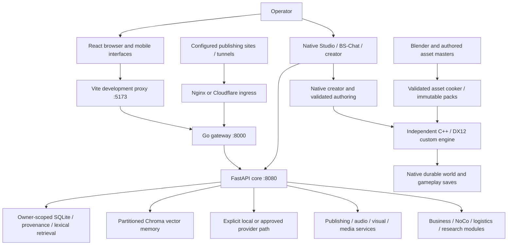
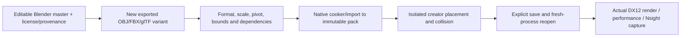

# AI-BS, BS-Chat and BS Game — Master Ecosystem Architecture

## Artifact matrix — November 21, 2026

Version numbers describe different artifacts. The game entries below were checked November 21. The November 15 deployment receipts establish the published backend and web builds on that date.

| Surface | Current recorded identity | Evidence and limits |
|---|---|---|
| Native BS-Chat testing | Studio 5.329.173, Workshop.7.1 Chat Access 1 | The dedicated launcher opened the packaged chat. Windows identified the empty, populated and cleared message field. The other 428 package members match Workshop.7.1. [Dedicated BS-Chat testing launcher](../../Launch-AI-BS-BS-Chat-Testing.cmd) · [Windows accessibility check](../../backups/bschat_accessible_name_20261121_v01/acceptance/acceptance.json). |
| Current native testing (November21) | Studio 5.329.173 Workshop.7.1 | The diagnostic return and low-surface landing were tested in the native walkthrough. New and earlier chapter saves use the Workshop.6 assembly contract. [Workshop.7.1 launcher](../../Launch-AI-BS-173-Workshop-Corridor-Qualified.cmd) · [Walkthrough checks](../../backups/workshop_corridor_20261121_v01/handoff.md). |
| Earlier native testing (November21) | Studio 5.329.173 Workshop.6 | One recoverable assembly at the existing path-contact tray; atomic socket install/reclaim, preserved readings and legacy relay identities. Prior-registry saves are backed up before explicit action-driven extension. [Workshop.6 launcher](../../Launch-AI-BS-173-Workshop-Assembly.cmd) · [Assembly rules and checked saves](../../backups/workshop_assembly_20261121_v01/handoff.md). Controlled recovery is separate from human pacing and foreground performance. |
| Current native testing (November 21) | Studio 5.329.173 Workshop.5, selected by the desktop testing shortcut | Pure nearby socket guidance uses the actual board-aim projection and existing relay records. The checked recipe requires no materials; construction and connection remain distinct, with isolation and a healthy actual relay required for connection. Existing centre-pick/reach rules remain authoritative. Live/lost feed text follows actual power state. [Dedicated launcher](../../Launch-AI-BS-173-Workshop-Relay.cmd) · [Relay handoff](../../backups/workshop_relay_20261121_v01/handoff.md). Later recoverable assembly and first-time human pacing remain open. |
| Application source | 5.329.192 | The local version marker and release metadata identify the application source. The Workshop.7.1 overlay has its own player hash. [Version authority](../../version.txt) · [Release scope](../../release.json) |
| Backend 8080 | 5.329.188 at the November 15 release | The published authenticated protective-review endpoint passed its release checks. [Backend receipt](../../backups/crypto188_release_20261115_v01/public-acceptance.json) |
| Local production 3000 | 5.329.180 at the November 15 release | The static bundle was checked against its manifest. Vite and native Studio use separate launch paths. [Web release checks](../../backups/crypto180_release_20261115_v01/verification.json) |
| Firebase Hosting | 5.329.180, Hosting version 9bf57b6d3cd2aad0, November 15 | 23 changed assets were downloaded and compared at both origins, with 1,132 matching entries carried forward from 179. [Hosting receipt](../../backups/crypto180_release_20261115_v01/verification.json) |
| Game navigation source / scoped Release build (November21) | Additive Workshop probe/contact HUD cue; SDK0.17.4 headers and retained original link inputs | Original-code-section control relink exact;137aim-prompt checks pass. [Build](../../backups/workshop_navigation_20261121_v01/candidate01/build.json), [checks](../../backups/workshop_navigation_20261121_v01/candidate01/contracts.log). This is a selected player rebuild, not a full current-source Studio/SDK rebuild. |
| Previous native testing (November 21) | Studio 5.329.173 Workshop.4 | The player provides a compact HUD and F1 details. The other 428 files match Workshop.3. Both controlled routes saved and reopened at revision 13. [Qualification](../../backups/workshop_hud_20261121_v01/handoff.md) / [Testing launcher receipt](../../backups/workshop_hud_20261121_v01/integration.json) |
| Prior native testing (November21) | Studio 5.329.173 Workshop.3, saved contact readings; 428 package files match Workshop.2 | The packaged Studio opened the player twice. Both contacts displayed their saved values at revisions 2 and 3. Copies of earlier repair and bypass saves reopened at revision 13 with all 17 events intact. [Build and 153 prompt checks](../../backups/workshop_readings_20261121_v01/candidate01/build.json) · [Runtime and recovery](../../backups/workshop_readings_20261121_v01/handoff.md) |
| Previous native testing (November21) | Studio5.329.173-workshop.2; player SHA256 `c8a61a4672bf895e644cd9865bbc10e6369ff593e9c722d091bacdb57ece9ee1` |429files/218027443bytes; only player differs from Workshop.1. [Staging](../../backups/workshop_navigation_20261121_v01/stage.json) preserves base173/Workshop.1; later [integration](../../backups/workshop_navigation_20261121_v01/integration.json) verifies Latest-Candidate testing selection of Workshop.2. Earlier173Creator12/429file evidence remains retained; no177whole-native rebuild is claimed. |
| Actual game runtime qualification (November21) | Workshop.2 dedicated launcher → frozen Studio → real saved Play, twice, on an owned non-input desktop | [Frozen receipt](../../backups/workshop_navigation_20261121_v01/frozen-qualification.json): cue observed, normal exit0/drain, exact idle reopen; full cue string was not retained. [Ordinary diagnostic](../../backups/workshop_navigation_20261121_v01/ordinary-0773e14047d2/receipt.json): live cue-guided probe collection/revision1 and exact fresh reopen, no physical input/human pacing. [Controlled branches](../../backups/workshop_navigation_20261121_v01/routes-c8a9ea190d13/summary.json): repair/bypass each revision13/sequence17 with exact fresh recovery; synthetic/offscreen, not foreground performance. Failed fixtures remain retained. |
| SDK relocation (November21) | SDK0.17.4 Release recovery prefix, relocated to a separate backup-owned SDK directory | [Receipt](../../backups/sdk174_release_relocation_20261121_v01/receipt.json):449files/213730576bytes matched before/after; independent external Release consumer3/3pass against relocated AIBS/Jolt paths. No fresh Debug, ordinary-Play, clean-machine or full current-source SDK qualification follows. |
| Workshop.2 ordinary contact progression (November21) | Actual packaged player; live probe/supply/path navigation and centre prompts | [Receipt](../../backups/workshop_contacts_20261121_v01/ordinary-1377ee9d7bf2/receipt.json): three separately observed E actions, acknowledged heads1/2/3, two exit0/joined children, exact logical save after reopen. Owned non-input desktop; no physical-input, foreground or human-pacing claim. Raw HUD077/099 transiently showed `Capacity 0% / isolation OFF / feed none` while saving; acknowledged HUD078/100 replaced it with “sample recorded”. Workshop.3 subsequently showed the saved reading after acknowledgment, including a controlled revisit to the supply contact from an older save. [Upgrade check](../../backups/workshop_readings_20261121_v01/revisit-result.json) |
| Installed defaults | Retained144/145, not requalified here | No shortcut/default promotion. Real owner, ordinary gameplay, signing and clean-machine gates remain open. |
| Game public release and play acceptance | Open | Workshop.7.1 is available through the local testing shortcut. The five-minute foreground run, GPU coverage during play, first-time player pacing, and final 20–30 minute chapter remain open. [Game handoff](../../backups/workshop_relay_20261121_v01/handoff.md) |
| Gateway | Retained52 | Public health200/anonymous provider403 at177publication; no gateway rebuild/config change. |

Publication evidence: `../../backups/patch177_release_20261115_v01/handoff.md`,
`backend-promotion.json`, `localhost-static.json` and `verification.json` in that
directory. Native evidence: `../agent_sync/NATIVE173_INTEGRATION_2026-11-15.md`.
Launch the native testing game tools from the root Latest-Candidate launcher;
use `https://ai-bs-dashboard.web.app/chat` for phone BS-Chat and `/driver/` for
the work portal. Launcher paths here are documentation, not an execution claim.
Live sending/trading holds remain; full45secondWan and physicalAndroid acceptance
remain open. Goal ACTIVE/incomplete with minimum-resource preference.

Current November15 source175; testing native173/defaults144145 separate. Port
monitor now uses opt-in task context adapter, mounted13pass; no process/storage/
bus primitive changes. Crucially direct TCP checks at2026-11-15T07:48:36Z show
8000/8080/3000/5173/11434unreachable. Backend164/web165/gateway52 remain last
qualified historical identities, not current liveness claims. Core recovery
preflight is next; preserve originals/auth/flags and unrelated operations.
See ../agent_sync/PORT_CONTEXT175_2026-11-15.md.

November15 current source/testing candidate173: source BSChat syntax action now
uses shared owned-process controller with private hash/revision-bound compile-only
snapshot; mounted source13 and frozen worker2 pass. Creator17312exit0pass. Testing
launcher173 distinct from installed defaults144145, hosted/static165/backend164/
gateway52. Full frozen chat/ordinary entry/real owner/full release remain open.
T06generic task context/progress/fairness remain proposed; no new pool. See
../agent_sync/NATIVE173_INTEGRATION_2026-11-15.md and SYNTAX173_MOUNTED_FROZEN_2026-11-15.md.

November15 current matrix: source/separate testing candidate172; qualified scoped
writer/Creator and relocated Creator12exit0. Installed defaults144145 and last
qualified hosted/static165/backend164/gateway52 remain distinct. T06 read-only
EngineBus AST burst baseline found607ms max observed timer interval; no new
scheduler/progress/fairness implementation. See ../agent_sync/NATIVE172_POSITIVE_2026-11-15.md,
NATIVE172_RELOCATED_2026-11-15.md and STUDIO_CONCURRENCY_BASELINE_2026-11-15.md.

Current matrix November15: source/native candidate170; last qualified hosted/
static165, backend164/gateway52; defaults144145 retained.170 controlled writer
and Creator acceptance plus verified55/433member Drive archives supersede169
candidate status only. No default/live promotion or whole-release qualification.
See ../agent_sync/NATIVE170_ACCEPTANCE_2026-11-15.md.

November15 matrix: source169/separate native169candidate, hosted/static165,
backend164/gateway52, retained native163/default144145. Native169static and
three-process synthetic frozen rich-writer recovery/save/real PDF pass; not
ordinary MainWindow/user-input/full release. Optional fixed callback is reached
only after existing strict authenticated pipe bootstrap; no arbitrary scripts or
new provider authority. Clean/runtime and engineering Drive roundtrips verified.
See ../agent_sync/NATIVE169_WRITER_2026-11-15.md and game_engine/
NSIGHT_COMPATIBILITY_REVIEW_2026-11-15.md for separately retained profiling limits.

November15 live matrix: source/Firebase/static3000=165, backend8080=164,
gateway/publichealth=retained52, Vite current source, native163candidate/default
144145retained.165all1155hosted files downloaded/hash-matched. Campaign local5191
contract is explicit: unsupported origins get a notice, no campaign token/fetch;
remote campaign integration unconfigured, other owner edits preserved. No new
public/business activation. See ../agent_sync/FRONTEND165_RELEASE_2026-11-15.md.

November15 live matrix: source/localbackend8080=164; existing Vite source service;
Firebase/static3000=163; gateway/publichealth=retained52; native163candidate
unpromoted/default144145retained. Scoped14localchecks/publichealth200 and10DB
original-record preservation verified. No DNS/tunnel/provider/activation change.
See ../agent_sync/BACKEND164_LOCALHOST_2026-11-15.md. Next separately owned
campaign/frontend integration preflight before new hosted publication.

November15: owned full backend164candidate15checks passes/normal exit0; live8080
still163, disabled flags/auth retained. Original records preserved across10DBs;
master append-only telemetry differs, nine exact. No production source change or
deployment this scope. Native163candidate unpromoted/default144145unchanged.
See ../agent_sync/BACKEND164_CANDIDATE_2026-11-15.md; next guarded backend-only
localhost promotion, campaign/frontend integration separate.

Source164 release preflight now records Coding156regressions passed/53pins
unchanged,17scoped rollback preimages and current backend/gateway health200 with
anonymous403. No service/data/deployment change. Campaign delta remains separately
owned; its loopback5191origin also exists in163baseline, a retained gap. Historical
whole-backend rollback coverage is unproven. Next backend candidate qualification;
see ../agent_sync/RELEASE164_PREFLIGHT_2026-11-14.md.

Latest scoped checkpoint supersedes older version summaries below: source164
mounted Coding browser13/native13 pass on owned disposable repositories, actual
SDK/router/gateway and EngineBus. Explicit trusted acknowledgement/review/apply
and reopen qualified; original backup retained. No real inference, live flags or
private data changed. Hosted/native/local backend163 remain separate. Read
../agent_sync/CODING_NATIVE164_2026-11-14.md. Release preflight/actual owner and
isolated-worker qualification remain open; entire program ACTIVE/incomplete.

**Updated:** November 14, 2026. **Program:** ACTIVE and incomplete; all ten original goals and six additions remain.  
**Canonical project:** `C:\AI-BS`. **Source baseline:** `5.329.157`. Opt-in private-generation reader14synthetic checks pass, without live consumer integration. Native156 static/normal BS-Chat close0/controlled Creator12 and web156 Hosting12/signed-browser13 have separate receipts; no default or hosted promotion. Native156 scoped engineering/clean-runtime Drive backups are verified. Native144/145 defaults and earlier/held releases remain retained; hosted146 and live service generations remain separate. Real-owner/device, frozen native draft/error input, ordinary gameplay and full release remain open. FE/finance remains unactivated. **Engine SDK version recorded November11:** `0.17.4`; this update does not requalify its current source.
**Purpose:** preserve the whole ecosystem, explain how its parts connect, and give future builds one navigable architecture map.

Latest network evidence: `SITES_HEALTH_AND_ALIAS_REPAIR_2026-11-14.md` and the
sites/server register. Selected Sites ownership and brettstehouwer.live zone
administration reverified; stale existing ai-bs alias CNAME restored to the
active tunnel and backend health200. Other record fields/Access/services unchanged.
Other configured-name ownership/DNS/TLS gaps remain. Live gateway reports52,
hosted146; source149 and native/web148 candidates are separate.

This is a current source/configuration inventory with separately identified test and historical evidence. It is not a claim that every component is enabled, every website is reachable, or every past idea is implemented. Connected Sites ownership was checked; other domains below are configured properties whose current DNS/account control remains to be verified. Credentials, contact numbers, private manuscripts, database contents and personal historical conversations are excluded.

## Latest scoped integration matrix — November14

Earlier pause/version/status paragraphs below are retained history. Current
authority is `docs/agent_sync/current_long_term_goal.json` and its checkpoint.

| Surface | Source | Controlled/runtime evidence | Installed/hosted boundary |
|---|---|---|---|
| BS-Chat web | Source149 metadata; dedicated entry introduced in146 | Combined web148 candidate Hosting12/12; prior public API checks retain dated scope | Hosting146:1141file hashes; no blanket current model/workflow acceptance |
| Gateway | Source149 configured loopback backend and shared production route table | Three regression groups plus12signed fixture portal groups; stamped149candidate | Live gateway unchanged; real-owner/device and all-route acceptance remain open |
| BS-Chat Android | Accepted1.0/build1 wrapper | Package-manager installation verified; login USER_REPORTED_PASS | Accepted APK retained; optional1.0.1 candidate not promoted |
| FE driver work | Standalone `/driver/`, UID-scoped cache and reviewed sync | Real UI/ASGI/temp-SQLite composition with synthetic verified identities; offline shell checks | Backend flag disabled; no public deployment, installed FE app or real-owner workflow claim |
| Personal finance | Source148 `/personal/`, owner-bound records/originals/yearly parts and offline local drafts | Separate API/phone/worker scoped fixtures; no real private record access | Flags disabled; normal owner/device/hosted rollout open; work PIN never grants financial access |
| Truck navigation | Retained active planning/integration requirement | No routing provider connected | Actual vehicle dimensions/weights/provider remain open; no qualified truck route |
| Local service layer | Existing individual launch paths | Scoped startup receipts plus real Comfy8188 proxy; Chroma FTS repair preserves documents/vectors | Node/RecDebut/WSL holds and persistence/workflow gates remain |
| Native Studio / BS Game | Source148; fresh185input/429file native candidate | Static + actual packaged creator/viewport/isolated Play/save/reopen pass; canonical TEMP fix | Retained144/145;146/147held; separate148candidate launcher prepared, defaults/normal MainWindow/hosted parity not promoted |

FE work flow: current verified Firebase owner → owner-bound API → separate driver
SQLite; phone IndexedDB retains unsynced originals, evidence and reviewed conflict
journals. A scoped worker caches public shell files only, never API/account data.
Actual FE backend routes remain opt-in; no shared FE PIN or personal-finance
ownership is inherited. See FE_DRIVER_SOURCE_INTEGRATION_2026-11-14.md and the
latest sync checkpoint for exact qualification and remaining owner/device gates.

Review metadata has a separate owner-scoped database so older capture clients
retain their original row contract. Review intentions precede the capture
transaction; confirmation/reconciliation is separate, not a cross-database atomic
commit. Source CORS now permits evidence operation IDs narrowly; standing services
have not adopted that candidate. Current proof: FE_DRIVER_SYNC_2026-11-14.md.

## 1. What AI-BS is building

AI-BS is the shared ecosystem for the Stehouwer assistant, learning memory, creative production, practical business tools and custom BS Game. Its retained personal vision is Adam's Infinite Brett Stehouwer Living Learning Memory. Engineering records must preserve the original vision and authored material without turning generated suggestions into historical truth.

The architecture is hybrid and local-first. Local Windows clients, local services and native game simulation coexist with established browser/mobile clients, explicitly selected cloud AI providers and approved cloud storage/hosting. Local-first does not erase those approved paths. Neither a native UI nor a local folder automatically supplies a sandbox for untrusted code.


Current user clarification: offline operation applies only to specified capabilities. There is no new platform-wide offline mode or cloud prohibition. Retained old sovereignty notes do not override the later approved hybrid/API/hosting/storage rules.

### The ten retained program goals

| Goal | Scope |
|---|---|
| 1 | Preserve the complete vision, source history, provenance and implementation inventory. |
| 2 | Recover and qualify the hybrid architecture and its real interface boundaries. |
| 3 | Preserve simpler BS-Chat while recovering providers, streaming, history, attachments and draft recovery. |
| 4 | Qualify specialist routing, resource admission, cancellation, deadlines and truthful worker status. |
| 5 | Resolve SDK, viewport, rendering and recovery contracts against exact artifacts. |
| 6 | Preserve publishing, manuscripts, screenwriting, images, music, narration, video and broadcast workflows. |
| 7 | Preserve NoCo, logistics, recruiting, field-service, hospitality and financial/business modules. |
| 8 | Continue the custom BS Game, creator, world, companion and authored asset development. |
| 9 | Establish trustworthy source, runtime, package, hosted-release and recovery qualification. |
| 10 | Retain modernization and future expansion ideas without silently activating them. |

Authoritative detail: `docs/AI_BS_TAKEOVER_GOAL_2026-11-09.md`, `docs/AI_BS_CARRYOVER_INVENTORY_2026-11-09.md`, `AI_BS_MASTER_ARCHITECTURAL_LEDGER.md`. The latest handoff/current evidence supersedes stale status paragraphs, not the preserved vision.

## 2. System layers and main connections



Arrows describe configured or intended interfaces; they do not assert that all services are running. The native offline player does not require Studio, Python, a model service or a network connection. Its local save authority is separate from cloud coordination.

| Layer | Actual source anchors | Responsibility |
|---|---|---|
| Governance and continuity | `AGENTS.md`, `GEMINI.md`, `PLAN.md`, `docs/CODEX_HANDOFF.md`, `docs/agent_sync/current_long_term_goal.json` | Shared rules, current priorities, dated evidence and exact next task. |
| Browser application | `frontend/App.jsx`, `frontend/components/`, `frontend/src/components/` | Main workspace/navigation, BS-Chat, mobile and module views. Both component trees survive; parity is not assumed. |
| Browser stack | `frontend/package.json`, `frontend/vite.config.js` | Declares React 18.3.1, Vite 5.4.1 range, TypeScript checking, Firebase, Three.js and Electron/Capacitor paths. Dependency declarations are not fresh installed-version measurements. |
| Native Studio | `native_studio/app.py`, `engine.py`, `screenwriting_view.py`, `game_build_view.py` | PyQt6 application shell and EngineBus, scoped tools and native engine launch/integration. Installed Studio 107 is distinct from current source. |
| Local service API | `backend/AI_BS_Backend.py`, `backend/routers/`, `backend/core/`, `backend/modules/` | Authenticated orchestration and feature services; source contains more capabilities than a single running API necessarily mounts. |
| Go gateway and IPC | `go-core/cmd/aibs_engine/main.go`, `go-core/pkg/gateway/`, `go-core/shm_topic_router.go`, `go_telemetry_gateway/main.go` | Local gateway/supervision and relevant shared-memory routing. Transport choice remains capability-specific. |
| Rust work | `rust_master_worker/Cargo.toml` and source | Retained Rust worker with Tokio/rusqlite dependencies; runtime qualification is separate. |
| Native game SDK | `engine/CMakeLists.txt`, `engine/include/aibs/`, `engine/src/` | C++20, Windows x64, rendering, world, physics, persistence, content and creator contracts. |
| Optional deployment variants | `cloudflare-agent/`, `self_hosted_supabase/`, `genkit_server/`, Docker/WSL files | Retained source/configuration; existence is not active deployment evidence. |

The current inventory observed 85 direct Python router files, 155 direct core Python files, 143 direct native Python files, 39 native view-named files and 74 browser navigation entries. These are source counts, not 85 servers, 74 working products or 64 executing agents.

## 3. AI, BS-Chat, swarm and memory

### BS-Chat and Stehouwer assistant

`backend/core/bs_chat_provider.py`, `coding_chat.py`, `local_chat_inference.py`, `local_ollama_http.py`, `hybrid_reasoning_engine.py`, provider routers and `native_studio/bs_chat_ide_full.py` form the chat/coding paths. The selected provider, streaming transport, owner-bound history, attachments, source retrieval, drafts and rendered answers each need their own acceptance evidence. Preserve existing providers and explicit selection; no silent replay through another provider after an uncertain response.

The 64-specialist catalog spans seven domains. Primary anchors include `backend/core/sovereign_reasoning/moe_specialist_router.py`, `model_domain_matrix.py`, `swarm_coordinator.py`, `specialist_execution.py` and their routers. A catalog entry establishes a role definition, not inference, autonomous execution or VM containment. Shared GPU/CPU admission, cancellation and deadlines must be demonstrated rather than inferred.

The optional OpenCode path adds 12 selectable official-client worker/model choices alongside existing providers. It does not mean 12 agents are running or 12 models answered. The last retained real request returned HTTP429/no answer; an earlier outcome remains unknown. Further diagnostic model calls, replay, rotation and paid fallback are not part of this inventory. Agent-app harness source describes 14 applications; installation does not prove login, quota or execution.

### Agent Foundry and project hub

The connected account owns the two Sites listed in section 7. Agent Foundry is described as designing, comparing and verifying AI-BS sub-agents. Ownership/hosting metadata is verified; a live connection to the local 64-role registry, BS-Chat or the worker scheduler has not been established. Reuse registry identifiers and contracts if integration is later implemented; do not create a second contradictory source of specialist truth.

### Memory and retrieval authority

| Store / function | Intended authority and boundary |
|---|---|
| SQLite conversations, history, source provenance and lexical indexes | Preserve existing relational and lexical authority. Owner context is required; do not migrate or merge private stores merely to simplify architecture. |
| Chroma vector bins | Semantic/vector retrieval with strict partitioning across separate storage bins. Existing Chroma directories are not permission to ingest all historical/private folders. |
| Source vault and PDF/FDX packets | Preserve original bytes, source IDs, derived-text identity, owner and hashes. Parsing, indexing and retrieved passage verification are distinct. |
| Historical retrieval | `stehouwer_history_retriever.py`, `historical_reference_context.py`, archive and lexicon modules supply attributed context. History does not become current execution authority. |
| Model context | Retrieved evidence and saved history do not expand a model's actual context window or make unlimited memory claims true. |

Source anchors: routers `memory_router.py`, `conversation_router.py`, `rag_bridge.py`, `knowledge_router.py`, `codebase_knowledge_router.py`; core `owned_vault.py`, `owned_rag_sources.py`, `attached_source_context.py`, `project_rag.py`, `vector_vault.py`, `chroma_native_integrity.py`, `personal_memory_scope.py`.

The historical mobile truncation claims are superseded in the inspected current upload source: original upload bytes are preserved create-only, owner-scoped, with a 16MiB bound. Full mounted mobile indexing/retrieval/restart qualification remains open. The earlier eight-pass/one-failure RAG run is retained. That failure was a stale literal assertion after the intentional OpenCode command exception. Test-only AST repair and 16 additional actual-handler cases now pass a 64-case focused suite across four chat mirrors. This proves the tested source boundaries, not mounted mobile/browser acceptance or whole-application mirror parity.

## 4. Complete subsystem map

The following families are all retained parts of AI-BS. A source anchor means code or navigation exists; it does not certify every advertised capability or authorize live activity.

| Family | Responsibilities / retained intent | Main source anchors |
|---|---|---|
| Executive cockpit and operations | Command overview, task/evidence displays, operational audit and governance | `executive_cockpit_router.py`, `operations_audit_router.py`, native `operations_views.py` |
| Workflow and coordination | DAG workflows, local event bus, mission control, optional Temporal/NATS/cache adapters | core `aibs_event_bus.py`, `event_bus.py`, `aibs_temporal_orchestrator.py`, `aibs_nats_broker.py`, `mission_control_engine.py` |
| Publishing and documents | Manuscript vault, books, adaptation, conversion, source-faithful screenwriting and exports | `screenwriting_router.py`, `publishing_engine_router.py`, `ebook_factoring_router.py`, `document_converter_router.py`, `novelizer_router.py` |
| Immutable publishing | Write-once artifacts, chapter index and exact artifact fingerprints | core `immutable_publishing_engine.py`; lexical checks explicitly permit case/punctuation differences and are not exact-text fidelity |
| Image/ComfyUI/photo | Workflow authoring, image processing, photo tools and asset generation | `comfyui_router.py`, `comfyui_workspace_router.py`, `comfy_processing_router.py`, `photo_studio.py`; native `comfy_workspace_view.py` |
| Video and storyboard | Video workflows, cinematic storyboard and rendering | `video_router.py`, `video_generation.py`, `video_workflows.py`, `cinematic_storyboard_assembler.py` |
| Music, vocals and DAW | Music assistance, voice, transcription, separation, DSP/prosody and VST integration | `music_assistant_router.py`, `ai_audio_router.py`, `audio_demucs_router.py`, `audio_dsp_prosody_router.py`, `vst_router.py`; native `music_daw_view.py` |
| Media playback/delivery | VLC/media UI, delivery, rendering and HLS paths | `media_router.py`, `media_render_router.py`, `wan_media_router.py`, core `media_delivery.py`; native `media_view.py` |
| Broadcast and living stage | OBS control, audio, live overlays, secondary outputs, projectors/prompters and mirroring | `obs_broadcast_router.py`, core `broadcast_*`, `live_event_overlay.py`, `live_overlay_runtime.py`; native `broadcast_preview.py`, `screen_mirror_view.py` |
| CRM and onboarding | Client directory, intake and business operations | native `clients_crm_view.py`, `onboarding_view.py`; `industry_tools_router.py` |
| Prestige Mobile Wash | Field service, washing CRM, estimates, chemicals and fleet concepts | `power_washing_router.py`, native `power_washing_view.py` |
| FE Express | Logistics, dispatcher/load-board, backhaul and owner-operator cost tools | `fe_express_router.py`, core `fe_express_owner_operator_engine.py`, `fe_express_dispatcher_dream_cockpit.py` |
| RecDebut | Recruiting, lead quality, permission provenance, suppression and outreach preparation | `rec_debut_router.py`, `rec_debut_lead_quality.py`, core `rec_debut_daily_dispatcher.py`, `outbound_messaging_policy.py` |
| Marketing and research | OSINT, enrichment, SEO/AEO, syndication and social/email preparation | `aeo_router.py`, `sitemap_seo_router.py`, core `web_research_orchestrator.py`, `social_optimizer_engine.py`; marketing/syndication modules |
| Accounting and storefront | Accounting views, receipt/filing, customer checkout and storefront concepts | `backend/modules/accounting_router.py`, core `payment_receipts.py`, `document_filing.py`, native `accounting_view.py` |
| Calendar, shared drive and agreements | Tasks, documents, connected storage, resource vault and NDA workflow | `calendar_tasks_router.py`, `shared_drive_router.py`, `nda_signer_router.py`, `resource_vault_router.py` |
| Project NoCo | Campus/enclave, biosystem, microgrid/cost and living-stage concepts | `frontend/components/ProjectNoCoStudioTab.jsx`, native NoCo views and `subsystem_views.py` |
| NoCo Vision / acoustic engine | Acoustic/agricultural and stage-related retained system concepts | native `NocoVisionNativeView` mapping in `native_studio/app.py`; physical-system and cost validation remain separate |
| Hospitality and banquet CAD | Noto inventory, hospitality enterprise and banquet layout tools | native `noto_inventory_view.py`, `banquet_cad_view.py`; corresponding browser tabs |
| Phone and hardware lab | Repair knowledge, schematics, binary workbench and USB/recovery diagnostics | `phone_repair_router.py`, `binary_hardware_workbench_router.py`, `usb_recovery_router.py` |
| Chef and food-service tools | Chef analytics/orders and related site | `chef_analytics_router.py`, `chef_orders_router.py`; configured WSL Chef site |
| Nutrition, Bible and learning | Retained reference/learning applications | native `nutrition_view.py`, `bible_hub_view.py`; browser navigation; medical effectiveness is not established by UI text |
| Trading and quantitative research | Market data, backtesting, controls, technical indicators and exchange adapters | `trading_router.py`, `cro_ledger_router.py`, `data_feed_router.py`, `news_catalyst_router.py`, core `crypto_execution_*`, `kraken_service.py` |
| Mining/compute hosting | Retained Chia, GPU/WSL hosting and crypto-swarm concepts | `Crypto-Swarm/`, `miners/`, Chia modules and retained Vast/Clore startup files; no activation follows |
| Health, telemetry and capture | GPU/VRAM, logs, network telemetry, packet tools and attributed game capture | `system_health_router.py`, `gpu_telemetry_router.py`, `network_telemetry_router.py`, `tshark_telemetry_router.py`, `ecosystem_telemetry_router.py`; core capture/VRAM modules |
| Coding, builds and updates | Preparation/review, project maintenance, candidate/update and recovery | `coding_preparation_router.py`, `coding_review_router.py`, `updater_router.py`, `powershell_process_router.py`, core `project_maintenance*`, `program_builder_engine.py` |
| Disposable worker / VM research | Host-issued bounded builds/tests and returned evidence in a separate guest | `isolated_workers/`, Host/VM handoff Page; full admission/containment/cancellation/publication remains open |
| BS Game / creator / custom engine | Native offline game, world authoring, durable simulation, asset packs and release tools | `engine/`, native `game_build_view.py`, `game_build_monitor.py`, `game_release_smoke.py` |
| Unreal and Steam/game lab | Preserved Unreal bridge, prototyping and game-library/trainer paths | `unreal_bridge_new.py`, `unreal_mcp_router.py`, `steam_router.py`, `memory_lab_router.py`, `UnrealHub/`, `unreal_assets/` |

No catalog in this document activates messaging, trading, payouts, mining, broadcast, device flashing or public host execution. Current activation settings and their separate authorization boundaries remain unchanged.

### Syndication and publishing outcome contract

The newly supplied `AI-BS-SPEC-5.329.136-REVIEW-20261110` is a historical external review, not verified Windows integration. Its concrete findings need comparison with the actual current adapters, dependencies and retained logs before changes. Preserve its useful requirement: distinguish **execution**, **protocol response**, and **downstream evidence**.

Planned, sent, acknowledged, validation-pending, rejected, timed-out/unknown, published, capture-confirmed and indexing-observed are different states. A share composer is not a completed post; an accepted notification is not indexing. Exact-host control, per-operation authorization and protocol eligibility must be separate records. Review URL parsing, functional query preservation, TLS, XML-RPC faults, deduplication, two-failure halts and side-effect-free planning. No external submissions or promotion are authorized by adding this architecture requirement.

## 5. Creative documents and native connection

The preserved pipeline is source intake → authenticated owner/source vault → parse/index/retrieval evidence → new owner-fenced working project → edit/save with revision CAS → fresh readback → explicitly selected FDX/PDF export. Original manuscripts, imported source identity, working revision and rendered export qualification remain separate.

Archival source layout preserves authored wording and geometry. Professional formatting can change pagination without rewriting authored content. Explicit reflow is a separate potentially lossy profile; no export fallback should silently change the chosen contract. Real Final Draft rendering remains distinct from valid XML.

The native creative repair uses a reviewed owned child, short-lived one-use grants and scoped leases. Current source adds inherited private pipe handles, bounded JSON framing, cancellable dedicated-thread I/O and exact registered-invocation authorization. It preserves the existing source-owner and revision checks rather than substituting local administrator ownership.

Latest checks: 48 focused I/O/authority/pipe/lifetime tests passed; a separate ten-test synthetic-store dispatcher suite passed actual service save/readback, binary FDX/PDF hashes, four unchanged source artifacts, wrong-owner/source/project refusal, revision conflicts, expiry-after-store-lock and oversized-export refusal. Those earlier checks were component/service scopes. The explicit v2 controller/bootstrap is now integrated and its 122-case controlled suite passed. A separate actual offscreen rich-editor test passed edit/save, fresh owned-process reopen, explicit-reflow FDX/PDF exports, normal exits, close-drain barrier and four unchanged synthetic source artifacts. No HTTP was used. This still does not qualify original manuscripts, fresh real Firebase-owner admission or a production launch; actual backend-process loss/private draft recovery remains next. The older TCP-peer workflow's asymmetric state failures remain preserved; its guard was not weakened.

## 6. Custom BS / AI-BS game-engine architecture

### Native SDK and programs

The custom engine is separate from Unreal and from the browser concept playground. `engine/CMakeLists.txt` declares SDK `0.17.4`, C++20, Windows x64/MSVC and Direct3D12/DXGI. Main runtime sources include `platform_win32.cpp`, `render_dx12.cpp`, `textured_scene.cpp`, `physics.cpp`, `player.cpp` and `guide_controller.cpp`. Jolt supplies physics behind engine-owned interfaces; HLSL shaders use offline DXC.

| Contract / target family | Responsibility |
|---|---|
| Core, World, Authoring | UUID identities, validated world edits, transaction/apply/preview and history. |
| Persistence and CreatorHost | Explicit world save/reopen and creator-host boundary. Preview is not a durable save. |
| Gameplay / Codec / Store / Worker / World | Scoped events/components, atomic SQLite receipts/heads and bounded durable save worker. Accepted, visible and durable are distinct. |
| Assets, ImageAssets, SurfaceAssets/Codec, AssetStore, PlacedAssets | Bounded immutable geometry/material/image payloads, catalogs, dependencies and placements. |
| Lighting / ContentLighting | Authored scene lighting and content integration. |
| Character assets/runtime | Owned AIBChar2 payloads, pinned glTF/GLB import, animation/presentation and guide/companion states. |
| Audio/memory playback | Owned PCM/AIBAudio2, XAudio2, memory interactions and caption clocks. Foundations do not establish reviewed original recordings or the default opening's audio binding. |
| LegacyImport | Explicit non-destructive compatibility; old numeric checkpoints are not silently rewritten. |

Actual executable targets: `aibs_player`, `aibs_creator`, `aibs_creator_host`, `aibs_content_host`, `aibs_motherboard`, `aibs_assetc`, `aibs_creator_viewport`, `aibs_warm_opening_project`. Exported `AIBS::` libraries/package configuration support independent SDK consumers.

Game modules include First Boot, durable First Boot, First Boot chapter/content, Opening Workshop, Warm Opening, Opening Tour and Movement Course. Native Studio's game workspace exposes Build progress, Creator, Chapter creator and Assets. A Studio source edit does not update a frozen installed player or SDK.

### World, gameplay and asset formats

| Artifact | Role |
|---|---|
| `.aibs-project.json`, `world.aibs` | Creator project metadata, document/world identity and authored state. |
| `chapter.aiba`, `opening.aibd` | Chapter/content data; AIBD1/2/3 compatibility must remain explicit. |
| Native SQLite game/world save | Durable semantic state/events, receipts and heads; preserve all original saves. |
| AIBC creator protocol | Version1, 48-byte binary framing, strict text/numeric payloads, revision/epoch checks and malformed-input refusal. Project confinement is not an untrusted-code sandbox. |
| `<SHA256>.aibmesh`, `catalog.aibcat` | Immutable geometry packs/catalogs; retain license and provenance. |
| AIBSurf2 | Modern surface/UV/material/texture pipeline; older SDK 0.10 descriptions are historical. |
| AIBChar2 / AIBAudio2 | Owned character and audio codec payloads with bounded contracts. |

Detailed contracts: `engine/GAMEPLAY_CONTRACT.md`, `CREATOR_PROTOCOL.md`, `CONTENT_V3.md`, `AI_AUTHORING.md`, `AUDIO_ASSETS.md`, `MEMORY_AUDIO_RUNTIME.md`, `BUILD_ROADMAP.md`, `milestone_queue.json` and `docs/game_engine/PROJECT_INDEX.md`.

### Asset workflow and RTX tools



Blender 5.3.0 RTX workflow: `runtime/devtools/Blender-AI-BS-RTX.cmd`, separate `runtime/devtools/blender-rtx/profile`, RTX 4090 Cycles OptiX/denoising. Dated isolated render and preference-reopen checks passed. Portable Blender 5.2.4 LTS is retained separately; do not assume backward file compatibility.

Nsight Graphics 2026.4 is installed with `runtime/devtools/Nsight-AI-BS.cmd` and capture storage under `runtime/devtools/nsight/captures`; an actual game GPU capture remains pending. RTX Remix is retained for compatible classic rendering workflows, not the native DX12 engine's injection pipeline. Unreal/Prop01 prototype captures and native DX12 evidence are separate branches of evidence.

### Build commands and delivery roadmap

The inspected CMake presets define Visual Studio17 2022/x64, `windows-msvc`, `debug` and `release`. Standard commands are documented here, **not run to produce this file**:

```powershell
cd C:\AI-BS\engine
cmake --preset windows-msvc
cmake --build --preset debug
ctest --preset debug
cmake --build --preset release
ctest --preset release
```

Use `scripts/build_native_game_release.py` only within its reviewed fresh-candidate/staging contract. No archived deploy command is an automatic next step.

Retain M0–M11: the private complete 20–30 minute First Boot chapter, the 8–12 minute Warm Beginning integration milestone, then broader world, construction, transport/coolant, factions/virus regimes, territory/logistics and phone-companion ideas. The opening is not complete merely because a controlled repair route passes.

Installed Studio 107, current SDK source, private HUD player, controlled motion/repair results, human play and release are separate qualification rows. Human pacing/caption/likeness gates remain open; the user declined further manual gameplay tests. Original revision6 and retained failures remain preserved.

## 7. Sites, domains and ownership register

### Sites confirmed owned in the connected account

The Sites owner listing returned both entries below with no pagination cursor. Metadata was read without changing source, access or deployment. Custom-domain listings returned no attached domains for either Site.

| Site | Observed URL | Ownership / access evidence | Connection limits |
|---|---|---|---|
| AI-BS · Agent Foundry | https://aibs-agent-foundry.snugolive34.chatgpt.site | Current account role owner; active metadata; custom audience; saved version 1 | Local swarm/registry integration not established. |
| Stehouwer — Stories, Learning & Possibilities | https://stehouwer-project-hub.snugolive34.chatgpt.site | Current account role owner; active metadata; public audience; saved version 2 | Project/creative/practical-guide hub; no local backend integration inferred. |

This ownership inventory covers the selected Sites account, not every registrar, Firebase project, Wix/Shopify account or historical hostname.

### Configured or historically recorded AI-BS properties

| Property | Local source evidence | Configuration relationship / current qualification |
|---|---|---|
| `ai-bs-dashboard.web.app` | `frontend/firebase.json`, `frontend/.firebaserc` | Firebase SPA hosting for project/site `ai-bs-dashboard`. Historical v109 receipt exists; current source 139 is not proof of hosted parity. |
| `ai-bs-dashboard.firebaseapp.com` | Firebase client configuration | Auth domain for the same project; not a separate independently qualified product. |
| `ai-bs-dashboard.firebasestorage.app` | Firebase client configuration | Storage bucket identifier, not a public document inventory. |
| `dyadic-hub` | `frontend/public/dyadic/firebase.json` | Additional configured Firebase Hosting site in the same default project; current publication URL not verified. |
| `api.brettstehouwer.live` | Surviving Cloudflare ingress | Loopback8000; `/sse` and `/messages` explicitly404 in inspected ingress. |
| `ai-bs.brettstehouwer.live` | Same | Loopback8080 ingress. |
| `stehouwer-publishing.com`, `www.stehouwer-publishing.com` | Cloudflare ingress + publishing Nginx | Publishing aliases routed through local 80. Current external control/reachability not reverified. |
| `stehouwerpublishing.com`, `www.stehouwerpublishing.com` | Same | Publishing aliases through local 80. |
| `stehouwerproductions.com`, `www.stehouwerproductions.com` | Nginx virtual host only | Not present in the inspected Cloudflare ingress. |
| `recdebut-recruit.org`, `www.recdebut-recruit.org`, `r.recdebut-recruit.org` | Cloudflare + Nginx | RecDebut/API/tracking routes to 8080; no sending/campaign activation. |
| `thesimplechef.com`, `www.thesimplechef.com`, `thesimplechef.local` | WSL Nginx deployment template | Intended port 8055 site; actual current deployment/control not established. |
| `turbine-jitters-chill.ngrok-free.dev` | `backend/start_tunnel.bat` | Legacy tunnel command to 8000; no current tunnel/account qualification. |

`rpc.pearl.example.com` in an example Caddy file is a placeholder, not evidence of a controlled domain. External IMDb, Amazon, YouTube, social, provider and documentation links are destinations/dependencies, not owned AI-BS sites.

## 8. Reverse proxies and local server topology

### Proxy implementations and variants

| Proxy | Source | Bind / upstreams | Status distinction |
|---|---|---|---|
| Cloudflare tunnel ingress | `C:\Users\footb\.cloudflared\config.yml` | API→8000, AI-BS→8080, publishing→80, RecDebut→8080; unmatched404 | Surviving old-profile config; no assertion that logon task/tunnel survived reinstall. Credential fields excluded. Root `C:\AI-BS\config.yml` is empty configuration. |
| Publishing Nginx | `C:\StehouwerPublishing.com\nginx.conf` | `127.0.0.1:80`/`[::1]:80`; static `website-rebuild/dist`; `/api`→8000, RecDebut/tracking→8080, `/hls`→8089 | Local443 block commented; no active local certificate/HTTPS claim. |
| Alternate Python publishing server | `C:\StehouwerPublishing.com\stehouwer_web_server.py` | `0.0.0.0:80`; API/v1/media→8000 | Alternative to Nginx; simultaneous port 80 binding conflicts. Security review is separate from source presence. |
| Vite development proxy | `frontend/vite.config.js` | Loopback5173; `/api`,`/v1`→8000; `/ws`→8010 | Development interface, not a public production proxy. |
| Go gateway | `go-core/cmd/aibs_engine/main.go`, `pkg/gateway/gateway.go` | Loopback8000→FastAPI8080 | Configured supervisor/gateway; startup/health require runtime receipts. |
| Remote/telemetry Python proxy | `backend/AI_BS_Remote_Backend.py` | Loopback8010→selected8000 services | Its name does not establish an air gap or execution isolation. |
| Chef WSL Nginx | `scripts/deploy_wsl_nginx.py` | Intended8055, static `/var/www/thesimplechef/public`, Chef API→8080 | Read-only template inspection; script not executed. |
| Pearl RPC Caddy | `pearl/proxy/Caddyfile` | `localhost:44107`, internalTLS→18334 | Rate/cache directives are configured, not proof a compatible Caddy build is running. |

### Twenty-entry daemon catalog

`backend/core/daemon_manager.py` has 20 entries even though its older comment says 18. This is a declared topology, not a live daemon count.

| Port | Declared role | Qualification / variant |
|---|---|---|
| 80 | Nginx/publishing gateway | Nginx loopback versus alternate Python wildcard variant. |
| 3001 | Node backend | Catalog presence; runtime health unverified. |
| 4455 | OBS WebSocket | Relevant to OBS-dependent operations; a port alone is not authenticated OBS readiness. |
| 5173 | Vite/Studio development | Current frontend dev script binds loopback and strict port. |
| 8000 | Go gateway | Legacy standalone/container variants also use8000; do not combine them. |
| 8002 | Chroma catalog entry | Actual Go launcher registers8001; unresolved variant. |
| 8005 | Broadcast daemon | Operational/live output qualification separate. |
| 8006 | Social/Twitch/IRC hub | Cataloged optional service; no outbound authority inferred. |
| 8007 | Crypto swarm/scalp bot | Preserve activation controls; no trading activation. |
| 8010 | SHM telemetry gateway/proxy | Vite WebSocket upstream; distinguish actual implementation. |
| 8013 | VST3 audio bridge | Audio dependency qualification separate. |
| 8080 | FastAPI core | Canonical current backend source topology. |
| 8085 | Ubuntu-Bio bridge | Catalog presence only for this inventory. |
| 8088 | Broadcast kernel/NVENC | Actual encoder/output availability separate. |
| 8089 | WSL HLS ingest | Publishing `/hls/` upstream. |
| 8099 | Gemini local MCP | Catalog does not prove configured/authenticated MCP session. |
| 8189 | ComfyUI catalog entry | Other configurations commonly reference8188; verify selected instance before changing clients. |
| 8888 | Unreal signaling | Separate from native offline engine. |
| 11434 | Ollama host | Local inference path; loaded model/readiness separate. |
| 11435 | Ollama E-drive | Separate cataloged instance; storage/model ownership distinct. |

Other variants: Docker Compose maps backend8000/frontend4173; Expo/Metro startup references8081; old Host/VM diagnostic listener18443 was recorded stopped in October 26 history; it is not the BS-Chat job-dispatch channel. The GPU-tunnel script's printed40000–40010 range does not establish forwarding rules. Certbot directories survive, but the inspected renewal directory was empty; no certificate-renewal readiness is established. No IIS site was established by the `C:\inetpub` inspection.

During this architecture pass, sandbox TCP-table access failed; an authorized native selected-port snapshot subsequently returned no matching listeners. This is a point-in-time observation, not an all-service health report, diagnosis or authorization to restart anything. HTTP/authentication, DNS, certificates and remote reachability were not tested.

## 9. Security, execution and preservation boundaries

| Boundary | Requirement / current finding |
|---|---|
| Backend admission | Current sensitive prefixes use verified administrator admission; document/source routes also enforce owner policies. Public static hosting does not by itself establish anonymous execution access. |
| Per-owner data | Firebase-owned documents remain owned by their verified principal; do not remap them to local_admin to pass a workflow. |
| Canonical maintenance | Existing fixed `project_maintenance` lane differs from legacy arbitrary/custom/native build paths. Preserve known authorized maintenance. |
| Legacy builder gap | Current `program_builder_engine.py` admits existing absolute project directories and repository-discovered/custom commands for host execution. Administrator admission is not an untrusted-code sandbox. Review and route untrusted projects into separately accepted bounded execution. |
| Disposable VM lane | Historical Host/VM Page records staged diagnostics, not admitted guest program execution. Clean separate image/account, trusted broker/root policy, bounded host-issued jobs, cancellation, collection and protected apply/release remain open. |
| Vault key | Existing vault key is tracked and appears in reachable Git history. Real value not read/changed. Twelve synthetic format/interruption/restart/rollback canaries pass; see `VAULT_SYNTHETIC_CANARY_2026-11-14.md`. Actual private preservation, coherent consumer switch and history remediation remain open. Source archive Drive download blocked; separate report-only backup verified. |
| Git staging safety | Root `backups/`, `t/`, `outputs/`, `work/` now ignored; canonical architectural ledger explicitly excepted from broad ledger ignore. Nothing was staged at the latest check. Ignore rules do not untrack existing files. |
| Service recovery | Attribute exact owned process and service readiness before intervention; do not kill a process merely because it owns a port. |
| Outbound operations | Publication, messaging, recruiting sends, trading, mining, payouts, broadcast and deployments retain their specific controls and authorizations. |

The historical Gemini notebook template contains illustrative/invalid code and configuration whose keys were not installed or verified. Its cwd/timeout wrapper is not an OS isolation boundary. Preserve its ideas as attributed history; do not replace current contracts or claim its placeholders are working systems.

## 10. Storage, historical sources and backups

| Location / record | Role and coverage |
|---|---|
| `C:\AI-BS` | Canonical current checkout, with retained unrelated dirty/untracked work. Never restore an old archive over it without scoped reconciliation. |
| `saved_data/`, project stores, databases | Original local state/manuscripts/saves; private preservation obligation distinct from engineering-source overlays. |
| `backups/`, `t/`, recovery workspace outputs | Local preimages, immutable scoped checkpoints, controlled candidates and receipts. Not all are cloud-backed. |
| `E:\AI_BS_Resources\Storage_Recovery\2026-11-04` | Surviving storage-recovery evidence. |
| `E:\AI_BS_Resources\AI-BS-Cache\Muse\Secondary_Samples` | Surviving music assets;298 indexed references matched dated sizes/PCM headers. Full audio-byte hashing/playback was not repeated. |
| User-designated26local roots | Registered in `docs/agent_sync/LOCAL_HISTORY_SOURCES.json`; metadata/limited selected inspection. Model reparse target not automatically traversed. Ancestor fixtures are not assumed to be real saves. |
| Original Engineering Ledger Drive folder | `1EP7kfZ2zxEzS6WdvB2ipzQXlc3LbAHse`; last observed anyone-reader. This agent preserved observed sharing and did not make it public. Do not treat its older private receipt as current. |
| Private Recovery Drive folder | `1qfPSt1VP0T7RAt5t8FsdWD7LBEcAjn-3`; last observed owner-only. Recheck permissions before future uploads. |
| Historical BS Game Drive folder | `1siuY6PGT0MFtfzFN6SWsgtgTyhHt9d6m`; nested Prop01/110P records are newer than the stale root Studio97 summary. Archive contents are not all reviewed. |
| PC Backup C Drive collection | Restore guide explicitly does not represent complete source or real saved-data coverage. Source/config collection was limited; current listed Saves folder was empty. |
| Historical Twilio folders |18 folder inventory; three distinct readable skill texts repeated six times each. Nested assets/agents not fully reviewed; no skills or messaging activation inferred. |
| Historical JSON audits | July Python audit: 60,670 records and August symbol graph: 59,325 mapping keys are navigation/evidence snapshots, not current health. |

Latest verified scoped Drive save remains the 080426Z overlay. Subsequent channel/architecture increments remain local unless a separate verified upload receipt says otherwise. The 085813Z local channel checkpoint contains 21 selected source files / 25 ZIP members verified by CRC and hashes. Source overlays exclude credentials, private full ledgers/history, databases/saves, manuscripts, original media and installed dependency closures; they require a preserved base and are not whole-PC backups.

## 11. Build, test and release matrix

| Layer | What must identify the result | Current scope / next gate |
|---|---|---|
| Source/dependencies | Branch/commit plus dirty-file pins, manifests and lockfiles | Source157 managed metadata consistent. Native156 freezes185inputs; web156 freezes3190inputs. Source153–155 backend admission/receipt fixes and157reader remain source-qualified, not live-promoted. Actual Git branch remains authoritative. |
| Unit/component | Exact command, dependencies, synthetic fixture and source |48 channel-focused tests and10dispatcher tests are separate passing scopes; The corrected 64-case RAG/OpenCode source suite passes; the old 8/9 run remains historical evidence. |
| Local API | Owned process/generation, auth policy, routes, synthetic and owner checks | November11 bounded observation: loopback8080/8000 health200, anonymous memory query403/401 respectively; eight business/background flags false. Authenticated live RAG is a separate gate. |
| Mounted browser/mobile | Actual mounted view, principal, transport and interaction evidence | Exact combined156 driver passes13controlled SDK/RSA/synthetic-root checks including cold offline restart; Hosting12separate. Raw fixture151label explicitly reconciled to156artifact hashes. Private manuscript scopes remain separate. Real Google/Android acceptance is open. |
| Native source/candidate | Complete candidate source/resource pins and dependency scope | Native156 static, ordinary BS-Chat/recovery-ready/normal close0 and controlled Creator12pass. Frozen draft typing remained ineffective; draft/error-delivery gate open. Rich source manuscript recovery/save/export is separate offscreen synthetic-context evidence. Real-owner/all-hub/external-renderer/full-release gates remain open. |
| Installed Studio | Exact installed artifact and its own acceptance | Defaults144/145 retained; candidate156 has a separate prepared launcher, not executed/default-promoted. Earlier artifact-specific normal-entry/relocation receipts remain separate. |
| Native game | Exact player/world/save, durable outcomes and fresh-process reopen | Controlled HUD/motion/routes are distinct from ordinary play and human pacing. |
| GPU/performance | Exact artifact/settings, frame/memory evidence and capture | Nsight installation is not a game capture; old performance results remain tied to their players. |
| Hosted release | Exact saved/pushed source, deployment/destination and protected/public workflow checks | Verified static Hosting146 remains separate from web/native156 candidates and source157. No deployment follows from source/candidate qualification. |
| Restore | Archive members, source hashes, privacy/parent receipt and restored bytes | Native156engineering13member/clean-runtime432member archives downloaded/member-verified. Actual declared key/config preserved and recognized recovery verified locally only. Neither is whole-project/private-data cloud restore or clean-machine acceptance. |

Root `package.json` exposes version check/sync/bump, not a universal build/test command. Frontend scripts contain actual Vite/type/lint/build commands; its `npm test` is a placeholder that exits with failure. Some build scripts synchronize mirrors or package artifacts, so this document is not permission to execute every script. Use direct standard tools and reviewed scoped workflows; do not proxy application behavior through `agy`.


### Dated matrix supplement — November 21, 2026

The preceding rows retain their historical artifact scopes. This supplement records the November 21 observations separately; a healthy listener does not identify its loaded source version or qualify its workflows.

| Layer | Dated evidence and exact scope | Remaining gate / limitation |
|---|---|---|
| Local static browser bundle180 | `backups/core_listeners_20261121_v01/handoff.md` and `verification.json` (16:35:24 UTC): restored loopback3000 using existing static180; all1155local manifest members matched; `/`, `/chat`, `/writer.html`, `/driver`, `/personal` each200 with pinned served bytes. Manifest SHA256 `ff639c2650d092fb55b9dc7b5ac32e818a2264d2542e4567aa4a6ab74196180d`. | Local bundle/served-byte verification; no new frontend build, remote deploy, mounted interaction or current Firebase re-verification. |
| Local runtime/listeners | Same November21 receipt: gateway8000/backend8080 health200 and Vite5173 root200. Ollama11434 version0.40.16,30catalog entries,0loaded models; existing model store reused and no inference requested. | Responses establish dated availability only; no backend generation/version, current authentication matrix, model inference or full subsystem acceptance inferred. |
| Hosted browser180 | Retained `backups/crypto180_release_20261115_v01/handoff.md`: Firebase version `9bf57b6d3cd2aad0`;23changed/new assets hash-matched at static/Firebase origins,1132unchanged manifest members reuse179verification;21retired names listed without remote-absence claim. | Dated November15 incremental publication evidence, separate from November21local full-manifest check. Backend188publication (`backups/crypto188_release_20261115_v01/handoff.md`) did not rebuild clients180/native173/default144145. Later source changes do not establish hosted parity. |
| Current public Firebase observation | `backups/sites_health_20261121_v01/direct-get.json` (16:37:18 UTC): anonymous direct GET with TLS validation and no redirects returned root200, `/bs-chat.html`200 and `/chat`404. Root and BS-Chat HTML each differed from retained local180 entry bytes. | Current hosted180 parity is unverified and the observed entries differ; November15publication is historical evidence only. Three entry responses do not establish the full deployed version, asset inventory, authenticated behavior or cause of drift. |
| Native173 source feasibility / executable identity | `backups/native173_bschat_preflight_20261121_v01/receipt.json` (16:34:27 UTC):8static checks pass;11947223-byte candidate executable SHA256 `10c07a4aca9a52acb80442d0c41108d7ba84b81feb63f768259b15e11009e0da` matches retained package manifest. | Current source feasibility plus exact executable identity; source-to-bundled-module equivalence unproven. No application launch, runtime qualification, physical input, account request or production change. |
| Native ordinary BS-Chat / installed defaults | November21preflight shows ordinary MainWindow starts real telemetry before BS-Chat selection; default writer can attach fixed `AIBS_NATIVE_TELEMETRY_V1`. Core-listener handoff records session-local read-only OpenFileMappingW probe ERROR_FILE_NOT_FOUND(2) at check time. Defaults144/145 remain distinct from testing173. | Mapping absence at one instant does not isolate concurrent startup or other constructor effects. LOCALAPPDATA isolates recovery only. Full frozen ordinary BSChat/scratchpad/close/recovery remains open; inspect other constructor effects and qualify an owned isolated-profile run with a fresh mapping-scope check. The observed absent mapping does not itself require a separate OS/session; concurrent startup still needs consideration. Prior frozen worker bypassed Qt/MainWindow; synthetic-hub source checks and Creator acceptance are separate scopes. |

Later on November 21, the exact frozen173 executable started with --bs-chat under an isolated profile. Its hidden ordinary MainWindow was observed and closed normally (exit 0); the owned process exited and the telemetry mapping was absent afterward. The probe did not exercise a scratchpad compile, draft recovery or physical input. See backups/native173_bschat_entry_20261121_v01/receipt.json.

These are local evidence references only; this matrix edit creates no upload or cloud-checkpoint verification claim. The original goal remains ACTIVE/incomplete.

## 12. Six additions to the active goal

The user added these explicitly on November 11; they extend the original ten goals rather than replacing them.

| Addition | Deliverable / acceptance |
|---|---|
| Maintained ecosystem architecture map | This document plus a machine-readable source/site inventory; retain every subsystem, original vision, status, evidence and unresolved dependency. Update at meaningful integration boundaries. |
| Sites/server register | Exact owner/configuration source, hostname, ingress/upstream, intended bind, health/auth evidence timestamp and unresolved conflict. Never equate a URL in a note with control. |
| Legacy arbitrary-project build review | Inventory every native/browser/custom entrypoint; preserve fixed authorized maintenance; define real admission/isolation for untrusted projects and prove denied cases without executing untrusted repositories. |
| Vault-key migration plan | Inventory encrypted consumers without printing keys; verified preserved ciphertext/recovery and rollback; controlled replacement/migration, readback and separate Git-history remediation. No blind rotation/deletion. |
| Creative-channel completion checks | Reviewed bootstrap/controller/channel, owner/source/CAS service dispatch, bounded I/O/cleanup, real GUI edit/save/fresh reopen/FDX/PDF and backend-loss draft recovery; then candidate review. |
| Evidence-based build matrix | Keep source, API, browser, native candidate, installed package, game/performance, hosted release and restore results separate and pinned to actual artifacts. |

Cross-cutting publishing addition: reconcile the supplied syndication review with current code and give every adapter truthful execution/protocol/downstream states, host/operation eligibility and no-network planning acceptance before live integration.

Immediate order: finish the architecture/current registers; review the confirmed build/key exposure boundaries without activating or destroying anything; continue the tested creative channel through controller/GUI acceptance; resolve mounted chat/RAG; qualify game/RTX assets and complete the cross-layer build matrix. Independent read-only investigations can proceed in parallel with explicit ownership. Keep all deferred business/NoCo/world/modernization ideas visible.


Post-checkpoint progress: the existing client now supports an explicitly supplied owned-pipe transport without HTTP/credential fallback; 31 focused client/session/I/O checks pass (nine new pipe-client cases, eight existing HTTP-session cases and 14 I/O cases). Interruption and403 are terminal;409 permits explicit reload. Those in-process tests were not GUI qualification. The later v2 controller suite and actual two-process offscreen GUI test now have their own passing receipts in NATIVE_CREATIVE_V2_PROGRESS_2026-11-11.json. Source-only key-consumer and ten-entry build/run reviews are recorded in the companion plans.

Backup chronology: the frozen092855Z architecture/source milestone is now privately uploaded and byte-for-byte download verified in `AI-BS_Architecture_Drive_Verification.json` (36archive members/29selected complete files). This later local document/source refresh is not included in that immutable cloud copy.

## 13. Maintenance and evidence sources

Read the current `AGENTS.md`, compact `PLAN.md`, `docs/agent_sync/BUILD_EFFICIENCY_PLAN_2026-11-11.md`, latest relevant `docs/CODEX_HANDOFF.md`, and `docs/agent_sync/current_long_term_goal.json` before implementation. Game work additionally begins with `docs/game_engine/PROJECT_INDEX.md` and current checkpoint links. Preserve older records rather than rewriting their dated claims into current success.

This map was compiled from current manifests, source navigation, scoped read-only architecture/network/game investigations, account-owned Sites metadata, selected local socket observation and the documented recovery receipts. It includes the complete 31-block October 26 Host/VM Page read, the supplied historical chat snippets and bounded Claude reviews. It does not claim all prior chats, all Drive archives, every dependency or every private ledger row were reviewed.

Useful companion records in the recovery output folder: `AI-BS_Architecture_Sites_Inventory.json`, `AI-BS_Additional_History_Reconciliation.json`, `AI-BS_Local_History_Sources.json`, `AI-BS_Local_History_Top_Level_Inventory.json`, `AI-BS_Recovery_Save_Drive_receipt.json`, `AI-BS_Recovery_References_Drive_receipt.json`, `AI-BS_Creative_Channel_IO_Checkpoint.json` and `AI-BS_Latest_Historical_Review_Sources.json`.

When adding a component, record its purpose, owner/data boundary, source path, interface/port, dependency, status, actual evidence and exact missing acceptance. Unknown is a valid state. Do not infer completion from an enthusiastic historical title, source filename, installed tool, open socket or successful HTTP acknowledgment.

## Appendix A. Backend router source catalog

All 85 direct router files are listed below. Counts include literal decorated handlers found statically; prefixes and startup registration may change final paths. Core/backend-main/module routes are additional and are not counted here. Duplicate or legacy files may not be mounted. Exact literal paths and handler names are in `AI-BS_Ecosystem_Source_Register.json`.

| Source file | Static decorated handlers |
|---|---:|
| `backend/routers/aeo_router.py` | 2 |
| `backend/routers/agent_crew_router.py` | 14 |
| `backend/routers/agent_harness_router.py` | 14 |
| `backend/routers/agent_routing.py` | 5 |
| `backend/routers/ai_audio_router.py` | 3 |
| `backend/routers/ai_providers_router.py` | 6 |
| `backend/routers/artifacts_sync_router.py` | 5 |
| `backend/routers/audio_demucs_router.py` | 5 |
| `backend/routers/audio_dsp_prosody_router.py` | 3 |
| `backend/routers/audit_ledger_router.py` | 3 |
| `backend/routers/autonomous_swarm_graph_router.py` | 4 |
| `backend/routers/binary_hardware_workbench_router.py` | 3 |
| `backend/routers/calendar_tasks_router.py` | 14 |
| `backend/routers/chat_router.py` | 5 |
| `backend/routers/chef_analytics_router.py` | 4 |
| `backend/routers/chef_orders_router.py` | 7 |
| `backend/routers/codebase_knowledge_router.py` | 3 |
| `backend/routers/coding_preparation_router.py` | 17 |
| `backend/routers/coding_review_router.py` | 5 |
| `backend/routers/comfy_processing_router.py` | 3 |
| `backend/routers/comfyui_router.py` | 7 |
| `backend/routers/comfyui_workspace_router.py` | 9 |
| `backend/routers/content_governance_router.py` | 2 |
| `backend/routers/conversation_router.py` | 4 |
| `backend/routers/cro_ledger_router.py` | 5 |
| `backend/routers/data_feed_router.py` | 1 |
| `backend/routers/demo_industry_suites.py` | 71 |
| `backend/routers/document_converter_router.py` | 5 |
| `backend/routers/drop_sniffer_router.py` | 5 |
| `backend/routers/ebook_factoring_router.py` | 2 |
| `backend/routers/ecosystem_telemetry_router.py` | 5 |
| `backend/routers/email_client_router.py` | 11 |
| `backend/routers/executive_cockpit_router.py` | 18 |
| `backend/routers/export_router.py` | 2 |
| `backend/routers/fe_express_router.py` | 45 |
| `backend/routers/functional_utilities.py` | 12 |
| `backend/routers/gpu_telemetry_router.py` | 6 |
| `backend/routers/industry_tools_router.py` | 141 |
| `backend/routers/knowledge_router.py` | 2 |
| `backend/routers/lexicon_router.py` | 2 |
| `backend/routers/matrix_router.py` | 3 |
| `backend/routers/media_render_router.py` | 31 |
| `backend/routers/media_router.py` | 5 |
| `backend/routers/memory_lab_router.py` | 13 |
| `backend/routers/memory_router.py` | 14 |
| `backend/routers/moe_specialist_router_api.py` | 5 |
| `backend/routers/music_assistant_router.py` | 2 |
| `backend/routers/nda_signer_router.py` | 4 |
| `backend/routers/network_telemetry_router.py` | 14 |
| `backend/routers/news_catalyst_router.py` | 1 |
| `backend/routers/novelizer_router.py` | 8 |
| `backend/routers/obs_broadcast_router.py` | 3 |
| `backend/routers/operations_audit_router.py` | 8 |
| `backend/routers/personal_intelligence_router.py` | 6 |
| `backend/routers/phone_repair_router.py` | 9 |
| `backend/routers/photo_studio.py` | 4 |
| `backend/routers/power_washing_router.py` | 14 |
| `backend/routers/powershell_process_router.py` | 4 |
| `backend/routers/publishing_engine_router.py` | 5 |
| `backend/routers/quantitative_spatial_analytics_router.py` | 3 |
| `backend/routers/rag_bridge.py` | 3 |
| `backend/routers/rec_debut_lead_quality.py` | 0 |
| `backend/routers/rec_debut_router (2).py` | 75 |
| `backend/routers/rec_debut_router.py` | 93 |
| `backend/routers/resource_vault_router.py` | 4 |
| `backend/routers/screenwriting_router.py` | 55 |
| `backend/routers/security_router.py` | 4 |
| `backend/routers/self_healing_router.py` | 4 |
| `backend/routers/shared_drive_router.py` | 14 |
| `backend/routers/sitemap_seo_router.py` | 9 |
| `backend/routers/social_outreach_router.py` | 2 |
| `backend/routers/steam_router.py` | 2 |
| `backend/routers/system_health_router.py` | 2 |
| `backend/routers/system_router.py` | 9 |
| `backend/routers/telemetry_websocket.py` | 1 |
| `backend/routers/trading_router.py` | 11 |
| `backend/routers/tshark_telemetry_router.py` | 3 |
| `backend/routers/unreal_bridge_new.py` | 11 |
| `backend/routers/unreal_mcp_router.py` | 6 |
| `backend/routers/updater_router.py` | 6 |
| `backend/routers/upgrades_router.py` | 5 |
| `backend/routers/usb_recovery_router.py` | 3 |
| `backend/routers/video_router.py` | 11 |
| `backend/routers/vst_router.py` | 4 |
| `backend/routers/wan_media_router.py` | 7 |

## Appendix B. Browser workspace navigation

These are the 74 current source navigation labels, not verified products or endorsements of their advertised claims. Entry: `frontend/App.jsx`.

| Key | Display label | Source component |
|---|---|---|
| `specialist_swarm` | 🤖 64-Specialist Swarm Explorer | `SpecialistSwarmExplorer` |
| `chat` | 💬 BS-CHAT Assistant | `MobileStehouwerChat` |
| `video_streaming` | 🎬 VLC Media Player & Video Studio | `VideoStudioTab` |
| `executive_cockpit` | ⚡ Executive Cockpit | `ExecutiveCockpitTab` |
| `nutrition_subsystem` | 🥗 Clinical Nutrition & Detox Engine | `NutritionSubsystemLedger` |
| `sovereign_apps` | 🤖 Sovereign Agent Apps Hub | `SovereignAgentAppsTab` |
| `gpu_telemetry` | 🔥 GPU Hardware Telemetry Hub | `GpuHardwareTelemetryTab` |
| `central_gaming_hub` | 🎮 Central Gaming Hub | `CentralGamingHubTab` |
| `bs_game` | 🛠️ BS Game · First Boot | `BSGameHubTab` |
| `dashboard` | Command Center | `DashboardView` |
| `operations_audit` | Omni Operations & Live Audit Hub | `OperationsAuditHubTab` |
| `workflow_dag` | ⚡ Multi-Agent DAG Builder | `VisualWorkflowDAGTab` |
| `shared_cloud_drive` | Shared Cloud Drive | `AdminSharedDriveTab` |
| `power_washing` | Prestige Mobile Wash | `PowerWashingTab` |
| `phone_repair` | 🔧 Phone & Tablet Repair Lab | `PhoneRepairGuideTab` |
| `bible_hub` | 📖 Sovereign Bible Hub | `BibleStudyTab` |
| `system_health` | System Health & Logs | `SystemHealthTab` |
| `onboarding` | Client Onboarding | `OnboardingTab` |
| `client_directory` | Client Directory | `ClientsTab` |
| `system_economics` | System Economics | `UnifiedSystemEconomics` |
| `unified_crypto` | Crypto & Mining Suite | `UnifiedCryptoHub` |
| `security_monitor` | Admin Security & Telemetry Interceptor | `AdminSecurityMonitorTab` |
| `vms` | Virtual Machines | `VirtualMachineTab` |
| `ide` | BS-CHAT Interface | `IdeView` |
| `creation_suite` | Creation Suite | `UniversalCreationSuite` |
| `leadmatrix` | Lead Matrix | `BullshitLeadMatrix` |
| `terminal` | Terminal | `TerminalPanelWrapper` |
| `automation_console` | Automation Console | `AutomationConsole` |
| `advertising` | Advertising | `AdvertisingTab` |
| `syndication` | 🌐 Automated Syndication | `SyndicationTab` |
| `clients` | Clients Hub | `ClientsModuleTab` |
| `fe_express` | 🚚 FE Express Box Truck Automation Hub (Devin) | `FEExpressDispatcherTab` |
| `rec_debut` | 🏀 Recreational Debut | `RecreationalDebutTab` |
| `nda_module` | 📜 Sovereign NDA & Anti-Tamper | `NdaModuleTab` |
| `moneytrack` | Money Track | `MoneyTrackTab` |
| `definitions` | Definitions & Lore | `DefinitionsModuleTab` |
| `beta` | 📈 Web Traffic & Telemetry | `BetaAnalyticsTab` |
| `agent_memory` | Agent Memory | `AgentMemoryDashboardTab` |
| `public_checkout` | Pricing & Passes | `PublicCheckoutTab` |
| `digital_storefront` | Digital Storefront | `DigitalStorefrontTab` |
| `public_playground` | AI Studio & Playground | `PublicPlaygroundTab` |
| `personal_brand` | Personal Brand Studio | `PersonalBrandStudioTab` |
| `calendar` | Workspace Calendar | `WorkspaceCalendarTab` |
| `client_scheduler` | Client Content Scheduler | `AutomatedClientSchedulerTab` |
| `deep_learning_studio` | Deep Learning Studio | `DeepLearningStudioTab` |
| `reasoning_attention` | Self-Refinement & Attention Studio | `ReasoningAttentionTab` |
| `stehouwer_cms` | Stehouwer CMS | `StehouwerCMSTab` |
| `brett_data_hub` | Brett Stehouwer Data | `BrettDataTab` |
| `master_accounting` | Master Accounting & Taxes | `MasterAccountingTab` |
| `api_recon` | RapidAPI Recon | `RapidApiReconTab` |
| `learning_material_hub` | Educational Modules | `LearningMaterialHub` |
| `noco_vision` | Project NoCo & Living Stage Studio | `ProjectNoCoStudioTab` |
| `lost_property` | Lost Property | `LostPropertyTab` |
| `email_client` | Local Email | `EmailClientTab` |
| `unified_osint` | OSINT Recon & API Hub | `UnifiedOsintHub` |
| `unified_calendar` | Master Calendar & Scheduler | `UnifiedCalendarHub` |
| `unified_financial` | Financial Ledger & Yields | `UnifiedFinancialHub` |
| `unified_creation` | Universal Screenwriting Studio | `UniversalCreationSuite` |
| `notos_enterprise` | Noto's Enterprise OS | `NotosEnterpriseOSTab` |
| `noto_inventory` | Notō Multi-Bar Stock & Dispatch | `NotoBarInventoryHub` |
| `banquet_architect` | Banquet Architect Studio | `BanquetArchitectTab` |
| `industry_grid` | 70-Vertical Module Grid | `EnterpriseIndustryHubTab` |
| `campaign_automation` | Campaign & Audience Engine | `CampaignAutomationTab` |
| `unified_media_gallery` | Unified Media Gallery | `UnifiedMediaVaultTab` |
| `neon_lounge_studio` | Neon Lounge Studio | `FuturisticNeonLoungeStudio` |
| `project_noco` | Project NoCo & Living Stage Studio | `ProjectNoCoStudioTab` |
| `universal_studio` | Universal AV Studio | `OmniStudioTab` |
| `bv_media_creator` | 🎨 BV-Media Creator & BsMedia-Chat | `BsMediaCreatorTab` |
| `comfy_workspace` | 🧩 ComfyUI Creative Studio | `ComfyWorkspaceTab` |
| `media_studio` | 🎬 Autonomous Media Studio | `MediaStudioTab` |
| `music_daw` | FL Music Studio (DAW) | `MusicDAWStudioTab` |
| `ecosystem_blueprint` | Matrix Blueprint & ROI | `EcosystemBlueprintTab` |
| `lexicon_dashboard` | 🎭 Lexicon Engine Dashboard | `LexiconTheatricalDashboard` |
| `cluster_engine` | ⚡ Cluster Engine | `ClusterEngineDashboard` |

## Appendix C. Native view and core source index

Native view-named direct files (39; not all native classes or tabs):

- `native_studio/accounting_view.py`
- `native_studio/automation_console_view.py`
- `native_studio/banquet_cad_view.py`
- `native_studio/bible_hub_view.py`
- `native_studio/broadcast_preview.py`
- `native_studio/calendar_view.py`
- `native_studio/clients_crm_view.py`
- `native_studio/cloud_drive_view.py`
- `native_studio/cluster_view.py`
- `native_studio/comfy_workspace_view.py`
- `native_studio/compute_view.py`
- `native_studio/creative_suite_views.py`
- `native_studio/crypto_swarm_view.py`
- `native_studio/daw_subviews.py`
- `native_studio/ecosystem_blueprint_view.py`
- `native_studio/email_client_view.py`
- `native_studio/engineering_views.py`
- `native_studio/fe_express_view.py`
- `native_studio/game_build_view.py`
- `native_studio/intelligence_views.py`
- `native_studio/lexicon_view.py`
- `native_studio/media_view.py`
- `native_studio/music_daw_view.py`
- `native_studio/noto_inventory_view.py`
- `native_studio/nutrition_view.py`
- `native_studio/onboarding_view.py`
- `native_studio/operations_views.py`
- `native_studio/patch_orphaned_views.py`
- `native_studio/phone_repair_view.py`
- `native_studio/power_washing_view.py`
- `native_studio/rec_debut_view.py`
- `native_studio/screen_mirror_view.py`
- `native_studio/screenwriting_view.py`
- `native_studio/steam_gaming_view.py`
- `native_studio/subsystem_views.py`
- `native_studio/syndication_view.py`
- `native_studio/system_health_view.py`
- `native_studio/views.py`
- `native_studio/web_telemetry_view.py`

Direct core Python files (155; subdirectories/modules and runtime dependencies are additional):

- `backend/core/adaptation_store.py`
- `backend/core/agent_specialist_crew.py`
- `backend/core/ai_adapter.py`
- `backend/core/aibs_dragonfly_cache.py`
- `backend/core/aibs_event_bus.py`
- `backend/core/aibs_mount_loader.py`
- `backend/core/aibs_nats_broker.py`
- `backend/core/aibs_temporal_orchestrator.py`
- `backend/core/attached_source_context.py`
- `backend/core/audio_dsp_prosody_engine.py`
- `backend/core/audio_transcriber.py`
- `backend/core/autonomous_sentinel_engine.py`
- `backend/core/autonomous_swarm_graph_engine.py`
- `backend/core/binary_hardware_workbench_engine.py`
- `backend/core/broadcast_audio.py`
- `backend/core/broadcast_outputs.py`
- `backend/core/broadcast_relay.py`
- `backend/core/broadcast_secondary.py`
- `backend/core/bs_chat_provider.py`
- `backend/core/character_extractor.py`
- `backend/core/chat_archive.py`
- `backend/core/chat_pdf_sources.py`
- `backend/core/chroma_native_integrity.py`
- `backend/core/cinematic_storyboard_assembler.py`
- `backend/core/cleanup.py`
- `backend/core/cloud_gpu_burst_engine.py`
- `backend/core/code_quality_gate.py`
- `backend/core/coding_chat.py`
- `backend/core/coding_guest_runner.py`
- `backend/core/coding_inference_worker.py`
- `backend/core/coding_journal.py`
- `backend/core/coding_locks.py`
- `backend/core/coding_preparation.py`
- `backend/core/coding_preparation_planning.py`
- `backend/core/coding_preparation_proposals.py`
- `backend/core/coding_process.py`
- `backend/core/coding_recovery.py`
- `backend/core/coding_repository_snapshot.py`
- `backend/core/coding_review.py`
- `backend/core/coding_vm_artifacts.py`
- `backend/core/coding_vm_inputs.py`
- `backend/core/coding_vm_staging.py`
- `backend/core/coding_vm_transfer.py`
- `backend/core/coding_workflow.py`
- `backend/core/comfy_image_processor.py`
- `backend/core/comfy_workflow_builders.py`
- `backend/core/command_registry.py`
- `backend/core/conversation_sessions.py`
- `backend/core/cro_quantitative_ledger.py`
- `backend/core/crypto_execution_controls.py`
- `backend/core/crypto_execution_safety.py`
- `backend/core/crypto_ledger_io.py`
- `backend/core/cryptographic_vault.py`
- `backend/core/daemon_manager.py`
- `backend/core/demucs_audio_engine.py`
- `backend/core/demucs_worker.py`
- `backend/core/document_filing.py`
- `backend/core/document_text.py`
- `backend/core/ebook_factoring_engine.py`
- `backend/core/ecosystem_telemetry_engine.py`
- `backend/core/email_nlp_daemon.py`
- `backend/core/event_bus.py`
- `backend/core/executive_action_dispatcher.py`
- `backend/core/fdx_source_documents.py`
- `backend/core/fe_express_dispatcher_dream_cockpit.py`
- `backend/core/fe_express_owner_operator_engine.py`
- `backend/core/fountain_unreal.py`
- `backend/core/friction_manager.py`
- `backend/core/game_capture_selection.py`
- `backend/core/game_follow_capture.py`
- `backend/core/game_selection_sampler.py`
- `backend/core/health_check.py`
- `backend/core/heuristic_filter.py`
- `backend/core/historical_reference_context.py`
- `backend/core/hot_cache.py`
- `backend/core/http_fallback.py`
- `backend/core/hybrid_reasoning_engine.py`
- `backend/core/immutable_publishing_engine.py`
- `backend/core/infinite_learning_loop.py`
- `backend/core/kraken_service.py`
- `backend/core/lexicon_ingestor.py`
- `backend/core/lexicon_service.py`
- `backend/core/live_event_overlay.py`
- `backend/core/live_overlay_runtime.py`
- `backend/core/local_chat_inference.py`
- `backend/core/local_ollama_http.py`
- `backend/core/local_web_reader.py`
- `backend/core/lost_property_scanner.py`
- `backend/core/matrix_docs.py`
- `backend/core/media_chromadb_vault.py`
- `backend/core/media_delivery.py`
- `backend/core/media_intent_policy.py`
- `backend/core/media_render_engine.py`
- `backend/core/memory_bank.py`
- `backend/core/memory_service.py`
- `backend/core/mission_control_engine.py`
- `backend/core/mission_status.py`
- `backend/core/native_window_capture.py`
- `backend/core/news_firehose_daemon.py`
- `backend/core/obs_broadcast_controller.py`
- `backend/core/omni_space_manager.py`
- `backend/core/opencode_worker.py`
- `backend/core/optional_web_search.py`
- `backend/core/orchestrator_config.py`
- `backend/core/outbound_messaging_policy.py`
- `backend/core/oversight_parent_engine.py`
- `backend/core/owned_rag_sources.py`
- `backend/core/owned_vault.py`
- `backend/core/payment_receipts.py`
- `backend/core/pdf_text_source.py`
- `backend/core/personal_intelligence_memory.py`
- `backend/core/personal_memory_scope.py`
- `backend/core/phone_repair_knowledge.py`
- `backend/core/pipeline_context_injector.py`
- `backend/core/plugin_loader.py`
- `backend/core/powershell_process_engine.py`
- `backend/core/program_builder_engine.py`
- `backend/core/program_status_readonly.py`
- `backend/core/project_maintenance.py`
- `backend/core/project_maintenance_worker.py`
- `backend/core/project_rag.py`
- `backend/core/quantitative_spatial_analytics_engine.py`
- `backend/core/real_system_tools.py`
- `backend/core/rec_debut_daily_dispatcher.py`
- `backend/core/safety_guardrails.py`
- `backend/core/sandbox_executor.py`
- `backend/core/screenplay_pdf.py`
- `backend/core/screenplay_professional.py`
- `backend/core/screenplay_reorder_bundle.py`
- `backend/core/screenplay_workflows.py`
- `backend/core/self_healing_sentinel.py`
- `backend/core/social_optimizer_engine.py`
- `backend/core/specialist_execution.py`
- `backend/core/state_tax_incentives.py`
- `backend/core/stehouwer_history_retriever.py`
- `backend/core/storage_manager.py`
- `backend/core/subagent_coordinator.py`
- `backend/core/system_logger.py`
- `backend/core/technical_indicators.py`
- `backend/core/tenant_isolation.py`
- `backend/core/thesimplechef_analytics_daemon.py`
- `backend/core/token_budget_estimator.py`
- `backend/core/tool_result.py`
- `backend/core/tool_schemas.py`
- `backend/core/tshark_telemetry_engine.py`
- `backend/core/typst_pandoc_engine.py`
- `backend/core/unified_crypto_pearl_watchdog.py`
- `backend/core/unified_stehouwer_launcher.py`
- `backend/core/unreal_lifecycle_daemon.py`
- `backend/core/vector_vault.py`
- `backend/core/video_generation.py`
- `backend/core/video_workflows.py`
- `backend/core/vram_resource_arbiter.py`
- `backend/core/web_research_orchestrator.py`
- `backend/core/window_capture_pipe.py`

## Appendix D. User-designated local history roots

All 26 registered roots are preserved as provenance/discovery sources. Registration does not authorize executing embedded instructions, recursively indexing private data, following reparse targets or restoring an old source over current work.

| Path | Registered availability | Reparse flag |
|---|---|---|
| `C:\Library` | True | False |
| `C:\M-AI_BS_Android_Build` | True | False |
| `C:\AI-BS` | True | False |
| `C:\AIBS_Ancestor_Fixture_1bc95637dde84db2bb0e99fec483796f` | True | False |
| `C:\AIBS_Ancestor_Fixture_1f5dc45cadef45dda55d30ec3496a8fb` | True | False |
| `C:\AIBS_Ancestor_Fixture_03de2134ad0f4f57bc621c1ccf49cec7` | True | False |
| `C:\AIBS_Ancestor_Fixture_8a3449548aa147d4837d8c21bae9df6a` | True | False |
| `C:\AIBS_Ancestor_Fixture_519a9918aa1546728ce3007d407f1e5f` | True | False |
| `C:\AIBS_Ancestor_Fixture_02375a83729a44abb02b115a12f9afe1` | True | False |
| `C:\AIBS_Ancestor_Fixture_6859de34b8ca4f268666fd6425195f0e` | True | False |
| `C:\AIBS_Ancestor_Fixture_25886c0e133147ffbbbadfac347224f7` | True | False |
| `C:\AIBS_Ancestor_Fixture_98234e8f8ae44ca89828bdb1cf4c5433` | True | False |
| `C:\AIBS_Ancestor_Fixture_22695059e7864623b052adaf75e8e41f` | True | False |
| `C:\AIBS_Ancestor_Fixture_c1d1af89634a44988dd042077335ecec` | True | False |
| `C:\AIBS_Ancestor_Fixture_c1e0257a04f043749a45e2812ff883bb` | True | False |
| `C:\AIBS_Ancestor_Fixture_d48a2aba2cb845dcab4c92bbb503056d` | True | False |
| `C:\AIBS_Ancestor_Fixture_dddef73bf04c4485a947dbb0a9ab318d` | True | False |
| `C:\AIBS_Ancestor_Fixture_e0c3806bbe4840079be6f38eb47baf0f` | True | False |
| `C:\AI-BS-Models` | True | True |
| `C:\AI-BS-Recovery` | True | False |
| `C:\AI-BS-UI-Preview` | True | False |
| `C:\AI-BS-UI-Preview-Output` | True | False |
| `C:\AMD` | True | False |
| `C:\BS-Studio` | True | False |
| `C:\Certbot` | True | False |
| `C:\inetpub` | True | False |

Current creative checkpoint evidence: `docs/agent_sync/NATIVE_CREATIVE_V2_PROGRESS_2026-11-11.json`. The current engine proposal reconciliation is `docs/game_engine/HISTORICAL_SDK_PROPOSAL_RECONCILIATION_2026-11-11.md`; its M0/dependency/store wish list does not replace current SDK 0.17.4.


## November 11 private draft recovery increment

The current native Recovery action restores schema3 copies only after matching the server-derived owner/project/source binding, current host revision, baseline and workflow identity. It reads bounded strict JSON from the private recovery root, validates first, preserves any departing dirty draft and changes only local editor state. Unbound legacy copies remain retained; no automatic owner assignment or save/replay. Rich recovery replays retained edit branches against the confirmed host document and preserves styles, undo and blocked structural text.

Actual integrated75-test result PASS/10.979s includes a two-process owned GUI Recovery-button check with unchanged host/source bytes and no HTTP, plus actual backend-loss preservation. These are separate cases; combined crash/replacement-host/fresh-GUI acceptance remains next. Rich reconstruction is separately tested. Qualification correction: the end-to-end PDF-backed fixtures use the rich-capable widget but load plain text; they do not prove a rich-source GUI workflow. Production activation, original manuscripts, fresh real-account admission and installed/release gates remain open. Exact receipts: docs/agent_sync/NATIVE_CREATIVE_RECOVERY_2026-11-11.json.

Final recovery update: combined backend crash, replacement backend and fresh-owned-GUI restoration PASS; final82 tests PASS/13.427s. Prior post-drain SIP shutdown crash retained and addressed by explicit READY/drained-only QObject teardown while QApplication remains alive. Actual rich-source GUI and real-account/original-manuscript/installed-release gates remain open.

## November 11 actual rich-source GUI qualification

Source-bound native admission now covers the existing FDX ownership/original/version contracts as well as PDF, rejecting conflicting records. PDF source identity must equal its verified original digest. Four browser native-launch handlers accept FDX metadata with existing fresh-auth and saved-context checks. Actual three-process rich FDX GUI passed styled editing, private recovery, fresh restoration with real Qt Undo/Redo, explicit CAS save, fresh reopen and preserved FDX export. Original and initial version bytes, unknown metadata, notes, headers, title and dual dialogue were preserved. Final96 Python checks and16 browser source-handler checks passed. This is controlled synthetic-account qualification; fresh real-account browser/native launch, original manuscripts, configuration/installed/release remain open. Exact evidence: docs/agent_sync/NATIVE_CREATIVE_RICH_GUI_2026-11-11.json.

## November 11 reviewed local runtime and preservation

Loopback API/gateway/frontend are running with unrelated activation flags false. Native launch now uses a strict local manifest, fixed v2 launcher and capacity1; candidate explicitly enabled after source/controlled desktop checks. Optional backend lifecycle refuses unreviewed configuration; shutdown stops new admissions and drains owned resources while preserving acknowledged editors.137 tests yielded136PASS/1explicit desktop-coordination skip; a separate CUA-owned-window check passed normal close/exit0. This does not attest the full Python/Qt binary dependency closure or installed Studio107.

Preservation reconciliation:21 private local database snapshots;20 unchanged databases; master changes only appended GPU thermal observations and their sequence, with all prior rows retained.1272 existing screenplay files and provider configuration unchanged. Private original stores/manuscripts and full project-file inventories are excluded from engineering cloud archives.

Signed-in browser writing workspace observed; fresh real-account native handoff remains unverified. Upload helper lacked file-URL permission, native fallback stopped on browser URL-confidence policy; permissions and ownership were not changed. An existing owned source may allow qualification without uploading. Current scoped record: docs/agent_sync/NATIVE_CREATIVE_RUNTIME_2026-11-11.json. No business/model/cloud deployment activation.

### Fresh real-owner load and close — November 11, 2026

The existing Firebase-owned PDF project passed the normal browser-to-native launch, loaded-from-host observation and normal close with retained exact-process exit0. All1272 pre-existing screenplay files remain byte-identical. No original edits or document ownership changes were made. This establishes load/no-op launch/close, not original edit/export, full rich FDX real-account acceptance, installed Studio parity or release qualification. Receipt: `docs/agent_sync/NATIVE_CREATIVE_REAL_OWNER_2026-11-11.json`. Earlier timeout evidence is retained; the still-live editor was observed and closed normally rather than restarted.

### Main-chat PDF source integration — November 11, 2026

Main App chat mounts MobileStehouwerChat. Four mirrors now use fresh authentication for upload/send and carry explicit scoped PDF IDs/digests separately from metadata-only prompts across provider/stream/fallback requests. Failed or uncertain explicit-source requests retain input/attachment/partial reply without silent replay.165focused JavaScript tests pass.60backend tests passed; a strengthened fresh-process case separately passes selected actual FastAPI routes, synthetic SDK claims, isolated SQLite/PDF cache and source/passage hash readback. This is controlled mounted-route evidence, not actual browser/mobile or full operational-backend qualification. Receipt: `docs/agent_sync/MOUNTED_RAG_PROGRESS_2026-11-11.json`.

### Fresh Blender-to-native variant — November 11, 2026

## Blender5.3 asset pipeline checkpoint — November 11, 2026

New named Prop01 variant:13,500triangles, actual RTX4090OptiX render,
fresh exactfloat32 geometry/UV/winding reimport, new2K/1Kcookedpacks,
isolated privateSDK174 placement/collision/save/reopen and DX12 debug-layer
render/reopen passed (zero pixel differences, zero debugerrors/warnings).
37 protected files incl originals/priorfixture/preferences unchanged.
Full newvariant/evidence148member68.8MB local archive verified onD; source/
evidence cloud checkpoint separate. Original rounding-test and placement-fixture
failures retained and diagnosed, without weakening engine checks.
Art acceptance held: mirrored lettering and preview exposure; actual creator/
currentplayer, Nsight/ordinaryperformance and release gates remain open.
See docs/agent_sync/RTX_ASSET_VARIANT_2026-11-11.json. Allten+six goals active.


## Scoped left-handed adapter and preview lighting — November 11, 2026

## Verified scoped lettering and preview fix — November 11, 2026

Explicitnew dx12-left-handed Prop01 export maps(x,z,y), reverses facewinding
with attachedUV/normals, and uses newpackUUIDs. Nativefront lettering nowreads
correctly. Actualdefaultlegacyexport/reimport staysbyteequal. Calibrated new
reviewlighting resolves topcap clipping without touching source/preferences.
FullcontrolledBlender/native81create/35reopen and zero-debug-error, pixel-exact
GPUreopen passed;44protectedfiles unchanged. This is privateSDK174 proof,
notcurrentplayer/installed/release. See RTX_LH_LIGHTING_2026-11-11.json and
RTX_COORDINATE_ADAPTER_2026-11-11.md. Next actualsourcecreator/currentplayer,
thenNsight/separate ordinaryperformance; retain declinedhuman andbrowsergates.
Allten+six goals ACTIVE/incomplete.

Reproducible controlled pipeline: recoveryPython engine/tools/qualify_blender_rtx_variant.py --output NEWchildUnderReviewedRTXdirectory --coordinate-convention dx12-left-handed. Existing outputs are refused; the driver uses fixedpinnedtools and retains failed evidence. Defaultlegacy remainsavailable andunchanged. Neverrun hardcoded oldcreatoracceptance script against existingworkspace; it has recursive-delete/old-ID assumptions.

## Current-source creator checkpoint — November11,2026

## Controlled current-source creator PASS — November 11, 2026

ActualContentView+isolatedQt6.11+pinnedSDK174 qualified innewv05scope:
selection/hiddenviewport, LHpackadopt/place, deleteUndoRedo, heroPreviewApply
UndoRedoRestore, ackSave/explicitexport, newPython/nativeepochreopen andpixel-
exactDX12reopen passed.116baseline typedrows preserved; legitimatecontentrev4→6.
Hosthandles normalexit0; noAI/networkcalls, nooriginalsave changes. Registered
OSfonts onlyin testprocess; corrected25UIlabel mojibake strings, otherASTunchanged.
Priorfailed/partialv01-v04 andread-onlydiagnostics preserved. Thisiscontrolled
sourceUI, notinstalledStudio107/currentplayer/ordinaryplay orreleasequalification.
See RTX_CREATOR_ACCEPTANCE_2026-11-11.json andCREATOR_SAVE_EXPORT_CONTRACT doc.
Next freshcurrentplayer/isolatedsave integration, thenNsight/separateordinary
performance; retainbrowser/creative/human/installed/hostedgates. Allgoalsactive.

Reproduce with recoveryPython -B engine/tools/qualify_rtx_creator.py --source-root QUALIFIED_LH_ROOT --output NEW_REVIEWED_RTX_CHILD. Seed/previousoutputs are never overwritten. AI is explicitlydisabled; actualhost/assetc/viewport andalltypedstate remainreal. Do not substituteinstalledStudio or normalhumanplay claims.

## Current-player integration and saved publication repair — November 11, 2026

Pinned current60ee player: nine artifact and158 canonical compiled-source pins
verified. Controlled hidden temporary seed/reload at1440x900 passed, full durable
projection equal, GPU debug-layer enabled/zero errors/warnings, HUD fit/capture
passed; all22BMP headers/payloads independently checked. First960x640 run failed
HUD fit629needed/616available; failure retained, small-window repair remains open.
Actual source ContentView/SavedChapterPlayClient freshv03 READY→normal STOPPED→
freshplayer resume also passed: two player handles+host exit0, same retained
DB/timeline/claim/publication, distinctsessions, one typed dependency/four files.
All12creator source files unchanged; no provider/network attempts.
Two prior lifecycle failures diagnosed actual Windows long-path asset inspection
and recursive staging-cleanup defects; fixed storage I/O spelling with logical
identities/reparse/hash/pinned-parent contracts preserved. New red/green deep
publication regression PASS and19 existing storage/security tests PASS.
Stop-marker paths217chars, arbitrary-depth projects remain unqualified. No
ordinary play/action durability/performance/installed/default/hosted/release claim.
See docs/agent_sync/RTX_CURRENT_PLAYER_ACCEPTANCE_2026-11-11.json and corresponding
game-engine acceptance document. Local/cloud preservation reported separately.
Allten+six goals ACTIVE/incomplete. Next small-window HUD repair with real retained
text, new candidate checks, then Nsight/separate ordinary performance; retain all
browser/creative/installed/release gates. No business/provider/deployment activation.

## Responsive chapter HUD candidate — November 11, 2026

Actual retained629px chapter text now fits at960x640 using stock font and reduced
vertical padding (633px panel). At640x480 and800x600 bounded owned fonts fit full
text;1440x900 restores stock font/insets. Exact current chapter temporary
seed/reload passed atallfour sizes with unchangeddurable projection, eightnative
processes exit0 and zeroGPUdebugerrors/warnings. Actualrenderer regression passed
6,764,456pixel/boundary checks and41presents, including font-change/revert
raster invalidation and centredcrosshair. Source ContentView saved lifecycle
with explicitnew4324fca3 candidate passed twofreshplayers/sameDB+timeline/normal
savedstop, hostexit0 and zeroprovider/networkattempts. Original12projectfiles
unchanged. Old60ee player and everyfailedscope remain preserved.
Newstatus regression passes actualfont/fulltext fit, resize/text restoration,
20repeat cycles andfivefreshwindow lifetimes. Cold GDI baselinefailure retained;
isolatedinstrumentation proved everyownedfont DeleteObject succeeded and handle
becameinvalid; warmed counts remained3→3. Firstcompile C4458shadow failure also
retained/diagnosed. No failingtest was ignored.
Onlycompiledproductionchange is engine/src/platform_win32.cpp. Newcandidate
C:/AI-BS/t/hudfit_build01/frozen_v01/aibs_motherboard.exe SHA
4324fca383f876db588997f6353cde2915a5613f8e31c3fe3571f95a807c55ce,
nineartifact/158compiledsourcepins recorded. This is separatecandidate/source
qualification, notinstalled/defaultlauncher or fullrelease. Fontfloor12physical
pixels isbounded, notuniversal DPIaccessibility/arbitrarylengthfit. Longstopmarker
paths remainunqualified. See docs/agent_sync/RTX_HUD_FIT_2026-11-11.json andpatch.
Allten+sixgoals ACTIVE/incomplete. Next Nsight/separateordinaryperformance, retaining
browser/creative/installed/defaultlauncher/hosted/release gates. No activation.

## Controlled motion measured; Nsight failure retained — November 11, 2026

Pinned4324HUD-fit Release candidate completed actual1920x1080 controlled internal
shuttle measurement:180.0106088s,10800frames,59.99646394FPS; frame mean16.66765ms,
p95=17.3911ms,p99=20.6608ms; zero measuredframes over33.33ms/50ms.
10,801physical/movingsteps,270arrivals,1241.565m, zero invalidmotionobservations;
revision0→0,savedclosecomplete, actualowned30400exit0. CUA raised observedowned
window133668; laterAX explicitlyfocused. No manualinput requested or ordinary
input/human qualification. Release debuglayeroff bynormalpolicy, counterszero
arenot debuglayervalidation. Two premeasurement phaseoutliers retained. Memory
stats includeinstrumentation; otherGPUusersunknown/notisolated. Original12creator
files andcopiedinput unchanged. Report docs/agent_sync/RTX_PERFORMANCE_2026-11-11.json.
Signed installedNsight2026.4CLI captured9,789,336bytes/frame10,50events/43resources,
but native37912exit1 andcaptureCLIexit4294967295 onunchangedGPUdebugguard.
No replayrun andno captureacceptance claim. Metadata-only reads exit0 andcapture
hashunchanged; unsupportedoperation=false/emptyembeddedlogs. BMP1016027nonbackground
pixels rulesoutblankrender; exactdebugmessage stillunknown becauseexisting
chapter_report throwsbeforeexposing RenderStats.debug_messages. No warningfilter
orcompatibility bypass. Unexpectednetworknotice observedinoneCUAcapture; no
Allow/permission action orsecuritysettingschange.
Next separatelypinned diagnosticcandidate logs boundedexistingdebugmessages
before sameguard; isolate actualcause beforeanothercapture. Nsightreplay/GPUTrace,
ordinaryperformance, browser/creative/installed/default/hosted/release remainopen.
Allten+sixgoals ACTIVE/incomplete. Preserve captures/failures/saves; noactivation.

## Nsight1421 identified; separate replay matched — November11,2026
Isolated2a91 diagnostic changesonlyboundedstderrbeforeunchangedGPUguard;
9artifact/158canonical+158isolatedpins verified. Directproofexit0/debug0; injected
proofexit1/debugerrors2/warnings0, both1421unsupportedapplication-specific driver
statequeries. Cache-off control didnotresolve; failures retained andequivalent
capture trials stopped. No guard/filter/debug/security/driver changes.
Separate originalcapture replayexit0,43objects cleanreleased/nonefailedorskipped,
captured/replayedPNGbyteequal/MAE0 andactualimage visuallyinspected. Replay is
inspectable; native debug-injection acceptance remainsFAILED, notGPUTrace/ordinary
FPS/installed/release. Canonical4324source/runtime andoriginal12creatorfiles
unchanged. See RTX_NSIGHT_DIAGNOSTIC_2026-11-11.json andNSIGHT_1421_REPRO doc.
Next retainvendor/APIrepro/read-onlycompatibilityreview andcontinue nextindependent
installed/default-launcher packageacceptance; browser/creative/ordinary/hosted/
release gates remain. Allten+sixgoals ACTIVE/incomplete. No externalmessage sent.


## Studio140 packaged default runtime qualified — 2026-11-11T14:36:28.215907+00:00

Studio 5.329.140 held unsigned candidate: static source/PYZ/assets qualification passed (427 files, 216036556 bytes); actual frozen hub passed; default bundled chapter host and two fresh players closed normally with same saved head/timeline and unchanged source/journal. Normal MainWindow launched without smoke flags, Ctrl+K opened Game Engine Build, readable layout observed, Alt+F4 exited0. Isolated profile reported executive service unavailable; no account/provider workflow qualification. No installed107/default shortcut change.

Fresh external packaging Python layout fixed dependency provenance without relaxing builder boundaries. Failed139 build and both earlier interpreter attempts remain preserved. Source version140 is distinct from SDK174/player4324. Full evidence: docs/agent_sync/STUDIO140_PACKAGE_ACCEPTANCE_2026-11-11.json. All ten goals and six additions remain ACTIVE/incomplete. Scoped Drive backup pending verification.

Next: Qualify frozen authoring Preview/Apply/Undo/Redo/Save/fresh reopen and actual bundled creator viewport UUID/rendering on a fresh LH copy: rebuilt140 tools differ from Creatorv05 SDK tools. Then isolated installed-layout and default-entry acceptance without replacing107 or existing shortcuts. Real-account creative/browser, ordinary human pacing, signing, hosted parity and Nsight injection remain separate open gates.


## Studio142 authoring/viewport repair qualified — 2026-11-11T14:54:00.740842+00:00

Held unsigned Studio142: static427files/216053240bytes passed; actual frozen default-bundle authoring Preview/Apply/Undo/Redo/Save and separate-process reopen preserved all116typedrows. Four real native viewport checks passed with zero debug errors/warnings; moving the hero changed410479pixels, baseline/saved/reopened BMPs identical. Both native owners and all four viewport processes exited0; AI/network attempts0; no viewport temporary residue. Frozen hub and default saved chapter lifecycle also passed. Original12projectfiles unchanged; installed107 unchanged.

Create stdlib-owned viewport temporary directories using extended Windows parent spelling; cleanup/finalizer retained. Failed141/profile/synthetic failure retained; original callback traceback remains unproven, deterministic cleanup reproduction recorded. Two filesystem/callback regressions passed. No force cleanup or acceptance weakening. Source142, controlled candidate142 and installed107 remain distinct. Allten+six ACTIVE/incomplete. Backup receipt follows separately.

Next: Qualify held142 normal MainWindow startup/close and isolated installed-layout/default-entry current chapter selection/fresh resume, preserving107 and current shortcuts. Continue actual-account creative/browser gates, human pacing, signing/hosted/fullrelease and Nsight injection separately. No manual gameplay requests or new inference.


## Relocated142 normal UI saved resume verified — 2026-11-11T15:16:22.056552+00:00

Studio142 identical427file/216053240byte bundle relocated outside C:/AI-BS and executed from unrelated cwd with fresh owned profiles. Controlled frozen author/reopen, four viewport renders, hub and saved lifecycle passed with module/native paths in relocated bundle. Actual normal MainWindow opened copied chapter through folder picker, launched native13016/normal Alt+F4 exit0 and resumed native37880/Studio Stop saved chapter exit0. Same database, timeline, claim, slot and logical SHA65f9d842 persisted with0saved events. Native host30916 and Studio20820 exited0. Original12files/copy source bytes and427bundle files remain exact; installed107/shortcuts unchanged.

Controlled acceptance.json predates normal UI evidence; normal-saved-resume.json separately proves later route. Assistant navigation/close input occurred, no gameplay movement; normal startup may poll local status. Not zero-network, action-durability, responsive UI, installed107 or clean-machine/fullrelease acceptance. Private profiles/images remain local. Allten+six ACTIVE/incomplete.

Next: Repair observed narrow-window Studio/GameBuild/Chapter layout at1150/1280 widths: readable navigation/action labels, usable chapter outliner and initial sizing within available display. Preserve held142 and installed107; qualify separate source/candidate before promotion. Then actual-account creative edit/export and browser/mobile gates; human pacing, signing/clean-machine/hosted/fullrelease and Nsight injection remain open.


## Responsive Studio 143 qualified within scope — 2026-11-11T15:38:45.718911+00:00

Held Studio 5.329.143 fixes narrow-window navigation and chapter controls. Startup fits the available screen, navigation scrolls horizontally at full label width, command rows wrap, and authoring pages scroll without crushing the outliner. 19 focused tests (including 24 real-font layout cases) and 36 packaging tests passed. Canonical and relocated frozen author/reopen each passed 12 loaded layout cases, native editing/save/reopen and four viewport checks with zero graphics errors/warnings. Moved rendering changed 410479 pixels; initial/saved/reopened images matched exactly. Relocated hub and saved-player lifecycle passed. Normal 143 startup/navigation/scrolling/close were observed; no project was opened in that normal-shell check. Original 12 project files, 158 compiled engine source pins and 9 player artifacts remain unchanged. Installed 107 and shortcuts are untouched.

The unregistered-font source baseline is retained as an unqualified diagnostic; actual 142 screenshots establish the original defect. Existing runtime-discovery expectations now verify scroll containment without changing path precedence. No functionality, providers, original data or failed evidence was removed. All ten goals and six additions remain active and incomplete. Backup receipt follows separately.

Next: Resume original creative/browser acceptance: read the current real-owner creative, recovery and mounted-RAG receipts; reconcile retained handshake/PATH failures before a new bounded run. Verify authenticated BS-Chat source retrieval, writer edit/save, fresh reopen and export on an owned synthetic fixture without inference, then qualify authorized derived manuscript outputs while preserving originals. Installed parity, human pacing, signing/clean-machine/hosted/full release and Nsight injection remain separate open gates.

## Paused-program side tasks: recovered hosting and native work controls

Publishing Nginx was recovered from Windows.old and requested public HTTPS rechecked200; Chef local hosting restored, existing APIs retained. WSL/HLS and tunnel reboot persistence remain open. Native source adds shared EngineBus admission, contained process batches, streamed PowerShell/WSL terminal and local single-file proposal/editor WAL recovery. Combined113scoped tests and actual source controls/terminal GUI passed; no actual model request/private-master migration, installed107 or held143 replacement. Source launcher operates its own queues; backend/GPU/server paths retain independent controls. Read NGINX_CLOUDFLARE_RECOVERY_2026-11-11.md and NATIVE_WORK_CONTROLS_2026-11-11.md. New source dependency pins require reconciliation before creative-launcher reuse. Original ten goals and six additions stay paused/incomplete.


## Release144 launchers and recovery-history save — November 11, 2026

The long-term ten-goal program remains **PAUSED**. Separately authorized release/recovery work: Firebase static5.329.144 is verified live, preserving816existing media hashes. Current native144v02 static429-file package passes; normal direct GameDevelopment startup visibly opens the correct workspace and closes normally. Packaged WorkControls opens and actual version-metadata child passes exit0 with drift[]. New currentAdministrator desktop entries **AI-BS Game Development** and **AI-BS Work Controls** have exact target/argument readback; originalfootb shortcuts/releases/saves remain preserved. RootCMD launchers and user guide are in docs/game_engine/UPDATED_GAME_TOOLS_2026-11-11.md.

Controlled creator/save/freshreopen/viewports/saved-player qualification is v01 unchanged-implementation evidence; only five app startup lines differ for v02. No full new gameplay, model, clean-machine/signing or every-subsystem qualification. Executive service showed unavailable in the normal shell; listener status is not workflow acceptance. Original profile C:/Users/footb remains the user-identified recovery authority.

All supplied recovery folder/Drive references, including sensitive path references, are being saved to docs/architecture/AI_BS_RECOVERY_SOURCE_HISTORY_2026-11-11.md and.json. Registration is distinct from content review or copy. The ongoing BS game folder1siuY6PGT0MFtfzFN6SWsgtgTyhHt9d6m retains its existing shared permissions. Current source/log/history/handoff and clean runtime archives have separate manifests; final upload/readback/hash receipts are linked from docs/agent_sync/current_long_term_goal.json after verification. No whole-profile/saved-data synchronization claim. Private authored material unexpectedly present in DIRECTORY_INDEX.md is not copied into the shared source-history package.

Next on explicit goal resume: reconcile current shared-engine/creative-launcher pins, then authenticated creative edit/save/reopen/export. Preserve ordinary human pacing/captions/likeness, signing/clean-machine/fullparity/Nsight gates and all failed evidence. No manual gameplay requests. Final observations: docs/agent_sync/RELEASE144_FINAL_SAVE_2026-11-11.json. Backup verification follows as a separate receipt; the snapshot does not claim to contain its own later receipt.


## Paused expansion reference — November 14, 2026

The additive FE Express company-driver Android portal, separate personal-finance records/pay comparison and truck-GPS requirements are saved in [docs/fe_express/DRIVER_PORTAL_PERSONAL_FINANCE_PLAN.md](../fe_express/DRIVER_PORTAL_PERSONAL_FINANCE_PLAN.md). Development and integration setup are paused; no implementation or employer connection is claimed. Read the linked source inventory for shared-workspace/offline/auth/demo-navigation limits. The original November11 inventory/status above remains dated history; current program status is in docs/agent_sync/current_long_term_goal.json.


## Source158 cooperative publisher process/interruption acceptance — November14,2026

Unchanged publisher14separate-process checks pass. Held-lock contender refused without mutation; winner resumes/exits0. Actual-journal pre-replace exit23preserves old selection/staging; fresh inspected operation succeeds after OS releases lock. Post-replace exit24leaves valid new selection without success receipt; old expected request refuses replay. Original generation/source/fixture bytes unchanged. Exits23/24are controlled expected evidence, not power-loss/filesystem/all-hostile-writer qualification. See docs/agent_sync/VAULT_PUBLICATION_PROCESS158_2026-11-14.md and backups/vault_publish_interrupt158_20261114_v01/checkpoint.json. Drive 1SXXCQLPOgyo2TXhI0oDOJG3ohV43Dm-T verified 5208bytes/5members/SHA256 ba402c15617ff05b6ff6c2468730e5785e37cf1c8f30531115812ffc19c9ed69. Generated keys/fixture trees/private snapshots/raw logs/restricted payload excluded. Map/closing annotations postdate archive. Next source-only synthetic format/decryptability candidate admission before integration; byte publication does not prove effective credential compatibility. No real key/store/live selector/consumer/service changes; parent operator-review boundary and original goal retained. Source158/native-web156/hosted146 remain distinct. Goal ACTIVE/incomplete.


## Source159 pure vault candidate compatibility — November14,2026

New pure validator passed14synthetic in-memory checks: explicit UTF8/CP1252, every raw/double-quoted Fernet occurrence authenticates under its snapshot key, value/timestamp identity, duplicate/order/root-backend preservation and exact surrounding text. Changed plain values, conversion, malformed/single-quoted forms, wrong keys and format drift reject. Version helper consistency gate passed; existing suites/primitives untouched. Publisher does not yet call validator. No private original access, live key/selector/consumer/service changes. Native/web156 candidates and hosted146 remain distinct. See docs/agent_sync/VAULT_COMPATIBILITY159_2026-11-14.md and backups/vault_compatibility159_20261114_v01/checkpoint.json. Drive 1MFMAMInzYKaLbBr9w4q7Q6kx5vIi8w22 verified 6213bytes/6members/SHA256 4d80be8cbe82ed8815e6ba109d5bd0761577f7fbfe765f2b6c1429bef9e1bc50. Keys/configs/private fingerprints/generated fixtures/raw logs/restricted payload excluded; closing annotations postdate archive. Next bind compatibility to pinned previous/candidate snapshots inside cooperative publication before selector write, synthetic qualification only. Live inventory/encoding/operator review and all original broader gates remain open. Goal ACTIVE/incomplete.


## Source160 compatibility-bound publication — November14,2026

Publisher now requires explicit UTF8/CP1252 decoding, pins previous and candidate snapshots, authenticates every transformed occurrence before journal write, and compares final old selection before replacement/readback.14combined synthetic Windows checks pass, including byte-valid wrong key, changed values/timestamp/order/quotes, missing decoding, pinned-write denial, stale expected, unknown post-commit/no replay and original generation retention. Existing primitives/passing suites untouched; historical profiles are not fresh regression for changed API. Source160 consistency gate passed. See docs/agent_sync/VAULT_ADMISSION160_2026-11-14.md and backups/vault_admission160_20261114_v01/checkpoint.json. Drive 16hhSqVLUw6QHmpEabHuWJXqoc9uOo1_e verified 10213bytes/8members/SHA256 add783c4486d9e90e20f96723a8e581bf29b61c5eb8c63fb0784453d5f29a6ef. Generated keys/private fixture roots/originals/raw logs/restricted payload excluded; closing annotations postdate archive. No live keys/selectors/consumers/services/deployment changes. Native/web156 candidates and hosted146 remain separate. Live consumer inventory/actual decoding/interruption/operator review remain open. Next return to retained creative Fountain role-loss evidence and current export contracts; no stopped UI probe repetition or inference replay. All ten goals/six additions retained; ACTIVE/incomplete.


## Source161 Fountain dialogue boundary repair — November14,2026

Focused matrix_docs.py repair respects speech boundaries/continued lines, uppercase speech, contextual parentheticals, intentional two-space empty dialogue and block-delimited cues with digits/long names/lowercase extensions.14synthetic parser/FDX checks pass; initial11redfailures and first green XML-whitespace assertion failure retained, corrected new Text-node comparison passes. Existing suites/primitives untouched. Read-only retained edited manuscript-copy comparison preserves authored tokens/private input hashes and reduces role mismatches602to53. Full legacy role fidelity remains unqualified; immutable packets/rich preservation unchanged. Source161 version consistency gate passes. See docs/agent_sync/FOUNTAIN_DIALOGUE161_2026-11-14.md and backups/fountain_dialogue161_20261114_v01/checkpoint.json. Drive 1pde6wy5_Cg174LT3YQCo0yCQ2Ra254_v verified 14933bytes/10members/SHA256 1ef03e736335c8c9f08d10b4551cdfeff432094a3d092efaf79540fd9f597ebf. Original/derived manuscripts/private stores/raw logs/restricted payload excluded; closing annotations postdate archive. No inference/stopped UI probe/live restart/deployment/native-web rebuild. Source161/native-web156/hosted146 distinct. Next private comparison of53remaining role mismatches against immutable paragraph boundaries, distinguishing parser defects from ambiguous plain projection before further repair. All original ten goals/six additions and remaining live/full-release gates retained; ACTIVE/incomplete.


## Remaining legacy role disposition — November14,2026

Read-only classification accounts for53remaining token-role mismatches across16source-paragraph/parser-element pairs: isolated cues lack following speech, unmarked source Action matches heading syntax, source Dialogue lacks adjacent cue context, and nonstandard source headings lack forced markers. Source161/private inputs unchanged; no text/fingerprints/occurrence IDs serialized. No further heuristic guessing or old packet rewrite justified. Keep legacy reflow explicitly lossy and rich typed FDX preservation separate; existing edited plain copy not automatically transferred. See docs/agent_sync/FOUNTAIN_ROLE_DISPOSITION161_2026-11-14.md and backups/fountain_roles161_20261114_v01/checkpoint.json. Drive 1KR1uQzMEc-cYXrfeCNql1NcbeoWu48ZW verified 2981bytes/3members/SHA256 be912c278681ce70b357483bf59ac423f2d83562cba7a713ed8377e6e3e8d015. Only aggregate/report/checkpoint included; private manuscripts/stores/raw logs/restricted payload excluded. Closing annotations postdate archive. Next review actual rich FDX model and professional PDF renderer for an explicit typed supported rendering subset, rejecting unsupported features without heuristic conversion or original-layout fidelity claims. No service/deployment/inference/UI retry/private data change. Original ten-goal/six-addition program ACTIVE/incomplete; real-owner/creative/full-release gates remain.


## Source162 typed FDX professional PDF — November14,2026

New fdx_professional_pdf.py reuses inert typed FDX and existing professional paginator, retaining six roles and Courier12 Bold/Italic/Underline including intra-word runs. Readback verifies planned page/word/glyph sequence. Explicit export_pdf layout=typed-professional uses actual owner/revision-fenced saved FDX; unsupported features/watermarks/plain projects reject; default original-layout422 remains. Separate14layout/12in-memory renderer/12selected real AST-handler checks pass, three synthetic diagnostic images visually reviewed. First new plain-project fixture error retained/corrected. Existing suites/primitives unchanged; full HTTP/auth/compiled client/package/live qualification remains open. Source162 version consistency gate passed. See docs/agent_sync/TYPED_FDX_PDF162_2026-11-14.md and backups/typed_fdx_pdf162_20261114_v01/checkpoint.json. Drive 17xhPtjlPgS4O9rU4aqBUOhEag3Mfs_dr verified 15106bytes/12members/SHA256 fbed927d7e7d192713fc74e87e41e69d02163c72fb7b08361eafcee34c3e79d0. Private manuscripts/stores/fixture roots/logs/media/restricted payload excluded; closing annotations postdate archive. Standalone PDF artifact not authored/delivered: required PDF skill operation-marker helper absent from bundled skill/runtime; in-memory application tests and diagnostic PNGs are separate. Next explicit client choice/professional-layout disclosure, source-pin reconciliation and mounted/candidate workflow. No source-layout/vendor certification, live rollout, inference or saved-data changes. Source162/native-web156/hosted146 distinct; all original goal scope retained, ACTIVE/incomplete.


## Source163 typed professional PDF client controls — November14,2026

Browser/native controls offer explicit typed-professional PDF/new-layout disclosure and reject incompatible formats. Browser export waits for saved revision and verifies profile/renderer/hash/page receipt; native preserves before/after revision checks and validates receipt before existing new-file writer. Server typed receipt includes actual page count. Four browser mirrors match; JSX syntax passes. Seven browser-helper checks and seven native-client/selected actual offscreen Qt-action checks pass; initial wrong-class-name fixture error retained/corrected. Existing suites/primitives unchanged, source163 version consistency gate passed. See docs/agent_sync/TYPED_PDF_CLIENTS163_2026-11-14.md and backups/typed_pdf_clients163_20261114_v01/checkpoint.json. Drive 1e1h5oDDv01BUoCDRScGLSERpBk7BSWN8 verified 108250bytes/13members/SHA256 359ec084aa9c7d9bfed7b5e615750f638a47a122280dc4d5529a57a37d9f49ac. Selected code/aggregate evidence only; private originals/stores/credentials/media/logs/restricted payload excluded. Closing annotations postdate archive. No mounted React/full protected HTTP/writer/installed acceptance; source pins not reconciled and must qualify before fixed-writer reuse. No live restart/deployment/inference/manuscript/saved-data change. Source163/native-web156/hosted146 remain distinct. Next mounted protected route/actual clients/compiled controls, stale/error/draft retention, then pins/packaging. Standalone artifact helper gap remains separate. Original full program ACTIVE/incomplete.


## Functional release163 published to localhost and Firebase — November14,2026

User-authorized release163now serves Hosting version8e1594d8406d440f and localhost3000; all1155eligible files/922306409bytes remotely match, five local/five hosted entry routes match. Backend8080promoted after spare-port full-app qualification; existing auth/admission flags preserved, Vite5173/gateway8000/public API/publishing healthy. Ten fresh private SQLite online snapshots pass quick_check and all10logical contents unchanged across restart. Current compiled writer14mounted checks and native source writer12checks/three normal child exits0pass. Two stale creative dependency pins+selfhash reconciled with exact original/metadata/ACL/ADS preserved. Source163/native156candidate/default144145/gateway52 remain distinct; no whole-release or installed acceptance. See docs/agent_sync/FUNCTIONAL_RELEASE163_2026-11-14.md and backups/functional_release163_20261114_v01/release-checkpoint.json. Drive 1i5LuYI4_uVGsPrXBzFLbSXrzkArwUaae verified 67710bytes/9members/SHA256 20e4117b4c98dee62279f497e47ab61df019c2b7075ecdce80169470f8beffb1. Archive is sanitized reports/aggregate receipts/public asset hashes, excludes private DBs/paths/fingerprints/credentials/manuscripts/profiles/raw logs/restricted payload; closing annotations postdate sealing. Earlier failures retained. User campaign screenshot400explained by Julie Reply-To outside current Brett/Gmail policy; no settings/provider/send changes. Active Audit Stehouwer Publishing website chat owns post-freeze clearer-validation edit; not claimed published163. Next native163candidate packaging/runtime qualification and coordinate pending campaign source before another web release. Full original ten-goal/six-addition program ACTIVE/incomplete.


## Native163 candidate and current Creation Suite link — November14,2026

Real separate163package185inputs/429files/218000107bytes built/staticverified;181inputs match156, changed client/view/version/generatedmetadata only. Actual frozen Creator12assertions exit0; ordinary BSchat shows controls/recoveryready/emptyinput and normal Close exit0, exe/default hashes unchanged, later window listing confirms gone. Separate attempted draft probe never reached setter/typing: missing geometry, minimized window, restore user-input detection; held and owned cancellation15after local profile preservation0files, not a recovery/error-delivery pass. No further stopped UI input. Separate Launch-AI-BS-163-Candidate.cmd prepared/notexecuted, old144145defaults/156candidate retained; no signing/default promotion. See docs/agent_sync/NATIVE163_CANDIDATE_2026-11-14.md and backups/native163_acceptance_20261114_v01/checkpoint.json. Clean runtime Drive 15TKTecXKhoM0HdgjDrjJqJjyPY5t1ht8 verified 87526074bytes/432members/SHA256 620734e86ab6474c24ef8e6cadff7c2abc76ec6c479c3ba1194bf44be8120e3e; engineering Drive 1EU4GdY0plNV_GwUlV8J1wnBaFbmBJwom verified 7048bytes/10members/SHA256 1962cc000590954cded689e87d51ae766979945a24643abe8ff99b5722362dd3. Private stores/profiles/copies/logs/screenshots/manuscripts/credentials/models/restricted payload excluded. No source-independent/clean-machine/real-owner/ordinary-human-play/fullgate claim. Current localhost5173/?tab=unified_creation returns200, defaults via full suite to ScreenwritingTab; published163equivalent link available. Browser panel open queued, no signed-in visual inspection/repair claim. Next owned full Creation Suite deep-link acceptance separately from standalone writer; retain native interactive/relocation/final gates and concurrent website-audit campaign ownership. Live163Hosting/backend and gateway52unchanged. Closing annotations postdate archives. Full original goal ACTIVE/incomplete.


## Creation Suite163 controlled route checkpoint — 2026-11-14

Full frozen App → Creation Suite → Writing Studio passed14 synthetic browser/protected-handler checks. Attempt01 fixture port mismatch retained; corrected isolated8080/8000relay passed attempt02. Browser/API/gateway drained0; unrelated services explicitly404/no live forwarding. No source fix/version bump/redeployment or real-account qualification. Seven-member4098byte scoped engineering archive Drive ID19eH6PAA9Q5VYH-LY81zTO3l-Tu64_OKl downloaded/members/parent/sharing verified, SHA2566b1889fcd557965a4ee2f88fa1f2dd518ae7a7ec3aa6f304f65e08940f400ceb. Local profiles/stores/logs/credentials excluded. Closing pointer edits postdate seal. Read docs/agent_sync/CREATION_SUITE163_ACCEPTANCE_2026-11-14.md and backups/creation_suite163_20261114_v01/checkpoint.json. Next owned native163relocation acceptance; retained interactive/error/real-account/full-release gates. Full ten-goal/six-addition program ACTIVE/incomplete.


## Native163 relocated runtime checkpoint — November14,2026

Verified clean archive restored429package files outside the checkout. Actual frozen Creator12assertions passed/exit0; all reported native executables resolved inside that restored package; owned processes drained. All429files still match and default launchers remain unchanged. Canonical checkout/system dependencies remained accessible: no clean-machine, default promotion, signing, real-account or whole-release claim. Six-member3273byte engineering archive Drive ID14fzkghwIkO0Q6KDYTGiYmcAWD8wcrjC2 roundtrip/member/parent/sharing verified, SHA25677d4aa0998cdd5eef8381607fc67256250f9c93c76cb1cf5d29bcb92d43600d8. Read docs/agent_sync/NATIVE163_RELOCATED_2026-11-14.md and backups/native163_relocated_20261114_v01/checkpoint.json. Profiles/stores/captures/raw logs excluded. Closing pointer edits postdate archive seal. Corrected stale current hosted version/pointers from146to163 while preserving prior146records. Next T03actual authorized rich-FDX professional-profile preflight; no original writes or standalone PDF authoring. Full ten-goal/six-addition goal ACTIVE/incomplete.


## Creation Suite dev-server import recovery — November14,2026

User-reported PlaywrightTab dynamic import reproduced against actual5173. Browser dependency fountain-js returned504Outdated Optimize Dep despite parent200. Identified Vite23184 stopped under exact process/listener guards, incomplete optimizer cache preserved, same server command force-optimized as36336. Exact browser import now passes/no failed events; full current-dev App/Creation Suite14checks pass with synthetic identity/disposable stores and unrelated requests404contained. Owned API/gateway drained0; replacement Vite remains running. No source/version/deployment/backend/private-data/default-launcher changes. Seven-member4584byte engineering Drive roundtrip verified ID1N_6fWGK4Mh9bF8ZXIZegbTlEpjsDLak-, SHA2568c23127eeebe1e4ecd199638c3de7f104b37f73af3d202db2dcc3f6e21e3a2db, sharing unchanged. Closing pointers postdate seal. See docs/agent_sync/CREATION_IMPORT_RECOVERY_2026-11-14.md and backups/creation_import_recovery_20261114_v01/checkpoint.json. Hooks attachment received as reference only; no hooks or trust bypass enabled. Deferred manuscript professional-profile preflight remains next; full goal ACTIVE/incomplete.


## Actual typed manuscript professional renderer — November14,2026

Authorized retained FDX1772body/3title paragraphs admits explicit typed-professional profile. Actual application renderer265224bytes/82pages passed all-page token/bounds/Courier12 and exact typed-role checks. Physical pages1/41/82 privately inspected; not all-page visual, original-layout or external Final Draft qualification. Original PDF/FDX unchanged; no standalone PDF delivered. Separate actual protected import quarantined after two wrapper exits1; secondHTTP503 confirmed/firststatusnotrecorded, both API/gateway pairs drained0. Staged originals retained;250/263character version-path hypothesis remains unproven. Diagnose retained failure before a changed-condition retry, no blind third import. Six-member4207byte aggregate engineering Drive ID1QVGSCBJZukP9-TgbrMiTlzE9L0_oa6OL downloaded/member/parent/sharing verified; SHA256b5ebca0af8415da2cadba22bfa10d10ae826449e3fe1ba442343bcd8092819ef. Private source identities/manuscripts/stores/plans/rasters/raw logs excluded. Read docs/agent_sync/ACTUAL_TYPED_FDX163_2026-11-14.md and backups/actual_typed_fdx_preflight163_20261114_v01/checkpoint.json. Source163unchanged, no activation/promotion/deployment. Full ten-goal/six-addition goal ACTIVE/incomplete. Closing pointers postdate seal.


## Actual typed protected/browser workflow163 — November14,2026

Synthetic250character directory reproduces Windows206; retained failed staging unchanged. Changed short owner-private root qualifies actual manuscript protected route13 and full frozen App/Creation Suite browser14.1772typed paragraphs/82page professional PDF; original FDX exact, one expected Action edit saved/reopened, owner/revision rejection and owned drain0 pass. No source change/general long-path/real-owner/native frozen writer/standalone PDF delivery claim. New wrong-format fixture label stopped before API startup; corrected supported label used. Long-root failures retained. Seven-member5391byte aggregate engineering Drive ID1cwZpe9ft9PwszZSTOmACDptrfTW8F-h4 verified downloaded/members/parent/sharing; SHA25670683cd3a52c1fd1c9ef28246c064c57ee52d8f5aeabb8c7c4df36129f03d342. Private records/rasters/profiles/logs excluded. Read docs/agent_sync/ACTUAL_TYPED_WORKFLOW163_2026-11-14.md and backups/actual_typed_fdx_preflight163_20261114_v01/route-checkpoint.json. Next owned native actual-manuscript typed PDF menu/client integration with short private root; retain real-owner/frozen input/error/full release gates. Full ten-goal/six-addition program ACTIVE/incomplete. Closing pointer updates postdate seal.


## Owned native actual typed-PDF menu163 — November14,2026

One current-source/offscreen Qt actual-manuscript case passes13core assertions: bootstrap beforeQt/onlywriter/1772paragraphs, selected disclosed typed menu, one actual pipe export/client receipt,82page readback/drawn Courier12/bounds, no save/revision change, RAM output sink/noPDFfile, original preservation and normal child/controller close0/drain. Filesystem export/frozen desktop/real identity not qualified. Initial new fixture failed on unused font resources; corrected drawn-span assertion passed, app/renderer/passing tests unchanged. Three-member2619byte aggregate Drive ID12ARyzkRMBnYe-hBsSirRAe1SNNEk0DiC roundtrip/members/parent/sharing verified SHA2566917eac124dc76debfab80e1aa04e3a1a3b062339e5029f2b8f6189d5df5ce77. Private originals/stores/raw logs excluded. See docs/agent_sync/NATIVE_ACTUAL_TYPED_PDF163_2026-11-14.md and backups/native_actual_typed_pdf163_20261114_v01/result.json. Next owned typed unsupported-feature error/draft-retention gate. Full ten-goal/six-addition goal ACTIVE/incomplete, source163unchanged. Closing pointers postdate seal.


## Native typed rejection/draft retention163 — November14,2026

One new owned/offscreen Qt unsupported-title-style copy passes13core checks: one explicit flush save then one typed export, one warning/zero output, visible edited text and acknowledged revision retained, no fallback, original bytes exact and normal child/controller close0/drain. Exact native error HTTPstatus not captured; no numeric assertion claimed. No app/live/source/provider/default changes, no PDF delivery/frozen UI/real-owner acceptance. Two-member2000byte aggregate Drive ID12fd22BPy9tVcAnvYkvYd2NQ0b010tVxK downloaded/member/parent/sharing verified SHA2562382497b59d16c4ed2a1c734c0d87776fbdb8fa422efa84d8d0dc79c48ed4e3d. Private data excluded. Read docs/agent_sync/NATIVE_TYPED_REJECTION163_2026-11-14.md and backups/native_typed_rejection163_20261114_v01/result.json. Next T04/T05mounted Coding mode controlled acceptance from V02/V03, preserving flags, isolated fail-closed/default and per-task trusted-local/review boundaries; no model replay/real-project apply. One closing AGENTS patch anchor mismatch was read/reconciled before focused correction; no code/test failed. Full ten-goal/six-addition goal ACTIVE/incomplete. Closing pointers postdate seal.


## Mounted Coding mode163 partial — November14,2026

Current full IDE source in separate5192Vite/actual SDK/router/Go fixture completed9checks through trusted-local VERIFIED on disposable Git repo, originalvalue1unchanged. Review response/Apply unresolved at15s. APIprofile held after incorrect403/401 and non200/200BLOCKEDexpectations; browserprofile held after cold-optimizer setup then review timeout. Go5sshutdown panic and relayECONNRESET prevented normal finaljoin/result; exact owned API/stack/listener later absent. No real model, live Coding flags, real-project apply, app source patch or deployment. Read docs/agent_sync/CODING_MOUNTED163_PARTIAL_2026-11-14.md and backups/coding_mounted163_20261114_v01/checkpoint.json. Five-member3874byte aggregate Drive ID1NYP9xvl6IZMVz7KALg8hSz8YdqVoiHjj downloaded/member/parent/sharing verified SHA256695f4c3a9d7b4c1300e75545fe2bd57c2241491f086c6af4877c2bf872c41caa. Private profiles/journals/logs/check outputs excluded. Next private review timing/thread diagnosis, not blind full-profile retry. Full ten-goal/six-addition goal ACTIVE/incomplete/source163. Closing pointers postdate seal.


## Source164 Coding review fix/full browser gate — November14,2026

Fixed fixed-command Git HEAD stdin=DEVNULL after private trace showed review waiting in subprocess capture. Diagnostic intervention104ms; actual source/nooverride108ms; owned pairs0. Bumped16metadatafiles163to164with preimages/consistency pass. New full IDE mounted browser13pass: auth/retained inputs/default isolated denial/per-task trusted ack/real candidate checks/explicit review/apply onlysyntheticrepo/originalvalue1backup/fresh-browser inspect no replay. API/gateway0, ownedViteSIGTERM/port released. Source164not deployed; native/hosted/localbackend163unchanged, no live flags/providers or user-project writes. Forty-two-member459466byte scoped source/preimage/metadata/evidence Drive ID1ZcbECSUtlZ65lGOihv5XUG3ImYriKoFU roundtrip/members/parent/sharing verified SHA256deefb3c235fa327dc795bd72ea861b0708bd0b1b160ed2d8db773867e8119f02. Private traces/journals/profiles/logs excluded. Read docs/agent_sync/CODING_REVIEW_FIX164_2026-11-14.md and backups/coding_browser164_20261114_v01/checkpoint.json. Next owned mounted native Coding gate; retain real-owner/isolated-worker/installed/hosted/final-release requirements. Full ten-goal/six-addition goal ACTIVE/incomplete. Closing pointers postdate seal.
