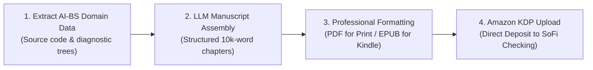

# Amazon KDP Technical Publishing Blueprint: Stehouwer Publishing

## Executive Summary
This blueprint adapts the YouTube intelligence from Sean Dollwet (over 1M views analyzing AI digital publishing) into a concrete, zero-inventory business line for **Stehouwer Publishing**. 

Instead of low-content notebooks or generic fiction, Stehouwer Publishing will publish **focused, high-utility technical field manuals and trade guides** (10,000–20,000 words). These guides are compiled from your existing, proprietary AI-BS domain knowledge bases (`PhoneRepairGuideTab`, `PowerWashingTab`, `SchedulingEngine`), formatted for Amazon Kindle Direct Publishing (KDP), and distributed globally with **zero upfront manufacturing cost, zero inventory, and 100% automated Amazon fulfillment**.

---

## 1. Unit Economics & Royalty Structure

Amazon KDP operates on an on-demand royalty model where Amazon handles digital delivery, printing, and shipping, depositing net royalties directly into your bank account monthly via ACH:

| Format | Retail Price | Amazon Printing / Delivery Cost | Stehouwer Royalty Rate | Net Profit per Sale |
| :--- | :--- | :--- | :--- | :--- |
| **Kindle eBook** | **$9.99** | $0.15 (Digital delivery) | **70%** | **`$6.84`** |
| **Paperback (Print-on-Demand)** | **$19.99** | ~$3.85 (120 pages B&W) | **60% minus print** | **`$8.14`** |
| **Hardcover (Collector/Desk Copy)** | **$29.99** | ~$7.50 (Case laminate) | **60% minus print** | **`$10.49`** |

### Projected Portfolio Monthly Earnings (5 Active Titles)
- Conservative (1 copy/day across 5 titles): 30 sales x $7.50 avg = **`$225 / month`** ($52/week)
- Moderate (3 copies/day across 5 titles): 90 sales x $7.50 avg = **`$675 / month`** ($157/week)
- Strong Performer (8 copies/day across 5 titles): 240 sales x $7.50 avg = **`$1,800 / month`** ($420/week)

---

## 2. Initial Catalog: 3 Ready-to-Assemble Titles

Your AI-BS codebase already contains deep, specialized domain knowledge that can be compiled directly into authoritative manuals:

### Title 1: *The Independent Mobile Repair Technician's Field Manual*
- **Sub-headline:** *Micro-Soldering Schematics, Face ID Serialization, IC Diagnostic Trees, and Operational Store Policies for iPhone & Android Repair.*
- **Source Material in AI-BS:** `frontend/components/PhoneRepairGuideTab.jsx` (2,120 lines of diagnostic trees, workstation layouts, carrier deductible matrices, micro-soldering thermal presets, and component serialization workflows).
- **Target Audience:** Independent repair shops, mobile repair techs, and electronics hobbyists.
- **Why It Sells:** Practical, step-by-step diagnostic trees and thermal profiles are scarce in book format; techs keep physical paperback copies on their workbench.

### Title 2: *The Commercial & Residential Pressure Washing Operations Manual*
- **Sub-headline:** *Chemical Formulations, Fleet Rig Setup, Surface Estimating Matrices, and Commercial B2B Contract Blueprints.*
- **Source Material in AI-BS:** `frontend/components/PowerWashingTab.jsx` and `PrestigeWash` modules (surface dilution ratios, SH chemical mixing calculators, square-footage pricing tables, and commercial property maintenance agreements).
- **Target Audience:** Starting pressure washing contractors and exterior maintenance operators.
- **Why It Sells:** Commercial chemical mixing and B2B pricing formulas save contractors thousands in trial-and-error damage.

### Title 3: *The Autonomous Local Business Architecture*
- **Sub-headline:** *Deploying Automated Customer Scheduling, Real-Time SMS Dispatch, and AI Operations Hubs for Service Trades.*
- **Source Material in AI-BS:** `AutomatedClientSchedulerTab.jsx`, `OperationsAuditHubTab.jsx`, and SQLite backend architecture.
- **Target Audience:** Small business owners, digital agencies, and freelance developers looking for turnkey automation playbooks.

---

## 3. The 4-Step Production Pipeline

### Step 1: Manuscript Generation & Outline
- Structure the book into 7 to 10 practical chapters (1,500 to 2,000 words each).
- Use local models (Ollama on your Ryzen 9 9950X) or Claude to expand technical code routines into clear, instructional prose with ASCII diagrams and checklists.

### Step 2: Cover Design
- Use local ComfyUI on your RTX 4090 (or Canva Pro) to generate a clean, modern, professional book cover (2,560 x 1,600 px for Kindle; full-wrap PDF template with spine calculator for paperback).
- Avoid generic stock-photo aesthetics; use technical blueprint or minimalist dark cyberpunk typography matching Stehouwer Publishing branding.

### Step 3: Formatting & Proofing
- Format text with standard 6x9 inch trim size, 0.75" margins, and clear chapter headers.
- Export interior as:
  - **EPUB** for Amazon Kindle eBook.
  - **Print-Ready PDF** (with embedded fonts) for Amazon Paperback.

### Step 4: Amazon KDP Upload & Launch
1. Log in to [kdp.amazon.com](https://kdp.amazon.com) using your Amazon credentials.
2. Enter Book Metadata:
   - **Author / Publisher:** Brett Stehouwer / Stehouwer Publishing
   - **Keywords:** 7 high-intent Amazon search phrases (e.g., *iphone motherboard repair guide, micro soldering book, phone technician manual*).
   - **Categories:** Non-fiction > Technology > Electronics & Hardware.
3. Upload EPUB + Cover -> Set price to **$9.99** (Enroll in KDP Select for Kindle Unlimited page-read royalties).
4. Upload Paperback PDF -> Set price to **$19.99** -> Order physical author proof copy ($3.85 printing cost).
5. Link Direct Deposit to your SoFi Checking Account (`*3136`).

---

## 4. Immediate 7-Day Action Plan

| Day | Milestone | Actionable Deliverable |
| :--- | :--- | :--- |
| **Day 1** | Outline & Extraction | Extract all 12 diagnostic trees and thermal tables from `PhoneRepairGuideTab.jsx`. |
| **Day 2–3** | Chapter Drafting | Draft Chapters 1–8 (Intake SOPs, Screen Serialization, Face ID Repair, Micro-Soldering, Pricing Matrices). |
| **Day 4** | Technical Review & Edits | Review formatting, verify exact component references, and polish chapter transitions. |
| **Day 5** | Cover & Interior Layout | Generate 6x9 print cover and compile interior PDF/EPUB. |
| **Day 6** | KDP Account & Upload | Set up Stehouwer Publishing on KDP and submit files for Amazon automated review. |
| **Day 7** | Live Publication | Book goes live globally on Amazon.com, Amazon UK, and Amazon Europe. |
