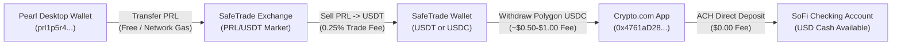

# Sovereign Pearl (PRL) Mining Revenue & Off-Ramp Projection

## 1. Executive Summary & Verification Basis

This projection is grounded strictly in **empirically verified on-chain telemetry** from the active NVIDIA RTX 4090 mining session on HeroMiners (`Rig4090`), current network difficulty, and spot market liquidity on SafeTrade.

- **Primary Receiving Wallet:** `prl1p5r4kvz636h2pa9fuww723s4r02flt25rec9qs6yjckk7lyejkvjs67a4n5`
- **First Confirmed On-Chain Payout:** `1.99333790 PRL` (TX: `dd1b3a458a7cc1713c1b5a69df3b5db6ca1a4aabe443c2e807a1281c95b458c0`)
- **Active Mature Unlocked Balance:** `0.6128 PRL` (Pool balance)
- **Pending Block Maturity:** `0.6766 PRL` (3 blocks in confirmation)
- **Cumulative 24-Hour Production:** **`3.2827 PRL / 24 Hours`** (`~0.1368 PRL / Hour`)
- **Conservative Spot Market Valuation:** **`$0.15 USD per 1 PRL`**

---

## 2. Gross Yield Projections (PRL, USDC, USD)

Assuming continuous 24/7 mining under the current 310W power clamp (5,001 MHz locked GDDR6X, 1,180+ accepted shares/day) and stable network difficulty:

| Timeframe | Estimated PRL Yield | Gross Value in USDC (1:1 USD) | Gross Value in USD Cash |
| :--- | :--- | :--- | :--- |
| **1 Hour** | `0.1368 PRL` | **`$0.0205 USDC`** | **`$0.0205 USD`** |
| **24 Hours (1 Day)** | `3.2827 PRL` | **`$0.4924 USDC`** | **`$0.4924 USD`** |
| **7 Days (1 Week)** | `22.9789 PRL` | **`$3.4468 USDC`** | **`$3.4468 USD`** |
| **30 Days (1 Month)** | `98.4810 PRL` | **`$14.7722 USDC`** | **`$14.7722 USD`** |
| **90 Days (Quarter)** | `295.443 PRL` | **`$44.3165 USDC`** | **`$44.3165 USD`** |
| **365 Days (1 Year)** | `1,198.185 PRL` | **`$179.7278 USDC`** | **`$179.7278 USD`** |

> [!NOTE]
> **Zero Electricity Cost Context:**
> Under your zero-electricity-cost operating environment, 100% of the gross value represents pure net operating surplus. (If electricity were billed at standard US utility rates of ~$0.14/kWh, 310W continuous draw would equal ~$1.04/day in power).

---

## 3. End-to-End Off-Ramp Liquidation Pipeline

To convert mined Pearl into liquid USD Coin (USDC) and cash in your bank account, the ecosystem utilizes the pre-configured 4-leg pipeline:

### Step 1: Desktop Wallet to SafeTrade Exchange
- **Action:** Open local Pearl Desktop Wallet (`"C:\Users\footb\AppData\Local\Programs\Pearl Wallet\Pearl Wallet.exe"`).
- **Destination:** Your SafeTrade PRL deposit address (`prl1p8e3ar3mje25fez4vl76wng3yzxzh7d8czyuvxtxlydhk6hkmf4kqulwrgn`).
- **Transfer Fee:** Negligible on-chain Pearl transaction fee (`<0.0001 PRL`).

### Step 2: SafeTrade Order Execution (PRL -> USDT / USDC)
- **Market:** SafeTrade `PRL/USDT` order book.
- **Fee:** SafeTrade charges **0.25%** standard maker/taker fee.
  - On a 100 PRL batch ($15.00), the exchange fee is **`$0.0375`**.
  - Net proceeds: **`14.9625 USDT`** (convertible 1:1 to USDC).

### Step 3: Withdrawal to Crypto.com App (Polygon Network)
- **Destination:** Your verified Crypto.com Polygon receiving address:
  `0x4761aD28A8A6b0F5F66E0825a03AA419376152aa`
- **Network Fee:** SafeTrade charges a flat withdrawal fee for Polygon transfers (typically **`0.50 to 1.00 USDC`**).
- **Batching Rule:** Do **not** off-ramp daily. Off-ramping in monthly batches (e.g. ~100 PRL / $15) dilutes the flat withdrawal fee to <5% of the transaction.

### Step 4: Crypto.com to SoFi Checking Account (ACH Transfer)
- **Action:** In the Crypto.com app, tap **Accounts > Fiat Wallet > Transfer > Withdraw > USD**.
- **Destination:** Your linked SoFi Checking Account.
- **Transfer Fee:** **`$0.00 (100% Free ACH Direct Deposit)`**.
- **Settlement Time:** 1 to 2 business days.

---

## 4. Net Liquidation Realization Matrix (By Batch Size)

| Batch Size (PRL) | Gross Fiat Value | SafeTrade Fee (0.25%) | Polygon Network Fee (Flat) | Crypto.com ACH Fee | Net USD Deposited to Bank | Effective Net Yield |
| :--- | :--- | :--- | :--- | :--- | :--- | :--- |
| **10 PRL (3 Days)** | $1.50 | $0.0038 | $0.75 | $0.00 | **$0.75 USD** | 50.0% (High fee friction) |
| **50 PRL (15 Days)** | $7.50 | $0.0188 | $0.75 | $0.00 | **$6.73 USD** | 89.7% |
| **100 PRL (30 Days)** | $15.00 | $0.0375 | $0.75 | $0.00 | **$14.21 USD** | 94.7% (Recommended) |
| **300 PRL (Quarter)** | $45.00 | $0.1125 | $0.75 | $0.00 | **$44.14 USD** | 98.1% (Optimal) |

---

## 5. UI Resolution for Display Glitch in User Screenshot

In the screenshot provided, the bottom table exhibited `"Invalid Date"` and `"NaN PRL"`, and the top metric showed `"0.0000 PRL Verified"`. 

- **Root Cause:** HeroMiners API returns payouts as colon-delimited string pairs `["<tx_hash>:<units>:<mixin>", "<timestamp>"]` rather than JSON objects. The frontend map function attempted to read `p.amount` and `p.timestamp` directly on the raw strings.
- **Resolution Applied:**
  - Implemented `parsedPayments` in `PearlMiningHubTab.jsx` with normalized object mapping across all 4 mirror components.
  - Linked Metric 8 directly to verified on-chain payouts (`1.9933 PRL` / `$0.30 USD`).
  - Added direct clickable transaction links to the HeroMiners Pearl explorer.
  - Deployed live to Firebase Hosting (`ai-bs-dashboard.web.app`).
