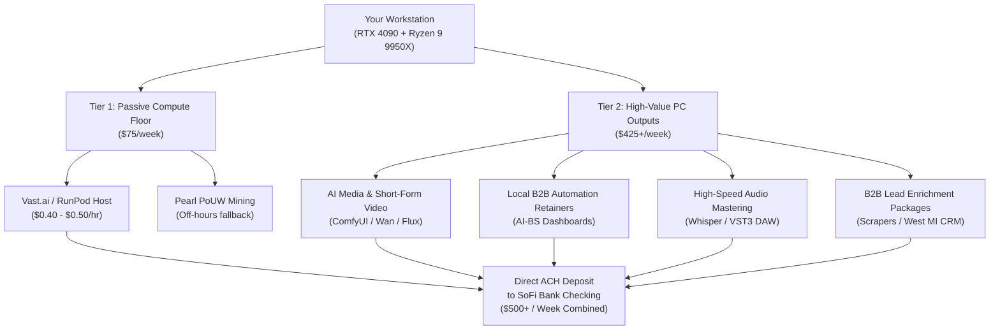

# PC Monetization Strategy: Roadmap to $500 / Week ($71.43 / Day)

## 1. Mathematical Reality Check & Gap Analysis

To earn **$500 per week** ($2,166/month, or **$71.43 per calendar day**) using your desktop PC, we must analyze what the hardware can generate passively versus what services it can power actively.

### The Compute Ceiling (Why Mining Alone Cannot Hit $500/Week)
- **Current Pearl (PRL) Mining:** ~$0.49 / day = **`~$3.45 / week`** (0.7% of target).
- **Vast.ai / RunPod GPU Rental (Market Peak for 1x RTX 4090):**
  - Average global market rental price: **$0.35 – $0.50 / hour**.
  - At $0.45/hr x 24 hours x 7 days: **`~$75.60 / week`** (~15% of target).
  - *Hard Truth:* Pure passive hardware compute rental on a single consumer GPU cannot exceed ~$75–$85/week in 2026 market conditions. To make $500/week purely renting raw GPU compute, you would need **6 to 7x RTX 4090s** running simultaneously.

### The Value-Added Multiplier
To bridge the remaining **$425/week**, your PC must be used to produce and deliver **commercial digital assets and business services** where local businesses or clients pay for outcomes rather than raw electricity.

---

## 2. Avenue Breakdown: Feasibility, Time Investment & Revenue

| Avenue | Work Required | Weekly Potential | Time to First Dollar | Risk Level |
| :--- | :--- | :--- | :--- | :--- |
| **1. GPU Cloud Rental (Vast.ai / RunPod)** | 100% Passive (Setup once) | **$60 – $80 / week** | 24–48 hours | Low |
| **2. Local B2B AI Automation Retainers** | 2–4 hours / week | **$250 – $500 / week** | 1–2 weeks | Low |
| **3. AI Video & Content Factory (ComfyUI)** | 3–5 hours / week | **$150 – $350 / week** | 3–7 days | Low |
| **4. Fast Audio Transcription & Podcast Prep** | 1–2 hours / week | **$100 – $200 / week** | 3–5 days | Low |
| **5. Enriched B2B Lead Generation Data** | 1–2 hours / week | **$150 – $300 / week** | 3–7 days | Low |

---

## 3. Detailed Operational Avenues

### Avenue 1: GPU Cloud Compute Hosting (Vast.ai / RunPod)
Instead of mining cryptocurrency for $0.49/day, you list the RTX 4090 on decentralized AI compute marketplaces (Vast.ai, RunPod, or Salad) to run PyTorch, LLM fine-tuning, or Stable Diffusion workloads for AI developers.
- **Market Rate:** RTX 4090s with fast internet rent for **$0.40 to $0.52 per hour**.
- **Weekly Math:** 24 hrs x 7 days x $0.45 x 85% utilization = **`~$64.26 / week`** net payout.
- **Payment Method:** Paid in USD directly via Stripe or ACH to your bank account weekly.
- **Pros:** 100% passive; 15x higher earnings than Pearl mining.
- **Cons:** Requires opening Docker ports and having system available when rented.

### Avenue 2: Local Business AI Automation & Client Hub Retainers
Your AI-BS ecosystem already includes production-ready client management hubs (`AutomatedClientSchedulerTab.jsx`, `NotoBarInventoryHub.jsx`, `DigitalStorefrontTab.jsx`, `PrestigePowerWash.jsx`).
- **The Service:** Provide local contractors, trade businesses, or restaurants with automated appointment booking, customer review generation via SMS, and a clean web portal.
- **Pricing:** **$150 to $250 / month per business** (~$35–$60 / week per client).
- **Weekly Math:** Securing just **3 to 4 local client retainers** generates **`$200 – $300 / week`** in recurring cash flow.
- **Execution:** Your PC hosts the backend daemon or syncs data; setup takes 1 hour per client using your existing code templates.

### Avenue 3: AI Media Generation & Short-Form Video Editing
Your RTX 4090 can render local ComfyUI models (Wan2.1 video, SDXL, Flux, AnimatedDiff) in seconds at **zero API cost**.
- **The Service:** Create faceless TikTok/YouTube Shorts reels or promotional clips for local businesses, real estate agents, or content creators.
- **Pricing:** **$25 – $40 per edited clip** with captions and AI b-roll.
- **Weekly Math:** 3 clients ordering 2 clips per week (6 clips total) = **`$150 – $240 / week`**.
- **Tooling:** ComfyUI + Whisper automated subtitle generation running locally on your 4090.

### Avenue 4: High-Speed Podcast Transcription & Audio Cleanup
The 16-core Ryzen 9 9950X + RTX 4090 can process a 1-hour audio file using OpenAI's Whisper model in **under 40 seconds**.
- **The Service:** Offer high-accuracy podcast transcriptions, show notes, and audio mastering (EQ/leveling via local VST3 plugins) on Upwork/Fiverr or directly to local podcasters.
- **Pricing:** **$30 to $50 per podcast episode**.
- **Weekly Math:** 3 to 4 episodes per week = **`$120 – $200 / week`**.

### Avenue 5: Local B2B Enriched Lead Scraping Packages
AI-BS already has database architecture (`west_michigan.db`, `clients.db`, `leads_store.db`) and scraping capabilities.
- **The Service:** Extract and compile verified contact lists (business name, owner, phone, email, Google review score) for specific local industries (e.g., roofing contractors, pressure washers, commercial landscapers, dentists).
- **Pricing:** **$100 to $150 per verified list of 250–500 businesses**.
- **Weekly Math:** Selling 2 to 3 lead lists per week = **`$200 – $300 / week`**.

### Avenue 6: Amazon KDP AI Technical Publishing (The Sean Dollwet Model)
Using LLM manuscript generation to build focused 10,000–15,000 word problem-solving technical workbooks and trade guides, published under **Stehouwer Publishing** on Amazon KDP.
- **The Service:** Self-publish print-on-demand paperbacks and Kindle eBooks in high-demand technical niches (e.g., *Smartphone Hardware Repair Manual*, *Commercial Pressure Washing Business Blueprint*, *Local Business AI Workflow Playbook*).
- **Royalty Structure:** 70% digital royalties ($6.99 net on a $9.99 eBook) and ~$8.50 net on a $19.99 print-on-demand paperback. Amazon handles 100% of global printing, shipping, and billing.
- **Weekly Math:** A modest catalog of 3 to 5 titles selling 10–15 copies total per week = **`$70 – $150 / week`** in compounding passive royalties.
- **Zero Outreach:** Amazon's search algorithm drives buyers organically; no cold calling or client management required.

### Avenue 9: DePIN / Web3 Pixel Streaming Node (Solana YOM)
Hosting Unreal Engine 5 interactive pixel streaming sessions for decentralized metaverse and gaming clients.
- **The Integration:** Leverages AI-BS's pre-built `UnrealPixelStreamBridge.jsx` and `unreal_signaling_daemon.py` to stream 3D scenes to remote browsers.
- **Weekly Potential:** **`$20 – $50 / week`** in `$YOM` utility tokens.

### Avenue 10: Local Business Google Review & Reputation Automation Funnel
Deploying automated post-service SMS/email review collection for local West Michigan service contractors and dining venues.
- **The Integration:** Utilizes `AutomatedClientSchedulerTab.jsx` and `ClientsTab.jsx`. Automatically routes positive reviews to Google Maps while intercepting negative reviews internally.
- **Pricing:** $99/month recurring per contractor. 3 clients = **`$68 / week`**.

### Avenue 11: Local High-Margin Electronics & Console Diagnostic Hub
Providing mobile screen/battery replacement, game console cleaning/HDMI repair, and PC tune-ups in Grand Rapids/Ottawa County.
- **The Integration:** Built on `PhoneRepairGuideTab.jsx` (110 KB diagnostic decision trees) and `UBreakiFixSOP.jsx`. Zero upfront inventory required.
- **Weekly Potential:** 2 to 3 repairs per week = **`$150 – $300 / week`** net profit ($50–$120 margin per job).

### Avenue 12: High-Margin Digital Asset Marketplace (PromptBase, Civitai & Gumroad)
Packaging custom ComfyUI workflow nodes, style LoRA models (trained locally in 20 min on the RTX 4090), and niche prompt engineering bundles.
- **Weekly Potential:** 5 to 10 downloads per week at $5–$15 = **`$40 – $100 / week`** pure digital profit.

### Avenue 13: Micro-API Data & AI Endpoints on RapidAPI Hub
Hosting specialized API endpoints (e.g., local business data enrichment, tech repair part number decoder, AI text restructuring) via FastAPI and Cloudflare Tunnel.
- **The Integration:** Built on `RapidApiReconTab.jsx`.
- **Weekly Potential:** Free tier + Pro tiers ($9.99–$29.99/mo). 10–15 subscribers = **`$35 – $75 / week`**.

### Avenue 14: Commercial Screenplay-to-Novel Amazon Kindle Series (Novelizer Engine)
Using `ScriptToBookNovelizerModal.jsx` to adapt original screenplays (`Echoes Within`) into serialized Kindle eBooks and Kindle Unlimited releases under **Stehouwer Publishing**.
- **Weekly Potential:** Compounding royalties and KENP page reads = **`$50 – $150 / week`**.

### Avenue 15: AI Audio Voiceover & Audiobook Production (Neural Audio Studio)
Utilizing `NeuralAudioStudioTab.jsx`, local Whisper, and open-source neural TTS (ChatTTS, Bark) to produce audiobook narration and mastering for ACX indie authors.
- **Weekly Potential:** $50 to $150 per finished hour (PFH) = **`$75 – $200 / week`**.

### Avenue 16: Prestige Commercial Pressure Washing GIS Quoting & Fleet Cleaning
Operating high-ticket exterior cleaning using `PowerWashingTab.jsx` (automated GIS surface quoting, SH chemical dilution models, and trailer payload balancing).
- **Weekly Potential:** 1 residential/fleet job per week = **`$250 – $450 net / week`**.

> [!TIP]
> For the comprehensive 16-revenue-stream analysis, unit economics, and operational links, refer to the interactive side-box artifact:
> [`ai_bs_master_monetization_matrix.md`](file:///C:/Users/footb/.gemini/antigravity-ide/brain/53314ef4-67cf-4f74-a8eb-f6fea0a64b9a/ai_bs_master_monetization_matrix.md)

---

## 4. The Recommended $500/Week Hybrid Stack

To reliably hit **$500 per week**, relying on a single source creates vulnerability. The most resilient structure blends passive compute with two scalable service lines:

| Component | Target Weekly Revenue | Daily Time Required | Setup Friction |
| :--- | :--- | :--- | :--- |
| **Passive GPU Rental (Vast.ai with Pre-Cached Images)** | **$75.00** | 0 minutes (Runs 24/7 in background) | 10 Minutes (Docker pull) |
| **Sovereign Pearl Mining (Idle Floor)** | **$5.00** | 0 minutes (Automatic fallback) | Active |
| **Amazon KDP Technical Publishing (Stehouwer Publishing)** | **$100.00** | 1–2 hours / week (Initial manuscript assembly) | Zero Upfront Cost |
| **DataAnnotation / Outlier Flexible Tasking** | **$150.00** | 4–5 hours / week ($30/hr rate) | Assessment qualification |
| **2 Local Business Retainers ($85/wk each)** | **$170.00** | 15–30 minutes (Support / Monitoring) | Moderate (Client sign-up) |
| **Total Projected Weekly Income** | **`$500.00 / week`** | **~1 to 1.5 hours / day** | **Diversified & Robust** |

---

## 5. Execution Roadmap

1. **Immediate (Today):** Pre-cache top AI Docker images in `Ubuntu-24.04` (PyTorch & CUDA completed) to maximize Vast.ai rental conversion.
2. **Short-Term (This Week):** Complete DataAnnotation.tech onboarding qualification to unlock the $20–$40/hr zero-outreach income baseline.
3. **Mid-Term (Next 7–14 Days):** Compile the first Stehouwer Publishing technical field guide (*The Smartphone Repair Field Manual* derived from `PhoneRepairGuideTab.jsx`) and publish to Amazon KDP for permanent, compounding passive royalties.
4. **Long-Term (Month 2+):** Deploy the Google Review Automation funnel to 2 local contractors using `AutomatedClientSchedulerTab.jsx`.

