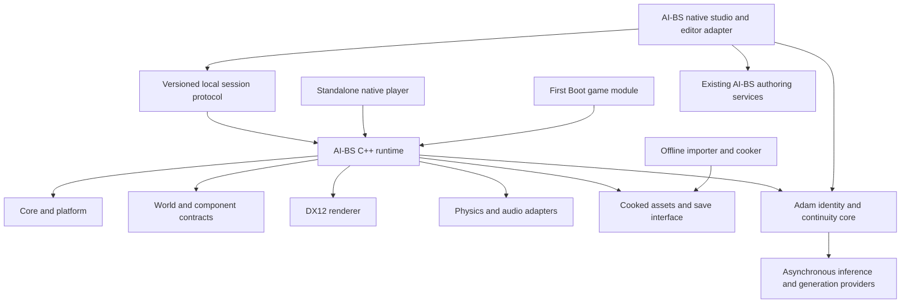

# AI-BS core game engine implementation plan

> **Historical planning snapshot — superseded execution sequence.** This document records the 2026-10-31 proposal and its observations at that time. Native C++ implementation was subsequently authorized and SDK 0.4 was built and verified. Statements below such as "planning only," "no native engine implementation" and old milestone numbers remain historical; they are not current instructions or current build status. The accepted continuing sequence, private First Boot alpha scope and next three tested slices are now in [the current build roadmap](../../engine/BUILD_ROADMAP.md) and [machine-readable milestone queue](../../engine/milestone_queue.json). Consult [actual build results](../../engine/BUILD_STATUS.md) and [the ongoing ledger](AI_BS_GAME_ARCHITECTURAL_BUILDER_LEDGER.md) for implementation evidence and remaining limits. Original design material below is preserved for traceability.

Date: 2026-10-31 (America/New_York). Status: PROPOSED architecture and implementation backlog. No native engine implementation, SDK installation, or successful engine build is asserted by this plan.

Build an independently owned AI-BS engine with a native player, a reusable C++ SDK, an asset cooker, and native editor tools. Use First Boot as the first game and integration test: BS restores power, repairs a fault, opens a world gate, and reloads into the repaired world. Unity/Unreal-style capabilities are a long-term product direction; the first deliverable is a small engine alpha with a complete development-to-player workflow.

The architecture requirements and proposed decisions are in [spec.md](spec.md). The researched dependency register is [sdk_registry.json](sdk_registry.json). Starter component types and inspector metadata are in [component_contracts.json](component_contracts.json). These JSON files are design contracts, not installed-package manifests or runtime implementations.
The user selected all three creation workflows (AI, visual tools and code) and the full range of world building. [Authoring and world-building planning](authoring_and_world_building.md) expands that target; [planning_decisions.json](planning_decisions.json) separates confirmed direction from proposed implementations. The current task remains planning, with no SDK provisioning or source build started.
Adam is the user-selected living continuity core across architecture, creation and play. [Adam core and First Boot](adam_core_and_first_boot.md) defines his foundational memory and opening expression; [cue/continuity contracts](adam_first_boot_contracts.json) records proposed triggers and delivery rules. M5 enriches an already-present Adam rather than introducing him.

## 1. Repository baseline and readiness

Read-only source inspection recorded branch `codex/audit-v532976-20261031`, commit `d321b96219427d998dd8c97c214967a5f3f2a8e3`. The working tree already contained unrelated modifications. This planning package adds documentation under `docs/game_engine`; it does not replace root mission files, migrate databases, or change the architectural ledger. Ledger and handoff fingerprint updates remain deferred under the project instructions.

| Classification | Finding | Consequence |
| --- | --- | --- |
| VERIFIED | `native_studio/engine.py:113` is a Qt thread-pool task bus. | Reuse for editor/background work; build a separate real-time runtime. |
| VERIFIED | `frontend/src/components/industry_hubs/GameEngineArchitectureHub.jsx:27` embeds an Unreal bridge. | Preserve existing integrations as separate tools; the new player owns its rendering. |
| VERIFIED | `frontend/components/Noco3DCampusWalkthrough.jsx:135` implements browser 3D navigation. | Useful interaction reference; native player implementation remains separate. |
| VERIFIED | `rust_master_worker/Cargo.toml:6` lists SQLite/Tokio dependencies. | No demonstrated rendering or physics foundation in that component. |
| VERIFIED | `backend/core/program_builder_engine.py:161` recognizes CMake projects. | Existing build tooling can later launch the engine's own presets. |
| VERIFIED | Git and Python resolve in the inspected shell; compiler, CMake, Ninja, Rust/Cargo, and vcpkg commands do not. Conventional VS/Windows SDK locations were not found. | M0 verifies or provisions a working native toolchain. Custom installations elsewhere remain UNVERIFIED. |
| VERIFIED | An `engine/` source directory was absent during inspection. | Add a scoped engine tree during implementation. |
| UNVERIFIED | Current GPU driver, live VRAM availability, compiler compatibility, engine dependency resolution, and packaged-player performance. | Measure with real tools; source documentation is not a hardware acceptance result. |

The master ledger records native desktop policy and existing service infrastructure. Keep its existing features available. The new C++ runtime is an additive subsystem; it does not convert the application into a game or require a browser surface.

## 2. Core component boundaries

| Module | Responsibilities | First useful proof |
| --- | --- | --- |
| Platform | Native window/surface ownership, input actions, displays, controller events, monotonic time, files | Resize, minimize, focus changes, remapped input, clean shutdown |
| Core | Lifecycle, results/errors, allocators, logging, tracing, bounded job queues, cancellation | Headless application starts and stops with no orphan jobs |
| Renderer | DX12 device/swapchain, resource lifetimes, barriers, shader pipeline, cameras, materials, lighting, debug views | Real GPU-rendered primitive with validated resize and teardown |
| World | Entity/component storage, stable IDs, transforms, scenes, prefab instances, typed events | Serialize, reload, and resolve one scene with valid references |
| Authoring core | Authoritative project documents, schema validation, transactions, revision/history and recovery | AI, UI and SDK clients edit one document through the same API |
| Physics | Collision layers, shape/ray queries, rigid bodies, capsule character, sensors | Walk, ground, step, collide, and target a repairable object |
| Navigation | Tiled route queries, dirty-region invalidation and geometry/obstacle rebuild coordination | NPC routing follows admitted bridges, walls and terrain edits |
| Assets | Source registry, import validation, cooking, dependencies, asynchronous loading, runtime resource handles | Import a GLB, cook it, and load it without source paths |
| Audio | Buses, spatial emitters/listener, streaming, dialogue playback | Fan hum changes with power; Adam line plays with volume controls |
| Runtime UI | HUD, settings, subtitles, focus/navigation, game panels, glyph/sprite assets | Startup dashboard, readable prompts, keyboard/controller menu navigation |
| Animation | Skeleton/clip assets, pose sampling, skinning, transitions, update budgets | BS locomotion and repair animation in the packaged chapter |
| Gameplay framework | Registered actions/events, interaction queries, generic construction operations and extension points | A game module registers its own components/rules |
| First Boot game module | BS/Adam rules, faults, objectives, power links and world gates | Repair a fault and change the hub through typed game events |
| Persistence | Snapshot capture, versioned save-store API, queued commits, migrations, import/export | Restart restores the last committed repaired-world state |
| Editor | Project browser, viewport, outliner, inspector, asset browser, console, undo/redo, Play/Stop | Author a scene, play a copy, undo an edit, save and reload |
| Adam core | Required identity, semantic memory, evidence-backed interpretation, restoration priorities and authoring context | Offline recall of actual choices, shortcuts, hazards and repaired regions |
| AI providers | Asynchronous generation/retrieval/language adapters enriching Adam and authoring jobs | Delayed/unavailable providers preserve Adam's continuity and simulation |
| Build/cooker CLI | Validation, dependency traversal, shader/asset cooking, player assembly | Run a packaged First Boot build away from the source tree |

Dependency direction:

The player links the runtime and game module. It has no mandatory dependency on Python, Qt, Ollama, ComfyUI, NATS, Temporal, the editor, or a running HTTP server. Existing orchestration services can schedule authoring jobs outside the frame loop.

## 3. SDK and build decisions

Use C++20, Windows x64, MSVC with a Windows SDK, CMake presets, Ninja, and vcpkg manifest mode. M0 records exact compiler/SDK/build-tool versions and an immutable vcpkg tool revision and registry baseline. A vcpkg baseline establishes version floors; exact overrides and the resolved transitive package set must also be recorded where necessary. Do not describe a floating baseline as a lockfile. [Official versioning tutorial](https://learn.microsoft.com/en-us/vcpkg/consume/lock-package-versions).

| Dependency | Proposed role | Introduce |
| --- | --- | --- |
| SDL3 | Standalone window, input, controller/display lifecycle | M1 |
| Windows SDK / Direct3D 12 | Native graphics backend and platform declarations | M0-M1 |
| DXC / HLSL | Offline shader compilation and diagnostics | M1 |
| DirectXMath | Math implementation behind AI-BS value types | M1 |
| Dear ImGui | Development overlay and initial inspection tools | M1 |
| D3D12 Memory Allocator | GPU heap/resource allocation behind renderer handles | M2 |
| EnTT | Component storage behind AI-BS world interfaces | M2 |
| cgltf / glTF 2.0 | Import subset: static meshes, transforms, PBR materials | M2 |
| DirectXTex | Cooker-side image conversion, mip generation, DDS processing | M2 |
| Jolt Physics | Collision, rigid bodies, character and sensor integration | M3 |
| miniaudio | Spatial sound, buses, streamed dialogue playback | M3 |
| SQLite | Save-store implementation and namespaced integrated persistence | M3 |
| Existing PyQt6 studio | Optional editor shell and background authoring UI | M4 |
| Lua | Later mission scripting behind the same gameplay command API | After M6 |
| PIX / RenderDoc | Development captures, timing and resource diagnostics | M1 onward |

Upstream roles, license references, caveats, and pin status are recorded per dependency in `sdk_registry.json`. Select compatible releases at the milestone that introduces each dependency; do not install every SDK up front. Compile-time third-party types do not become scene/save identities or the public plugin ABI.

Use the system DX12 runtime for the initial renderer feature subset. Add a pinned non-preview Agility SDK only when a selected graphics feature needs it. Record the SDK version, runtime path, supported OS/driver feature probes, and packaged DLL set together. [Official Agility integration guide](https://devblogs.microsoft.com/directx/gettingstarted-dx12agility/).

Preserve the existing PyQt editor integration. Its GPL/commercial licensing and the selected Qt distribution need their own editor redistribution decision; the standalone player does not link them. [Publisher licensing description](https://www.riverbankcomputing.com/software/pyqt/intro).

## 4. AI-BS developer SDK surfaces

The first SDK is headers plus CMake targets and examples built with one recorded toolchain. Suggested target names are `AIBS::Core`, `AIBS::World`, `AIBS::Render`, `AIBS::Physics`, `AIBS::Audio`, `AIBS::UI`, `AIBS::Animation`, `AIBS::Assets`, `AIBS::Gameplay`, `AIBS::Authoring`, `AIBS::Adam`, and `AIBS::AI`; `AIBS::Navigation` enters with its later navigation adapter. Names are proposed API contracts, not available build targets.

| SDK surface | Initial contract |
| --- | --- |
| Application | Initialize/shutdown, fixed update, render snapshot extraction, pause/resume, typed failure reporting |
| World | Generation-checked handles, stable UUID lookup, registered component access, deferred spawn/despawn commands |
| Components | Versioned field registration, constraints, defaults, scene/save policy, inspector descriptions, migrations |
| Assets | Asset IDs, async requests, load/cancel state, typed resource handles, missing-asset errors |
| Gameplay | Action intents, typed events, interaction queries, objective flags and undoable edit commands |
| UI and animation | Game UI layout/focus/actions and cooked text/image assets; later skeleton/clip handles, pose playback and animation events |
| Editor | Component inspector extensions, importers, selection/picking, project commands and Play-session lifecycle |
| Authoring | Shared document ownership, validated grouped operations, durable revision/history and recoverable project publication |
| AI authoring | Submit/cancel jobs, immutable artifact results, import validation, user-visible provenance |
| Adam | Scoped event memory/projections, known routes/hazards, historical recall, restoration interpretation, authoring rationale and registered action planning |
| Adam expression | Initial `Speak`, `Highlight`, `SuggestObjective` outputs with request/revision/expiry fields; voice/UI/haptic delivery is separate from memory |

First Boot is a statically linked C++ game module. Dynamic binary plugins and C++ hot reload follow a demonstrated need; a later plugin boundary uses an explicitly versioned C function table and opaque handles. Compiler-specific C++ layouts and EnTT internals stay within one binary/toolchain boundary.

Deliver one documented sample for each SDK introduction: native sandbox at M1, scene round-trip and continuity-event contract at M2, fault-repair plus offline Adam recall at M3, editor command/history at M4, and provider-enriched Adam result at M5. An SDK capability is usable only when its sample builds and runs.

## 5. Attributes, identity, and scene data

Each inspector field has a stable field ID, explicit type/default, units where meaningful, range/reference constraints, editor control, and separate scene/save/transient policies. A component has a stable type ID, schema version, validation rules, and explicit migration behavior. See `component_contracts.json` for the initial registered fields.

Use meters, seconds, kilograms, radians, normalized xyzw quaternions, and linear-space colors. Public world coordinates are left-handed, +Y up, +Z forward; the glTF importer explicitly converts source handedness, winding, transforms, normals/tangents, and animation data. A round-trip fixture catches mirrored geometry. Skeletal animation import is a later milestone; reject unsupported extensions rather than silently dropping them.

Stable entity/asset UUIDs persist; runtime handles include generation values and never enter save files. Transform parents form a forest. Scene references and the opening power network are validated before play; power is derived after load rather than independently saved. Saved gameplay overrides are keyed by entity UUID plus component/field IDs, never memory offsets.

Separate source authoring JSON from cooked runtime data. A cooked package header records magic/version, target, schema versions, dependency IDs, and content integrity. Cache keys include normalized source content, dependency content, importer version, settings, target, and shader/compiler version. Exclude timestamps and machine-specific absolute paths from canonical content identity. Cooking checksums are implementation requirements; current handoff checksum generation remains deferred.

## 6. Execution, persistence, and AI boundaries

The simulation owner applies input and typed commands at fixed 60 Hz. Physics uses the same step. Start with at most four catch-up ticks per rendered frame; cap excess accumulated time and record overload events. Pause cleanly on long suspension. Render interpolates immutable snapshots; asset/audio/save workers do not mutate world state. Fixed stepping does not promise identical physics across platforms or compiler configurations.

The editor starts the runtime as a separate native process first. Use a versioned, length-bounded local named-pipe protocol for scene commands, acknowledgments, logs, and selection updates. Maintain command IDs, scene revisions, rejection reasons, and process-owned resource cleanup. The initial editor launches a separate viewport window. Add embedded native HWND surfaces only after focus, DPI, resize, shutdown, and GPU-lifetime tests pass. Never transfer pointer values or arbitrary Python evaluation through this protocol.

Play starts from an isolated snapshot of the authored scene. Stop discards transient play changes. Applying selected play changes is a later explicit editor command. Save/undo/hot-asset reload occur at safe simulation boundaries, with affected collision/render resources retired after their consumers finish.

`MasterDbSaveStore` integrates new `engine_game_*` tables in `backend/aibs_master.db`; `LocalSaveStore` uses the same schema under a per-user game data path for standalone deployment. Both implement one versioned export/import format. Store small checkpoint blobs, game schema/version, project and slot IDs, world revision, and creation times. Assets remain outside the database. Commit an immutable snapshot on a worker in one transaction; configure bounded busy handling, preserve the last committed slot after failures, and report errors to the player. Do not change shared database journal policy without measuring its existing configuration and writer behavior.

Adam is the first-class native continuity/interpretation core for both authoring and play. Preserve semantic events for declared choices, routes/shortcuts, hazards survived, constructions, failures, repairs and regional restoration. Rebuild bounded working projections from durable versioned records; generated summaries retain event references and do not replace history. World deltas and corresponding continuity records commit atomically with operation deduplication. Keep project/context/timeline/branch identities explicit so editor experiments and later checkpoint branches are not mistaken for current-player facts.

Adam frames asset/code/sector generation through actual job and transaction outcomes. Each asset still needs validated geometry/material/collision/rig/LOD data appropriate to its use. Validate expression/planning request IDs, session/load epoch, authored-scene revision, target generation/preconditions, allowed command, size, frequency and expiry before the authoritative owner applies a registered action. Simulation ticks, movement and unrelated transient gameplay do not invalidate all pending responses. Local memory and authored expression work offline; model providers enrich them asynchronously. Repair stability, durable checkpoint completion, build success and verified package behavior are separate facts. Game commands manipulate simulated world state; repository history becomes game lore only through explicit versioned publication.

## 7. Milestone backlog and acceptance

Every milestone depends on the previous one unless stated. Packaging and launch checks begin at M1; they are repeated after dependency changes, not postponed to the end. No calendar estimate is committed before a working M1 profile identifies the actual integration effort.

### M0: Reproducible native toolchain

- Verify a compiler/Windows SDK using installation discovery plus an actual x64 compile/link; install scoped prerequisites only during the implementation task.
- Add `engine/CMakeLists.txt`, `CMakePresets.json`, dependency manifest/baseline, a resolved dependency report, and a toolchain preflight script.
- Define core, player, sandbox, headless-test and cooker targets. Early cooker may only validate a minimal project manifest; do not claim asset cooking yet.
- Record compiler/runtime flags, build presets, tool/SDK versions, dependency notices and redistributable decisions. Cache resolved build inputs for later offline rebuilding where licensing permits.
- Acceptance: configure/build a clean tree, run a headless executable, and reproduce it from the documented preset without editing machine-specific source paths.

### M1: Native player and real rendering

- Implement SDL3 lifecycle/input and a small DX12 device/swapchain path, DXC shader build, depth buffer, camera, math and ImGui diagnostic overlay.
- Handle frame synchronization, fences, resource transitions, resize/minimize, device errors and shutdown. Measure frame intervals with a monotonic clock.
- Acceptance: a packaged sandbox draws a real primitive, moves a camera, survives repeated resize/focus/launch-close cycles, and runs with no Python/Qt/AI services. No unexplained D3D12 debug-layer errors in the exercised path.
- Evidence: GPU capture plus log of target hardware, driver, build and feature level. A screenshot alone does not establish cleanup or synchronization correctness.

### M2: World, attributes, and static asset pipeline

- Add EnTT-backed world storage, UUID/handle separation, transform hierarchy, schema registry and scene serialization.
- Define the shared project document, transaction IDs/revisions, grouped edits, operation acknowledgements and source ownership for AI/visual/code workflows. Reserve prefab-local identity, persistent player-created entity records, owning cells, deletions and terrain delta versions before editing tools grow.
- Define Adam's required native core, semantic event schemas, context/timeline/branch IDs, journal/projection contracts, evidence references and checkpoint event heads. His live model context is not the persistence format.
- Add initial cgltf import subset and image cooking with explicit resource/path/format validation. External resources stay inside the declared project asset roots.
- Implement material constants/textures, basic PBR lighting and one shadowed light, asset handles and missing-resource behavior.
- Specify opaque/alpha-test/transparent passes, precooked shader variants and stable resource handles; add basic frustum culling and instancing before construction stress scenes. Geometry/collision jobs carry source revisions for later safe replacement.
- Define a small runtime UI layer for glyph/sprite drawing, layout, input focus and action routing. The initial English UI uses explicitly licensed cooked font assets and a declared character set; select and pin the font-baking/text implementation in M2. Full shaping and additional writing systems require their own validated extension. ImGui serves development inspection; player HUD/menu behavior belongs to the runtime UI contract.
- Acceptance: import/cook/load a static GLB scene; correct orientation/color space; reject a broken reference or unsupported extension with a useful error; identical declared inputs produce identical canonical outputs; an upstream change invalidates its dependents.

### M3: Playable simulation and first repair

- Add fixed-step input/physics, capsule controller, ray targeting, interaction commands, power graph, fault state, objective and world gate.
- Keep First Boot-specific power/fault/objective systems in its game module. Implement the first generic placement transaction and created/deleted entity persistence through explicit room transitions; full terrain editing remains a later deliverable.
- Add audio playback and both save-store implementations with save-schema migrations and exported checkpoint support.
- Implement native Adam continuity, journal-backed choices/routes/hazards/repairs, authored internal-compass expression and the event-driven First Boot cue map. Commit continuity records with their world changes; handle bounded queue backpressure visibly without silently dropping required memories.
- Build the startup dashboard, interaction prompt, objective text and save feedback with runtime UI; world-space device panels dispatch the same validated interaction commands.
- Build the early First Boot proof using primitive art: press power, enter Core Sinks, trace/repair Memory Leak, return to changed hub, unlock gate, save and reload.
- Acceptance: the chain completes in the standalone player with inference disabled; repair/objective state persists; corrupted/failed commits do not replace the last valid checkpoint; a recorded same-build input sequence reproduces discrete progression events. Physics pose checks use documented tolerances.
- Adam acceptance: after save/terminate/reopen offline, recall an actual choice, shortcut and hazard; rollback must not import later-branch progress. A failed action cannot trigger a success line. Repair confirmation does not imply the checkpoint reached disk. Muting audio/haptics leaves memory and essential cues available.

### M4: Native editor workflow

- Add a scoped editor adapter under `native_studio/game_engine/` and the local runtime session protocol.
- Provide viewport launch, outliner, inspector driven from component contracts, asset browser, log console, transform editing, scene save, undo/redo, and Play/Stop isolation.
- Acceptance: create/edit/save/reopen a First Boot scene, undo a property edit, pick an entity, and start/stop repeated play sessions with no orphan player. Scene validation and player use the same schema/version.
- Add project creation/templates, basic prefab instances/overrides, transaction history, accepted-versus-committed feedback and document recovery. Restart a crashed viewport from the last committed authoring state.
- Connect Adam to authoring decisions/job outcomes while keeping authoring, temporary Play and published-player histories scoped. Publish selected real development history into game lore through versioned content rather than silently merging memories.
- Embedded native viewport, gizmos, prefab override editing and hot reload are added in that order only after the separate-window lifecycle works.

### M5: AI authoring and Adam generation enrichment

- Connect existing AI-BS background services through editor adapters. Generation produces staged artifacts; normal validation/import/cooking admits them to the project.
- Admit AI scene changes through the same typed transactions as visual tools and the code SDK. Generated source uses staged file changes and the normal build/preview path; configurable previews and automatic draft application do not create a separate scene format.
- Enrich the existing Adam core with asynchronous language/generation/retrieval providers, cancellation, timeout, evidence references, stale-result rejection and measured CPU/GPU scheduling. Preserve native awareness, memory and authored expression when providers are unavailable.
- Acceptance: a valid delayed guidance proposal is admitted while movement/ticks continue; unavailable services, an invalid proposal, and a response arriving after entity deletion or a new session leave gameplay and saving usable. An admitted generated asset has source/job metadata and valid cooked dependencies.

### M6: First Boot alpha and player packaging

- Replace primitive art in one hub and one Core Sinks encounter with a consistent, optimized asset set. Add BS animation, spatial fan/conduit audio, startup UI and readable interaction feedback.
- Extend the cooker and renderer for one declared skeletal-animation subset: skeleton and clip validation, sampled poses, skinned bounds, locomotion/repair transitions and animation events. Root motion, retargeting and procedural animation remain separate extensions.
- Supply controls, settings, save-slot UI, volume options, subtitles and reduced-flash settings. State changes should be readable through more than color alone.
- Include basic modular/free placement, undoable construction edits and saved created-entity records. Prove AI, visual and code workflows on a second small game with a different mechanic, without editing generic engine code. Authorable UI/animation bindings must not depend on First Boot-specific C++.
- Package only declared player libraries, cooked assets, configuration and notices. Shader compilation/import tools stay in the development SDK unless a documented runtime need exists.
- Acceptance: a 10-15 minute First Boot chapter is completable after copying the package away from the developer source tree, with offline fallback dialogue, restartable saves, and no studio/service requirement.

### M7: Streaming worlds and scalable visual detail

- Add stable world-cell IDs, async load/unload, bounded residency, cross-cell references, spawn rules, save deltas and origin handling. Develop one transition from Jenison to a second district.
- Add LODs, visibility culling, instancing, texture residency, animation budgets and profiling-driven batching before advanced lighting features.
- Implement the expanded editable-world track: surface sculpting, localized volumetric excavation, freeform mesh editing, procedural recipes, construction-aware collision/navigation updates and persistence. These are separate measurable deliverables within R3, rather than one undifferentiated M7 task.
- Acceptance: repeat the region transition without unbounded RAM/VRAM growth, duplicate entities, broken references or lost repairs. Measure packaged frame times while crossing the boundary.
- Evaluate ray-traced lighting, virtualized geometry, voxel systems, Vulkan, multiplayer, console support and public dynamic-plugin ABI only against demonstrated requirements and separate acceptance criteria.

## 8. Performance and resource budgets

These are initial engineering targets, not benchmark results. The declared developer rig is RTX 4090 / Ryzen 9950X / 64 GB RAM from the supplied concept and source profile; M0/M1 record the live machine configuration. Minimum supported player hardware is undecided until measurements exist.

| Measure | Initial target and method |
| --- | --- |
| Frame delivery | First Boot at 1920x1080, p95 frame time <=16.7 ms and p99 <=33.3 ms over a defined repeatable five-minute route after warmup; record present mode and outliers |
| Simulation | 60 Hz fixed step; game+physics measured separately; overload counter remains zero on the target route |
| Renderer memory | Initial soft cap 8 GiB on the declared 24 GiB adapter, further limited by current DXGI budget; measure process residency and adapter pressure |
| CPU memory | Initial player working-set target <=4 GiB for the two-room slice; measure reload/transition trends |
| Background AI | Inference disabled for the baseline benchmark; a separate enabled profile records model, device and concurrency |
| Asset loading | Background file/decode work; bounded uploads; log any frame stall attributable to loading |
| Save work | Immutable snapshot capture measured on owner thread; disk/SQLite work stays on workers; checkpoint success requires committed data |

The existing VRAM arbiter contains static fallback telemetry; do not use those values to authorize game/inference concurrency. Use real adapter budgets and valid measurement status. Under pressure, defer authoring/inference jobs and lower residency according to explicit policy. The renderer does not implicitly flush caches or unload models belonging to other services.

## 9. Verification and exact next task

Use headless C++ tests for schema/reference rules, power/quest logic, migration and command validation; temporary save databases for failure and atomicity cases; cooker fixtures for cache invalidation and coordinate conversion; and hardware-backed integration runs for rendering/input/editor lifecycle. Use the native studio's applicable existing checks when its adapter changes. A headless pass does not certify graphics output.

At implementation, record the exact command, return code and artifact for each acceptance check. After two consecutive failures of the same operation, preserve diagnostics and change the diagnostic approach under the repository rule. Do not disable checks to make a milestone green.

The current next task is to deepen the creation, construction and world-format decisions in the authoring/world-building plan. Once the planning phase ends, the first implementation task remains **M0: discover/provision the Windows C++ build toolchain, create the additive `engine/` CMake skeleton, and compile/link/run a headless x64 application from a recorded preset**. M1 then establishes the first real native rendering path. This document does not claim either task has run.
