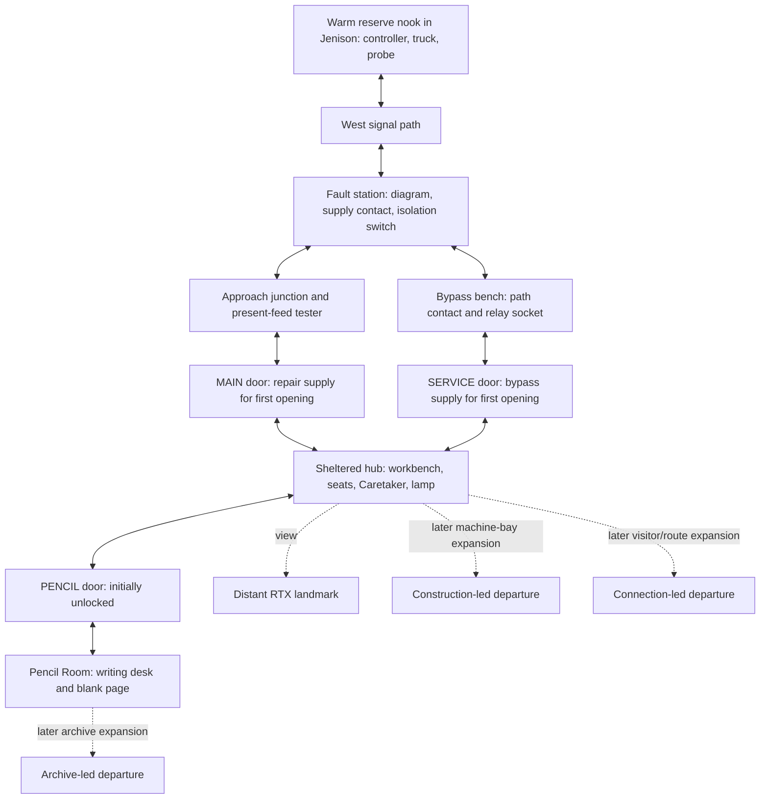
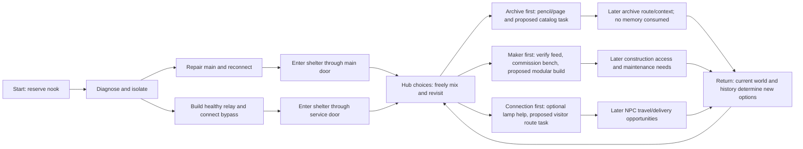

# Sheltered hub and Pencil Room story design

Current planning addendum: the 2026-11-04 room/state specification below maps the existing native Warm Beginning and drafts the five planning deliverables. Earlier rooms and first-hour expansions remain proposals. The reserve nook inside Jenison is distinct from the current sheltered destination; this does not settle the eventual permanent open-world home. No new environment was built by this update.

Status: PROPOSED, planning only. Source basis: selected passages of Echos Within, especially Adam My Brother Always, the pencil passage, remembered shared play and laughter, and the description of home as wherever Mom and Adam lived. All rooms, NPCs, quests, consequences and new dialogue below are fictional adaptation proposals. They do not assert additional biographical events or words spoken by Adam.

## Emotional foundation

Confirmed creator correction: Jenison is the unwanted starting base, an antagonistic place full of enemies who never believed in BS. Jenison itself is not the safe home represented by Adam's memory. The creator selects the negative figures described in Echos Within as the source cast for antagonists. Map each portrayal to the manuscript's account, preserving its names/aliases and distinguishing recalled events from newly invented game behavior.

The sheltered hub is a place BS creates or discovers within that larger journey. Its final location is unresolved: a protected foothold inside Jenison, a refuge beyond its boundary, or a later player-built home. It embodies the creator's remembered feeling of safety with Adam and family. Adam's support remains steady across branches, failed repairs and endings. Player choices change the built world and relationships with fictional inhabitants; they do not change the facts of the creator's life or make support something to earn.

BS begins in unwanted Jenison. A proposed first shelter is a small secured workshop or hidden room, distinct from the hostile district around it; another route can lead to shelter outside Jenison. Warm light, a workbench and places to sit are things BS establishes as safety develops. Furnishing, room shape, paths and machine layout are editable. The Pencil Room's full development follows that established foothold rather than implying Jenison was already home.

## Walkable layout

Arrival vestibule -> shared living space -> pencil worktable -> Pencil Room.
The living space also connects to the machine bay, a sheltered garden/overlook and the Core Sinks service door. A maintenance loop can reconnect the machine bay to the vestibule. Alternative stairs, lifts, tunnels and bridges can change that topology.

| Place | Detail and source connection | Initial interaction | Consequence possibilities |
| --- | --- | --- | --- |
| Arrival vestibule | A threshold into the feeling of home described in the manuscript; no claim to reconstruct a real house | Enter, pause, inspect power, choose which inner door to open | Entry route establishes available sightlines, clues and first NPC contact |
| Shared living space | Remembered shared gaming and laughter; proposed paired seats and an initially dormant game display | Sit, switch on a game, arrange furniture, speak with visitors | Opens play-oriented tasks, visitor conversations and an optional return motif |
| Pencil worktable | The manuscript's pencil as a tool for preserving memories | Pick up pencil, write, sketch a connection, organize a chosen page | Introduces preservation and creation through different first actions |
| Pencil Room | A personal writing/archive room whose layout grows from selected memories | Read, arrange, write captions, create displays, choose what is shared | Produces different archive paths, contextual recall and visitor responses |
| Machine bay | A fictional expression of building things to share and enjoy | Restore power, assemble a machine, reroute capacity | Can power the archive, game display, lift or a visitor's requested device |
| Sheltered garden/overlook | A proposed place for comfortable silence and looking toward what comes next | Rest, plant/build, view routes, invite a visitor | Opens environmental discoveries and different departure paths |
| Service threshold | Connects the safe home base to Core Sinks | Open door, inspect, build an alternate exit, ask for guidance | Changes discovery order, supply access and available encounter approaches |

The sheltered rooms remain a dependable place of return. Hazardous construction can be previewed or isolated in a test bay; deliberate game rules decide how experiments affect surrounding machinery. Ordinary mistakes never secretly revoke the hub's emotional safety.

## Pencil Room in detail

The first view is a modest desk beneath a warm task light, with a pencil, blank paper and one selected piece of writing. Beyond it are empty shelves and movable display surfaces. The room can become intimate, spacious, workshop-like or gallery-like through player construction.

Proposed stations:

- Writing desk: preserve a selected memory in words, sketch a structure or make a private note.
- Memory shelves: arrange chosen writings and objects by relationship, place, theme or the player's own system.
- Shared-play corner: an optional game setup that gives joy and ordinary companionship space in the story.
- Creation wall: turn a sketch into a proposed structure, inspect the design and build it through the existing creation tools.
- Route journal: retain actual journeys, shortcuts and unfinished intentions, distinct from biographical memories.
- Door to the wider archive: opens through several routes, including restoring machinery, finding a writing route or helping a visitor recover a catalog reference.

The pencil has three proposed modes: Record (write/preserve), Trace (understand a connection), and Sketch (propose a build). A chosen memory can inspire a structure without becoming a spendable currency. Source writings remain preserved while displays and fictional interpretations can be rearranged.

Potential personal objects are proposals for selection, not automatic canon: a pencil; a shared-game setup; a red toy-truck motif drawn from a remembered happy moment; a page about Adam believing in his brother; a threshold/home motif. Specific photographs, handwriting, recordings, dates and private passages require deliberate content selection rather than invented substitutes presented as authentic.

## Actions and branching outcomes

The creator can attach configurable rules to every relevant action category: movement/arrival, leaving, looking, inspecting, opening/closing, sitting, speaking, building, modifying, deleting, repairing, connecting, writing and taking a route. Movement rules use zones, crossings, dwell or sequences; individual footsteps need not create permanent branches.

Action -> validated event -> conditions -> state changes -> world/NPC/quest consequences -> Adam's scoped recall.

Every action can be a rule input. Its current configuration may produce an immediate change, a delayed condition, contextual dialogue, a recorded fact or no visible consequence. This supports broad authorship without promising infinitely many individually scripted endings.

Each rule defines stable ID/version, event, subjects/zone, conditions, priority, effects, cooldown, once/repeat policy, relevant history, reversibility and player feedback. Rules can be edited in visual tools, code or AI-assisted authoring through the same project model. Changing a rule during Play creates a declared sandbox revision; publishing it to an existing save needs compatibility handling.

| Action | Example conditions | Proposed consequence | Later consequence |
| --- | --- | --- | --- |
| Open the service door early | Core Sinks still dark | Meet the fictional Courier and find a maintenance clue | Obtain a supply route before restoring the archive |
| Inspect the desk first | Pencil not yet used | Discover the writing path | Archives can become the first major destination |
| Build a generator | Components available and valid placement | Restore one selected consumer circuit | Power priorities influence which visitor arrives and which task becomes available |
| Build a bridge | Reachable endpoints and collision validation | Create an actual alternate route | Courier changes path; Adam recalls this player-built shortcut |
| Close a bypass door | Its pressure/electrical rule is configured | Stabilize one branch while rerouting another | A different access puzzle or ventilation route becomes useful |
| Move a shelf | It is movable and the gap remains navigable | Reveal an optional maintenance panel | Unlock a hidden workspace configuration |
| Talk before repairing | NPC knows the fault's location | Learn a safer repair approach | NPC acknowledges being consulted; new cooperation task |
| Repair before talking | Fault already repaired | NPC recognizes the actual completed work | Follow-up task replaces the obsolete tutorial |
| Leave a task unfinished | No irreversible deadline declared | Record an unfinished intention | NPC offers current alternatives on return, rather than repeating stale instructions |
| Dismantle a machine | World policy permits it | Reclaim parts and remove its supplied capability | Dependent quests pause or reroute with explained recovery options |

Opening a door is not automatically a moral decision. Meaning follows the configured situation and visible consequences. Major irreversible changes are signaled through understandable world feedback. Essential progression has fallback routes so creative rearrangement does not silently strand the story.

## Fictional NPCs and side quests

Every interactable NPC has contextual information, a hint or a side-quest opportunity appropriate to current state. They can remember completed help, react to construction and introduce others. They need not recite a quest every time. An unavailable or completed task produces an honest alternate response.

| Proposed NPC | Place/personality | Hint | Side quest and branches |
| --- | --- | --- | --- |
| The Caretaker | Quiet maintenance inhabitant near the vestibule | Notices a circuit still responding | A Light for the Table: power a lamp by repair, rerouting or a newly built source; the chosen method changes the later maintenance task |
| The Archivist | Patient organizer in the Pencil Room | Explains that a missing index does not mean a page is gone | A Place for This Page: recover or rebuild catalog access, then choose an arrangement; recognition respects private/shared display choices |
| The Courier | Restless route-finder at the service threshold | Knows an alternate supply entrance | The Long Way Home: repair a lift, build a bridge or open a tunnel; NPC travel and future deliveries follow the actual route |
| The Tinkerer | Curious builder in the machine bay | Spots spare capacity or an incompatible part | Something Worth Sharing: assemble a communal machine or adapt an existing one; its purpose shapes later visitors and resource needs |
| The Listener | Unhurried visitor near the garden | Reflects on an observed choice without claiming knowledge of private memories | Leave a Place to Sit: create an accessible place to pause; later conversations vary with the resulting space |

The five supportive NPC roles above are fictional proposals. Antagonists draw from the negative figures in Echos Within under the creator's direction; each requires a source-based character profile before assigning encounters or quest roles. Additional NPCs follow the same hint/task/relationship contract. Adam remains the remembered brother guiding BS across the whole place.

## Adam's guidance and memory

Adam recalls actual actions and relates them to current possibilities. New example game dialogue, not historical quotations:

- At the desk: "We can keep something here. Start with what you want to remember."
- After a player-built shortcut: "You made a way back."
- When a plan changes: "We can use what you learned from that."

Personal characterization follows the creator's memories of familiarity, humor, encouragement and safety. Comfortable silence and shared-play moments remain available. Adam's interpretation distinguishes remembered biography, fictional lore and the current branch's actions.

Keep separate records for world state, action history, NPC knowledge, relationships, quest stages, chosen source memories, and cue delivery. Preserve causal IDs so a new unlock can explain what caused it. Undo, demolition and checkpoint rollback re-evaluate dependent conditions without rewriting biographical facts.

## Outcomes and chapter departures

The hub can become an archive-led refuge, a maker's workshop, a connected meeting place or a mixture. These are descriptive outcomes based on actual builds and choices, not personality judgments or one hidden morality score.

Available departures can include Archives first, Core Sinks first, a construction-led network route, or an NPC-led side expedition. Later returns change room use, visitors and Adam's contextual recall. Paths can reconverge while preserving their different histories.

Longer-term endings use several dimensions: what was preserved, built, connected, shared and left unfinished, along with NPC/quest outcomes and the final player choice. Selective authored ending scenes can combine those facts. No ending changes the real brother's life or treats grief as a task completed by winning.

## Next planning deliverables

1. A room-by-room diagram with editable doors, machine sockets, seats, route zones and NPC anchors.
2. A selected personal-memory list with origin, intended meaning and proposed presentation.
3. A first-hour branch graph showing at least three ways through the hub and their later consequences.
4. A rule/NPC/quest authoring contract with previews explaining affected dependencies and save compatibility.
5. A consistency walkthrough: open/close, build/dismantle, depart/return, help/decline and save/reload each route; verify coherent hints and alternate progression.

All of this is narrative/system planning. No engine implementation, generated voice, SDK installation or source-manuscript edit is included.

## 2026-11-04 addendum: current opening layout and editable design

PLANNING ONLY; source inspected 2026-11-05T03:35:37Z. The creator again selected Continue planning. Companion/room/prop proposals remain subject to the original checkpoints3-8 and opening-first priorities. Read scope: this earlier design, warm_beginning_memory_sources.md, current warm_opening.cpp/.hpp, opening_workshop.cpp/.hpp, first_boot_chapter.cpp, first_boot_content.cpp and the Prop01 parent/technical plans. This is source review, not a new runtime test or a complete memoir review.

### 1. Room and route diagram

This is a logical connectivity diagram, not a scaled plan or proof of physical reachability. MAIN/SERVICE/PENCIL are semantic roles; actual door and fixture UUIDs come from the authored definition and remain stable in its saves. Dotted lines show optional sightlines or later proposals.

Coordinates below are template-local native metres, written(x,z). warm_opening.cpp offsets them by origin=(spawn.x+32,spawn.y-.2,spawn.z+25); they are not universal world positions to paste into an unrelated save. Native+Y is up. Door/component/region anchors inherited from the template must be read from the selected definition rather than guessed.

| Zone | Existing anchor/content basis | Proposed editable knobs | Movement and state constraints |
| --- | --- | --- | --- |
| Nook | Center(-32.5,-26); controller(-34.7,-29); truck(-30.3,-28.8); probe derived from controller | Shell/floor kit, reserve lamp, shelf, controller and keepsake display positions | Stay outside shelter/Pencil objective volumes. Keep a clear west exit, supported return point and Adam spawn/Wait space. Reserve light does not award restoration or shelter. |
| West path | Trace strips around(-37,-20),(-37,-15),(-37,-10); companion nodes every segment | Trace width, edge detail, optional looking zones, component rows | Preserve actual controller/Adam clearance, support and visibility. Prop01 rows cannot narrow the route below tested movement requirements. No per-footstep inference or compulsory memory stop. |
| Fault station | Diagram(-34.4,-7.8); chassis(-33,-1.5); fault/switch from typed template | Diagnostic panel, cap visual, safe work surface, warning light, inspection anchor | Separate cap visuals from fault/switch/socket semantics. Preserve the hazard boundary, targeting rays, visible grounded reach and isolation approach. |
| Bypass approach | Notes/workbench(-43.3,-8); socket from fault component; path contact derived from notes | Relay visual, sockets/cable endpoints, workbench and parts layout | Existing build/connect/disconnect/dismantle actions remain distinct. Show the currently selected relay and a recoverable replacement path. Do not spend a private memory as a construction resource. |
| Entrance junction | Companion main-front(-33,1.9), service-front(-41,1.9); door UUIDs from content | Door trim, route markings, swing clearance, matching graph anchors | Move aperture, collision, companion gate/edges and return corridor as one reviewed layout change. First powered opening latches the door; a later outage does not silently relock it. |
| Sheltered hub | Companion hub(-37,8); seats(-31,8.4)/(-31,10); Caretaker/lamp/bench from content | Seats, repair/upgrade surfaces, NPC interaction anchor, lamp, commission station | Grounded physical arrival earns shelter. Keep NPC interaction and valid return anchors clear. Current seat interaction is a reading pause; an animated sitting system is a later proposal. |
| Pencil threshold/room | Companion front(-37,10.7)/back(-37,15); pencil/page around(-40.3,17) | Desk, shelves, selected displays, optional private writing and route journal | Keep the door and page approach usable after furniture edits. Blank paper, silence, privacy and leaving are valid choices. No compulsory personal disclosure. |
| Horizon | Restored-light landmark around(0,22) and wider board geometry | RTX/CPU/RAM silhouette, trace sightlines, later route seeds | Seeing the landmark is not reaching/unlocking it. Native RTX awakening and later travel need their own actual evidence. |

Use one independent Prop01 placement in a disposable chapter before making a fresh factory branch with a replacement capacitor reference. Existing saved placement reference triples are immutable; replacing those visuals requires explicit new placements/removal of old ones or a fresh branch, not silent retargeting. The detailed coupon/can requires the authored scale, reduced mesh/texture and explicit-proxy work in PROP01_NATIVE_ASSET_SPEC.md. Moving visual scenery alone never rewrites collision or power state.

The current Pencil door starts unlocked. The diagram's hub-to-Pencil link describes physical layout, not a mandatory help/commission/power gate. Actual direct Pencil arrival can also award shelter in the current planner; preserve that behavior unless a separately justified design change is approved and tested.

### 2. Selected memories and presentation

The selected facts below reuse warm_beginning_memory_sources.md and the current authored panel disclosures. XML-P locators are body-paragraph positions in the reviewed structured edition, not printed pages. Keep source attribution, original speech and newly authored game dialogue distinct. No new biography is inferred from a game prop.

| Source locator | Intended meaning | Opening presentation and optional choice |
| --- | --- | --- |
| XML-P682 | Adam helping BS learn to look/turn in games | Controller beside the nook; optional camera guidance. BS may already know the controls and move on. |
| XML-P69 | Happy fragment of a red electric toy truck with Adam | Shelf keepsake and later vehicle inspiration; do not reenact the distress surrounding the passage. |
| XML-P270/P1165 | Reflective imagining of Adam nearby | Two seats and an optional quiet panel; no invented conversation or historical quotation. |
| XML-P946-947 | Protection and making room for someone else | Shelter architecture and optional Caretaker lamp help. Caretaker is a fictional character. |
| XML-P1145 | Making something useful from difficult circumstances | Repair/bypass as mechanical adaptation; neither route is emotionally superior. |
| XML-P332 | Pencil/writing preserving relationships and memories | Blank page and pencil, with reading/writing/privacy/return-later possibilities. No invented last letter. |

Adam's primary face reference remains the selected dark-jacket store photo, with naturalistic face/clothing and subtle glow. Retain the right-wrist Pray for Kids band. Age-labelled references stay labelled. This planning list does not approve likeness or captions, and original family media stays outside ordinary derived-project uploads.

### 3. Branch graph and later consequences

The current opening has TWO designed power routes. Actual alternate physical entry can be recorded by the existing engine, but that is not proof of a third authored access route. The first-hour graph below proposes three activity/departure orders AFTER the hub; it does not add requirements to the8-12minute shelter proof or pretend those later systems exist.

Archive first may change information discovery; Maker first may create physical access; Connection first may establish NPC cooperation. These are future authored consequences to implement/validate, not rewards secretly present now. Record chosen actions and actual built links rather than assigning a permanent personality or affection score. Repairing and then using bypass is a valid mixed history, not an invalid ending. Completing a later route must not rewrite personal source facts or erase another route's recorded work.

Proposed pacing envelope for ordinary first-time shelter arrival: orient/look in nook; follow a readable signal path; inspect/sample; isolate and repair OR build/commission bypass; test the healthy feed; enter/claim shelter workbench. Tune the whole to8-12minutes through user play, not forced waits or padding. Pencil interaction can remain available afterward; the richer20-30minutechapter/first-hour expansion keeps its separate acceptance gates.

### 4. Rule, NPC and quest authoring contract

This table is a PROPOSED authoring contract for future generic rules, extending the existing typed actions and preview model. It is not a claim that all fields have a completed visual editor or that arbitrary scripts are accepted by the runtime.

| Contract group | Required authoring information | Preview and compatibility result |
| --- | --- | --- |
| Identity/scope | Rule/quest/NPC stable ID and version; project/world/content branch; target entity/asset UUIDs | Resolve all referenced objects. Do not substitute a display name for identity or silently transplant another branch's events. |
| Trigger | Supported semantic action, region crossing/dwell or accepted operation; subject; current-state predicates | Show the exact current event/conditions that activate it. An input/attempt, a successful edit and durable save acknowledgment are different triggers. |
| Effects | Current state changes, historical events, power/door/navigation/quest dependencies, cost/reward IDs | List affected consumers, routes, collision, Adam hints and returns. Effects that must agree publish through the existing validated transaction boundary. |
| Repeat/order | Once/repeat, cooldown, priority, duplicate suppression, conflict policy | Explain whether replay/reload repeats anything and why. Nearby live danger outranks optional narrative. Rewards cannot duplicate on retry or return. |
| NPC knowledge | Information/hints known from actual discoveries and supported fictional lore; availability; optional quest stage | Every interactable NPC has useful state-appropriate information or a task opportunity. Finished/declined/unavailable tasks produce an honest response rather than stale instructions. |
| Personal provenance | Source locator and permitted adaptation; authored/sourced/original-recording label; privacy/display choice | Preserve source facts. Do not generate historical speech, infer private knowledge or force publication as a progression cost. |
| Reversal/recovery | Undo/dismantle, loss of supply, departure, alternate route and explicit return/Recall behavior | Distinguish retained achievement/history from current operational capability. Show how BS can recover before accepting an edit that removes access. |
| Saves/migration | Content/schema version, supported readers, old-ID mapping, branch/migration policy and dependency closure | Preserve AIBD1/2 readers, v3 monotonic promotion and companion/light/media bindings. Incompatible semantic changes need explicit migration or new compatible branch; never silently reinterpret old receipts. |

Preview examples: moving a capacitor near a switch highlights selection and route clearance; moving a door highlights both navigation gates and occupied sweep; dismantling the selected relay shows power/lighting/bench changes while retaining unlocked doors and history; editing a panel's text shows its provenance and bounded content impact. A preview is not a successful runtime edit or completed save.

Current authoring constraint: the Warm Workshop uses all32hint-map entries, including workshop.binding. Adding new panels/NPC cues cannot append unbounded keys. Reuse existing content slots when semantically appropriate or propose a versioned bounded content change with compatibility tests. The current validators check local approaches and bidirectional doorway crossings; they do not establish arbitrary global reachability after every edit.

### 5. Consistency walkthrough to execute later

SOURCE-DERIVED EXPECTATIONS ONLY. None of these cases ran during planning. Execute against the final native package, both camera modes and isolated saves, recording actual outcomes and failures.

| Action sequence | Expected logical state | Expected retained history and recovery |
| --- | --- | --- |
| Isolate, repair, reconnect | Main live; hazard inactive | Original damage repaired; door first-opening available. Current planner requires isolation, not prior inspection; inspecting first remains the tutorial sequence unless an explicit future design change adds a gate. |
| Isolate, build, connect relay | Bypass live; main remains isolated and may stay damaged | Construction and selected relay identity retained; service entrance first-opening available. |
| Repair while isolated, then select bypass | Repaired main currently isolated; bypass supplies power | Both repair and bypass histories retained. Adam describes the actual current supply. |
| Open door, lose supply, close/reopen | Previously latched door remains unlocked; occupancy guards apply | A door can provide a return route during an outage. Closing cannot intersect BS; Adam waits at a closed graph gate. |
| Dismantle selected relay, build replacement | Old relay tombstoned; selected old feed may remain recorded but is offline | Disconnect old selection, then connect the new healthy relay, or restore main. Do not invent power because a socket or old identity exists. |
| Depart and return | Current location changes; discovered shelter/Pencil remains discovered | No duplicate discovery reward. Update hints from current supply, lamp and location. Supported, clear return anchors remain. |
| Help or decline lamp, then visit Pencil | Optional quest outcome retained; lamp illumination follows current power | Either choice can continue. Completed help does not mean the lamp is powered forever. |
| Collect probe, sample both contacts, test feed, change source, commission | Stale tested source signature rejects first commissioning | Retest the present healthy supply. Stored samples need not match the final feed; the successful current test is the gate. |
| Commission, lose/restore power | Bench stays claimed; online means claimed plus a healthy current supply | Later switching does not currently require a fresh test merely to regain online status. Do not overwrite ownership with power availability. |
| Wait/Recall, close door, fall and reload | Valid intent/anchor restored; closed gate respected; explicit recovery remains possible | No saved footsteps/bones/animation frames and no fabricated repair/shelter arrival by Adam. |
| Preview/Apply/Undo/Redo/Save/restart | Accepted authored changes and binding versions agree | Preserve immutable dependencies, exact placement IDs/TRS, companion/media and chosen branch. Corruption/failed replacement must retain the prior scene/save. |

Current power predicates: main=capacity100and isolationOFF; bypass=isolationONand connected live relay at100capacity; active arc=damaged and isolationOFF. Their rendered circuits and guidance must agree. Saving is a separate durable acknowledgment; a correct logical effect does not by itself prove restart persistence.

### Planning closeout and remaining goal

This addendum drafts the five earlier requested planning deliverables using current source and selected memory records. It does not complete runtime acceptance or the full game goal. Remaining delivery still includes Prop01 cleanup/native import, currentSDK174 Debug/camera/consumer qualification, packaged normal play, final likeness/captions, human pacing, moving-game performance, launcher delivery and final verified source/art/package backup.

No code, model, real save, release or original family reference was changed. C:257.83GiB/D:86.76GiB observed; E untouched. Back up this updated design document only under the already authorized Workshop planning folder; record the exact uploaded bytes and authenticated restore result in checkpoints/room-state-plan-20261104-drive.json. Parent plan/spec backups remain intact. Documentation freshness must not mark source/content qualification current or green.
