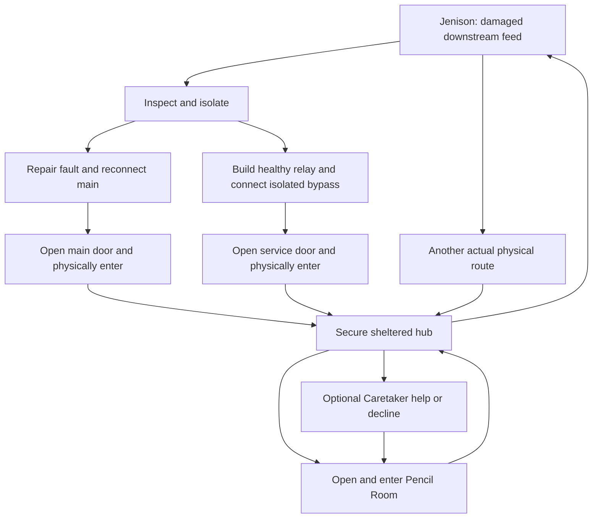

# First Boot chapter — SDK0.8 development

The game-owned `AIBS::FirstBootChapter` module adds the Jenison power-fault route, sheltered workshop and Pencil Room above the generic engine. Its rule/scene/clock and continuous capsule-traversal fixtures pass in Debug and Release. Native process/GPU branch proofs and retained Studio94/SDK0.8 delivery now pass. M3 is complete at this mechanical scope; the complete20–30minutealpha remains unfinished.

The chapter preserves the existing motherboard, CPU, RAM, GPU and power-stage geography. Six new UUID records use four new component types alongside `firstboot.Node` version1:

| Component type | Records and durable state |
| --- | --- |
| Door | Main-feed, service-bypass and Pencil Room doors; open state and persistent unlocked latch. |
| PowerFault | Diagnosed/isolation/capacity, connected bypass and actual relay identity. |
| ChapterProgress | Current region/quest step, secured shelter, Pencil visit, actual route use, departure/return/recovery counts and latest recovery identity. |
| NPCQuest | Fictional Caretaker's optional task, help/decline/completion, lamp connection and presentation anchors. |

Use `first_boot_chapter_schemas()` for the registered definitions and `first_boot_chapter_ids()` for the persistent record identities. Installing availability is one atomic batch: all six records and two true quest-availability outcomes, without inventing discoveries, player actions or historical words from Adam.

## Current authored layout

Positions below are metres relative to the motherboard centre; height is relative to its top. Existing hardware remains intact. The current prototype uses oriented boxes, not final environment art.

| Place | Current anchor | Purpose |
| --- | --- | --- |
| Jenison arrival | approximately x−32, z−25 on the default board | Unwanted start; a supported clear alternative is selected on compatible smaller boards. |
| Downstream fault | x−33, z−3 | Distinct from the older CPU repair; 2×2.5m half-extents define the arc zone. |
| Isolation switch | x−35.5, z−3 | Safe-edge control for isolating or reconnecting the main feed. |
| Relay socket | x−42, z−3 | A real healthy constructed relay provides an independent feed while the fault is isolated. |
| Main door | x−33, z4 | Initial opening requires restored/reconnected main supply. |
| Service door | x−41, z4 | Initial opening requires the isolated healthy relay feed. |
| Sheltered workshop | x−44…−29, z4…20.5 | Secured return and a dependable foothold. |
| Caretaker | x−40, z6.5 | Contextual clues and optional *A Light for the Table*. |
| Table/lamp | x−40, z10 | Connection can use either valid supply. Current illumination follows current power. |
| Pencil Room door | x−37, z13 | A usable internal door; the side quest is optional. |
| Writing desk | x−40, z17 | An ordinary pencil and blank page, informed by selected memoir meanings. |

The three doors and fixed room shell are an authored M3 template. Repositioning rooms, defining more doors, editing sockets/seats/routes and publishing compatible content revisions belong to the M4 creator and later building work. Current gameplay exposes real door state and construction dependencies; it does not claim that every template attribute is already editable in a graphical creator.

Opening a door is different from using its route. Classification uses the grounded body segment through its actual aperture. Entering by another physical route records an alternative, without claiming a repair or bypass. Merely looking around in inspection mode does not discover regions or finish quests.

## Power, recovery and choices

Repairing the downstream fault requires isolation. Repair sets its own capacity to100; it does not silently reconnect the feed or rewrite the older CPU's capacity/history. Reconnection is a separate mechanism action. Bypass supply depends on isolation, a recorded connection, and the actual referenced relay remaining alive and healthy at the socket.

An opened supply door retains its unlocked latch. Removing the relay changes current power, while the latched door remains usable. Lamp completion remains a historical fact after supply loss; its light reflects current supply. Declining help retains clues and does not block the Pencil Room. Later help and departure/return can change the current quest step while preserving completed milestones and earlier events.

The independent active-play clock uses60Hz ticks with bounded eight-step catch-up. A newly active damaged feed starts90 warning ticks, then30 arc ticks and120 cooldown ticks. Focus/inspection pause clears catch-up instead of advancing danger off-screen. Visual warning/arc meshes are transient; waiting never writes a save event per frame.

A real contact produces one atomic recovery outcome and durable count/activation-cycle identity. World changes remain in place; the safe return does not rewind repairs, construction or quests. The owner acknowledges a contact only after authoritative publication. Pending critical intent must retain actual body/clock evidence under backpressure, pause movement/time as required, and be discarded if its activation is no longer current. Native exact operation identity should be stable for that activation/cycle.

`FirstBootChapterActor` is trusted evidence supplied by the authoritative player controller and clock. An AI proposal or SDK request cannot supply an ancient or fabricated body/sample as proof. The rule callback must capture current owner evidence. This is a C++ authority contract, not a security sandbox.

## Save and publication contract

For a selected old Node-only world, run the footprint/topology preflight before an explicit additive registry extension. Unsupported layouts remain usable in the earlier construction-yard mode. Preflight rejects incompatible protected hardware, including tall intrusive traces; genuinely thin board traces remain compatible. Installation also rejects reusing imported retired UUIDs.

The ordinary prepared-world path then validates rules, stages the candidate scene/collision and reserves saving before publication. Occupied door closure rejects, and construction must retain a supported clear return. Only actual ordered storage completion establishes Saved and durable Adam recall. Current guidance can describe visible state; it must not call a pending action a committed memory.

SQL-format and semantic-wire compatibility follow [GAMEPLAY_CONTRACT](GAMEPLAY_CONTRACT.md). A registry extension does not fabricate gameplay revisions. Quest/mechanism outcomes use their explicit new family versions; node-only construction still uses the original outcomes. Old modes and original `.aibs` saves remain separate.

## Personal foundation and verification limits

Adam remains Brett's remembered brother and safe person. The selected [memoir source locators](../docs/game_engine/first_boot_memory_sources.md) distinguish actual source meaning from newly authored rooms and dialogue. The Caretaker is fictional. Personal memories are optional, without an affection score or progression cost; support remains steady after failure, declined help or a bypass.

`tests/first_boot_chapter_tests.cpp` covers nine suites: installation/projection, repair and optional choices, physical route evidence and door safety, actual bypass storage/restart, actual repair storage/restart, fixed-tick hazard/truth validation, body-based Node reach authority, pre-migration full-candidate staging, and current-state hint priority. It includes small/shifted boards, protected geometry, imported identities, real worker commits, exact recovery retry and reopened consequences. These module fixtures alone do not prove native input, continuous player traversal, GPU/HUD behavior, packaged deployment, voice/audio or the final RTX awakening. Consult BUILD_STATUS and the actual later native/traversal reports for those claims.

The independent `tests/first_boot_chapter_traversal_tests.cpp` uses actual PlayerController/Jolt movement without mid-route reset/teleport: closed panels stop BS, then repair→hub→Pencil→exit/return takes1,141 ticks, and bypass→relay dismantle→unpowered service return takes812 ticks. Grounded height variation verifies board-detail stepping. The real Win32 status-panel test separately checks measured text and crosshair layout across desktop window resizes. These do not replace the native saved-process branch proof.

Retained native delivery: Studio5.329.94, both canonical34-test configurations and installed consumers, packaged36-process chapter plus23-process M2 regression. Actual intermediate HUD checks prove healthy service-door direction, offline-feed recovery after Pencil completion, and nearby live-fault warning priority. See BUILD_STATUS and m3_acceptance_audit.md for exact evidence and limits.
