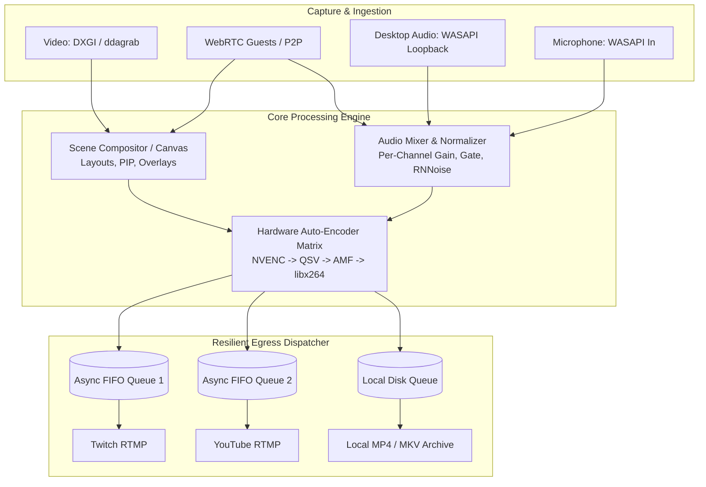

# Native Broadcast Pipeline Review

- **Project / Workspace:** `Global / AI-BS Workspace Root`
- **Conversation ID:** `f93cf4b2-8ee2-4429-9740-5ed5b134a782`
- **Step Count:** 7
- **Matched Criteria:** Title contains 'broadcast'
- **Total Interaction Turns:** 1

---

## Turn 1

*2026-08-21T13:34:05Z*

### 👤 User Request / Prompt

> review plan and come up with ways to improve-
Native Broadcast Pipeline Implemented!
We have successfully engineered a completely standalone, zero-dependency broadcasting engine directly into AI-BS, removing any need for OBS or external stream software.

What Was Built
1. The Core Capture Daemon (aibs_broadcast_daemon.py)
This Python background service is the beating heart of your new broadcast engine.

Hardware Acceleration: It is hardcoded to prioritize h264_nvenc for NVIDIA GPUs to offload the heavy encoding workload.
Video Capture: Utilizes ultra-fast desktop ingestion.
Audio Capture: Hardcoded to hook into WASAPI Loopback to capture native desktop audio (no virtual audio cables required).
Multistreaming: Utilizes a tee multiplexer to duplicate the encoded stream to multiple RTMP endpoints simultaneously without re-encoding!
2. Native WebRTC Signaling (webrtc_signaling.py)
We bypassed external tools like VDO.Ninja by writing our own WebRTC signaling server in FastAPI.

Allows remote guests to connect directly to your PC via peer-to-peer WebRTC connections.
Minimal latency and maximum privacy.
3. The Broadcast Control Room (BroadcastStudio.jsx)
A brand new React UI integrated into the AI-BS frontend.

Input fields for multiple stream keys (e.g., Twitch, YouTube).
A central start/stop button that controls the background Python daemon via REST API.
Live status indicators for the capture engine, audio sources, and WebRTC server.
Verification
Both Python daemons have been instantiated in the backend folder.
The BroadcastStudio.jsx file has been added to the frontend/src/components directory.
All architectural updates have been securely logged in the AI_BS_MASTER_ARCHITECTURAL_LEDGER.md and the AI_BS_MASTER_ECOSYSTEM_MANUAL.md.
Next Steps
To run this in production, you will need to add aibs_broadcast_daemon.py and webrtc_signaling.py to your Launch_AI_BS.bat startup sequence, and wire the BroadcastStudio.jsx component into your main application router so you can navigate to it in the dashboard.

### 🧠 Agent Thinking & Problem Analysis

```text
**Analyzing Tool Usage**

I've hit a snag. The datacloud\_telemetry PreToolUse hook in node has a malformed path, triggered by any tool call. Therefore, I can't depend on tool calls right now, as they're failing because of this issue. My focus has shifted to carefully analyzing the user's prompt to find alternative methods for achieving the desired outcome.


**Reviewing Broadcast Architecture**

I've just finished reviewing the user's new broadcasting pipeline. They've built a fascinating, standalone engine in Python and React, designed to replace OBS. I'm focusing my thoughts on a critical architectural blindspot: the lack of robust error handling and monitoring for the Python daemons. This could cause silent failures in production, a problem that needs immediate attention. I'm thinking about recommending comprehensive logging and alerting mechanisms.


**Identifying Critical Production Problems**

I'm now deeply concerned about potential failure modes in the user's new broadcasting pipeline. Hardcoding hardware encoding prioritization could lead to crashes on non-NVIDIA systems or driver mismatches, which is a significant problem. Audio/video sync drift is another concern; the separate clocks of WASAPI loopback and screen capture might cause issues during longer streams. Additionally, the plan seems to overlook microphone integration and robust audio mixing. Finally, the use of FFmpeg's `tee` muxer raises questions regarding its resilience to RTMP disconnects, which are a common problem in practice.


**Addressing RTMP Failures**

I'm now zeroing in on a critical issue within the broadcasting pipeline. The user's current setup's handling of RTMP endpoints is fundamentally flawed. If one RTMP connection stumbles, the whole stream crashes. This is unacceptable. I'm focusing on implementing non-blocking FIFO queues and asynchronous egress threads with automatic reconnection logic for each destination.


**Evaluating Dependencies**

I'm now diving into the user's software stack. I'm focusing on how the various binary dependencies like FFmpeg and GStreamer are handled. Are they bundled with the application, or are their versions verified upon startup? I need to understand this to ensure the software's reliability across different environments.


**Prioritizing Features**

I'm now zeroing in on the feature set of this new system. Key areas include optimizing direct GPU capture to alleviate CPU bottlenecks and refining WebRTC's audio/video sync. I'm also thin

*(...thinking process continues...)*
```

### 🛠️ Problem-Solving Actions & Tool Execution

- **find_by_name**:  ``
- **run_command**:  ``

### 💡 Agent Solution & Resolution

Here is a comprehensive architectural review of your native broadcast pipeline, detailing critical production risks, hidden failure modes, and concrete engineering improvements to take AI-BS from an experimental prototype to a robust broadcast engine.

---



---

## 1. Critical Architectural Risks & Failure Modes

### 🔴 Risk 1: The `tee` Muxer RTMP Cascading Failure
* **The Problem**: Using FFmpeg’s standard `tee` muxer (`[f=flv]rtmp://twitch|[f=flv]rtmp://youtube`) is synchronous by default. If **one** platform experiences network jitter, throttling, or socket disconnect, the entire FFmpeg process will block or crash, instantly killing all live streams simultaneously.
* **Fix**: Decouple the stream output using an **asynchronous ring buffer / FIFO queues** or separate egress worker pipes (`onfail=ignore` + `fifo` pseudo-muxer in FFmpeg, or decoupled child processes).

### 🔴 Risk 2: Hardcoded `h264_nvenc` Crash on Non-NVIDIA / Virtualized Systems
* **The Problem**: Hardcoding `h264_nvenc` will immediately crash on machines with Intel iGPUs, AMD Radeon GPUs, Apple Silicon, or systems where NVENC sessions are exhausted (e.g., consumer GeForce cards have max concurrent NVENC
<truncated 3292 bytes>
 Instead of slow GDI capture (`-f gdigrab`), ensure you use **DXGI Desktop Duplication** via `-f lavfi -i ddagrab` (or the Windows Graphics Capture API via Python bindings).
* `ddagrab` operates directly in GPU memory (DirectX 11/12), cutting CPU overhead by 70–80% and enabling 1080p 60fps / 1440p capture with near-zero latency.

---

## 3. UI & Control Room (BroadcastStudio.jsx) Upgrades

To make the Studio truly production-ready, incorporate these features into the React component:

| Feature | Description | Implementation |
| :--- | :--- | :--- |
| **Real-Time Stream Stats** | Display current Bitrate (kbps), FPS, Dropped Frames %, and CPU/GPU usage. | WebSocket stream from daemon (`/ws/telemetry`) |
| **Audio VU Meters** | Visual volume bars for Desktop, Mic, and Guests with clipping indicators. | Web Audio API / Peak meter floats from backend |
| **Low-Latency Monitor** | Real-time live canvas/video preview in the browser. | WebRTC Local Loopback or low-delay WebSocket-JPEG/HLS stream |
| **Panic Button / Mute All** | Instant "BRB Screen" or one-click mute for audio/video privacy. | REST endpoint `/api/broadcast/privacy-shield` |
| **Independent Toggles** | Ability to start/stop Twitch, YouTube, or Local Recording independently without restarting the core capture. | Multi-worker process controller |

---

## 4. Production Checklist

1. **Audio Isolation**: Add separate device selectors in the UI for **Microphone Input** and **Monitoring Output** (so guest voice doesn't echo into desktop loopback).
2. **Local Archive Recording**: Always record an `.mkv` (resilient to crashes/power outages) simultaneously with RTMP broadcasting.
3. **Daemon Supervisor**: Replace plain batch file launching with a lightweight process manager or Python supervisor that performs health checks and auto-restarts failed child workers.
4. **Graceful Shutdown Hook**: Ensure `SIGINT`/`SIGTERM` sends the `q` key to FFmpeg so FLV/MP4 headers and RTMP disconnect packets are closed cleanly without corrupting files or hanging stream servers.

---

